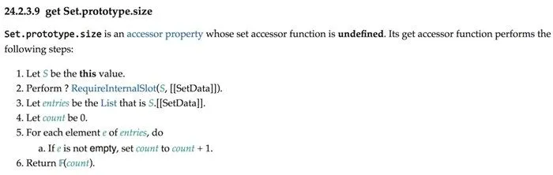

# 第5章非原始值的响应式方案(3)

## 5.8　代理 Set 和 Map

```
从本节开始，我们将介绍集合类型数据的响应式方案。集合类型包括 Map/Set 以及
WeakMap/WeakSet。使用 Proxy 代理集合类型的数据不同于代理普通对象，因为集合类型
数据的操作与普通对象存在很大的不同。下面总结了 Set 和 Map 这两个数据类型的原型属性
```

和方法。

```sql
Set 类型的原型属性和方法如下。
size：返回集合中元素的数量。
add(value)：向集合中添加给定的值。
clear()：清空集合。
delete(value)：从集合中删除给定的值。
has(value)：判断集合中是否存在给定的值。
keys()：返回一个迭代器对象。可用于 for...of 循环，迭代器对象产生的值为集合中
```

- 的元素值。

```sql
values()：对于 Set 集合类型来说，keys() 与 values() 等价。
entries()：返回一个迭代器对象。迭代过程中为集合中的每一个元素产生一个数组值
[value, value]。
forEach(callback[, thisArg])：forEach 函数会遍历集合中的所有元素，并对每
一个元素调用 callback 函数。forEach 函数接收可选的第二个参数 thisArg，用于指
定 callback 函数执行时的 this 值。
Map 类型的原型属性和方法如下。
size：返回 Map 数据中的键值对数量。
clear()：清空 Map。
delete(key)：删除指定 key 的键值对。
has(key)：判断 Map 中是否存在指定 key 的键值对。
get(key)：读取指定 key 对应的值。
set(key, value)：为 Map 设置新的键值对。
keys()：返回一个迭代器对象。迭代过程中会产生键值对的 key 值。
values()：返回一个迭代器对象。迭代过程中会产生键值对的 value 值。
entries()：返回一个迭代器对象。迭代过程中会产生由 [key, value] 组成的数组
```

- 值。

```
forEach(callback[, thisArg])：forEach 函数会遍历 Map 数据的所有键值对，并
对每一个键值对调用 callback 函数。forEach 函数接收可选的第二个参数 thisArg，
用于指定 callback 函数执行时的 this 值。
观察上述列表可以发现，Map 和 Set 这两个数据类型的操作方法相似。它们之间最大的不同
体现在，Set 类型使用 add(value) 方法添加元素，而 Map 类型使用 set(key, value)
方法设置键值对，并且 Map 类型可以使用 get(key) 方法读取相应的值。既然两者如此相
```

似，那么是不是意味着我们可以用相同的处理办法来实现对它们的代理呢？没错，接下来，我

```
们就深入探讨如何实现对 Set 和 Map 类型数据的代理。
```

### 5.8.1　如何代理 Set 和 Map

```
前文讲到，Set 和 Map 类型的数据有特定的属性和方法用来操作自身。这一点与普通对象不
```

同，如下面的代码所示：

```xml
// 普通对象的读取和设置操作
const obj = { foo: 1 }
obj.foo // 读取属性
obj.foo = 2 // 设置属性
// 用 get/set 方法操作 Map 数据
const map = new Map()
map.set(‘key’, 1) // 设置数据
map.get(‘key’) // 读取数据
正是因为这些差异的存在，我们不能像代理普通对象那样代理 Set 和 Map 类型的数据。但整
体思路不变，即当读取操作发生时，应该调用 track 函数建立响应联系；当设置操作发生
时，应该调用 trigger 函数触发响应，例如：
const proxy = reactive(new Map([['key', 1]]))
<p>effect(() => {
console.log(proxy.get(‘key’)) // 读取键为 key 的值
})</p>
proxy.set(‘key’, 2) // 修改键为 key 的值，应该触发响应
```

当然，这段代码展示的效果是我们最终要实现的目标。但在动手实现之前，我们有必要先了解

```
关于使用 Proxy 代理 Set 或 Map 类型数据的注意事项。
```

先来看一段代码，如下：

```javascript
const s = new Set([1, 2, 3])
const p = new Proxy(s, {})
console.log(p.size) // 报错 TypeError: Method get Set.prototype.size called on inc
在这段代码中，我们首先定义了一个 Set 类型的数据 s，接着为它创建一个代理对象 p。由
于代理的目标对象是 Set 类型，因此我们可以通过读取它的 p.size 属性获取元素的数量。
但不幸的是，我们得到了一个错误。错误信息的大意是“在不兼容的 receiver 上调用了 get
Set.prototype.size 方法”。由此我们大概能猜到，size 属性应该是一个访问器属性，
```

所以它作为方法被调用了。通过查阅规范可以证实这一点，如图 5-11 所示。



```
图 5-11　Set.prototype.size 属性的定义
```

图 5-11 所描述的内容如下。

```
Set.prototype.size 是一个访问器属性，它的 set 访问器函数是 undefined，它的
get 访问器函数会执行以下步骤。
1. 让 S 的值为 this。
2. 执行 ? RequireInternalSlot(S, [[SetData]])。
3. 让 entries 的值为 List，即 S.[[SetData]]。
4. 让 count 的 值为 0。
5. 对于 entries 中 的每个元素 e，执行：
a. 如果 e 不是空的，则将 count 设置为 count + 1。
6. 返回 (count)</img img src="https:>。
由此可知，Set.prototype.size 是一个访问器属性。这里的关键点在第 1 步和第 2 步。
根据第 1 步的描述：让 S 的值为 this。这里的 this 是谁呢？由于我们是通过代理对象 p
来访问 size 属性的，所以 this 就是代理对象 p。接着在第 2 步中，调用抽象方法
RequireInternalSlot(S, [[SetData]]) 来检查 S 是否存在内部槽 [[SetData]]。
很显然，代理对象 S 不存在 [[SetData]] 这个内部槽，于是会抛出一个错误，也就是前面
```

例子中得到的错误。

```
为了修复这个问题，我们需要修正访问器属性的 getter 函数执行时的 this 指向，如下面
```

的代码所示：

```javascript
const s = new Set([1, 2, 3])
const p = new Proxy(s, {
    get(target, key, receiver) {
      if (key === 'size') {
        // 如果读取的是 size 属性
        // 通过指定第三个参数 receiver 为原始对象 target 从而修复问题
        return Reflect.get(target, key, target)
      }
      // 读取其他属性的默认行为
      return Reflect.get(target, key, receiver)
    }
})
console.log(s.size) // 3
```

```sql
在上面这段代码中，我们在创建代理对象时增加了 get 拦截函数。然后检查读取的属性名称
是不是 size，如果是，则在调用 Reflect.get 函数时指定第三个参数为原始 Set 对象，
这样访问器属性 size 的 getter 函数在执行时，其 this 指向的就是原始 Set 对象而非代
理对象了。由于原始 Set 对象上存在 [[SetData]] 内部槽，因此程序得以正确运行。
接着，我们再来尝试从 Set 中删除数据，如下面的代码所示：
const s = new Set([1, 2, 3])
const p = new Proxy(s, {
    get(target, key, receiver) {
      if (key === 'size') {
        return Reflect.get(target, key, target)
      }
      // 读取其他属性的默认行为
      return Reflect.get(target, key, receiver)
    }
  }
)
// 调用 delete 方法删除值为 1 的元素
// 会得到错误 TypeError: Method Set.prototype.delete called on incompatible receive
p.delete(1)
可以看到，调用 p.delete 方法时会得到一个错误，这个错误与前文讲解的访问 p.size 属
性时发生的错误非常相似。为了搞清楚问题的原因，我们需要详细分析当调用 p.delete(1)
```

方法时都发生了什么。

```sql
实际上，访问 p.size 与访问 p.delete 是不同的。这是因为 size 是属性，是一个访问器
属性，而 delete 是一个方法。当访问 p.size 时，访问器属性的 getter 函数会立即执
行，此时我们可以通过修改 receiver 来改变 getter 函数的 this 的指向。而当访问
p.delete 时，delete 方法并没有执行，真正使其执行的语句是 p.delete(1) 这句函数
调用。因此，无论怎么修改 receiver，delete 方法执行时的 this 都会指向代理对象
p，而不会指向原始 Set 对象。想要修复这个问题也不难，只需要把 delete 方法与原始数
```

据对象绑定即可，如以下代码所示：

```sql
const s = new Set([1, 2, 3])
const p = new Proxy(s, {
    get(target, key, receiver) {
      if (key === 'size') {
        return Reflect.get(target, key, target)
      }
      // 将方法与原始数据对象 target 绑定后返回
      return target[key].bind(target)
    }
  }
)
// 调用 delete 方法删除值为 1 的元素，正确执行
p.delete(1)
在上面这段代码中，我们使用 target[key].bind(target) 代替了
Reflect.get(target, key, receiver)。可以看到，我们使用 bind 函数将用于操作
数据的方法与原始数据对象 target 做了绑定。这样当 p.delete(1) 语句执行时，
delete 函数的 this 总是指向原始数据对象而非代理对象，于是代码能够正确执行。
最后，为了后续讲解方便以及代码的可扩展性，我们将 new Proxy 也封装到前文介绍的
createReactive 函数中：
const reactiveMap = new Map()
// reactive 函数与之前相比没有变化
function reactive(obj) {
<p>const existionProxy = reactiveMap.get(obj)
if (existionProxy) return existionProxy
const proxy = createReactive(obj)</p>
<p>reactiveMap.set(obj, proxy)</p>
<p>return proxy
}
// 在 createReactive 里封装用于代理 Set/Map 类型数据的逻辑
function createReactive(obj, isShallow = false, isReadonly = false) {
return new Proxy(obj, {
get(target, key, receiver) {
if (key === ‘size’) {
return Reflect.get(target, key, target)
}</p>
<pre><code>   return target[key].bind(target)
}
</code></pre>   return target[key].bind(target)
}
})
}
```

这样，我们就可以很简单地创建代理数据了：

```javascript
const p = reactive(new Set([1, 2, 3]))
console.log(p.size) // 3
```

### 5.8.2　建立响应联系

```
了解了为 Set 和 Map 类型数据创建代理时的注意事项之后，我们就可以着手实现 Set 类型
```

数据的响应式方案了。其实思路并不复杂，以下面的代码为例：

```javascript
const p = reactive(new Set([1, 2, 3]))
effect(() => {
// 在副作用函数内访问 size 属性
console.log(p.size)
})
// 添加值为 1 的元素，应该触发响应
p.add(1)
这段代码展示了响应式 Set 类型数据的工作方式。首先，在副作用函数内访问了 p.size 属
性；接着，调用 p.add 函数向集合中添加数据。由于这个行为会间接改变集合的 size 属性
值，所以我们期望副作用函数会重新执行。为了实现这个目标，我们需要在访问 size 属性时
调用 track 函数进行依赖追踪，然后在 add 方法执行时调用 trigger 函数触发响应。下面
```

的代码展示了如何进行依赖追踪：

```xml
function createReactive(obj, isShallow = false, isReadonly = false) {
  return new Proxy(obj, {
    get(target, key, receiver) {
      if (key === 'size') {
        // 调用 track 函数建立响应联系
        track(target, ITERATE_KEY)
        return Reflect.get(target, key, target)
      }
<pre><code>   return target[key].bind(target)
}
</code></pre>   return target[key].bind(target)
}
})
}
```

```
可以看到，当读取 size 属性时，只需要调用 track 函数建立响应联系即可。这里需要注意
的是，响应联系需要建立在 ITERATE_KEY 与副作用函数之间，这是因为任何新增、删除操
作都会影响 size 属性。接着，我们来看如何触发响应。当调用 add 方法向集合中添加新元
素时，应该怎么触发响应呢？很显然，这需要我们实现一个自定义的 add 方法才行，如以下
```

代码所示：

```javascript
// 定义一个对象，将自定义的 add 方法定义到该对象下
const mutableInstrumentations = {
  add(key) {/* ... */}
}
function createReactive(obj, isShallow = false, isReadonly = false) {
return new Proxy(obj, {
get(target, key, receiver) {
// 如果读取的是 raw 属性，则返回原始数据对象 target
if (key === ‘raw’) return target
if (key === ‘size’) {
track(target, ITERATE_KEY)
return Reflect.get(target, key, target)
}
// 返回定义在 mutableInstrumentations 对象下的方法
return mutableInstrumentations[key]
}
})
}
```

```javascript
首先，定义一个对象 mutableInstrumentations，我们会将所有自定义实现的方法都定
义到该对象下，例如 mutableInstrumentations.add 方法。然后，在 get 拦截函数内
返回定义在 mutableInstrumentations 对象中的方法。这样，当通过 p.add 获取方法
时，得到的就是我们自定义的 mutableInstrumentations.add 方法了。有了自定义实现
的方法后，就可以在其中调用 trigger 函数触发响应了：
// 定义一个对象，将自定义的 add 方法定义到该对象下
const mutableInstrumentations = {
  add(key) {
    // this 仍然指向的是代理对象，通过 raw 属性获取原始数据对象
    const target = this.raw
    // 通过原始数据对象执行 add 方法添加具体的值，
    // 注意，这里不再需要 .bind 了，因为是直接通过 target 调用并执行的
    const res = target.add(key)
    // 调用 trigger 函数触发响应，并指定操作类型为 ADD
    trigger(target, key, 'ADD')
    // 返回操作结果
    return res
  }
}
如上面的代码所示，自定义的 add 函数内的 this 仍然指向代理对象，所以需要通过
this.raw 获取原始数据对象。有了原始数据对象后，就可以通过它调用 target.add 方
法，这样就不再需要 .bind 绑定了。待添加操作完成后，调用 trigger 函数触发响应。需
要注意的是，我们指定了操作类型为 ADD，这一点很重要。还记得 trigger 函数的实现吗？
```

我们来回顾一下，如下面的代码片段所示：

```sql
function trigger(target, key, type, newVal) {
  const depsMap = bucket.get(target)
  if (!depsMap) return
  const effects = depsMap.get(key)
<p>// 省略无关内容</p>
<p>// 当操作类型 type 为 ADD 时，会取出与 ITERATE_KEY 相关联的副作用函数并执行
if (type === ‘ADD’ || type === ‘DELETE’) {
const iterateEffects = depsMap.get(ITERATE_KEY)
iterateEffects && iterateEffects.forEach(effectFn => {
if (effectFn !== activeEffect) {
effectsToRun.add(effectFn)
}
})
}</p>
effectsToRun.forEach(effectFn => {
if (effectFn.options.scheduler) {
effectFn.options.scheduler(effectFn)
} else {
effectFn()
}
})
}
当操作类型是 ADD 或 DELETE 时，会取出与 ITERATE_KEY 相关联的副作用函数并执行，这
样就可以触发通过访问 size 属性所收集的副作用函数来执行了。
当然，如果调用 add 方法添加的元素已经存在于 Set 集合中了，就不再需要触发响应了，这
```

样做对性能更加友好，因此，我们可以对代码做如下优化：

```javascript
const mutableInstrumentations = {
  add(key) {
    const target = this.raw
    // 先判断值是否已经存在
    const hadKey = target.has(key)
    // 只有在值不存在的情况下，才需要触发响应
    const res = target.add(key)
    if (!hadKey) {
      trigger(target, key, 'ADD')
    }
    return res
  }
}
在上面这段代码中，我们先调用 target.has 方法判断值是否已经存在，只有在值不存在的
```

情况下才需要触发响应。

```sql
在此基础上，我们可以按照类似的思路轻松地实现 delete 方法：
const mutableInstrumentations = {
  delete(key) {
    const target = this.raw
    const hadKey = target.has(key)
    const res = target.delete(key)
    // 当要删除的元素确实存在时，才触发响应
    if (hadKey) {
      trigger(target, key, 'DELETE')
    }
    return res
  }
}
如上面的代码所示，与 add 方法的区别在于，delete 方法只有在要删除的元素确实在集合
中存在时，才需要触发响应，这一点恰好与 add 方法相反。
```

### 5.8.3　避免污染原始数据

```
本节中我们借助 Map 类型数据的 set 和 get 这两个方法来讲解什么是“避免污染原始数据”及
```

其原因。

```
Map 数据类型拥有 get 和 set 这两个方法，当调用 get 方法读取数据时，需要调用 track
函数追踪依赖建立响应联系；当调用 set 方法设置数据时，需要调用 trigger 方法触发响
```

应。如下面的代码所示：

```sql
const p = reactive(new Map([['key', 1]]))
<p>effect(() => {
console.log(p.get(‘key’))
})</p>
p.set(‘key’, 2) // 触发响应
其实想要实现上面这段代码所展示的功能并不难，因为我们已经有了实现 add、delete 等
方法的经验。下面是 get 方法的具体实现：
```

```javascript
const mutableInstrumentations = {
  get(key) {
    // 获取原始对象
    const target = this.raw
    // 判断读取的 key 是否存在
    const had = target.has(key)
    // 追踪依赖，建立响应联系
    track(target, key)
   // 如果存在，则返回结果。这里要注意的是，如果得到的结果 res 仍然是可代理的数据，
   // 则要返回使用 reactive 包装后的响应式数据
    if (had) {
      const res = target.get(key)
      return typeof res === 'object' ? reactive(res) : res
    }
  }
}
```

如上面的代码及注释所示，整体思路非常清晰。这里有一点需要注意，在非浅响应的情况下，

```
如果得到的数据仍然可以被代理，那么要调用 reactive(res) 将数据转换成响应式数据后
```

返回。在浅响应模式下，就不需要这一步了。由于前文讲解过如何实现浅响应，因此这里不再详细讨论。

```
接着，我们来讨论 set 方法的实现。简单来说，当 set 方法被调用时，需要调用 trigger
方法触发响应。只不过在触发响应的时候，需要区分操作的类型是 SET 还是 ADD，如下面的
```

代码所示：

```bash
const mutableInstrumentations = {
  set(key, value) {
    const target = this.raw
    const had = target.has(key)
    // 获取旧值
    const oldValue = target.get(key)
    // 设置新值
    target.set(key, value)
    // 如果不存在，则说明是 ADD 类型的操作，意味着新增
    if (!had) {
      trigger(target, key, 'ADD')
    } else if (oldValue !== value || (oldValue === oldValue && value === value))
      // 如果不存在，并且值变了，则是 SET 类型的操作，意味着修改
      trigger(target, key, 'SET')
    }
  }
}
这段代码的关键点在于，我们需要判断设置的 key 是否存在，以便区分不同的操作类型。我
们知道，对于 SET 类型和 ADD 类型的操作来说，它们最终触发的副作用函数是不同的。因为
ADD 类型的操作会对数据的 size 属性产生影响，所以任何依赖 size 属性的副作用函数都
需要在 ADD 类型的操作发生时重新执行。
上面给出的 set 函数的实现能够正常工作，但它仍然存在问题，即 set 方法会污染原始数
```

据。这是什么意思呢？来看下面的代码：

```javascript
// 原始 Map 对象 m
const m = new Map()
// p1 是 m 的代理对象
const p1 = reactive(m)
// p2 是另外一个代理对象
const p2 = reactive(new Map())
// 为 p1 设置一个键值对，值是代理对象 p2
p1.set('p2', p2)
effect(() => {
// 注意，这里我们通过原始数据 m 访问 p2
console.log(m.get(‘p2’).size)
})
// 注意，这里我们通过原始数据 m 为 p2 设置一个键值对 foo --> 1
m.get(‘p2’).set(‘foo’, 1)
```

```
在这段代码中，我们首先创建了一个原始 Map 对象 m，p1 是对象 m 的代理对象，接着创建
另外一个代理对象 p2，并将其作为值设置给 p1，即 p1.set('p2', p2)。接下来问题出
现了，在副作用函数中，我们通过原始数据 m 来读取数据值，然后又通过原始数据 m 设置数
```

据值，此时发现副作用函数重新执行了。这其实不是我们所期望的行为，因为原始数据不应该具有响应式数据的能力，否则就意味着用户既可以操作原始数据，又能够操作响应式数据，这样一来代码就乱套了。

```bash
那么，导致问题的原因是什么呢？其实很简单，观察我们前面实现的 set 方法：
const mutableInstrumentations = {
  set(key, value) {
    const target = this.raw
    const had = target.has(key)
    const oldValue = target.get(key)
    // 我们把 value 原封不动地设置到原始数据上
    target.set(key, value)
    if (!had) {
      trigger(target, key, 'ADD')
    } else if (oldValue !== value || (oldValue === oldValue && value === value))
      trigger(target, key, 'SET')
    }
  }
}
在 set 方法内，我们把 value 原样设置到了原始数据 target 上。如果 value 是响应式数
```

据，就意味着设置到原始对象上的也是响应式数据，我们把响应式数据设置到原始数据上的行为称为数据污染。

```bash
要解决数据污染也不难，只需要在调用 target.set 函数设置值之前对值进行检查即可：只
要发现即将要设置的值是响应式数据，那么就通过 raw 属性获取原始数据，再把原始数据设
置到 target 上，如下面的代码所示：
const mutableInstrumentations = {
  set(key, value) {
    const target = this.raw
    const had = target.has(key)
<pre><code> const oldValue = target.get(key)
// 获取原始数据，由于 value 本身可能已经是原始数据，所以此时 value.raw 不存在，则直接使用 v
const rawValue = value.raw || value
target.set(key, rawValue)
if (!had) {
  trigger(target, key, 'ADD')
} else if (oldValue !== value || (oldValue === oldValue &amp;&amp; value === val
  trigger(target, key, 'SET')
}
</code></pre> const oldValue = target.get(key)
// 获取原始数据，由于 value 本身可能已经是原始数据，所以此时 value.raw 不存在，则直接使用 v
const rawValue = value.raw || value
target.set(key, rawValue)
if (!had) {
  trigger(target, key, 'ADD')
} else if (oldValue !== value || (oldValue === oldValue &amp;&amp; value === val
  trigger(target, key, 'SET')
}
}
}
```

现在的实现已经不会造成数据污染了。不过，细心观察上面的代码，会发现新的问题。我们一

```
直使用 raw 属性来访问原始数据是有缺陷的，因为它可能与用户自定义的 raw 属性冲突，所
```

以在一个严谨的实现中，我们需要使用唯一的标识来作为访问原始数据的键，例如使用

```
Symbol 类型来代替。
本节中，我们通过 Map 类型数据的 set 方法讲解了关于避免污染原始数据的问题。其实除了
set 方法需要避免污染原始数据之外，Set 类型的 add 方法、普通对象的写值操作，还有为
```

数组添加元素的方法等，都需要做类似的处理。

### 5.8.4　处理 forEach

```sql
集合类型的 forEach 方法类似于数组的 forEach 方法，我们先来看看它是如何工作的：
const m = new Map([
  [{ key: 1 }, { value: 1 }]
])
effect(() => {
m.forEach(function (value, key, m) {
console.log(value) // { value: 1 }
console.log(key) // { key: 1 }
})
})
以 Map 为例，forEach 方法接收一个回调函数作为参数，该回调函数会在 Map 的每个键值
对上被调用。回调函数接收三个参数，分别是值、键以及原始 Map 对象。如上面的代码所
示，我们可以使用 forEach 方法遍历 Map 数据的每一组键值对。
遍历操作只与键值对的数量有关，因此任何会修改 Map 对象键值对数量的操作都应该触发副
作用函数重新执行，例如 delete 和 add 方法等。所以当 forEach 函数被调用时，我们应
该让副作用函数与 ITERATE_KEY 建立响应联系，如下面的代码所示：
const mutableInstrumentations = {
  forEach(callback) {
    // 取得原始数据对象
    const target = this.raw
    // 与 ITERATE_KEY 建立响应联系
    track(target, ITERATE_KEY)
    // 通过原始数据对象调用 forEach 方法，并把 callback 传递过去
    target.forEach(callback)
  }
}
这样我们就实现了对 forEach 操作的追踪，可以使用下面的代码进行测试：
const p = reactive(new Map([
  [{ key: 1 }, { value: 1 }]
]))
<p>effect(() => {
p.forEach(function (value, key) {
console.log(value) // { value: 1 }
console.log(key) // { key: 1 }
})
})</p>
// 能够触发响应
p.set({ key: 2 }, { value: 2 })
可以发现，这段代码能够按照预期工作。然而，上面给出的 forEach 函数仍然存在缺陷，我
们在自定义实现的 forEach 方法内，通过原始数据对象调用了原生的 forEach 方法，即
// 通过原始数据对象调用 forEach 方法，并把 callback 传递过去
target.forEach(callback)
这意味着，传递给 callback 回调函数的参数将是非响应式数据。这导致下面的代码不能按
```

预期工作：

```sql
const key = { key: 1 }
const value = new Set([1, 2, 3])
const p = reactive(new Map([
  [key, value]
]))
<p>effect(() => {
p.forEach(function (value, key) {
console.log(value.size) // 3
})
})</p>
p.get(key).delete(1)
在上面这段代码中，响应式数据 p 有一个键值对，其中键是普通对象 { key: 1 }，值是
Set 类型的原始数据 new Set([1, 2, 3])。接着，我们在副作用函数中使用 forEach
方法遍历 p，并在回调函数中访问 value.size。最后，我们尝试删除 Set 类型数据中值为
1 的元素，却发现没能触发副作用函数重新执行。导致问题的原因就是上面曾提到的，当通过
value.size 访问 size 属性时，这里的 value 是原始数据对象，即 new Set([1, 2,
3])，而非响应式数据对象，因此无法建立响应联系。但这其实不符合直觉，因为 reactive
本身是深响应，forEach 方法的回调函数所接收到的参数也应该是响应式数据才对。为了解
```

决这个问题，我们需要对现有实现做一些修改，如下面的代码所示：

```bash
const mutableInstrumentations = {
  forEach(callback) {
    // wrap 函数用来把可代理的值转换为响应式数据
    const wrap = (val) => typeof val === 'object' ? reactive(val) : val
    const target = this.raw
    track(target, ITERATE_KEY)
    // 通过 target 调用原始 forEach 方法进行遍历
    target.forEach((v, k) => {
      // 手动调用 callback，用 wrap 函数包裹 value 和 key 后再传给 callback，这样就实现
      callback(wrap(v), wrap(k), this)
    })
  }
}
其实思路很简单，既然 callback 函数的参数不是响应式的，那就将它转换成响应式的。所
以在上面的代码中，我们又对 callback 函数的参数做了一层包装，即把传递给 callback
```

函数的参数包装成响应式的。此时，如果再次尝试运行前文给出的例子，会发现它能够按预期工作了。

```
最后，出于严谨性，我们还需要做一些补充。因为 forEach 函数除了接收 callback 作为
参数之外，它还接收第二个参数，该参数可以用来指定 callback 函数执行时的 this 值。
```

更加完善的实现如下所示：

```xml
const mutableInstrumentations = {
  // 接收第二个参数
  forEach(callback, thisArg) {
    const wrap = (val) => typeof val === 'object' ? reactive(val) : val
    const target = this.raw
    track(target, ITERATE_KEY)
<pre><code> target.forEach((v, k) =&gt; {
  // 通过 .call 调用 callback，并传递 thisArg
  callback.call(thisArg, wrap(v), wrap(k), this)
})
</code></pre> target.forEach((v, k) =&gt; {
  // 通过 .call 调用 callback，并传递 thisArg
  callback.call(thisArg, wrap(v), wrap(k), this)
})
}
}
至此，我们的工作仍然没有完成。现在我们知道，无论是使用 for...in 循环遍历一个对
象，还是使用 forEach 循环遍历一个集合，它们的响应联系都是建立在 ITERATE_KEY 与副
作用函数之间的。然而，使用 for...in 来遍历对象与使用 forEach 遍历集合之间存在本
质的不同。具体体现在，当使用 for...in 循环遍历对象时，它只关心对象的键，而不关心
```

对象的值，如以下代码所示：

```sql
effect(() => {
  for (const key in obj) {
    console.log(key)
  }
})
只有当新增、删除对象的 key 时，才需要重新执行副作用函数。所以我们在 trigger 函数
内判断操作类型是否是 ADD 或 DELETE，进而知道是否需要触发那些与 ITERATE_KEY 相关
联的副作用函数重新执行。对于 SET 类型的操作来说，因为它不会改变一个对象的键的数
量，所以当 SET 类型的操作发生时，不需要触发副作用函数重新执行。
但这个规则不适用于 Map 类型的 forEach 遍历，如以下代码所示：
const p = reactive(new Map([
  ['key', 1]
]))
<p>effect(() => {
p.forEach(function (value, key) {
// forEach 循环不仅关心集合的键，还关心集合的值
console.log(value) // 1
})
})</p>
p.set(‘key’, 2) // 即使操作类型是 SET，也应该触发响应
当使用 forEach 遍历 Map 类型的数据时，它既关心键，又关心值。这意味着，当调用
p.set('key', 2) 修改值的时候，也应该触发副作用函数重新执行，即使它的操作类型是
SET。因此，我们应该修改 trigger 函数的代码来弥补这个缺陷：
function trigger(target, key, type, newVal) {
  console.log('trigger', key)
  const depsMap = bucket.get(target)
  if (!depsMap) return
  const effects = depsMap.get(key)
<p>const effectsToRun = new Set()
effects && effects.forEach(effectFn => {
if (effectFn !== activeEffect) {
effectsToRun.add(effectFn)
}
})</p>
<p>if (
type === ‘ADD’ ||
type === ‘DELETE’ ||
// 如果操作类型是 SET，并且目标对象是 Map 类型的数据，
// 也应该触发那些与 ITERATE_KEY 相关联的副作用函数重新执行
(
type === ‘SET’ &&
Object.prototype.toString.call(target) === ‘[object Map]’
)
) {
const iterateEffects = depsMap.get(ITERATE_KEY)
iterateEffects && iterateEffects.forEach(effectFn => {
if (effectFn !== activeEffect) {
effectsToRun.add(effectFn)
}
})
}</p>
<p>// 省略部分内容</p>
effectsToRun.forEach(effectFn => {
if (effectFn.options.scheduler) {
effectFn.options.scheduler(effectFn)
} else {
effectFn()
}
})
}
如上面的代码所示，我们增加了一个判断条件：如果操作的目标对象是 Map 类型的，则 SET
类型的操作也应该触发那些与 ITERATE_KEY 相关联的副作用函数重新执行。
```

### 5.8.5　迭代器方法

```
接下来，我们讨论关于集合类型的迭代器方法，实际上前面讲解如何拦截 for...of 循环遍
```

历数组的时候介绍过迭代器的相关知识。集合类型有三个迭代器方法：

- entries

- keys

- values

```javascript
调用这些方法会得到相应的迭代器，并且可以使用 for...of 进行循环迭代，例如：
const m = new Map([
  ['key1', 'value1'],
  ['key2', 'value2']
])
for (const [key, value] of m.entries()) {
console.log(key, value)
}
// 输出：
// key1 value1
// key2 value2
另外，由于 Map 或 Set 类型本身部署了 Symbol.iterator 方法，因此它们可以使用
for...of 进行迭代：
for (const [key, value] of m) {
  console.log(key, value)
}
// 输出：
// key1 value1
// key2 value2
当然，我们也可以调用迭代器函数取得迭代器对象后，手动调用迭代器对象的 next 方法获取
```

对应的值：

```javascript
const itr = m[Symbol.iterator]()
console.log(itr.next())  // { value: ['key1', 'value1'], done: false }
console.log(itr.next())  // { value: ['key2', 'value2'], done: false }
console.log(itr.next())  // { value: undefined, done: true }
实际上，m[Symbol.iterator] 与 m.entries 是等价的：
console.log(m[Symbol.iterator] === m.entries) // true
这就是为什么上例中使用 for...of 循环迭代 m.entries 和 m 会得到同样的结果。
```

理解了这些内容后，我们就可以尝试实现对迭代器方法的代理了。不过在这之前，不妨做一些尝试，看看会发生什么，如以下代码所示：

```xml
const p = reactive(new Map([
  ['key1', 'value1'],
  ['key2', 'value2']
]))
<p>effect(() => {
// TypeError: p is not iterable
for (const [key, value] of p) {
console.log(key, value)
}
})</p>
p.set(‘key3’, ‘value3’)
在这段代码中，我们首先创建一个代理对象 p，接着尝试使用 for...of 循环遍历它，却得
到了一个错误：“p 是不可迭代的”。我们知道一个对象能否迭代，取决于该对象是否实现了迭
代协议，如果一个对象正确地实现了 Symbol.iterator 方法，那么它就是可迭代的。很显
然，代理对象 p 没有实现 Symbol.iterator 方法，因此我们得到了上面的错误。
但实际上，当我们使用 for...of 循环迭代一个代理对象时，内部会试图从代理对象 p 上读
取 p[Symbol.iterator] 属性，这个操作会触发 get 拦截函数，所以我们仍然可以把
Symbol.iterator 方法的实现放到 mutableInstrumentations 中，如以下代码所示：
const mutableInstrumentations = {
  [Symbol.iterator]() {
    // 获取原始数据对象 target
    const target = this.raw
    // 获取原始迭代器方法
    const itr = target[Symbol.iterator]()
    // 将其返回
    return itr
  }
}
实现很简单，不过是把原始的迭代器对象返回而已，这样就能够使用 for...of 循环迭代代
理对象 p 了，然而事情不可能这么简单。在 5.8.4 节中讲解 forEach 方法时我们提到过，传
递给 callback 的参数是包装后的响应式数据，如：
p.forEach((value, key) => {
  // value 和 key 如果可以被代理，那么它们就是代理对象，即响应式数据
})
同理，使用 for...of 循环迭代集合时，如果迭代产生的值也是可以被代理的，那么也应该
```

将其包装成响应式数据，例如：

```javascript
for (const [key, value] of p) {
  // 期望 key 和 value 是响应式数据
}
```

因此，我们需要修改代码：

```xml
const mutableInstrumentations = {
  [Symbol.iterator]() {
    // 获取原始数据对象 target
    const target = this.raw
    // 获取原始迭代器方法
    const itr = target[Symbol.iterator]()
<pre><code> const wrap = (val) =&gt; typeof val === 'object' &amp;&amp; val !== n
// 返回自定义的迭代器
return {
  next() {
    // 调用原始迭代器的 next 方法获取 value 和 done
    const { value, done } = itr.next()
    return {
      // 如果 value 不是 undefined，则对其进行包裹
      value: value ? [wrap(value[0]), wrap(value[1])] : value,
      done
    }
  }
}
</code></pre> const wrap = (val) =&gt; typeof val === 'object' &amp;&amp; val !==
// 返回自定义的迭代器
return {
  next() {
    // 调用原始迭代器的 next 方法获取 value 和 done
    const { value, done } = itr.next()
    return {
      // 如果 value 不是 undefined，则对其进行包裹
      value: value ? [wrap(value[0]), wrap(value[1])] : value,
      done
    }
  }
}
}
}
如以上代码所示，为了实现对 key 和 value 的包装，我们需要自定义实现的迭代器，在其中
调用原始迭代器获取值 value 以及代表是否结束的 done。如果值 value 不为
undefined，则对其进行包装，最后返回包装后的代理对象，这样当使用 for...of 循环进
```

行迭代时，得到的值就会是响应式数据了。

```xml
最后，为了追踪 for...of 对数据的迭代操作，我们还需要调用 track 函数，让副作用函数
与 ITERATE_KEY 建立联系：
const mutableInstrumentations = {
  [Symbol.iterator]() {
    const target = this.raw
    const itr = target[Symbol.iterator]()
<pre><code> const wrap = (val) =&gt; typeof val === 'object' &amp;&amp; val !== n
// 调用 track 函数建立响应联系
track(target, ITERATE_KEY)
return {
  next() {
    const { value, done } = itr.next()
    return {
      value: value ? [wrap(value[0]), wrap(value[1])] : value,
      done
    }
  }
}
</code></pre> const wrap = (val) =&gt; typeof val === 'object' &amp;&amp; val !==
// 调用 track 函数建立响应联系
track(target, ITERATE_KEY)
return {
  next() {
    const { value, done } = itr.next()
    return {
      value: value ? [wrap(value[0]), wrap(value[1])] : value,
      done
    }
  }
}
}
}
由于迭代操作与集合中元素的数量有关，所以只要集合的 size 发生变化，就应该触发迭代操
作重新执行。因此，我们在调用 track 函数时让 ITERATE_KEY 与副作用函数建立联系。完
```

成这一步后，集合的响应式数据功能就相对完整了，我们可以通过如下代码测试一下：

```xml
const p = reactive(new Map([
  ['key1', 'value1'],
  ['key2', 'value2']
]))
<p>effect(() => {
for (const [key, value] of p) {
console.log(key, value)
}
})</p>
p.set(‘key3’, ‘value3’) // 能够触发响应
```

```xml
前面我们说过，由于 p.entries 与 p[Symbol.iterator] 等价，所以我们可以使用同样
的代码来实现对 p.entries 函数的拦截，如以下代码所示：
const mutableInstrumentations = {
  // 共用 iterationMethod 方法
  [Symbol.iterator]: iterationMethod,
  entries: iterationMethod
}
// 抽离为独立的函数，便于复用
function iterationMethod() {
  const target = this.raw
  const itr = target[Symbol.iterator]()
<p>const wrap = (val) => typeof val === ‘object’ ? reactive(val) : val</p>
<p>track(target, ITERATE_KEY)</p>
return {
next() {
const { value, done } = itr.next()
return {
value: value ? [wrap(value[0]), wrap(value[1])] : value,
done
}
}
}
}
但当你尝试运行代码使用 for...of 进行迭代时，会得到一个错误：
// TypeError: p.entries is not a function or its return value is not iterable
for (const [key, value] of p.entries()) {
  console.log(key, value)
}
错误的大意是 p.entries 的返回值不是一个可迭代对象。很显然，p.entries 函数的返回
值是一个对象，该对象带有 next 方法，但不具有 Symbol.iterator 方法，因此它确实不
```

是一个可迭代对象。这里是经常出错的地方，大家切勿把可迭代协议与迭代器协议搞混。可迭

```javascript
代协议指的是一个对象实现了 Symbol.iterator 方法，而迭代器协议指的是一个对象实现
了 next 方法。但一个对象可以同时实现可迭代协议和迭代器协议，例如：
const obj = {
  // 迭代器协议
  next() {
    // ...
  }
  // 可迭代协议
  [Symbol.iterator]() {
    return this
  }
}
```

所以解决问题的方法也自然而然地出现了：

```xml
// 抽离为独立的函数，便于复用
function iterationMethod() {
  const target = this.raw
  const itr = target[Symbol.iterator]()
<p>const wrap = (val) => typeof val === ‘object’ ? reactive(val) : val</p>
<p>track(target, ITERATE_KEY)</p>
return {
next() {
const { value, done } = itr.next()
return {
value: value ? [wrap(value[0]), wrap(value[1])] : value,
done
}
}
// 实现可迭代协议
<a href="">Symbol.iterator {
return this
}
}
}
</a href="">
```

现在一切都能正常工作了。

### 5.8.6　values 与 keys 方法

```xml
values 方法的实现与 entries 方法类似，不同的是，当使用 for...of 迭代 values
时，得到的仅仅是 Map 数据的值，而非键值对：
for (const value of p.values()) {
  console.log(value)
}
values 方法的实现如下：
const mutableInstrumentations = {
  // 共用 iterationMethod 方法
  [Symbol.iterator]: iterationMethod,
  entries: iterationMethod,
  values: valuesIterationMethod
}
<p>function valuesIterationMethod() {
// 获取原始数据对象 target
const target = this.raw
// 通过 target.values 获取原始迭代器方法
const itr = target.values()</p>
<p>const wrap = (val) => typeof val === ‘object’ ? reactive(val) : val</p>
<p>track(target, ITERATE_KEY)</p>
// 将其返回
return {
next() {
const { value, done } = itr.next()
return {
// value 是值，而非键值对，所以只需要包裹 value 即可
value: wrap(value),
done
}
},
<a href="">Symbol.iterator {
return this
}
}
}
</a href="">
其中，valuesIterationMethod 与 iterationMethod 这两个方法有两点区别：
iterationMethod 通过 target[Symbol.iterator] 获取迭代器对象，而
valuesIterationMethod 通过 target.values 获取迭代器对象；
iterationMethod 处理的是键值对，即 [wrap(value[0]), wrap(value[1])]，而
valuesIterationMethod 只处理值，即 wrap(value)。
```

由于它们的大部分逻辑相同，所以我们可以将它们封装到一个可复用的函数中。但为了便于理解，这里仍然将它们设计为两个独立的函数来实现。

```
keys 方法与 values 方法非常类似，不同点在于，前者处理的是键而非值。因此，我们只需
要修改 valuesIterationMethod 方法中的一行代码，即可实现对 keys 方法的代理。把
```

下面这句代码：

```javascript
const itr = target.values()
```

替换成：

```javascript
const itr = target.keys()
```

这么做的确能够达到目的，但如果我们尝试运行如下测试用例，就会发现存在缺陷：

```xml
const p = reactive(new Map([
  ['key1', 'value1'],
  ['key2', 'value2']
]))
<p>effect(() => {
for (const value of p.keys()) {
console.log(value) // key1 key2
}
})</p>
p.set(‘key2’, ‘value3’) // 这是一个 SET 类型的操作，它修改了 key2 的值
在上面这段代码中，我们使用 for...of 循环来遍历 p.keys，然后调用 p.set('key2',
'value3') 修改键为 key2 的值。在这个过程中，Map 类型数据的所有键都没有发生变化，
仍然是 key1 和 key2，所以在理想情况下，副作用函数不应该执行。但如果你尝试运行上
```

例，会发现副作用函数仍然重新执行了。

```
这是因为，我们对 Map 类型的数据进行了特殊处理。前文提到，即使操作类型为 SET，也会
触发那些与 ITERATE_KEY 相关联的副作用函数重新执行，trigger 函数的代码可以证明这
```

一点：

```sql
function trigger(target, key, type, newVal) {
  // 省略其他代码
<p>if (
type === ‘ADD’ ||
type === ‘DELETE’ ||
// 即使是 SET 类型的操作，也会触发那些与 ITERATE_KEY 相关联的副作用函数重新执行
(
type === ‘SET’ &&
Object.prototype.toString.call(target) === ‘[object Map]’
)
) {
const iterateEffects = depsMap.get(ITERATE_KEY)
iterateEffects && iterateEffects.forEach(effectFn => {
if (effectFn !== activeEffect) {
effectsToRun.add(effectFn)
}
})
}</p>
// 省略其他代码
}
这对于 values 或 entries 等方法来说是必需的，但对于 keys 方法来说则没有必要，因
为 keys 方法只关心 Map 类型数据的键的变化，而不关心值的变化。
```

解决办法很简单，如以下代码所示：

```sql
const MAP_KEY_ITERATE_KEY = Symbol()
<p>function keysIterationMethod() {
// 获取原始数据对象 target
const target = this.raw
// 获取原始迭代器方法
const itr = target.keys()</p>
<p>const wrap = (val) => typeof val === ‘object’ ? reactive(val) : val</p>
<p>// 调用 track 函数追踪依赖，在副作用函数与 MAP_KEY_ITERATE_KEY 之间建立响应联系
track(target, MAP_KEY_ITERATE_KEY)</p>
// 将其返回
return {
next() {
const { value, done } = itr.next()
return {
value: wrap(value),
done
}
},
<a href="">Symbol.iterator {
return this
}
}
}
</a href="">
在上面这段代码中，当调用 track 函数追踪依赖时，我们使用 MAP_KEY_ITERATE_KEY 代
替了 ITERATE_KEY。其中 MAP_KEY_ITERATE_KEY 与 ITERATE_KEY 类似，是一个新的
Symbol 类型，用来作为抽象的键。这样就实现了依赖收集的分离，即 values 和 entries
等方法仍然依赖 ITERATE_KEY，而 keys 方法则依赖 MAP_KEY_ITERATE_KEY。当 SET
类型的操作只会触发与 ITERATE_KEY 相关联的副作用函数重新执行时，自然就会忽略那些
与 MAP_KEY_ITERATE_KEY 相关联的副作用函数。但当 ADD 和 DELETE 类型的操作发生
时，除了触发与 ITERATE_KEY 相关联的副作用函数重新执行之外，还需要触发与
MAP_KEY_ITERATE_KEY 相关联的副作用函数重新执行，因此我们需要修改 trigger 函数
```

的代码，如下所示：

```sql
function trigger(target, key, type, newVal) {
  // 省略其他代码
<p>if (
// 操作类型为 ADD 或 DELETE
(type === ‘ADD’ || type === ‘DELETE’) &&
// 并且是 Map 类型的数据
Object.prototype.toString.call(target) === ‘[object Map]’
) {
// 则取出那些与 MAP_KEY_ITERATE_KEY 相关联的副作用函数并执行
const iterateEffects = depsMap.get(MAP_KEY_ITERATE_KEY)
iterateEffects && iterateEffects.forEach(effectFn => {
if (effectFn !== activeEffect) {
effectsToRun.add(effectFn)
}
})
}</p>
// 省略其他代码
}
```

这样，就能够避免不必要的更新了：

```xml
const p = reactive(new Map([
  ['key1', 'value1'],
  ['key2', 'value2']
]))
<p>effect(() => {
for (const value of p.keys()) {
console.log(value)
}
})</p>
p.set(‘key2’, ‘value3’) // 不会触发响应
p.set(‘key3’, ‘value3’) // 能够触发响应
```

## 5.9　总结

```
在本章中，我们首先介绍了 Proxy 与 Reflect。Vue.js 3 的响应式数据是基于 Proxy 实现
的，Proxy 可以为其他对象创建一个代理对象。所谓代理，指的是对一个对象基本语义的代
```

理。它允许我们拦截并重新定义对一个对象的基本操作。在实现代理的过程中，我们遇到了访

```
问器属性的 this 指向问题，这需要使用 Reflect.* 方法并指定正确的 receiver 来解
```

决。

```
然后我们详细讨论了 JavaScript 中对象的概念，以及 Proxy 的工作原理。在 ECMAScript 规
```

范中，JavaScript 中有两种对象，其中一种叫作常规对象，另一种叫作异质对象。满足以下三点要求的对象就是常规对象：

- 对于表 5-1 给出的内部方法，必须使用规范 10.1.x 节给出的定义实现；

```
对于内部方法 [[Call]]，必须使用规范 10.2.1 节给出的定义实现；
对于内部方法 [[Construct]]，必须使用规范 10.2.2 节给出的定义实现。
```

而所有不符合这三点要求的对象都是异质对象。一个对象是函数还是其他对象，是由部署在该对象上的内部方法和内部槽决定的。

```
接着，我们讨论了关于对象 Object 的代理。代理对象的本质，就是查阅规范并找到可拦截
```

的基本操作的方法。有一些操作并不是基本操作，而是复合操作，这需要我们查阅规范了解它们都依赖哪些基本操作，从而通过基本操作的拦截方法间接地处理复合操作。我们还详细分析

```
了添加、修改、删除属性对 for...in 操作的影响，其中添加和删除属性都会影响
for...in 循环的执行次数，所以当这些操作发生时，需要触发与 ITERATE_KEY 相关联的
副作用函数重新执行。而修改属性值则不影响 for...in 循环的执行次数，因此无须处理。
我们还讨论了如何合理地触发副作用函数重新执行，包括对 NaN 的处理，以及访问原型链上
的属性导致的副作用函数重新执行两次的问题。对于 NaN，我们主要注意的是 NaN ===
NaN 永远等于 false。对于原型链属性问题，需要我们查阅规范定位问题的原因。由此可
见，想要基于 Proxy 实现一个相对完善的响应系统，免不了去了解 ECMAScript 规范。
```

而后，我们讨论了深响应与浅响应，以及深只读与浅只读。这里的深和浅指的是对象的层级，浅响应（或只读）代表仅代理一个对象的第一层属性，即只有对象的第一层属性值是响应（或只读）的。深响应（或只读）则恰恰相反，为了实现深响应（或只读），我们需要在返回属性值之前，对值做一层包装，将其包装为响应式（或只读）数据后再返回。

之后，我们讨论了关于数组的代理。数组是一个异质对象，因为数组对象部署的内部方法

```
[[DefineOwnProperty]] 不同于常规对象。通过索引为数组设置新的元素，可能会隐式地
改变数组 length 属性的值。对应地，修改数组 length 属性的值，也可能会间接影响数组
中的已有元素。所以在触发响应的时候需要额外注意。我们还讨论了如何拦截 for...in 和
for...of 对数组的遍历操作。使用 for...in 循环遍历数组与遍历普通对象区别不大，唯
一需要注意的是，当追踪 for...in 操作时，应该使用数组的 length 作为追踪的 key。
for...of 基于迭代协议工作，数组内建了 Symbol.iterator 方法。根据规范的 23.1.5.1
节可知，数组迭代器执行时，会读取数组的 length 属性或数组的索引。因此，我们不需要
做其他额外的处理，就能够实现对 for...of 迭代的响应式支持。
我们还讨论了数组的查找方法。如 includes、indexOf 以及 lastIndexOf 等。对于数组
```

元素的查找，需要注意的一点是，用户既可能使用代理对象进行查找，也可能使用原始对象进行查找。为了支持这两种形式，我们需要重写数组的查找方法。原理很简单，当用户使用这些方法查找元素时，我们可以先去代理对象中查找，如果找不到，再去原始数组中查找。

```
我们还介绍了会隐式修改数组长度的原型方法，即 push、pop、shift、unshift 以及
splice 等方法。调用这些方法会间接地读取和设置数组的 length 属性，因此，在不同的
```

副作用函数内对同一个数组执行上述方法，会导致多个副作用函数之间循环调用，最终导致调

```
用栈溢出。为了解决这个问题，我们使用一个标记变量 shouldTrack 来代表是否允许进行
追踪，然后重写了上述这些方法，目的是，当这些方法间接读取 length 属性值时，我们会
先将 shouldTrack 的值设置为 false，即禁止追踪。这样就可以断开 length 属性与副作
```

用函数之间的响应联系，从而避免循环调用导致的调用栈溢出。

```
最后，我们讨论了关于集合类型数据的响应式方案。集合类型指 Set、Map、WeakSet 以及
WeakMap。我们讨论了使用 Proxy 为集合类型创建代理对象的一些注意事项。集合类型不同
于普通对象，它有特定的数据操作方法。当使用 Proxy 代理集合类型的数据时要格外注意，
例如，集合类型的 size 属性是一个访问器属性，当通过代理对象访问 size 属性时，由于代
理对象本身并没有部署 [[SetData]] 这样的内部槽，所以会发生错误。另外，通过代理对
象执行集合类型的操作方法时，要注意这些方法执行时的 this 指向，我们需要在 get 拦截
函数内通过 .bind 函数为这些方法绑定正确的 this 值。我们还讨论了集合类型响应式数据
的实现。我们需要通过“重写”集合方法的方式来实现自定义的能力，当 Set 集合的 add 方法
执行时，需要调用 trigger 函数触发响应。我们也讨论了关于“数据污染”的问题。数据污染
```

指的是不小心将响应式数据添加到原始数据中，它导致用户可以通过原始数据执行响应式相关

```
操作，这不是我们所期望的。为了避免这类问题发生，我们通过响应式数据对象的 raw 属性
```

来访问对应的原始数据对象，后续操作使用原始数据对象就可以了。我们还讨论了关于集合类

```
型的遍历，即 forEach 方法。集合的 forEach 方法与对象的 for...in 遍历类似，最大
的不同体现在，当使用 for...in 遍历对象时，我们只关心对象的键是否变化，而不关心
值；但使用 forEach 遍历集合时，我们既关心键的变化，也关心值的变化。
```
