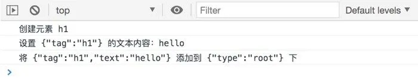

# 第7章渲染器的设计

在第 3 章中，我们初步讨论了虚拟 DOM 和渲染器的工作原理，并尝试编写了一个微型的渲染器。从本章开始，我们将详细讨论渲染器的实现细节。在这个过程中，你将认识到渲染器是Vue.js 中非常重要的一部分。在 Vue.js 中，很多功能依赖渲染器来实现，例如 Transition 组

```
件、Teleport 组件、Suspense 组件，以及 template ref 和自定义指令等。
```

另外，渲染器也是框架性能的核心，渲染器的实现直接影响框架的性能。Vue.js 3 的渲染器不仅仅包含传统的 Diff 算法，它还独创了快捷路径的更新方式，能够充分利用编译器提供的信息，大大提升了更新性能。

渲染器的代码量非常庞大，需要合理的架构设计来保证可维护性，不过它的实现思路并不复杂。接下来，我们就从讨论渲染器如何与响应系统结合开始，逐步实现一个完整的渲染器。

## 7.1　渲染器与响应系统的结合

顾名思义，渲染器是用来执行渲染任务的。在浏览器平台上，用它来渲染其中的真实 DOM 元素。渲染器不仅能够渲染真实 DOM 元素，它还是框架跨平台能力的关键。因此，在设计渲染器的时候一定要考虑好可自定义的能力。

本节，我们暂时将渲染器限定在 DOM 平台。既然渲染器用来渲染真实 DOM 元素，那么严格来说，下面的函数就是一个合格的渲染器：

```javascript
function renderer(domString, container) {
  container.innerHTML = domString
}
```

我们可以如下所示使用它：

```
renderer('<h1>Hello</h1>', document.getElementById('app'))
如果页面中存在 id 为 app 的 DOM 元素，那么上面的代码就会将 <h1>hello</h1> 插入
```

到该 DOM 元素内。

当然，我们不仅可以渲染静态的字符串，还可以渲染动态拼接的 HTML 内容，如下所示：

```javascript
let count = 1
renderer(`<h1>$</h1>`, document.getElementById('app'))
这样，最终渲染出来的内容将会是 <h1>1</h1>。注意上面这段代码中的变量 count，如果
```

它是一个响应式数据，会怎么样呢？这让我们联想到副作用函数和响应式数据。利用响应系统，我们可以让整个渲染过程自动化：

```xml
const count = ref(1)
<p>effect(() => {
renderer(<code>&lt;h1&gt;$&lt;/h1&gt;</code>, document.getElementById(‘app’))
})</p>
&lt;h1&gt;$&lt;/h1&gt;count.value++
在这段代码中，我们首先定义了一个响应式数据 count，它是一个 ref，然后在副作用函数
内调用 renderer 函数执行渲染。副作用函数执行完毕后，会与响应式数据建立响应联系。
当我们修改 count.value 的值时，副作用函数会重新执行，完成重新渲染。所以上面的代
码运行完毕后，最终渲染到页面的内容是 <h1>2</h1>。
```

这就是响应系统和渲染器之间的关系。我们利用响应系统的能力，自动调用渲染器完成页面的渲染和更新。这个过程与渲染器的具体实现无关，在上面给出的渲染器的实现中，仅仅设置了

```xml
元素的 innerHTML 内容。
从本章开始，我们将使用 @vue/reactivity 包提供的响应式 API 进行讲解。关于
@vue/reactivity 的实现原理，第二篇已有讲解。@vue/reactivity 提供了 IIFE 模块
格式，因此我们可以直接通过 <script> 标签引用到页面中使用：
<script src="https://unpkg.com/@vue/reactivity@3.0.5/dist/reactivity.global.js">
它暴露的全局 API 名叫 VueReactivity，因此上述内容的完整代码如下：
const { effect, ref } = VueReactivity
<p>function renderer(domString, container) {
container.innerHTML = domString
}</p>
<p>const count = ref(1)</p>
<p>effect(() => {
renderer(<code>&lt;h1&gt;$&lt;/h1&gt;</code>, document.getElementById(‘app’))
})</p>
&lt;h1&gt;$&lt;/h1&gt;count.value++
可以看到，我们通过 VueReactivity 得到了 effect 和 ref 这两个 API。
```

## 7.2　渲染器的基本概念

理解渲染器所涉及的基本概念，有利于理解后续内容。因此，本节我们会介绍渲染器所涉及的术语及其含义，并通过代码来举例说明。

我们通常使用英文 renderer 来表达“渲染器”。千万不要把 renderer 和 render 弄混了，前者代表渲染器，而后者是动词，表示“渲染”。渲染器的作用是把虚拟 DOM 渲染为特定平台上的真实元素。在浏览器平台上，渲染器会把虚拟 DOM 渲染为真实 DOM 元素。

```
虚拟 DOM 通常用英文 virtual DOM 来表达，有时会简写成 vdom。虚拟 DOM 和真实 DOM
```

的结构一样，都是由一个个节点组成的树型结构。所以，我们经常能听到“虚拟节点”这样的

```
词，即 virtual node，有时会简写成 vnode。虚拟 DOM 是树型结构，这棵树中的任何一个
vnode 节点都可以是一棵子树，因此 vnode 和 vdom 有时可以替换使用。为了避免造成困
惑，在本书中将统一使用 vnode。
```

渲染器把虚拟 DOM 节点渲染为真实 DOM 节点的过程叫作挂载，通常用英文 mount 来表达。

```
例如 Vue.js 组件中的 mounted 钩子就会在挂载完成时触发。这就意味着，在 mounted 钩子
```

中可以访问真实 DOM 元素。理解这些名词有助于我们更好地理解框架的 API 设计。

那么，渲染器把真实 DOM 挂载到哪里呢？其实渲染器并不知道应该把真实 DOM 挂载到哪里。因此，渲染器通常需要接收一个挂载点作为参数，用来指定具体的挂载位置。这里的“挂载点”其实就是一个 DOM 元素，渲染器会把该 DOM 元素作为容器元素，并把内容渲染到其中。我们通常用英文 container 来表达容器。

上文分别阐述了渲染器、虚拟 DOM（或虚拟节点）、挂载以及容器等概念。为了便于理解，下面举例说明：

```javascript
function createRenderer() {
  function render(vnode, container) {
    // ...
  }
return render
}
```

```
如上面的代码所示，其中 createRenderer 函数用来创建一个渲染器。调用
createRenderer 函数会得到一个 render 函数，该 render 函数会以 container 为挂
载点，将 vnode 渲染为真实 DOM 并添加到该挂载点下。
你可能会对这段代码产生疑惑，如为什么需要 createRenderer 函数？直接定义 render
```

不就好了吗？其实不然，正如上文提到的，渲染器与渲染是不同的。渲染器是更加宽泛的概念，它包含渲染。渲染器不仅可以用来渲染，还可以用来激活已有的 DOM 元素，这个过程通常发生在同构渲染的情况下，如以下代码所示：

```xml
function createRenderer() {
  function render(vnode, container) {
    // ...
  }
<p>function hydrate(vnode, container) {
// …
}</p>
return {
render,
hydrate
}
}
可以看到，当调用 createRenderer 函数创建渲染器时，渲染器不仅包含 render 函数，
还包含 hydrate 函数。关于 hydrate 函数，介绍服务端渲染时会详细讲解。这个例子说
明，渲染器的内容非常广泛，而用来把 vnode 渲染为真实 DOM 的 render 函数只是其中一
部分。实际上，在 Vue.js 3 中，甚至连创建应用的 createApp 函数也是渲染器的一部分。
```

有了渲染器，我们就可以用它来执行渲染任务了，如下面的代码所示：

```javascript
const renderer = createRenderer()
// 首次渲染
renderer.render(vnode, document.querySelector('#app'))
在上面这段代码中，我们首先调用 createRenderer 函数创建一个渲染器，接着调用渲染器
的 renderer.render 函数执行渲染。当首次调用 renderer.render 函数时，只需要创
```

建新的 DOM 元素即可，这个过程只涉及挂载。

```
而当多次在同一个 container 上调用 renderer.render 函数进行渲染时，渲染器除了要
```

执行挂载动作外，还要执行更新动作。例如：

```javascript
const renderer = createRenderer()
// 首次渲染
renderer.render(oldVNode, document.querySelector('#app'))
// 第二次渲染
renderer.render(newVNode, document.querySelector('#app'))
如上面的代码所示，由于首次渲染时已经把 oldVNode 渲染到 container 内了，所以当再
次调用 renderer.render 函数并尝试渲染 newVNode 时，就不能简单地执行挂载动作了。
在这种情况下，渲染器会使用 newVNode 与上一次渲染的 oldVNode 进行比较，试图找到并
```

更新变更点。这个过程叫作“打补丁”（或更新），英文通常用 patch 来表达。但实际上，挂载动

```
作本身也可以看作一种特殊的打补丁，它的特殊之处在于旧的 vnode 是不存在的。所以我们
```

不必过于纠结“挂载”和“打补丁”这两个概念。代码示例如下：

```javascript
function createRenderer() {
  function render(vnode, container) {
    if (vnode) {
      // 新 vnode 存在，将其与旧 vnode 一起传递给 patch 函数，进行打补丁
      patch(container._vnode, vnode, container)
    } else {
      if (container._vnode) {
        // 旧 vnode 存在，且新 vnode 不存在，说明是卸载（unmount）操作
        // 只需要将 container 内的 DOM 清空即可
        container.innerHTML = ''
      }
    }
    // 把 vnode 存储到 container._vnode 下，即后续渲染中的旧 vnode
    container._vnode = vnode
  }
return {
render
}
}
上面这段代码给出了 render 函数的基本实现。我们可以配合下面的代码分析其执行流程，
从而更好地理解 render 函数的实现思路。假设我们连续三次调用 renderer.render 函数
```

来执行渲染：

```javascript
const renderer = createRenderer()
// 首次渲染
renderer.render(vnode1, document.querySelector(‘#app’))
// 第二次渲染
renderer.render(vnode2, document.querySelector(‘#app’))
// 第三次渲染
renderer.render(null, document.querySelector(‘#app’))
```

```
在首次渲染时，渲染器会将 vnode1 渲染为真实 DOM。渲染完成后，vnode1 会存储到容
器元素的 container._vnode 属性中，它会在后续渲染中作为旧 vnode 使用。
在第二次渲染时，旧 vnode 存在，此时渲染器会把 vnode2 作为新 vnode，并将新旧
vnode 一同传递给 patch 函数进行打补丁。
在第三次渲染时，新 vnode 的值为 null，即什么都不渲染。但此时容器中渲染的是
vnode2 所描述的内容，所以渲染器需要清空容器。从上面的代码中可以看出，我们使用
container.innerHTML = '' 来清空容器。需要注意的是，这样清空容器是有问题的，
```

- 不过这里我们暂时使用它来达到目的。

```
另外，在上面给出的代码中，我们注意到 patch 函数的签名，如下：
patch(container._vnode, vnode, container)
我们并没有给出 patch 的具体实现，但从上面的代码中，仍然可以窥探 patch 函数的部分
细节。实际上，patch 函数是整个渲染器的核心入口，它承载了最重要的渲染逻辑，我们会
花费大量篇幅来详细讲解它，但这里仍有必要对它做一些初步的解释。patch 函数至少接收
```

三个参数：

```javascript
function patch(n1, n2, container) {
  // ...
}
第一个参数 n1：旧 vnode。
第二个参数 n2：新 vnode。
第三个参数 container：容器。
在首次渲染时，容器元素的 container._vnode 属性是不存在的，即 undefined。这意味
着，在首次渲染时传递给 patch 函数的第一个参数 n1 也是 undefined。这时，patch 函
数会执行挂载动作，它会忽略 n1，并直接将 n2 所描述的内容渲染到容器中。从这一点可以
看出，patch 函数不仅可以用来完成打补丁，也可以用来执行挂载。
```

## 7.3　自定义渲染器

正如我们一直强调的，渲染器不仅能够把虚拟 DOM 渲染为浏览器平台上的真实 DOM。通过将渲染器设计为可配置的“通用”渲染器，即可实现渲染到任意目标平台上。本节我们将以浏览器作为渲染的目标平台，编写一个渲染器，在这个过程中，看看哪些内容是可以抽象的，然后通过抽象，将浏览器特定的 API 抽离，这样就可以使得渲染器的核心不依赖于浏览器。在此基础上，我们再为那些被抽离的 API 提供可配置的接口，即可实现渲染器的跨平台能力。

```xml
我们从渲染一个普通的 <h1> 标签开始。可以使用如下 vnode 对象来描述一个 <h1> 标签：
const vnode = {
  type: 'h1',
  children: 'hello'
}
观察上面的 vnode 对象。我们使用 type 属性来描述一个 vnode 的类型，不同类型的
type 属性值可以描述多种类型的 vnode。当 type 属性是字符串类型值时，可以认为它描
述的是普通标签，并使用该 type 属性的字符串值作为标签的名称。对于这样一个 vnode，
我们可以使用 render 函数渲染它，如下面的代码所示：
const vnode = {
  type: 'h1',
  children: 'hello'
}
// 创建一个渲染器
const renderer = createRenderer()
// 调用 render 函数渲染该 vnode
renderer.render(vnode, document.querySelector('#app'))
为了完成渲染工作，我们需要补充 patch 函数：
function createRenderer() {
  function patch(n1, n2, container) {
    // 在这里编写渲染逻辑
  }
<p>function render(vnode, container) {
if (vnode) {
patch(container._vnode, vnode, container)
} else {
if (container._vnode) {
container.innerHTML = ‘’
}
}
container._vnode = vnode
}</p>
return {
render
}
}
```

```javascript
如上面的代码所示，我们将 patch 函数也编写在 createRenderer 函数内。在后续的讲解
中，如果没有特殊声明，我们编写的函数都定义在 createRenderer 函数内。
patch 函数的代码如下：
function patch(n1, n2, container) {
  // 如果 n1 不存在，意味着挂载，则调用 mountElement 函数完成挂载
  if (!n1) {
    mountElement(n2, container)
  } else {
    // n1 存在，意味着打补丁，暂时省略
  }
}
在上面这段代码中，第一个参数 n1 代表旧 vnode，第二个参数 n2 代表新 vnode。当 n1
不存在时，意味着没有旧 vnode，此时只需要执行挂载即可。这里我们调用 mountElement
```

完成挂载，它的实现如下：

```javascript
function mountElement(vnode, container) {
  // 创建 DOM 元素
  const el = document.createElement(vnode.type)
  // 处理子节点，如果子节点是字符串，代表元素具有文本节点
  if (typeof vnode.children === 'string') {
    // 因此只需要设置元素的 textContent 属性即可
    el.textContent = vnode.children
  }
  // 将元素添加到容器中
  container.appendChild(el)
}
```

上面这段代码我们并不陌生，第 3 章曾初步讲解过渲染器的相关内容。首先调用

```
document.createElement 函数，以 vnode.type 的值作为标签名称创建新的 DOM 元
素。接着处理 vnode.children，如果它的值是字符串类型，则代表该元素具有文本子节
点，这时只需要设置元素的 textContent 即可。最后调用 appendChild 函数将新创建的
DOM 元素添加到容器元素内。这样，我们就完成了一个 vnode 的挂载。
```

挂载一个普通标签元素的工作已经完成。接下来，我们分析这段代码存在的问题。我们的目标

```
是设计一个不依赖于浏览器平台的通用渲染器，但很明显，mountElement 函数内调用了大
量依赖于浏览器的 API，例如 document.createElement、el.textContent 以及
appendChild 等。想要设计通用渲染器，第一步要做的就是将这些浏览器特有的 API 抽离。
```

怎么做呢？我们可以将这些操作 DOM 的 API 作为配置项，该配置项可以作为

```sql
createRenderer 函数的参数，如下面的代码所示：
// 在创建 renderer 时传入配置项
const renderer = createRenderer({
  // 用于创建元素
  createElement(tag) {
    return document.createElement(tag)
  },
  // 用于设置元素的文本节点
  setElementText(el, text) {
    el.textContent = text
  },
  // 用于在给定的 parent 下添加指定元素
  insert(el, parent, anchor = null) {
    parent.insertBefore(el, anchor)
  }
})
可以看到，我们把用于操作 DOM 的 API 封装为一个对象，并把它传递给 createRenderer
函数。这样，在 mountElement 等函数内就可以通过配置项来取得操作 DOM 的 API 了：
function createRenderer(options) {
<p>// 通过 options 得到操作 DOM 的 API
const {
createElement,
insert,
setElementText
} = options</p>
<p>// 在这个作用域内定义的函数都可以访问那些 API
function mountElement(vnode, container) {
// …
}</p>
<p>function patch(n1, n2, container) {
// …
}</p>
<p>function render(vnode, container) {
// …
}</p>
return {
render
}
}
接着，我们就可以使用从配置项中取得的 API 重新实现 mountElement 函数：
function mountElement(vnode, container) {
  // 调用 createElement 函数创建元素
  const el = createElement(vnode.type)
  if (typeof vnode.children === 'string') {
    // 调用 setElementText 设置元素的文本节点
    setElementText(el, vnode.children)
  }
  // 调用 insert 函数将元素插入到容器内
  insert(el, container)
}
如上面的代码所示，重构后的 mountElement 函数在功能上没有任何变化。不同的是，它不
```

再直接依赖于浏览器的特有 API 了。这意味着，只要传入不同的配置项，就能够完成非浏览器环境下的渲染工作。为了展示这一点，我们可以实现一个用来打印渲染器操作流程的自定义渲染器，如下面的代码所示：

```sql
const renderer = createRenderer({
  createElement(tag) {
    console.log(`创建元素 $`)
    return { tag }
  },
  setElementText(el, text) {
    console.log(`设置 $ 的文本内容：$`)
    el.textContent = text
  },
  insert(el, parent, anchor = null) {
    console.log(`将 $ 添加到 $ 下`)
    parent.children = el
  }
})
观察上面的代码，在调用 createRenderer 函数创建 renderer 时，传入了不同的配置
项。在 createElement 内，我们不再调用浏览器的 API，而是仅仅返回一个对象 { tag
}，并将其作为创建出来的“DOM 元素”。同样，在 setElementText 以及 insert 函数
```

内，我们也没有调用浏览器相关的 API，而是自定义了一些逻辑，并打印信息到控制台。这样，我们就实现了一个自定义渲染器，可以用下面这段代码来检测它的能力：

```javascript
const vnode = {
  type: 'h1',
  children: 'hello'
}
// 使用一个对象模拟挂载点
const container = { type: 'root' }
renderer2.render(vnode, container)
```

需要指出的是，由于上面实现的自定义渲染器不依赖浏览器特有的 API，所以这段代码不仅可以在浏览器中运行，还可以在 Node.js 中运行。图 7-1 给出了在浏览器中的运行结果。



- 图 7-1　渲染器的运行结果

现在，我们对自定义渲染器有了更深刻的认识了。自定义渲染器并不是“黑魔法”，它只是通过抽象的手段，让核心代码不再依赖平台特有的 API，再通过支持个性化配置的能力来实现跨平台。

## 7.4　总结

在本章中，我们首先介绍了渲染器与响应系统的关系。利用响应系统的能力，我们可以做到，当响应式数据变化时自动完成页面更新（或重新渲染）。同时我们注意到，这与渲染器的具体

```
实现无关。我们实现了一个极简的渲染器，它只能利用 innerHTML 属性将给定的 HTML 字
```

符串内容设置到容器中。

接着，我们讨论了与渲染器相关的基本名词和概念。渲染器的作用是把虚拟 DOM 渲染为特定平台上的真实元素，我们用英文 renderer 来表达渲染器。虚拟 DOM 通常用英文 virtual DOM

```
来表达，有时会简写成 vdom 或 vnode。渲染器会执行挂载和打补丁操作，对于新的元素，
渲染器会将它挂载到容器内；对于新旧 vnode 都存在的情况，渲染器则会执行打补丁操作，
即对比新旧 vnode，只更新变化的内容。
```

最后，我们讨论了自定义渲染器的实现。在浏览器平台上，渲染器可以利用 DOM API 完成DOM 元素的创建、修改和删除。为了让渲染器不直接依赖浏览器平台特有的 API，我们将这些用来创建、修改和删除元素的操作抽象成可配置的对象。用户可以在调用

```
createRenderer 函数创建渲染器的时候指定自定义的配置对象，从而实现自定义的行为。
```

我们还实现了一个用来打印渲染器操作流程的自定义渲染器，它不仅可以在浏览器中运行，还可以在 Node.js 中运行。
