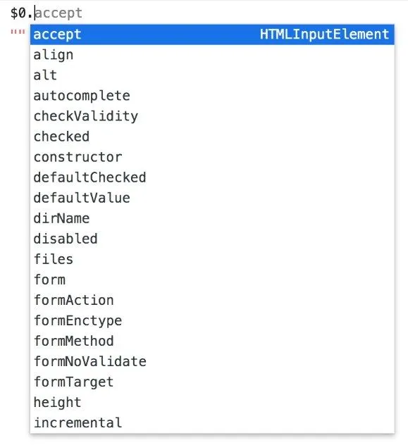
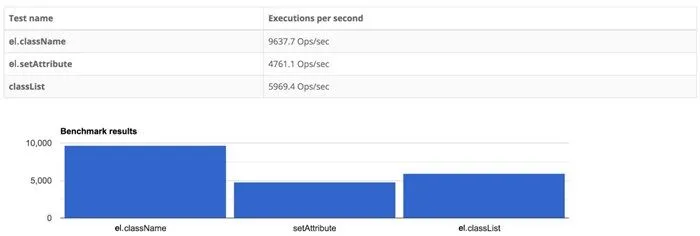

# 第8章挂载与更新(1)

## 第 8 章　挂载与更新

在第 7 章中，我们主要介绍了渲染器的基本概念和整体架构。本章，我们将讲解渲染器的核心功能：挂载与更新。

## 8.1　挂载子节点和元素的属性

```
第 7 章提到，当 vnode.children 的值是字符串类型时，会把它设置为元素的文本内容。
```

一个元素除了具有文本子节点外，还可以包含其他元素子节点，并且子节点可以是很多个。为

```javascript
了描述元素的子节点，我们需要将 vnode.children 定义为数组：
const vnode = {
  type: 'div',
  children: [
    {
      type: 'p',
      children: 'hello'
    }
  ]
}
上面这段代码描述的是“一个 div 标签具有一个子节点，且子节点是 p 标签”。可以看到，
vnode.children 是一个数组，它的每一个元素都是一个独立的虚拟节点对象。这样就形成
```

了树型结构，即虚拟 DOM 树。

```
为了完成子节点的渲染，我们需要修改 mountElement 函数，如下面的代码所示：
```

```sql
function mountElement(vnode, container) {
  const el = createElement(vnode.type)
  if (typeof vnode.children === 'string') {
    setElementText(el, vnode.children)
  } else if (Array.isArray(vnode.children)) {
    // 如果 children 是数组，则遍历每一个子节点，并调用 patch 函数挂载它们
    vnode.children.forEach(child => {
      patch(null, child, el)
    })
  }
  insert(el, container)
}
在上面这段代码中，我们增加了新的判断分支。使用 Array.isArray 函数判断
vnode.children 是否是数组，如果是数组，则循环遍历它，并调 patch 函数挂载数组中
```

的虚拟节点。在挂载子节点时，需要注意以下两点。

```
传递给 patch 函数的第一个参数是 null。因为是挂载阶段，没有旧 vnode，所以只需要
传递 null 即可。这样，当 patch 函数执行时，就会递归地调用 mountElement 函数完
```

- 成挂载。

```
传递给 patch 函数的第三个参数是挂载点。由于我们正在挂载的子元素是 div 标签的子
节点，所以需要把刚刚创建的 div 元素作为挂载点，这样才能保证这些子节点挂载到正确
```

- 位置。

```
完成了子节点的挂载后，我们再来看看如何用 vnode 描述一个标签的属性，以及如何渲染这
些属性。我们知道，HTML 标签有很多属性，其中有些属性是通用的，例如 id、class 等，
而有些属性是特定元素才有的，例如 form 元素的 action 属性。实际上，渲染一个元素的
```

属性比想象中要复杂，不过我们仍然秉承一切从简的原则，先来看看最基本的属性处理。

```
为了描述元素的属性，我们需要为虚拟 DOM 定义新的 vnode.props 字段，如下面的代码所
```

示：

```javascript
const vnode = {
  type: 'div',
  // 使用 props 描述一个元素的属性
  props: {
    id: 'foo'
  },
  children: [
    {
      type: 'p',
      children: 'hello'
    }
  ]
}
vnode.props 是一个对象，它的键代表元素的属性名称，它的值代表对应属性的值。这样，
我们就可以通过遍历 props 对象的方式，把这些属性渲染到对应的元素上，如下面的代码所
```

示：

```sql
function mountElement(vnode, container) {
  const el = createElement(vnode.type)
  // 省略 children 的处理
<p>// 如果 vnode.props 存在才处理它
if (vnode.props) {
// 遍历 vnode.props
for (const key in vnode.props) {
// 调用 setAttribute 将属性设置到元素上
el.setAttribute(key, vnode.props[key])
}
}</p>
insert(el, container)
}
```

```
在这段代码中，我们首先检查了 vnode.props 字段是否存在，如果存在则遍历它，并调用
setAttribute 函数将属性设置到元素上。实际上，除了使用 setAttribute 函数为元素
```

设置属性之外，还可以通过 DOM 对象直接设置：

```sql
function mountElement(vnode, container) {
  const el = createElement(vnode.type)
  // 省略 children 的处理
<p>if (vnode.props) {
for (const key in vnode.props) {
// 直接设置
el[key] = vnode.props[key]
}
}</p>
insert(el, container)
}
在这段代码中，我们没有选择使用 setAttribute 函数，而是直接将属性设置在 DOM 对象
上，即 el[key] = vnode.props[key]。实际上，无论是使用 setAttribute 函数，还
```

是直接操作 DOM 对象，都存在缺陷。如前所述，为元素设置属性比想象中要复杂得多。不过，在讨论具体有哪些缺陷之前，我们有必要先搞清楚两个重要的概念：HTML Attributes和 DOM Properties。

## 8.2　HTML Attributes 与 DOM Properties

理解 HTML Attributes 和 DOM Properties 之间的差异和关联非常重要，这能够帮助我们合理地设计虚拟节点的结构，更是正确地为元素设置属性的关键。

我们从最基本的 HTML 说起。给出如下 HTML 代码：

```xml
<input id="my-input" type="text" value="foo" />
HTML Attributes 指的就是定义在 HTML 标签上的属性，这里指的就是 id="my-input"、
type="text" 和 value="foo"。当浏览器解析这段 HTML 代码后，会创建一个与之相符
的 DOM 元素对象，我们可以通过 JavaScript 代码来读取该 DOM 对象：
const el = document.querySelector('#my-input')
```

这个 DOM 对象会包含很多属性（properties），如图 8-1 所示。



- 图 8-1　DOM 对象下的属性

这些属性就是所谓的 DOM Properties。很多 HTML Attributes 在 DOM 对象上有与之同名的

```
DOM Properties，例如 id="my-input" 对应 el.id，type="text" 对应 el.type，
value="foo" 对应 el.value 等。但 DOM Properties 与 HTML Attributes 的名字不总是一
```

模一样的，例如：

```xml
<div class="foo"></div>
```

```
class="foo" 对应的 DOM Properties 则是 el.className。另外，并不是所有 HTML
```

Attributes 都有与之对应的 DOM Properties，例如：

```xml
<div aria-valuenow="75"></div>
aria-* 类的 HTML Attributes 就没有与之对应的 DOM Properties。
```

类似地，也不是所有 DOM Properties 都有与之对应的 HTML Attributes，例如可以用

```
el.textContent 来设置元素的文本内容，但并没有与之对应的 HTML Attributes 来完成同
```

样的工作。

HTML Attributes 的值与 DOM Properties 的值之间是有关联的，例如下面的 HTML 片段：

```xml
<div id="foo"></div>
这个片段描述了一个具有 id 属性的 div 标签。其中，id="foo" 对应的 DOM Properties
是 el.id，并且值为字符串 'foo'。我们把这种 HTML Attributes 与 DOM Properties 具有
相同名称（即 id）的属性看作直接映射。但并不是所有 HTML Attributes 与 DOM Properties
```

之间都是直接映射的关系，例如：

```xml
<input value="foo" />
这是一个具有 value 属性的 input 标签。如果用户没有修改文本框的内容，那么通过
el.value 读取对应的 DOM Properties 的值就是字符串 'foo'。而如果用户修改了文本框
的值，那么 el.value 的值就是当前文本框的值。例如，用户将文本框的内容修改为
'bar'，那么：
console.log(el.value) // 'bar'
```

但如果运行下面的代码，会发生“奇怪”的现象：

```
console.log(el.getAttribute('value')) // 仍然是 'foo'
console.log(el.value) // 'bar'
可以发现，用户对文本框内容的修改并不会影响 el.getAttribute('value') 的返回值，
```

这个现象蕴含着 HTML Attributes 所代表的意义。实际上，HTML Attributes 的作用是设置与之对应的 DOM Properties 的初始值。一旦值改变，那么 DOM Properties 始终存储着当前值，

```
而通过 getAttribute 函数得到的仍然是初始值。
但我们仍然可以通过 el.defaultValue 来访问初始值，如下面的代码所示：
el.getAttribute('value') // 仍然是 'foo'
el.value // 'bar'
el.defaultValue // 'foo'
这说明一个 HTML Attributes 可能关联多个 DOM Properties。例如在上例中，value="foo"
与 el.value 和 el.defaultValue 都有关联。
```

虽然我们可以认为 HTML Attributes 是用来设置与之对应的 DOM Properties 的初始值的，但有些值是受限制的，就好像浏览器内部做了默认值校验。如果你通过 HTML Attributes 提供的默认值不合法，那么浏览器会使用内建的合法值作为对应 DOM Properties 的默认值，例如：

```xml
<input type="foo" />
我们知道，为 <input/> 标签的 type 属性指定字符串 'foo' 是不合法的，因此浏览器会
矫正这个不合法的值。所以当我们尝试读取 el.type 时，得到的其实是矫正后的值，即字符
串 'text'，而非字符串 'foo'：
console.log(el.type) // 'text'
```

从上述分析来看，HTML Attributes 与 DOM Properties 之间的关系很复杂，但其实我们只需要记住一个核心原则即可：HTML Attributes 的作用是设置与之对应的 DOM Properties 的初始值。

## 8.3　正确地设置元素属性

上一节我们详细讨论了 HTML Attributes 和 DOM Properties 相关的内容，因为 HTMLAttributes 和 DOM Properties 会影响 DOM 属性的添加方式。对于普通的 HTML 文件来说，当浏览器解析 HTML 代码后，会自动分析 HTML Attributes 并设置合适的 DOM Properties。但用户编写在 Vue.js 的单文件组件中的模板不会被浏览器解析，这意味着，原本需要浏览器来完成的工作，现在需要框架来完成。

我们以禁用的按钮为例，如下面的 HTML 代码所示：

```xml
<button disabled>Button</button>
浏览器在解析这段 HTML 代码时，发现这个按钮存在一个叫作 disabled 的 HTML
Attributes，于是浏览器会将该按钮设置为禁用状态，并将它的 el.disabled 这个 DOM
Properties 的值设置为 true，这一切都是浏览器帮我们处理好的。但同样的代码如果出现在
Vue.js 的模板中，则情况会有所不同。首先，这个 HTML 模板会被编译成 vnode，它等价
```

于：

```javascript
const button = {
  type: 'button',
  props: {
    disabled: ''
  }
}
注意，这里的 props.disabled 的值是空字符串，如果在渲染器中调用 setAttribute 函
```

数设置属性，则相当于：

```
el.setAttribute('disabled', '')
```

这么做的确没问题，浏览器会将按钮禁用。但考虑如下模板：

```xml
<button :disabled="false">Button</button>
它对应的 vnode 为：
const button = {
  type: 'button',
  props: {
    disabled: false
  }
}
```

```
用户的本意是“不禁用”按钮，但如果渲染器仍然使用 setAttribute 函数设置属性值，则会
```

产生意外的效果，即按钮被禁用了：

```
el.setAttribute('disabled', false)
```

在浏览器中运行上面这句代码，我们发现浏览器仍然将按钮禁用了。这是因为使用

```
setAttribute 函数设置的值总是会被字符串化，所以上面这句代码等价于：
el.setAttribute('disabled', 'false')
对于按钮来说，它的 el.disabled 属性值是布尔类型的，并且它不关心具体的 HTML
Attributes 的值是什么，只要 disabled 属性存在，按钮就会被禁用。所以我们发现，渲染器
不应该总是使用 setAttribute 函数将 vnode.props 对象中的属性设置到元素上。那么应
```

该怎么办呢？一个很自然的思路是，我们可以优先设置 DOM Properties，例如：

```
el.disabled = false
```

这样是可以正确工作的，但又带来了新的问题。还是以上面给出的模板为例：

```xml
<button disabled>Button</button>
这段模板对应的 vnode 是：
const button = {
  type: 'button',
  props: {
    disabled: ''
  }
}
我们注意到，在模板经过编译后得到的 vnode 对象中，props.disabled 的值是一个空字
```

符串。如果直接用它设置元素的 DOM Properties，那么相当于：

```
el.disabled = ''
由于 el.disabled 是布尔类型的值，所以当我们尝试将它设置为空字符串时，浏览器会将
它的值矫正为布尔类型的值，即 false。所以上面这句代码的执行结果等价于：
el.disabled = false
这违背了用户的本意，因为用户希望禁用按钮，而 el.disabled = false 则是不禁用的意
```

思。

```
这么看来，无论是使用 setAttribute 函数，还是直接设置元素的 DOM Properties，都存
```

在缺陷。要彻底解决这个问题，我们只能做特殊处理，即优先设置元素的 DOM Properties，

```sql
但当值为空字符串时，要手动将值矫正为 true。只有这样，才能保证代码的行为符合预期。
下面的 mountElement 函数给出了具体的实现：
function mountElement(vnode, container) {
  const el = createElement(vnode.type)
  // 省略 children 的处理
<p>if (vnode.props) {
for (const key in vnode.props) {
// 用 in 操作符判断 key 是否存在对应的 DOM Properties
if (key in el) {
// 获取该 DOM Properties 的类型
const type = typeof el[key]
const value = vnode.props[key]
// 如果是布尔类型，并且 value 是空字符串，则将值矫正为 true
if (type === ‘boolean’ && value === ‘’) {
el[key] = true
} else {
el[key] = value
}
} else {
// 如果要设置的属性没有对应的 DOM Properties，则使用 setAttribute 函数设置属性
el.setAttribute(key, vnode.props[key])
}
}
}</p>
insert(el, container)
}
如上面的代码所示，我们检查每一个 vnode.props 中的属性，看看是否存在对应的 DOM
```

Properties，如果存在，则优先设置 DOM Properties。同时，我们对布尔类型的 DOM

```
Properties 做了值的矫正，即当要设置的值为空字符串时，将其矫正为布尔值 true。当然，
如果 vnode.props 中的属性不具有对应的 DOM Properties，则仍然使用 setAttribute
```

函数完成属性的设置。

但上面给出的实现仍然存在问题，因为有一些 DOM Properties 是只读的，如以下代码所示：

```sql
<form id="form1"></form>
<input form="form1" />
在这段代码中，我们为 <input/> 标签设置了 form 属性（HTML Attributes）。它对应的
DOM Properties 是 el.form，但 el.form 是只读的，因此我们只能够通过
setAttribute 函数来设置它。这就需要我们修改现有的逻辑：
function shouldSetAsProps(el, key, value) {
  // 特殊处理
  if (key === 'form' && el.tagName === 'INPUT') return false
  // 兜底
  return key in el
}
<p>function mountElement(vnode, container) {
const el = createElement(vnode.type)
// 省略 children 的处理</p>
<p>if (vnode.props) {
for (const key in vnode.props) {
const value = vnode.props[key]
// 使用 shouldSetAsProps 函数判断是否应该作为 DOM Properties 设置
if (shouldSetAsProps(el, key, value)) {
const type = typeof el[key]
if (type === ‘boolean’ && value === ‘’) {
el[key] = true
} else {
el[key] = value
}
} else {
el.setAttribute(key, value)
}
}
}</p>
insert(el, container)
}
如上面的代码所示，为了代码的可读性，我们提取了一个 shouldSetAsProps 函数。该函
数会返回一个布尔值，代表属性是否应该作为 DOM Properties 被设置。如果返回 true，则
代表应该作为 DOM Properties 被设置，否则应该使用 setAttribute 函数来设置。在
shouldSetAsProps 函数内，我们对 <input form="xxx" /> 进行特殊处理，即
<input/> 标签的 form 属性必须使用 setAttribute 函数来设置。实际上，不仅仅是
<input/> 标签，所有表单元素都具有 form 属性，它们都应该作为 HTML Attributes 被设
```

置。

```
当然，<input form="xxx"/> 是一个特殊的例子，还有一些其他类似于这种需要特殊处理
```

的情况。我们不会列举所有情况并一一讲解，因为掌握处理问题的思路更加重要。另外，我们也不可能把所有需要特殊处理的地方都记住，更何况有时我们根本不知道在什么情况下才需要特殊处理。所以，上述解决方案本质上是经验之谈。不要惧怕写出不完美的代码，只要在后续迭代过程中“见招拆招“，代码就会变得越来越完善，框架也会变得越来越健壮。

最后，我们需要把属性的设置也变成与平台无关，因此需要把属性设置相关操作也提取到渲染器选项中，如下面的代码所示：

```sql
const renderer = createRenderer({
  createElement(tag) {
    return document.createElement(tag)
  },
  setElementText(el, text) {
    el.textContent = text
  },
  insert(el, parent, anchor = null) {
    parent.insertBefore(el, anchor)
  },
  // 将属性设置相关操作封装到 patchProps 函数中，并作为渲染器选项传递
  patchProps(el, key, prevValue, nextValue) {
    if (shouldSetAsProps(el, key, nextValue)) {
      const type = typeof el[key]
      if (type === 'boolean' && nextValue === '') {
        el[key] = true
      } else {
        el[key] = nextValue
      }
    } else {
      el.setAttribute(key, nextValue)
    }
  }
})
而在 mountElement 函数中，只需要调用 patchProps 函数，并为其传递相关参数即可：
function mountElement(vnode, container) {
  const el = createElement(vnode.type)
  if (typeof vnode.children === 'string') {
    setElementText(el, vnode.children)
  } else if (Array.isArray(vnode.children)) {
    vnode.children.forEach(child => {
      patch(null, child, el)
    })
  }
<p>if (vnode.props) {
for (const key in vnode.props) {
// 调用 patchProps 函数即可
patchProps(el, key, null, vnode.props[key])
}
}</p>
insert(el, container)
}
```

这样，我们就把属性相关的渲染逻辑从渲染器的核心中抽离了出来。

## 8.4　class 的处理

```
在上一节中，我们讲解了如何正确地把 vnode.props 中定义的属性设置到 DOM 元素上。但
在 Vue.js 中，仍然有一些属性需要特殊处理，比如 class 属性。为什么需要对 class 属性
进行特殊处理呢？这是因为 Vue.js 对 calss 属性做了增强。在 Vue.js 中为元素设置类名有
```

以下几种方式。

```xml
方式一：指定 class 为一个字符串值。
<p class="foo bar"></p>
这段模板对应的 vnode 是：
const vnode = {
  type: 'p',
  props: {
    class: 'foo bar'
  }
}
方式二：指定 class 为一个对象值。
<p :class="cls"></p>
假设对象 cls 的内容如下：
const cls = { foo: true, bar: false }
那么，这段模板对应的 vnode 是：
const vnode = {
  type: 'p',
  props: {
    class: { foo: true, bar: false }
  }
}
方式三：class 是包含上述两种类型的数组。
<p :class="arr"></p>
```

这个数组可以是字符串值与对象值的组合：

```javascript
const arr = [
  // 字符串
  'foo bar',
  // 对象
  {
    baz: true
  }
]
那么，这段模板对应的 vnode 是：
const vnode = {
  type: 'p',
  props: {
    class: [
      'foo bar',
      { baz: true }
    ]
  }
}
可以看到，因为 class 的值可以是多种类型，所以我们必须在设置元素的 class 之前将值
归一化为统一的字符串形式，再把该字符串作为元素的 class 值去设置。因此，我们需要封
装 normalizeClass 函数，用它来将不同类型的 class 值正常化为字符串，例如：
```

```javascript
const vnode = {
  type: 'p',
  props: {
    // 使用 normalizeClass 函数对值进行序列化
    class: normalizeClass([
      'foo bar',
      { baz: true }
    ])
  }
}
```

最后的结果等价于：

```javascript
const vnode = {
  type: 'p',
  props: {
    // 序列化后的结果
    class: 'foo bar baz'
  }
}
至于 normalizeClass 函数的实现，这里我们不会做详细讲解，因为它本质上就是一个数据
```

结构转换的小算法，实现起来并不复杂。

```python
假设现在我们已经能够对 class 值进行正常化了。接下来，我们将讨论如何将正常化后的
class 值设置到元素上。其实，我们目前实现的渲染器已经能够完成 class 的渲染了。观察
前文中函数的代码，由于 class 属性对应的 DOM Properties 是 el.className，所以表达
式 'class' in el 的值将会是 false，因此，patchProps 函数会使用 setAttribute
函数来完成 class 的设置。但是我们知道，在浏览器中为一个元素设置 class 有三种方
式，即使用 setAttribute、el.className 或 el.classList。那么哪一种方法的性能
更好呢？图 8-2 对比了这三种方式为元素设置 1000 次 class 的性能。
```



```
图 8-2　el.className、setAttribute 和 el.classList 的性能比较
可以看到，el.className 的性能最优。因此，我们需要调整 patchProps 函数的实现，
```

如下面的代码所示：

```javascript
const renderer = createRenderer({
  // 省略其他选项
patchProps(el, key, prevValue, nextValue) {
// 对 class 进行特殊处理
if (key === ‘class’) {
el.className = nextValue || ‘’
} else if (shouldSetAsProps(el, key, nextValue)) {
const type = typeof el[key]
if (type === ‘boolean’ && nextValue === ‘’) {
el[key] = true
} else {
el[key] = nextValue
}
} else {
el.setAttribute(key, nextValue)
}
}
})
从上面的代码中可以看到，我们对 class 进行了特殊处理，即使用 el.className 代替
setAttribute 函数。其实除了 class 属性之外，Vue.js 对 style 属性也做了增强，所以
我们也需要对 style 做类似的处理。
通过对 class 的处理，我们能够意识到，vnode.props 对象中定义的属性值的类型并不总
```

是与 DOM 元素属性的数据结构保持一致，这取决于上层 API 的设计。Vue.js 允许对象类型的

```
值作为 class 是为了方便开发者，在底层的实现上，必然需要对值进行正常化后再使用。另
```

外，正常化值的过程是有代价的，如果需要进行大量的正常化操作，则会消耗更多性能。

## 8.5　卸载操作

前文主要讨论了挂载操作。接下来，我们将会讨论卸载操作。卸载操作发生在更新阶段，更新指的是，在初次挂载完成之后，后续渲染会触发更新，如下面的代码所示：

```
// 初次挂载
renderer.render(vnode, document.querySelector('#app'))
// 再次挂载新 vnode，将触发更新
renderer.render(newVNode, document.querySelector('#app'))
更新的情况有几种，我们逐个来看。当后续调用 render 函数渲染空内容（即 null）时，如
```

下面的代码所示：

```javascript
// 初次挂载
renderer.render(vnode, document.querySelector('#app'))
// 新 vnode 为 null，意味着卸载之前渲染的内容
renderer.render(null, document.querySelector('#app'))
首次挂载完成后，后续渲染时如果传递了 null 作为新 vnode，则意味着什么都不渲染，这
时我们需要卸载之前渲染的内容。回顾前文实现的 render 函数，如下：
function render(vnode, container) {
  if (vnode) {
    patch(container._vnode, vnode, container)
  } else {
    if (container._vnode) {
      // 卸载，清空容器
      container.innerHTML = ''
    }
  }
  container._vnode = vnode
}
可以看到，当 vnode 为 null，并且容器元素的 container._vnode 属性存在时，我们直
接通过 innerHTML 清空容器。但这么做是不严谨的，原因有三点。
```

- 容器的内容可能是由某个或多个组件渲染的，当卸载操作发生时，应该正确地调用这些组件

```
的 beforeUnmount、unmounted 等生命周期函数。
```

- 即使内容不是由组件渲染的，有的元素存在自定义指令，我们应该在卸载操作发生时正确执行对应的指令钩子函数。

```
使用 innerHTML 清空容器元素内容的另一个缺陷是，它不会移除绑定在 DOM 元素上的事
```

- 件处理函数。

```
正如上述三点原因，我们不能简单地使用 innerHTML 来完成卸载操作。正确的卸载方式是，
根据 vnode 对象获取与其相关联的真实 DOM 元素，然后使用原生 DOM 操作方法将该 DOM
元素移除。为此，我们需要在 vnode 与真实 DOM 元素之间建立联系，修改 mountElement
```

函数，如下面的代码所示：

```sql
function mountElement(vnode, container) {
  // 让 vnode.el 引用真实 DOM 元素
  const el = vnode.el = createElement(vnode.type)
  if (typeof vnode.children === 'string') {
    setElementText(el, vnode.children)
  } else if (Array.isArray(vnode.children)) {
    vnode.children.forEach(child => {
      patch(null, child, el)
    })
  }
<p>if (vnode.props) {
for (const key in vnode.props) {
patchProps(el, key, null, vnode.props[key])
}
}</p>
insert(el, container)
}
可以看到，当我们调用 createElement 函数创建真实 DOM 元素时，会把真实 DOM 元素
赋值给 vnode.el 属性。这样，在 vnode 与真实 DOM 元素之间就建立了联系，我们可以通
过 vnode.el 来获取该虚拟节点对应的真实 DOM 元素。有了这些，当卸载操作发生的时
候，只需要根据虚拟节点对象 vnode.el 取得真实 DOM 元素，再将其从父元素中移除即
```

可：

```javascript
function render(vnode, container) {
  if (vnode) {
    patch(container._vnode, vnode, container)
  } else {
    if (container._vnode) {
      // 根据 vnode 获取要卸载的真实 DOM 元素
      const el = container._vnode.el
      // 获取 el 的父元素
      const parent = el.parentNode
      // 调用 removeChild 移除元素
      if (parent) parent.removeChild(el)
    }
  }
  container._vnode = vnode
}
如上面的代码所示，其中 container._vnode 代表旧 vnode，即要被卸载的 vnode。然后
通过 container._vnode.el 取得真实 DOM 元素，并调用 removeChild 函数将其从父
```

元素中移除即可。

```
由于卸载操作是比较常见且基本的操作，所以我们应该将它封装到 unmount 函数中，以便后
```

续代码可以复用它，如下面的代码所示：

```javascript
function unmount(vnode) {
  const parent = vnode.el.parentNode
  if (parent) {
    parent.removeChild(vnode.el)
  }
}
unmount 函数接收一个虚拟节点作为参数，并将该虚拟节点对应的真实 DOM 元素从父元素
中移除。现在 unmount 函数的代码还非常简单，后续我们会慢慢充实它，让它变得更加完
善。有了 unmount 函数后，就可以直接在 render 函数中调用它来完成卸载任务了：
function render(vnode, container) {
  if (vnode) {
    patch(container._vnode, vnode, container)
  } else {
    if (container._vnode) {
      // 调用 unmount 函数卸载 vnode
      unmount(container._vnode)
    }
  }
  container._vnode = vnode
}
最后，将卸载操作封装到 unmount 中，还能够带来两点额外的好处。
在 unmount 函数内，我们有机会调用绑定在 DOM 元素上的指令钩子函数，例如
beforeUnmount、unmounted 等。
当 unmount 函数执行时，我们有机会检测虚拟节点 vnode 的类型。如果该虚拟节点描述
```

- 的是组件，则我们有机会调用组件相关的生命周期函数。

## 8.6　区分 vnode 的类型

```
在上一节中我们了解到，当后续调用 render 函数渲染空内容（即 null）时，会执行卸载操
作。如果在后续渲染时，为 render 函数传递了新的 vnode，则不会进行卸载操作，而是会
把新旧 vnode 都传递给 patch 函数进行打补丁操作。回顾前文实现的 patch 函数，如下面
```

的代码所示：

```javascript
function patch(n1, n2, container) {
  if (!n1) {
    mountElement(n2, container)
  } else {
    // 更新
  }
}
其中，patch 函数的两个参数 n1 和 n2 分别代表旧 vnode 与新 vnode。如果旧 vnode 存
在，则需要在新旧 vnode 之间打补丁。但在具体执行打补丁操作之前，我们需要保证新旧
vnode 所描述的内容相同。这是什么意思呢？举个例子，假设初次渲染的 vnode 是一个 p
```

元素：

```javascript
const vnode = {
  type: 'p'
}
renderer.render(vnode, document.querySelector('#app'))
后续又渲染了一个 input 元素：
const vnode = {
  type: 'input'
}
renderer.render(vnode, document.querySelector('#app'))
这就会造成新旧 vnode 所描述的内容不同，即 vnode.type 属性的值不同。对于上例来
说，p 元素和 input 元素之间不存在打补丁的意义，因为对于不同的元素来说，每个元素都
```

有特有的属性，例如：

```xml
<p id="foo" />
<!-- type 属性是 input 标签特有的，p 标签则没有该属性 -->
<input type="submit" />
在这种情况下，正确的更新操作是，先将 p 元素卸载，再将 input 元素挂载到容器中。因此
我们需要调整 patch 函数的代码：
function patch(n1, n2, container) {
  // 如果 n1 存在，则对比 n1 和 n2 的类型
  if (n1 && n1.type !== n2.type) {
    // 如果新旧 vnode 的类型不同，则直接将旧 vnode 卸载
    unmount(n1)
    n1 = null
  }
if (!n1) {
mountElement(n2, container)
} else {
// 更新
}
}
如上面的代码所示，在真正执行更新操作之前，我们优先检查新旧 vnode 所描述的内容是否
相同，如果不同，则直接调用 unmount 函数将旧 vnode 卸载。这里需要注意的是，卸载完
成后，我们应该将参数 n1 的值重置为 null，这样才能保证后续挂载操作正确执行。
即使新旧 vnode 描述的内容相同，我们仍然需要进一步确认它们的类型是否相同。我们知
道，一个 vnode 可以用来描述普通标签，也可以用来描述组件，还可以用来描述 Fragment
等。对于不同类型的 vnode，我们需要提供不同的挂载或打补丁的处理方式。所以，我们需
要继续修改 patch 函数的代码以满足需求，如下面的代码所示：
function patch(n1, n2, container) {
  if (n1 && n1.type !== n2.type) {
    unmount(n1)
    n1 = null
  }
  // 代码运行到这里，证明 n1 和 n2 所描述的内容相同
  const { type } = n2
  // 如果 n2.type 的值是字符串类型，则它描述的是普通标签元素
  if (typeof type === 'string') {
    if (!n1) {
      mountElement(n2, container)
    } else {
      patchElement(n1, n2)
    }
  } else if (typeof type === 'object') {
    // 如果 n2.type 的值的类型是对象，则它描述的是组件
  } else if (type === 'xxx') {
    // 处理其他类型的 vnode
  }
}
实际上，在前文的讲解中，我们一直假设 vnode 的类型是普通标签元素。但严谨的做法是根
据 vnode.type 进一步确认它们的类型是什么，从而使用相应的处理函数进行处理。例如，
如果 vnode.type 的值是字符串类型，则它描述的是普通标签元素，这时我们会调用
mountElement 或 patchElement 完成挂载和更新操作；如果 vnode.type 的值的类型是
```

对象，则它描述的是组件，这时我们会调用与组件相关的挂载和更新方法。
