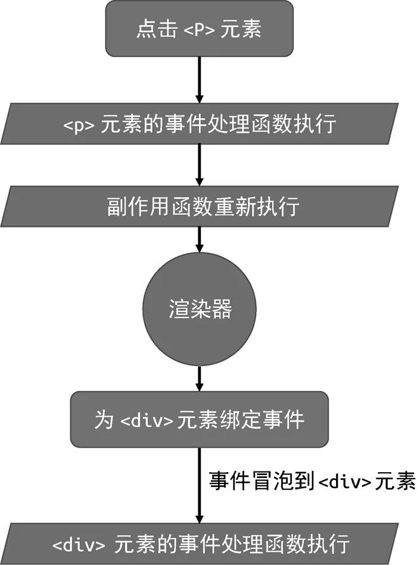
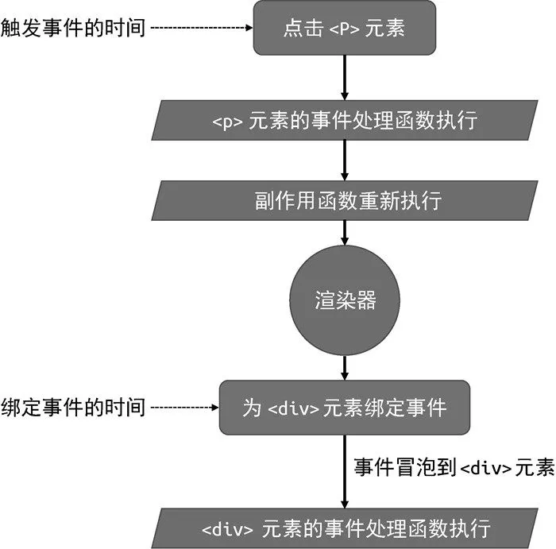
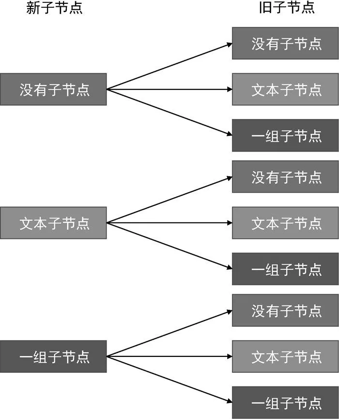

# 第8章挂载与更新(2)

## 8.7　事件的处理

本节我们将讨论如何处理事件，包括如何在虚拟节点中描述事件，如何把事件添加到 DOM 元素上，以及如何更新事件。

我们先来解决第一个问题，即如何在虚拟节点中描述事件。事件可以视作一种特殊的属性，因

```
此我们可以约定，在 vnode.props 对象中，凡是以字符串 on 开头的属性都视作事件。例
```

如：

```javascript
const vnode = {
  type: 'p',
  props: {
    // 使用 onXxx 描述事件
    onClick: () => {
      alert('clicked')
    }
  },
  children: 'text'
}
```

解决了事件在虚拟节点层面的描述问题后，我们再来看看如何将事件添加到 DOM 元素上。这

```
非常简单，只需要在 patchProps 中调用 addEventListener 函数来绑定事件即可，如下
```

面的代码所示：

```javascript
patchProps(el, key, prevValue, nextValue) {
  // 匹配以 on 开头的属性，视其为事件
  if (/^on/.test(key)) {
    // 根据属性名称得到对应的事件名称，例如 onClick ---> click
    const name = key.slice(2).toLowerCase()
    // 绑定事件，nextValue 为事件处理函数
    el.addEventListener(name, nextValue)
  } else if (key === 'class') {
    // 省略部分代码
  } else if (shouldSetAsProps(el, key, nextValue)) {
    // 省略部分代码
  } else {
    // 省略部分代码
  }
}
```

那么，更新事件要如何处理呢？按照一般的思路，我们需要先移除之前添加的事件处理函数，然后再将新的事件处理函数绑定到 DOM 元素上，如下面的代码所示：

```javascript
patchProps(el, key, prevValue, nextValue) {
  if (/^on/.test(key)) {
    const name = key.slice(2).toLowerCase()
    // 移除上一次绑定的事件处理函数
    prevValue && el.removeEventListener(name, prevValue)
    // 绑定新的事件处理函数
    el.addEventListener(name, nextValue)
  } else if (key === 'class') {
    // 省略部分代码
  } else if (shouldSetAsProps(el, key, nextValue)) {
    // 省略部分代码
  } else {
    // 省略部分代码
  }
}
```

这么做代码能够按照预期工作，但其实还有一种性能更优的方式来完成事件更新。在绑定事件

```
时，我们可以绑定一个伪造的事件处理函数 invoker，然后把真正的事件处理函数设置为
invoker.value 属性的值。这样当更新事件的时候，我们将不再需要调用
removeEventListener 函数来移除上一次绑定的事件，只需要更新 invoker.value 的
```

值即可，如下面的代码所示：

```javascript
patchProps(el, key, prevValue, nextValue) {
  if (/^on/.test(key)) {
    // 获取为该元素伪造的事件处理函数 invoker
    let invoker = el._vei
    const name = key.slice(2).toLowerCase()
    if (nextValue) {
      if (!invoker) {
        // 如果没有 invoker，则将一个伪造的 invoker 缓存到 el._vei 中
        // vei 是 vue event invoker 的首字母缩写
        invoker = el._vei = (e) => {
          // 当伪造的事件处理函数执行时，会执行真正的事件处理函数
          invoker.value(e)
        }
        // 将真正的事件处理函数赋值给 invoker.value
        invoker.value = nextValue
        // 绑定 invoker 作为事件处理函数
        el.addEventListener(name, invoker)
      } else {
        // 如果 invoker 存在，意味着更新，并且只需要更新 invoker.value 的值即可
        invoker.value = nextValue
      }
    } else if (invoker) {
      // 新的事件绑定函数不存在，且之前绑定的 invoker 存在，则移除绑定
      el.removeEventListener(name, invoker)
    }
  } else if (key === 'class') {
    // 省略部分代码
  } else if (shouldSetAsProps(el, key, nextValue)) {
    // 省略部分代码
  } else {
    // 省略部分代码
  }
}
```

观察上面的代码，事件绑定主要分为两个步骤。

```
先从 el._vei 中读取对应的 invoker，如果 invoker 不存在，则将伪造的 invoker
作为事件处理函数，并将它缓存到 el._vei 属性中。
把真正的事件处理函数赋值给 invoker.value 属性，然后把伪造的 invoker 函数作为
```

- 事件处理函数绑定到元素上。可以看到，当事件触发时，实际上执行的是伪造的事件处理函

```
数，在其内部间接执行了真正的事件处理函数 invoker.value(e)。
当更新事件时，由于 el._vei 已经存在了，所以我们只需要将 invoker.value 的值修改
为新的事件处理函数即可。这样，在更新事件时可以避免一次 removeEventListener 函数
```

的调用，从而提升了性能。实际上，伪造的事件处理函数的作用不止于此，它还能解决事件冒泡与事件更新之间相互影响的问题，下文会详细讲解。

```
但目前的实现仍然存在问题。现在我们将事件处理函数缓存在 el._vei 属性中，问题是，在
```

同一时刻只能缓存一个事件处理函数。这意味着，如果一个元素同时绑定了多种事件，将会出

```javascript
现事件覆盖的现象。例如同时给元素绑定 click 和 contextmenu 事件：
const vnode = {
  type: 'p',
  props: {
    onClick: () => {
      alert('clicked')
    },
    onContextmenu: () => {
      alert('contextmenu')
    }
  },
  children: 'text'
}
renderer.render(vnode, document.querySelector('#app'))
当渲染器尝试渲染这上面代码中给出的 vnode 时，会先绑定 click 事件，然后再绑定
contextmenu 事件。后绑定的 contextmenu 事件的处理函数将覆盖先绑定的 click 事件
的处理函数。为了解决事件覆盖的问题，我们需要重新设计 el._vei 的数据结构。我们应该
将 el._vei 设计为一个对象，它的键是事件名称，它的值则是对应的事件处理函数，这样就
```

不会发生事件覆盖的现象了，如下面的代码所示：

```javascript
patchProps(el, key, prevValue, nextValue) {
  if (/^on/.test(key)) {
    // 定义 el._vei 为一个对象，存在事件名称到事件处理函数的映射
    const invokers = el._vei || (el._vei = {})
    //根据事件名称获取 invoker
    let invoker = invokers[key]
    const name = key.slice(2).toLowerCase()
    if (nextValue) {
      if (!invoker) {
        // 将事件处理函数缓存到 el._vei[key] 下，避免覆盖
        invoker = el._vei[key] = (e) => {
          invoker.value(e)
        }
        invoker.value = nextValue
        el.addEventListener(name, invoker)
      } else {
        invoker.value = nextValue
      }
    } else if (invoker) {
      el.removeEventListener(name, invoker)
    }
  } else if (key === 'class') {
    // 省略部分代码
  } else if (shouldSetAsProps(el, key, nextValue)) {
    // 省略部分代码
  } else {
    // 省略部分代码
  }
}
```

另外，一个元素不仅可以绑定多种类型的事件，对于同一类型的事件而言，还可以绑定多个事

```
件处理函数。我们知道，在原生 DOM 编程中，当多次调用 addEventListener 函数为元素
```

绑定同一类型的事件时，多个事件处理函数可以共存，例如：

```javascript
el.addEventListener('click', fn1)
el.addEventListener('click', fn2)
当点击元素时，事件处理函数 fn1 和 fn2 都会执行。因此，为了描述同一个事件的多个事件
处理函数，我们需要调整 vnode.props 对象中事件的数据结构，如下面的代码所示：
const vnode = {
  type: 'p',
  props: {
    onClick: [
      // 第一个事件处理函数
      () => {
        alert('clicked 1')
      },
      // 第二个事件处理函数
      () => {
        alert('clicked 2')
      }
    ]
  },
  children: 'text'
}
renderer.render(vnode, document.querySelector('#app'))
```

在上面这段代码中，我们使用一个数组来描述事件，数组中的每个元素都是一个独立的事件处理函数，并且这些事件处理函数都能够正确地绑定到对应元素上。为了实现此功能，我们需要

```javascript
修改 patchProps 函数中事件处理相关的代码，如下面的代码所示：
patchProps(el, key, prevValue, nextValue) {
  if (/^on/.test(key)) {
    const invokers = el._vei || (el._vei = {})
    let invoker = invokers[key]
    const name = key.slice(2).toLowerCase()
    if (nextValue) {
      if (!invoker) {
        invoker = el._vei[key] = (e) => {
          // 如果 invoker.value 是数组，则遍历它并逐个调用事件处理函数
          if (Array.isArray(invoker.value)) {
            invoker.value.forEach(fn => fn(e))
          } else {
            // 否则直接作为函数调用
            invoker.value(e)
          }
        }
        invoker.value = nextValue
        el.addEventListener(name, invoker)
      } else {
        invoker.value = nextValue
      }
    } else if (invoker) {
      el.removeEventListener(name, invoker)
    }
  } else if (key === 'class') {
    // 省略部分代码
  } else if (shouldSetAsProps(el, key, nextValue)) {
    // 省略部分代码
  } else {
    // 省略部分代码
  }
}
在这段代码中，我们修改了 invoker 函数的实现。当 invoker 函数执行时，在调用真正的
事件处理函数之前，要先检查 invoker.value 的数据结构是否是数组，如果是数组则遍历
```

它，并逐个调用定义在数组中的事件处理函数。

## 8.8　事件冒泡与更新时机问题

在上一节中，我们介绍了基本的事件处理。本节我们将讨论事件冒泡与更新时机相结合所导致的问题。为了更清晰地描述问题，我们需要构造一个小例子：

```xml
const { effect, ref } = VueReactivity
<p>const bol = ref(false)</p>
effect(() => {
// 创建 vnode
const vnode = {
type: ‘div’,
props: bol.value ? {
onClick: () => {
alert(‘父元素 clicked’)
}
} : {},
children: [
{
type: ‘p’,
props: {
onClick: () => {
bol.value = true
}
},
children: ‘text’
}
]
}
// 渲染 vnode
renderer.render(vnode, document.querySelector(‘#app’))
})
这个例子比较复杂。在上面这段代码中，我们创建一个响应式数据 bol，它是一个 ref，初
始值为 false。接着，创建了一个 effect，并在副作用函数内调用 renderer.render 函
数来渲染 vnode。这里的重点在于该 vnode 对象，它描述了一个 div 元素，并且该 div 元
素具有一个 p 元素作为子节点。我们再来详细看看 div 元素以及 p 元素的特点。
div 元素
它的 props 对象的值是由一个三元表达式决定的。在首次渲染时，由于 bol.value 的值
为 false，所以它的 props 的值是一个空对象。
p 元素
它具有 click 点击事件，并且当点击它时，事件处理函数会将 bol.value 的值设置为
true。
结合上述特点，我们来思考一个问题：当首次渲染完成后，用鼠标点击 p 元素，会触发父级
div 元素的 click 事件的事件处理函数执行吗？
答案其实很明显，在首次渲染完成之后，由于 bol.value 的值为 false，所以渲染器并不
会为 div 元素绑定点击事件。当用鼠标点击 p 元素时，即使 click 事件可以从 p 元素冒泡
到父级 div 元素，但由于 div 元素没有绑定 click 事件的事件处理函数，所以什么都不会
发生。但事实是，当你尝试运行上面这段代码并点击 p 元素时，会发现父级 div 元素的
click 事件的事件处理函数竟然执行了。为什么会发生如此奇怪的现象呢？这其实与更新机
制有关，我们来分析一下当点击 p 元素时，到底发生了什么。
当点击 p 元素时，绑定到它身上的 click 事件处理函数会执行，于是 bol.value 的值被改
为 true。接下来的一步非常关键，由于 bol 是一个响应式数据，所以当它的值发生变化
时，会触发副作用函数重新执行。由于此时的 bol.value 已经变成了 true，所以在更新阶
段，渲染器会为父级 div 元素绑定 click 事件处理函数。当更新完成之后，点击事件才从 p
元素冒泡到父级 div 元素。由于此时 div 元素已经绑定了 click 事件的处理函数，因此就
发生了上述奇怪的现象。图 8-3 给出了当点击 p 元素后，整个更新和事件触发的流程图。
```

根据图 8-3 我们能够发现，之所以会出现上述奇怪的现象，是因为更新操作发生在事件冒泡之前，即为 div 元素绑定事件处理函数发生在事件冒泡之前。那如何避免这个问题呢？一个很自然的想法是，能否将绑定事件的动作挪到事件冒泡之后？但这个想法不可靠，因为我们无法知道事件冒泡是否完成，以及完成到什么程度。你可能会想，Vue.js 的更新难道不是在一个异步的微任务队列中进行的吗？那是不是自然能够避免这个问题了呢？其实不然，换句话说，微任务会穿插在由事件冒泡触发的多个事件处理函数之间被执行。因此，即使把绑定事件的动作放到微任务中，也无法避免这个问题。

那应该如何解决呢？其实，仔细观察图 8-3 就会发现，触发事件的时间与绑定事件的时间之间是有联系的，如图 8-4 所示。



- 图 8-3　更新和事件触发的流程



- 图 8-4　触发事件的时间与绑定事件的时间之间的联系

由图 8-4 可以发现，事件触发的时间要早于事件处理函数被绑定的时间。这意味着当一个事件触发时，目标元素上还没有绑定相关的事件处理函数，我们可以根据这个特点来解决问题：屏蔽所有绑定时间晚于事件触发时间的事件处理函数的执行。基于此，我们可以调整

```javascript
patchProps 函数中关于事件的代码，如下：
patchProps(el, key, prevValue, nextValue) {
  if (/^on/.test(key)) {
    const invokers = el._vei || (el._vei = {})
    let invoker = invokers[key]
    const name = key.slice(2).toLowerCase()
    if (nextValue) {
      if (!invoker) {
        invoker = el._vei[key] = (e) => {
          // e.timeStamp 是事件发生的时间
          // 如果事件发生的时间早于事件处理函数绑定的时间，则不执行事件处理函数
          if (e.timeStamp < invoker.attached) return
          if (Array.isArray(invoker.value)) {
            invoker.value.forEach(fn => fn(e))
          } else {
            invoker.value(e)
          }
        }
        invoker.value = nextValue
        // 添加 invoker.attached 属性，存储事件处理函数被绑定的时间
        invoker.attached = performance.now()
        el.addEventListener(name, invoker)
      } else {
        invoker.value = nextValue
      }
    } else if (invoker) {
      el.removeEventListener(name, invoker)
    }
  } else if (key === 'class') {
    // 省略部分代码
  } else if (shouldSetAsProps(el, key, nextValue)) {
    // 省略部分代码
  } else {
    // 省略部分代码
  }
}
```

如上面的代码所示，我们在原来的基础上只添加了两行代码。首先，我们为伪造的事件处理函

```
数添加了 invoker.attached 属性，用来存储事件处理函数被绑定的时间。然后，在
invoker 执行的时候，通过事件对象的 e.timeStamp 获取事件发生的时间。最后，比较两
```

者，如果事件处理函数被绑定的时间晚于事件发生的时间，则不执行该事件处理函数。

这里有必要指出的是，在关于时间的存储和比较方面，我们使用的是高精时间，即

```
performance.now。但根据浏览器的不同，e.timeStamp 的值也会有所不同。它既可能是
```

高精时间，也可能是非高精时间。因此，严格来讲，这里需要做兼容处理。不过在 Chrome

```
49、Firefox 54、Opera 36 以及之后的版本中，e.timeStamp 的值都是高精时间。
```

## 8.9　更新子节点

前几节我们讲解了元素属性的更新，包括普通标签属性和事件。接下来，我们将讨论如何更新

```
元素的子节点。首先，回顾一下元素的子节点是如何被挂载的，如下面 mountElement 函数
```

的代码所示：

```sql
function mountElement(vnode, container) {
  const el = vnode.el = createElement(vnode.type)
<p>// 挂载子节点，首先判断 children 的类型
// 如果是字符串类型，说明是文本子节点
if (typeof vnode.children === ‘string’) {
setElementText(el, vnode.children)
} else if (Array.isArray(vnode.children)) {
// 如果是数组，说明是多个子节点
vnode.children.forEach(child => {
patch(null, child, el)
})
}</p>
<p>if (vnode.props) {
for (const key in vnode.props) {
patchProps(el, key, null, vnode.props[key])
}
}</p>
insert(el, container)
}
```

在挂载子节点时，首先要区分其类型：

```
如果 vnode.children 是字符串，则说明元素具有文本子节点；
如果 vnode.children 是数组，则说明元素具有多个子节点。
```

这里需要思考的是，为什么要区分子节点的类型呢？其实这是一个规范性的问题，因为只有子节点的类型是规范化的，才有利于我们编写更新逻辑。因此，在具体讨论如何更新子节点之

```
前，我们有必要先规范化 vnode.children。那应该设定怎样的规范呢？为了搞清楚这个问
```

题，我们需要先搞清楚在一个 HTML 页面中，元素的子节点都有哪些情况，如下面的 HTML代码所示：

```xml
<!-- 没有子节点 -->
<div></div>
<!-- 文本子节点 -->
<div>Some Text</div>
<!-- 多个子节点 -->
<div>
  <p/>
  <p/>
</div>
```

对于一个元素来说，它的子节点无非有以下三种情况。

```
没有子节点，此时 vnode.children 的值为 null。
具有文本子节点，此时 vnode.children 的值为字符串，代表文本的内容。
```

- 其他情况，无论是单个元素子节点，还是多个子节点（可能是文本和元素的混合），都可以用数组来表示。

如下面的代码所示：

```
// 没有子节点
vnode = {
  type: 'div',
  children: null
}
// 文本子节点
vnode = {
  type: 'div',
  children: 'Some Text'
}
// 其他情况，子节点使用数组表示
vnode = {
  type: 'div',
  children: [
    { type: 'p' },
    'Some Text'
  ]
}
现在，我们已经规范化了 vnode.children 的类型。既然一个 vnode 的子节点可能有三种
```

情况，那么当渲染器执行更新时，新旧子节点都分别是三种情况之一。所以，我们可以总结出更新子节点时全部九种可能，如图 8-5 所示。



- 图 8-5　新旧子节点的关系

但落实到代码，我们会发现其实并不需要完全覆盖这九种可能。接下来我们就开始着手实现，

```javascript
如下面 patchElement 函数的代码所示：
function patchElement(n1, n2) {
  const el = n2.el = n1.el
  const oldProps = n1.props
  const newProps = n2.props
  // 第一步：更新 props
  for (const key in newProps) {
    if (newProps[key] !== oldProps[key]) {
      patchProps(el, key, oldProps[key], newProps[key])
    }
  }
  for (const key in oldProps) {
    if (!(key in newProps)) {
      patchProps(el, key, oldProps[key], null)
    }
  }
// 第二步：更新 children
patchChildren(n1, n2, el)
}
```

如上面的代码所示，更新子节点是对一个元素进行打补丁的最后一步操作。我们将它封装到

```
patchChildren 函数中，并将新旧 vnode 以及当前正在被打补丁的 DOM 元素 el 作为参
```

数传递给它。

```javascript
patchChildren 函数的实现如下：
function patchChildren(n1, n2, container) {
  // 判断新子节点的类型是否是文本节点
  if (typeof n2.children === 'string') {
    // 旧子节点的类型有三种可能：没有子节点、文本子节点以及一组子节点
    // 只有当旧子节点为一组子节点时，才需要逐个卸载，其他情况下什么都不需要做
    if (Array.isArray(n1.children)) {
      n1.children.forEach((c) => unmount(c))
    }
    // 最后将新的文本节点内容设置给容器元素
    setElementText(container, n2.children)
  }
}
```

如上面这段代码所示，首先，我们检测新子节点的类型是否是文本节点，如果是，则还要检查旧子节点的类型。旧子节点的类型可能有三种情况，分别是：没有子节点、文本子节点或一组子节点。如果没有旧子节点或者旧子节点的类型是文本子节点，那么只需要将新的文本内容设置给容器元素即可；如果旧子节点存在，并且不是文本子节点，则说明它的类型是一组子节

```
点。这时我们需要循环遍历它们，并逐个调用 unmount 函数进行卸载。
```

如果新子节点的类型不是文本子节点，我们需要再添加一个判断分支，判断它是否是一组子节点，如下面的代码所示：

```xml
function patchChildren(n1, n2, container) {
  if (typeof n2.children === 'string') {
    // 省略部分代码
  } else if (Array.isArray(n2.children)) {
    // 说明新子节点是一组子节点
<pre><code> // 判断旧子节点是否也是一组子节点
if (Array.isArray(n1.children)) {
  // 代码运行到这里，则说明新旧子节点都是一组子节点，这里涉及核心的 Diff 算法
} else {
  // 此时：
  // 旧子节点要么是文本子节点，要么不存在
  // 但无论哪种情况，我们都只需要将容器清空，然后将新的一组子节点逐个挂载
  setElementText(container, '')
  n2.children.forEach(c =&gt; patch(null, c, container))
}
</code></pre> // 判断旧子节点是否也是一组子节点
if (Array.isArray(n1.children)) {
  // 代码运行到这里，则说明新旧子节点都是一组子节点，这里涉及核心的 Diff 算法
} else {
  // 此时：
  // 旧子节点要么是文本子节点，要么不存在
  // 但无论哪种情况，我们都只需要将容器清空，然后将新的一组子节点逐个挂载
  setElementText(container, '')
  n2.children.forEach(c =&gt; patch(null, c, container))
}
}
}
在上面这段代码中，我们新增了对 n2.children 类型的判断：检测它是否是一组子节点，
```

如果是，接着再检查旧子节点的类型。同样，旧子节点也有三种可能：没有子节点、文本子节点和一组子节点。对于没有旧子节点或者旧子节点是文本子节点的情况，我们只需要将容器元素清空，然后逐个将新的一组子节点挂载到容器中即可。如果旧子节点也是一组子节点，则涉及新旧两组子节点的比对，这里就涉及我们常说的 Diff 算法。但由于我们目前还没有讲解 Diff算法的工作方式，因此可以暂时用一种相对傻瓜式的方法来保证功能可用。这个方法很简单，即把旧的一组子节点全部卸载，再将新的一组子节点全部挂载，如下面的代码所示：

```javascript
function patchChildren(n1, n2, container) {
  if (typeof n2.children === 'string') {
    if (Array.isArray(n1.children)) {
      n1.children.forEach((c) => unmount(c))
    }
    setElementText(container, n2.children)
  } else if (Array.isArray(n2.children)) {
    if (Array.isArray(n1.children)) {
      // 将旧的一组子节点全部卸载
      n1.children.forEach(c => unmount(c))
      // 再将新的一组子节点全部挂载到容器中
      n2.children.forEach(c => patch(null, c, container))
    } else {
      setElementText(container, '')
      n2.children.forEach(c => patch(null, c, container))
    }
  }
}
```

这样做虽然能够实现需求，但并不是最优解，我们将在下一章讲解如何使用 Diff 算法高效地更新两组子节点。现在，对于新子节点来说，还剩下最后一种情况，即新子节点不存在，如下面的代码所示：

```javascript
function patchChildren(n1, n2, container) {
  if (typeof n2.children === 'string') {
    if (Array.isArray(n1.children)) {
      n1.children.forEach((c) => unmount(c))
    }
    setElementText(container, n2.children)
  } else if (Array.isArray(n2.children)) {
    if (Array.isArray(n1.children)) {
      //
    } else {
      setElementText(container, '')
      n2.children.forEach(c => patch(null, c, container))
    }
  } else {
    // 代码运行到这里，说明新子节点不存在
    // 旧子节点是一组子节点，只需逐个卸载即可
    if (Array.isArray(n1.children)) {
      n1.children.forEach(c => unmount(c))
    } else if (typeof n1.children === 'string') {
      // 旧子节点是文本子节点，清空内容即可
      setElementText(container, '')
    }
    // 如果也没有旧子节点，那么什么都不需要做
  }
}
可以看到，如果代码走到了 else 分支，则说明新子节点不存在。这时，对于旧子节点来说仍
```

然有三种可能：没有子节点、文本子节点以及一组子节点。如果旧子节点也不存在，则什么都不需要做；如果旧子节点是一组子节点，则逐个卸载即可；如果旧的子节点是文本子节点，则清空文本内容即可。

## 8.10　文本节点和注释节点

```
在前面的章节中，我们只讲解了一种类型的 vnode，即用于描述普通标签的 vnode，如下面
```

的代码所示：

```javascript
const vnode = {
  type: 'div'
}
我们用 vnode.type 来描述元素的名称，它是一个字符串类型的值。
```

接下来，我们讨论如何用虚拟 DOM 描述更多类型的真实 DOM。其中最常见的两种节点类型是文本节点和注释节点，如下面的 HTML 代码所示：

```xml
<div><!-- 注释节点 -->我是文本节点</div>
<div> 是元素节点，它包含一个注释节点和一个文本节点。那么，如何使用 vnode 描述注释
```

节点和文本节点呢？

```
我们知道，vnode.type 属性能够代表一个 vnode 的类型。如果 vnode.type 的值是字符
```

串类型，则代表它描述的是普通标签，并且该值就代表标签的名称。但注释节点与文本节点不同于普通标签节点，它们不具有标签名称，所以我们需要人为创造一些唯一的标识，并将其作

```javascript
为注释节点和文本节点的 type 属性值，如下面的代码所示：
// 文本节点的 type 标识
const Text = Symbol()
const newVNode = {
  // 描述文本节点
  type: Text,
  children: '我是文本内容'
}
// 注释节点的 type 标识
const Comment = Symbol()
const newVNode = {
// 描述注释节点
type: Comment,
children: ‘我是注释内容’
}
可以看到，我们分别为文本节点和注释节点创建了 symbol 类型的值，并将其作为
vnode.type 属性的值。这样就能够用 vnode 来描述文本节点和注释节点了。由于文本节点
和注释节点只关心文本内容，所以我们用 vnode.children 来存储它们对应的文本内容。
有了用于描述文本节点和注释节点的 vnode 对象后，我们就可以使用渲染器来渲染它们了，
```

如下面的代码所示：

```sql
function patch(n1, n2, container) {
  if (n1 && n1.type !== n2.type) {
    unmount(n1)
    n1 = null
  }
<p>const { type } = n2</p>
if (typeof type === ‘string’) {
if (!n1) {
mountElement(n2, container)
} else {
patchElement(n1, n2)
}
} else if (type === Text) { // 如果新 vnode 的类型是 Text，则说明该 vnode 描述的是文本节
// 如果没有旧节点，则进行挂载
if (!n1) {
// 使用 createTextNode 创建文本节点
const el = n2.el = document.createTextNode(n2.children)
// 将文本节点插入到容器中
insert(el, container)
} else {
// 如果旧 vnode 存在，只需要使用新文本节点的文本内容更新旧文本节点即可
const el = n2.el = n1.el
if (n2.children !== n1.children) {
el.nodeValue = n2.children
}
}
}
}
观察上面这段代码，我们增加了一个判断条件，即判断表达式 type === Text 是否成立，
如果成立，则说明要处理的节点是文本节点。接着，还需要判断旧的虚拟节点（n1）是否存
在，如果不存在，则直接挂载新的虚拟节点（n2）。这里我们使用 createTextNode 函数来
创建文本节点，并将它插入到容器元素中。如果旧的虚拟节点（n1）存在，则需要更新文本
内容，这里我们使用文本节点的 nodeValue 属性完成文本内容的更新。
另外，从上面的代码中我们还能注意到，patch 函数依赖浏览器平台特有的 API，即
createTextNode 和 el.nodeValue。为了保证渲染器核心的跨平台能力，我们需要将这
```

两个操作 DOM 的 API 封装到渲染器的选项中，如下面的代码所示：

```sql
const renderer = createRenderer({
  createElement(tag) {
    // 省略部分代码
  },
  setElementText(el, text) {
    // 省略部分代码
  },
  insert(el, parent, anchor = null) {
    // 省略部分代码
  },
  createText(text) {
    return document.createTextNode(text)
  },
  setText(el, text) {
    el.nodeValue = text
  },
  patchProps(el, key, prevValue, nextValue) {
    // 省略部分代码
  }
})
在上面这段代码中，我们在调用 createRenderer 函数创建渲染器时，传递的选项参数中封
装了 createText 函数和 setText 函数。这两个函数分别用来创建文本节点和设置文本节
```

点的内容。我们可以用这两个函数替换渲染器核心代码中所依赖的浏览器特有的 API，如下面的代码所示：

```sql
function patch(n1, n2, container) {
  if (n1 && n1.type !== n2.type) {
    unmount(n1)
    n1 = null
  }
<p>const { type } = n2</p>
if (typeof type === ‘string’) {
if (!n1) {
mountElement(n2, container)
} else {
patchElement(n1, n2)
}
} else if (type === Text) {
if (!n1) {
// 调用 createText 函数创建文本节点
const el = n2.el = createText(n2.children)
insert(el, container)
} else {
const el = n2.el = n1.el
if (n2.children !== n1.children) {
// 调用 setText 函数更新文本节点的内容
setText(el, n2.children)
}
}
}
}
```

注释节点的处理方式与文本节点的处理方式类似。不同的是，我们需要使用

```
document.createComment 函数创建注释节点元素。
```

## 8.11　Fragment

```
Fragment（片断）是 Vue.js 3 中新增的一个 vnode 类型。在具体讨论 Fragment 的实现
之前，我们有必要先了解为什么需要 Fragment。请思考这样的场景，假设我们要封装一组
```

列表组件：

```xml
<List>
  <Items />
</List>
整体由两个组件构成，即 <List> 组件和 <Items> 组件。其中 <List> 组件会渲染一个
<ul> 标签作为包裹层：
<!-- List.vue -->
<template>
  <ul>
    <slot />
  </ul>
</template>
而 <Items> 组件负责渲染一组 <li> 列表：
<!-- Items.vue -->
<template>
  <li>1</li>
  <li>2</li>
  <li>3</li>
</template>
```

这在 Vue.js 2 中是无法实现的。在 Vue.js 2 中，组件的模板不允许存在多个根节点。这意味

```
着，一个 <Items> 组件最多只能渲染一个 <li> 标签：
```

```sql
<!-- Item.vue -->
<template>
  <li>1</li>
</template>
因此在 Vue.js 2 中，我们通常需要配合 v-for 指令来达到目的：
<List>
  <Items v-for="item in list" />
</List>
类似的组合还有 <select> 标签与 <option> 标签。
而 Vue.js 3 支持多根节点模板，所以不存在上述问题。那么，Vue.js 3 是如何用 vnode 来描
述多根节点模板的呢？答案是，使用 Fragment，如下面的代码所示：
const Fragment = Symbol()
const vnode = {
  type: Fragment,
  children: [
    { type: 'li', children: 'text 1' },
    { type: 'li', children: 'text 2' },
    { type: 'li', children: 'text 3' }
  ]
}
```

与文本节点和注释节点类似，片段也没有所谓的标签名称，因此我们也需要为片段创建唯一标

```
识，即 Fragment。对于 Fragment 类型的 vnode 的来说，它的 children 存储的内容就
是模板中所有根节点。有了 Fragment 后，我们就可以用它来描述 Items.vue 组件的模板
```

了：

```xml
<!-- Items.vue -->
<template>
  <li>1</li>
  <li>2</li>
  <li>3</li>
</template>
```

这段模板对应的虚拟节点是：

```javascript
const vnode = {
  type: Fragment,
  children: [
    { type: 'li', children: '1' },
    { type: 'li', children: '2' },
    { type: 'li', children: '3' }
  ]
}
```

类似地，对于如下模板：

```xml
<List>
  <Items />
</List>
```

我们可以用下面这个虚拟节点来描述它：

```xml
const vnode = {
  type: 'ul',
  children: [
    {
      type: Fragment,
      children: [
        { type: 'li', children: '1' },
        { type: 'li', children: '2' },
        { type: 'li', children: '3' }
      ]
    }
  ]
}
可以看到，vnode.children 数组包含一个类型为 Fragment 的虚拟节点。
当渲染器渲染 Fragment 类型的虚拟节点时，由于 Fragment 本身并不会渲染任何内容，所
以渲染器只会渲染 Fragment 的子节点，如下面的代码所示：
function patch(n1, n2, container) {
  if (n1 && n1.type !== n2.type) {
    unmount(n1)
    n1 = null
  }
<p>const { type } = n2</p>
if (typeof type === ‘string’) {
// 省略部分代码
} else if (type === Text) {
// 省略部分代码
} else if (type === Fragment) { // 处理 Fragment 类型的 vnode
if (!n1) {
// 如果旧 vnode 不存在，则只需要将 Fragment 的 children 逐个挂载即可
n2.children.forEach(c => patch(null, c, container))
} else {
// 如果旧 vnode 存在，则只需要更新 Fragment 的 children 即可
patchChildren(n1, n2, container)
}
}
}
观察上面这段代码，我们在 patch 函数中增加了对 Fragment 类型虚拟节点的处理。渲染
Fragment 的逻辑比想象中要简单得多，因为从本质上来说，渲染 Fragment 与渲染普通元
素的区别在于，Fragment 本身并不渲染任何内容，所以只需要处理它的子节点即可。
但仍然需要注意一点，unmount 函数也需要支持 Fragment 类型的虚拟节点的卸载，如下面
unmount 函数的代码所示：
function unmount(vnode) {
  // 在卸载时，如果卸载的 vnode 类型为 Fragment，则需要卸载其 children
  if (vnode.type === Fragment) {
    vnode.children.forEach(c => unmount(c))
    return
  }
  const parent = vnode.el.parentNode
  if (parent) {
    parent.removeChild(vnode.el)
  }
}
当卸载 Fragment 类型的虚拟节点时，由于 Fragment 本身并不会渲染任何真实 DOM，所
以只需要遍历它的 children 数组，并将其中的节点逐个卸载即可。
```

## 8.12　总结

在本章中，我们首先讨论了如何挂载子节点，以及节点的属性。对于子节点，只需要递归地调

```
用 patch 函数完成挂载即可。而节点的属性比想象中的复杂，它涉及两个重要的概念：
```

HTML Attributes 和 DOM Properties。为元素设置属性时，我们不能总是使用

```
setAttribute 函数，也不能总是通过元素的 DOM Properties 来设置。至于如何正确地为
元素设置属性，取决于被设置属性的特点。例如，表单元素的 el.form 属性是只读的，因此
只能使用 setAttribute 函数来设置。
接着，我们讨论了特殊属性的处理。以 class 为例，Vue.js 对 class 属性做了增强，它允
许我们为 class 指定不同类型的值。但在把这些值设置给 DOM 元素之前，要对值进行正常
化。我们还讨论了为元素设置 class 的三种方式及其性能情况。其中，el.className 的
性能最优，所以我们选择在 patchProps 函数中使用 el.className 来完成 class 属性
的设置。除了 class 属性之外，Vue.js 也对 style 属性做了增强，所以 style 属性也需要
```

做类似的处理。

```
然后，我们讨论了卸载操作。一开始，我们直接使用 innerHTML 来清空容器元素，但是这样
```

存在诸多问题。

- 容器的内容可能是由某个或多个组件渲染的，当卸载操作发生时，应该正确地调用这些组件

```
的 beforeUnmount、unmounted 等生命周期函数。
```

- 即使内容不是由组件渲染的，有的元素存在自定义指令，我们应该在卸载操作发生时正确地执行对应的指令钩子函数。

```
使用 innerHTML 清空容器元素内容的另一个缺陷是，它不会移除绑定在 DOM 元素上的事
```

- 件处理函数。

```
因此，我们不能直接使用 innerHTML 来完成卸载任务。为了解决这些问题，我们封装了
unmount 函数。该函数是以一个 vnode 的维度来完成卸载的，它会根据 vnode.el 属性取
```

得该虚拟节点对应的真实 DOM，然后调用原生 DOM API 完成 DOM 元素的卸载。这样做还有两点额外的好处。

```
在 unmount 函数内，我们有机会调用绑定在 DOM 元素上的指令钩子函数，例如
beforeUnmount、unmounted 等。
当 unmount 函数执行时，我们有机会检测虚拟节点 vnode 的类型。如果该虚拟节点描述
```

- 的是组件，则我们也有机会调用组件相关的生命周期函数。

```
而后，我们讨论了 vnode 类型的区分。渲染器在执行更新时，需要优先检查新旧 vnode 所
```

描述的内容是否相同。只有当它们所描述的内容相同时，才有打补丁的必要。另外，即使它们

```
描述的内容相同，我们也需要进一步检查它们的类型，即检查 vnode.type 属性值的类型，
```

据此判断它描述的具体内容是什么。如果类型是字符串，则它描述的是普通标签元素，这时我

```
们会调用 mountElement 和 patchElement 来完成挂载和打补丁；如果类型是对象，则它
描述的是组件，这时需要调用 mountComponent 和 patchComponent 来完成挂载和打补
```

丁。

```
我们还讲解了事件的处理。首先介绍了如何在虚拟节点中描述事件，我们把 vnode.props
对象中以字符串 on 开头的属性当作事件对待。接着，我们讲解了如何绑定和更新事件。在更
新事件的时候，为了提升性能，我们伪造了 invoker 函数，并把真正的事件处理函数存储在
invoker.value 属性中，当事件需要更新时，只更新 invoker.value 的值即可，这样可
以避免一次 removeEventListener 函数的调用。
```

我们还讲解了如何处理事件与更新时机的问题。解决方案是，利用事件处理函数被绑定到DOM 元素的时间与事件触发时间之间的差异。我们需要屏蔽所有绑定时间晚于事件触发时间的事件处理函数的执行。

```
之后，我们讨论了子节点的更新。我们对虚拟节点中的 children 属性进行了规范化，规定
vnode.children 属性只能有如下三种类型。
```

- 字符串类型：代表元素具有文本子节点。

- 数组类型：代表元素具有一组子节点。

```
null：代表元素没有子节点。
在更新时，新旧 vnode 的子节点都有可能是以上三种情况之一，所以在执行更新时一共要考
```

虑九种可能，即图 8-5 所展示的那样。但落实到代码中，我们并不需要罗列所有情况。另外，

```
当新旧 vnode 都具有一组子节点时，我们采用了比较笨的方式来完成更新，即卸载所有旧子
```

节点，再挂载所有新子节点。更好的做法是，通过 Diff 算法比较新旧两组子节点，试图最大程度复用 DOM 元素。我们会在后续章节中详细讲解 Diff 算法的工作原理。

```
我们还讨论了如何使用虚拟节点来描述文本节点和注释节点。我们利用了 symbol 类型值的
唯一性，为文本节点和注释节点分别创建唯一标识，并将其作为 vnode.type 属性的值。
最后，我们讨论了 Fragment 及其用途。渲染器渲染 Fragment 的方式类似于渲染普通标
签，不同的是，Fragment 本身并不会渲染任何 DOM 元素。所以，只需要渲染一个
Fragment 的所有子节点即可。
```
