# 第9章简单Diff算法

```
从本章开始，我们将介绍渲染器的核心 Diff 算法。简单来说，当新旧 vnode 的子节点都是一
```

组节点时，为了以最小的性能开销完成更新操作，需要比较两组子节点，用于比较的算法就叫作 Diff 算法。我们知道，操作 DOM 的性能开销通常比较大，而渲染器的核心 Diff 算法就是为了解决这个问题而诞生的。

## 9.1　减少 DOM 操作的性能开销

核心 Diff 只关心新旧虚拟节点都存在一组子节点的情况。在上一章中，我们针对两组子节点的更新，采用了一种简单直接的手段，即卸载全部旧子节点，再挂载全部新子节点。这么做的确可以完成更新，但由于没有复用任何 DOM 元素，所以会产生极大的性能开销。

以下面的新旧虚拟节点为例：

```javascript
// 旧 vnode
const oldVNode = {
  type: 'div',
  children: [
    { type: 'p', children: '1' },
    { type: 'p', children: '2' },
    { type: 'p', children: '3' }
  ]
}
// 新 vnode
const newVNode = {
type: ‘div’,
children: [
{ type: ‘p’, children: ‘4’ },
{ type: ‘p’, children: ‘5’ },
{ type: ‘p’, children: ‘6’ }
]
}
```

按照之前的做法，当更新子节点时，我们需要执行 6 次 DOM 操作：

- 卸载所有旧子节点，需要 3 次 DOM 删除操作；

- 挂载所有新子节点，需要 3 次 DOM 添加操作。

```
但是，通过观察上面新旧 vnode 的子节点，可以发现：
更新前后的所有子节点都是 p 标签，即标签元素不变；
只有 p 标签的子节点（文本节点）会发生变化。
例如，oldVNode 的第一个子节点是一个 p 标签，且该 p 标签的子节点类型是文本节点，内
容是 '1'。而 newVNode  的第一个子节点也是一个 p 标签，它的子节点的类型也是文本节
点，内容是 '4'。可以发现，更新前后改变的只有 p 标签文本节点的内容。所以，最理想的
更新方式是，直接更新这个 p 标签的文本节点的内容。这样只需要一次 DOM 操作，即可完成
一个 p 标签更新。新旧虚拟节点都有 3 个 p 标签作为子节点，所以一共只需要 3 次 DOM 操
```

作就可以完成全部节点的更新。相比原来需要执行 6 次 DOM 操作才能完成更新的方式，其性能提升了一倍。

```
按照这个思路，我们可以重新实现两组子节点的更新逻辑，如下面 patchChildren 函数的
```

代码所示：

```javascript
function patchChildren(n1, n2, container) {
  if (typeof n2.children === 'string') {
    // 省略部分代码
  } else if (Array.isArray(n2.children)) {
    // 重新实现两组子节点的更新方式
    // 新旧 children
    const oldChildren = n1.children
    const newChildren = n2.children
    // 遍历旧的 children
    for (let i = 0; i < oldChildren.length; i++) {
      // 调用 patch 函数逐个更新子节点
      patch(oldChildren[i], newChildren[i])
    }
  } else {
    // 省略部分代码
  }
}
在这段代码中，oldChildren 和 newChildren 分别是旧的一组子节点和新的一组子节
点。我们遍历前者，并将两者中对应位置的节点分别传递给 patch 函数进行更新。patch 函
```

数在执行更新时，发现新旧子节点只有文本内容不同，因此只会更新其文本节点的内容。这样，我们就成功地将 6 次 DOM 操作减少为 3 次。图 9-1 是整个更新过程的示意图，其中菱形代表新子节点，矩形代表旧子节点，圆形代表真实 DOM 节点。

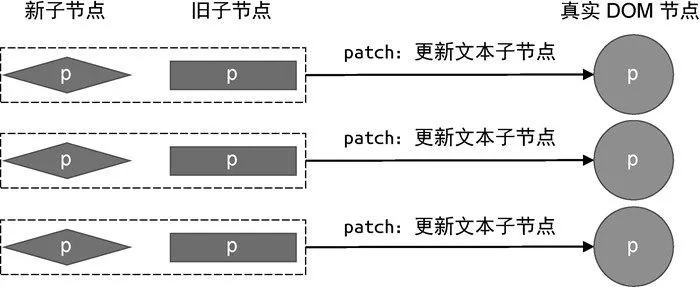

- 图 9-1　仅更新文本子节点

这种做法虽然能够减少 DOM 操作次数，但问题也很明显。在上面的代码中，我们通过遍历旧的一组子节点，并假设新的一组子节点的数量与之相同，只有在这种情况下，这段代码才能正确地工作。但是，新旧两组子节点的数量未必相同。当新的一组子节点的数量少于旧的一组子节点的数量时，意味着有些节点在更新后应该被卸载，如图 9-2 所示。

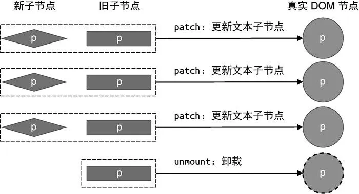

- 图 9-2　卸载已经不存在的节点

```
在图 9-2 中，旧的一组子节点中一共有 4 个 p 标签，而新的一组子节点中只有 3 个 p 标签。
这说明，在更新过程中，需要将不存在的 p 标签卸载。类似地，新的一组子节点的数量也可
```

能比旧的一组子节点的数量多，如图 9-3 所示。

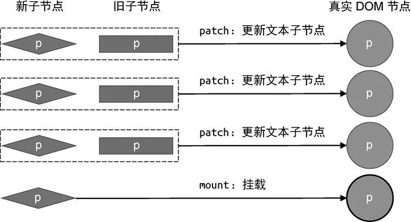

- 图 9-3　挂载新的节点

```
在图 9-3 中，新的一组子节点比旧的一组子节点多了一个 p 标签。在这种情况下，我们应该
```

挂载新增节点。

通过上面的分析我们意识到，在进行新旧两组子节点的更新时，不应该总是遍历旧的一组子节点或遍历新的一组子节点，而是应该遍历其中长度较短的那一组。这样，我们才能够尽可能多

```
地调用 patch 函数进行更新。接着，再对比新旧两组子节点的长度，如果新的一组子节点更
```

长，则说明有新子节点需要挂载，否则说明有旧子节点需要卸载。最终实现如下：

```javascript
function patchChildren(n1, n2, container) {
  if (typeof n2.children === 'string') {
    // 省略部分代码
  } else if (Array.isArray(n2.children)) {
    const oldChildren = n1.children
    const newChildren = n2.children
    // 旧的一组子节点的长度
    const oldLen = oldChildren.length
    // 新的一组子节点的长度
    const newLen = newChildren.length
    // 两组子节点的公共长度，即两者中较短的那一组子节点的长度
    const commonLength = Math.min(oldLen, newLen)
    // 遍历 commonLength 次
    for (let i = 0; i < commonLength; i++) {
      patch(oldChildren[i], newChildren[i], container)
    }
    // 如果 newLen > oldLen，说明有新子节点需要挂载
    if (newLen > oldLen) {
      for (let i = commonLength; i < newLen; i++) {
        patch(null, newChildren[i], container)
      }
    } else if (oldLen > newLen) {
      // 如果 oldLen > newLen，说明有旧子节点需要卸载
      for (let i = commonLength; i < oldLen; i++) {
        unmount(oldChildren[i])
      }
    }
  } else {
    // 省略部分代码
  }
}
```

这样，无论新旧两组子节点的数量关系如何，渲染器都能够正确地挂载或卸载它们。

## 9.2　DOM 复用与 key 的作用

在上一节中，我们通过减少 DOM 操作的次数，提升了更新性能。但这种方式仍然存在可优化的空间。举个例子，假设新旧两组子节点的内容如下：

```
// oldChildren
[
  { type: 'p' },
  { type: 'div' },
  { type: 'span' }
]
// newChildren
[
{ type: ‘span’ },
{ type: ‘p’ },
{ type: ‘div’ }
]
```

如果使用上一节介绍的算法来完成上述两组子节点的更新，则需要 6 次 DOM 操作。

```
调用 patch 函数在旧子节点 { type: 'p' } 与新子节点 { type: 'span' } 之间打
补丁，由于两者是不同的标签，所以 patch 函数会卸载 { type: 'p' }，然后再挂载 {
type: 'span' }，这需要执行 2 次 DOM 操作。
与第 1 步类似，卸载旧子节点 { type: 'div' }，然后再挂载新子节点 { type: 'p'
}，这也需要执行 2 次 DOM 操作。
与第 1 步类似，卸载旧子节点 { type: 'span' }，然后再挂载新子节点 { type:
'div' }，同样需要执行 2 次 DOM 操作。
```

因此，一共进行 6 次 DOM 操作才能完成上述案例的更新。但是，观察新旧两组子节点，很容易发现，二者只是顺序不同。所以最优的处理方式是，通过 DOM 的移动来完成子节点的更新，这要比不断地执行子节点的卸载和挂载性能更好。但是，想要通过 DOM 的移动来完成更新，必须要保证一个前提：新旧两组子节点中的确存在可复用的节点。这个很好理解，如果新的子节点没有在旧的一组子节点中出现，就无法通过移动节点的方式完成更新。所以现在问题变成了：应该如何确定新的子节点是否出现在旧的一组子节点中呢？拿上面的例子来说，怎么

```
确定新的一组子节点中第 1 个子节点 { type: 'span' } 与旧的一组子节点中第 3 个子节
点相同呢？一种解决方案是，通过 vnode.type 来判断，只要 vnode.type 的值相同，我
```

们就认为两者是相同的节点。但这种方式并不可靠，思考如下例子：

```
// oldChildren
[
  { type: 'p', children: '1' },
  { type: 'p', children: '2' },
  { type: 'p', children: '3' }
]
// newChildren
[
{ type: ‘p’, children: ‘3’ },
{ type: ‘p’, children: ‘1’ },
{ type: ‘p’, children: ‘2’ }
]
```

观察上面两组子节点，我们发现，这个案例可以通过移动 DOM 的方式来完成更新。但是所有

```
节点的 vnode.type 属性值都相同，这导致我们无法确定新旧两组子节点中节点的对应关
```

系，也就无法得知应该进行怎样的 DOM 移动才能完成更新。这时，我们就需要引入额外的

```
key 来作为 vnode 的标识，如下面的代码所示：
// oldChildren
[
  { type: 'p', children: '1', key: 1 },
  { type: 'p', children: '2', key: 2 },
  { type: 'p', children: '3', key: 3 }
]
// newChildren
[
{ type: ‘p’, children: ‘3’, key: 3 },
{ type: ‘p’, children: ‘1’, key: 1 },
{ type: ‘p’, children: ‘2’, key: 2 }
]
```

```
key 属性就像虚拟节点的“身份证”号，只要两个虚拟节点的 type 属性值和 key 属性值都相
同，那么我们就认为它们是相同的，即可以进行 DOM 的复用。图 9-4 展示了有 key 和 无
key 时新旧两组子节点的映射情况。
```

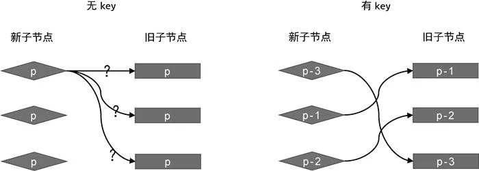

```
图 9-4　有 key 与无 key
由图 9-4 可知，如果没有 key，我们无法知道新子节点与旧子节点间的映射关系，也就无法
知道应该如何移动节点。有 key 的话情况则不同，我们根据子节点的 key 属性，能够明确知
```

道新子节点在旧子节点中的位置，这样就可以进行相应的 DOM 移动操作了。

有必要强调的一点是，DOM 可复用并不意味着不需要更新，如下面的两个虚拟节点所示：

```javascript
const oldVNode = { type: 'p', key: 1, children: 'text 1' }
const newVNode = { type: 'p', key: 1, children: 'text 2' }
这两个虚拟节点拥有相同的 key 值和 vnode.type 属性值。这意味着，在更新时可以复用
```

DOM 元素，即只需要通过移动操作来完成更新。但仍需要对这两个虚拟节点进行打补丁操

```
作，因为新的虚拟节点（newVNode）的文本子节点的内容已经改变了（由 'text 1' 变成
'text 2'）。因此，在讨论如何移动 DOM 之前，我们需要先完成打补丁操作，如下面
patchChildren 函数的代码所示：
```

```xml
function patchChildren(n1, n2, container) {
  if (typeof n2.children === 'string') {
    // 省略部分代码
  } else if (Array.isArray(n2.children)) {
    const oldChildren = n1.children
    const newChildren = n2.children
<pre><code> // 遍历新的 children
for (let i = 0; i &lt; newChildren.length; i++) {
  const newVNode = newChildren[i]
  // 遍历旧的 children
  for (let j = 0; j &lt; oldChildren.length; j++) {
    const oldVNode = oldChildren[j]
    // 如果找到了具有相同 key 值的两个节点，说明可以复用，但仍然需要调用 patch 函数更新
    if (newVNode.key === oldVNode.key) {
      patch(oldVNode, newVNode, container)
      break // 这里需要 break
    }
  }
}
</code></pre> // 遍历新的 children
for (let i = 0; i &lt; newChildren.length; i++) {
  const newVNode = newChildren[i]
  // 遍历旧的 children
  for (let j = 0; j &lt; oldChildren.length; j++) {
    const oldVNode = oldChildren[j]
    // 如果找到了具有相同 key 值的两个节点，说明可以复用，但仍然需要调用 patch 函数更新
    if (newVNode.key === oldVNode.key) {
      patch(oldVNode, newVNode, container)
      break // 这里需要 break
    }
  }
}
} else {
// 省略部分代码
}
}
```

在上面这段代码中，我们重新实现了新旧两组子节点的更新逻辑。可以看到，我们使用了两层

```
for 循环，外层循环用于遍历新的一组子节点，内层循环则遍历旧的一组子节点。在内层循
环中，我们逐个对比新旧子节点的 key 值，试图在旧的子节点中找到可复用的节点。一旦找
到，则调用 patch 函数进行打补丁。经过这一步操作之后，我们能够保证所有可复用的节点
```

本身都已经更新完毕了。以下面的新旧两组子节点为例：

```xml
const oldVNode = {
  type: 'div',
  children: [
    { type: 'p', children: '1', key: 1 },
    { type: 'p', children: '2', key: 2 },
    { type: 'p', children: 'hello', key: 3 }
  ]
}
<p>const newVNode = {
type: ‘div’,
children: [
{ type: ‘p’, children: ‘world’, key: 3 },
{ type: ‘p’, children: ‘1’, key: 1 },
{ type: ‘p’, children: ‘2’, key: 2 }
]
}</p>
// 首次挂载
renderer.render(oldVNode, document.querySelector(‘#app’))
setTimeout(() => {
// 1 秒钟后更新
renderer.render(newVNode, document.querySelector(‘#app’))
}, 1000);
```

```
运行上面这段代码，1 秒钟后，key 值为 3 的子节点对应的真实 DOM 的文本内容会由字符串
'hello' 更新为字符串 'world'。下面我们详细分析上面这段代码在执行更新操作时具体
```

发生了什么。

```
第一步，取新的一组子节点中的第一个子节点，即 key 值为 3 的节点。尝试在旧的一组子
节点中寻找具有相同 key 值的节点。我们发现，旧的子节点 oldVNode[2] 的 key 值为
3，于是调用 patch 函数进行打补丁。在这一步操作完成之后，渲染器会把 key 值为 3 的
虚拟节点所对应的真实 DOM 的文本内容由字符串 'hello' 更新为字符串 'world'。
第二步，取新的一组子节点中的第二个子节点，即 key 值为 1 的节点。尝试在旧的一组子
节点中寻找具有相同 key 值的节点。我们发现，旧的子节点 oldVNode[0] 的 key 值为
1，于是调用 patch 函数进行打补丁。由于 key 值等于 1 的新旧子节点没有任何差异，所
```

- 以什么都不会做。

```
第三步，取新的一组子节点中的最后一个子节点，即 key 值为 2 的节点，最终结果与第二
```

- 步相同。

经过上述更新操作后，所有节点对应的真实 DOM 元素都更新完毕了。但真实 DOM 仍然保持

```
旧的一组子节点的顺序，即 key 值为 3 的节点对应的真实 DOM 仍然是最后一个子节点。由
于在新的一组子节点中，key 值为 3 的节点已经变为第一个子节点了，因此我们还需要通过
```

移动节点来完成真实 DOM 顺序的更新。

## 9.3　找到需要移动的元素

```
现在，我们已经能够通过 key 值找到可复用的节点了。接下来需要思考的是，如何判断一个
```

节点是否需要移动，以及如何移动。对于第一个问题，我们可以采用逆向思维的方式，先想一想在什么情况下节点不需要移动？答案很简单，当新旧两组子节点的节点顺序不变时，就不需要额外的移动操作，如图 9-5 所示。

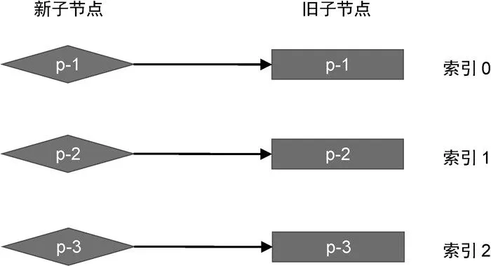

- 图 9-5　节点顺序不变

在图 9-5 中，新旧两组子节点的顺序没有发生变化，图中也给出了旧的一组子节点中各个节点的索引：

```
key 值为 1 的节点在旧 children 数组中的索引为 0；
key 值为 2 的节点在旧 children 数组中的索引为 1；
key 值为 3 的节点在旧 children 数组中的索引为 2。
```

接着，我们对新旧两组子节点采用上一节介绍的更新算法，看看当新旧两组子节点的顺序没有发生变化时，更新算法具有怎样的特点。

```
第一步：取新的一组子节点中的第一个节点 p-1，它的 key 为 1。尝试在旧的一组子节点
中找到具有相同 key 值的可复用节点，发现能够找到，并且该节点在旧的一组子节点中的
索引为 0。
第二步：取新的一组子节点中的第二个节点 p-2，它的 key 为 2。尝试在旧的一组子节点
中找到具有相同 key 值的可复用节点，发现能够找到，并且该节点在旧的一组子节点中的
索引为 1。
第三步：取新的一组子节点中的第三个节点 p-3，它的 key 为 3。尝试在旧的一组子节点
中找到具有相同 key 值的可复用节点，发现能够找到，并且该节点在旧的一组子节点中的
索引为 2。
```

在这个过程中，每一次寻找可复用的节点时，都会记录该可复用节点在旧的一组子节点中的位

```
置索引。如果把这些位置索引值按照先后顺序排列，则可以得到一个序列：0、1、2。这是一
```

个递增的序列，在这种情况下不需要移动任何节点。

我们再来看看另外一个例子，如图 9-6 所示。


- 图 9-6　节点顺序变化

同样，我们根据图 9-6 中给出的例子再次执行更新算法，看看这一次会有什么不同。

```
第一步：取新的一组子节点中的第一个节点 p-3，它的 key 为 3。尝试在旧的一组子节点
中找到具有相同 key 值的可复用节点，发现能够找到，并且该节点在旧的一组子节点中的
索引为 2。
第二步：取新的一组子节点中的第二个节点 p-1，它的 key 为 1。尝试在旧的一组子节点
中找到具有相同 key 值的可复用节点，发现能够找到，并且该节点在旧的一组子节点中的
索引为 0。
到了这一步我们发现，索引值递增的顺序被打破了。节点 p-1 在旧 children 中的索引是
0，它小于节点 p-3 在旧 children 中的索引 2。这说明节点 p-1 在旧 children 中排
在节点 p-3 前面，但在新的 children 中，它排在节点 p-3 后面。因此，我们能够得出
一个结论：节点 p-1 对应的真实 DOM 需要移动。
第三步：取新的一组子节点中的第三个节点 p-2，它的 key 为 2。尝试在旧的一组子节点
中找到具有相同 key 值的可复用节点，发现能够找到，并且该节点在旧的一组子节点中的
索引为 1。
到了这一步我们发现，节点 p-2 在旧 children 中的索引 1 要小于节点 p-3 在旧
children 中的索引 2。这说明，节点 p-2 在旧 children 中排在节点 p-3 前面，但在
新的 children 中，它排在节点 p-3 后面。因此，节点 p-2 对应的真实 DOM 也需要移
```

- 动。

以上就是 Diff 算法在执行更新的过程中，判断节点是否需要移动的方式。在上面的例子中，我

```
们得出了节点 p-1 和节点 p-2 需要移动的结论。这是因为它们在旧 children 中的索引要
小于节点 p-3 在旧 children 中的索引。如果我们按照先后顺序记录在寻找节点过程中所遇
到的位置索引，将会得到序列：2、0、1。可以发现，这个序列不具有递增的趋势。
其实我们可以将节点 p-3 在旧 children 中的索引定义为：在旧 children 中寻找具有相
同 key 值节点的过程中，遇到的最大索引值。如果在后续寻找的过程中，存在索引值比当前
```

遇到的最大索引值还要小的节点，则意味着该节点需要移动。

```xml
我们可以用 lastIndex 变量存储整个寻找过程中遇到的最大索引值，如下面的代码所示：
function patchChildren(n1, n2, container) {
  if (typeof n2.children === 'string') {
    // 省略部分代码
  } else if (Array.isArray(n2.children)) {
    const oldChildren = n1.children
    const newChildren = n2.children
<pre><code> // 用来存储寻找过程中遇到的最大索引值
let lastIndex = 0
for (let i = 0; i &lt; newChildren.length; i++) {
  const newVNode = newChildren[i]
  for (let j = 0; j &lt; oldChildren.length; j++) {
    const oldVNode = oldChildren[j]
    if (newVNode.key === oldVNode.key) {
      patch(oldVNode, newVNode, container)
      if (j &lt; lastIndex) {
        // 如果当前找到的节点在旧 children 中的索引小于最大索引值 lastIndex，
        // 说明该节点对应的真实 DOM 需要移动
      } else {
        // 如果当前找到的节点在旧 children 中的索引不小于最大索引值，
        // 则更新 lastIndex 的值
        lastIndex = j
      }
      break // 这里需要 break
    }
  }
}
</code></pre> // 用来存储寻找过程中遇到的最大索引值
let lastIndex = 0
for (let i = 0; i &lt; newChildren.length; i++) {
  const newVNode = newChildren[i]
  for (let j = 0; j &lt; oldChildren.length; j++) {
    const oldVNode = oldChildren[j]
    if (newVNode.key === oldVNode.key) {
      patch(oldVNode, newVNode, container)
      if (j &lt; lastIndex) {
        // 如果当前找到的节点在旧 children 中的索引小于最大索引值 lastIndex，
        // 说明该节点对应的真实 DOM 需要移动
      } else {
        // 如果当前找到的节点在旧 children 中的索引不小于最大索引值，
        // 则更新 lastIndex 的值
        lastIndex = j
      }
      break // 这里需要 break
    }
  }
}
} else {
// 省略部分代码
}
}
```

```
如以上代码及注释所示，如果新旧节点的 key 值相同，说明我们在旧 children 中找到了可
复用 DOM 的节点。此时我们用该节点在旧 children 中的索引 j 与 lastIndex 进行比
较，如果 j 小于 lastIndex，说明当前 oldVNode 对应的真实 DOM 需要移动，否则说明
不需要移动。但此时应该将变量 j 的值赋给变量 lastIndex，以保证寻找节点的过程中，变
量 lastIndex 始终存储着当前遇到的最大索引值。
```

现在，我们已经找到了需要移动的节点，下一节我们将讨论如何移动节点，从而完成节点顺序的更新。

## 9.4　如何移动元素

在上一节中，我们讨论了如何判断节点是否需要移动。移动节点指的是，移动一个虚拟节点所对应的真实 DOM 节点，并不是移动虚拟节点本身。既然移动的是真实 DOM 节点，那么就需要取得对它的引用才行。我们知道，当一个虚拟节点被挂载后，其对应的真实 DOM 节点会存

```
储在它的 vnode.el 属性中，如图 9-7 所示。
```

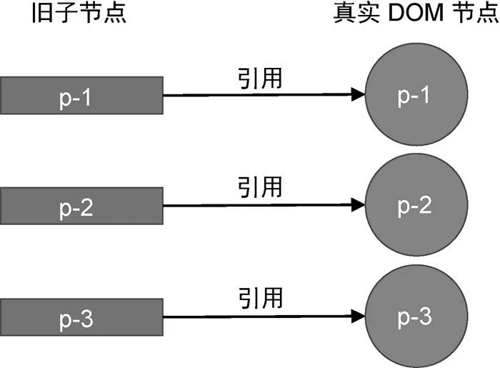

- 图 9-7　虚拟节点引用了真实 DOM 元素

```javascript
因此，在代码中，我们可以通过旧子节点的 vnode.el 属性取得它对应的真实 DOM 节点。
当更新操作发生时，渲染器会调用 patchElement 函数在新旧虚拟节点之间进行打补丁。回
顾一下 patchElement 函数的代码，如下：
function patchElement(n1, n2) {
  // 新的 vnode 也引用了真实 DOM 元素
  const el = n2.el = n1.el
  // 省略部分代码
}
```

```
可以看到，patchElement 函数首先将旧节点的 n1.el 属性赋值给新节点的 n2.el 属性。
```

这个赋值语句的真正含义其实就是 DOM 元素的复用。在复用了 DOM 元素之后，新节点也将持有对真实 DOM 的引用，如图 9-8 所示。

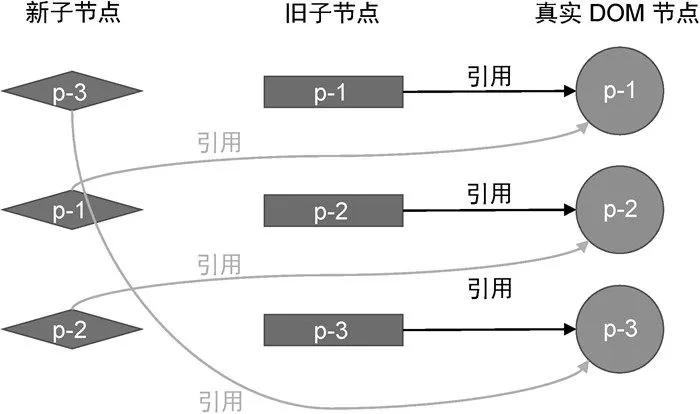

- 图 9-8　使新的子节点也引用真实 DOM 元素

可以看到，无论是新子节点还是旧子节点，都存在对真实 DOM 的引用，在此基础上，我们就可以进行 DOM 移动操作了。

为了阐述具体应该怎样移动 DOM 节点，我们仍然引用上一节的更新案例，如图 9-9 所示。

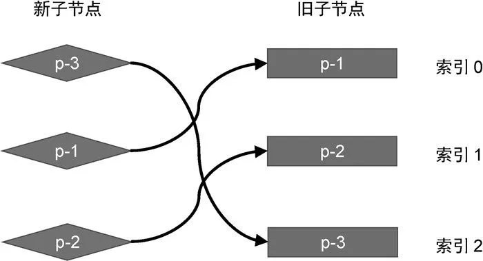

- 图 9-9　新旧子节点的关系

它的更新步骤如下。

```
第一步：取新的一组子节点中第一个节点 p-3，它的 key 为 3，尝试在旧的一组子节点中
找到具有相同 key 值的可复用节点。发现能够找到，并且该节点在旧的一组子节点中的索
引为 2。此时变量 lastIndex 的值为 0，索引 2 不小于 0，所以节点 p-3 对应的真实
DOM 不需要移动，但需要更新变量 lastIndex 的值为 2。
第二步：取新的一组子节点中第二个节点 p-1，它的 key 为 1，尝试在旧的一组子节点中
找到具有相同 key 值的可复用节点。发现能够找到，并且该节点在旧的一组子节点中的索
引为 0。此时变量 lastIndex 的值为 2，索引 0 小于 2，所以节点 p-1 对应的真实
```

- DOM 需要移动。

```
到了这一步，我们发现，节点 p-1 对应的真实 DOM 需要移动，但应该移动到哪里呢？我
们知道，新 children 的顺序其实就是更新后真实 DOM 节点应有的顺序。所以节点 p-1
在新 children 中的位置就代表了真实 DOM 更新后的位置。由于节点 p-1 在新
children 中排在节点 p-3 后面，所以我们应该把节点 p-1 所对应的真实 DOM 移动到
节点 p-3 所对应的真实 DOM 后面。移动后的结果如图 9-10 所示。
可以看到，这样操作之后，此时真实 DOM 的顺序为 p-2、p-3、p-1。
第三步：取新的一组子节点中第三个节点 p-2，它的 key 为 2。尝试在旧的一组子节点中
找到具有相同 key 值的可复用节点。发现能够找到，并且该节点在旧的一组子节点中的索
引为 1。此时变量 lastIndex 的值为 2，索引 1 小于 2，所以节点 p-2 对应的真实
```

- DOM 需要移动。

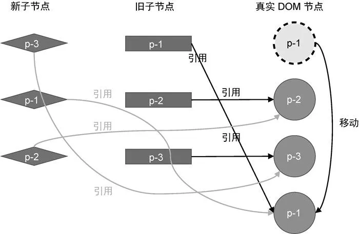

```
图 9-10　把节点 p-1 对应的真实 DOM 移动到节点 p-3 对应的真实 DOM 后面
第三步与第二步类似，节点 p-2 对应的真实 DOM 也需要移动。同样，由于节点 p-2 在新
children 中排在节点 p-1 后面，所以我们应该把节点 p-2 对应的真实 DOM 移动到节点
p-1 对应的真实 DOM 后面。移动后的结果如图 9-11 所示。
```

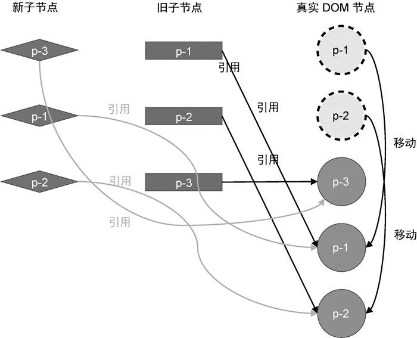

```sql
图 9-11　把节点 p-2 对应的真实 DOM 移动到节点 p-1 对应的真实 DOM 后面
经过这一步移动操作之后，我们发现，真实 DOM 的顺序与新的一组子节点的顺序相同了：p-
3、p-1、p-2。至此，更新操作完成。
接下来，我们着手实现代码。其实并不复杂，如下面 patchChildren 函数的代码所示：
function patchChildren(n1, n2, container) {
  if (typeof n2.children === 'string') {
    // 省略部分代码
  } else if (Array.isArray(n2.children)) {
    const oldChildren = n1.children
    const newChildren = n2.children
<pre><code> let lastIndex = 0
for (let i = 0; i &lt; newChildren.length; i++) {
  const newVNode = newChildren[i]
  let j = 0
  for (j; j &lt; oldChildren.length; j++) {
    const oldVNode = oldChildren[j]
    if (newVNode.key === oldVNode.key) {
      patch(oldVNode, newVNode, container)
      if (j &lt; lastIndex) {
        // 代码运行到这里，说明 newVNode 对应的真实 DOM 需要移动
        // 先获取 newVNode 的前一个 vnode，即 prevVNode
        const prevVNode = newChildren[i - 1]
        // 如果 prevVNode 不存在，则说明当前 newVNode 是第一个节点，它不需要移动
        if (prevVNode) {
          // 由于我们要将 newVNode 对应的真实 DOM 移动到 prevVNode 所对应真实 DOM 后面，
          // 所以我们需要获取 prevVNode 所对应真实 DOM 的下一个兄弟节点，并将其作为锚点
          const anchor = prevVNode.el.nextSibling
          // 调用 insert 方法将 newVNode 对应的真实 DOM 插入到锚点元素前面，
          // 也就是 prevVNode 对应真实 DOM 的后面
          insert(newVNode.el, container, anchor)
        }
      } else {
        lastIndex = j
      }
      break
    }
  }
}
</code></pre> let lastIndex = 0
for (let i = 0; i &lt; newChildren.length; i++) {
  const newVNode = newChildren[i]
  let j = 0
  for (j; j &lt; oldChildren.length; j++) {
    const oldVNode = oldChildren[j]
    if (newVNode.key === oldVNode.key) {
      patch(oldVNode, newVNode, container)
      if (j &lt; lastIndex) {
        // 代码运行到这里，说明 newVNode 对应的真实 DOM 需要移动
        // 先获取 newVNode 的前一个 vnode，即 prevVNode
        const prevVNode = newChildren[i - 1]
        // 如果 prevVNode 不存在，则说明当前 newVNode 是第一个节点，它不需要移动
        if (prevVNode) {
          // 由于我们要将 newVNode 对应的真实 DOM 移动到 prevVNode 所对应真实 DOM 后面，
          // 所以我们需要获取 prevVNode 所对应真实 DOM 的下一个兄弟节点，并将其作为锚点
          const anchor = prevVNode.el.nextSibling
          // 调用 insert 方法将 newVNode 对应的真实 DOM 插入到锚点元素前面，
          // 也就是 prevVNode 对应真实 DOM 的后面
          insert(newVNode.el, container, anchor)
        }
      } else {
        lastIndex = j
      }
      break
    }
  }
}
} else {
// 省略部分代码
}
}
在上面这段代码中，如果条件 j < lastIndex 成立，则说明当前 newVNode 所对应的真实
DOM 需要移动。根据前文的分析可知，我们需要获取当前 newVNode 节点的前一个虚拟节
点，即 newChildren[i - 1]，然后使用 insert 函数完成节点的移动，其中 insert 函
数依赖浏览器原生的 insertBefore 函数，如下面的代码所示：
const renderer = createRenderer({
  // 省略部分代码
<p>insert(el, parent, anchor = null) {
// insertBefore 需要锚点元素 anchor
parent.insertBefore(el, anchor)
}</p>
// 省略部分代码
})
```

## 9.5　添加新元素

本节我们将讨论添加新节点的情况，如图 9-12 所示。

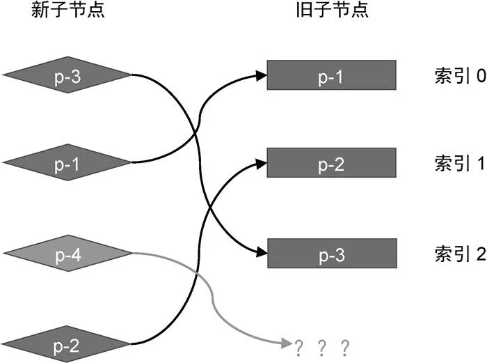

```
图 9-12　新增节点 p-4
观察图 9-12 可知，在新的一组子节点中，多出来一个节点 p-4，它的 key 值为 4，该节点
```

在旧的一组子节点不存在，因此应该将其视为新增节点。对于新增节点，在更新时我们应该正确地将它挂载，这主要分为两步：

- 想办法找到新增节点；

- 将新增节点挂载到正确位置。

首先，我们来看一下如何找到新增节点。为了搞清楚这个问题，我们需要根据图 9-12 中给出的例子模拟执行简单 Diff 算法的逻辑。在此之前，我们需要弄清楚新旧两组子节点与真实DOM 元素的当前状态，如图 9-13 所示。

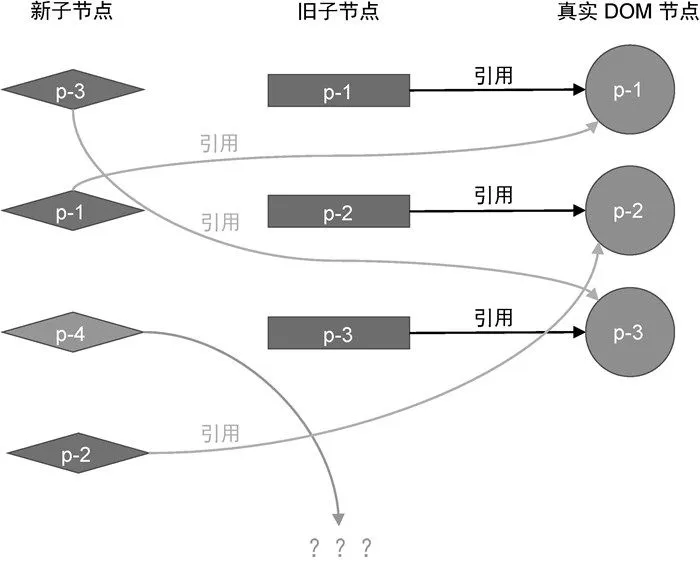

- 图 9-13　新旧两组子节点与真实 DOM 元素的当前状态

接着，我们开始模拟执行简单 Diff 算法的更新逻辑。

```
第一步：取新的一组子节点中第一个节点 p-3，它的 key 值为 3，尝试在旧的一组子节点
中寻找可复用的节点。发现能够找到，并且该节点在旧的一组子节点中的索引值为 2。此
时，变量 lastIndex 的值为 0，索引值 2 不小于 lastIndex 的值 0，所以节点 p-3 对
应的真实 DOM 不需要移动，但是需要将变量 lastIndex 的值更新为 2。
第二步：取新的一组子节点中第二个节点 p-1，它的 key 值为 1，尝试在旧的一组子节点
中寻找可复用的节点。发现能够找到，并且该节点在旧的一组子节点中的索引值为 0。此时
变量 lastIndex 的值为 2，索引值 0 小于 lastIndex 的值 2，所以节点 p-1 对应的真
实 DOM 需要移动，并且应该移动到节点 p-3 对应的真实 DOM 后面。经过这一步的移动
```

- 操作后，真实 DOM 的状态如图 9-14 所示。

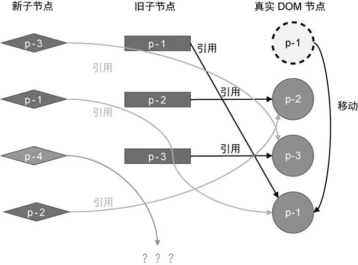

- 图 9-14　真实 DOM 的当前状态

```
此时真实 DOM 的顺序为 p-2、p-3、p-1。
第三步：取新的一组子节点中第三个节点 p-4，它的 key 值为 4，尝试在旧的一组子节点
中寻找可复用的节点。由于在旧的一组子节点中，没有 key 值为 4 的节点，因此渲染器会
把节点 p-4 看作新增节点并挂载它。那么，应该将它挂载到哪里呢？为了搞清楚这个问
题，我们需要观察节点 p-4 在新的一组子节点中的位置。由于节点 p-4 出现在节点 p-1
后面，所以我们应该把节点 p-4 挂载到节点 p-1 所对应的真实 DOM 后面。在经过这一步
```

- 挂载操作之后，真实 DOM 的状态如图 9-15 所示。

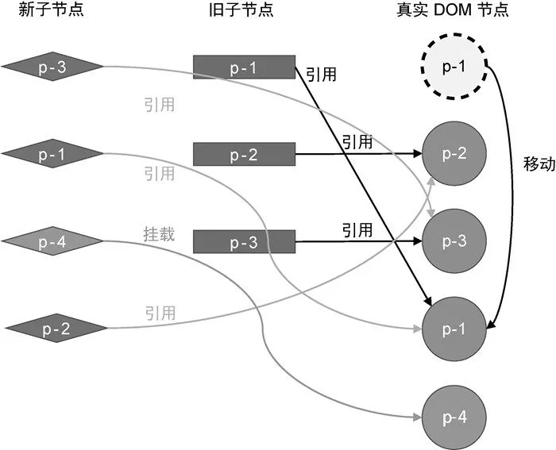

- 图 9-15　真实 DOM 的当前状态

```
此时真实 DOM 的顺序是：p-2、p-3、p-1、p-4，其中 p-4 是刚刚挂载的。
第四步：取新的一组子节点中第四个节点 p-2，它的 key 值为 2，尝试在旧的一组子节点
中寻找可复用的节点。发现能够找到，并且该节点在旧的一组子节点中的索引值为 1。此时
变量 lastIndex 的值为 2，索引值 1 小于 lastIndex 的值 2，所以节点 p-2 对应的真
实 DOM 需要移动，并且应该移动到节点 p-4 对应的真实 DOM 后面。经过这一步移动操
```

- 作后，真实 DOM 的状态如图 9-16 所示。

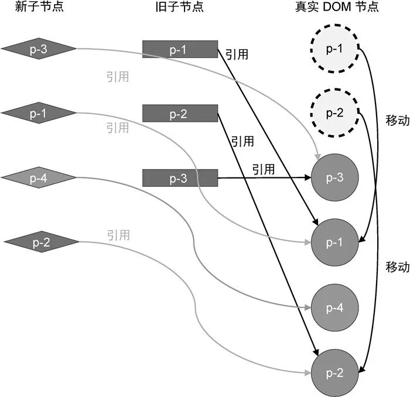

- 图 9-16　真实 DOM 的当前状态

```
此时真实 DOM 的顺序是：p-3、p-1、p-4、p-2。至此，真实 DOM 的顺序已经与新的一
```

组子节点的顺序相同了，更新完成。

```sql
接下来，我们着手实现代码，如下面 patchChildren 函数的代码所示：
function patchChildren(n1, n2, container) {
  if (typeof n2.children === 'string') {
    // 省略部分代码
  } else if (Array.isArray(n2.children)) {
    const oldChildren = n1.children
    const newChildren = n2.children
<pre><code> let lastIndex = 0
for (let i = 0; i &lt; newChildren.length; i++) {
  const newVNode = newChildren[i]
  let j = 0
  // 在第一层循环中定义变量 find，代表是否在旧的一组子节点中找到可复用的节点，
  // 初始值为 false，代表没找到
  let find = false
  for (j; j &lt; oldChildren.length; j++) {
    const oldVNode = oldChildren[j]
    if (newVNode.key === oldVNode.key) {
      // 一旦找到可复用的节点，则将变量 find 的值设为 true
      find = true
      patch(oldVNode, newVNode, container)
      if (j &lt; lastIndex) {
        const prevVNode = newChildren[i - 1]
        if (prevVNode) {
          const anchor = prevVNode.el.nextSibling
          insert(newVNode.el, container, anchor)
        }
      } else {
        lastIndex = j
      }
      break
    }
  }
  // 如果代码运行到这里，find 仍然为 false，
  // 说明当前 newVNode 没有在旧的一组子节点中找到可复用的节点
  // 也就是说，当前 newVNode 是新增节点，需要挂载
  if (!find) {
    // 为了将节点挂载到正确位置，我们需要先获取锚点元素
    // 首先获取当前 newVNode 的前一个 vnode 节点
    const prevVNode = newChildren[i - 1]
    let anchor = null
    if (prevVNode) {
      // 如果有前一个 vnode 节点，则使用它的下一个兄弟节点作为锚点元素
      anchor = prevVNode.el.nextSibling
    } else {
      // 如果没有前一个 vnode 节点，说明即将挂载的新节点是第一个子节点
      // 这时我们使用容器元素的 firstChild 作为锚点
      anchor = container.firstChild
    }
    // 挂载 newVNode
    patch(null, newVNode, container, anchor)
  }
}
</code></pre> let lastIndex = 0
for (let i = 0; i &lt; newChildren.length; i++) {
  const newVNode = newChildren[i]
  let j = 0
  // 在第一层循环中定义变量 find，代表是否在旧的一组子节点中找到可复用的节点，
  // 初始值为 false，代表没找到
  let find = false
  for (j; j &lt; oldChildren.length; j++) {
    const oldVNode = oldChildren[j]
    if (newVNode.key === oldVNode.key) {
      // 一旦找到可复用的节点，则将变量 find 的值设为 true
      find = true
      patch(oldVNode, newVNode, container)
      if (j &lt; lastIndex) {
        const prevVNode = newChildren[i - 1]
        if (prevVNode) {
          const anchor = prevVNode.el.nextSibling
          insert(newVNode.el, container, anchor)
        }
      } else {
        lastIndex = j
      }
      break
    }
  }
  // 如果代码运行到这里，find 仍然为 false，
  // 说明当前 newVNode 没有在旧的一组子节点中找到可复用的节点
  // 也就是说，当前 newVNode 是新增节点，需要挂载
  if (!find) {
    // 为了将节点挂载到正确位置，我们需要先获取锚点元素
    // 首先获取当前 newVNode 的前一个 vnode 节点
    const prevVNode = newChildren[i - 1]
    let anchor = null
    if (prevVNode) {
      // 如果有前一个 vnode 节点，则使用它的下一个兄弟节点作为锚点元素
      anchor = prevVNode.el.nextSibling
    } else {
      // 如果没有前一个 vnode 节点，说明即将挂载的新节点是第一个子节点
      // 这时我们使用容器元素的 firstChild 作为锚点
      anchor = container.firstChild
    }
    // 挂载 newVNode
    patch(null, newVNode, container, anchor)
  }
}
} else {
// 省略部分代码
}
}
```

```
观察上面这段代码。首先，我们在外层循环中定义了名为 find 的变量，它代表渲染器能否在
旧的一组子节点中找到可复用的节点。变量 find 的初始值为 false，一旦寻找到可复用的
节点，则将变量 find 的值设置为 true。如果内层循环结束后，变量 find 的值仍然为
false，则说明当前 newVNode 是一个全新的节点，需要挂载它。为了将节点挂载到正确位
置，我们需要先获取锚点元素：找到 newVNode 的前一个虚拟节点，即 prevVNode，如果
```

存在，则使用它对应的真实 DOM 的下一个兄弟节点作为锚点元素；如果不存在，则说明即将

```
挂载的 newVNode 节点是容器元素的第一个子节点，此时应该使用容器元素的
container.firstChild 作为锚点元素。最后，将锚点元素 anchor 作为 patch 函数的
第四个参数，调用 patch 函数完成节点的挂载。
但由于目前实现的 patch 函数还不支持传递第四个参数，所以我们需要调整 patch 函数的
```

代码，如下所示：

```sql
// patch 函数需要接收第四个参数，即锚点元素
function patch(n1, n2, container, anchor) {
  // 省略部分代码
<p>if (typeof type === ‘string’) {
if (!n1) {
// 挂载时将锚点元素作为第三个参数传递给 mountElement 函数
mountElement(n2, container, anchor)
} else {
patchElement(n1, n2)
}
} else if (type === Text) {
// 省略部分代码
} else if (type === Fragment) {
// 省略部分代码
}
}</p>
<p>// mountElement 函数需要增加第三个参数，即锚点元素
function mountElement(vnode, container, anchor) {
// 省略部分代码</p>
// 在插入节点时，将锚点元素透传给 insert 函数
insert(el, container, anchor)
}
```

## 9.6　移除不存在的元素

在更新子节点时，不仅会遇到新增元素，还会出现元素被删除的情况，如图 9-17 所示。

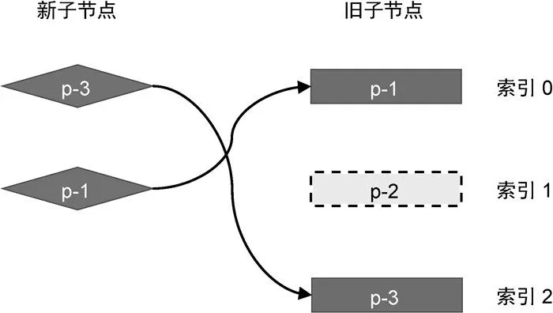

- 图 9-17　节点被删除的情况

```
在新的一组子节点中，节点 p-2 已经不存在了，这说明该节点被删除了。渲染器应该能找到
```

那些需要删除的节点并正确地将其删除。

具体要如何做呢？首先，我们来讨论如何找到需要删除的节点。以图 9-17 为例，我们来分析它的更新步骤。在模拟执行更新逻辑之前，我们需要清楚新旧两组子节点以及真实 DOM 节点的当前状态，如图 9-18 所示。

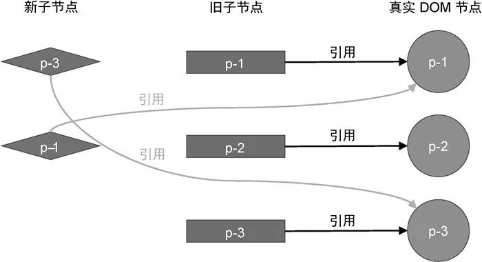

- 图 9-18　新旧两组子节点与真实 DOM 节点的当前状态

接着，我们开始模拟执行更新的过程。

```
第一步：取新的一组子节点中的第一个节点 p-3，它的 key 值为 3。尝试在旧的一组子节
点中寻找可复用的节点。发现能够找到，并且该节点在旧的一组子节点中的索引值为 2。此
时变量 lastIndex 的值为 0，索引 2 不小于 lastIndex 的值 0，所以节点 p-3 对应的
真实 DOM 不需要移动，但需要更新变量 lastIndex 的值为 2。
第二步：取新的一组子节点中的第二个节点 p-1，它的 key 值为 1。尝试在旧的一组子节
点中寻找可复用的节点。发现能够找到，并且该节点在旧的一组子节点中的索引值为 0。此
时变量 lastIndex 的值为 2，索引 0 小于 lastIndex 的值 2，所以节点 p-1 对应的真
实 DOM 需要移动，并且应该移动到节点 p-3 对应的真实 DOM 后面。经过这一步的移动
```

- 操作后，真实 DOM 的状态如图 9-19 所示。

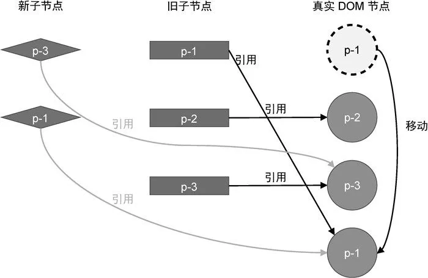

- 图 9-19　真实 DOM 的当前状态

```
至此，更新结束。我们发现，节点 p-2 对应的真实 DOM 仍然存在，所以需要增加额外的逻
```

辑来删除遗留节点。思路很简单，当基本的更新结束时，我们需要遍历旧的一组子节点，然后

```xml
去新的一组子节点中寻找具有相同 key 值的节点。如果找不到，则说明应该删除该节点，如
下面 patchChildren 函数的代码所示：
function patchChildren(n1, n2, container) {
  if (typeof n2.children === 'string') {
    // 省略部分代码
  } else if (Array.isArray(n2.children)) {
    const oldChildren = n1.children
    const newChildren = n2.children
<pre><code> let lastIndex = 0
for (let i = 0; i &lt; newChildren.length; i++) {
  // 省略部分代码
}
// 上一步的更新操作完成后
// 遍历旧的一组子节点
for (let i = 0; i &lt; oldChildren.length; i++) {
  const oldVNode = oldChildren[i]
  // 拿旧子节点 oldVNode 去新的一组子节点中寻找具有相同 key 值的节点
  const has = newChildren.find(
    vnode =&gt; vnode.key === oldVNode.key
  )
  if (!has) {
    // 如果没有找到具有相同 key 值的节点，则说明需要删除该节点
    // 调用 unmount 函数将其卸载
    unmount(oldVNode)
  }
}
</code></pre> let lastIndex = 0
for (let i = 0; i &lt; newChildren.length; i++) {
  // 省略部分代码
}
// 上一步的更新操作完成后
// 遍历旧的一组子节点
for (let i = 0; i &lt; oldChildren.length; i++) {
  const oldVNode = oldChildren[i]
  // 拿旧子节点 oldVNode 去新的一组子节点中寻找具有相同 key 值的节点
  const has = newChildren.find(
    vnode =&gt; vnode.key === oldVNode.key
  )
  if (!has) {
    // 如果没有找到具有相同 key 值的节点，则说明需要删除该节点
    // 调用 unmount 函数将其卸载
    unmount(oldVNode)
  }
}
} else {
// 省略部分代码
}
}
```

如以上代码及注释所示，在上一步的更新操作完成之后，我们还需要遍历旧的一组子节点，目

```
的是检查旧子节点在新的一组子节点中是否仍然存在，如果已经不存在了，则调用 unmount
```

函数将其卸载。

## 9.7　总结

在本章中，我们首先讨论了 Diff 算法的作用。Diff 算法用来计算两组子节点的差异，并试图最大程度地复用 DOM 元素。在上一章中，我们采用了一种简单的方式来更新子节点，即卸载所有旧子节点，再挂载所有新子节点。然而这种更新方式无法对 DOM 元素进行复用，需要大量的 DOM 操作才能完成更新，非常消耗性能。于是，我们对它进行了改进。改进后的方案是，

```
遍历新旧两组子节点中数量较少的那一组，并逐个调用 patch 函数进行打补丁，然后比较新
```

旧两组子节点的数量，如果新的一组子节点数量更多，说明有新子节点需要挂载；否则说明在旧的一组子节点中，有节点需要卸载。

```
然后，我们讨论了虚拟节点中 key 属性的作用，它就像虚拟节点的“身份证号”。在更新时，渲
染器通过 key 属性找到可复用的节点，然后尽可能地通过 DOM 移动操作来完成更新，避免
```

过多地对 DOM 元素进行销毁和重建。

接着，我们讨论了简单 Diff 算法是如何寻找需要移动的节点的。简单 Diff 算法的核心逻辑是，拿新的一组子节点中的节点去旧的一组子节点中寻找可复用的节点。如果找到了，则记录该节点的位置索引。我们把这个位置索引称为最大索引。在整个更新过程中，如果一个节点的索引值小于最大索引，则说明该节点对应的真实 DOM 元素需要移动。

最后，我们通过几个例子讲解了渲染器是如何移动、添加、删除虚拟节点所对应的 DOM 元素的。
