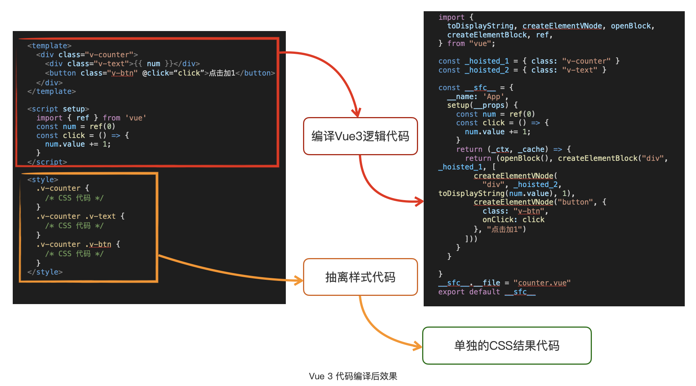
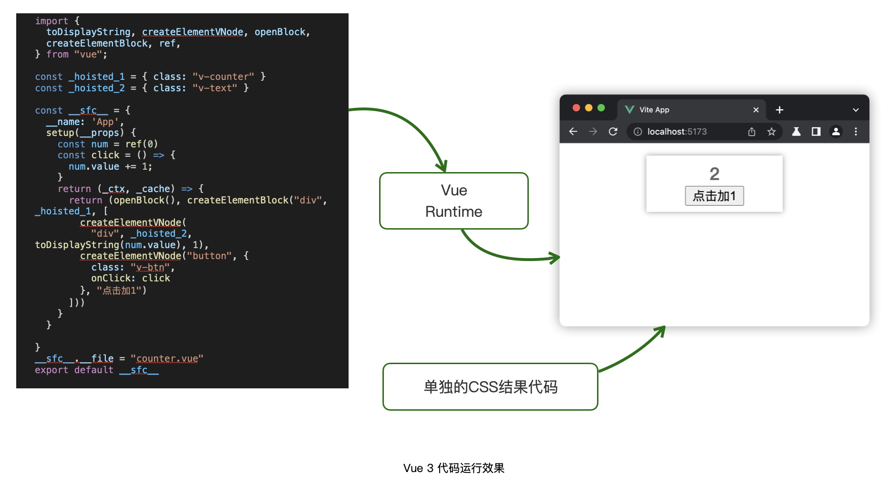
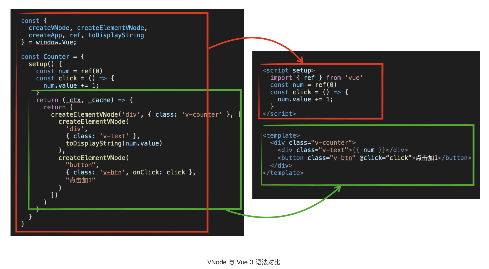
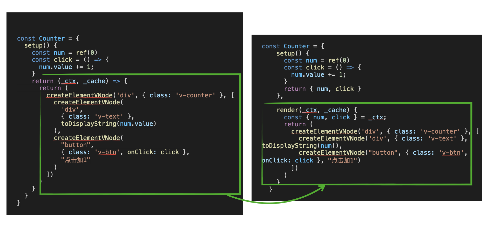
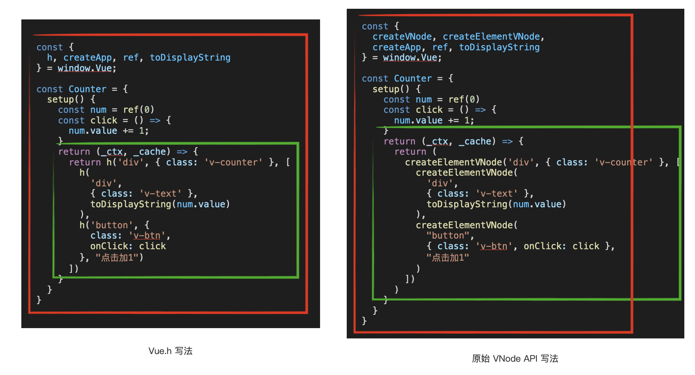
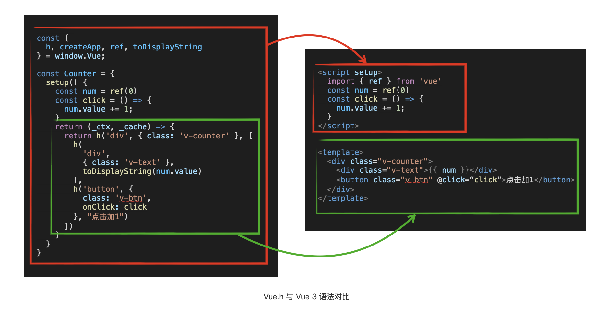
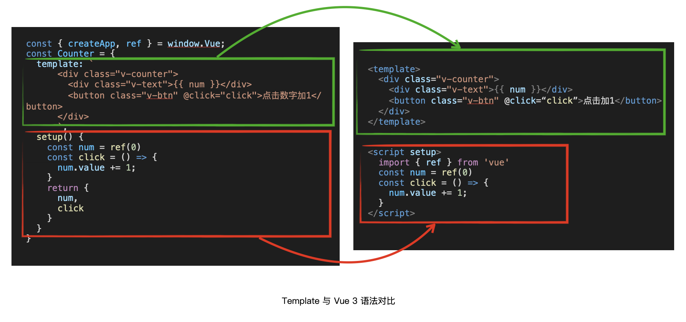

# 01 | 编译和非编译模式：离开Vue工具，你还知道怎么用Vue3吗？

你好，我是杨文坚。

在开始讲解今天课程之前，我们来想象一下这么一个场景：当 Vue.js 代码在生产环境中报错了，你该如何快速根据生产环境编译后的代码，进行问题定位和排错呢？

代入到这个场景中，你是否会感到无解？虽然说，得益于 Vue.js 丰富的“全家桶”式开发工具，我们能够低成本地直接使用开发项目，无需关心繁琐的项目构建配置，但这也很容易让新同学产生依赖，甚至误解。

比如误解 Vue.js 这类语法是浏览器默认就支持的，不清楚 Vue.js 代码在浏览器中实际的运行方式等等。这种浅尝辄止式的学习，会给我们实际的开发工作带来一些小麻烦。

所以，我们一定得清楚 Vue.js 在非编译的情况下是如何使用的，这样即便我们脱离了 Vite、Webpack 和 Rollup 等构建工具，也能让 Vue.js 3 在浏览器中正常运行。同时，你也可以通过这节课理解 Vue.js 的代码是如何进行编译，让浏览器识别运行的。

## Vue.js‌ 3 代码编译结果是什么样子的？

在开始讲解 Vue.js 非编译模式的运行原理之前，我想先带你了解下 Vue.js 代码编译结果是怎样的。我们都知道，Vue.js 代码经过编译后才能在浏览器运行，而且，Vue.js 代码编译后的结果就是基于非编译语法来运行的。这能让你更好地理解 Vue.js 非编译模式的运行原理。

我在下图列举了一个简单的 Vue.js 3 组件，以及通过 Vue.js 构建工具编译出来的 JavaScript代码结果：



你看，在这个 Vue.js 代码的编译过程中，主要进行了以下的操作流程：

1. 把 Vue.js 代码里的模板编译成基于 JavaScript 代码描述的 VNode（虚拟节点）；

2. 把 Vue.js 代码里 JavaScript 逻辑代码，编译成运行时对应生命周期的逻辑代码；

3. 最后是把内置的 CSS 样式代码抽离出来。

从上面的描述，我们可以总结一下，Vue.js 经过编译后产出是 JavaScript 和 CSS 代码，也就是浏览可以直接支持运行的代码。

上述提到的编译后的 JavaScript 和 CSS 代码，最终运行结果如下图所示：



现在我将上述案例的完整 Vue.js 代码贴出来，让你能更加清晰地了解代码的内容。

```xml
<template>
 <div class="v-counter">
   <div class="v-text">{{ num }}</div>
   <button class="v-btn" @click="click">点击数字加1</button>
 </div>
</template>
<script setup>
 import { ref } from 'Vue.js'
 const num = ref(0)
 const click = () => {
   num.value += 1;
 }
</script>
<style>
 .v-counter {
   width: 200px;
   margin: 20px auto;
   padding: 10px;
   color: #666666;
   box-shadow: 0px 0px 9px #00000066;
   text-align: center;
 }
 .v-counter .v-text {
   font-size: 28px;
   font-weight: bolder;
 }
 .v-counter .v-btn {
   font-size: 20px;
   padding: 0 10px;
   height: 32px;
   cursor: pointer;
 }
</style>
```

上面贴出来的 Vue.js 3 经过 Vue.js 3 官方的编译器编译结束后，核心的功能代码会编译出下面这样的结果。

```bash
import {
 toDisplayString, createElementVNode, openBlock,
 createElementBlock, ref,
} from "Vue.js";
const _hoisted_1 = { class: "v-counter" }
const _hoisted_2 = { class: "v-text" }
const __sfc__ = {
 __name: 'App',
 setup(__props) {
   const num = ref(0)
   const click = () => {
     num.value += 1;
   }
   return (_ctx, _cache) => {
     return (openBlock(), createElementBlock("div", _hoisted_1, [
       createElementVNode(
         "div", _hoisted_2, toDisplayString(num.value), 1),
       createElementVNode("button", {
         class: "v-btn",
         onClick: click
       }, "点击数字加1")
     ]))
   }
 }
}
__sfc__.__file = "counter.Vue.js"
export default __sfc__
```

这个最终结果可以直接在支持 ES Modules 的浏览器环境运行，还可以将其再次经过 ES6+ 语法的编译，最后成为能在浏览器直接运行的 ES5 代码。

我们经过上述 Vue.js3 代码案例，知道了 Vue.js 3 代码经过编译，最终能在浏览器运行的代码结果是纯粹的 JavaScript 和 CSS，而且我们现在还可以反向从编译后的结果知道，Vue.js 最终是用纯 JavaScript 来描述模板和逻辑内容，然后在浏览器中运行的。

这个编译后的结果，也就是最原始的 Vue.js 非编译模式的运行方式。接下来我们就来分析一下，Vue.js 非编译模式是如何运行的。

## Vue.js 非编译模式是如何运行的？

在讲解非编译模式是如何运行之前，我们先来对比一下 Vue.js3 的非编译模式代码和 Vue.js 原生语法的关联。你先看下下面这张图：



我们可以看到，其实 Vue.js 3 组件的非编译代码也能直接跟 Vue.js 3 原生语法一一对应上，包括：

- “模板”的对应关系；

- “生命周期逻辑代码”的对应关系。

可以这么理解，Vue.js 原生语法有两大块核心内容，就是模板和逻辑。相应地，非编译模式也有模板和逻辑这两个部分。

在上述的 Vue.js 3 的 setup 语法的代码编译结果中，模板和逻辑是耦合在组件对象的 setup 方法里的，非编译的运行代码模板和逻辑交织在一起，看起来比较麻烦。其实这里也可以把setup 的模板代码，抽出来放到独立的 render 方法里，如下图所示：



这样 Vue.js 非编译代码模板和逻辑分开，代码的可读性是不是也提高了不少呢？这里你有没有发现逻辑代码里，setup 逻辑的非编译写法和原生写法很接近，但是模板写法都是各种createElementVNode 的 VNode 的 API，是不是感觉很繁琐？如果所有的模板都用这么长的API 来写，那可太崩溃了。

其实还有更奔溃的，现实就是 VNode 的 API 不止一个，这个 createElementVNode 只是用来书写 HTML 语法的 VNode，还有其他 API 用来书写自定义的 VNode 等等。

那么问题来了，有没有更加简单的非编译写法？

## 更简单的非编译模式写法

我们前面讲了，用 createElementVNode 等 API 描述 VNode，会带来很多书写模板代码的成本。Vue.js3 本身提供了一种更加简便的 API 来统一描述 VNode，而且不需要关心不同类型VNode 的不同 API，这个方法就是 Vue.js.h。

下面我就以一张图来举例说明 Vue.js.h 这种更加便捷的模板写法，你看下这里：



你可以看到，Vue.js.h 的写法跟原始 VNode API 写法相比，模板内容更加简短清晰。我们再来对比一下 Vue.js.h 写法和 Vue.js 3 原生写法，如下图所示：



Vue.js.h 与 Vue.js 3 原生写法相比，你会发现其实它也会多写一些 API 代码来描述模板。那么，我们还有更加方便的 Vue.js 非编译模式吗？

还真有！更加简单的非编译模式就是 Template 写法的非编译模式，如下图所示：



你可以看到，非编译的 Template 写法跟原生 Vue.js 3 写法最为接近，可以直接用字符串写模板，达到模板代码和 JavaScript 逻辑代码的分离的效果。而且，不需要通过 Webpack、Vite等构建器编译，就可以直接在浏览器上运行。

但是，Template 的非编译写法真的是不需要编译吗？

非也。这里的“非编译”指的只是不需要在开发过程中编译，最终它还是需要编译成 VNode 才能在浏览器里运行，那么这个编译过程会在哪进行呢？

答案就是在浏览器里进行编译。由于是直接写模板代码，代码运行的时候有一个模板的编译过程，也就是会将字符串模板编译成 VNode 的结果，再执行 VNode 的渲染。对比 Vue.js.h 和直接的 VNode 的运行过程多了编译操作，同时使用的运行时也增加了编译代码。如果你想看更多种非编译模式的案例代码，也可以在GitHub 代码仓库查看。

到现在我们介绍了这么多种非编译模式，可能你或多或少有些疑问，除了可以辅助排查错误，这些模式还有什么其他作用呢？

我们从上述内容可以看出，Vue.js 的非编译模式直接可以书写出在浏览器运行的 Vue.js 代码，那是不是意味着我们可以跳过开发编译阶段，直接在浏览器里组装 Vue.js 的代码结构，动态渲染出想要页面功能呢？哈哈，答案是肯定的。

那么说到这里，你大概能猜到“组装结构 + 动态渲染”这个组合有什么用了吧？

这个组合适用于一切能在浏览器动态搭建的场景，就是低代码搭建页面的场景。换句话说，Vue.js 的非编译写法可以直接用于低代码的核心解决方案中。比如，基于非编译的写法可以用来编写低代码平台搭建页面的组件运行时，阿里等大厂内部的基于 React.js 的低代码场景实现方式，也经常见到基于 React.js 的非编译写法来构造浏览器端的运行时。

## 总结

通过这节课的内容，你能了解到 Vue.js 3 的编译和非编译模式区别，更重要的是能知道 Vue.js3 脱离了构建工具如何进行开发和在浏览器中运行。这些都是在后续学习和深入实践 Vue.js 3项目必不可少的前置知识储备。

我们在使用一门技术框架时候，不仅需要熟悉官方提供的通用开发模式，也需要在离开了通用开发模式，还能掌握其他的方式来无缝衔接使用这个技术框架。这节课里的非编译模式就是脱离了官方推荐的编译开发模式进行的，在遇到 Vue.js 3 编译受限的时候，就可以快速选择这个非编译模式替代方案。

最后，你在学习一门技术框架的时候，也要注意了解技术框架的多种模式的使用方案，也就是从其他角度了解技术的特点，挖掘技术更多可能的场景，丰富自己解决问题的技术方案储备。比如，Vue.js 非编译模式除了能够帮助理解 Vue.js 3 最终在浏览器运行代码的形式之外，还能辅助生产环境快速定位问题，快速反推到源码位置，以及快速开发纯静态页面，甚至还能为低代码搭建页面、运营页面动态渲染等提供解决方案和思路。

## 思考题

Vue.js 3 非编译场景与 Vue.js 的 JSX 写法有什么联系吗？

期待你的分享。如果今天的课程让你有所收获，也欢迎把文章分享给有需要的朋友，我们下节课再见！

完整的代码在这里
