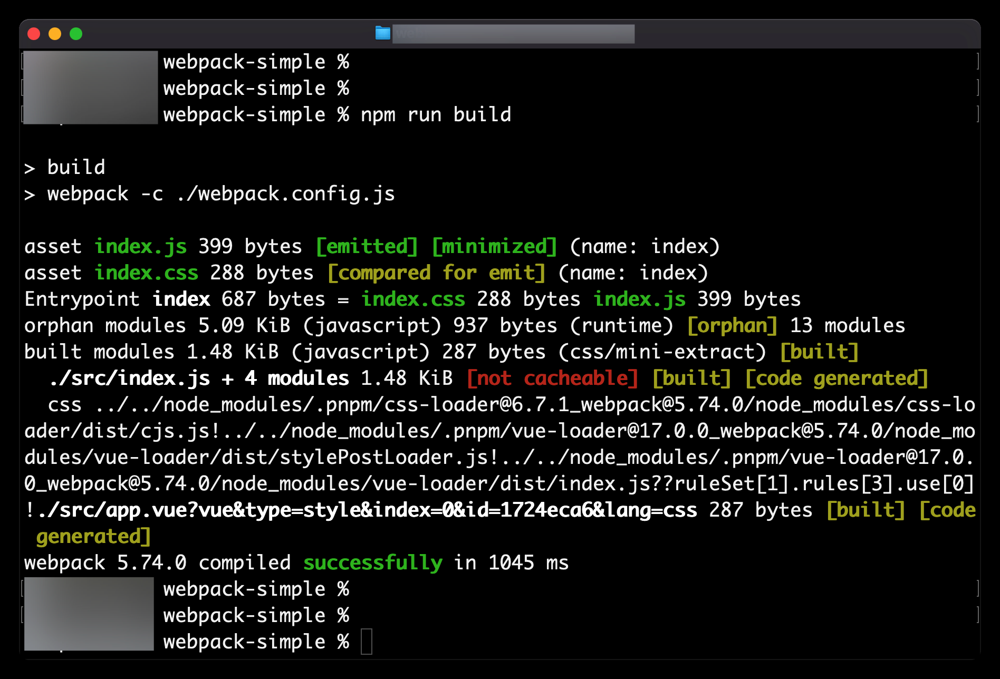

# 02 | Webpack编译搭建：如何用Webpack初构建Vue3项目？

你好，我是杨文坚。

看到这个题目，你是不是觉得有点疑惑？明明 Vue.js 3 官方标配的编译工具是 Vite，为什么我不先讲 Vue.js 3 结合 Vite 进行项目编译，而是先教你用 Webpack 编译 Vue.js 3 项目呢？

这是因为，我们这个课程是要做一个“企业级项目的实战”，而在企业技术开发中，第一要素就是保证功能的稳定性和可用性。在这一点上，Webpack 比 Vite 有更大优势。它发布于 2013年，拥有较好的技术生态，基本上，你用 Webpack 项目打包构建遇到任何问题，都能在网上找到相关场景的直接解决方案或者间接解决思路。而 Vite 比较年轻，在 2020 年才发布正式版，在技术生态的沉淀上并没有 Webpack 那么丰富。

所以，这一讲中，我们还是先来讲讲怎么用 Webpack 来编译 Vue.js 3 项目。开始之前，我们先来看看除了 Webpack 生态更稳定的因素外，Webpack 和 Vite 究竟还有什么区别，让你对这两个工具有更深入的了解。

## Webpack 和 Vite 有什么区别？

我在研究技术的时候经常在想，脱离技术的定位来对比技术好坏都是耍流氓。因为每一种流行的技术之所以被人接纳，肯定是有其诞生的定位和开发者的使用定位。所以我们要对比Webpack 和 Vite，最重要是对比这两种技术工具的定位。

Webpack 和 Vite 的定位是不一样的，这个连 Vite 的作者尤雨溪老师都曾经在知乎上回应过。Vite 定位是 Web“开发工具链”，其内置了一些打包构建工具，让开发者开箱即用，例如预设了Web 开发模式直接使用 ESM 能力，开发过程中可以通过浏览器的 ESM 能力按需加载当前开发页面的相关资源。

然而，Webpack 定位是构建“打包工具”，面向的是前端代码的编译打包过程。Webpack 能力很单一，就是提供一个打包构建的能力，如果有特定的构建需要，必须让开发者来选择合适的Loader 和 Plugin 进行组合配置，达到最终的想要的打包效果。比如 Webpack 没有内置开发服务，需要引入 webpack-dev-server 才能有开发服务的能力，这个对比 Vite 就不一样，VIte就直接内置了一个开发服务。

那么，两者的技术能力或者功能有什么异同点呢？

其实这两个工具能提供的技术能力有很大的重叠度或者相似度，基本就是对前端代码进行打包构建处理。区别是 Vite 内置了很多工具，可以减少很多配置工作量；而 Webpack 只是简单的打包工具架子，需要开发者一开始准备很多配置处理，不像 Vite 那样能开箱即用，需要花些功夫进行选择 Webpack 的 Loader 和 Plugin 进行配置。

不过，在对于企业级项目开发中，技术的稳定性当然是大于一切的，你会发现花上半天时间配置一下打包工具，可以减少后续遇到问题的烦恼。

那么，既然 Webpack 不能像 Vite 那样子开箱即用的话，我们现在就来学习一下，用Webpack 搭建 Vue.js 3 项目需要有什么步骤。

## 如何用 Webpack 搭建 Vue.js 3 项目?

用 Webpack 来搭建 Vue.js 3 项目，我们可以将最初始的项目搭建分成这几个步骤：

1. 项目目录和源码准备；

2. 安装依赖；

3. 配置 Webpack 的 Vue.js 3 编译配置；

4. 执行 Vue.js 3 编译。

第一步就是要先准备好项目目录，如下所示：

```
.
├── dist/*
├── package.json
├── src
│   ├── app.vue
│   └── index.js
└── webpack.config.js
```

我给你从上到下介绍一下这个项目目录的结构：

- dist， 是一个文件夹，为 Vue.js 3 代码的编译结果目录，最后的编译结果都是前端静态资源文件，例如 JavaScript、CSS 和 HTML 等文件；

- package.json，是一个 JSON 文件，为 Node.js 项目的声明文件，声明了模块依赖、脚本定义和版本名称等内容；

- src，是一个文件夹，为 Vue.js3 项目的源码目录，主要开发的代码内容都放在这个文件夹里；

- webpack.config.js，是一个 JavaScript 文件，是本次 Vue.js 3 项目核心内容，主要是Webpack 配置代码。

我们就在 src 的文件夹里新增两个 Vue.js 3 的源码内容，为后续编译做准备。这里是src/app.vue 的源码内容：

```xml
<template>
 <div class="demo">
   <div class="text">Count: {{state.count}}</div>
   <button class="btn" @click="onClick">Add</button>
 </div>
</template>
<script setup>
 import { reactive } from 'vue';
 const state = reactive({
   count: 0
 });
 const onClick = () => {
   state.count ++;
 }
</script>
<style>
.demo {
 width: 200px;
 padding: 10px;
 box-shadow: 0px 0px 9px #00000066;
 text-align: center;
}
.demo .text {
 font-size: 28px;
 font-weight: bolder;
 color: #666666;
}
.demo .btn {
 font-size: 20px;
 padding: 0 10px;
 height: 32px;
 min-width: 80px;
 cursor: pointer;
}
</style>
```

以下是 src/index.js 项目的入口文件源码：

```python
import { createApp } from 'vue';
import App from './app.vue';
const app = createApp(App);
app.mount('#app');
```

当你完成了步骤一的项目目录的结构设计和源码准备后，就可以进行第二步，安装依赖的npm 模块了，也就是安装项目所需要的 npm 模块。

这里的 npm 模块分成两种，一种是源码所在的 npm 模块，另外一种是开发过程中所需要的npm 模块。两种 npm 模块的安装方式都一样，区别就是安装命令要带上不同参数。

以下是安装源码依赖的 npm 模块：

```
npm i --save vue
```

这里源码代码依赖是 Vue.js 的官方源码库，这时候会自动增加依赖声明到 package.json 文件的 dependencies 字段里。

```json
{
 "dependencies": {
   "vue": "^3.2.37"
 }
}
```

以下是安装项目开发过程中依赖的 npm 模块：

```
npm i --save-dev css-loader mini-css-extract-plugin vue-loader webpack webpack-cl
```

这里是 Webpack 编译 Vue.js 3 代码所需要的开发依赖，这时候也会自动新增依赖声明到package.json 文件的 devDependencies 字段里，跟源码的依赖区分开来。

```json
{
 "devDependencies": {
   "css-loader": "^6.7.1",
   "mini-css-extract-plugin": "^2.6.1",
   "vue-loader": "^17.0.0",
   "webpack": "^5.74.0",
   "webpack-cli": "^4.10.0"
 }
}
```

当你完成了步骤二的项目依赖安装后，接下来就是这节课配置的关键内容，步骤三的Webpack 配置。在此，我先将完整的 Webpack 配置内容贴出来，后面再跟你详细讲解每个配置项的作用，你先看看完整的代码：

```javascript
const path = require('path');
const { VueLoaderPlugin } = require('vue-loader/dist/index')
const MiniCssExtractPlugin = require('mini-css-extract-plugin');
module.exports = {
 mode: 'production',
 entry: {
   'index' : path.join(__dirname, 'src/index.js'),
 },
 output: {
   path: path.join(__dirname, 'dist'),
   filename: '[name].js',
 },
 module: {
   rules: [
     {
       test: /\.vue$/,
       use: [
         'vue-loader'
       ]
     },
     {
       test: /\.(css|less)$/,
       use: [
         MiniCssExtractPlugin.loader,
         'css-loader',
       ]
     },
   ]
 },
 plugins: [
   new VueLoaderPlugin(),
   new MiniCssExtractPlugin({
     filename: '[name].css'
   })
 ],
 externals: {
   'vue': 'window.Vue'
 }
}
```

我们从上到下一步步分析。

首先看 mode，这是声明了 Webpack 的打包模式是生产的编译模式。这里一般有两种选项，生产（production）和开发（development）模式，这两种模式是企业或者开源项目约定俗成的必备模式。

第二个 entry，是声明了 Webpack 要执行打包构建编译时候从哪个文件开始编译的“入口文件”。而接下来的 output，是声明 Webpack 编译的出口文件，也就是编译结果要放在哪个目录下的哪个文件里，这里我就对应地配置出口目录配置在 dist 文件夹里。

再接着是 module，这是 Webpack 打包构建的核心所在，你可以根据自己项目的打包需要，选择对应的打包加载器（Loader）来处理指定的打包文件。这里我们选择了 vue-loader 和css-loader 就是为了解决项目里 Vue.js3 源码和 Vue.js3 源码里的 CSS 代码的打包编译处理。

然后是 plugins，这个是 Webpack 的插件配置，主要是贯穿 Webpack 的整个打包的生命周期。这里就需要 Vue 的加载插件（VueLoaderPlugin）来辅助你在编译 Vue.js 3 代码时候做相关的编译处理。同时，我们这里也用了 CSS 的分离插件（MiniCssExtractPlugin），主要是在Webpack 打包的生命周期过程中将 Vue.js 3 源码里的 CSS 代码分离出单独的 CSS 文件。

最后是 externals，这个是声明在 Webpack 打包编译过程中，有哪些源码依赖的 npm 模块需要“排除打包”处理，也就是不做打包整合处理。我们这里就是将 Vue.js 3 的运行源码进行“排除打包”处理，让代码最终代码依赖的 Vue.js 3 运行时，从 window.Vue 全局变量获取。这么做的好处就是通过减少打包的内容来缩短打包时间。

完成以上的三个步骤，接下来就进入最终步骤了，也就是编译脚本配置。这里我们需要在package.json 里配置好执行脚本，如下所示：

```json
{
 "scripts": {
   "build": "webpack -c ./webpack.config.js"
 }
}
```

这个编译脚本可以让你在当前目录的命令行工具里，直接执行 npm run build 就可以触发编译操作。执行编译脚本命令后结果如下图所示：



执行完代码后，会在当前项目的 dist 目录文件夹里，生成最终的 Vue.js 3 编译结果代码index.js 和 index.css 文件。其中 index.js 文件就是核心的 Vue.js3 源码文件的编译结果，结果如下：

```javascript
(()=>{"use strict";const e=window.Vue,t={class:"demo"},n={class:"text"},c={__name
```

你可以从上述代码中看到，由于我把 vue 模块给 external 出来成为 window.Vue，让编译后的代码变得更加精简。后续代码运行的时候，我们只要在页面加入 Vue.js 3 的全局变量脚本，就可以把 node_modules/vue/dist/vue.runtion.global.js 这个文件复制出来引用了。

好了，到这个点，我们终于实现了最基础的 Webpack 编译 Vue.js 3 项目。不过，上述的内容只是开始。不知道你有没有发现，上述配置过程只是处理了代码编译，但是实际做项目我们需要一边写代码一边实时编译源码调试，还要实时显示效果，这不仅仅只做一次性的编译操作，而是要分成多种编译模式。

通常我们做企业级前端项目时候，最基本的编译模式有开发模式和生产模式，接下来我们就来讲解一下 Webpack 开发模式和生产模式的配置。

## Webpack 开发模式和生产模式

在讲解如何配置 Webpack 开发模式和生产模式之前，我们要先了解一个概念，Node.js 进程的环境变量概念。

Node.js 在执行命令脚本时候，如果带上参数 NODE_ENV=production，完整的脚本命令是NODE_ENV=production webpack -c ./webpack.config.js 。那么 webpack.config.js 文件在执行的时候，可以在 process.env 拿到环境变量 NODE_ENV，也就是可以拿到process.env.NODE_ENV = production。

这个环境变量有什么作用呢？它可以让我们设置不同环境变量来执行同一份配置Webpack.config.js 配置文件，触发不同的编译模式。

到这里，你应该知道为什么我一开始要讲解 Node.js 进程的环境变量这个概念了吧？我们就是要利用进程环境变量，在 webpack.config.js 配置文件里，根据不同环境变量值判断和处理不同模式的编译。

现在我们就可以开始进入 Webpack 的开发模式和生产模式的讲解了。

### 开发模式处理

开发模式和生产模式是基于不同进程环境变量做区分的，所以他们的执行命令脚本就不一样。这里我们就可以基于上述的 package.json 做一下执行脚本的更改，如下所示：

```json
{
 "scripts": {
   "dev": "NODE_ENV=development webpack serve -c ./webpack.config.js",
   "build": "NODE_ENV=production webpack -c ./webpack.config.js"
 }
}
```

你有没有发现，这里的开发模式（dev），是不是多了个 serve 的子命令？这个就是我们要讲的在开发模式下，需要一个开发服务来让编译的代码能在浏览器中访问。这个时候，我们就需要安装 Webpack 开发服务的依赖模块 webpack-dev-server ：

```
npm i --save-dev webpack-dev-server
```

你安装后，要在 Webpack 配置文件添加对应的服务配置：

```
{
 // 其它 Webpack配置代码
 devServer: {
   static: {
     directory: path.join(__dirname),
   },
   compress: true,
   port: 6001,
   hot: false,
   compress: false,
 }
 // 其它 Webpack配置代码
}
```

在开发模式下，我们还要断点到源码指定位置的内容，这里就需要新增一个配置内容，也就是sourceMap 的配置，配置代码如下所示：

```
{
 // 其它 Webpack配置代码
 devtool: 'inline-cheap-module-source-map',
 // 其它 Webpack配置代码
}
```

这里的 devtool 还有其它的选项，详情你可以参考下官方文档。

另外，开发过程中还需要 HTML 页面来承载运行编译后的 JavaScript 和 CSS 代码。这里你需要在项目的根目录下新创建一个 HTML 文件 index.html，用于访问处理，同时还需要让webpack-dev-server 知道它应该访问哪个 HTML 文件的配置处理。为此，你需要先配置好服务的访问页面。

配置服务的访问页面，首先你要安装 html-webpack-plugin 插件来处理 HTML 页面：

```
npm i --save-dev html-webpack-plugin
```

再配置 html-webpack-plugin 到 webpack.confg.js 文件中：

```
{
 // 其它 Webpack配置代码
 plugins: [
   new HtmlWebpackPlugin({
     title: 'Hello Vue',
     filename: 'index.html',
     template:'./index.html',
     minify: false,
     inject: false,
     templateParameters: {
       publicPath: path.join(__dirname),
       js: [
         './node_modules/vue/dist/vue.runtime.global.js',
         './index.js'
       ],
       css: [
         './index.css'
       ],
     },
   })
 ]
 // 其它 Webpack配置代码
}
```

然后再配置 HTML 模板文件：

```xml
<html>
 <head>
   <meta name="viewport" content="width=device-width, initial-scale=1.0, maximum
   <link rel="stylesheet" href="<%= htmlWebpackPlugin.options.templateParameters
   <script src="<%= htmlWebpackPlugin.options.templateParameters.js[0] %>"></scr
 </head>
 <body>
   <div id="app"></div>
 </body>
 <script src="<%= htmlWebpackPlugin.options.templateParameters.js[1] %>"></scrip
</html>
```

至此，你就可以愉快地使用开发模式进行 Vue.js 3 的项目开发了，执行以下命令：

```
npm run dev
```

再访问命令行所提示的访问链接，你就可以在浏览器预览到实际代码渲染结果了。

### 生产模式处理

好了，处理完开发模式后，我们接下来还要处理生产模式。

生产模式最重要的是代码编译完后要进行压缩处理，减少体积。这里我们就需要压缩JavaScript 和 CSS 的结果代码，你可以选择安装 Webpack 生态里的压缩代码插件，具体有压缩 JavaScript 代码的插件 TerserPlugin 和压缩 CSS 代码的插件 CssMinimizerPlugin，这几个插件是 Webpack 官方文档的推荐插件，可以执行如下安装命令：

```
npm i --save-dev css-minimizer-webpack-plugin terser-webpack-plugin
```

然后再进行 webpack.config.js 文件的配置：

```
{
 // 其它 Webpack配置代码
 optimization: {
   minimizer: [
     new TerserPlugin({}),
     new CssMinimizerPlugin({}),
   ],
 },
 // 其它 Webpack配置代码
}
```

如果这个时候，你还想把 HTML 模板在生产模式中都打印出来，可以这么配置处理：

```
{
 // 其它 Webpack配置代码
 plugins: [
   new HtmlWebpackPlugin({
     title: 'Hello Vue',
     filename: 'index.html',
     template:'./index.html',
     minify: false,
     inject: false,
     templateParameters: {
       publicPath: path.join(__dirname),
       js: [
         'https://unpkg.com/vue@3.2.37/dist/vue.runtime.global.js',
         './index.js'
       ],
       css: [
         './index.css'
       ],
     },
   })
 ]
 // 其它 Webpack配置代码
}
```

注意了，这里的 https://unpkg.com/vue@3.2.37/dist/vue.runtime.global.js 只是临时模拟CDN 的 Vue.js 3 运行时文件，实际企业级项目要换成公司内部的 CDN 资源。

好了，我这里就已经把 Webpack 编译 Vue.js3 项目的生产模式和开发模式都配置好了。不知道你有没有发现，两种模式有很多配置是重叠的，这个时候就需要用到我们刚刚提到的Node.js 进程环境变量来做区分判断处理，同时可以加上一个 webpack-merge 来辅助处理配置的合并。

最终配置结果如下所示：

```javascript
const path = require('path');
const webpackMerge = require('webpack-merge').default;
const { VueLoaderPlugin } = require('vue-loader/dist/index')
const MiniCssExtractPlugin = require('mini-css-extract-plugin');
const CssMinimizerPlugin = require("css-minimizer-webpack-plugin");
const TerserPlugin = require("terser-webpack-plugin");
const HtmlWebpackPlugin = require('html-webpack-plugin');
const baseConfig = {
 mode: process.env.NODE_ENV,
 entry: {
   'index' : path.join(__dirname, 'src/index.js'),
 },
 output: {
   path: path.join(__dirname, 'dist'),
   filename: '[name].js',
 },
 module: {
   rules: [
     {
       test: /\.vue$/,
       use: [
         'vue-loader'
       ]
     },
     {
       test: /\.(css|less)$/,
       use: [
         MiniCssExtractPlugin.loader,
         'css-loader',
       ]
     },
     {
       test: /\.(png|svg|jpg|jpeg|gif)$/i,
       type: 'asset/resource',
     }
   ]
 },
 plugins: [
   new VueLoaderPlugin(),
   new MiniCssExtractPlugin({
     filename: '[name].css'
   }),
 ],
 externals: {
   'vue': 'window.Vue'
 }
}
if (process.env.NODE_ENV === 'development') {
 config = webpackMerge(baseConfig, {
   devtool: 'inline-cheap-module-source-map',
   devServer: {
     static: {
       directory: path.join(__dirname),
     },
     port: 6001,
     hot: false,
     compress: false,
   },
   plugins: [
     new HtmlWebpackPlugin({
       title: 'Hello Vue',
       filename: 'index.html',
       template:'./index.html',
       minify: false,
       inject: false,
       templateParameters: {
         publicPath: path.join(__dirname),
         js: [
           './node_modules/vue/dist/vue.runtime.global.js',
           './index.js'
         ],
         css: [
           './index.css'
         ],
       },
     })
   ]
 })
} else {
 config = webpackMerge(baseConfig, {
   optimization: {
     minimizer: [
       new TerserPlugin({}),
       new CssMinimizerPlugin({}),
     ],
   },
   plugins: [
     new HtmlWebpackPlugin({
       title: 'Hello Vue',
       filename: 'index.html',
       template:'./index.html',
       minify: false,
       inject: false,
       templateParameters: {
         publicPath: path.join(__dirname),
         js: [
           'https://unpkg.com/vue@3.2.37/dist/vue.runtime.global.js',
           './index.js'
         ],
         css: [
           './index.css'
         ],
       },
     })
   ]
 })
}
module exports = config;
```

上述的配置内容就是本次 Vue.js 3 项目配置 Webpack 编译的核心代码，涵盖了开发模式和生产模式。现在你应该已经比较清晰地了解到一个完整的 Vue.js 3 项目的 Webpack 配置流程了，接下来就愉快地进行 Vue.js 3 代码的开发吧！

## 总结

这节课我们讲了这么多关于 Webpack 的 Vue.js 3 项目编译配置的知识，核心展示了企业级项目是怎么做编译配置的。

用 Webpack 搭建 Vue.js 3 项目，主要包括配置项目目录、根据要求安装依赖（Plugin 和Loader）、开发模式和生产模式的设置这几个步骤，其中你要特别注意开发模式和生产模式的配置复用和配置隔离。

我们前面也说了，我们选择 Webpack，是为了面向企业级项目的学习目标考虑。目前我所接触到的大厂，主流的构建配置还是 Webpack，除了生态丰富的原因外，还有一点是企业中很多历史项目都是用 Webpack 进行构建的，形成了一个比较稳定的代码传承。但是，你也不能因为这样就忽略了 Vite 这个 Vue.js 3 官方的“亲儿子”技术工具。

你需要的是举一反三，用 Webpack 生产和开发模式配置，类比学习 Vite 相关的技术知识点，因为同类型的技术基本都是相同的。例如，本节课提到生产和开发模式，就不是 Webpack 独有的概念，是大部分构建工具都有的概念，Vite 也有相关概念。不仅仅是这节课，我希望你后续技术学习都要学会举一反三，互相比对。

## 思考题

Webpack 从诞生到现在这么久，核心也迭代了很多大版本，那不同版本在打包构建上有什么差异吗？

期待你的分享。如果今天的课程让你有所收获，欢迎你把文章分享给有需要的朋友，我们下节课再见！

完整的代码在这里
