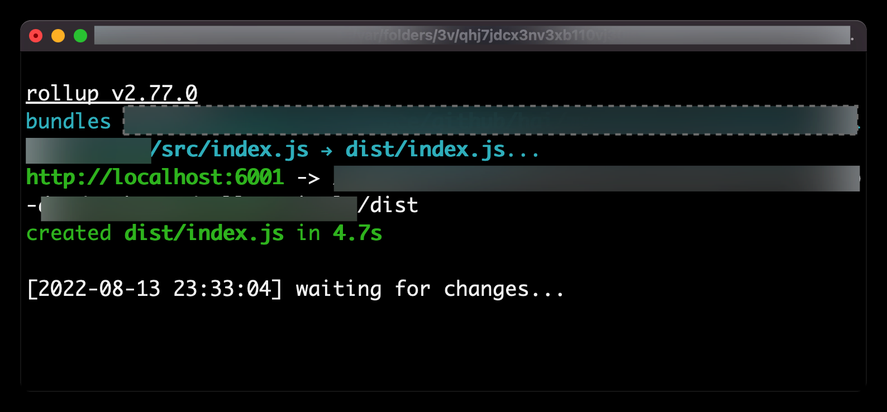
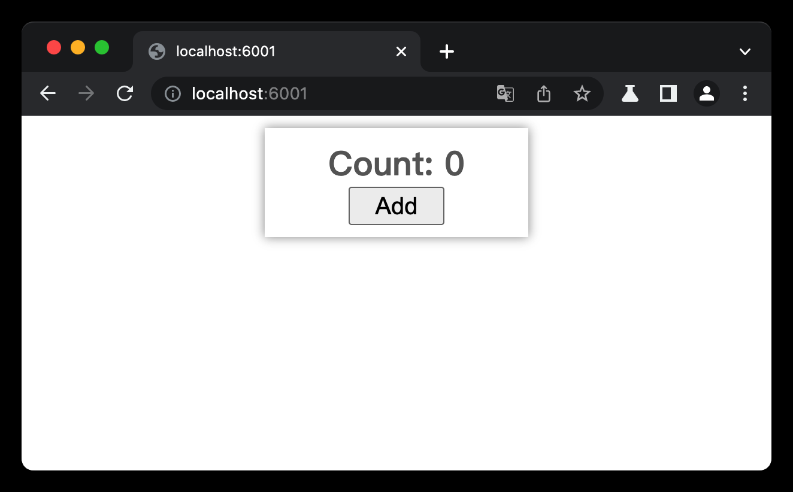
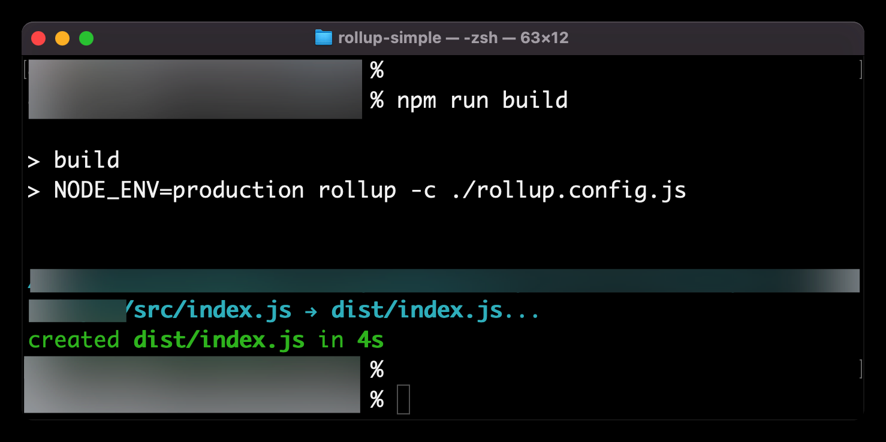
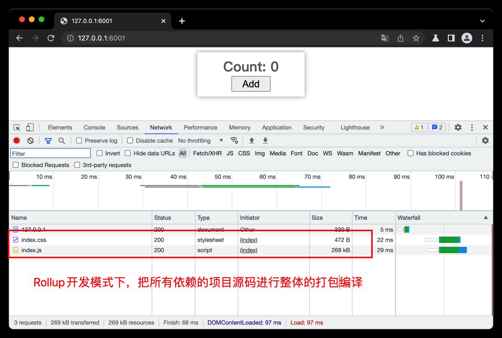
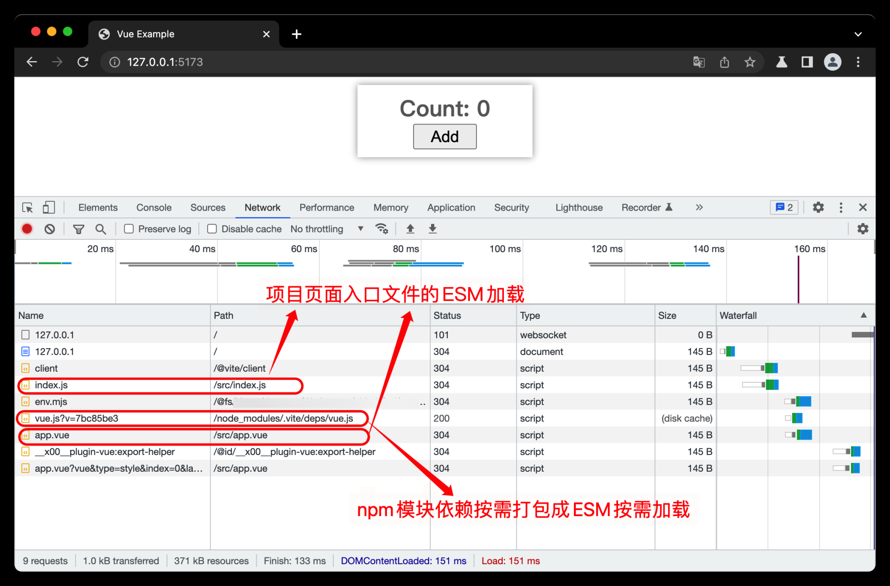
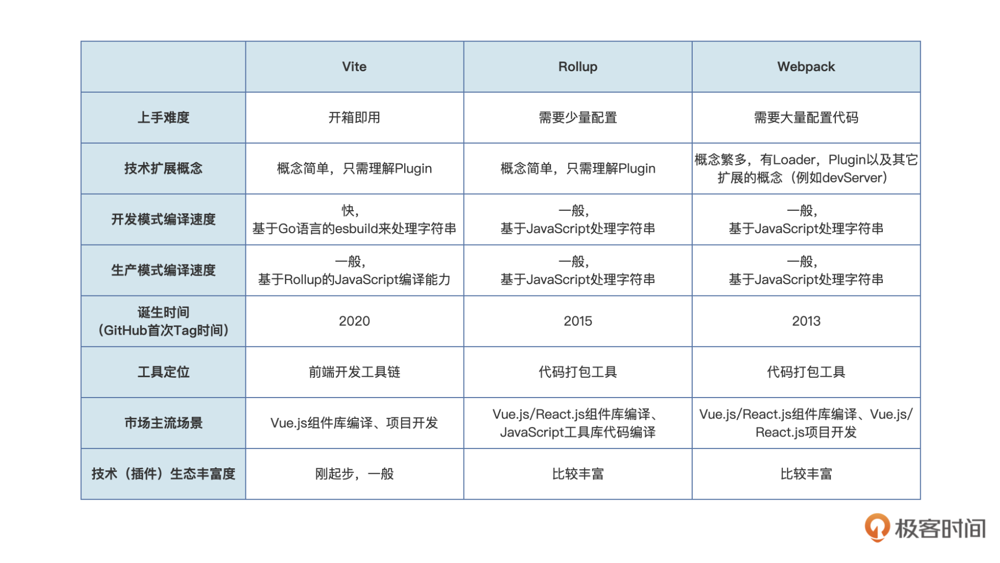

# 03 | 从Rollup到Vite：如何用Vite构建你的Vue3项目？

你好，我是杨文坚。

上节课我们跳过了官方推荐的 Vite，选择了 Webpack 来搭建 Vue.js 3 项目，这是因为我们看重 Webpack 丰富的技术生态，Webpack 发展了近 10 年，沉淀了许多问题处理经验，企业级的应用打包编译方案也相当丰富。

但是，近两年 Vue.js 官方推出了 Vite，很多新项目也开始使用 Vite。Vite 作为 Vue.js 3 官方标配的开发工具，代表了官方技术的发展方向，因此作为后续 Vue 学习和进阶，肯定是不可跳过的一环。

所以这一讲，我们就来尝试一下，如何用 Vite 来搭建 Vue.js 3 项目。不过，在开始之前，我还是需要给你简单介绍一下 Vite。

## Vite：Vue.js 3 的官方标配

首先我们要知道，Vue.js 发展到现在，已经不是一个纯粹的前端页面代码库或者框架了，而是一整套技术体系。这里的技术体系是指围绕着 Vue.js 进行构建的技术生态，包括测试工具Vitest、文档工具 VitePress 等等。这些工具开箱即用的能力，目前都是基于 Vite 来进行打造的，这也说明了 Vite 在整个 Vue.js 生态中的重要位置。

Vite 是 Vue.js 作者尤雨溪早年基于 Rollup 做的一个开发工具，核心是为了提高 JavaScript 项目的开发效率。那么相比同类型的开发工具来说，它的优势在哪呢？

除了上节课我们提到的 Vite 支持开箱即用，无需像 Webpack 要做一堆繁杂的配置之外，很重要的一点就是 Vite 确实能够提升我们的开发效率。Vite 利用现在最新版本的浏览器支持 ESM的特性，可以在开发模式下直接让所有 npm 模块和项目里的 JavaScript 文件按需加载执行，减少了开发模式编译时间，让开发过程中每次修改代码后能快速编译，进而提升了开发效率。

这一点对大部分开发者来讲，都是解决了开发过程中很大的体验痛点。那我们再深一步，为什么 Vite 能在开发模式中快速编译代码呢？因为 Vite 用了 esbuild。而 esbuild 是用 Go 语言编写的构建器，和普通 JavaScript 实现的构建器相比，它的打包速度能快 10~100 倍。

不过，截止到 2022 年，在 Vue.js 官方发布的 Vite 最新版 3.x 中，只有开发模式是用 esbuild进行代码编译，而生产模式依旧是用 Rollup 进行打包和编译。

这里问题就来了，既然我们说过 esbuild 的打包速度能够比普通 JavaScript 实现的构建器快10~100 倍，那么 Vite 生产模式不选择用 esbuild，而去选择 Rollup 呢？

这是因为两种模式的侧重有所不同。开发模式是面向开发者的，开发效率是最重要的，生产模式是面向企业项目的实际用户，代码功能稳定是第一位。

我们都知道，esbuild 其实也刚诞生不久，在代码分割和 CSS 处理方面没有 Rollup 那么成熟灵活。虽然它能降低代码编译时间提高开发效率，但最大问题是还不稳定。可以用于开发者使用，但要是直接用于生产模式打包编译代码给企业用户使用，就不太能令人放心了。然而Rollup 从 2015 年发布至今已经积累了多年的技术沉淀，形成了比较稳定的技术生态，所以Vite 在生产模式就选择了 Rollup，追求稳定。

到这里，我再来对 Rollup 做个补充介绍，Rollup 一开始技术社区里的定位做小工具开发的代码打包构建，但其实也是能跟 Webpack 一样做应用级别的代码打包构建。接下来，我们先讲解一下只用 Rollup 如何进行 Vue.js 3 项目配置，之后再来介绍 Vite 的使用，同时对比两者的差异。

毕竟，Vite 是基于 Rollup.js 的 Plugin 思路来打造插件体系的，同时也是把 Rollup.js 作为目前生产模式的底层打包构建工具。先了解 Rollup.js，可以让我们对 Vite 的插件使用概念有更清楚认识。

## ‌Rollup 如何配置 Vue.js 3 项目？

用 Rollup 来搭建 Vue.js 3 项目，可以分成以下几个步骤：

1. 项目目录和源码准备；

2. 安装依赖；

3. Vue.js 3 的 Rollup 编译脚本配置；

4. 执行开发模式和生产模式的 Vue.js 3 编译。

第一步就是要先准备好项目目录，如下所示：

```
.
├── dist/*
├── index.html
├── package.json
├── rollup.config.js
└── src
   ├── app.vue
   └── index.js
```

我给你从上到下介绍一下这个项目目录的结构：

- dist， 是一个文件夹，为 Vue.js 3 代码的编译结果目录，最后的编译结果都是前端静态资源文件，例如 JavaScript、CSS 和 HTML 等文件；

- index.html，是项目的 HTML 页面文件；

- package.json，是一个 JSON 文件，为 Node.js 项目的声明文件，声明了模块依赖、脚本定义和版本名称等内容；

- rollup.config.js，是一个 JavaScript 文件，是本次 Vue.js 3 项目核心内容，主要是Webpack 配置代码。

- src，是一个文件夹，为 Vue.js 3 项目的源码目录，主要开发的代码内容都放在这个文件夹里。

接着我们开始准备代码文件的内容。这里要先把项目 HTML 页面源码准备到 index.html 文件里，HTML 源码内容如下所示：

```xml
<html>
 <head>
   <link rel="stylesheet" href="./index.css" />
 </head>
 <body>
   <div id="app"></div>
 </body>
 <script src="./index.js"></script>
</html>
```

然后在 src 的文件夹里新增两个 Vue.js 3 的源码内容，为后续编译做准备。这里是src/app.vue 的源码内容：

```xml
<template>
 <div class="app">
   <div class="text">Count: {{state.count}}</div>
   <button class="btn" @click="onClick">Add</button>
 </div>
</template>
<script setup>
 import { reactive } from 'vue';
 const state = reactive({
   count: 0
 });
 const onClick = () => {
   state.count ++;
 }
</script>
<style>
.app {
 width: 200px;
 padding: 10px;
 margin: 10px auto;
 box-shadow: 0px 0px 9px #00000066;
 text-align: center;
}
.app .text {
 font-size: 28px;
 font-weight: bolder;
 color: #666666;
}
.app .btn {
 font-size: 20px;
 padding: 0 10px;
 height: 32px;
 min-width: 80px;
 cursor: pointer;
}
</style>
```

以下是 src/index.js 项目的入口文件源码：

```python
import { createApp } from 'vue';
import App from './app.vue';
document.addEventListener('DOMContentLoaded', () => {
 const app = createApp(App);
 app.mount('#app');
})
```

当你完成了步骤一的项目目录的结构设计和源码准备后，就可以进行第二步安装 Rollup 项目依赖的 npm 模块了，也就是安装项目所需要的 npm 模块。

以下是安装源码依赖的 npm 模块：

```
npm i --save vue
```

接下来安装 Rollup 项目开发过程中依赖的 npm 模块：

```
npm i --save-dev @babel/core @babel/preset-env @rollup/plugin-babel @rollup/plugi
```

这里安装的开发依赖非常多，我需要给你逐个分析一下各个依赖的作用：

- @babel/core，Babel 官方模块，用来编译 JavaScript 代码；

- @babel/preset-env，Babel 官方预设模块，用来辅助 @babel/core 编译最新的 ES 特性；

- @rollup/plugin-babel，Rollup 的 Babel 插件，必须配合 @bable/core 和 @babel/preset-env 一起使用；

- @rollup/plugin-commonjs，是 Rollup 官方插件，用来处理打包编译过程中 CommonJS 模块类型的源码；

- @rollup/plugin-html，是 Rollup 官方插件，用来管理项目的 HTML 页面文件；

- @rollup/plugin-node-resolve，是 Rollup 官方插件，用来打包处理项目源码在node_modules 里的使用第三方 npm 模块源码；

- @rollup/plugin-replace，是 Rollup 官方插件，用来替换源码内容，例如 JavaScript 源码的全局变量 process.env.NODE_ENV；

- rollup，Rollup 的核心模块，用来执行 Rollup 项目的编译操作；

- rollup-plugin-postcss，第三方模块，用于将 Vue.js 项目源码的 CSS 内容分离出独立 CSS文件；

- rollup-plugin-serve，第三方模块，用于 Rollup 项目开发模式的 HTTP 服务；

- rollup-plugin-vue，Vue.js 官方提供的 Rollup 插件模块。

依赖安装完后，可以在 package.json 看到安装结果，如下所示：

```json
{
 "devDependencies": {
   "@babel/core": "^7.18.6",
   "@babel/preset-env": "^7.18.6",
   "@rollup/plugin-babel": "^5.3.1",
   "@rollup/plugin-commonjs": "^22.0.1",
   "@rollup/plugin-html": "^0.2.4",
   "@rollup/plugin-node-resolve": "^13.3.0",
   "@rollup/plugin-replace": "^4.0.0",
   "rollup": "^2.77.0",
   "rollup-plugin-postcss": "^4.0.2",
   "rollup-plugin-serve": "^2.0.1",
   "rollup-plugin-vue": "^6.0.0"
 },
 "dependencies": {
   "vue": "^3.2.37"
 }
}
```

好了，到这里我就讲完了所有关于 Rollup 的 Vue.js 3 项目编译依赖安装，到此你算是完成了步骤二的项目依赖安装后，接下来就是这节课配置的关键内容，步骤三的 Rollup 配置。

在此，我先将完整的 Rollup 配置内容贴出来，后面再跟你详细讲解每个配置项的作用，你先看看完整的代码：

```javascript
const path = require('path');
const fs = require('fs');
const { babel } = require('@rollup/plugin-babel');
const vue = require('rollup-plugin-vue');
const { nodeResolve } = require('@rollup/plugin-node-resolve');
const commonjs = require('@rollup/plugin-commonjs');
const postcss = require('rollup-plugin-postcss');
const replace = require('@rollup/plugin-replace');
const html = require('@rollup/plugin-html');
const serve = require('rollup-plugin-serve');
const babelOptions = {
 "presets": [
   '@babel/preset-env',
 ],
 'babelHelpers': 'bundled'
}
module.exports = {
 input: path.join(__dirname, 'src/index.js'),
 output: {
   file: path.join(__dirname, 'dist/index.js'),
 },
 plugins: [
   vue(),
   postcss({
     extract: true,
     plugins: []
   }),
   nodeResolve(),
   commonjs(),
   babel(babelOptions),
   replace({
     'process.env.NODE_ENV': JSON.stringify(process.env.NODE_ENV),
     preventAssignment: true
   }),
   html({
     fileName: 'index.html',
     template: () => {
       const htmlFilePath = path.join(__dirname, 'index.html')
       const html = fs.readFileSync(htmlFilePath, { encoding: 'utf8' })
       return html;
     }
   }),
   process.env.NODE_ENV === 'development' ? serve({
     port: 6001,
     contentBase: 'dist'
   }) : null
 ],
}
```

我们对 Rollup 的配置从上到下一步步分析：

- input，是声明了 Rollup 要执行打包构建编译时候从哪个文件开始编译的“入口文件”；

- output，是声明 Rollup 编译的出口文件，也就是编译结果要放在哪个目录下的哪个文件里，这里我就对应地把出口目录配置在 dist 文件夹里；

- plugins，这个是 Rollup 的插件配置，主要是贯穿 Rollup 的整个打包的生命周期。

看到这里，你是不是觉得 Rollup 的配置比 Webpack 简单很多？

没错，这是因为 Rollup 的技术生态就只有 Plugin 的概念，不像 Webpack 有 Loader 和 Plugin两种技术生态和其它额外的官方配置。

完成以上的三个步骤，接下来就进入最终步骤了，也就是编译脚本配置。这里我们需要在package.json 里配置好执行编译的脚本，如下所示：

```json
{
 "scripts": {
   "dev": "NODE_ENV=development rollup -w -c ./rollup.config.js",
   "build": "NODE_ENV=production rollup -c ./rollup.config.js"
 }
}
```

这个脚本可以让你在当前目录的命令行工具里，直接执行 npm run dev 就可以触发开发模式编译操作，直接执行 npm run build 就可以生产模式编译操作。

第四步，我们就可以来试一下执行开发模式脚本命令 npm run dev 了，结果如下图所示：



根据提示，我们可以通过浏览器直接访问 http://localhost:6001 查看开发模式结果：



执行完开发模式后，我们可以执行以下生产模式命令 npm run build，执行完后结果如下：



最后我们可以在项目的 dist 目录里找到生产模式编译结果。

通过上述整套 Rollup 搭建 Vue.js 3 的项目编译的讲解，你是不是觉得即使 Rollup 比Webpack 配置更简单，但仍然很繁琐呢？

而且，在上述 Rollup 的配置我还没加上生产模式的代码压缩配置，如果把生产模式判断逻辑加上去的话， rollup.config.js 代码配置会更加复杂。所以这个时候 Vite 的开箱即用尤其重要，可以帮我们减少很多项目开发过程中的配置工作。接下来我就来讲解一下 Vite 的 Vue.js 3项目配置，顺便再对比一下 Vite 项目和 Rollup 项目的配置。

## 改成 Vite 项目后会怎样？

我先讲解一下 Vite 的项目配置步骤。你会看到，虽然配置步骤跟 Rollup 类似，但是每个步骤比 Rollup 简单得多。

第一步，项目目录和源码准备，如下所示：

```
.
├── dist
├── index.html
├── package.json
├── src
│   ├── app.vue
│   └── index.js
└── vite.config.js
```

这里与 Rollup 项目最大区别就是配置文件不同，为 vite.config.js。

第二步，安装依赖。

我们先来安装项目源码模块依赖：

```
npm i --save vue
```

然后再安装项目开发模块依赖：

```
npm i --save-dev vite @vitejs/plugin-vue
```

哈哈，到了这一步，你会不会发现，项目开发的模块依赖比 Rollup 少了很多？只有简单的两个依赖。

第三步，配置 Vite 的 Vue.js 3 编译配置，也就是在 vite.config.js 配置 Vite 的编译配置。

```bash
import { defineConfig } from 'vite'
import vue from '@vitejs/plugin-vue'
export default defineConfig({
 plugins: [vue()],
 base: './'
})
```

第四步，执行开发模式和生产模式的 Vue.js 3 编译，在 package.json 配置开发模式和生产模式的脚本命令。

```json
{
 "scripts": {
   "dev": "vite",
   "build": "vite build"
 }
}
```

好了，现在我们就可以愉快执行两种模式的命令进行打包编译了，你是不是觉得配置的内容比Rollup 和 Webpack 少了很多？不需要考虑太多插件选择，做简单准备后就可以直接进入开发和生产模式，已经算是达到了“开箱即用”的状态了。

那么，是不是 Rollup 和 VIte 之间的差别仅仅只有配置的难易呢？

答案是否定的。除了配置的难易差别外，两者之间还有不同开发编译模式的差异，但是这些差异都是对使用者无感知的，因为 Vite 底层已经做了很多优化工作，让开发者只关注简单的配置就能开箱即用。

我们刚刚提到过，Vite 只是在生产模式下的打包编译用了 Rollup，开发模式下的打包编译用的是 esbuild。所以虽然 Vite 和纯 Rollup 在生产模式下构建的结果相差不大，只是在项目配置上简约了很多，但是我们还是得花点时间对比下两者的开发模式，让你有个更清晰的判断。

我们先来看一下 Rollup 开发模式的执行过程：

1. 启动 Rollup 开发模式命令，Rollup 识别配置里的编译入口（input），从入口文件解析出所有依赖代码，进行编译；

2. 编译完后启动 HTTP 开发服务，同时也继续监听源码变化；

3. 开发者用浏览器访问页面；

4. 再次修改代码，Rollup 监听到源码变化，再整体重新编译代码。

我们直接来看看那 Rollup 在开发模式下，打包编译后在浏览器里的执行效果图片：



你可以看到，Rollup 是直接把所有代码打包成 Bundle 文件格式，也就是最后只生成一个JavaScript 文件和 CSS 文件。这种打包成一个文件的过程是最费时间的，所以 Vite 在开发模式下的理念就不用这套方式，只保留在 Vite 的生产模式中使用。

而 Vite 的开发模式执行过程又是另一番场景，具体执行过程如下：

1. Vite 开发模式命令，VIte 启动 HTTP 服务和监听源码的变化；

2. 开发者用浏览器访问页面；

3. Vite 根据访问页面引用的 ESM 类型的 JavaScript 文件进行查找依赖，并将依赖通过esbuild 编译成 ESM 模块的代码，保存在 node_modules/.vite/ 目录下；

4. 浏览器的 ESM 加载特性会根据页面依赖到 ESM 模块自动进行按需加载。

- 再次修改代码，再次访问页面，会自动执行 ESM 按需加载，同时触发依赖到的变更文件1.重新单独编译；

- 修改代码只会触发刷新页面，不会直接触发代码编译，而且源码编译是浏览器通过 ESM2.模块加载访问到对应文件才进行编译的；

- 开发模式下因为项目源码是通过 esbuild 编译，所以速度比 Rollup 快，同时由于是按页3.面里请求依赖进行按需编译，所以整体打包编译速度理论上是比 Rollup 快一些。

你也可以看下 Vite 在开发模式下浏览器访问的效果图片：



你可以看到，所有加载的 JavaScript 文件都是 ESM 模块文件。这些项目源码文件和 npm 依赖模块都是经过 esbuild 快速单独编译封装的 ESM 模块文件，不需要像 Rollup 那样经过重新分析语法和文件打包编译一个 Bundle 文件，省去了很多编译时间，这就是 Vite 为什么在开发模式下能快速编译的原因。

经过上述的对比，我们可以知道两者开发模式的体验差异还是很大的。Vite 的按需加载打包速度，理论上是比 Rollup 的打包编译 Bundle 文件要快一些。哈哈，请注意，我这里用的词是“理论上”。因为考虑到开发过程中可能出现一些意想不到的场景，所以这个打包速度的快我觉得“理论上”是绝对的，到实际开发就需要具体场景具体分析了。

除此之外，Vite 在开发模式下，依赖浏览器的 ESM 特性对页面的 JavaScript 文件进行按需加载。这里就会有一个问题，就是当项目页面依赖了很多 JavaScript 文件和 npm 模块，加载页面时候就要按需加载依赖的 ESM 文件，需要很长的浏览器请求时间，也会带来开发上的不好体验。在这种场景下，即使 esbuild 提升的打包速度节省的时间，也招架不住浏览器大量 ESM模块请求消费的大量时间，降低了整体的开发模式体验。

我讲了这么多，现在总结一下 Rollup 和 VIte 的差异，最大的差异是配置复杂度，其次是两种模式的差异。在生产模式下，目前是没太大的区别，因为最终还是一样通过 Rollup 打包和编译代码。在开发模式下，差异就比较大，Vite 通过 esbuild 和浏览器 ESM 对项目页面的JavaScript 进行按需加载，Rollup 是直接把所有依赖代码打包编译。

好了，通过这些差异，我们明显能看出 Vite 的理念和方式比较新颖，也对优化开发体验做了很多工作。那么最重要的问题来了，年轻的 Vite 能用于企业级项目吗？

## ‌年轻的 Vite 能用于企业级项目吗？

这个答案是可以的。我们前面说过企业项目最重要的是稳定，Vite 目前在生产模式下是通过Rollup 进行打包编译项目源码的，基于 Rollup 丰富的技术生态，也能解决大部分企业级项目遇到的问题。

但是！哈哈，我要提到“但是”了，你应该也发现 Vite 的开发模式和生产模式打包编译源码的机制不一样，分别是 esbuild 和 Rollup，那么就会造成开发和产线两种不同编译代码结果，这种不同可能会面临一个问题。

这个问题就是，开发过程编译的代码结果正常，但是到了产线的结果代码出错，导致开发阶段很难及时发现问题。当然啦，这只是一种可能性，不是绝对的，毕竟 Webpack 和 Rollup 在开发和生产模式的编译结果代码也存在一些差异，只不过差异没 Vite 这么大。

上述的风险也不是大问题，用 Vite 开发企业级项目在生产模式编译代码后，多验证和测试功能就行，你不要太纠结两种模式的代码差异带来的风险。技术不可能一成不变的，技术是需要试错和演进升级的。在这个技术演进过程中多花点时间去做测试和功能验证，也能够降低项目风险。

## ‌总结

又到每一节课的总结时间，我们这节课主要从“Rollup 配置 Vue.js 3 项目”到“Vite 配置 Vue.js 3项目”，通过对比来介绍 Vite 的技术理念和使用方式，更多 Vite 的使用方式可以查看官方文档。

与此同时，这节课也不是简单介绍 Rollup 和 Vite 的配置项目，而是通过一个对比，让你能知道 Vite 是作为官方标配工具的原因和演进历程。这些技术工具演进历程，可以让你在做企业级项目时候，可以在技术选型上做参考。

这里我将 Vite 和 Rollup，再结合之前讲解的 Webpack 一起做个对比，如下图所示：



项目中技术选型不是死板地照本宣科，而是要因地制宜根据项目的情况选择技术。例如，如果要改造旧项目，用 Vite 改造是存在很大风险，因为 Vite 很年轻不一定能适用旧项目改造；如果是新立项的企业项目，那么可以直接选择用 Vite 做项目源码编译的技术工具选型，可以借助 Vite 开箱即用的特性减少项目配置成本和提升开发模式体验。

最后，“在项目因地制宜选择合适技术工具”是我这一讲需要给你讲解的支线内容，新技术不一定适用所有项目，老技术不一定比不上新技术，每一门技术工具的诞生都有特定的定位和适用场景。我们要学会做好新旧技术的知识储备，做到心里“有术”，面对问题不慌。

## 思考题

Vite 开发模式下的 esbuild 的按需打包编译，真的是绝对比 Rollup 的 Bundle 打包方式快吗？如果不是，能否推演一下有哪些可能的打包慢场景？

期待你的分享。如果今天的课程让你有所收获，欢迎你把文章分享给有需要的朋友，我们下节课再见！

完整的代码在这里
