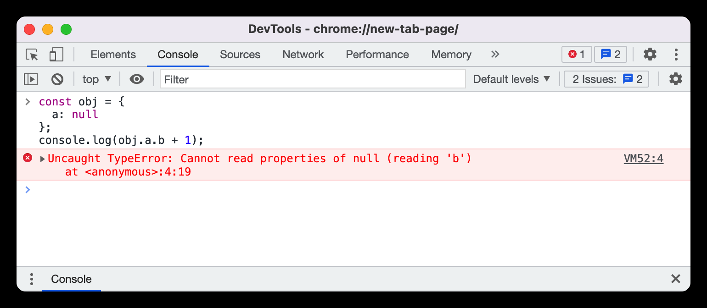
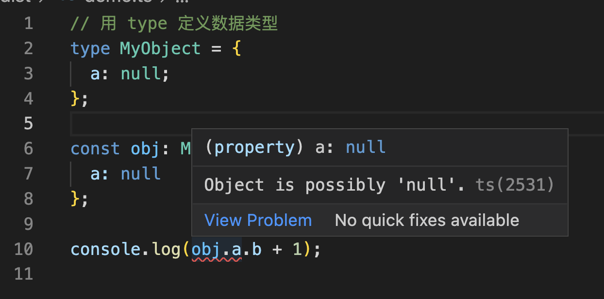
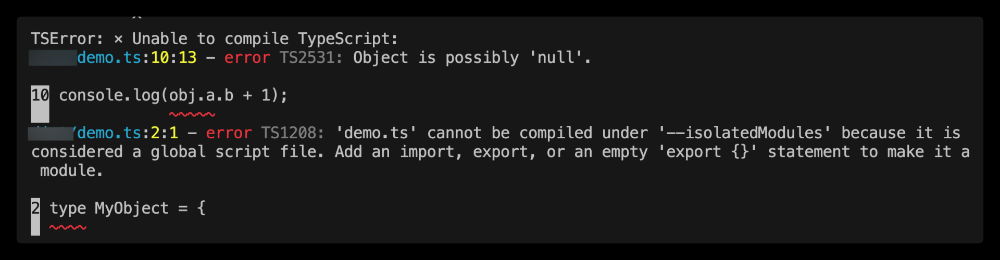
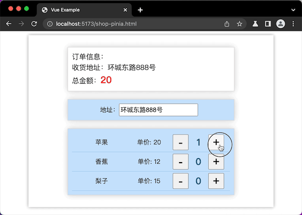
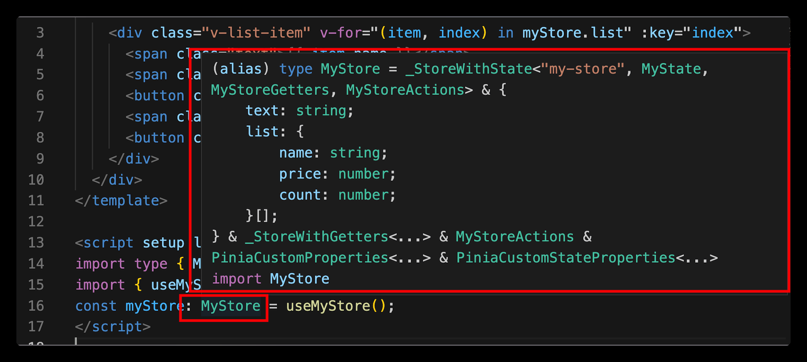
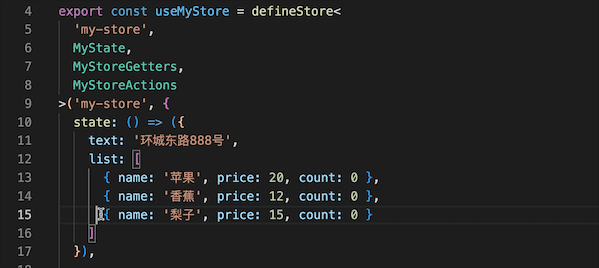
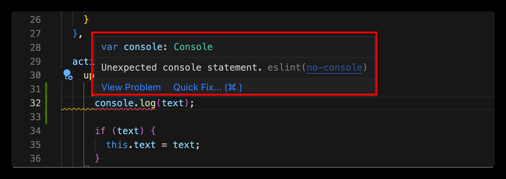
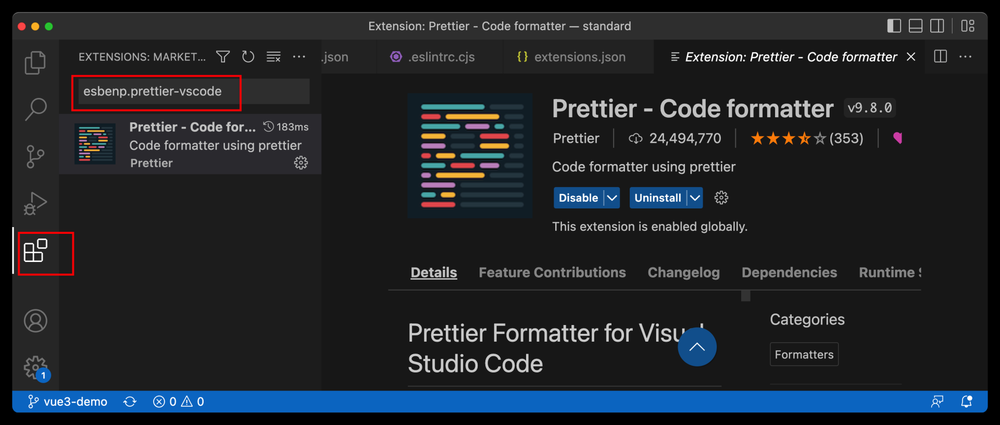
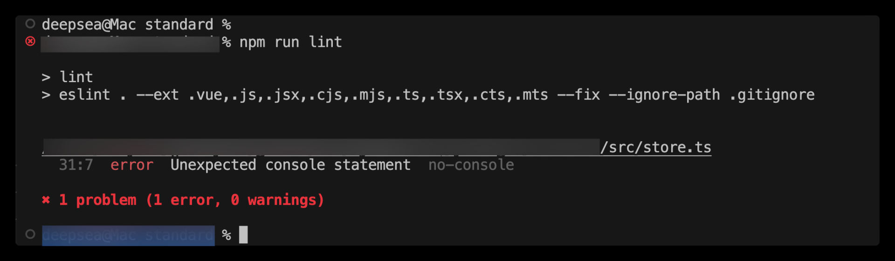

# 07 | 项目代码规范：如何成为一名合格的团队协作工程师？

你好，我是杨文坚。

这是我们基础篇部分的最后一节课，来聊聊 Vue 3 项目开发的代码规范实践。我们会以企业级项目的视角，实现项目的代码风格限制和代码质量检查，为你后续 Vue 3 项目进阶开发的代码规范打好基础。

为什么要专门留一节课来讲代码规范呢？

我们都知道，企业级项目通常都是团队多人合作进行开发和维护的。多人合作必然就逃不开个人的开发习惯和技术能力的差异，而技术能力的不足又会很直接体现在平时的坏习惯之中。比如说，有些开发者习惯性地在 JavaScript 代码里写一堆 console.log 代码进行功能调试，这个习惯其实很不好，如果在项目里，console.log 频繁使用不规范是很容易导致内存泄露的。

但开发者也是人，或多或少都有“坏习惯”，特别是遇到项目工期紧张，经常顾不上项目代码的规范和质量，只要功能实现就好了。

这些不可控的项目和人员因素，会让不规范代码慢慢积累，各种“小坑”密集沉淀，量变引发质变形成“大坑”，最终的结果就是项目代码难以维护，项目功能经常出问题。

为了规避这些问题，我们先把 Vue 3 项目的代码规范梳理成多个维度来进行讲解。

## Vue 3 项目代码规范有哪些方面？

首先，我们必须要理清楚一个概念，Vue 3 项目说到底本质是 JavaScript 项目，既然是JavaScript 项目，那我们就可以把项目代码规范分解成以下三个方面：

1. 强类型语言开发 JavaScript；

2. 代码格式规范；

3. 代码质量检查。

我们先来看第一点，用强类型语言开发 JavaScript。一般用强类型的语言开发 JavaScript 应用，即使用 TypeScript 进行开发。TypeScript 的显式类型，可以减少 JavaScript 语言因为弱类型原因带来的潜在问题，例如常见的浏览器运行时，对象属性不存在的问题。

而且使用 TypeScript，也可以增强代码的可读性，由于所有代码里的数据都经过 TypeScript定义的数据类型，在代码阅读过程中，我们能很清晰地了解业务代码中的数据流向和数据变化。

第二点就是代码格式规范。一般是在开发过程中，我们都会用工具来统一代码风格，方便代码的阅读，更方便团队的开发合作。在企业中，团队多人协作的项目经常遇到不同开发习惯导致代码风格不一致，例如代码缩进长度、代码每行最长长度、文件最多行数等代码格式。

多人协同开发的情况下，如果每人编写的代码格式不一致，就会降低代码的可读性和维护性。你可以设想一下，跟你一起开发项目的同事在代码里留下一个上千行代码的文件让你来修改，你会不会感觉到压力很大？如果这上千行代码的每行缩进长度都很随意，那你会不会更加崩溃？

那么既然要用工具来统一规范代码风格，在 Vue 3 项目中，我们需要用到什么工具来规范限制呢？

目前主流的代码格式规范工具是通过 ESLint 和 Prettier 结合来限制开发规范。其中 ESLint功能是代码格式化和代码质量检查；而 Prettier 的功能是代码格式化，而且可以利用在 VSCode 编辑器里的 Prettier 插件，实现每次保存代码文件，自动格式化代码规范，无需人工调整代码规范。

最后一点，代码质量检查。也就是检查代码质量，在开发过程中减少代码中潜在的问题。这个是最重要的，如果代码质量规范限制严格，可以大大减少线上问题。比如某个变量忘记声明就直接使用，还有上面提到过的滥用 console.log 带来的内存泄露的隐患等。当然这些代码质量问题都可以通过工具 ESLint 来检查和发现。

那么接下来，我们如何在实际项目开发中落实这些规范和要求呢？我们按照前面说的三个关键点一一来讲解。

## 如何在 Vue3 项目中快速使用 TypeScript？

说到 TypeScript，你应该或多或少听说过，它是 JavaScript 的“超集”，也就是说 JavaScript 是TypeScript 的子集。众所周知，JavaScript 是弱类型的语法，定义的数据可以随意赋值其它数据类型，这个弱类型特性很容易给代码在运行时候留下隐患。

TypeScript 的出现很大程度避免了这些潜在的类型隐患，它主要是在开发过程结合 VS Code等编辑器对进行代码里的类型推断检查，并且报出警告甚至错误。同时，TypeScript 在编译成JavaScript 时候，也会再次进行类型推断检查，如果有类型使用不规范，也会报错中断编译。

我们现在举一个例子对比说明一下。这是存在属性访问问题的 JavaScript 代码：

```javascript
const obj = {
 a: null
};
console.log(obj.a.b + 1);
```

这段 JavaScript 代码在开发过程中，如果不注意很难发现潜在的问题，一般要等代码在浏览器里运行的时候才能发现问题，如下图所示：



等在浏览器运行时候才能发现，就为时已晚了，可能已经影响到用户使用了。但如果换成TypeScript，我们就可以在“开发阶段”和“代码编译阶段”及早发现问题，在代码编译发布前提前把隐患暴露出来，你先看下这段代码：

```javascript
// 用 type 定义数据类型 MyObject
type MyObject = {
 a: null;
};
// 用类型 MyObject 来声明变量 obj
const obj: MyObject = {
 a: null
};
console.log(obj.a.b + 1);
```

这段代码是将前面存在问题的 JavaScript 代码改造成了 TypeScript 代码，我们只是加上了TypeScript 类型定义和变量类型声明，在开发阶段就能基于 VS Code 编辑器发现错误了，如下图所示：



在 TypeScript 代码编译成 JavaScript 代码过程中，也会报错，如下图所示：



通过这些例子的对比你可以看到，同样是一段有问题的功能代码，使用 TypeScript 就能及早发现问题所在，并且在开发过程中还能基于编辑器提醒或者编译过程中断报错及早发现问题。

不过这里有一个注意点，就是浏览器里并不能直接运行 TypeScript 代码，TypeScript 代码最终还是需要编译成 JavaScript 代码才能在浏览器中运行。所以，TypeScript 的作用主要是在开发阶段和编译阶段辅助开发者排除掉代码的类型隐患，而不是避免隐患。

但是毕竟不是所有人都会 TypeScript，如果你对它并不熟悉，又想快速上手 Vue 3 项目的开发，有什么好方法呢？

我刚刚说了，TypeScript 是为了开发阶段排除类型隐患，而且最终是编译成 JavaScript 代码，所以，小白想要快速上手，将 TypeScript 到 Vue 3 项目，核心就在于对所有数据进行TypeScript 类型声明，至于后续的一些高阶用法，你到时候按需查官方文档现学现用就好了。

我现在把上节课的课程案例（基于 Pinia 的商品订单应用），转换成 TypeScript 代码，给你讲解一下如何改造成 TypeScript 项目。



如果我们要把上节课的项目改造成 TypeScript 项目，需要做以下的 TypeScript 项目配置四个步骤。

第一步：安装 Vue 3 TypeScript 项目需要用到的 npm 模块依赖：

- 执行安装依赖命令：npm i -D typescript @vue/tsconfig；

- 其中 typescript 模块是 TypeScript 官方的编译模块，@vue/tsconfig 是 Vue 3 官方的配置模块，我们可以基于这个模块来直接使用官方的推荐配置，减少初始化配置的成本。

第二步：配置 TypeScript 的配置文件 tsconfig.config.json：

- 在项目的根目录下创建名为 tsconfig.config.json 的文件，文件内容如下代码所示：

```json
{
 "extends": "@vue/tsconfig/tsconfig.web.json",
 "include": ["env.d.ts", "src/**/*", "src/**/*.vue"],
 "compilerOptions": {
   "baseUrl": "."
 }
}
```

由于 Vite 自带了 TypeScript 的编译处理，所以我们就不需要新增其它开发配置了。

第三步：修改源码文件的 TypeScript 文件类型：

- Vue 模板文件设置 TypeScript 语言类型 lang=“ts”；

- JS 文件改成 TS 文件。

第四步：给项目源码文件的数据添加 TypeScript 类型声明。

先在项目根目录创建一个给 Vue 文件的类型声明文件 env.d.ts：

```
/// <reference types="vite/client" />
```

再创建一个类型的文件 src/types.ts，主要给项目业务逻辑需要用到的数据进行类型声明，具体内容如下代码所示：

```bash
import type { Store } from 'pinia';
// 声明订单商品数据类型
export interface MyItem {
 name: string;
 price: number;
 count: number;
}
// 声明基于Pinia的公共数据类型
export interface MyState {
 text: string;
 list: MyItem[];
}
// 声明基于Pinia的Getters读数据方法的数据类型
export type MyStoreGetters = {
 totalPrice(state: MyState): number;
};
// 声明基于Pinia的Actions操作数据方法的数据类型
export interface MyStoreActions {
 updateText(text?: string): void;
 increase(index: number): void;
 decrease(index: number): void;
}
// 声明基于Pinia的公共数据及其操作方法的聚合数据类型
export type MyStore = Store<
 'my-store',
 MyState,
 MyStoreGetters,
 MyStoreActions
>;
```

接下来，我们就可以将这个项目的数据类型给所有 TypeScript 代码引用了。下面就是 Pinia 的公共数据操作文件改造成 TypeScript 代码内容：

```bash
import { defineStore } from 'pinia';
import type { MyState, MyStoreGetters, MyStoreActions } from './types';
export const useMyStore = defineStore<
 'my-store',
 MyState,
 MyStoreGetters,
 MyStoreActions
>('my-store', {
 state: () => ({
   text: '环城东路888号',
   list: [
     { name: '苹果', price: 20, count: 0 },
     { name: '香蕉', price: 12, count: 0 },
     { name: '梨子', price: 15, count: 0 }
   ]
 }),
 getters: {
   totalPrice(state) {
     let total = 0;
     state.list.forEach((item) => {
       total += item.price * item.count;
     });
     return total;
   }
 },
 actions: {
   updateText(text?: string) {
     if (text) {
       this.text = text;
     }
   },
   increase(index: number) {
     this.list[index].count += 1;
   },
   decrease(index: number) {
     if (this.list[index].count > 0) {
       this.list[index].count -= 1;
     }
   }
 }
});
```

你可以看到，改造量非常小，我们只需要给相关方法和数据加上类型的声明，这个声明可以在开发代码和编译代码期间做类型推断，尽早发现代码中潜在的数据操作隐患。

至于剩下的其它 Vue 文件怎么改造，我们以订单商品列表的 Vue 文件为例看看：

```xml
<template>
 <div class="v-list">
   <div class="v-list-item" v-for="(item, index) in myStore.list" :key="index">
     <span class="text">{{ item.name }}</span>
     <span class="text">单价: {{ item.price }}</span>
     <button class="btn" v-on:click="myStore.decrease(index)">-</button>
     <span class="count"> {{ item.count }}</span>
     <button class="btn" v-on:click="myStore.increase(index)">+</button>
   </div>
 </div>
</template>
<script setup lang="ts">
import type { MyStore } from '../types';
import { useMyStore } from '../store';
const myStore: MyStore = useMyStore();
</script>
```

你会发现 Vue 文件的 TypeScript 改造量也很小，就是 <script> 标签加上 lang="ts"属性，然后给使用的数据加上类型声明。用 VS Code 编辑器开发过程，你还可以把鼠标悬浮到对应数据类型上，看到该数据类型的提示内容，如下图所示：



至此，你应该能快速理解和入门 Vue 3 项目的 TypeScript 配置操作了。不过这里还要再说明一下，由于 Vite 自带了 TypeScript 的编译处理，所以我们不需要新增其它开发配置。

如果你项目用的是 Rollup 或者是 Webpack 进行代码打包，那么需要添加对应的 TypeScript的 Loader 或者 Plugin。这里也体现出 Vite 开箱即用的优势，TypeScript 的编译配置也直接原生自带，开箱即用。

对于 Vue 3 项目来说，这里讲的 TypeScript 就基本够用了，剩下的一些高阶用法你可以以后再根据工作需要从官方文档中查找，没有必要花太多精力学会全部的 TypeScript 语法。

前面也说了，我们使用 TypeScript 主要是在开发过程中尽早发现类型问题，减少潜在数据类型问题隐患，这个是代码层面的数据类型规范，但是要人工自发遵守，代码规范很多，也难全部记得住，代码风格也不统一。

所以在开发过程中，我们还需要让编辑器能自带语法提醒和代码保存规范自动格式化的设置，这就需要对编辑器进行配置了。目前主流的都是基于 VS Code 编辑器进行 ESLint 和 Prettier的项目配置和编辑器插件配置，接下来我们也来看看这个怎么用。

## 如何在 VS Code 用 ESLint 和 Prettier 规范代码格式？

如果你想高效率地开发 Vue 3 项目，我建议你用 VS Code 这个开源免费的代码编辑器进行开发。我们这门课所有项目都是基于 VS Code 编辑器来进行开发的，所有项目规范配置也是基于 VS Code 代码编辑器。

使用 VS Code 结合 ESLint 和 Prettier 可以实现在保存代码触发保存操作时，自动进行格式化代码风格操作，如下动图所示：



而且，使用 VS Code 结合 ESlint 可以实现不规范代码的错误提示，如下图所示：



这里，ESLint 禁用代码使用 console.log，结合 VS Code 对代码里的 console.log 代码进行了错误提示。

那如何实现上述说的代码文件保存时自动格式化代码呢？我们需要对 ESLint、Prettier 和 VSCode 进行相应的配置。

我们先来看第一步，ESLint 配置，ESLint 功能是代码格式化和代码质量检查。

这里首先要安装 npm 模块：

```
npm i -D eslint eslint-plugin-vue @vue/eslint-config-prettier @vue/eslint-config-
```

上述依赖的各自作用如下：

- eslint 是 ESLint 的核心模块，包括 CLI 命令工具；

- eslint-plugin-vue 是 ESLint 的 Vue.js 语法插件，主要用于检查 Vue 代码文件语法；

- @vue/eslint-config-prettier 是 ESLint 的 Prettier 配置，主要是联动 Prettier 进行代码规范的格式化；

- @vue/eslint-config-typescript 是 ESLint 的 TypeScript 配置，主要是检查 Vue.js 项目中的TypeScript 语法；

其次是要设置 ESLint 项目配置文件 .eslintrc.cjs，参考如下：

```
/* eslint-env node */
module.exports = {
 root: true,
 plugins: ['prettier'],
 extends: [
   'plugin:vue/vue3-essential',
   'plugin:prettier/recommended',
   'eslint:recommended',
   '@vue/eslint-config-typescript/recommended',
   '@vue/eslint-config-prettier'
 ],
 rules: {
   // 单引号限制
   quotes: ['error', 'single'],
   // 禁用console
   'no-console': 'error'
 }
};
```

这里的 ESLint 配置，直接使用了 Vue 3 官方默认 ESLint 配置。当然你也可以通过 rules 定义项目的代码风格配置，例如我这里就设置了单引号限制和禁用 console 使用的代码质量限制，其它规范配置可以查看官方配置文档。

第二步，是 Prettier 配置。Prettier 的作用是格式化代码风格，后续加上 VS Code 的Prettier 插件，可以在保存代码时候，自动格式化代码风格。

同样地，我们首先安装 npm 模块：

```
npm i -D prettier
```

然后在根目录创建 prettier 配置文件 .prettierrc.json，文件内容如下：

```json
{
 "tabWidth": 2,
 "useTabs": false,
 "endOfLine": "auto",
 "singleQuote": true,
 "semi": true,
 "trailingComma": "none",
 "bracketSpacing": true
}
```

这些配置主要是代码风格的配置，例如 “tabWidth: 2”是代码风格缩进两个空格，其它配置和更多配置信息可以查看官网文档 。

第三步，就是 VS Code 编辑器的配置，主要是能和 ESLint 和 Prettier 配置进行联动生效。

我们先要安装 VS Code 的 ESLint 和 Prettier 等相关插件。这里 Vue 3 项目需要以下五个 VSCode 插件：

- Vue.volar ： Vue 3 官方推荐的 VS Code 开发插件；

- Vue.vscode-typescript-vue-plugin： Vue 3 TypeScript 语法辅助 VS Code 插件；

- dbaeumer.vscode-eslint ： ESLint 的 VS Code 插件；

- esbenp.prettier-vscode ：Prettier 的 VS Code 插件；

- rvest.vs-code-prettier-eslint：ESLint 联动 Prettier 的 VS Code 插件；

具体 VS Code 插件安装方式如下图所示：



安装完插件后，我们再配置 VS Code 编辑器配置，在项目的根目录下创建一个 .vscode 的目录。接着再创建 VS Code 扩展插件的配置文件 .vscode/extensions.json，声明我们项目需要用到的插件，这样子只要用 VS Code 打开这个项目，就可以提醒开发者去安装相关插件了。

```json
{
 "recommendations": [
   "Vue.volar",
   "Vue.vscode-typescript-vue-plugin",
   "rvest.vs-code-prettier-eslint",
   "dbaeumer.vscode-eslint",
   "esbenp.prettier-vscode"
 ]
}
```

最后我们还要配置 VS Code 的项目本地配置文件 .vscode/settings.json，主要是声明使用插件的配置和一些编辑器的保存自动格式化代码的配置：

```
{
 "editor.formatOnSave": true,
 "eslint.format.enable": true,
 "prettier.configPath": ".prettierrc.json",
 "[typescript]": {
   "editor.defaultFormatter": "esbenp.prettier-vscode"
 },
 "[typescriptreact]": {
   "editor.defaultFormatter": "esbenp.prettier-vscode"
 },
 "[vue]": {
   "editor.defaultFormatter": "esbenp.prettier-vscode"
 }
}
```

至此，项目的代码规范格式配置完毕，能够实现在项目开发过程中保存文件自动格式化代码和提示语法不规范错误。

那么我们处理完 ESLint 和 Prettier 的 VS Code 配置后，是不是就一劳永逸了？

不是的，VS Code 只是编辑器，如果团队其它开发者用的是其它编辑器，那么 VS Code 的规范限制就不起作用了，所以这个时候就需要一个 ESLint 检查代码质量的兜底操作。那么，如何使用 ESLint 对代码进行质量检查呢？

## 如何用 ESLint 检查代码质量？

我们刚刚在 ESLint 安装依赖的时候，说过 eslint 模块里包括了 CLI 工具，我们可以在项目的package.json 脚本里，使用 ESLint 的 CLI 工具来统一处理代码质量的检查。

首先需要在 package.json 里配置 ESLint 的 CLI 使用脚本：

```json
{
 "scripts": {
   "lint": "eslint . --ext .vue,.js,.jsx,.cjs,.mjs,.ts,.tsx,.cts,.mts --fix --ig
 }
}
```

然后就可以在项目根目录的命令框里执行 npm run lint 进行代码风格和质量的统一检查，以及部分问题的修复，所有的代码风格规范和质量规范都是统一使用根目录下的 .eslintrc.cjs 的配置文件里的规范内容。

如果出现代码质量问题会报错，如下图所示：



报错，提示代码里使用了 console.log 这个配置禁用的语法操作。

这样，我们就可以愉快地兜底查找代码质量问题，然后进行问题的修复，即使团队其他开发者用的不是约定的 VS Code 编辑器，也能最后统一检查代码风格规范和质量规范。

## 总结

经过这节课的讲解，我相信你已经能明白项目的代码规范的重要性和必要性了，核心就是要通过技术工具手段来规范代码，降低团队不同开发者的开发习惯差异，提高项目代码质量和可读性，这样可以减少很多代码的维护成本和避免一些潜在代码问题。

关于 Vue 3 的项目代码规范配置理念，主要有三个要点：

- 编写代码规范，核心是用 TypeScript 这个强类型的语法，来减少 Vue 3 项目潜在的类型问题；

- 代码格式规范，基于 VS Code 编辑器，用 ESLint 和 Prettier，规范和限制开发代码时的代码风格格式化和质量检查；

- 代码质量检查，基于 ESLint 的 CLI 工具进行兜底检查，避免是用其它编辑器绕过 VS Code的代码规范限制。

但是一定要记住，我们做项目代码规范，不是为了规范而规范，核心是要提升代码质量，在开发项目时，让团队合作更加顺利，代码可读性更强，项目维护成本更低，让项目的潜在代码问题变得更少。

## 思考

在实际项目中，如何结合 git 流程，在提交代码（git commit）或者推送代码（git push）时候进行自动化的 ESLint 代码质量检查？

欢迎在留言区积极留言，参与讨论，下一讲见。

完整的代码在这里
