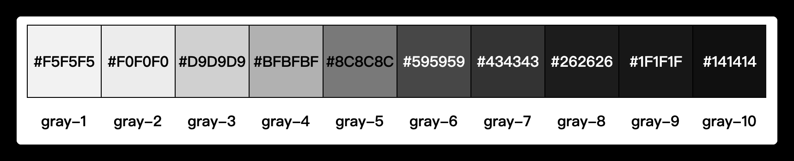
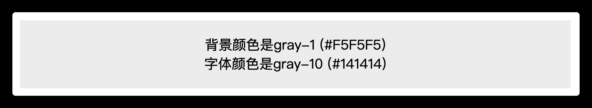
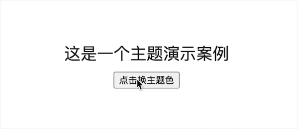
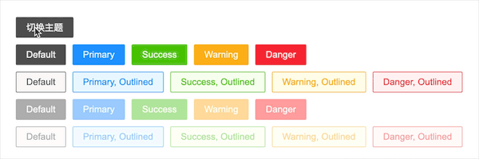
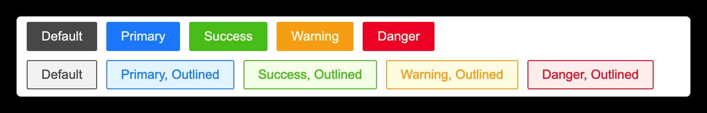
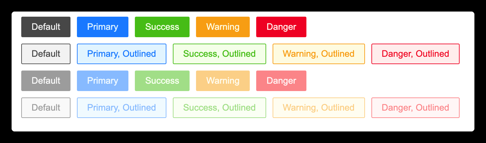

# 09 | 主题方案和基础组件：如何设计组件库的主题方案？

你好，我是杨文坚。

在上一节课的 Vue.js 3.x 自研组件库的开发入门中我提到，组件库有一个重要的作用，就是“可定制化主题”。那么，什么是“可定制化主题”呢？

如果你在电商企业中进行业务功能的前端页面开发，原有使用的组件库是蓝色风格的样式，但是想在节假日里快速转变成红色风格的组件样式，再比如，如果你开发的页面是亮色系的效果，哪天产品经理需要前端快速实现暗色系的黑夜效果，提升用户夜间的使用体验，那么，你会怎么做前端页面的改造呢？

这些场景，都要处理前端页面整体颜色以及视觉风格的变化，这类“变化”在前端开发中一般定义为“主题”的控制，也就是“可定制化主题”。

作为负责业务需求的前端开发者，一般都尽量专注业务功能点的开发，页面的主题风格定制能力通常是在组件库中管理。那么，组件库的前端开发者，就需要提供一套能控制组件的主题风格的组件库，提供给业务前端开发者直接使用。这样，业务前端开发者不需要关心组件库的主题方案如何实现，只需要根据组件库的使用规范“开箱即用”就好。

那么，如何设计组件库的主题实现呢？我们先来看看主题方案设计需要做什么准备。

## 组件库的主题方案设计需要做什么准备？

既然是方案设计，首先要做的是方案的规范准备，这里主题的方案设计需要准备以下两种规范：

- 颜色的设计规范；

- CSS 的开发规范。

前面我们提到，页面主题的变化主要是整体颜色视觉风格的变化。而且，使用组件库开发，业务功能页面控制主题是通过组件库的内置主题系统来控制的。所以，我们主题方案设计的第一步就是需要设计好组件库的颜色规范。

这里要明确一点，颜色规范设计通常不是前端开发者的职责工作，而是设计师的工作。但是前端作为设计稿和实现代码之间的“桥梁”，需要做好设计稿的沟通和讨论。不过，设计师一般对颜色规范设计的流程比较严格，也有很多讲究。所以，作为前端开发者，我们有必要简单了解这些颜色规范设计的过程。

第一步是颜色种类的选择。一般设计师会选择几种大类型的颜色，例如红色、蓝色和绿色等。然后根据业务需要挑选这几类型中的一个基准色号。

第二步，基于上一步选择好的基准色号，进行颜色梯度的处理，例如颜色亮度和饱和度从浅到深的梯度处理。举个例子，灰色的颜色梯度处理如下图片所示：



最后一步，也就是第三步，根据不同颜色的颜色梯度，进行语义化使用处理。我们拿上述灰色每个梯度的颜色来“语义化处理”，将“灰色 1 号”作为页面背景颜色，“灰色 10 号”作为页面的字体颜色。效果如下述所示：



到这里，你可能会有疑惑，如果只是前端程序员自发建设组件库，没有设计师参与设计，要如何做颜色的设计规范呢？

这类无设计师的情况你也不用担心，有很多开源组件库都提供了现成的颜色设计规范。例如Ant Design 官方团队的颜色规范、Element Plus 官方团队的颜色规范都可以直接参考。

当然，这些颜色的设计规范都是面向设计师的，前端开发者在其中只是参与讨论，最终还是需要设计师来拍板敲定颜色的设计规范。

但接下来的将颜色规范的设计内容转变成代码的部分，就是前端开发者能拍板的领域了。

前端开发中对组件库的主题开发和控制主要基于 CSS 来处理的，所以在开发之前，我们要制定 CSS 的开发规范。

首先，我们要选择 CSS 的预处理器语言来开发，主要利用 CSS 预处理器语言的“可编程的逻辑语法”来编写 CSS。目前主流的 CSS 的预处理器语言有 Less 和 Sass，两者语法比较类似。

- Less，对 CSS 原始语法增加了少许方便的扩展，例如函数、运算等语法，学习更容易

- 预处理器 Sass，语法更加丰富和全面。

两种预处理器语言都有很多开源组件库都在使用，例如 Ant Design 使用了 Less，ElementPlus 选择了 Sass。这里我们主要选择 Less 来开发组件库的 CSS 代码，主要是考虑到 Less简单易用，能满足绝大部分的开发需要。

我们可以用 Less 里的变量语法来管理所有的颜色梯度，如下述代码所示：

```
@gray-1: #f5f5f5;
@gray-2: #f0f0f0;
@gray-3: #d9d9d9;
@gray-4: #bfbfbf;
@gray-5: #8c8c8c;
@gray-6: #595959;
@gray-7: #434343;
@gray-8: #262626;
@gray-9: #1f1f1f;
@gray-10: #141414;
```

不过，虽然我们已经有了 Less 作为预处理器语法来管理 CSS 代码，例如主题颜色梯度都用了 Less 变量语法来管理，但接下来我们还要管理具体组件的主题样式上面，而且还要语义化控制到具体某个组件的某个维度的颜色。

什么是语义化颜色呢？一个按钮的背景颜色是“蓝色 1 号”，语义化颜色就是将“蓝色 1 号”语义化给了按钮背景颜色。但是实际中，组件语义化的内容维度是有很多层次的。

一个按钮的颜色，有背景颜色、字体颜色和边框颜色这一整套颜色体系，在按钮默认状态、点击状态和禁用状态时，背景、字体和边框颜色又需要独立的一套新的颜色体系。这个时候，就有三套颜色体系。如果再叠加一个按钮类型，例如是“实心颜色”的按钮和“空心颜色”的按钮，就演变成 3x2 的 6 种颜色体系。

你想，就这一个按钮组件，都有 6 种颜色体系，那如何做好 CSS 的语义化代码管理和维护呢？如果再来一个“白天”和“黑夜”模式的主题切换颜色功能，那要如何管理呢？

这个时候就需要用到 CSS Variable 来管理语义化的组件颜色了。

什么是 CSS Variable 呢？就是 CSS 自定义属性，也可以称作 CSS 变量或者级联变量，主要是 CSS 代码在浏览器中，定义一个 CSS 属性（或者称为“变量”）后，这个 CSS 属性就可以在页面中全局其它 CSS 代码中使用，甚至是覆盖重写。例如下面代码所示：

```javascript
@prefix-name: my-vue;
@white: #ffffff;
@black: #222222;
// ...
@gray-4: #bfbfbf;
// ...
:root {
 // 页面背景颜色
 --@{prefix-name}-page-bg-color: @white;
 // 页面字体颜色
 --@{prefix-name}-page-text-color: @black;
 // 页面通用边框颜色
 --@{prefix-name}-page-border-color: @gray-4;
}
.@{prefix-name}-box {
 background: ~'var(--@{prefix-name}-page-bg-color)';
 color: ~'var(--@{prefix-name}-page-text-color)';
}
```

这里的代码是用 Less 来管理颜色梯度，再用 CSS Variable 来使用颜色梯度的 Less 变量，同时语义化来管理不同维度的语义化颜色。CSS Variable 更多的用法可以参考这个官方文档。

我们现在有了颜色设计规范和 CSS 开发规范，最后要面临的问题就是“如何实现组件库的主题方案”了，我下面就用一个最简单的案例来实现一个主题方案，示范一下。

## 如何实现组件库主题方案？

在讲解组件库的主题方案前，我们先看看效果：



在这张动图中，我实现了一个组件 Box，设置了组件语义化的背景色和字体色，切换主题的时候，就用 className 的优先级来控制语义化的 CSS Variable，也就是用新主题的颜色样式覆盖掉原有的默认主题的颜色样式，达到动态切换主题。

具体代码如下述所示。Box 组件的 Less 代码：

```javascript
@prefix-name: my-vue;
@white: #ffffff;
@black: #222222;
// ...
@gray-4: #bfbfbf;
// ...
// 默认明亮主题颜色
:root {
 // 页面背景颜色
 --@{prefix-name}-page-bg-color: @white;
 // 页面字体颜色
 --@{prefix-name}-page-text-color: @black;
}
:root {
 // 暗黑主题颜色
 &.@{prefix-name}-theme-dark {
   // 页面背景颜色
   --@{prefix-name}-page-bg-color: @black;
   // 页面字体颜色
   --@{prefix-name}-page-text-color: @white;
 }
}
.@{prefix-name}-box {
 background: ~'var(--@{prefix-name}-page-bg-color)';
 color: ~'var(--@{prefix-name}-page-text-color)';
}
```

Box 组件的 Vue 代码：

```xml
<template>
 <div :class="{ [baseClassName]: true }">
   <slot v-if="$slots.default"></slot>
 </div>
</template>
<script setup lang="ts">
import { prefixName } from '../theme/index';
const baseClassName = `${prefixName}-box`;
</script>
```

Box 组件的使用代码：

```xml
<template>
 <Box class="example">
   <div :style="{ padding: 10, fontSize: 24 }">这是一个主题演示案例</div>
   <button @click="onClick">点击换主题色</button>
 </Box>
</template>
<script setup lang="ts">
import { Box } from '../src';
import { prefixName } from '../src/theme/index';
const onClick = () => {
 const darkThemeName = `${prefixName}-theme-dark`;
 const html = document.querySelector('html');
 if (html?.classList.contains(darkThemeName)) {
   html?.classList.remove(darkThemeName);
 } else {
   html?.classList.add(darkThemeName);
 }
};
</script>
<style>
html,
body {
 height: 100%;
 width: 100%;
}
.example {
 height: 100%;
 padding: 100px;
 box-sizing: border-box;
 text-align: center;
}
</style>
```

通过上述“明亮主题”和“暗黑主题”的切换代码和演示案例，你会发现，组件库的主题方案设计核心就是颜色规范 + CSS Variable 控制。是不是很简单？

其实，理论上是可以这么简单理解的，但是实际在组件库的每个组件开发过程中，我们要做好组件内部的主题方案的实现，还是有点“复杂度”的。

这个“复杂度”体现在不同组件的使用场景不同，不同组件的主题方案都要“因地制宜”来实现。具体情况，我给你演示一个基础的组件实现，你就知道了。接下来我就给你演示一下，如何开发一个常见的多状态的按钮组件。

## 如何开发一个多状态的按钮组件？

在开发组件前，还是先演示一下最终的效果：



上面动图中，演示的是常见组件库里实现的按钮组件，具备多种组件的状态维度，这里维度分成按钮类型、按钮变种（种类）和按钮禁用状态。其中按钮类型有 Default、Primary，Success、Warn 和 Danger 这五类，按钮变种有 Contented 和 Outlined 两类，按钮禁用状态有 Enabled 和 Disabled 两类。

总的来讲，上述按钮有这三种维度状态，也就是类型、变种和是否禁用。那么，如何实现这个三种维度的叠加管理呢？分解成这三个步骤：

- 第一步，基础按钮组件样式的开发；

- 第二步，实现按钮不同维度组合的样式；

- 第三步，组件的使用状态叠加。

第一步，基础按钮组件的样式开发，也就是实现一个按钮的“底座”，后续可以基于这个底座做各类维度叠加的样式开发，具体代码如下述所示。

Less 代码：

```sql
.@{prefix-name}-button {
 position: relative;
 display: inline-block;
 font-weight: 400;
 white-space: nowrap;
 text-align: center;
 cursor: pointer;
 user-select: none;
 touch-action: manipulation;
 height: 32px;
 padding: 4px 15px;
 font-size: 14px;
 border-radius: 2px;
 box-sizing: border-box;
 border-width: 1px;
}
```

注意了，我这里将所有颜色梯度规范代码全部放了在本节课源码里的./packages/components/theme/variable.less 文件中管理，也用了同样的 variable.less 文件来管理 CSS 的公共命名前缀。

Vue 代码：

```xml
<template>
 <button
   :class="{
     [baseClassName]: true,
   }"
 >
   <slot v-if="$slots.default"></slot>
 </button>
</template>
<script setup lang="ts">
import { prefixName } from '../theme/index';
const baseClassName = `${prefixName}-button`;
</script>
```

这里也要注意，我这里将 className 的公共命名前缀放在./packages/components/theme/index.ts 中管理，前缀名称跟./packages/components/theme/variable.less 里保持一致，方便后续统一更换。

第二步，实现按钮不同维度组合的样式，也就是我们要根据不同状态维度的组合来实现样式的叠加。我先将按钮的不同维度的样式的 className 做个统一的管理，其中按钮类型和按钮变种统一管理，形成 5 x 3 的 15 个基础按钮样式。

具体 CSS Variable 语义化，如下面所示：

```
:root {
 // 按钮 default-contained: 默认状态
 --@{prefix-name}-btn-default-contained-color: @gray-1;
 --@{prefix-name}-btn-default-contained-border-color: @gray-6;
 --@{prefix-name}-btn-default-contained-bg-color: @gray-6;
 // 按钮 primary-contained: 默认状态
 --@{prefix-name}-btn-primary-contained-color: @blue-1;
 --@{prefix-name}-btn-primary-contained-border-color: @blue-6;
 --@{prefix-name}-btn-primary-contained-bg-color: @blue-6;
 // 按钮 success-contained: 默认状态
 --@{prefix-name}-btn-success-contained-color: @green-1;
 --@{prefix-name}-btn-success-contained-border-color: @green-6;
 --@{prefix-name}-btn-success-contained-bg-color: @green-6;
 // 按钮 warning-contained: 默认状态
 --@{prefix-name}-btn-warning-contained-color: @gold-1;
 --@{prefix-name}-btn-warning-contained-border-color: @gold-6;
 --@{prefix-name}-btn-warning-contained-bg-color: @gold-6;
 // 按钮 danger-contained: 默认状态
 --@{prefix-name}-btn-danger-contained-color: @red-1;
 --@{prefix-name}-btn-danger-contained-border-color: @red-6;
 --@{prefix-name}-btn-danger-contained-bg-color: @red-6;
 // 按钮 default-outlined: 默认状态
 --@{prefix-name}-btn-default-outlined-color: @gray-6;
 --@{prefix-name}-btn-default-outlined-border-color: @gray-6;
 --@{prefix-name}-btn-default-outlined-bg-color: @gray-1;
 // 按钮 primary-outlined: 默认状态
 --@{prefix-name}-btn-primary-outlined-color: @blue-6;
 --@{prefix-name}-btn-primary-outlined-border-color: @blue-6;
 --@{prefix-name}-btn-primary-outlined-bg-color: @blue-1;
 // 按钮 success-outlined: 默认状态
 --@{prefix-name}-btn-success-outlined-color: @green-6;
 --@{prefix-name}-btn-success-outlined-border-color: @green-6;
 --@{prefix-name}-btn-success-outlined-bg-color: @green-1;
 // 按钮 warning-outlined: 默认状态
 --@{prefix-name}-btn-warning-outlined-color: @gold-6;
 --@{prefix-name}-btn-warning-outlined-border-color: @gold-6;
 --@{prefix-name}-btn-warning-outlined-bg-color: @gold-1;
 // 按钮 danger-outlined: 默认状态
 --@{prefix-name}-btn-danger-outlined-color: @red-6;
 --@{prefix-name}-btn-danger-outlined-border-color: @red-6;
 --@{prefix-name}-btn-danger-outlined-bg-color: @red-1;
}
```

具体 className 组合实现如下述所示：

```javascript
@import '../../theme/variable.less';
.@{prefix-name}-button {
 // ....
 // contented
 &.@{prefix-name}-button-default-contained {
   background: ~'var(--@{prefix-name}-btn-default-contained-bg-color)';
   color: ~'var(--@{prefix-name}-btn-default-contained-color)';
   border: 1px solid ~'var(--@{prefix-name}-btn-default-contained-border-color)'
 }
 &.@{prefix-name}-button-primary-contained {
   background: ~'var(--@{prefix-name}-btn-primary-contained-bg-color)';
   color: ~'var(--@{prefix-name}-btn-primary-contained-color)';
   border: 1px solid ~'var(--@{prefix-name}-btn-primary-contained-border-color)'
 }
 &.@{prefix-name}-button-success-contained {
   background: ~'var(--@{prefix-name}-btn-success-contained-bg-color)';
   color: ~'var(--@{prefix-name}-btn-success-contained-color)';
   border: 1px solid ~'var(--@{prefix-name}-btn-success-contained-border-color)'
 }
 &.@{prefix-name}-button-warning-contained {
   background: ~'var(--@{prefix-name}-btn-warning-contained-bg-color)';
   color: ~'var(--@{prefix-name}-btn-warning-contained-color)';
   border: 1px solid ~'var(--@{prefix-name}-btn-warning-contained-border-color)'
 }
 &.@{prefix-name}-button-danger-contained {
   background: ~'var(--@{prefix-name}-btn-danger-contained-bg-color)';
   color: ~'var(--@{prefix-name}-btn-danger-contained-color)';
   border: 1px solid ~'var(--@{prefix-name}-btn-danger-contained-border-color)';
 }
 // outlined
 &.@{prefix-name}-button-default-outlined {
   background: ~'var(--@{prefix-name}-btn-default-outlined-bg-color)';
   color: ~'var(--@{prefix-name}-btn-default-outlined-color)';
   border: 1px solid ~'var(--@{prefix-name}-btn-default-outlined-border-color)';
 }
 &.@{prefix-name}-button-primary-outlined {
   background: ~'var(--@{prefix-name}-btn-primary-outlined-bg-color)';
   color: ~'var(--@{prefix-name}-btn-primary-outlined-color)';
   border: 1px solid ~'var(--@{prefix-name}-btn-primary-outlined-border-color)';
 }
 &.@{prefix-name}-button-success-outlined {
   background: ~'var(--@{prefix-name}-btn-success-outlined-bg-color)';
   color: ~'var(--@{prefix-name}-btn-success-outlined-color)';
   border: 1px solid ~'var(--@{prefix-name}-btn-success-outlined-border-color)';
 }
 &.@{prefix-name}-button-warning-outlined {
   background: ~'var(--@{prefix-name}-btn-warning-outlined-bg-color)';
   color: ~'var(--@{prefix-name}-btn-warning-outlined-color)';
   border: 1px solid ~'var(--@{prefix-name}-btn-warning-outlined-border-color)';
 }
 &.@{prefix-name}-button-danger-outlined {
   background: ~'var(--@{prefix-name}-btn-danger-outlined-bg-color)';
   color: ~'var(--@{prefix-name}-btn-danger-outlined-color)';
   border: 1px solid ~'var(--@{prefix-name}-btn-danger-outlined-border-color)';
 }
}
```

Vue 代码实现如下：

```xml
<template>
 <button
   :class="{
     [baseClassName]: true,
     [btnClassName]: true
   }"
 >
   <slot v-if="$slots.default"></slot>
 </button>
</template>
<script setup lang="ts">
import { prefixName } from '../theme/index';
import type { ButtonType, ButtonVariant } from './types';
const props = withDefaults(
 defineProps<{
   type?: ButtonType;
   variant?: ButtonVariant;
 }>(),
 {
   type: 'default',
   variant: 'contained',
   disabled: false
 }
);
const baseClassName = `${prefixName}-button`;
const btnClassName = `${baseClassName}-${props.type}-${props.variant}`;
</script>
```

实现后的效果如下：



接下来实现按钮禁用的样式，主要也是通过添加 className，利用其添加在后面，优先级更高来覆盖样式，具体实现代码如下：

Less 代码：

```
@import '../../theme/variable.less';
.@{prefix-name}-button {
 // ...
 &.@{prefix-name}-button-disabled {
   opacity: 0.5;
   cursor: not-allowed;
   &:hover {
     opacity: 0.5;
   }
 }
}
```

Vue 代码改造后如下：

```xml
<template>
 <button
   :class="{
     [baseClassName]: true,
     [btnClassName]: true,
     [disabledClassName]: props.disabled
   }"
 >
   <slot v-if="$slots.default"></slot>
 </button>
</template>
<script setup lang="ts">
import { prefixName } from '../theme/index';
import type { ButtonType, ButtonVariant } from './types';
const props = withDefaults(
 defineProps<{
   type?: ButtonType;
   variant?: ButtonVariant;
   disabled?: boolean;
 }>(),
 {
   type: 'default',
   variant: 'contained',
   disabled: false
 }
);
const baseClassName = `${prefixName}-button`;
const btnClassName = `${baseClassName}-${props.type}-${props.variant}`;
const disabledClassName = `${baseClassName}-disabled`;
</script>
```

实现上述代码后，使用该按钮组件枚举所有按钮状态叠加效果如下图所示：



第三步，就是实现按钮其他状态叠加，例如鼠标悬浮时候（Hover）等状态，也是添加对应的CSS Variable，然后在 Less 里使用对应变量。因为这里实现都是一些重复性的代码操作，所以我就不多讲了，留给你来实现或者你可以后续看本课程的完整源码案例。

到了这一步，我们就已经实现了一个多状态的 Vue.js 3.x 按钮组件，可以通过传入不同的Props 来控制显示不同的状态样式和状态叠加的样式。

讲到这，你是不是已经觉得“复杂度”有所提升了？其实这个按钮组件的复杂度基本就到此为止了，也就是说这个按钮的“基础底座”已经实现了。

我们接下来要做的就是基于已有的“底座”，也就是已经实现好的按钮语义化的 className 和CSS Variable，来配置主题控制和样式主题的切换效果。

## 如何对多状态的按钮组件进行主题控制？

通过上述的规范设计阶段，我们应该知道，主题核心就是颜色梯度的控制，我们在处理按钮组件的不同颜色的时候，只是选择某个颜色的某个梯度号。也就是说，当我们想按钮主题风格时候，只需要控制“颜色”和“梯度”就行了，再覆盖对应的 CSS Variable，就能实现主题快速切换，不需要关注其他。

我这里具体拆解成两步：

- 第一步，对按钮不同状态维度组合选择对应色板的颜色梯度；

- 第二步，将选好的颜色用新 className 来覆盖原来的 CSS Variable。

刚刚实现按钮组件是默认的“明亮”模式的主题，我现在针对按钮组件按钮的所有维度状态，快速实现一个“暗黑”主题的颜色效果。这里可以直接切换颜色“梯度”，直接从取梯度号的镜像号数，例如“蓝色 2 号”的就换成“蓝色 8 号”来替换。

然后按照第二步的操作，全部替换到对应的 CSS Variable，根据 className 优先级操作，来覆盖主题样式，具体代码如下述所示：

明亮主题 Less 代码：

```
@import "./variable.less";
:root {
 // 按钮 default-contained: 默认状态
 --@{prefix-name}-btn-default-contained-color: @gray-1;
 --@{prefix-name}-btn-default-contained-border-color: @gray-6;
 --@{prefix-name}-btn-default-contained-bg-color: @gray-6;
 // 按钮 default-contained: Hover状态
 --@{prefix-name}-btn-default-contained-color-hover: @gray-2;
 --@{prefix-name}-btn-default-contained-border-color-hover: @gray-8;
 --@{prefix-name}-btn-default-contained-bg-color-hover: @gray-8;
 // 按钮 primary-contained: 默认状态
 --@{prefix-name}-btn-primary-contained-color: @blue-1;
 --@{prefix-name}-btn-primary-contained-border-color: @blue-6;
 --@{prefix-name}-btn-primary-contained-bg-color: @blue-6;
 // 按钮 primary-contained: Hover状态
 --@{prefix-name}-btn-primary-contained-color-hover: @blue-2;
 --@{prefix-name}-btn-primary-contained-border-color-hover: @blue-8;
 --@{prefix-name}-btn-primary-contained-bg-color-hover: @blue-8;
 // 按钮 success-contained: 默认状态
 --@{prefix-name}-btn-success-contained-color: @green-1;
 --@{prefix-name}-btn-success-contained-border-color: @green-6;
 --@{prefix-name}-btn-success-contained-bg-color: @green-6;
 // 按钮 success-contained: Hover状态
 --@{prefix-name}-btn-success-contained-color-hover: @green-2;
 --@{prefix-name}-btn-success-contained-border-color-hover: @green-8;
 --@{prefix-name}-btn-success-contained-bg-color-hover: @green-8;
 // 按钮 warning-contained: 默认状态
 --@{prefix-name}-btn-warning-contained-color: @gold-1;
 --@{prefix-name}-btn-warning-contained-border-color: @gold-6;
 --@{prefix-name}-btn-warning-contained-bg-color: @gold-6;
 // 按钮 warning-contained: Hover状态
 --@{prefix-name}-btn-warning-contained-color-hover: @gold-2;
 --@{prefix-name}-btn-warning-contained-border-color-hover: @gold-8;
 --@{prefix-name}-btn-warning-contained-bg-color-hover: @gold-8;
 // 按钮 danger-contained: 默认状态
 --@{prefix-name}-btn-danger-contained-color: @red-1;
 --@{prefix-name}-btn-danger-contained-border-color: @red-6;
 --@{prefix-name}-btn-danger-contained-bg-color: @red-6;
 // 按钮 danger-contained: Hover状态
 --@{prefix-name}-btn-danger-contained-color-hover: @red-2;
 --@{prefix-name}-btn-danger-contained-border-color-hover: @red-8;
 --@{prefix-name}-btn-danger-contained-bg-color-hover: @red-8;
 // 按钮 default-outlined: 默认状态
 --@{prefix-name}-btn-default-outlined-color: @gray-6;
 --@{prefix-name}-btn-default-outlined-border-color: @gray-6;
 --@{prefix-name}-btn-default-outlined-bg-color: @gray-1;
 // 按钮 default-outlined: Hover状态
 --@{prefix-name}-btn-default-outlined-color-hover: @gray-8;
 --@{prefix-name}-btn-default-outlined-border-color-hover: @gray-8;
 --@{prefix-name}-btn-default-outlined-bg-color-hover: @gray-2;
 // 按钮 primary-outlined: 默认状态
 --@{prefix-name}-btn-primary-outlined-color: @blue-6;
 --@{prefix-name}-btn-primary-outlined-border-color: @blue-6;
 --@{prefix-name}-btn-primary-outlined-bg-color: @blue-1;
 // 按钮 primary-outlined: Hover状态
 --@{prefix-name}-btn-primary-outlined-color-hover: @blue-8;
 --@{prefix-name}-btn-primary-outlined-border-color-hover: @blue-8;
 --@{prefix-name}-btn-primary-outlined-bg-color-hover: @blue-2;
 // 按钮 success-outlined: 默认状态
 --@{prefix-name}-btn-success-outlined-color: @green-6;
 --@{prefix-name}-btn-success-outlined-border-color: @green-6;
 --@{prefix-name}-btn-success-outlined-bg-color: @green-1;
 // 按钮 success-outlined: Hover状态
 --@{prefix-name}-btn-success-outlined-color-hover: @green-8;
 --@{prefix-name}-btn-success-outlined-border-color-hover: @green-8;
 --@{prefix-name}-btn-success-outlined-bg-color-hover: @green-2;
 // 按钮 warning-outlined: 默认状态
 --@{prefix-name}-btn-warning-outlined-color: @gold-6;
 --@{prefix-name}-btn-warning-outlined-border-color: @gold-6;
 --@{prefix-name}-btn-warning-outlined-bg-color: @gold-1;
 // 按钮 warning-outlined: Hover状态
 --@{prefix-name}-btn-warning-outlined-color-hover: @gold-8;
 --@{prefix-name}-btn-warning-outlined-border-color-hover: @gold-8;
 --@{prefix-name}-btn-warning-outlined-bg-color-hover: @gold-2;
 // 按钮 danger-outlined: 默认状态
 --@{prefix-name}-btn-danger-outlined-color: @red-6;
 --@{prefix-name}-btn-danger-outlined-border-color: @red-6;
 --@{prefix-name}-btn-danger-outlined-bg-color: @red-1;
 // 按钮 danger-outlined: Hover状态
 --@{prefix-name}-btn-danger-outlined-color-hover: @red-8;
 --@{prefix-name}-btn-danger-outlined-border-color-hover: @red-8;
 --@{prefix-name}-btn-danger-outlined-bg-color-hover: @red-2
}
```

暗黑主题 Less 代码：

```
@import "../variable.less";
:root {
 &.@{prefix-name}-theme-dark {
   // 按钮 default-contained: 默认状态
   --@{prefix-name}-btn-default-contained-color: @gray-9;
   --@{prefix-name}-btn-default-contained-border-color: @gray-4;
   --@{prefix-name}-btn-default-contained-bg-color: @gray-4;
   // 按钮 default-contained: Hover状态
   --@{prefix-name}-btn-default-contained-color-hover: @gray-8;
   --@{prefix-name}-btn-default-contained-border-color-hover: @gray-2;
   --@{prefix-name}-btn-default-contained-bg-color-hover: @gray-2;
   // 按钮 primary-contained: 默认状态
   --@{prefix-name}-btn-primary-contained-color: @blue-9;
   --@{prefix-name}-btn-primary-contained-border-color: @blue-4;
   --@{prefix-name}-btn-primary-contained-bg-color: @blue-4;
   // 按钮 primary-contained: Hover状态
   --@{prefix-name}-btn-primary-contained-color-hover: @blue-8;
   --@{prefix-name}-btn-primary-contained-border-color-hover: @blue-2;
   --@{prefix-name}-btn-primary-contained-bg-color-hover: @blue-2;
   // 按钮 success-contained: 默认状态
   --@{prefix-name}-btn-success-contained-color: @green-9;
   --@{prefix-name}-btn-success-contained-border-color: @green-4;
   --@{prefix-name}-btn-success-contained-bg-color: @green-4;
   // 按钮 success-contained: Hover状态
   --@{prefix-name}-btn-success-contained-color-hover: @green-8;
   --@{prefix-name}-btn-success-contained-border-color-hover: @green-2;
   --@{prefix-name}-btn-success-contained-bg-color-hover: @green-2;
   // 按钮 warning-contained: 默认状态
   --@{prefix-name}-btn-warning-contained-color: @gold-9;
   --@{prefix-name}-btn-warning-contained-border-color: @gold-4;
   --@{prefix-name}-btn-warning-contained-bg-color: @gold-4;
   // 按钮 warning-contained: Hover状态
   --@{prefix-name}-btn-warning-contained-color-hover: @gold-8;
   --@{prefix-name}-btn-warning-contained-border-color-hover: @gold-2;
   --@{prefix-name}-btn-warning-contained-bg-color-hover: @gold-2;
   // 按钮 danger-contained: 默认状态
   --@{prefix-name}-btn-danger-contained-color: @red-9;
   --@{prefix-name}-btn-danger-contained-border-color: @red-4;
   --@{prefix-name}-btn-danger-contained-bg-color: @red-4;
   // 按钮 danger-contained: Hover状态
   --@{prefix-name}-btn-danger-contained-color-hover: @red-8;
   --@{prefix-name}-btn-danger-contained-border-color-hover: @red-2;
   --@{prefix-name}-btn-danger-contained-bg-color-hover: @red-2;
   // 按钮 default-outlined: 默认状态
   --@{prefix-name}-btn-default-outlined-color: @gray-4;
   --@{prefix-name}-btn-default-outlined-border-color: @gray-4;
   --@{prefix-name}-btn-default-outlined-bg-color: @gray-9;
   // 按钮 default-outlined: Hover状态
   --@{prefix-name}-btn-default-outlined-color-hover: @gray-2;
   --@{prefix-name}-btn-default-outlined-border-color-hover: @gray-2;
   --@{prefix-name}-btn-default-outlined-bg-color-hover: @gray-8;
   // 按钮 primary-outlined: 默认状态
   --@{prefix-name}-btn-primary-outlined-color: @blue-4;
   --@{prefix-name}-btn-primary-outlined-border-color: @blue-4;
   --@{prefix-name}-btn-primary-outlined-bg-color: @blue-9;
   // 按钮 primary-outlined: Hover状态
   --@{prefix-name}-btn-primary-outlined-color-hover: @blue-2;
   --@{prefix-name}-btn-primary-outlined-border-color-hover: @blue-2;
   --@{prefix-name}-btn-primary-outlined-bg-color-hover: @blue-8;
   // 按钮 success-outlined: 默认状态
   --@{prefix-name}-btn-success-outlined-color: @green-4;
   --@{prefix-name}-btn-success-outlined-border-color: @green-4;
   --@{prefix-name}-btn-success-outlined-bg-color: @green-9;
   // 按钮 success-outlined: Hover状态
   --@{prefix-name}-btn-success-outlined-color-hover: @green-2;
   --@{prefix-name}-btn-success-outlined-border-color-hover: @green-2;
   --@{prefix-name}-btn-success-outlined-bg-color-hover: @green-8;
   // 按钮 warning-outlined: 默认状态
   --@{prefix-name}-btn-warning-outlined-color: @gold-4;
   --@{prefix-name}-btn-warning-outlined-border-color: @gold-4;
   --@{prefix-name}-btn-warning-outlined-bg-color: @gold-9;
   // 按钮 warning-outlined: Hover状态
   --@{prefix-name}-btn-warning-outlined-color-hover: @gold-2;
   --@{prefix-name}-btn-warning-outlined-border-color-hover: @gold-2;
   --@{prefix-name}-btn-warning-outlined-bg-color-hover: @gold-8;
   // 按钮 danger-outlined: 默认状态
   --@{prefix-name}-btn-danger-outlined-color: @red-4;
   --@{prefix-name}-btn-danger-outlined-border-color: @red-4;
   --@{prefix-name}-btn-danger-outlined-bg-color: @red-9;
   // 按钮 danger-outlined: Hover状态
   --@{prefix-name}-btn-danger-outlined-color-hover: @red-2;
   --@{prefix-name}-btn-danger-outlined-border-color-hover: @red-2;
   --@{prefix-name}-btn-danger-outlined-bg-color-hover: @red-8;
 }
}
```

最终效果下述所示：

好了，至此，我们就基于主题方案实现了 Vue.js 3.x 组件库的一个基础组件——按钮组件的功能和主题效果。

## 总结

这节课的核心是带你学会 Vue.js 3.x 自研组件库的主题方案设计，以及结合主题方案来开发一个基础组件，了解组件库主题方案实现的完整流程。

简单来说，组件库的主题方案实现就是三点：

- 梳理组件库用到的基本颜色和对应的颜色梯度，用 Less 或其他 CSS 预处理器语言来编写；

- 每个组件通过 CSS Variable 来控制各种语义化颜色，例如按钮的背景颜色；

- 主题控制是利用 CSS Varibale 来修改覆盖每个组件里语义化的“颜色”和“梯度号”。

最后我们也通过一个实际的按钮组件，演示了这三点的开发流程，完整实现了一个基础组件按钮组件及主题切换的功能，你可以多动手试一试。

## 思考题

为什么主题控制只考虑颜色，不考虑组件的尺寸的形状控制呢？

欢迎留言参与讨论，我会在章节末统一点评，期待见到你的身影。下一讲见。

完整的代码在这里
