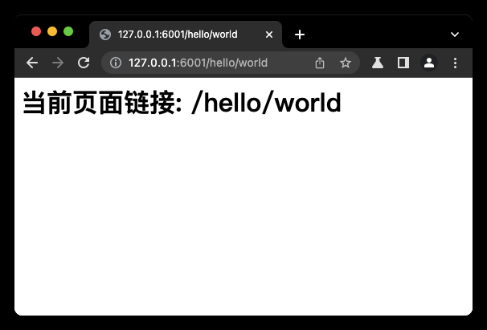
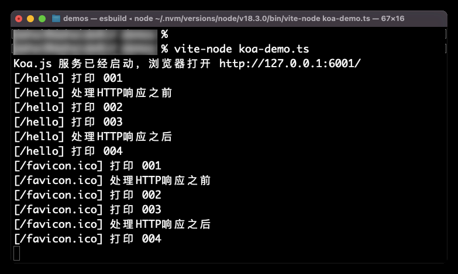
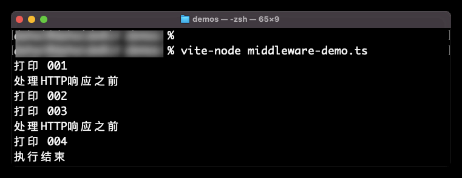
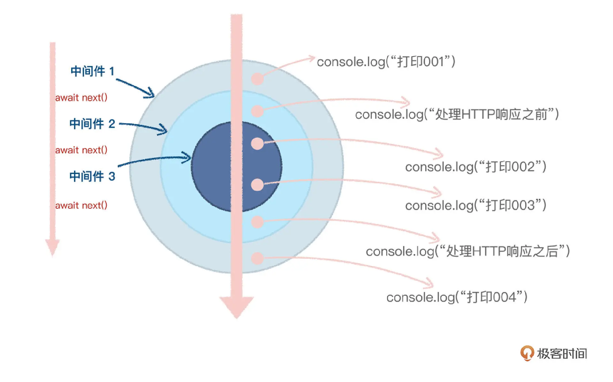
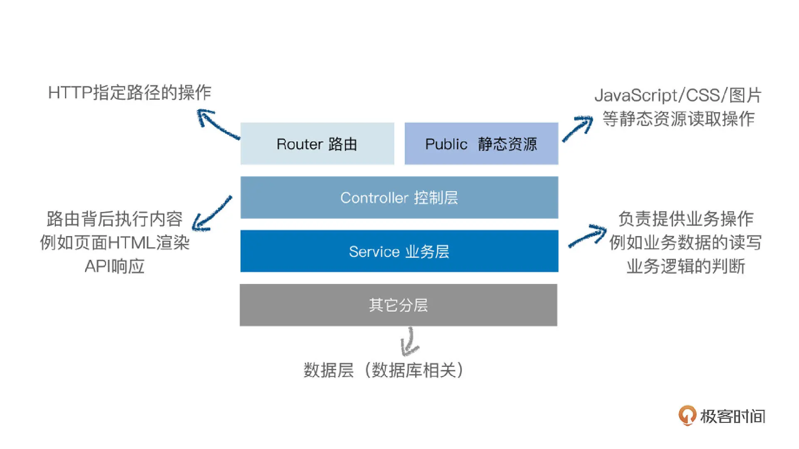
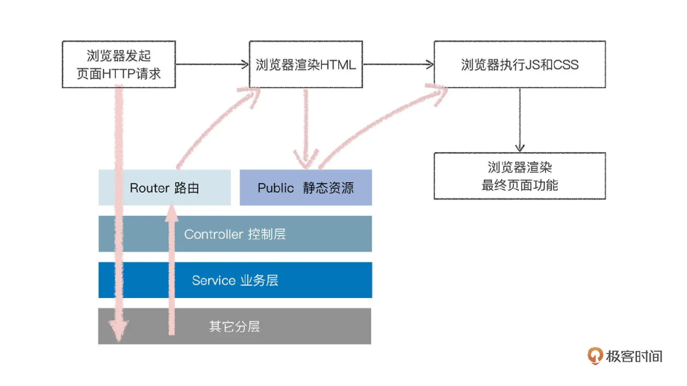
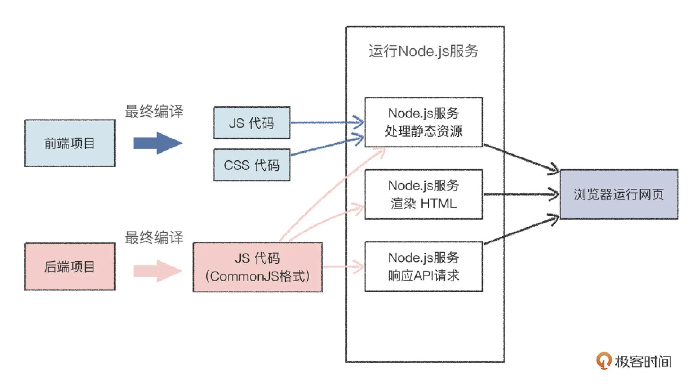
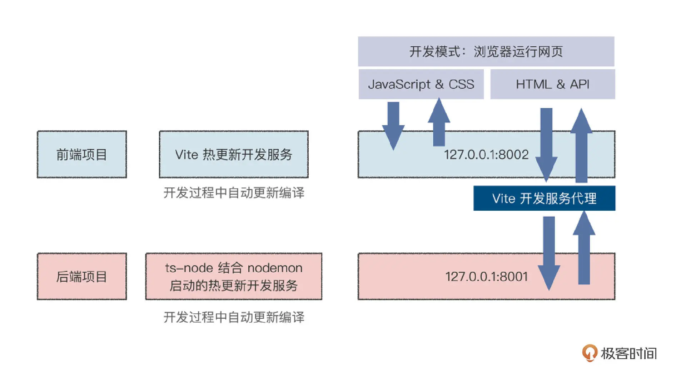
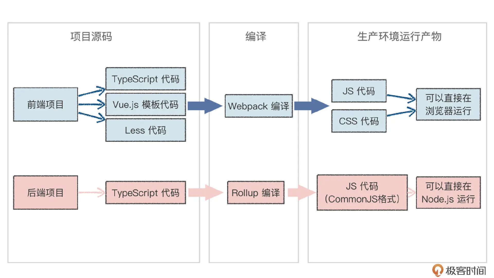
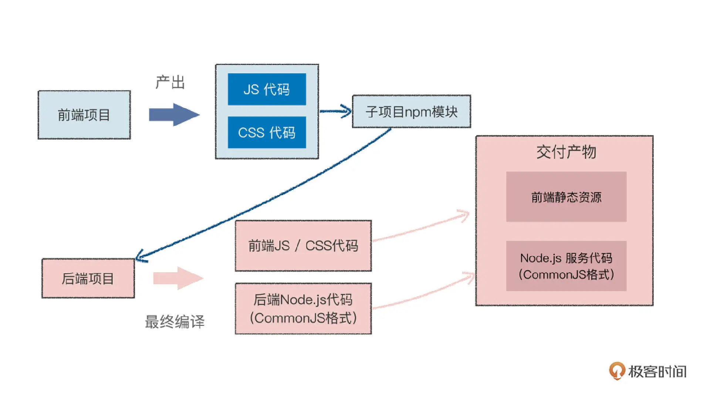

# 17 | Koa.js：如何结合Koa.js开发Node.jsWeb服务？

你好，我是杨文坚。

上节课我们分析了单页面应用的原理，并且使用了 vue-router 来实现 Vue.js 的单页面应用。这节课，我们就来做进一步的扩展，接入 Koa.js，实现 Node.js 的 Web 服务，打造一个前后端分离的 Node.js 全栈项目。

可能你有疑问，为什么作为前端开发工程师，需要自己开发后端服务呢？

这其实跟工作分工有关。绝大多数企业，不管是“前端”“后端”，还是“测试”，程序员的核心工作都是帮企业解决实际的技术问题。如果你负责某个项目，遇到了技术问题，但是问题所属的技术领域不是自己职位的领域，也是需要自己想办法解决的。

也就是说，你作为前端程序员，负责实现一个全栈项目，无论怎么努力沟通，都没有后端程序员来支持开发，那就需要自己动手解决了。这种情况其实也是大厂的常态。在大厂里，前端程序员都会 Node.js 的 Web 服务开发，以备工作不时之需。

为什么大家要选择 Node.js 来开发 Web 服务，而不是其他语言呢？

## 为什么要用 Node.js 开发 Web 服务？

在大厂里，前端程序员用 Node.js 开发 Web 服务，核心原因是 Node.js 的主要开发语言也是JavaScript。所以，Node.js 对于前端程序员来讲，入门和学习成本较低，甚至可以说是无缝切换。

因为 Node.js 同样用 JavaScript 语言，前端页面中用到的大部分 JavaScript 工具库，比如lodash.js 之类的工具，也是能直接用在 Node.js 服务端中的，甚至我们课程中的 Vue.js 前端组件，也能稍作处理，放在 Node.js 服务端里运行。

总的来说，我们课程中运营搭建的全栈项目选择 Node.js 开发，有三个优势：

- 前后端统一用 JavaScript，学习成本低；

- 代码可前后端复用，能提高开发效率；

- Vue.js 组件可以用于前端和服务端渲染。

好，用 Node.js 开发 Web 服务已经确定了，但 Node.js 只是个 JavaScript 运行环境，那该选择什么框架或者工具来开发 Web 服务呢？

在 Node.js 中，市面上主流用来开发 Web 服务的框架有 Express.js、Koa.js、Egg.js、Nest.js等。我们课程项目里选择 Koa.js，有这几个原因：

- Koa.js 框架精简，轻量简单，源码就几个 JavaScript 文件；

- Koa.js 洋葱中间件模型的灵活优势；

- Koa.js 的中间件生态丰富；

- 国内大厂广泛使用 Koa.js，用于封装业务 Web 框架，例如阿里开源的 Egg.js 等。

其实 Koa.js 之外的其它 Web 服务框架，功能都很齐全，但是学习成本高，框架结构的复杂度也高。我们使用一个框架，最重要的，不是看它功能是否齐全，而是看自己能否弄清它的核心原理，出问题时知道怎么排查原因。所以，我们就选择了 Koa.js 作为项目的 Web 服务框架。

那么，如何使用 Koa.js 开发 Node.js 服务呢？

## 如何使用 Koa.js 开发 Node.js 服务?

首先，你要理解一点，所有 Web 服务框架都是处理 HTTP 请求和响应的，不管是 Koa.js，还是 Express.js、Egg.js 等 Node.js Web 框架，最核心功能就是处理 HTTP 请求和响应，框架之间的差异，主要是处理 HTTP 的流程操作或设计理念不一样。

我们先看相同，再看差异。

### 核心要素 http 模块

演示一下在 Node.js 中最简单的一个 HTTP 服务，如下代码所示：

```xml
// easy-server.cjs
const http = require('node:http');
const server = http.createServer((req, res) => {
 const url = req.url;
 const html = `
 <html>
   <head>
     <meta charset="utf-8" />
   </head>
   <body>
     <h1>当前页面链接: ${url}</h1>
   </body>
 </html>
 `;
 res.end(html);
});
server.listen(6001, () => {
 console.log('服务已经启动，浏览器打开 http://127.0.0.1:6001/');
});
```

这段代码是通过 Node.js 的“http”模块，快速实现一个 HTTP 服务，所有的 Node.js Web 框架的最核心点就是利用这个 Node.js 原生能力。

执行启动这个简单的 Node.js 服务“node ./easy-server.cjs”，然后用浏览器访问，效果如下图所示：



上述的代码也可以直接用 TypeScript 来编写，代码可以改成这样：

```xml
// easy-server.ts
import http from 'node:http';
const server = http.createServer(
 (
   req: http.IncomingMessage,
   res: http.ServerResponse<http.IncomingMessage>
 ) => {
   const url = req.url;
   const html = `
 <html>
   <head>
     <meta charset="utf-8" />
   </head>
   <body>
     <h1>当前页面链接: ${url}</h1>
   </body>
 </html>
 `;
   res.end(html);
 }
);
server.listen(6001, () => {
 console.log('服务已经启动，浏览器打开 http://127.0.0.1:6001/');
});
```

这个时候，我们可以使用 vite-node 这个 npm 模块，在本地计算机全局安装这个命令，直接启动 TypeScript 文件，如执行这个命令 “vite-node ./easy-server.ts”。

我们了解了 Node.js Web 框架的核心要素 http 模块之后，剩下需要掌握的就是不同框架对HTTP 操作的设计理念。

### 不同设计理念

我们主要用到 Web 框架是 Koa.js，那么它核心的分析服务设计理念，就是处理 HTTP 请求的中间件流程设计，也就是“洋葱模型”。这我先给你展示一段代码：

```xml
/* eslint-disable no-console */
import Koa from 'koa';
import type { Context, Next } from 'koa';
const app = new Koa();
app.use(async (ctx: Context, next: Next) => {
 console.log(`[${ctx.path}] 打印 001`);
 await next();
 console.log(`[${ctx.path}] 打印 004`);
});
app.use(async (ctx: Context, next: Next) => {
 console.log(`[${ctx.path}] 处理HTTP响应之前`);
 ctx.body = `<html>
 <head>
   <meta charset="utf-8" />
 </head>
 <body>
   <h1>当前页面链接: ${ctx.path}</h1>
 </body>
</html>`;
 await next();
 console.log(`[${ctx.path}] 处理HTTP响应之后`);
});
app.use(async (ctx: Context, next: Next) => {
 console.log(`[${ctx.path}] 打印 002`);
 await next();
 console.log(`[${ctx.path}] 打印 003`);
});
app.listen(6001, () => {
 console.log('Koa.js 服务已经启动，浏览器打开 http://127.0.0.1:6001/');
});
```

这段代码执行后，可以访问 http://127.0.0.1:6001/hello 连接，得到控制台这样的打印顺序：



这种打印结果就是洋葱模型的效果，每个异步函数，都是一个中间件，执行时候“先进后出”。其实，每个中间件，都等于一个 Promise。我把上述的代码拆解成简单的 JavaScript 代码，你就能理解中间件模型了，代码如下所示：

```javascript
// middleware-demo.ts
const context = {};
async function middleware1(ctx: any, next: any) {
 console.log('打印 001');
 await next();
 console.log('打印 004');
}
async function middleware2(ctx: any, next: any) {
 console.log('处理HTTP响应之前');
 await next();
 console.log('处理HTTP响应之后');
}
async function middleware3(ctx: any, next: any) {
 console.log('打印 002');
 await next();
 console.log('打印 003');
}
Promise.resolve(
 middleware1(context, async () => {
   return Promise.resolve(
     middleware2(context, async () => {
       return Promise.resolve(
         middleware3(context, async () => {
           return Promise.resolve();
         })
       );
     })
   );
 })
).then(() => {
 console.log('执行结束');
});
```

执行后的打印效果如下：



你看，所谓的洋葱模型中间件，就是 Promise 嵌套。“先进后出”的效果就是 Promise 嵌套中resolve 前后控制。

Koa.js 的中间件洋葱模型，核心是用 koa-compose 这个 npm 模块来实现的，代码就 100 行左右，原理就是实现类似的 Promise 嵌套能力。结合上面的 Promise 嵌套代码，我们可以整理出其完整的模型，如下图所示：



Koa.js 本身框架极其简单，虽然只提供了 HTTP 请求和相应的处理能力，但是由于中间件模型灵活度高，可以控制整个 HTTP 的请求和相应过程，提供了很强的扩展能力，经过近七八年的沉淀，积累了很多功能中间件。开发者可以基于 Koa.js 选择对应功能的中间件，来实现Web 服务所需要的功能。

我们课程里涉及到的 Node.js Web 服务，都是基于 Koa.js 来选择需要功能中间件，组装成需要的功能服务。具体怎么选择和组装，我们详细看一下。

一般 Web 服务基础功能有四点：

- 服务端路由控制；

- 静态资源加载；

- HTML 页面渲染；

- 提供 API 接口（Ajax/JSONP 接口）。

这时候，Koa.js 可以通过找对应的中间件，来实现对应功能：

- 中间件 koa-router 处理路由；

- 中间件 koa-static 处理静态资源，同时，用 koa-mount 来辅助处理静态资源的 URL 前缀；

- Koa.js 自带的 Context 控制渲染 HTML 和处理 API。

那么接下来，我们课程 Web 服务架构的具体目录，可以设计成这样：

```
# packages/work-server/src
.
├── controller/*
├── public/*
├── service/*
├── template/*
├── util/*
├── router.ts
└── index.ts
```

我们来分析一下主要的目录和文件设计：

- 文件 router.ts，是路由层 ，定义 Web 服务的 URL 内容；

- 目录 controller，是控制层，控制页面内容和 API 内容的 HTTP 响应；

- 目录 service，是业务层，提供一些业务逻辑的操作；

- 目录 public，是静态资源目录，存放 JavaScript、CSS 和图片等静态资源。



具体的技术结构可以结合下图理解：



我们基于 TypeScript 实现路由层的代码，如下所示：

```bash
// packages/work-server/src/router.ts
import Router from '@koa/router';
import { renderPage } from './controller/page';
import { getData } from './controller/api';
const router = new Router();
router.get('/page/:pageName', renderPage);
router.get('/page/:pageName/:subPageName', renderPage);
router.get('/api/getData', getData);
const routers = router.routes();
export default routers;
```

控制层，我们实现了两个控制内容。

一个是页面渲染控制：

```bash
// packages/work-server/src/controller/page.ts
import type { Context, Next } from 'koa';
import { getPageHTML } from '../util/file';
export const renderPage = async (ctx: Context, next: Next) => {
 ctx.body = getPageHTML(ctx.params.pageName);
 await next();
};
```

另一个控制层内容是 API 请求控制，就是 Ajax 或者 HTTPXMLRequest 的请求操作：

```bash
// packages/work-server/src/controller/api.ts
import type { Context, Next } from 'koa';
export const getData = async (ctx: Context, next: Next) => {
 const data = [
   { id: 'A001', name: '001' },
   { id: 'A002', name: '002' },
   { id: 'A003', name: '003' },
   { id: 'A004', name: '004' },
   { id: 'A005', name: '005' }
 ];
 ctx.body = data;
 await next();
};
```

最后启动代码为如下所示：

```python
// packages/work-server/src/index.ts
import path from 'node:path';
import Koa from 'koa';
import koaStatic from 'koa-static';
import koaMount from 'koa-mount';
import routers from './router';
import { getServerDir } from './util/file';
const app = new Koa();
const publicDirPath = path.join(getServerDir(), 'public');
app.use(koaMount('/public', koaStatic(publicDirPath)));
app.use(routers);
const port = 8001;
app.listen(port, () => {
 console.log('服务启动: http://127.0.0.1:' + port);
});
```

最后你就可以用 vite-node 启动 TypeScript 的服务代码，访问服务页面。

现在，我们已经成功实现了一个基于 Koa.js 的 Web 服务，接下来，就要集合上节课的前端代码，整合前后端分离的全栈项目。这里你估计会有疑问，为什么需要做项目的前后端分离呢？

## 为什么需要前后端项目分离？

考虑三个视角，分别是技术视角、管理视角和行情视角。

从技术视角上看，前后端分离能让前端代码和服务端代码解耦，不会杂糅混合在一起，代码的目录和职责都很分明。反之，如果前后端代码耦合在一起，类似 PHP、JSP 等技术，一些前后端的功能代码都写在一起，虽然开发方便，但是不好区分功能职责。

从管理视角上看，项目的开发不是一次性的，会随着业务需求的变化不停迭代。如果我们不做前后端代码的解耦，耦合的代码在后续的频繁修改下，容易埋下代码混乱的隐患，直到陷入难以修改维护的困境。

前后端分离在项目管理视角中，还有另一个要素，就是“迁移成本”。项目到一定体量要做升级优化，前端代码要独立部署到 CDN 里，后端代码要“上云”部署到云服务上。前后端分离的项目可以用很低的成本完成升级改造，甚至后续项目重构，比如后端代码要替换开发语言，从Node.js 换成 Java，或者前端代码替换框架，从 Vue.js 换成 React.js，前后端分离的项目在重构过程中，也能保证不会带来太大的干扰成本。

第三个就是行情视角，目前国内大部分企业的 Web 项目基本都是前后端分离，只有极少数陈年老项目是前后端代码耦合在一起的。但国外的项目很多还是前后端耦合在一起的项目，例如很多国外网站是基于 PHP 开发的项目，或者基于 PHP 框架 WordPress，前端代码很多是写在 PHP 文件里的。

所以，基于以上三个视角的考虑，我选择了前后端分离的项目管理形式。那么，接下来，我们要如何设计 Vue.js 和 Koa.js 的前后端分离项目呢？

## 如何设计 Vue.js 和 Koa.js 前后端分离项目？

首先我们做一下整体的前后端的关系设计，看流程图：



这里，前端项目和后端项目是两个独立子项目，前端跟后端项目的联动主要是提供静态资源。前端项目将 JavaScript 和 CSS 等静态资源给后端，让后端能在渲染 HTML 页面时加载前端的静态资源，进而渲染页面。

从项目实现的架构中，我们不难看出，实际项目可以拆分成 monorepo 里的两个子项目：

- 前端子项目，主要是管理浏览器运行的 JS/CSS 代码；

- 后端子项目，主要是管理 Node.js 环境运行的代码。

现在区分出了两个子项目的项目实现，接下来就是两个子项目如何在生产模式和开发模式下实现前后端联动的问题了。

### 开发模式

现在我们先来设计前后端分离项目的“开发模式”：



这里可以看出，前端子项目的开发模式是用 Vite 启动开发服务来编译 Vue.js 代码的，而且提供了一个 8002 端口的服务。开发过程中，我们基本都用 TypeScript 语法开发，基于 Vite 的开发服务来实现 ES Modules 模块的编译和热更新。

前端子项目 Vite 只提供热更新的 JavaScript 代码和 CSS 代码，剩下的所有 HTML 和 API 的HTTP 请求，都要通过 Vite 代理转发到后端子项目服务。

后端子项目用 Koa.js 直接搭建服务，也是用 TypeScript 语法开发，并基于 nodemon 和 ts-node 实现开发过程中的热更新。nodemon 模块主要用于 Node.js 服务代码的热更新，ts-node 模块主要是编译 TypeScript 代码。

当 Koa.js 通过 nodemon 和 ts-node 启动开发模式的 Web 服务后，就可以提供渲染 HTML 和数据 API 的 HTTP 请求，并提供给前端的 Vite 服务。

在开发模式中，我们要启动两个开发服务：一个是前端 Vite 服务，主要做前端代码热更新；另一个是 Koa.js 的 Web 服务，包括其代码的热更新。但开发过程中主要是访问 Vite 服务，也就是图中的 8002 端口的服务，因为 Vite 服务已经代理了 Koa.js 的服务。

这时候，你可能有疑问，为什么 Koa.js 服务开发模式用的是 ts-node，而不是用 vite-node呢？这是因为目前 ts-node 比较成熟，同时 nodemon 也提供了 ts-node 启动 TypeScript 热更新代码的配置支持。而 vite-node 主要是面向 Vite 的能力扩展，能直接运行 ES Module 的TypeScript 代码。

### 生产模式

接下来我们再来看看前后端分离项目“生产模式”的分离设计，同样我也画了相关的结构图，如下所示：



从图中可知，前端通过 Webpack 编译，将前端子项目的 TypeScript 和 Less 代码，分别编译成 JS 和 CSS 文件。这里用 Webpack，我们主要考虑的是生产环境用 Webpack 这个老牌框架，会更稳定些，构建出来的结果比较放心。

后端子项目基于 Rollup 编译成 CommonJS 模块，主要是用 Rollup 将 TypeScript 代码文件一一对应编译成 JavaScript 代码，可以直接在 Node.js 环境运行。同时将前端子项目编译结果一同打包出交付产物。具体交付构建流程，如下图所示：



这个时候你可能会问，既然开发模式下能直接运行代码，为什么不直接用于生产模式呢？这是因为，开发模式下前后端所有代码还是处于 TypeScript 的“中间状态”。

开发模式下，前端项目是通过 Vite 做热更新编译和调试 TypeScript 代码，要实时监听文件变化和编译，十分耗性能。同样的，后端是用 nodemon 和 ts-node 实时监听和编译 TypeScript代码，也是十分费性能。

所以，生产模式要把源代码的“中间状态”转成“最终状态”，直接变成最终的运行代码的状态。

这个“变化的过程”就是将前端 TypeScript 和 Less 代码编译成 JavaScript 和 CSS 代码，能在浏览器里直接运行；将后端 TypeScript 代码编译成 CommonJS 格式 JavaScript 代码，能在Node.js 环境里直接运行。

具体完整代码，请看文稿最后的源码链接。

## 总结

通过本节课的学习，相信你已经知道了 Node.js 搭建全栈 Web 项目的原理和实现方式。这节课的实现跨度有点大，我们从 Node.js 服务端开发入门，跳跃到 Koa.js 的原理了解和使用，又从前后端项目分离设计，跳跃到全栈项目的生产和开发模式的构建落地实现。

我们按知识点逐个总结：

- Node.js Web 服务开发的核心原理是处理 HTTP 请求和响应，也就是 Node.js 原生 http 模块的使用；

- Koa.js 的核心原理是洋葱模型的中间件体系，基于这个中间件模型，我们可以构造出处理各种 HTTP 服务操作的中间件；

- 前后端项目分离的理念要从具体的需求场景来分析，要从“技术”“管理”和“行情”这三个视角看待，不能脱离实际环境，一昧讨论技术理念的利弊优劣；

- 构建 Node.js 的 Web 全栈项目，需要做好开发模式和生产模式的联动处理。特别是在生产模式下，要保证最终产物能直接在对应环境中运行，不能是开发代码的“原始代码”或者开发模式的“中间产物”。

希望你能通过这节课的学习，进入一个更新的技术台阶，脱离前端“只会写页面代码”的桎梏，成长为一个能解决全栈问题的工程师。

## 思考题

Koa.js 和 Express.js 的中间件模型有什么区别吗？

欢迎在留言区参与讨论，我们下节课见。

完整的代码在这里
