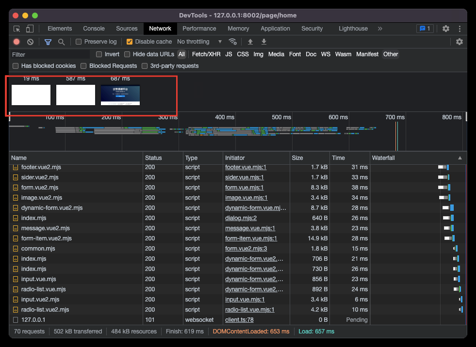
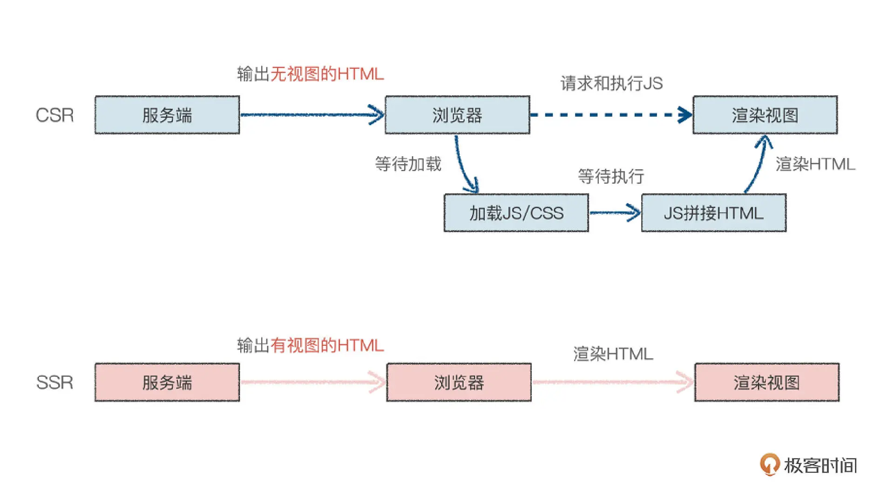
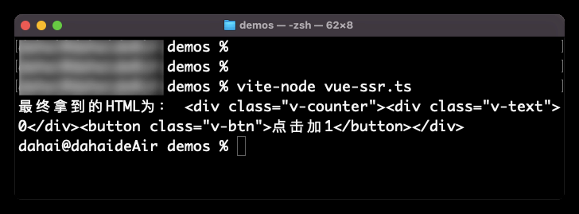
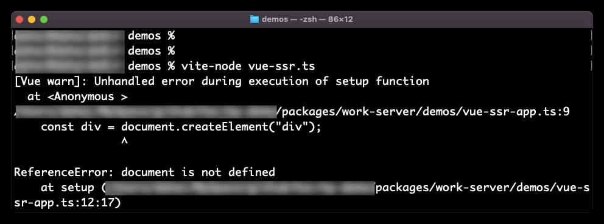
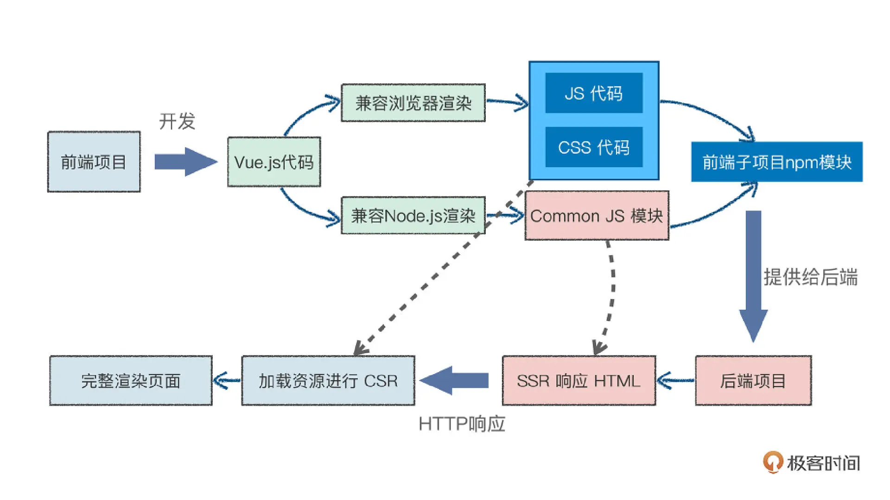
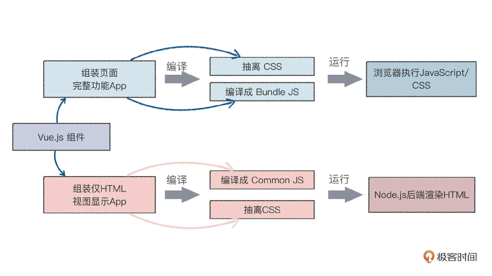
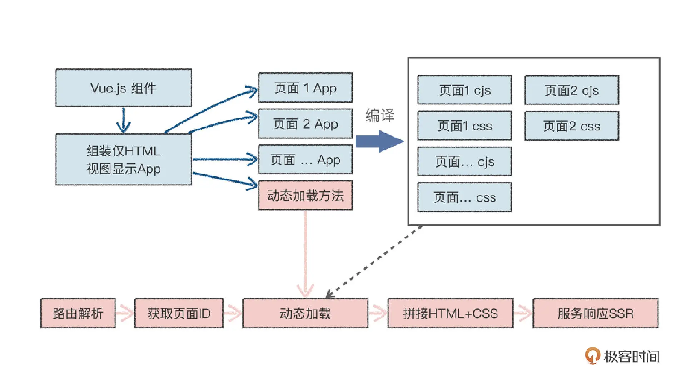
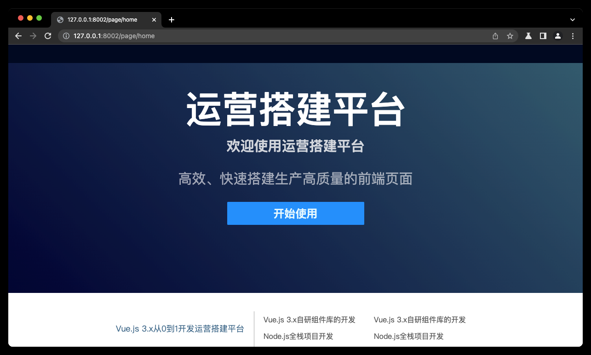
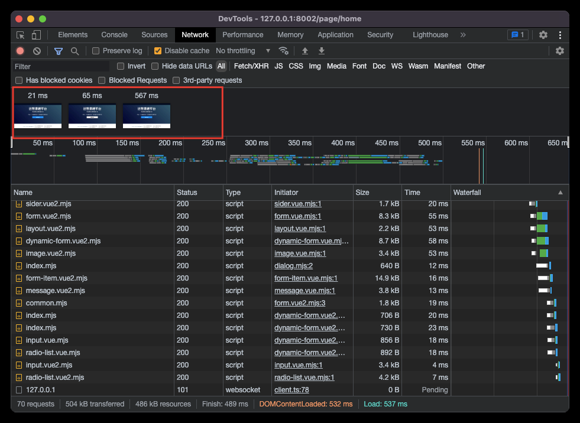

# 18 | Node.js服务端渲染页面：客户端渲染和服务端渲染有何区别？

你好，我是杨文坚。

之前，我们课上所有 Vue.js 的代码，都是在浏览器里运行的。在浏览器里，编译后的 Vue.js源码是纯粹的 JavaScript 代码，可以直接执行，并渲染出对应的视图和交互效果。

但在 JavaScript 代码还没通过 <script> 标签加载出来之前，整个页面一直是“白屏”，这个状态要等待 JavaScript 加载完，才能渲染出页面的功能视图。就像图中这样，浏览器控制台记录的白屏过程：



为什么会有这个现象呢？

其实也很简单，因为图中渲染方式是“浏览器端渲染”，先等待页面的 HTTP 请求响应，返回页面的 HTML，此时 HTML 还没有视图内容，只有 JavaScript 和 CSS 这些静态资源的引用，等到这些 HTML 里依赖的前端资源加载完毕后，最后执行 JavaScript 代码渲染出 HTML 结果，同时，对应 CSS 资源才会渲染样式效果。

如果请求页面依赖的资源文件体积太大，页面渲染就需要更长的等待时间，导致“白屏”时间等待太久，用户体验就很糟糕。

那么能不能无需等待 JavaScript 资源加载，就先渲染页面，来尽可能缩短“白屏”时间呢？

答案是有的，就是“服务端渲染”。究竟“浏览器渲染”和“服务端渲染”有什么渲染区别，带着这个问题，我们开始今天的学习。

## 什么是浏览器渲染和服务端渲染？

我们先从概念上理解一下这两个词。在前端领域里，“客户端”就是“浏览器”，所以“浏览器渲染”更官方的名称是客户端渲染。

- 客户端渲染，英文术语是 Client Side Render，简称 CSR（后面我们就统一用 CSR 这个术语来表示）。

“客户端渲染”就是通过浏览器中运行的 JavaScript 代码来生成 HTML 内容，从而渲染页面视图。

在前端领域里，CSR 除了渲染视图，更多是实现视图的交互操作，比如点击按钮后触发弹窗显示。因为这类交互操作，需要在浏览器里执行 JavaScript 代码绑定相关 DOM 的事件。

- 服务端渲染，英文术语是 Server Side Render，简称 SSR（后面我们统一用 SSR 这个术语来表示）。

SSR 是由服务端处理好页面的 HTML 内容，再通过 HTTP 请求响应给浏览器渲染。

具体技术过程是这样子的：浏览器输入 URL 发起了页面的 HTTP 请求，服务端接收请求后，再响应页面的 HTML 给浏览器，浏览器拿到页面 HTTP 请求返回的 HTML 数据，就可以开始渲染拿到的 HTML 的渲染视图了，如果 HTML 里有 CSS 内容，也会一并渲染出对应的样式。



所以，CSR 和 SSR 的最大区别就是“初始化页面视图时候”的“HTML 生成方式”，一个是在浏览器里拼接 HTML，一个是在服务器里拼接 HTML，这里的 HTML 也包括 <style> 标签里的CSS 内容。

那么 SSR 的优势是什么呢？

SSR，是浏览器在请求页面 URL 的时候，直接返回视图的 HTML 内容，这意味着在其它环境里，例如另一个服务器环境里发起这个 URL 的 HTTP 请求，也能拿到这个 HTML 内容，所以服务端渲染还能支持搜索引擎抓取页面数据，也就是支持“SEO”。

- SEO，全称是 Search Engine Optimization，中文意思就是“搜索引擎优化”，比方说，SEO就是能让用户通过百度搜索找到网站网页的内容。但是 SEO 不是搜索引擎单独一方就能完成的，需要多方的“合作”才能实现。如果站在 Web 网站视角上，SEO 就是要求 Web 网站提供一个能让搜索引擎“抓取”到数据的服务，让搜索引擎拿到网页的数据，做对应的页面关键字解析和收录。如果站在搜索引擎视角上，SEO 就是要求能通过搜索引擎的服务器来发起 HTTP 请求，拿到网页的 HTML 结果，然后归纳页面中的关键字，收录起来，等待用户搜索到关键字并提供对应网页链接。

- 如果站在其他用户视角上，就是用了某个搜索引擎，根据关键字来搜数据，如果关键字能对上，搜索引擎就显示对应收录的网页内容和链接。

我们小结一下两种渲染方式的作用：

- CSR：在浏览器里动态渲染 HTML、在浏览器里实现交互效果；

- SSR：支持页面加载的首屏体验优化、支持网页的 SEO（搜索引擎优化）。

之前我们都是在浏览器里做 Vue.js 的 CSR，那么 Vue.js 如何做 SSR 呢？也就是说，如何实现 Vue.js 的服务端渲染呢？

## 如何实现 Vue.js 服务端渲染？

我们先分析一下 Vue.js 能在浏览器端实现渲染的原理，看看能不能找到参考思路。

CSR 的原理就是，把 Vue.js 的模板语法代码或 JSX 语法代码，编译成纯 JavaScript 代码，然后通过 Vue.js 的 runtime，也就是 Vue.js 的运行时，执行编译后的 Vue.js 代码，并渲染出对应的 DOM（也就是 HTML）和绑定 DOM 的事件。

浏览器搞懂了，那服务端呢？

先看第一个关键点，能执行 JavaScript 代码的服务端环境，必须首选 Node.js 环境。Vue.js官方也提供了 Node.js 的渲染方法，支持在 Node.js 环境里执行“非编译模式”的 Vue.js 代码，或者是编译后的 Vue.js 代码，将其转化成 HTML 结果。讲到这里，你有没有觉得很熟悉，这个“非编译模式”的使用就和我们已经学过的第一节课联动起来了。

那么第二个关键点，Vue.js 是如何在 Node.js 的服务端渲染出 HTML 内容呢？我先跟你分析一下实现原理，基本分成两个步骤：

- 第一步，把 Vue.js“非编译模式代码”或者“编译结果代码”转化成 HTML 字符串或数据流；

- 第二步，把 HTML 内容写入 HTTP 响应返回给浏览器。

第一步，就是 Vue.js 官方提供的 API，支持将“非编译模式”的代码转化成 HTML 结果，我们看个例子。

这是编译后的 Vue.js 代码或者是“非编译模式”的 Vue.js 代码：

```bash
// vue-ssr-app.ts
import { createElementVNode, ref, toDisplayString } from 'vue';
const Counter = {
 setup() {
   const num = ref(0);
   const click = () => {
     num.value += 1;
   };
   return () => {
     return createElementVNode('div', { class: 'v-counter' }, [
       createElementVNode(
         'div',
         { class: 'v-text' },
         toDisplayString(num.value)
       ),
       createElementVNode(
         'button',
         { class: 'v-btn', onClick: click },
         '点击加1'
       )
     ]);
   };
 }
};
export default Counter;
```

把 Vue.js 可执行的 JavaScript 代码，在 Node.js 转化成 HTML：

```python
//  ./vue-ssr.ts
import { createSSRApp } from 'vue';
import { renderToString } from 'vue/server-renderer';
import App from './vue-ssr-app';
async function getAppSSRHTML() {
 // 将编译后或非编译模式的Vue.js组件或者页面进行SSR App转换
 const app = createSSRApp(App, {});
 // 将SSR App 生成HTML
 const html = await renderToString(app);
 return html;
}
async function main() {
 const html = await getAppSSRHTML();
 console.log(`最终拿到的HTML为： ${html}`);
}
main();
```

在这个例子中，我们使用的 Vue.js 代码，是可以在浏览器执行的 JavaScript 代码，之后通过Vue.js 官方的两个 API 来处理转化 HTML：

- 第一个 API 是 createSSRApp，创建一个服务端渲染的应用，类似 CSR 里的 createApp 这个 API，可以有效提取只能在服务端渲染的内容。

- 第二个 API 是 renderToString，把 SSR 的应用转成 HTML 字符串。

上述代码最终执行结果如下图：



我们也可以使用另一个 API renderToStream 来代替 renderToString，最终转化的结果是HTML 数据流，是二进制的数据（后面为了方便显示生成 HTML 的字符串内容，演示代码我们都使用 renderToString 开发）。

完成第一步的 HTML 转化后，接下来就是第二步，把 HTML 的字符串结果或者数据流结果，通过 Node.js 的 Web 服务的 HTTP 响应操作，返回给浏览器。

我们用 Koa.js 简单实现一个案例，具体代码如下所示：

```python
// vue-ssr-server.ts
import Koa from 'koa';
import { createSSRApp } from 'vue';
import { renderToString } from 'vue/server-renderer';
import App from './vue-ssr-app';
// 初始化 Koa.js 应用
const servre = new Koa();
servre.use(async (ctx) => {
 // 封装 Koa.js 中间件
 // 渲染 Vue.js 组件或应用的HTML内容
 const app = createSSRApp(App, {});
 const html = await renderToString(app);
 ctx.body = html;
});
servre.listen(6001, () => {
 console.log('SSR 服务已经启动，浏览器打开 http://127.0.0.1:6001/');
});
```

上述代码中，我用 Koa.js 搭建了一个简单的 Web 服务，并写了一个中间件来渲染 Vue.js 组件的 HTML 内容。

要特别注意的是，在实现 SSR 的过程中，需要做好浏览器和 Node.js 各自独有的 JavaScriptAPI 的判断隔离。如果 Vue.js 组件或者应用代码里有浏览器的 JavaScript API，在 Node.js 环境运行是会报错的，例如这个 Vue.js 的 JavaScript 代码：

```bash
import { createElementVNode, ref, toDisplayString } from 'vue';
const Counter = {
 setup() {
   // 这是浏览器创建DOM的 JavaScript API
   // Node.js环境不存在
   const div = document.createElement('div');
   console.log(div);
   return () => {
     return createElementVNode('div', { class: 'v-counter' }, '测试');
   };
 }
};
export default Counter;
```

上述代码中存在浏览器操作 DOM 的 JavaScript API，在 Node.js 环境里是不存在的，如果在Node.js 执行 SSR 时候，会报错：



所以，当你在用 Vue.js 的组件或应用 JavaScript 代码进行 SSR 操作时候，要确保代码里不能有浏览器 API，或者代码里要做好浏览器环境和 Node.js 的代码判断隔离。

另外，SSR 还有一点需要注意，也可以说是缺点吧，SSR 渲染出来的视图，只是静态的HTML 内容。Vue.js 组件里如果有交互事件，在 SSR 的渲染结果中是不会生效的。如果需要实现交互效果，就需要浏览器里执行相关的 JavaScript 代码，也就是需要 CSR 进行处理。

所以，这时候我们就需要 CSR 和 SSR 渲染的结合，那么如何设计 Vue.js 的 SSR 和 CSR 全栈项目呢？

## 如何设计全栈项目的 Vue.js 的 SSR 和 CSR？

一提到 SSR 和 CSR 的结合渲染，你或多或少会想到一个技术术语——“同构渲染”。

但是，“同构渲染”这个概念，定义众说纷纭，有开发者认为一套前端代码能支持 SSR 和CSR，那就是“同构渲染”，但又有开发者认为 SSR 和 CSR 结合是“异构渲染”等等，争议很多。为了减少歧义，在课程中我们就只称之为 Vue.js 的 SSR 和 CSR。

SSR 和 CSR 的结合渲染，目前业界没有什么统一的技术方案，不同企业、不同开发者，具体实现形式都是“八仙过海各显神通”。

Vite 官方提供了一个 SSR 和 CSR 结合渲染的案例：https://github.com/vitejs/vite/tree/main/playground/ssr-vue，你可以参考学习，这个案例上手很简单轻便，但是前后端共用的 Vue.js 代码是耦合在一起的，不适合我们课程中设计的前后端分离项目。

既要支持前后端解耦分离的项目，又要支持一套 Vue.js 代码能兼容 SSR 和 CSR 两种渲染方式，该怎么办呢？

其实也很简单，我们可以将同一套前端的 Vue.js 代码，做些兼容处理工作，编译出两套渲染代码，分别支持浏览器环境和 Node.js 环境的渲染，具体设计思路是这样子的：



想实现图中的内容，需要四步：

1. 前端子项目 Vue.js 组件，编译成面向浏览器可运行的 JavaScript 代码；

2. 前端子项目 Vue.js 组件，编译成面向 Node.js 服务可以运行的 JavaScript 代码；

3. 后端子项目引用对应编译后的 JavaScript 代码，运行相关的结果；

4. 页面渲染时候，按照需要进行 SSR 或者 CSR。

我们来一步步实现全栈项目的 SSR 和 CSR 的结合渲染。

第一步，前端子项目的 Vue.js 组件组装成功能页面代码，其中也包括所有交互功能的代码。这跟我们之前学过的编译操作、开发模式和生产模式一样，没什么太大区别。

第二步，根据需要，把 Vue.js 组件按需组装 SSR 所需要渲染的内容，这时候可以按照需要，选择页面的 Vue.js 组件，尽量只选择首屏需要的组件或者 SEO 需要用到的组件。记得同时做好 Node.js 环境的 JavaScript API 兼容。

封装好需要 SSR 页面的 Vue.js 代码，就编译成 CommonJS 模块格式，虽然 Node.js 现在已经支持 ES Module 模块格式，但考虑兼容性问题，还是以 CommonJS 模块格式提供出来比较稳妥。与此同时，所有页面编译出的都是独立 CommonJS 文件和 CSS 文件。具体流程我用一张图来描述：



第三步，在 Node.js 服务项目中，通过服务端路由解析出不同页面的 ID 或者页面名称，查找是否存在 SSR 的 CommonJS 模块代码：

- 如果存在，就获取 CommonJS 模块和对应的 CSS 代码，通过 Vue.js 的 SSR API 进行转换成 HTML，最后响应给浏览器，完成一个 SSR 流程和后续在浏览器里的 CSR 流程。

- 如果页面的 SSR CommonJS 代码不存在，就响应默认的 HTML，走普通的 CSR 流程。



第四步，观察和等待浏览器的执行。我拿这节课的源码案例来演示一下最终效果，用SSR+CSR 渲染了运营平台的首页：



用了 SSR+CSR 的开发模式，在控制台看到的渲染效果如下：



如果去掉 SSR，仅用 CSR，就会出现白屏等待的体验问题：

具体代码实现，你可以在课后查看课程 GitHub 上的源码案例。

## 如何合适地选择使用 SSR？

从分析和案例效果都可以看出，SSR 能减少白屏的时间，甚至白屏的时间可以忽略不计。那，是不是 SSR 就是项目开发必备的能力呢？或者说 SSR 合适所有项目场景吗？

其实不是的，并不是所有页面都需要 SSR。

主要原因是有些场景是不希望支持 SEO 的。因为有些页面是不想被浏览器引擎“抓取”页面数据的，避免一些业务数据被竞对批量获取。比如一些电商网站，就不想让搜索引擎拿到商品价格，这时候，页面渲染方式用纯 CSR 比较合适。

除了因为数据安全问题不适合 SSR 外，还有另一个不适合的场景，高并发大流量的服务场景。因为 SSR 在处理 HTML 过程中需要拼接字符串等操作行为，这个过程要消费内存和CPU 的资源。如果此时 SSR 过程还需读取数据填充到 HTML 里，再加上读写数据的等待时间和服务器资源消耗，会带来很大的服务器压力。

所以，如果涉及数据敏感、服务器压力的场景，我们就不合适用 SSR。当然这只是直观的选择方式，如果企业内有专业的数据安全团队和服务运维团队辅助，他们可以支持数据“防爬”和服务动态扩容，那么这两类问题场景也不是问题，可以愉快使用 SSR。

## 总结

通过今天的学习，相信你已经掌握了 Vue.js 关于 SSR 和 CSR 的原理以及利弊，我们总结一下两种渲染方式。

- CSR，也就是客户端渲染或浏览器渲染，依赖 JavaScript 资源的加载，需要加载完后执行，动态生成 HTML 视图和实现交互功能。

主要作用是交互功能的实现，缺点是依赖 JavaScript 等资源的加载，可能导致渲染页面出现“白屏”等待时间过长。CSR 适合数据敏感的网页，避免搜索引擎或“爬虫”来“抓取”网页数据，例如电商价格显示的详情页。

- SSR，也就是服务端渲染，在服务端处理 HTML 结果，并返回给浏览器直接渲染，主要作用是缩短页面渲染时间和支持搜索引擎“抓取”网页数据。

SSR 适合 SEO 场景，例如运营推广类的活动页面宣传。但是要考虑数据安全问题和服务运维成本问题。Vue.js 代码在 SSR 时，注意要做好浏览器的 JavaScript API 的兼容判断或者隔离，避免出现程序运行异常。

至于如何因地制宜定制 Vue.js 全栈项目的 SSR 和 CSR 结合方案，核心要考虑项目的前后端耦合或者解构的情况，同时还要考虑到国内大厂的前后端分离的技术趋势。SSR 和 CSR 的设计方案，必须让 Vue.js 在前后端的使用操作上解耦。

今天我们是从前后端项目分离的角度上做方案设计，但技术趋势在不停变化发展，除了掌握今天的技术设计方案，希望你也能灵活地做好设计方案的变通。

## 思考题

单页面应用如何优雅设计 Vue.js 项目的 SSR 和 CSR？

欢迎积极留言参与讨论，我们下节课见。

完整的代码在这里
