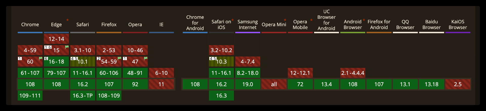
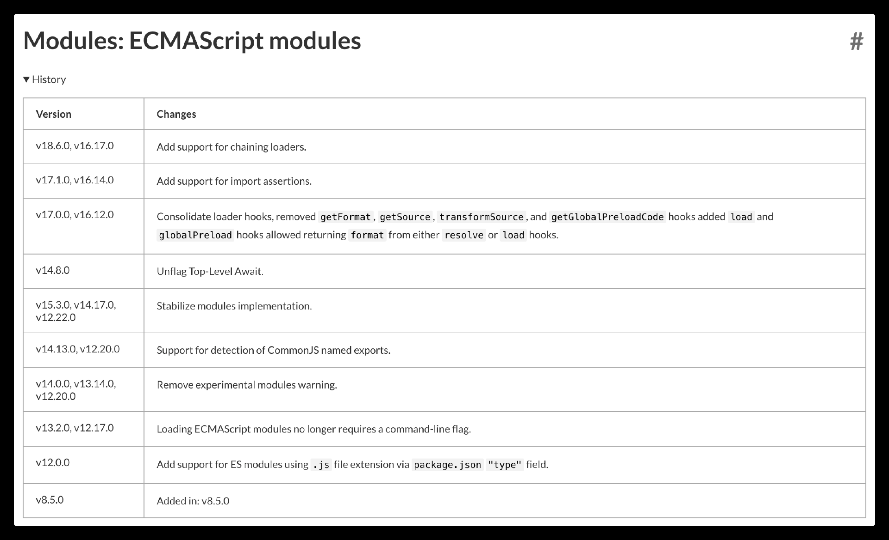
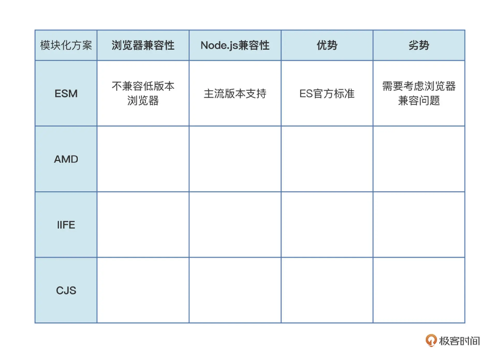
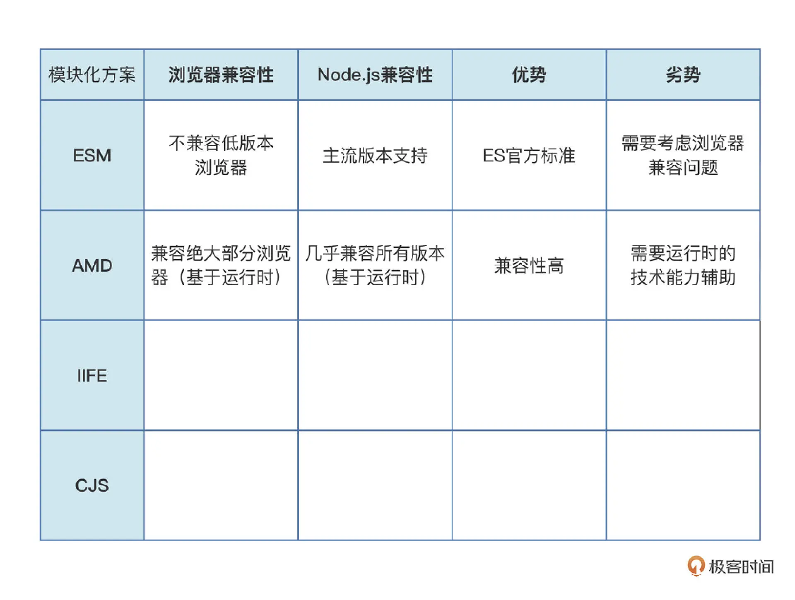
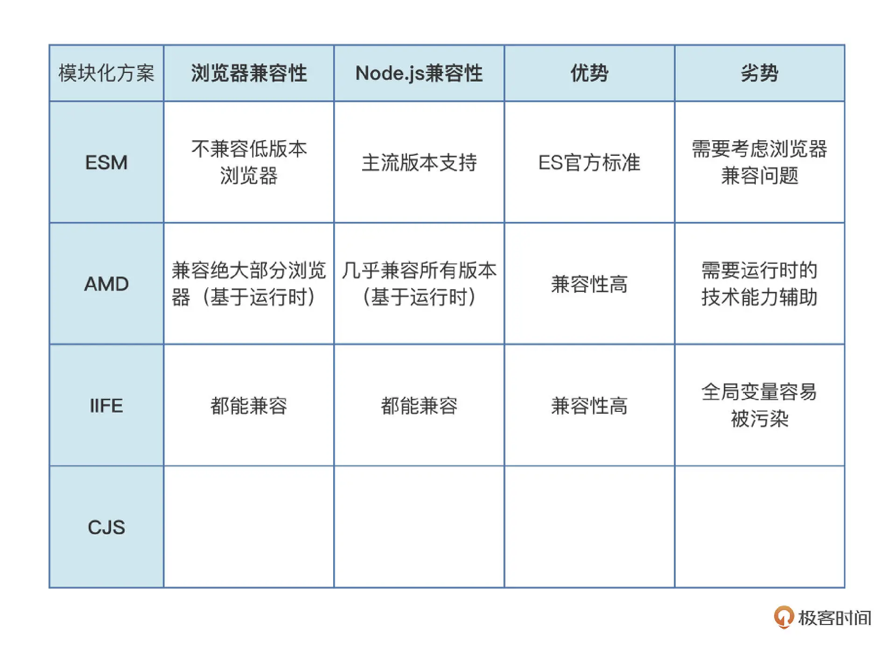
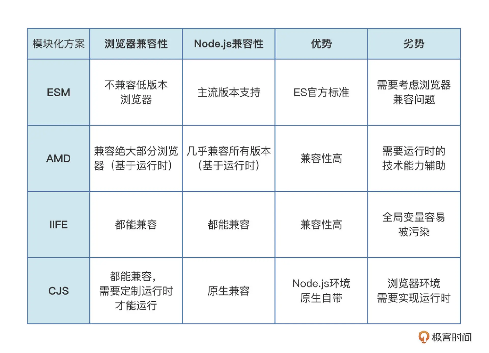
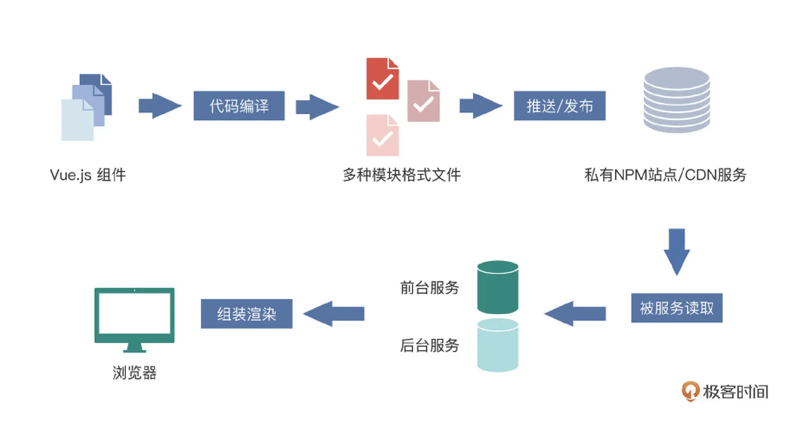
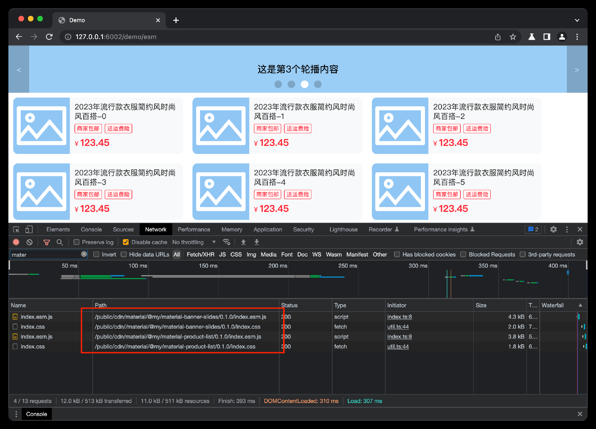

# 22 | 物料组件的编译和管理：如何处理组件的多种模块格式？

你好，我是杨文坚。

我们课程的平台项目，在数据设计环节，把平台的数据划分成了三个数据维度：用户、物料和页面，对应的运营搭建平台功能就有三种功能维度：用户、物料和页面。

上节课我们学习了用户的注册和登录，也就是用户数据的操作，属于用户功能维度。从这节课开始，我们进入物料功能维度，对运营搭建平台的物料体系进行功能分析、方案设计、技术解构和代码实现。

“物料”功能，核心就是操作物料的静态资源和数据库数据。其中，物料静态资源指的是每个物料组件的产物，也就是 JavaScript 和 CSS 文件，可以独立在浏览器或者 Node.js 环境中进行渲染或者执行。

而运营搭建平台，底层功能里最核心就是用物料搭建页面。如何搭建，其实就是把这些物料的JavaScript 和 CSS 文件组装起来运行。用前端技术视角看，就是用组件（物料）来组装页面。

想用组件组装成页面，首先要把组件模块化，方便后续组装，而且，要让组件在不同的环境（浏览器或者 Node.js）里的运行，把组件编译成对应模块化格式后才能运行。那么前端组件有哪些模块化方案呢？

## 前端组件有哪些模块化方案？

前端组件模块化方案，其实归根结底就是 JavaScript 的模块化方案。因为不管是 Vue.js 组件、React.js 组件或其他前端框架组件，最终要在浏览器或者 Node.js 环境运行，都需要编译成 JavaScript 代码。

那么，我们现在的关注点就是 JavaScript 的模块化方案。

JavaScript 作为一门“动态脚本语言”，在 ES6 草案确定前，没有“官方标准”的模快化方案。如果要对跨 JavaScript 文件的方法和数据进行“联动”，只能靠全局变量进行“通信联通”。后来经过技术社区的探索，基于 ES5 规范的 JavaScript 能力，实现了多种模块化方案。比较出名的有 AMD 模块化方案、CJS 模块化方案。

JavaScrip 在 ES6 草案确定后，确定了在 JavaScript 原生语言层面的标准模块化方案，ESModules，简称 ESM。

很多人疑惑，ESM 既然是 JavaScript 语言官方的模块化方案，那 ES6 规范之前的“野生”模块化方案是不是就不适用了呢？其实并不是的，很多以前的模块化方案依然有适用场景，常用的主要有四个。

- ESM 模块化方案

- AMD 模块化方案

- IIFE（全局变量）模块化方案

- CJS 模块化方案

来看每个模块化方案的优缺点和使用场景，我也会用代码演示具体原理和实现过程。

### 1. ESM 模块化方案

这个 ES 官方规范的模块化方案，在高版本浏览器和高版本 Node.js 环境下才能直接使用。Node.js 在服务端开发可以统一约定使用高版本，但是浏览器是用户自行选择的，控制不了版本，所以 ESM 在实际工作中要面临浏览器兼容问题。

ESM 的浏览器兼容情况（来自 https://caniuse.com/es6-module ）。



ESM 在 Node.js 环境下的支持情况截图（来自 https://nodejs.org/api/esm.html#modules-ecmascript-modules ）。



总结一下 ESM 的几种场景特性。



我们这节课主要是学习组件的模块化方案，因为物料组价的拼装是在浏览器操作进行的，那就优先考虑在浏览器里使用。看一个代码案例，用 ESM 组装渲染一个 Vue.js 应用。

首先是代码的目录。

```
. # packages/mock-cdn/demos/esm/
├── index.html
├── index.js
└── material
   ├── counter-decrease.js
   └── counter-increase.js
```

其中有两个物料组件 counter-decrease.js 和 counter-increase.js。

```bash
// packages/mock-cdn/demos/esm/material/counter-decrease.js
import { h, ref, toDisplayString } from 'vue';
const Counter = {
 setup() {
   const num = ref(0);
   const click = () => {
     num.value -= 1;
   };
   return () => {
     return h('div', { class: 'v-counter' }, [
       h('div', { class: 'v-text' }, toDisplayString(num.value)),
       h(
         'button',
         {
           class: 'v-btn',
           onClick: click
         },
         '点击减1'
       )
     ]);
   };
 }
};
export default Counter;
// packages/mock-cdn/demos/esm/material/counter-increase.js
import { h, ref, toDisplayString } from 'vue';
const Counter = {
 setup() {
   const num = ref(0);
   const click = () => {
     num.value += 1;
   };
   return () => {
     return h('div', { class: 'v-counter' }, [
       h('div', { class: 'v-text' }, toDisplayString(num.value)),
       h(
         'button',
         {
           class: 'v-btn',
           onClick: click
         },
         '点击加1'
       )
     ]);
   };
 }
};
export default Counter;
```

有了 ESM 物料产物，接下来就是物料的组装和渲染。

```xml
<!-- packages/mock-cdn/demos/esm/index.html -->
<html>
 <head>
   <meta charset="utf-8" />
   <script type="importmap">
     {
       "imports": {
         "vue": "/public/pkg/vue/3.2.45/dist/vue.runtime.esm-browser.js",
         "vue-router": "/public/pkg/vue/3.2.45/dist/vue.runtime.esm-browser.js"
       }
     }
   </script>
 </head>
 <body>
   <div id="app">页面加载中...</div>
   <script type="module" src="./index.js"></script>
 </body>
</html>
// packages/mock-cdn/demos/esm/index.js
import { createApp, h } from 'vue';
const layout = {
 materials: [
   { name: 'counter-increase' },
   { name: 'counter-decrease' }
 ]
};
async function runtime() {
 const children = [];
 for (const m of layout.materials) {
   const Module = await import(`/demos/esm/material/${m.name}.js`);
   children.push(h(Module?.default || Module));
 }
 const App = h('div', {}, children);
 const app = createApp({
   render() {
     return h(App, {});
   }
 });
 app.mount('#app');
}
runtime();
```

代码中，我们在 index.html 文件里用了 importmap 的特性，方便 ESM 里直接用 import vue的方式来调用；在 index.js 用 import()，也就是 ESM 的异步调用模块方法，获取依赖的物料组件。最终基于 Vue.js 的非编译模式的语法，我们成功把两个组件组装一起渲染。

### 2. AMD 模块化方案

AMD，全称是 Asynchronous Module Definition，“异步模块定义”，是一种面向浏览器运行的模块化方案。

AMD 在 ES6 还没出现之前，是 ES5 环境下常见用的模块化方案。这里提到的“异步模块”，是指按模块的依赖来异步加载 AMD 模块，等待依赖模块异步加载完，就开始执行主体代码。全程的运行时执行过程，都是基于 ES5 的语法能力来实现的。但是，AMD 只是一种技术方案，也就是规范，具体技术实现需要根据规范，实现其运行时。目前主流的 AMD 技术框架有RequireJS。



看一个代码案例，基于 RequireJS 用 AMD 规范来组装物料，渲染一个 Vue.js 应用。

代码的目录。

```
. # packages/mock-cdn/demos/amd/
├── index.html
├── index.js
└── material
   ├── counter-decrease.js
   └── counter-increase.js
```

两个 AMD 模块格式的物料组件 counter-decrease.js 和 counter-increase.js。

```javascript
// packages/mock-cdn/demos/amd/material/counter-decrease.js
define('counter-decrease', ['vue'], function (Vue) {
 const { h, ref, toDisplayString } = Vue;
 const Counter = {
   setup() {
     const num = ref(0);
     const click = () => {
       num.value -= 1;
     };
     return () => {
       return h('div', { class: 'v-counter' }, [
         h('div', { class: 'v-text' }, toDisplayString(num.value)),
         h(
           'button',
           {
             class: 'v-btn',
             onClick: click
           },
           '点击减1'
         )
       ]);
     };
   }
 };
 return Counter;
});
// packages/mock-cdn/demos/amd/material/counter-increase.js
define('counter-increase', ['vue'], function (Vue) {
 const { h, ref, toDisplayString } = Vue;
 const Counter = {
   setup() {
     const num = ref(0);
     const click = () => {
       num.value += 1;
     };
     return () => {
       return h('div', { class: 'v-counter' }, [
         h('div', { class: 'v-text' }, toDisplayString(num.value)),
         h(
           'button',
           {
             class: 'v-btn',
             onClick: click
           },
           '点击加1'
         )
       ]);
     };
   }
 };
 return Counter;
});
```

AMD 格式物料的组装和渲染。

```xml
<!-- packages/mock-cdn/demos/amd/index.html -->
<html>
 <head>
   <meta charset="utf-8" />
   <script src="/public/pkg/requirejs/2.3.6/require.js"></script>
   <script src="/public/pkg/vue/3.2.45/dist/vue.runtime.global.js"></script>
 </head>
 <body>
   <div id="app">页面加载中...</div>
   <script src="./index.js"></script>
 </body>
</html>
// packages/mock-cdn/demos/amd/index.js
const layout = {
 materials: [
   { name: 'counter-increase'  },
   { name: 'counter-decrease' }
 ]
};
window.requirejs.config({
 baseUrl: '/demos/amd/material/',
 paths: {}
});
window.define('vue', [], function () {
 return window.Vue;
});
function runtime() {
 window.require(
   ['vue', 'require', ...layout.materials.map((m) => m.name)],
   function (Vue, require) {
     const { createApp, h } = Vue;
     const children = [];
     for (const m of layout.materials) {
       const Module = require(m.name);
       children.push(h(Module?.default || Module));
     }
     const App = h('div', {}, children);
     const app = createApp({
       render() {
         return h(App, {});
       }
     });
     app.mount('#app');
   }
 );
}
runtime();
```

从上面代码中，你可以看到 AMD 模块的运行依赖了 RequireJS 的运行，RequireJS 提供一个define 的全局方法，给开发者用来定义模块。

这里的 RequireJS，是一种 AMD 模块化规范的代码实现，看定义过程。

```javascript
define('模块id', [
// 模块依赖id
], function( /*模块依赖的获取*/ ) {
 // 模块主体代码
})
```

RequireJS 通过解析依赖，来异步加载所有的依赖的 AMD 模块，等待依赖加载完后，就执行模块主体代码。

### 3. IIFE 模块化方案

IIFE，全称是 Immediately Invoked Function Expression，“立即执行函数”的意思。如果要实现模块化，就需要在 IIFE 中，把代码挂载在全局变量上。

这也是早期 JavaScript 的模块化方案，根据不同环境，把模块全部挂载在对应环境的全局变量上，浏览器就挂载在“window”对象上，Node.js 就挂载在 global 全局变量上。



关于 IIFE 全局变量模块化方案的代码案例，我们就不多讲了，非常简单，具体你可以参考代码案例所在目录（packages/mock-cdn/demos/iife/）。

### 4. CJS 模块化方案

CJS，全称是 CommonJS 模块化规范，目前用的比较广泛是在 Node.js 环境里，因为Node.js 刚诞生的时候，模块化方案是基于 CommonJS 规范来实现的，而且，CJS 规范也是在 ES6 草案确定之前诞生的、兼容 ES5 的环境。



CJS 比较适合在 Node.js 环境中使用，在 Node.js 服务端中拼接物料产物，在服务端组装成页面的 HTML。

今天我们主要讲物料产物的编译和前端浏览器里物料运行，关于 Node.js 服务端物料产物组装，不多讲，后面会专门分析搭建平台的物料 SSR 渲染。

前端组件的四种常见模块化方案我们就都了解了，每个模块化方案都有优缺点和适用场景，可以根据不同场景，选择对应的模块化方案。

我们日常开发 Vue.js 组件都是 TypeScript 语法来开发的，那么如何编译成多种模块化格式呢？

## Vue.js 组件如何编译成多种模块？

目前主流的构建工具，比如 Webpack、Rollup 和 Vite，都可以基于其插件体系，来把TypeScript 的 Vue.js 组件编译成多种模块化格式文件。既然都可以渲染，我们就优先选用Vue.js 官方标配的构建工具 Vite，进行多种模块化编译。

目前，Vite 默认支持 ESM、AMD、IIFE 和 CJS。那么 Vite 如何实现 AMD 模块编译呢？

其实 Vite 底层生产模式是基于 Rollup 来进行编译的，我们可以强行传入 AMD 的配置来执行编译。看具体配置代码。

```bash
// scripts/build-materials.ts
import { build } from 'vite';
import pluginVue from '@vitejs/plugin-vue';
import pluginVueJsx from '@vitejs/plugin-vue-jsx';
import { resolvePackagePath, readFile } from './util';
import type { InlineConfig } from 'vite';
function getBuildConfig(opts: {
 name: string;
 version: string;
 dirName: string;
 libName: string;
}): InlineConfig {
 const { dirName, libName } = opts;
 const config: InlineConfig = {
   plugins: [pluginVue(), pluginVueJsx()],
   build: {
     target: 'esnext',
     minify: false,
     emptyOutDir: true,
     outDir: resolvePackagePath(dirName, 'dist'),
     lib: {
       name: libName,
       entry: resolvePackagePath(dirName, 'src', 'index.ts'),
       formats: ['es', 'cjs', 'iife'],
       fileName: (format) => {
         if (format === 'es') {
           format = 'esm';
         }
         return `index.${format}.js`;
       }
     },
     rollupOptions: {
       preserveEntrySignatures: 'strict',
       external: ['vue', '@vue/components'],
       output: {
         globals: {
           vue: 'Vue',
           '@vue/components': 'MyVueComponents'
         },
         assetFileNames: 'index[extname]'
       }
     }
   }
 };
 return config;
}
function getBuildAMDConfig(opts: {
 name: string;
 version: string;
 dirName: string;
 libName: string;
}): InlineConfig {
 const { dirName, name, libName } = opts;
 const config: InlineConfig = {
   plugins: [pluginVue(), pluginVueJsx()],
   build: {
     // target: 'esnext',
     minify: false,
     emptyOutDir: false,
     outDir: resolvePackagePath(dirName, 'dist'),
     lib: {
       name: libName,
       entry: resolvePackagePath(dirName, 'src', 'index.ts'),
       // eslint-disable-next-line @typescript-eslint/ban-ts-comment
       // @ts-ignore
       formats: ['amd'],
       fileName: () => {
         return 'index.amd.js';
       }
     },
     rollupOptions: {
       preserveEntrySignatures: 'strict',
       external: ['vue', '@vue/components'],
       output: {
         name: name,
         format: 'amd',
         amd: {
           id: name
         },
         globals: {
           vue: 'vue',
           '@vue/components': '@vue/components'
         },
         assetFileNames: 'index.amd[extname]'
       }
     }
   }
 };
 return config;
}
async function main() {
 console.log('执行物料编译...');
 const materialList = [
   {
     name: require('../packages/material-product-list/package.json').name,
     version: require('../packages/material-product-list/package.json')
       .version,
     dirName: 'material-product-list',
     libName: 'MyMaterialProdcutList'
   },
   {
     name: require('../packages/material-banner-slides/package.json').name,
     version: require('../packages/material-banner-slides/package.json')
       .version,
     dirName: 'material-banner-slides',
     libName: 'MyMaterialBannerSlides'
   }
 ];
 for (const opts of materialList) {
   console.log(`开始编译物料 ${opts.dirName}`);
   const config = getBuildConfig(opts);
   const configAMD = getBuildAMDConfig(opts);
   await build(config);
   await build(configAMD);
 }
}
main();
```

在 Vite 编译代码中，我用一个 Vite 配置编译出 ESM、CJS 和 IIFE 的模块化格式代码，用另一个独立的 Vite 配置编译 AMD 模块代码。如果以后 Vite 不支持强行编译 AMD 的方式，我们可以独立用 Rollup 来进行编译。

在今天案例的 scripts/build-materials.ts 文件里，我就用一个 Vite 编译脚本，编译了案例的两个物料组件，形成多种模块化格式，具体你可以课后看案例代码实现。

现在我们编译出了多种模块格式，在搭建平台项目中，如何实现物料产物的管理和运行呢？

## 如何管理和运行各种模块化的物料组件？

既然我们实现了物料，也就是 Vue.js 组件各种模块化格式的编译产物。接下来对产物的管理和运行，主要有四步。

- 第一步，把物料的 Vue.js 组件编译多种模块化格式。

- 第二步，把各种模块化文件发布到私有 NPM 站点或者 CDN 服务。

- 第三步，前台和后台服务各自读取 CDN 上的物料，进行拼接页面。

- 第四步，实现各种模块化代码执行的运行时。



我们逐步分析。

第一步，编译 Vue.js 组件，需要你根据自己企业的技术基建做选择，我为了演示方便，就在课程代码案例的 monorepo 仓库中，管理了两个物料组件 material-banner-slides 和 material-product-list，然后进行 Vite 的构建编译。

第二步，把各种模块化文件发布到 CDN 上。如果你自己企业内部有私有 NPM 站点，就发布到私有 NPM 站点，如果有 CDN 服务，就发布到 CDN 服务上。某种意义上讲，NPM 也是一种 CDN 服务。

这里你需要注意，每次发布物料模块文件，都需要修改组件的版本，因为每次生产的物料文件都是不会被覆盖的，会随着版本增加，方便后续物料出问题后可以进行快速回滚处理。

在课程的代码案例里，为了演示方便，我在 monorepo 项目中用一个子项目 mock-cdn，模拟了一个 CDN 来存储公共物料。之后我把两个物料发布到 monorepo 的“模拟 CDN” 中。

第三步，前台和后台服务，根据自己所需要用到的物料产物，各自读取 CDN 上的物料，方便后续浏览器获取对应服务的物料产物。课程的代码案例，我就从 mock-cdn 这个模拟 CDN 来获取公共物料文件。

第四步，实现各种模块化代码执行的运行时，根据页面的配置文件，也就是页面用了哪些物料，进行拼接渲染页面。

我在课程的代码案例中，基于前台场景，在浏览器中，实现了 ESM 模块化的运行时、AMD模块化运行时和 IIFE 模块化运行时。先定义了公用的页面物料配置数据。

```bash
// packages/portal-front/src/demos/util.ts
export interface LayoutConfig {
 materials: Array<{
   name: string;
   globalName: string;
   version: string;
   props: Record<string, any>;
 }>;
}
export const layout: LayoutConfig = {
 materials: [
   {
     name: '@my/material-banner-slides',
     version: '0.1.0',
     globalName: 'MyMaterialBannerSlides',
     props: {
       style: { height: 100 }
     }
   },
   {
     name: '@my/material-product-list',
     version: '0.1.0',
     globalName: 'MyMaterialProdcutList',
     props: {}
   }
 ]
};
```

然后实现了一些公共工具方法和公用配置。

```bash
// packages/portal-front/src/demos/util.ts
export const CDN_BASE_URL = '/public/cdn/';
export async function loadMaterialStyle(params: {
 name: string;
 version: string;
}) {
 const { name, version } = params;
 const materialId = `${name}/${version}`;
 if (
   document.querySelectorAll(`style[data-material-id="${materialId}"]`)
     ?.length > 0
 ) {
   return;
 }
 const url = `${CDN_BASE_URL}/material/${name}/${version}/index.css`;
 const text = await fetch(url).then((res) => res.text());
 const style = document.createElement('style');
 style.setAttribute('data-material-id', materialId);
 style.innerHTML = text;
 const head =
   document.querySelector('head') ||
   document.querySelector('body') ||
   document.querySelector('html');
 head?.appendChild(style);
}
export function loadScript(url: string): Promise<void> {
 return new Promise((resolve, reject) => {
   const script = document.createElement('script');
   script.src = url;
   document.body.appendChild(script);
   script.onload = () => {
     resolve();
   };
   script.onerror = () => {
     reject();
   };
 });
}
export async function render(opts: {
 Vue: any;
 moduleMap: { [id: string]: any | { default: any } };
 layout: LayoutConfig;
}) {
 const { moduleMap, layout, Vue } = opts;
 const { h, createApp } = Vue;
 const children = layout.materials.map((item: any) => {
   return h(
     moduleMap[item.name]?.default || moduleMap[item.name],
     item?.props || {}
   );
 });
 const App = {
   setup() {
     return () => {
       return h('div', {}, children);
     };
   }
 };
 const app = createApp({
   render() {
     return h(App, {});
   }
 });
 app.mount('#app');
}
```

最后实现 ESM、AMD 和 IIFE 三种模块格式在浏览器的运行时。

ESM 物料组装运行时。

```python
import { CDN_BASE_URL, render, loadMaterialStyle, layout } from '../util';
async function loadMaterialESModule(params: { name: string; version: string }) {
 const { name, version } = params;
 return import(
   /* @vite-ignore */
   `${CDN_BASE_URL}material/${name}/${version}/index.esm.js`
 );
}
async function loadESModule(name: string) {
 return import(
   /* @vite-ignore */
   `${name}`
 );
}
async function runtime() {
 const moduleMap: any = {};
 for (const item of layout.materials) {
   const { name, version } = item;
   const Module = await loadMaterialESModule({
     name,
     version
   });
   await loadMaterialStyle({ name, version });
   moduleMap[name] = Module;
 }
 const Vue: any = await loadESModule('vue');
 await render({ Vue, moduleMap, layout });
}
runtime();
```

AMD 物料组装运行时。

```python
import { CDN_BASE_URL, render, loadMaterialStyle, layout } from '../util';
async function runtime() {
 const paths: Record<string, string> = {};
 layout.materials.forEach((m) => {
   paths[m.name] = `material/${m.name}/${m.version}/index.amd`;
 });
 window.requirejs.config({
   baseUrl: CDN_BASE_URL,
   paths
 });
 window.require(
   ['vue', 'require', ...layout.materials.map((m) => m.name)],
   (Vue: any, require: any) => {
     const moduleMap: any = {};
     for (const m of layout.materials) {
       const { name, version } = m;
       loadMaterialStyle({ name, version });
       moduleMap[name] = require(name);
     }
     render({ Vue, moduleMap, layout });
   }
 );
}
runtime();
```

这里要注意一点，AMD 运行时需要依赖 RequireJS，来实现 AMD 模块的加载和运行。

IIFE 物料组装运行时。

```python
import {
 CDN_BASE_URL,
 render,
 loadMaterialStyle,
 layout,
 loadScript
} from '../util';
async function runtime() {
 const moduleMap: any = {};
 for (const item of layout.materials) {
   const { name, version, globalName } = item;
   await loadScript(
     `${CDN_BASE_URL}/material/${name}/${version}/index.iife.js`
   );
   await loadMaterialStyle({ name, version });
   moduleMap[name] = window[globalName] as any;
 }
 const Vue: any = window.Vue;
 await render({ Vue, moduleMap, layout });
}
runtime();
```

在所有组装物料的运行时代码中，你要注意，我们需要在运行时中，用 JavaScript 来手动加载 CSS 文件。这个 CSS 是没有模块化区分的，面向所有模块化格式，都是通用的。

代码中最终组装物料的效果图。



## 总结

今天我们学习了前端组件的模块化和运营搭建平台物料的产物管理，也就是 Vue.js 组件的模块化管理，为后面物料搭建页面打好基础。

总结一下不同模块格式的优缺点。

如果现在需要你做个终极选择，我们平台项目中要选择哪种模块方式呢？

答案是全都要。因为浏览器端把握在用户手里，我们无法预测实际代码在运行过程中会出现什么兼容问题，如果平台渲染能支持多重模块格式，就意味着可以做一些优化策略，在低版本浏览器中，就可以优先选择对应能支持的模块格式。

在实现运营搭建平台的物料产物管理时，有两点要注意：

- 平台不是独立的一个工程，你需要根据自身企业技术基建，进行工程能力整合，例如对企业内部的 CDN 服务或者 NPM 私有服务的对接。

- 物料产物需要版本化管理，也就是 Vue.js 组件每次迭代编译，都需要发布一个新版本，方便出问题后快速回滚线上代码。

## 思考题

前台场景运行页面时，通过 ESM 或者 AMD 格式进行异步加载物料的代码文件，如果页面依赖的物料变多了，物料文件请求也会变多，这会影响页面打开时间吗？有什么办法可以提高页面打开时间吗？

欢迎留言参与讨论，我们下节课再见。

完整的代码在这里
