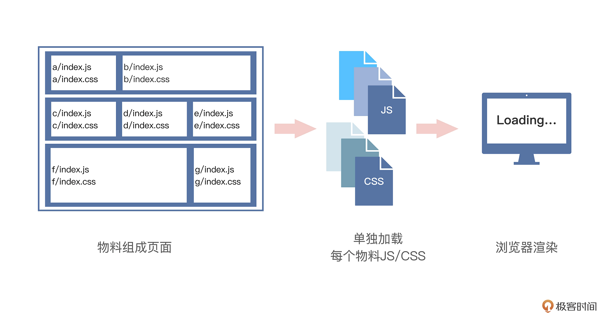
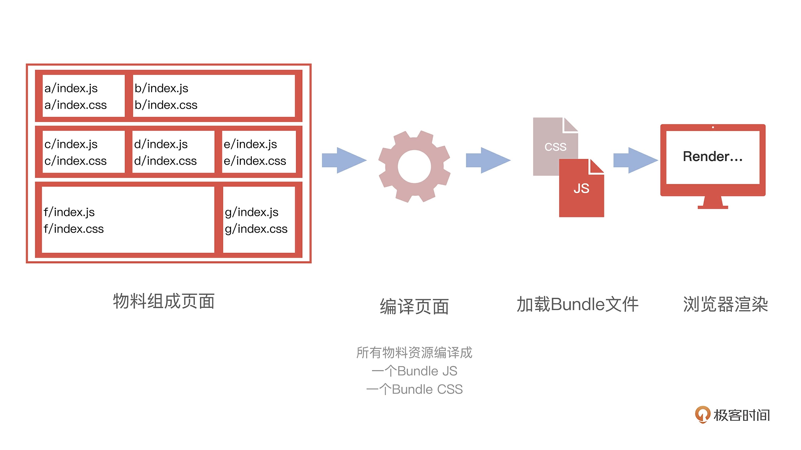
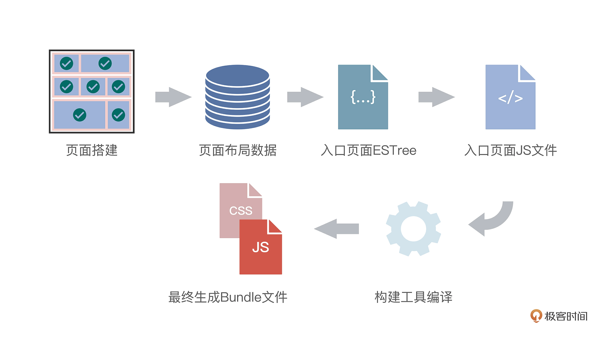
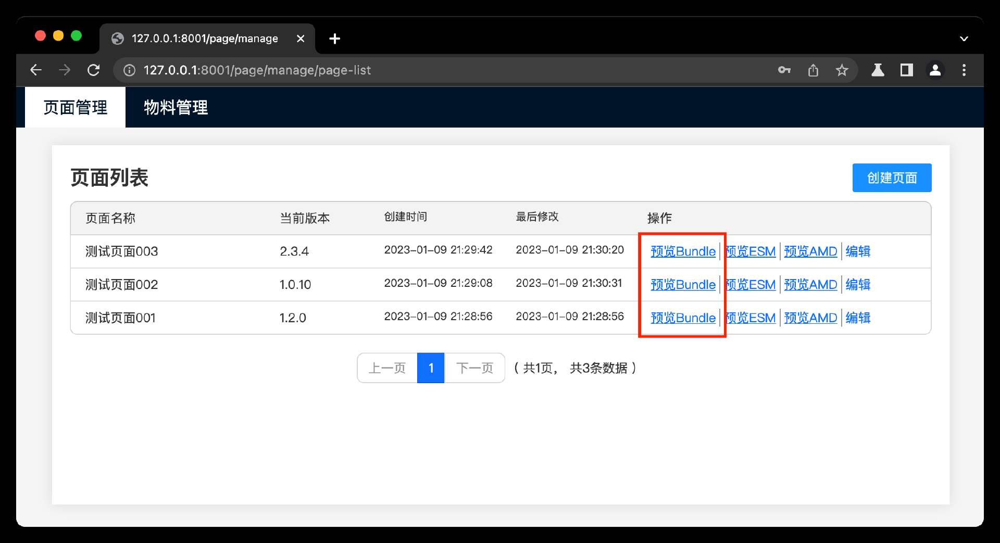
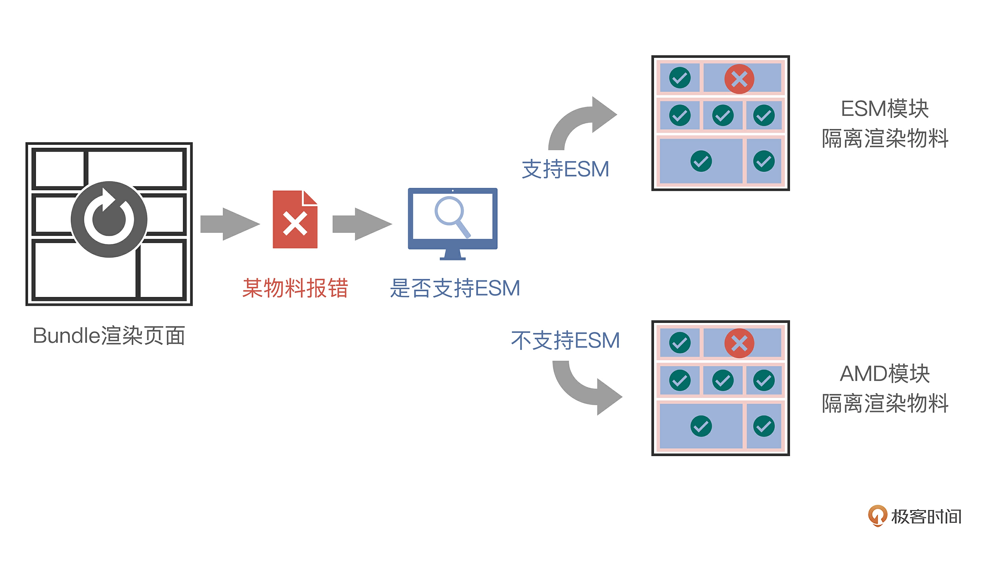

# 26 | 页面编译和运行：如何设计Vue.js搭建页面的渲染策略？

你好，我是杨文坚。

上节课，我们学习了如何实现“页面搭建”功能，实现流程可以分成两个关键点，“布局设计”和“填充物料”。有了“页面搭建”功能，我们可以通过可视化操作界面，生成完整的页面数据，这个数据，我们约定称为“页面布局数据”。

根据页面功能维度的五大功能模块，“页面搭建”“页面编译和运行”“页面发布流程”“页面版本管理”和“页面渲染方式”，有了页面布局数据，接下来，我们要做的就是基于页面布局数据，进行“页面编译和运行”。

到这里，你可能有疑问，为什么不能像页面搭建功能那样，直接通过 AMD 模块或者 ESM 模块方式，进行组装渲染运行呢？为什么还要进行页面编译?

## 为什么要进行页面编译

回忆一下我们之前做过的编译操作。在“物料组件产物管理”中，我们把物料的 Vue.js 组件，编译成了多种 JavaScript 模块格式；上节课“页面搭建”，我们在搭建页面的时候，基于组件的一种或多种模块格式，进行搭建页面的可视化操作渲染。

在页面搭建过程中，每个物料都是独立加载对应物料组件的 JavaScript 文件，同时，也加载物料组件的 CSS 文件进行渲染。所以，每个物料组件渲染的时候，就需要两个 HTTP 请求，来请求物料 JavaScript 和 CSS 的静态资源。

设想一下，如果页面依赖了 20 个不同的物料，按照页面搭建的方式进行渲染，就需要等 40（20x2=40）个 HTTP 请求，加载完组件资源，最后才能渲染出完整的页面。所以，按照物料组件独立加载文件的形式，来组装渲染页面，等到 HTTP 请求和响应，非常浪费时间，降低了用户体验。

但是，页面搭建，是面向企业内部员工操作的，加载时间久勉强可以接受，而且页面搭建功能，需要让物料能独立渲染和独立操作，所以，物料也就必须独立请求对应的组件资源。



而前台场景，面向的是外部客户，要尽可能提升页面的用户体验，减少加载时间。所以，我们就需要合并页面依赖的物料组件资源，也就是多个组件的 JavaScript 文件和 CSS 文件，变成一个 JavaScript 文件和一个 CSS 文件。

这就要根据页面布局数据，整合需要用到的多个物料的 JavaScript 和 CSS 文件，各自编译成一个 Bundle 文件。



一句话总结页面编译的作用就是：“页面编译，目的是为了减少 HTTP 请求，提升用户体验。”从技术角度上看，页面编译产出的 Bundle 文件，也提供新的一种页面组装物料的渲染方式。

好，我们明确了需要页面编译，但是，棘手的问题来了，怎么进行页面动态编译呢？

前端程序员通常在前端编译页面的时候，选择在开发阶段，写死固定编译脚本，来配置构建工具（例如 Webpack、Vite 之类）进行编译代码。但是在我们运营搭建平台里，页面数据和依赖都是动态内容，不可能写死固定配置脚本，要怎么实现搭建页面的动态编译呢？

## 如何实现搭建页面的动态编译

我们先看看常规情况，编译前端页面代码需要哪些要素。

基于 Webpack、Rollup 和 Vite 的配置规范，你可以总结出三个基本要素。

- 准备编译入口文件

- 配置插件来编译多种语言和语法

- 分离 JavaScript 和 CSS 的代码

我们逐一分析每个基础要素，看看在技术视角上，怎么选择方案来解决。

1. 准备编译入口文件

我们都知道，无论是 Webpack、Rollup 还是 Vite，要编译 JavaScript 代码，就必须提供入口文件。

但是，上节课我们在渲染页面搭建功能的时候，每个物料组件，会独立加载文件和渲染。这些文件都是物料级别的组件文件，没有页面级别的入口文件。那我们要怎么提供页面级别的入口文件呢？

这就需要基于页面布局数据来拼接代码，生成页面入口文件。拼接代码，估计很多人首先想到的，就是用字符串的方式来拼接代码。

```javascript
const code0 = `import Vue from 'vue';`;
const code1 = `const a = 1`;
const code2 = `const b = 2`;
const code3 = `function add(num1, num2) {
 return num1 + num2;
}`
const code4 = `const c = add(a, b)`
const code = `
 ${code0}
 ${code1}
 ${code2}
 ${code3}
 ${code4}
`
// 最后用Node.js的fs API生成文件
```

字符串拼接方式，固然简单明了，但也存在安全隐患。毕竟是通过字符串拼接出来的实际代码，我们无法保证拼接后的代码语法正确。很可能出现每个代码块字符串都没问题，但是拼接后，带来一些换行或者标点符号的冲突，导致语法出错。

那有没有更安全的办法，实现代码的拼接呢？答案是有的，就是基于 ESTree 来生成JavaScript 代码。

ESTree，你可以直接理解成 JavaScript 的抽象语法树，也就是 AST。

- AST 全称 Abstract Syntax Tree，是源码语法结构的一种抽象表示，以“树状结构”来描述一种开发语言的源码语法。通常用于代码编译、编辑器的语法高亮、语法错误提示和代码自动补全等场景。

ESTree 是 JavaScript 社区讨论出来的一种抽象语法树（AST），简单来讲，就是用 JSON 来描述 JavaScript 语法。说到这里，你是不是觉得有点熟悉，之前我们课程提到的 JSONSchema，就是用 JSON 描述 JSON，这里的 ESTree，就是用 JSON 描述 JavaScript。

例如上面代码案例中，个别代码片段，可以这么用 ESTree 描述。

```javascript
// 代码片段  const a = 1
// 变成ESTree如下所示
const estree1 = {
 type: 'VariableDeclaration',
 declarations: [
   {
     type: 'VariableDeclarator',
     id: {
       type: 'Identifier',
       name: 'a'
     },
     init: {
       type: 'NumericLiteral',
       value: 1
     }
   }
 ],
 kind: 'const'
};
// 代码片段
/*
function add(num1, num2) {
 return num1 + num2;
}
*/
// 变成ESTree如下所示
const estree3 = {
 type: 'FunctionDeclaration',
 id: {
   type: 'Identifier',
   name: 'add'
 },
 generator: false,
 async: false,
 params: [
   {
     type: 'Identifier',
     name: 'num1'
   },
   {
     type: 'Identifier',
     name: 'num2'
   }
 ],
 body: {
   type: 'BlockStatement',
   body: [
     {
       type: 'ReturnStatement',
       argument: {
         type: 'BinaryExpression',
         left: {
           type: 'Identifier',
           name: 'num1'
         },
         operator: '+',
         right: {
           type: 'Identifier',
           name: 'num2'
         }
       }
     }
   ],
   directives: []
 }
};
```

更多 ESTree 的抽象语法树规范，你可以查看 https://github.com/estree/estree GitHub 里ESTree 的社区文档。

有了 ESTree 来描述代码片段，我们可以通过拼接 JSON 的方式，实现完整的代码抽象语法树。

有了完整的抽象语法树，接下来要考虑怎么把它变成实际的 JavaScript 代码。

你可以直接使用 Babel 的工具 ，就是 @babel/generator 这个 npm 模块，进行语法树的转换，具体操作就像这段代码。

```python
import generator from '@babel/generator';
const estree1 = {
 type: 'VariableDeclaration',
 declarations: [
   {
     type: 'VariableDeclarator',
     id: {
       type: 'Identifier',
       name: 'a'
     },
     init: {
       type: 'NumericLiteral',
       value: 1
     }
   }
 ],
 kind: 'const'
};
const estreeProgram: any = {
 type: 'File',
 errors: [],
 program: {
   type: 'Program',
   sourceType: 'module',
   interpreter: null,
   body: [],
   directives: [estree1]
 },
 comments: []
};
const result = generator(estreeProgram);
console.log(result.code); // 输出代码 const a = 1;
```

使用 Babel 工具，我们可以用 ESTree，拼接 JavaScript 代码的抽象语法树，最终生成完整的代码了。但是在这个过程中，一行代码，需要用好几行甚至好几十行 ESTree 的 JSON 进行描述，是不是觉得很繁琐？那有没有更加便捷的方式呢？

答案是肯定的。ESTree 就是为了避免字符串拼接代码可能出现的语法问题，那么我们可以把比较复杂的 JavaScript 代码片段，通过工具，转成 ESTree，这就提供了可以用于拼接的ESTree。

要把 JavaScript 代码转成 ESTree，我们可以用 Babel 提供的另一个 npm 模块，@babel/parser，来处理。这个模块可以把 JavaScript 代码，转成 Babel 风格的 ESTree。

现在入口文件的拼接实现方式就很清晰，用 ESTree 来处理代码拼接，最后通过 Babel 的npm 模块，实现 ESTree 和 JavaScript 代码的互相转化。

### 2. 配置插件来编译多种语言和语法

完成了页面入口文件的动态生成，接下来我们看页面编译的第二点，配置插件来编译多种语言和语法。

不同构建工具，插件配置是有差异的，之前我们学习了 Webpack、Rollup 和 Vite 这三个构建工具，其中，插件配置最方便的就是 Vite，自带了 JavaScript 的 ES6 语法的编译和 CSS 文件抽离功能，无需其它插件配置。所以，动态编译构建工具，我们就选择 Vite。

### 3. 分离 JavaScript 和 CSS 代码

因为，Vite 的默认配置，支持把代码中的 JavaScript 和 CSS 代码进行编译分离，最后拆分成两个 Bundle 文件。我们就直接使用。

最后，就是执行编译操作了，可以直接使用 Vite 的 Node.js API，进行动态编译入口文件，大致代码就像这样。

```python
import path from 'node:path';
import { build } from 'vite';
import type { InlineConfig } from 'vite';
// 动态编译入口文件的方法
async function buildEntryFile(fullEntryFilePath: string) {
 const config: InlineConfig = {
   build: {
     emptyOutDir: false,
     outDir: path.dirname(fullEntryFilePath),
     lib: {
       name: 'MyBundle',
       entry: fullEntryFilePath,
       formats: ['iife'],
       fileName: () => {
         return 'bundle.js';
       }
     },
     rollupOptions: {
       preserveEntrySignatures: 'strict',
       external: ['vue'],
       output: {
         globals: {
           vue: 'Vue'
         },
         assetFileNames: 'bundle[extname]'
       }
     }
   }
 };
 await build(config);
}
```

这个页面布局数据，我演示一下怎么使用。

```json
{
   "layout": {
       "rows": [
           {
               "uuid": "4890074a-09f7-4b95-bd34-fecbe6e066db",
               "columns": [
                   {
                       "name": "首屏广告",
                       "uuid": "fc90dcbf-d70b-40f4-aa14-b64be2632092",
                       "width": 1000
                   }
               ]
           },
           {
               "uuid": "c248318f-ffd1-42d7-9f27-56533f7c4453",
               "columns": [
                   {
                       "name": "其它广告位1",
                       "uuid": "ac873013-d448-4ca8-b4bb-729b844ee262",
                       "width": 600
                   },
                   {
                       "uuid": "079c3fe5-f8af-475a-82ed-feb01b5730ee",
                       "width": 400
                   }
               ]
           },
           {
               "uuid": "8d0bb922-5d8c-4a67-80b0-4babaf3e2f97",
               "columns": [
                   {
                       "name": "促销商品",
                       "uuid": "e9b94120-ebe8-4418-9b13-7ea10095676d",
                       "width": 1000
                   }
               ]
           }
       ],
       "width": 1000
   },
   "moduleMap": {
       "ac873013-d448-4ca8-b4bb-729b844ee262": {
           "materialData": {},
           "materialName": "@my/material-banner-slides",
           "materialVersion": "0.9.0"
       },
       "e9b94120-ebe8-4418-9b13-7ea10095676d": {
           "materialData": {},
           "materialName": "@my/material-product-list",
           "materialVersion": "0.9.0"
       },
       "fc90dcbf-d70b-40f4-aa14-b64be2632092": {
           "materialData": {},
           "materialName": "@my/material-banner-slides",
           "materialVersion": "0.9.0"
       }
   }
}
```

最后的动态生成入口文件。

```python
import Vue from "vue";
import MyMaterialBannerSlides from "../../../material/@my/material-banner-slides/
import MyMaterialProductList from "../../../material/@my/material-product-list/0.
const {
 h,
 createApp,
 defineComponent
} = Vue;
const materialDeps = {
 "@my/material-banner-slides": MyMaterialBannerSlides,
 "@my/material-product-list": MyMaterialProductList
};
const pageLayoutData = {
 "layout": {
   "rows": [{
     "uuid": "4890074a-09f7-4b95-bd34-fecbe6e066db",
     "columns": [{
       "name": "首屏广告",
       "uuid": "fc90dcbf-d70b-40f4-aa14-b64be2632092",
       "width": 1000
     }]
   }, {
     "uuid": "c248318f-ffd1-42d7-9f27-56533f7c4453",
     "columns": [{
       "name": "其它广告位1",
       "uuid": "ac873013-d448-4ca8-b4bb-729b844ee262",
       "width": 600
     }, {
       "uuid": "079c3fe5-f8af-475a-82ed-feb01b5730ee",
       "width": 400
     }]
   }, {
     "uuid": "8d0bb922-5d8c-4a67-80b0-4babaf3e2f97",
     "columns": [{
       "name": "促销商品",
       "uuid": "e9b94120-ebe8-4418-9b13-7ea10095676d",
       "width": 1000
     }]
   }],
   "width": 1000
 },
 "moduleMap": {
   "ac873013-d448-4ca8-b4bb-729b844ee262": {
     "materialData": {},
     "materialName": "@my/material-banner-slides",
     "materialVersion": "0.9.0"
   },
   "e9b94120-ebe8-4418-9b13-7ea10095676d": {
     "materialData": {},
     "materialName": "@my/material-product-list",
     "materialVersion": "0.9.0"
   },
   "fc90dcbf-d70b-40f4-aa14-b64be2632092": {
     "materialData": {},
     "materialName": "@my/material-banner-slides",
     "materialVersion": "0.9.0"
   }
 }
};
const moduleComponentMap = {};
Object.keys(pageLayoutData.moduleMap).forEach(uuid => {
 const materialName = pageLayoutData.moduleMap[uuid].materialName;
 moduleComponentMap[uuid] = materialDeps[materialName];
});
const App = defineComponent({
 setup() {
   const Rows = pageLayoutData.layout.rows.map((row, rowIndex) => {
     const Columns = row.columns.map((col, colIndex) => {
       const Material = moduleComponentMap[col.uuid];
       const props = pageLayoutData.moduleMap[col.uuid]?.materialData || {};
       const Mod = h(Material || 'div', props);
       return h('div', {
         style: {
           width: col.width,
           display: 'flex'
         },
         'data-col': colIndex
       }, Mod);
     });
     return h('div', {
       style: {
         width: row.width,
         margin: '10px 0',
         display: 'flex',
         flexDirection: 'row'
       },
       'data-row': rowIndex
     }, Columns);
   });
   return () => {
     return h('div', {
       style: {
         width: pageLayoutData.layout.width,
         margin: '0 auto'
       }
     }, Rows);
   };
 }
});
const app = createApp(App);
app.mount('#app');
```

页面编译的技术实现流程，就是这样的三步，我们简单总结一下。



- 首先基于页面布局数据，用 ESTree 拼接和生产入口文件。

- 然后，用构建工具，例如 Vite，基于入口文件，把所有的物料文件进行打包编译。

- 最后，整个页面的静态资源通过编译，生成一个 JavaScript 的 Bundle 文件，和一个 CSS的 Bundle 文件。

在我们课程的代码案例里，你可以通过创建页面，提交发布页面，来动态编译页面的 Bundle文件。最终可以在页面列表中，点击去访问 Bundle 文件渲染的预览页面。



实现了页面编译，我们继续学习今天的第二个知识点——页面运行。这里的页面运行，不是简单的页面加载和渲染，而是要有一定的渲染策略。那为什么要设计渲染策略呢？

## 如何设计渲染策略

运营搭建平台，最终生产的页面是提供给外部客户使用的，页面的稳定性和安全性就很重要。

在上一步，页面编译内容是把所有物料组件的 JavaScript 文件，编译成一个 JavaScript 的Bundle 文件。如果基于合并后的 Bundle 文件，运行渲染页面的时候，某个物料组件的JavaScript 代码出错，容易导致整个页面崩溃白屏。这时候，就会造成页面的不可用，进而变成生产故障。

但是，我们的页面编译，又是用来解决多 HTTP 文件请求问题的，目的就是提供较好的用户体验。

所以页面渲染策略，就是要在“用户体验”和“页面稳定性”做一定的权衡处理。怎么设计渲染策略呢？

既然是要做权衡，那就有优先级的选择，我们可以根据渲染方式的优先级，设计渲染策略。

- 第一步，优先使用编译后的 Bundle 文件渲染页面，提升用户的体验。

- 第二步，监听页面报错，如果 JavaScript 的 Bundle 文件报错，导致页面白屏，就进入多模块独立文件渲染模式。

- 第三步，判断浏览器兼容性，选择合适的多模块的物料独立渲染方式。

如果浏览器支持 ESM，就基于 ESM 模块格式，每个模块单独加载文件独立渲染，尽量隔离掉错误的干扰。如果浏览器不支持 ESM，就用 AMD 模块格式，加载 RequireJS 的 AMD 运行环境，再让每个模块单独加载文件独立渲染，尽量隔离掉异常物料组件的报错干扰。

这里的物料独立渲染，就是把每个物料当做一个 Vue.js 应用来渲染，基于 createApp 这个API 来独立渲染每个物料。替换掉 Bundle 文件聚合所有物料组件，渲染一个应用的模式。

具体渲染策略实现流程，就像这样。



渲染策略的要点，最核心的就是独立物料模块渲染，其实就是把物料组件当做独立的应用来渲染。Bundle 文件渲染方式是只渲染一个 Vue.js 应用，当应用里出现报错，导致整体页面奔溃，就多变成模块独立加载渲染。这个时候，每个物料是独立的 Vue.js 应用进行独立渲染。隔离出错误模块或错误代码。

所以页面渲染策略的思路可以用一句话总结：“尽量保证页面功能全部渲染，如果出现异常，就降级成部分模块渲染，保证大部分功能可用性”。

## 总结

今天我们学习了“页面编译”和“页面运行”。其中，页面编译，就是基于页面布局数据，动态编译出页面完整的 JavaScript 和 CSS 的 Bundle 文件，目的是为了减少 HTTP 文件请求，提升用户体验。

动态编译过程中，需要注意三方面。

- 用 ESTree 处理代码拼接。在动态生成编译的入口文件时，要用 ESTree 动态生成 JS 代码，主要是尽量减少拼接代码带来的语法错误。

- 不同处理的 ESTree 语法有差异。处理 ESTree 的不同工具，都有一定的抽象语法树差异，这里建议用 Babel 的工具链，用 @babel/parser 把 JavaScript 代码转成 ESTree，用@babel/generator 把 ESTree 转成 JavaScript 代码。

- ESTree 也不是绝对安全。基于 ESTree 动态拼接代码，只能尽量避免 JavaScript 语法问题，但不是绝对能解决语法问题，在处理过程中还是要注意拼接代码的语法检查。

页面运行，核心就是要设计页面的渲染策略，保证页面功能的可用性和稳定性。

- 渲染策略是优先用 Bundle 文件渲染，保证用户体验。

- 检查页面报错情况，如果是 Bundle 文件报错导致页面崩溃，就进入兜底渲染环节。

- 兜底渲染主要是把页面物料文件独立加载，独立渲染，隔离错误干扰。

页面渲染策略其实就是一种兜底措施，平衡“用户体验”和“功能稳定性”。如果是由于提升用户体验带来了渲染问题，那就必须舍弃优化方式，进行降级处理。换句话说就是，牺牲用户体验，来保证功能的稳定性。

## 思考题

想一想，页面渲染策略中，Bundle 文件渲染不能兼顾“用户体验”和“技术稳定性”吗？渲染策略必须做降级处理，牺牲用户体验，变成物料独立加载渲染吗？

期待看到你的思考。希望通过今天的学习，你能掌握动态拼接页面代码的技术知识，同时，也能理解如何做好页面渲染策略的设计。下节课见。

完整的代码在这里
