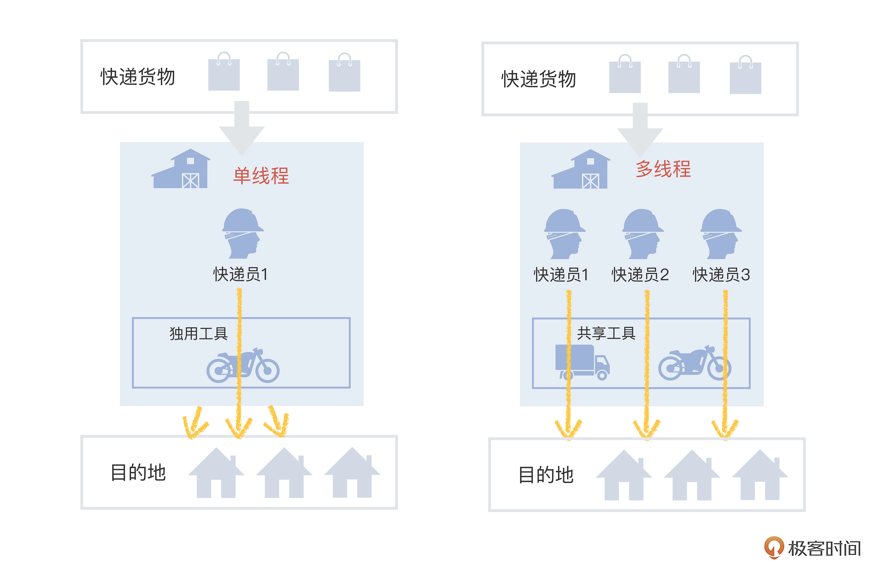
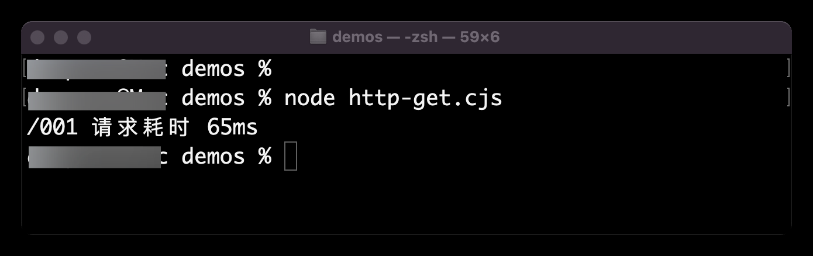
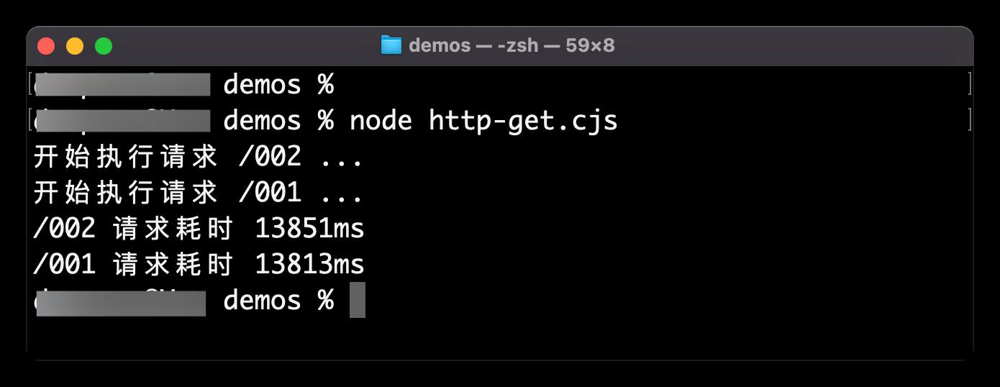
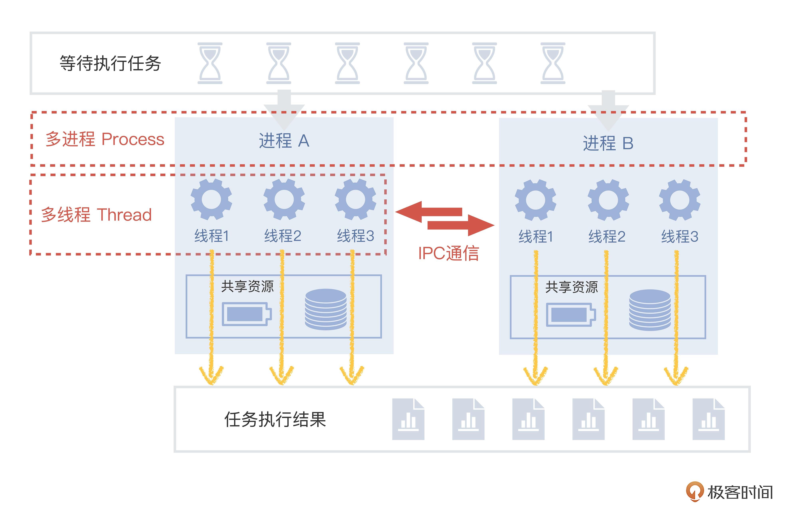
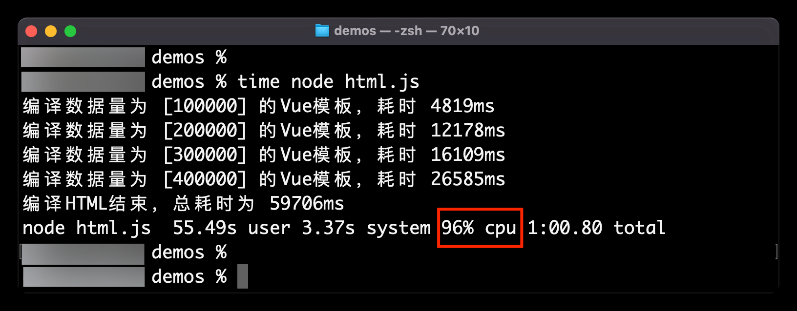
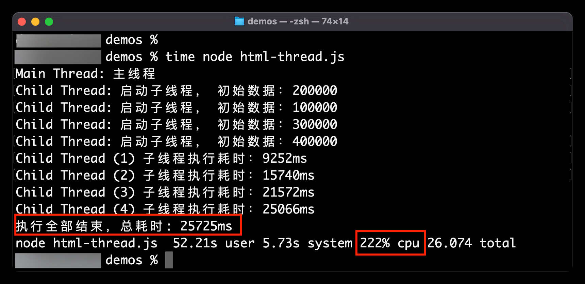
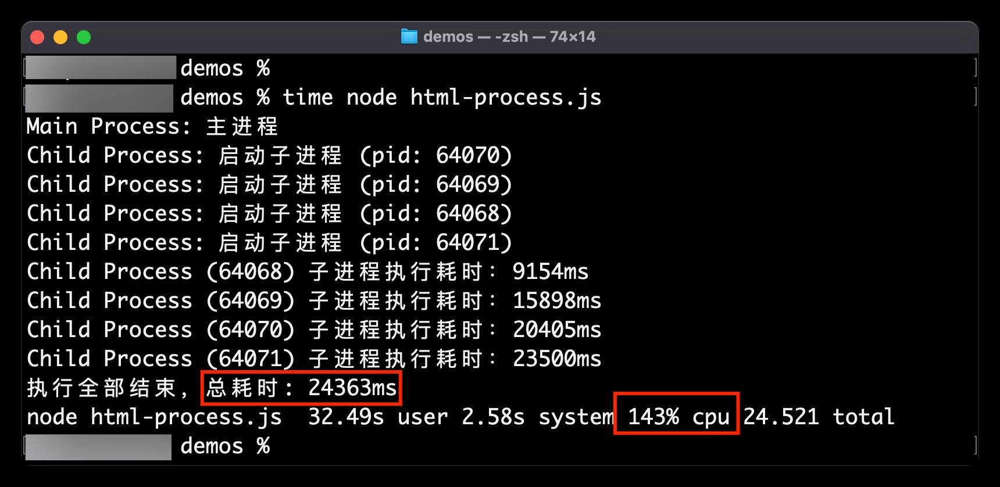

# 35 | 多进程部署：如何最大限度利用服务器资源运行Node.js服务？

你好，我是杨文坚。

上节课，我们基于服务端的纵向和横向切面，把 Node.js 服务化整为零，分解成了服务的各个最小颗粒度模块；然后根据这些模块逻辑，设计出两种方向切面的扩展规范；最后根据扩展规范设计和服务端结构分析，我们详细展示了服务端“技术底座”，分析了如何根据技术框架优势，更优雅地扩展功能。

到现在，我们已经实现了搭建功能，也做好功能扩展工作，那服务端开发方面的工作，是否能告一段落呢？

答案是否定的。还记得吗，之前我们在阶段性完成前端页面的开发工作后，还用一节课的时间，学习了如何优化搭建平台的前端性能。服务端的开发工作也是一样的，除了完成功能，还需要做服务端的性能优化。

在前端页面性能优化中，我提到两种优化思路，“前置优化”和“后置优化”。无论选择哪种优化思路，都要考虑常见的性能问题场景，也不能“过度设计”造成开发资源浪费。所以，服务端性能优化的工作，我们也要尽量“好钢用在刀刃上”，优先考虑大概率的性能场景问题，做好优化准备。

那服务端大概率的性能问题是什么？如何优化解决呢？我们开始今天的学习。

## 为什么 Node.js 会发生阻塞

服务端的性能问题，说到底其实就是机器资源的使用问题，主要是 CPU 和内存的利用问题。通常有两种极端情况，机器资源不够用、机器资源利用不充分，我们统称为机器资源使用不合理。

对于 Node.js 服务来说，我们都知道，机器资源使用不合理，通常会导致程序阻塞。那为什么Node.js 会发生阻塞问题呢？

Node.js 是运行 JavaScript 语言的一种环境，而 JavaScript 是“单线程语言”，按照 JavaScript语法执行逻辑，在 Node.js 环境里的执行过程也是单线程的。

插句题外话，要注意，“多线程”和“多进程”是两个不同的技术概念，别混淆了。

可能你听说过，浏览器可以用 Web Workers API 实现多线程，或者 Node.js 自带了多线程和多进程模块，但是这些都不是 JavaScript 本身的标准能力，而是浏览器和 Node.js 借助底层的能力，实现多线程或者多进程，属于运行环境提供的能力。

如果你不太理解，也不用担心，我们后面会讲 Node.js 多线程和多进程的使用，现在你可以直接理解，在 Node.js 环境里，默认单线程执行程序。

好，讲回来。Node.js 的单线程，因为省去了多线程频繁切换操作，避免共享资源冲突等风险，也没有线程锁操作等繁琐逻辑，能让服务程序变得轻量和简便。

你可以类比成“发快递”。单线程就是一个快递员派件，他知道所有地址，交通工具只有自己用，按部就班进行派件。多线程就是多个快递员派件，虽然多人并行派件，但是要分配工作事项、共用交通工具，增加了很多“管理成本”，类似多线程的“繁琐操作逻辑”。



虽然单线程管理简单，但是因为只有一个“执行单元”，如果遇到 CPU 密集计算的执行流程，就会被阻断住，导致后续程序内容执行不了，这就是 Node.js 发生阻塞的原因。

这么描述有点抽象，我们看一个实际的 Node.js 服务代码案例。

```javascript
// demos/http.cjs
const Koa = require('Koa');
const Router = require('@koa/router');
const app = new Koa();
const router = new Router();
const port = 9001;
router.get('/001', async (ctx) => {
 ctx.body = '<div>普通页面结果</div>';
});
router.get('/002', async (ctx) => {
 let count = 0;
 for (let i = 0; i < 9999999999; i++) {
   count++;
 }
 ctx.body = `<div>CPU密集计算数据 - 共[${count}]次计算</div>`;
});
app.use(router.routes());
app.listen(port, () => {
 console.log('服务已启动');
 console.log(`访问普通请求 http://127.0.0.1:${port}/001`);
 console.log(`访问CPU密集计算请求 http://127.0.0.1:${port}/002`);
});
```

这段代码是一个简单的 Koa.js 实现的 Node.js 服务，提供了两个 HTTP 页面，页面路径分别是 “/001”和“/002”。其中，路径“/001”请求是普通的 HTML 页面，路径“/002”请求是经过九十多亿次计算后才响应的 HTML 页面。这里，九十多亿次的计算属于 CPU 密集计算，在这个环节，Node.js 单线程服务会被阻塞住，直到被占用 CPU 的资源被释放。

我们写一个请求 HTTP 脚本，请求这两个路径，验证一下效果。

首先是单独请求普通 HTML 页面路径“/001”。

```javascript
// demos/http-get.cjs
// 单独请求 /001
const start = Date.now();
fetch('http://127.0.0.1:9001/001')
 .then((res) => res.text())
 .then(() => {
   console.log(`/001 请求耗时 ${Date.now() - start}ms`);
 });
```

在 Node.js 环境执行这段代码，结果就是这张截图。



可以看出，路径为“/001”普通页面请求处理，大概需要几十毫秒耗时。

接下来换成单独请求 CPU 密集计算路径“/002”。

```javascript
// demos/http-get.cjs
// 单独请求 /002
const start = Date.now();
fetch('http://127.0.0.1:9001/002')
 .then((res) => res.text())
 .then(() => {
   console.log(`/002 请求耗时 ${Date.now() - start}ms`);
 });
```

在 Node.js 环境执行代码，结果就是这样。


从截图可以看出，路径为“/002”CPU 密集计算请求处理，大概需要一万多毫秒的耗时，也就是九十亿的加法计算，在我本地电脑中，是十几秒级别的延时。

现在有两个路径的单独请求耗时，我们来模拟一下同时请求操作，验证阻塞的效果。

```javascript
// demos/http-get.cjs
// 模拟并发请求两种路径
const startFor002 = Date.now();
console.log('开始执行请求 /002 ...');
fetch('http://127.0.0.1:9001/002')
 .then((res) => res.text())
 .then(() => {
   console.log(`/002 请求耗时 ${Date.now() - startFor002}ms`);
 });
const startFor001 = Date.now();
console.log('开始执行请求 /001 ...');
fetch('http://127.0.0.1:9001/001')
 .then((res) => res.text())
 .then(() => {
   console.log(`/001 请求耗时 ${Date.now() - startFor001}ms`);
 });
```

执行代码后，看结果的截图。



可以看出，先请求 CPU 密集计算的“/002”路径，会阻塞住后面普通页面的“/001”路径请求，导致原本“/001”请求从耗时几十毫秒上升到十几秒，瞬间从“毫秒级”降级到“秒级”。

不过，你可能会有疑问，我们这个代码案例里几十亿的加法计算，已经是天文数量级别了，现实工作会遇到这类场景吗？

好问题，现实工作里，我们确实很少碰到“几十亿”级别的计算量，但是导致 CPU 密集计算不只这一个原因，还可能是多个并发操作累积导致的。例如，在 Vue.js 的服务端渲染场景，需要在服务进行 HTML 字符串拼接操作，这也占用 CPU 计算资源。如果碰到 HTML 字符串计算复杂的情况，再叠加并发请求过多，就很容易导致服务请求被阻塞。

所以，Node.js 服务中一旦出现密集计算的过程，就容易导致阻塞问题，阻塞了后续请求过程，导致并发问题。这类 Web 服务的密集计算场景，其实很常见，我们也避免不了的。

那么有没有办法，来解决这类问题呢？答案是有的，就是利用多进程或多线程。

## 什么是进程和线程

相信你在日常工作或者学习过程中，一定听说“线程”和“进程”，但是很多人会混淆这两个技术词汇。实际上，线程和进程是不同的技术概念，但是两者也有一定技术关系。

进程，英文称为 Process，是计算机系统里调度和分配资源的单位，也是线程的运行的宿主容器。

线程，Thread，是计算机系统里运算的最小单位，在进程中运行，也是进程中实际运行程序的单位。我们经常提到的“多线程”，就是指在“同一进程”里，有“多个线程”来执行程序，并且共享“同一进程分配的资源”。

听起来有点抽象，我们还是用“发快递”的例子来类比“多进程”和“多线程”。


如果把计算机系统类比成一个城市的快递体系，那么：

- 进程，就是城市里每一个快递点，可以调度和分配快递的运力资源。

- 线程，就是快递点里的快递员，是实际快递点执行配送快递的最小单元。

这个城市有多个快递点同时执行快递运输，就像一个计算机系统里多进程在执行任务。每个快递点，同时有多个快递员进行快件配送，就像同个进程，可以多线程执行程序任务，而且，每个快递员执行的是最后的送件工作，意味着线程是最小运行单元。

同个快递点，所有快递员，可以互相共享交通工具，类似线程之间可以共用资源，例如内存等。

不同快递站点，责任分明，交通工具不能跨站点共用，类似进程之间的资源不能共用。虽然不能共用交通工具，但是，不同快递站点，可以互相联系告知工作情况，类似进程之间虽然不能共享资源，但是可以进行进程间通信，全称 InterProcess communication，简称 IPC。



理清了进程和线程，我们回到课程 Vue.js 和 Node.js 的全栈项目里，用 Koa.js 搭建 Web 服务，大概率遇到的 CPU 密集计算的场景，主要集中在服务端渲染环节，也就是在服务端运行Vue.js 代码，通过计算和拼接字符串，来生成 HTML 内容。

如果这个页面的 HTML 结构非常复杂，请求页面的时候，服务端就会执行 Vue.js 代码，进行大量 HTML 字符串拼接计算，属于 CPU 的密集计算。这个时候，默认 Node.js 服务只有一个进程，进程里只有一个线程来执行任务，也就是单进程单线程服务。如果页面再叠加上并发请求，就可能造成阻塞问题。

现在我们解决的办法就是，利用多进程或者多线程来并行执行任务，缓解密集计算的任务压力，避免发生阻塞或并发问题。那么，如何在 Node.js 服务中使用多进程或多线程呢？

## 如何使用 Node.js 的多进程和多线程

前面提过，目前 Node.js 天然提供了进程和线程的控制模块，我们可以直接使用。

想发挥多线程多进程的优势，首先要有瓶颈场景，那我们先模拟复杂的 Vue.js 服务端渲染场景。

```javascript
// demos/html-action.js
const { h, renderList, toDisplayString, createSSRApp } = require('vue');
const { renderToString } = require('vue/server-renderer');
// Vue.js组件
const Item = {
 props: { index: Number, text: String },
 setup(props) {
   const { text, index } = props;
   return () => {
     return h('div', { class: 'v-item' }, [
       toDisplayString(index),
       toDisplayString(text)
     ]);
   };
 }
};
// Vue.js组件
const List = {
 props: {
   list: Array
 },
 setup(props) {
   const { list } = props;
   return () => {
     return h(
       'ul',
       { class: 'v-list' },
       renderList(list, (item, index) => {
         return h('li', null, [
           h('li', null, [h(Item, { text: item.text, index: index })])
         ]);
       })
     );
   };
 }
};
// Vue.js服务端渲染代码
// 按count数量，循环拼接Vue.js组件HTML字符串
async function createAppHTML(count) {
 const list = [];
 for (let i = 0; i < count; i++) {
   list.push({ text: `data-${i}` });
 }
 const app = createSSRApp(List, { list });
 const html = await renderToString(app);
 return html;
}
// 循环次数列表
const dataList = [100000, 200000, 300000, 400000];
module.exports = {
 createAppHTML,
 dataList
};
```

如果用默认“单进程单线程”的方式来执行，代码就是这样的：

```javascript
// demos/html.js
const { createAppHTML, dataList } = require('./html-action');
async function main() {
 const htmlList = [];
 const start = Date.now();
 for (let i = 0; i < dataList.length; i++) {
   const s = Date.now();
   const html = await createAppHTML(dataList[i]);
   htmlList.push(html);
   console.log(
     `编译数据量为 [${dataList[i]}] 的Vue模板，耗时 ${Date.now() - s}ms`
   );
 }
 console.log(`编译HTML结束，总耗时为 ${Date.now() - start}ms`);
}
main();
```

接着，我们在 Linux 或 MacOS 系统环境下，用“time”命令来辅助执行代码，统计一下耗时和资源使用情况，看结果截图。



可以看到，单进程单线程模式下，耗时 55 多秒，CPU 使用率 96%。

这个 CPU 使用率怎么理解呢？如果是多核 CPU 的机器，96% 使用率是比较低的。我们可以用 Node.js 多线程的方式来处理，得到新的 CPU 使用率，对比一下。

```javascript
// demos/html-thread.js
const {
 isMainThread,
 workerData,
 Worker,
 parentPort
} = require('worker_threads');
const { createAppHTML, dataList } = require('./html-action');
const htmlList = [];
// 线程数量为 多次密集计算的数量
const threadCount = dataList.length;
if (isMainThread) {
 // 如果是在主线程内
 console.log('Main Thread: 主线程');
 const mainStart = Date.now();
 // 触发多线程
 for (let i = 0; i < threadCount; i++) {
   // 将多次Vue.js服务端渲染的密集计算分配给子线程
   const worker = new Worker(__filename, {
     workerData: { count: dataList[i] }
   });
   // 线程间的通信
   worker.on('message', (data) => {
     htmlList.push(data.html);
     console.log(
       `Child Thread (${worker.threadId}) 子线程执行耗时：${data.time}ms`
     );
     if (htmlList.length >= dataList.length) {
       console.log(`执行全部结束，总耗时: ${Date.now() - mainStart}ms`);
     }
     // 子线程执行完计算后，触发结束子线程
     worker.emit('end');
   });
 }
} else {
 // 如果进入子线程
 // 并行帮忙执行分配的任务
 console.log(`Child Thread: 启动子线程， 初始数据：${workerData.count}`);
 const start = Date.now();
 createAppHTML(workerData.count).then((html) => {
   parentPort.postMessage({ html, time: Date.now() - start });
 });
}
```

我们用 Node.js 的多线程模块来运行 Vue.js 代码的密集计算，也用 Linux 下的“time”命令执行，可以看到结果。



用多线程模式（单进程的多线程），耗时 25 秒左右，CPU 使用率达到 222%，比刚才的单线程 96% 使用率高，这是因为利用多线程，发挥了多核 CPU 的算力，得到性能的提升，提高运行速度，降低运行时间。

看了多线程的操作，我们换成多进程的方式试试看，也就是多进程的单线程模式。

```javascript
// demos/html-process.js
const cluster = require('cluster');
const { createAppHTML, dataList } = require('./html-action');
const htmlList = [];
// 进程数量为 多次密集计算的数量
const processCount = dataList.length;
if (cluster.isMaster) {
 // 进入主进程
 console.log('Main Process: 主进程');
 const mainStart = Date.now();
 for (let i = 0; i < processCount; i++) {
   // 启动多进程来并发执行任务
   const worker = cluster.fork();
   worker.send({ count: dataList[i] });
   // 进程之间的IPC通信
   // 主进程向子进程发送任务数据
   worker.on('message', (data) => {
     htmlList.push(data.html);
     console.log(
       `Child Process (${worker.process.pid}) 子进程执行耗时：${data.time}ms`
     );
     if (htmlList.length >= dataList.length) {
       console.log(`执行全部结束，总耗时: ${Date.now() - mainStart}ms`);
     }
     // 子进程执行完任务后，退出子进程
     worker.kill();
   });
 }
} else {
 console.log(`Child Process: 启动子进程 (pid: ${process.pid})`);
 // 进程之间的IPC通信
 // 接收主进程的消息
 process.on('message', (data) => {
   const start = Date.now();
   // 执行Vue.js服务端渲染的密集计算
   createAppHTML(data.count).then((html) => {
     // 通过IPC，向主进程发送消息
     process.send({ html, time: Date.now() - start });
   });
 });
}
```

执行代码，查看多进程的性能使用情况。



从截图可以看出，多线程执行的耗时 24 秒左右，CPU 使用率达到 143%，这是因为使用了多进程，也同样发挥了多核 CPU 的算力，得到了性能的提升。

多进程和多线程两次运行对比，除了 CPU 使用率有差异，耗时是差不多的，而且都比单进程单线程执行的耗时少。我们归纳一下多线程和多进程的优劣。


多线程比多进程省内存等资源，但是，多进程比多线程稳定性强一些。你可以这么理解，多线程比较适合单独解决密集计算问题，多进程较适合管理服务的稳定性。

所以，这里我们就选择多进程的方式，来提高 CPU 等机器资源的利用率，提升性能。那么运营搭建平台，如何用多进程来部署 Node.js 服务呢？

## 如何部署搭建平台多进程服务

从前面 Node.js 的多进程案例代码中，我们可以看出，开启多进程是直接扩展出子进程，执行Node.js 的应用程序，不需要改动原有的应用代码。

那么面向本课程的运营搭建平台，我们可以添加这个服务进程管理文件，执行服务的多进程。

```javascript
// packages/work-server/start.cjs
const cluster = require('cluster');
const path = require('path');
const os = require('os');
const processCount = os.cpus().length;
const entryFile = path.join(__dirname, 'dist', 'index.cjs');
cluster.setupMaster({
 exec: entryFile
});
// 根据CPU核数，启动多进程
for (let i = 0; i < processCount; i++) {
 cluster.fork();
}
```

从代码可以看出，Node.js 服务，只需要新增一个脚本来启动多进程。这里，多进程的数量，建议跟当前服务器器的 CPU 核数保持一致，能最大限度发挥多核 CPU 的资源和能力。

有一点你要特别注意，多进程模式，主要在生产模式中使用，不要在开发模式下使用。

因为在开发模式中，我们是基于 TypeScript 语法进行代码开发，同时又有 nodemon 进行代码热更新，如果这时候开发模式加上了多进程，会带来很多开发上的干扰。而且，多进程的使用，是为了解决生产环境下的遇到服务阻塞问题或并发问题，是一种服务端性能优化的技术措施，并不是必要的技术措施。所以在课程的代码案例里，我们在生产模式中启动多进程服务。

当然，我们基于原生 Node.js 的进程模块，启动了服务的多进程，社区也有成熟的现成工具来直接辅助启动多进程，你可以考虑使用 pm2，具体工具信息可以查看这里：https://www.npmjs.com/package/pm2。

## 总结

围绕服务“阻塞问题”这一常见的服务端性能瓶颈点，我们展开了对 Node.js 服务的性能优化分析。性能问题，根本原因可以归纳成两种。

- 代码逻辑不合理，导致大量 CPU 密集计算直接运行。

- 机器资源利用不合理，单线程单进程执行代码，没充分利用机器资源。

我们有两个解决思路。

- 直接思路：直接优化资源利用，因为性能瓶颈问题，说到底就是资源使用或利用问题。

- 根治思路：优化代码逻辑，尽量按需设计代码，按需执行程序，避免直接执行 CPU 密集计算的逻辑。

关于 Node.js 的性能优化，也可以归纳成两个方面，CPU 密集计算优化和机器资源使用优化。

- CPU 密集计算优化方面：优先尽量少做密集计算逻辑，根据功能最小需求，按需计算。如果真的避免不了密集计算，可以选择 Node.js 环境提供的多线程模块进行密集计算。

- 机器资源优化方面：如果机器条件允许，可以尽量使用多线程来启动服务程序，保证机器资源的充分利用。

线程和进程，进程是调度资源最小单位，线程是进程里执行操作最小单位。两者各有利弊，各有适用的场景，应该扬长避短地选择使用。

## 思考题

服务端的性能优化措施，除了多线程、多进程的优化措施外，还有其它优化方案吗？

欢迎留言分享你的思考。在掌握 Node.js 服务端的性能优化操作的同时，也要记得举一反三应用到其它开发场景中。我们下节课见。

完整的代码在这里
