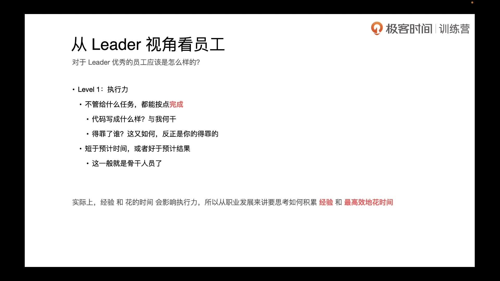

# 围炉夜话 | Leader眼里最有潜力的仔长什么样？

你好，我是杨文坚。

今天是“围炉夜话”环节的第二期，我们来玩一个视角切换，看看对 Leader 来说，优秀的员工应该是怎么样的？以及对员工来说，优秀的 Leader 应该是怎么样的？

要说明的是，这也是我基于自己的见闻和理解整理的，如果有不同观点，欢迎讨论。

视频中的主要内容，我也整理了文稿，供你参考。

### 对于 Leader 优秀的员工应该是怎么样的？

我认为可以分成 3 层。

- Level 1：执行力

- Level 2：推动能力

- Level 3：带队执行力

第一层执行力，不管给什么任务，都能按点完成，这一般就是⻣干人员了。实际上，经验和花的时间会影响执行力，所以从职业发展来讲，要思考如何积累经验和最高效地花时间。

经验是什么？其实很多人有误解，重复的不叫经验，叫重复利用经验，在解决问题中，互相不重复经历才叫经验。

有些经验是可复用的，有些经验是领域独有的，要区分看待。比如，CI 的原理和搭建方案是可复用经验，而某公司的 CI 如何使用，是领域独有经验。可复用经验学习所花的时间，都是为了自己。

怎么高效花时间？简单说就是，不是什么都加班，而是加有意义的班，换句话说应该思考，哪些事情需要在执行力上表现出超出预期，而不是所有。因为说实话，有些时候，凡事都超预期不一定好，你可能沦为救火员或“最低要求”，控制预期是一⻔学问。

第二层推动能力。如果符合执行力基本要求了，然后需要你能推动事情，因为 Leader 也想偷懒。推动的对象可能是：同工种员工、合作伙伴、上游，这时候要思考如何在不同的阶段去推动合作。

如果要推动同工种，要重点发展自己的影响力。其实你的职位是种影响力，但仅靠职位的影响力是最差的。

- 第一，你可以锻炼自己的分享能力，让学到的东⻄可以跟同工种分享，继而创造影响力，因为从演讲⻆度来看，让别人觉得有所得，要比一对一让对方觉得有所得要简单许多。

- 第二，你可以锻炼自己的技术能力，毕竟技术人员相轻，这时候技术能力会有一定的作用。

如果要推动合作伙伴，要重点发展自己的同理心。因为想推动合作伙伴，需要懂得对方做的事情，也需要能将自己专业度的东⻄用通俗的方式，或者用别人能理解的方式阐述。另外，体现出你的专业度也非常重要，能从专业度提出别人没想到的问题，并让对方理解。

如果要推动推动产品或业务，要重点理解他们的 KPI，产品或者业务的 KPI 是什么？到了这里，往往并非专业度问题，而是业务指标问题。不管黑猫白猫，抓到老鼠就是好猫。要思考如何从自己专业出发帮助对方提升 KPI，才能办成事。

第三层带队执行力。到这一层，自己有执行力，也有推动力，那么 Leader 给你几个人，你能否带队也有执行力呢？因为，简单说 Leader 也没空管那么多人，都是有管理半径的。

### 对于员工优秀的 Leader 是怎么样的？

我认为可以分成 3 层。

- Level 1：回报

- Level 2：态度

- Level 3：透明公开

第一层一般是看回报，只要我努力，跟你干有好果子吃，那就是好 Leader。第二层看态度，Leader 把员工看成是什么？是自己短期在公司完成业绩的工具，还是⻓期的资源。第三层看Leader 说的话，Leader 需要根据高层规划，进一步确定团队规划，在有些情况下，他是说能说的真话，还是把不能说的部分自己编一个理由。

通过员工和 Leader 的视角切换，相信你能看到自己所处的层次，以及想升到下一个层次需要培养的要素。

当然这都是我基于我自己的视角总结的，你的想法是什么呢？欢迎你留言讨论。
