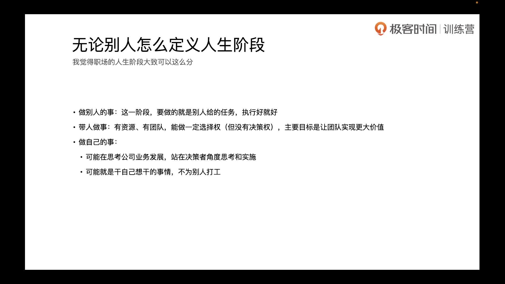

# 围炉夜话 | 你的职业起点和职业终点是什么？

你好，我是杨文坚。

今天是“围炉夜话”环节的第三期，我们聊一聊职业规划的事，正好在年底，也适合做一做今年复盘和规划，想想该怎么度过自己的职业生涯，为明年开个好头。

无论别人怎么定义人生阶段，我觉得，职场的人生阶段大致可以分成 3 层。

- 做别人的事：这一阶段，要做的就是别人给的任务，执行好就好。

- 带人做事：有资源、有团队，能做一定选择权（但没有决策权），主要目标是让团队实现更大价值。

- 做自己的事：一种可能在思考公司业务发展，站在决策者⻆度思考和实施；另一种可能就是干自己想干的事情，不为别人打工。

如果你认同我这种想法，那我就分享一下我自己是怎么干的，主要思考几个问题，具体讨论你可以看视频。

- 毕业开始就考虑，自己的职业终点是什么？为此要哪些条件？

- 看清自己和市场，我的核心竞争力是什么？现在哪个领域更有前景，核心业务原则是什么？

- 在这个领域，我要积累什么，放弃什么？技术能力、人力资源、人脉。

当然这也是我自己的想法，如果有不同观点，欢迎讨论。

明天就是除夕了，先预祝你节日快乐，身体健康！

这几年因为疫情原因，很多人可能都没好好过一个自在的春节了，相聚的时光最美好，这个春节，希望你能在亲朋好友的陪伴下愉快度过。我们就不安排学习任务了，节后再见。
