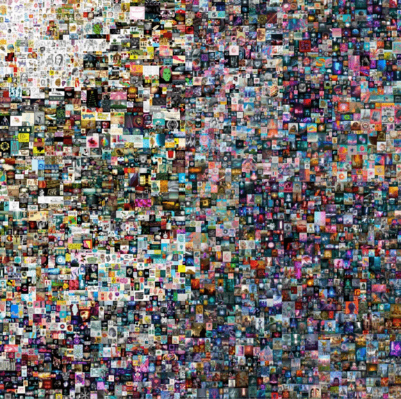
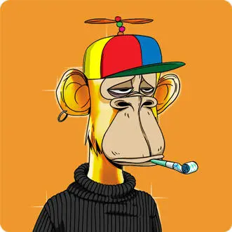

# 04-NFT（一）：数据确权及其文化和商业价值的发现

你好，我是郭大治。从这节课开始，我们就进入 Web 3.0 的应用层，一起来聊一个新话题：NFT。

为什么我第一个要跟你聊的是 NFT 呢？因为这是一个非常有意思的话题。NFT 反映的是虚拟世界里最基础、最底层的一个特性，NFT 不仅可以代表技术、艺术和金融等不同领域的基本元素，同时又能表达一些很主观的东西，所以我会专门用两节课的时间来讲它。

关于 NFT，有人说 NFT 代表着最新潮的加密艺术，也有人说 NFT 是拥有无限升值空间的黑马资产。那么，NFT 到底属于艺术还是属于资产？NFT 有哪些重要特性？还有，NFT 的这些重要特性，又是如何在 Web 3.0 的世界里实现价值的？

今天这节课，我们就追本溯源，从 NFT 的基本属性讲起，再针对 NFT 的重要特征及应用形式，来具体拆解分析一下，让你切身感受一下 NFT 为 Web 3.0 带来的无限可能！

好了，下面我们正式开始。

## NFT：数字社会的数据确权制度

本质上来说，NFT 是一种基于加密技术标准形成的数字资产，它的字面意思就是非同质化代币。

在以太坊生态，凡是基于 Erc-721 和 Erc-1155 两个标准生成的数字资产，都称为 NFT。相对于我们平时经常听到的同质化代币（也可以称为 FT），比如 BTC 或者 ETH 来说，虽然它们都属于虚拟资产，但是 NFT 有一个显著的特点，就是每个 NFT 都不可分割，所以每一个 NFT都具有唯一性。

基于 NFT，我们可以把虚拟世界的各种素材包括图片、文字、视频和动画甚至一段数据等进行标记，并和某个账户建立对应关系，建立对应关系之后，拥有账户的私钥就可以将归属于账户的 NFT 进行转账和交易，可以许可或者拒绝对于数据的访问，也就是拥有了该项 NFT 的控制权。

不过要知道，虚拟世界没有产权的概念，因为产权是一种来自第三方机构的认可，比如政府或者法院。在虚拟世界，控制权即产权，拥有了 NFT 的控制权就相当于完成了商品的确权，通过各种技术细节上的设置，NFT 的所有者可以获得转让及授权产生的相关收入，正是因为这样，NFT 也成为了数字社会数据确权的基本制度。

讲到这里，你可能会想问，讲了这么多 NFT，它和 Web 3.0 有什么联系呢？

你一定还记得，在第 1 讲里，我提到 Web 3.0 的主要功能就是通过“无需信任”的基础设施，提供可信的计算服务，按照这个标准来看，NFT 不正好就是 Web 3.0 在“资产确权”方面的一个典型案例吗？

NFT 可以为数字形式的创作提供确权服务，也就是说，如果我们想要通过自己设计的一个图片或者一篇文章赚钱，其实根本不需要申请专利、注册版权之类的操作，然后再根据版权产生的价值来获得收益，而是只需要将这些创作制作成 NFT，就可以通过 NFT 和智能合约的组合，实现类似现实世界中版权的各种商业模式。

甚至，我们还可以通过 NFT 低成本、永久产权、透明表达、可编程等特点，来创造更多传统产权制度没办法实现的新玩法。

我举个例子，你可能也听说过，一张普普通通的“小图片”，一旦制作成“数字藏品”或者 NFT，就变成了有人愿意用“真金白银”买单的 PFP，而且它们的价格还绝对超出我们的想象；再比如，作为数据确权制度的 NFT，为什么越来越受到各大品牌的青睐呢？现在 NFT 数字营销都已经成了一个最时尚和最热门的专业。

还有，NFT 的可编程性究竟有多大的想象空间？从 10000 张“无聊猿”的小图片，到建成“数字版迪士尼”，中间还有多少道路要走？

接下来，我就结合这些问题，一一给你讲解。

## 基于低成本及永久产权的文化发现

NFT 作为数据确权的基础制度，首要的特点是低成本和永久产权。

低成本体现在哪呢？

首先体现在制作成本方面，只要经过简单了解，你完全可以独立完成 NFT 作品的制作，这个过程在加密社区有一个专用名词，Mint，翻译过来就是“铸造”。

Mint 操作十分简单，只要你先完成图片设计，通过打开去中心化钱包，打开 Mint 网站简单设置，上传作品就完成 NFT 的“Mint”了，这里的作品可以是一个画作、图片，也可以是一个视频，甚至是一句话。

- NFT Mint流程图，以Opensea为例

而且，你在 NFT 的 Mint 过程中，只需要支付 Gas 费，无需其他任何费用。

其次是时间成本低，整个过程慢则几分钟，快则几秒钟，比起到版权局申请、公示，走完整个流程省了不知道多少时间。

另外，通过 Mint 的流程你也会发现，NFT 的制作过程完全是自助式的，无需任何机构或者个人帮助，你也不需要为了产权登记而四处奔波，不需要按照创作类别的不同，分别按照不同的流程进行登记，比如版权、商标等。NFT 的 Mint，你需要做的只是和区块链之间的互动，而且 NFT 支持的作品种类非常多，只要是以电子形式保存的作品都可以制做成 NFT。

除了低成本的优势之外，NFT 的另一个特点是永久产权。

不过讲到这里，你其实也会发现，在制作 NFT 的过程，无需任何机构或者个人参与这一点非常重要，因为只有这种方式获得的产权，才属于永久产权。

举个例子，你可能玩过《王者荣耀》，你花了很多的时间和金钱在游戏中获得了一颗“荣耀水晶”，但你如果要想向别人展示这颗水晶的话，你就必须进入这个游戏里面，才能实现你“炫富”的目的；并不是只有你没有能力，把这块水晶从游戏里面带出来给别人展示，而是说，一旦离开了游戏，这颗“水晶”可能根本就不存在了。

可以说，这颗“水晶”的命运就是整个 Web 2.0 世界的宿命，所有的资产和创作都需要借助于别人的“舞台”才能呈现，如果别人的“舞台”停止营业了，那么不管是谁的表演、也不管表演得多么精彩，也就只能消失了！

而你想保护你所创造的数据不被他人使用？这一点绝对是不可能的，因为数据保管在互联网公司的存储设备中，即使你本人想要调用自己创造的数据，流程和成本也非常高，关于数据的访问权限只能由互联网公司说了算。

但在 Web 3.0 的背景下，这种宿命已经被打破，就像 NFT 一样，只要不是所有节点同时退出网络，你的 NFT 就会存在；只要你掌握控制账户的私钥，NFT 就是属于你的，不管你想要交易还是送人，都不需要任何机构的帮助或者许可，这就是 NFT 的永久产权，这就是 Web 3.0的新范式！

所以，正是基于 NFT 永久产权的价值，艺术品特别是数字艺术品和 NFT 的结合，已经成为越来越多的艺术家和收藏者的共同选择。

2021 年 3 月，美国艺术家 Beeple 一幅 NFT 作品《每一天：前 5000 天》，就是将他每天一幅的 5000 幅画作合并制作成一个 NFT 作品，最终以将近 7000 万美元的高价在佳士得成交；甚至还有一名英国的艺术家 Banksy 将一幅价值 7 万英镑的艺术品《Morons》制作成了 NFT 作品，并通过全球直播的形式销毁了原作，以希望通过 NFT 的形式确保这幅作品的唯一性。

- Beeple（b.1981）《每一天：前5000天》，NFT（jpg），21，069 x 21，069像素

当然，拍出天价的艺术品确实可以赚足流量，但如果你认为 NFT 就是创造天价艺术品的造富机器，那你就错了。

因为在现实世界中，传统的版权保护制度和艺术品市场，完全可以为“天价”艺术品提供养分充足的土壤，而 NFT 的价值，洽洽在于可以为更多形式、更加碎片化，甚至是更加便宜的数字创作，提供确权、流通和价值发现的功能。

你可以试想一下，在艺术品市场，通过版权确权、画廊或者博物馆展览，以及拍卖行拍卖等等，这么长的一个链条支撑起来的艺术品，不是“天价”艺术品，也是远远超出普通人支付能力的艺术品，而且一定是只有极其少数的艺术家才具有完成这类创作的天赋。否则的话，艺术品销售产生的收入根本没法支撑整个行业运转，所以艺术品市场才成为“高高在上”的少数人的游乐场。

但是，对于 NFT 来说，完全不存在这样的问题，因为 NFT 的制作成本和销售成本非常之低，而且这个工具，就在每个人的身边，我们不需要任何专业机构的帮助，随时随地万物皆可NFT。所以，大量低价的艺术品就会在市场涌现，艺术品才能从“高高在上”的奢侈品，变成走进寻常人家的“消费品”。

所以，相对于传统的版权保护和艺术品流通机制来说，NFT 就是一套功能更强大，而且适应于几乎所有形式的数字创作的成本更低的挑战者。这个“挑战者”在物理世界，可以说基本上是毫无用武之地的，但是在数字世界，它却表现出非常明显的优势。

可以说，NFT 的意义，不仅在于为数字创作提供低廉而高效的确权功能，还在于对数字世界中的文化发现，发挥非常基础性和系统性的作用。

这里我还想再说一下，NFT 对于文化发现的功能，无论如何强调都不为过，就像造纸术和印刷术的推广在欧洲文艺复兴中发挥的积极作用一样，低成本的确权制度对于文化表达的权利，从社会精英的小圈子走向“普罗大众”发挥了重要的作用，而一旦“普罗大众”获得市场加持的文化表达的权利，就意味着整个社会不论在文化的传播渠道、传播形式，还是在传播内容以及价值诉求方面，都会发生全方位的变革，而这些变革，又必然加速人文思想的传播和社会层面的变迁。

就比如在中世纪的欧洲，只有“宫廷画师”或者专为贵族服务的画师，才可以凭借绘画这门手艺过上让人羡慕的生活，那么画师的创作一定是围绕皇家或者贵族的生活开展的。

而如果只需要简单的创作，却能因为获得大量的心理认同而变得流行起来的话，那么 meme也能成为流行商业元素。你要是感兴趣的话可以去了解一下 mfer，看看这个装在每个人心里的小混蛋是怎么变成流行文化的一部分的。

OK，了解了 NFT 的低成本和永久产权这两个特点之后，接下来，我就从它们的一个主要应用PFP 说起，让你了解一下迄今为止 NFT 最经典的原创商业模式是一个什么样的情况。

## PFP：从“小图片”到“身份表达”，再到社区筛选

NFT 自诞生以来，就一直在产品形态上进行各种各样的尝试。比如，有人将 NBA 球星的精彩瞬间制作成了 NFT 产品，然后就在市场上大获成功；还有人把一些实物艺术品、实物珠宝首饰等，制作成了数字形式的 NFT 藏品，也有许多获得成功的先例，前面提到的 Beeple 的《每一天，前 5000 天》就是例证。

但迄今为止，NFT 最大的发现是“小图片”，Picture for Proof，即 PFP。PFP 就是 JEPG 或者其他格式的小图片，但是小图片 Mint 成 NFT 之后，就变成了“身份的象征”，就变成了 2021年以来虚拟世界最火爆的一个商品品类。

下面，就让我们先来看看 CryptoPunks 这个 PFP 赛道的开创者，是如何为 PFP 闯出一片天空的吧。

2017 年，Larval Lab 的两位创始人通过算法生成 10000 张像素风格的图片，这些图片大小相同，但在肤色、五官、配饰或动作方面有所区别。之所以采用像素风格，一方面是创作者对于对于这种风格的喜欢，还有一方面的原因可能就在于，像素风格的构图相对简单，可以支持算法生成。

不过，他们在生成图片之后，并没有用来出售，而是让任何人都可以通过以太坊钱包免费申领，但在当时，愿意去免费申领的用户，绝对不是预测到，这些头像可以卖到像现在这样一个好价格，而是完全出于对各种加密产品的好奇而参与的，所以 5 年后的今天，持有CryptoPunk 的人才被打上加密社区 OG（有经验的老手）的标签。

进入 2021 年，加密市场进入了又一个繁荣的周期，尽管 CryptoPunk 不像 BTC 和 ETH 等 FT（同质化代币）一样可以在多个平台交易，但 Opensea 等 NFT 专业交易平台的出现，为它创造了一定的流动性，伴随着市场情绪的助推，CryptoPunk 成交价格迭创新高，在 2022 年 5月 22 日，苏富比将 CryptoPunk #7523 号以 1175 万美元成功拍出，也推动它的成交价格达到了一个新的高度。

- CryptoPunk #7523

同时，像 Visa 这样的机构都入手了一件 CryptoPunk，使得 CryptoPunk 成为凭借加密艺术，引领区块链应用向更大范围拓展的典型代表。

实际上，对于任何一个资产来说，在市场景气的大背景下，快速上涨的价格都是它最好的广告。但对资本市场稍有常识的人都知道，任何资产的价格都是有涨必有跌，CryptoPunk 的叙事始于对加密社区先行者的致敬，但投机心理带来的价格风险，也成为了它身上一个不可忽视的标签。

我们可以来假设一下，在未来，不管是谁花费了 2000 万美元购买一个 CryptoPunk 头像，我们都不会怀疑他对像素风格艺术品的热爱和欣赏，但我们也不会怀疑，他有把这个头像以更高的价格出售的强烈冲动。也许对冒险、对财富的追求，本身就是加密社区与生俱来的特质，这也算是 NFT 文化发现的一部分内容吧。

此外，NFT 除了通过价格方面的表现反映出市场的关注之外，其实也是收藏者主观心态的一种表达。

假如是你在拍卖会上花费 1200 万美元拍到了一件 CryptoPunk，你当然就获得了这件作品的所有权，你可以非常自然地把它换成你的头像，那么是不是其他人就不能用它作为头像呢？如果有人这样做了是不是就涉嫌侵犯你的私人财产呢？

当然不是，不仅是你，任何人都可以使用这个图片作为头像。当然，如果直接把完全一样的图片进行 Mint，然后再次销售，一定会受到 Opensea 这类平台的限制，不过除此之外，其他任何人在这张图片上的使用权几乎和你一样。

所以，这些事实都说明了，尽管你花费了 1200 万美金，但实际上你只买了一个链接，这个链接被打包在了以太坊的某个区块之中，说明你曾经花费一笔资金为你喜爱的“头像”付费。而如果别人也使用这个图片作为头像，一方面说明他也是喜欢这个头像，另一方面也说明他是在“借别人的装备耍酷”。

但无论如何，不管是花费 1200 万美金的你，还是一分钱没有花费的其他人，只要把这个图片用作自己的头像，就都是在对外界讲述着一段自己的经历和感受，这就是一种“身份”的表达。人们花在虚拟空间的时间越长，数字身份的价值就越高，甚至比现实生活中的 LV 和劳力士价值更高。

正如在现实生活中，如果佩戴劳力士会更容易获得某些人的信赖的话，在虚拟世界，使用一个经常被各种媒体曝光的头像，同样也会获得某种便利，比如有人把 Twitter 头像更换成CryptoPunk 之后，当天就有几百个人向他申请加为好友，这也算是 CryptoPunk 从单纯的个人自我表达向文化发现延伸的一个证明吧。

可以说，CryptoPunk 开创了 PFP 的方向，他的价格也充分体现了头部项目的效应。但价格涨得过快也带来了明显的副作用，高价格在事实上也拒绝了用户群体的扩张。所以，在CryptoPunk 之后，还涌现出了一大批 PFP 项目，而且从主题上来看更加多元。

比如，以一群已经拥有超级财富而整天在一个乡村俱乐部里闲逛为主题的 BAYC（BoredApe Yacht Club）；以猫为主题的 Cool Cats，以企鹅为主题的 Pudgy Penguins，以及以女性为主题的 World Of Women 等等。

- APE #8817

这些项目往往都在一个主题之下包括几千或者上万份作品，所有持有同一系列作品的人显然具有某种相似的文化诉求，如果把这些人群看成是一个 DAO（去中心化自治组织）的话，NFT就成为所有 DAO 成员共同拥有的一种文化标签，也成为在 DAO 成员中发挥凝聚作用的某种文化诱因，这种情况下，NFT 成为社区筛选的一种工具。

## 小结

这节课，我们主要针对 NFT 作为数据确权的基础制度，概括出了它的四个主要特点，分别是低成本、永久产权、透明表达，还有可编程。

其中，低成本和永久产权这两个特点，就使得 NFT 具有完全不同于已有版权制度的文化发现和价值发现功能，而且很可能会对流行文化和社会心理产生某种影响。但你也要知道，在当前的市场环境中，基于这些属性产生的 PFP，却面临着显著的价格风险，你需要高度关注。

在下节课，我们将针对 NFT 另外两个非常重要的特性，也就是透明表达和可编程进行讲解，还有关于 NFT 玩法的更多种可能，我们不见不散。

## 思考题

如果你有机会为自己挑选一个 PFP，你会关注哪些因素？欢迎在留言区分享你的答案，也欢迎你把今天的内容分享给更多的朋友。
