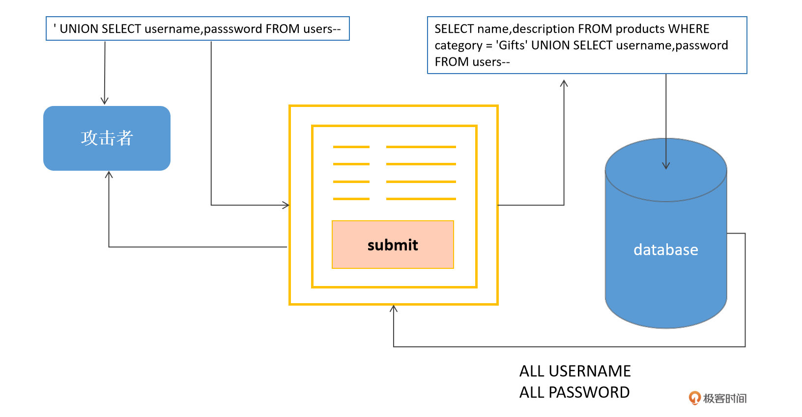
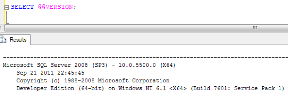

# 12 | 注入（上）：SQL注入起手式

你好，我是王昊天。

从这节课开始，我们就进入了排名第三的风险种类——注入。

这是在上一份 OWASP TOP 10 榜单中排名第一的风险种类，同时也是在过去十年中最具威慑力的漏洞类型之一，关于这类安全风险出现了许多重大的漏洞，同时也有众多著名的安全工具致力于解决这类问题，其中最著名的安全工具之一就是 sqlmap，作为 SQL 注入领域优秀的自动化检测工具，我们也会在之后的课程中深入探究。

那么什么是注入呢？

在著名的西游世界，就有许多次战斗生动地诠释了注入的威力，而这位善用注入的战斗大师就是我们勇敢机智的齐天大圣——孙悟空。在《西游记》中，孙悟空一共六次通过钻入敌人肚子的方式取得战斗的胜利。

## 注入

孙悟空的行为堪称注入攻击的典范，那么安全领域的注入攻击又是什么呢？

从抽象定义来说，注入攻击的本质是数据段与指令段的混淆，攻击者在原本应该作为数据段的输入中插入了恶意指令，同时将该恶意指令作为代码执行。正如孙悟空的战斗一般，妖怪肚子原本是消化食物用的，但却让孙悟空潜入其中，并且大显神威。

事实上，注入包含很多种类型，比如 SQL 注入、命令注入、XSS、资源注入等，其中 SQL 注入是最具代表性也是极为危险的一类漏洞，这一讲我们就从 SQL 注入入手来展开探讨。

### 查询过程与 SQL 注入



提到注入，就不得不提到查询过程。

以最常见的 SQL 注入为例，这类安全风险，就是将不可信的用户输入与 SQL 查询语句拼接产生的。事实上，SQL 注入是 Web 安全领域最危险的漏洞种类之一，一方面 SQL 注入漏洞的利用过程比较简单，另一方面 SQL 注入漏洞可能导致数据库失窃、数据被篡改及清除等安全风险。在更严重的情况下，SQL 注入可以通过应用程序传递恶意命令，控制托管数据库的操作系统，并以此为跳点成功进入内网。

### SQL 注入的危害

接下来我们来看一看 SQL 注入会产生哪些危害。

首先，SQL 注入可能会导致数据的泄露。我们以一个电商系统为例，看看这个过程是怎么发生的。

在一个电商系统中，我们都会有一个个人信息页面用于编辑、展示和存储我们的相关信息，通常的 URL 地址如下：

```
https://example.com/user_info?username=talentsec
```

在这种场景下，我们可以选择使用这种 SQL 语句来实现相应功能：

```sql
SELECT * FROM users WHERE username = 'talentsec';
```

这里我们可以展开做一下思考，如果 SQL 语句变为如下格式，是否随着 id 的数值变化可以取得不同的数据呢？很明显是可以的。

```sql
SELECT * FROM users WHERE username = 'talentsec' or id = '1';
我们只需要尝试去修改 username 参数，将其设置为talentsec' or id = '1即可实现上
```

述攻击过程。

进一步地设想一种更复杂的场景，在这种场景下 SQL 语句不只有一个条件，除了用户名，还增加了账户活跃这一条件。

```sql
SELECT * FROM users WHERE username = 'talentsec' and account_status = 'alive';
```

因为 SQL 语句变得更加复杂了，如果我们还用之前的方式攻击，就会破坏语句完整性，导致攻击无法顺利进行：

```sql
SELECT * FROM users WHERE username = 'talentsec' or id = '1' and account_status =
为了保证 SQL 语句的完整性，我们可以通过增加--注释符，让 SQL 语句重新恢复为合法格
式，保证攻击能够顺利执行。调整后，username 参数被设置为talentsec' or id = '1'
; -- and account_status = 'alive。 最终目的语句构造如下：
SELECT * FROM users WHERE username = 'talentsec' or id = '1' ; -- and account_sta
```

可以发现，由于 SQL 注入漏洞的存在，攻击者可以通过调整参数内容，获取到本不应该访问到的数据，这就会造成业务系统关键数据的泄露。

除了会造成数据泄露外，SQL 注入漏洞还可能修改程序的执行逻辑。

这个过程我们将在登录场景下复现。正常的 Web 应用系统都会具备登录功能，通过将用户输入的用户名及密码传入后端，程序可以在后端匹配账户信息来验证正确性，其中一种 SQL 语句实现方式如下：

```sql
SELECT * FROM users WHERE username = 'talentsec' and password = 'TALENTSEC';
```

如果该查询能够返回结果，则说明登录成功，否则说明登录失败。一名恶意的攻击者，可以构造如下 SQL 语句使其绕过登录限制，也就是说，攻击者可以在仅知道用户名的情况下，成功完成登录：

```sql
SELECT * FROM users WHERE username = 'talentsec';--' and password = 'test';
可以看到，在这次攻击中攻击者所使用的用户名是talentsec';--，密码是test。虽然真
实密码并不是test，但攻击者却成功登录了talentsec账户。
```

SQL 注入的危害是巨大的，其攻击过程也较为复杂，接下来我们就来进一步探讨如何发现以及实施 SQL 注入攻击。

## SQL 注入实战技法

### 漏洞发现

知道吗，对于 SQL 注入漏洞来说，最难的一点其实是发现漏洞，而非利用漏洞。因为正如我们前面讨论的，SQL 注入漏洞的利用过程相对简单，只要能够发现漏洞，利用不是问题。

为了更准确地发现 SQL 注入漏洞，我们需要了解，应用程序在什么时候会与数据库通信。这里，我给你提供两点参考。

你首先需要关注的是，通过表单提交认证的过程。这一过程会将用户输入的凭据发送到应用程序后端，并与数据库中存储的凭据进行比对。另外，一些管理后台和 CMS 系统，通过用户传入的参数针对性查询数据的时候，也需要我们特别关注。

一名优秀的攻击者需要对应用系统的接口参数有全面的了解，这些参数包括 POST 请求中隐藏的字段，也包括 HTTP Header 和 Cookie。接下来，攻击者需要对每个参数进行针对性的攻

```
击尝试，并观测系统结果。通常，最初的攻击尝试由'和;组成，这两个字符分别用于闭合字
```

符串以及 SQL 查询语句。如果存在 SQL 注入漏洞，这两个字符的输入很有可能会触发系统报

```
错。除此以外，一些注释符（--和/**/等）以及 SQL 关键字（AND和OR等）同样也可以被
```

用来检测 SQL 注入漏洞点。

值得一提的是，虽然我们常常通过观测系统报错的方法来判断 SQL 注入漏洞点，但是并非所

```
有 SQL 注入漏洞都会触发显性的系统报错。许多时候我们也会遇见500 Server Error或
```

者系统的自定义报错界面，这时我们就需要考虑使用盲注或是其他攻击方式。

SQL 注入漏洞作为一个漏洞大类，利用方式是比较多的，这使得它看起来有些复杂。但是，这类漏洞的利用过程见得多了，就会发现它们其实有相似的套路，借用《卖油翁》中的话说就是“无他，唯手熟尔”。

我们仍以经典的 SQL 查询语句为例：

```sql
SELECT * FROM users WHERE username='$username' AND password='$password';
```

我们对 username 和 password 构造一种特殊的输入：

```
$username = 1' or '1' = '1
$password = 1' or '1' = '1
```

代入参数后，SQL 查询语句变成：

```sql
SELECT * FROM users WHERE username='1' or '1' = '1' AND password='1' or '1' = '1'
可以发现，在上述 SQL 语句中，不管or和AND操作符谁的优先级高，WHERE语句的条件都是
```

永远为真的，因此我们可以通过这个操作，实现认证过程的绕过。

接下来，我们对原始 SQL 语句进行一次升级，这种升级后的语句也是非常常见的：

```sql
SELECT count(*) FROM users WHERE ((username='$username') AND (password=MD5('$pass
```

可以看到，这次升级一方面在 username 部分新增了括号，另一方面在处理 password 时，选择了 MD5 散列结果进行比较，最后又统计了查询结果的数量，经过升级之后，上一次的构造就无法生效了。

这时，如果我们想要构造新的参数完成 SQL 注入，就要解决三个问题，第一是括号的闭合，第二是 password 部分的比对，第三是要确保查询数量为 1。于是我们构造如下输入：

```
$username = 1' or '1' = '1')) LIMIT 1 --
$password = test
```

将参数代入后查询语句变成：

```sql
SELECT count(*) FROM users WHERE ((username='1' or '1' = '1')) LIMIT 1 --') AND (
```

可以发现上述 SQL 语句实现了括号的闭合、忽略了 password 判断部分，并且限制结果数量为 1，这段语句同时满足了 3 个限制条件，成功实现了 SQL 注入攻击。

```
在基本起手式阶段，除了这种使用'来进行注入探测的方式以外，我们还可以使用AND符号来
```

判断参数是否可以被当做运算符参与代码执行。以常见的 CMS 类型系统为例，常见的帖子链接如下：

```
https://example.com/article.php?id=1
在已知【id=1 帖子】存在的情况下，我们可以将 id 参数设置为1 AND 1=0，并且和 SQL 语
```

句完成拼接：

```sql
SELECT * from articles WHERE article_id = 1 AND 1=0;
如果该页面无法显示内容，就说明1 AND 1=0中后半部分的 False 结果参与了运算，依此可
```

以判断 SQL 注入漏洞的存在。

### 数据库信息

通过起手式阶段的基本动作，我们可以发现 SQL 注入漏洞是否存在。

在成功发现 SQL 注入漏洞之后，为了给后续更高级的注入动作做好铺垫，我们需要进入一个新的阶段–获取数据库信息。而之所以展开讲述这部分的主要原因是，虽然 SQL 语句是相对标准化的，但是每种 DBMS 在特殊指令、获取数据操作等方面都会有一些差异，因此在实际SQL 注入过程中我们需要考虑到数据库差异使用不同的语法。

如果我们想要判断一个后端数据库的类型，让这个数据库报错是一个快速的方法。这里我们列举几种常见的错误信息，可以发现 MySQL、MS SQL Server、PostgreSQL 的报错信息都有比较明显的特征：

```
You have an error in your SQL syntax; check the manual
that corresponds to your MySQL server version ...
Microsoft SQL Native Client error ...
Query failed: ERROR: syntax error at or near ...
```

事实上，对于不同类型的数据库，获取其数据库种类和版本号的 SQL 语句也会有一些差异：

```sql
SELECT @@version; -- Microsoft, MySQL
SELECT * FROM v$version; -- Oracle
SELECT version(); -- PostgreSQL
```



除了数据库类型和版本信息，还有哪些信息是攻击者想知道的呢？我们只要想想后面注入过程需要哪些信息，答案就不辩自明了，其实，就是数据库中包含的表，和每张表的结构信息。令人欣慰的是，数据库中有一张表存储了这些信息，这张表是 information_schema。通过如下SQL 语句可以查询出数据库中有哪些表以及每张表的结构：

```sql
SELECT * FROM information_schema.tables;
SELECT * FROM information_schema.columns WHERE table_name = 'users';
SELECT * FROM all_tables; -- For Oracle
SELECT * FROM all_tab_columns WHERE table_name = 'USERS'; -- For Oracle
```

## 总结

这节课我们进入了第三大风险种类——注入。

作为上一份榜单中排名第一的安全风险，其威力不可小觑。在 Web 业务系统中，注入普遍以SQL 注入形式存在，而 SQL 注入又与查询过程密不可分。通过利用 SQL 注入漏洞，不仅可以造成数据泄露、数据删除等后果，甚至可能使数据库服务器执行任意命令，进而导致整个内网的沦陷。

从技术角度来看，SQL 注入的影响主要是两个方面，一方面是影响数据查询逻辑，使得攻击者能够越权访问数据库数据，另一方面是通过篡改数据查询逻辑进而修改 SQL 语句执行过程。

事实上，SQL 注入漏洞虽然威力巨大，而且利用过程相对复杂，但是难度并不高。其难点主要在于如何发现 SQL 注入点，以及如何找到正确的利用方式。

关于如何发现 SQL 注入点，我向你介绍了一种有效的方法，那就是，在了解应用系统的完整接口以及接收的参数清单后，有针对性地逐一进行注入点排查。比较经典的注入点验证方案

```
有'和;，以及AND和OR等 。
```

在确定正确的利用方式上，SQL 注入虽然招式繁多，但是却有着完整的体系和套路，熟练掌

```
握之后完全可以“一招鲜吃遍天”。起手式阶段最主要的组合拳就是AND和OR、'和-- ，第一
```

招打完之后，为了给高级招式做铺垫，我们要学习下一招–知己知彼，通过利用information_schema 获取数据库中包含的表以及对应的表结构。

截止到目前，你已经掌握了初级 SQL 注入功力，能够在简单的场景下完成 SQL 注入攻击同时掌握数据库的结构。下节课我们一起来学习高级招式，包括 UNION 注入、BOOLEAN 注入、时间盲注、DNS 带外注入等多种攻击变种。

## 思考

你可以尝试使用 MiTuan 靶场中的 Sqlilabs 完成基本的起手式和知己知彼这两招吗？

期待你的动手实践，也欢迎你把这节课分享给有需要的朋友，我们下节课再见！
