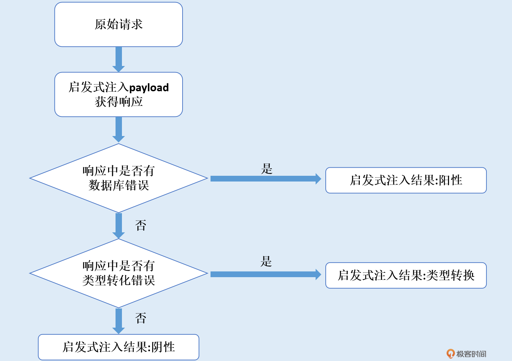

# 17 | 自动化注入神器（四）：sqlmap的核心功能解析

你好，我是王昊天。

在上节课中，我们重点学习了 sqlmap 中一个非常重要的算法——页面相似度算法。相信你对页面相似度这个概念会有更加清晰的认知，不但知道它是什么含义，而且知道它是如何计算出来的。解决了这个大难点之后，我在上节课的结尾提出了一个空连接检测功能，有了它，sqlmap 就可以大大提高执行效率。完成了检测，sqlmap 就进入到实际的 SQL 注入测试阶段了。

在 SQL 注入测试阶段，系统首先会检测有哪些注入点，然后对这些注入点逐一发送合适的payload，检测注入是否成功。如果注入成功，那么系统会将注入点存储下来，最后对它们进行输出。

这节课，我们就来正式学习 sqlmap 的 SQL 注入测试过程。

## 注入点检测

在 SQL 正式注入测试之前，sqlmap 会对每个目标的参数进行过滤。将那些非动态的，不存在注入可能的参数剔除掉，留下可能的注入点。这样 sqlmap 仅需要对这些可能的注入点进行正式的注入测试即可。

### 动态参数检测

我们首先来看 sqlmap 是如何检测动态参数的。这部分代码依旧在 start 函数中，紧接着空连接检测出现。

```
# sqlmap首先对所有可用于注入测试的参数进行简单的优先级排序。
  parameters = list(conf.parameters.keys())
# 定义测试列表的顺序。（从后到前）
  orderList = (PLACE.CUSTOM_POST, PLACE.CUSTOM_HEADER, PLACE.URI, PLACE.POST, PL
# 对测试参数排好序之后，系统开始对参数进行过滤操作。
  proceed = True
  for place in parameters:
      skip = # ...
      if skip:
          continue
      if place not in conf.paramDict:
          continue
      paramDict = conf.paramDict[place]
      paramType = conf.method if conf.method not in (None, HTTPMETHOD.GET, HTTPM
# ...
      for parameter, value in paramDict.items():
          if not proceed:
              break
# 经过过滤，将该参数加入到测试过的参数中，防止重复测试。
          kb.testedParams.add(paramKey)
```

我们可以结合代码中的注释，来理解参数的过滤。首先 sqlmap 会对待测参数进行一个优先级排序。在排序完成之后，系统会根据用户的配置信息，对这些参数进行过滤操作。这里我举一个例子来让你更加容易理解这一步骤。例如，当用户配置的检测 level 小于 2 时，那么系统就会跳过对 cookie 参数的检测过程。

过滤完成之后，我们就会进入到你最熟悉的一步——SQL 注入测试过程。让我们结合代码，分析 sqlmap 是如何进行 SQL 注入测试的。

```
if testSqlInj:
# 开始注入测试
   try:
# ...
# 进入启发式注入测试。
       check = heuristicCheckSqlInjection(place, parameter)
# 当启发式注入测试失败，就跳过该参数。
       if check != HEURISTIC_TEST.POSITIVE:
           if conf.smart or (kb.ignoreCasted and check == HEURISTIC_TEST.CASTED)
# ...
              continue
# ...
# 通过启发式注入测试后，就会进入到SQL注入测试阶段。
       injection = checkSqlInjection(place, parameter, value)
```

### 启发式注入测试

如果一个参数被检测为注入点，那我们就可以对它进行注入测试。为了提高注入测试的效率，系统会过滤一些注入成功率较低的注入点，这需要首先对它进行一个启发式注入测试。下面让我们结合代码，对启发式注入测试有个更具体的理解。

```python
def heuristicCheckSqlInjection(place, parameter):
# 如果配置中设置了跳过启发式注入测试，就返回结果None，当使用者没有特殊配置conf.start这个配置项
   if conf.skipHeuristics:
       return None
# 初始化参数，并根据用户设置的偏好制作payload。
   origValue = conf.paramDict[place][parameter]
   paramType = conf.method if conf.method not in (None, HTTPMETHOD.GET, HTTPMETH
   prefix = ""
   suffix = ""
   randStr = ""
   if conf.prefix or conf.suffix:
       if conf.prefix:
           prefix = conf.prefix
       if conf.suffix:
           suffix = conf.suffix
   while randStr.count('\'') != 1 or randStr.count('\"') != 1:
       randStr = randomStr(length=10, alphabet=HEURISTIC_CHECK_ALPHABET)
   kb.heuristicMode = True
   payload = "%s%s%s" % (prefix, randStr, suffix)
   payload = agent.payload(place, parameter, newValue=payload)
# 利用payload 请求目标页面的响应内容。
   page, _, _ = Request.queryPage(payload, place, content=True, raise404=False)
   kb.heuristicPage = page
kb.heuristicMode = False
系统首先会判断，用户是否设置跳过启发式注入测试，如果设置了，则返回None。如果没有
设置，那么系统就会获取到用户设置的偏好prefix以及suffix，然后据此构造出合适的
payload，并发送给目标，获取到响应内容page。
# 检测请求目标的响应中是否有数据库错误。
  parseFilePaths(page)
  result = wasLastResponseDBMSError()
  infoMsg = "heuristic (basic) test shows that %sparameter '%s' might " % ("%s "
# 检测page中是否有。
  def _(page):
      return any(_ in (page or "") for _ in FORMAT_EXCEPTION_STRINGS)
  casting = _(page) and not _(kb.originalPage)
```

系统会根据获取到的内容，判断其中的报错信息。其中，如果为数据库报错信息，那么

```
result的值为True。如果是设置在
sqlmap/lib/core/settings.py文件中FORMAT_EXCEPTION_SRTINGS配置项中定义的
类型转化错误信息，那么就会用casting来储存错误内容。
#     ...
# 当存在定义的问题时，发出报错信息。
   if casting:
       errMsg = "possible %s casting detected (e.g. '" % ("integer" if origValue
       platform = conf.url.split('.')[-1].lower()
       if platform == WEB_PLATFORM.ASP:
           errMsg += "%s=CInt(request.querystring(\"%s\"))" % (parameter, parame
       elif platform == WEB_PLATFORM.ASPX:
           errMsg += "int.TryParse(Request.QueryString[\"%s\"], out %s)" % (para
       elif platform == WEB_PLATFORM.JSP:
           errMsg += "%s=Integer.parseInt(request.getParameter(\"%s\"))" % (para
       else:
           errMsg += "$%s=intval($_REQUEST[\"%s\"])" % (parameter, parameter)
       errMsg += "') at the back-end web application"
       logger.error(errMsg)
       if kb.ignoreCasted is None:
           message = "do you want to skip those kind of cases (and save scanning
           kb.ignoreCasted = readInput(message, default='Y' if conf.multipleTarg
# 当数据库报错时，判断出注入漏洞很可能存在。
   elif result:
       infoMsg += "be injectable"
       if Backend.getErrorParsedDBMSes():
           infoMsg += " (possible DBMS: '%s')" % Format.getErrorParsedDBMSes()
       logger.info(infoMsg)
# 否则判定为不存在注入漏洞。
   else:
       infoMsg += "not be injectable"
       logger.warn(infoMsg)
   kb.heuristicMode = True
   kb.disableHtmlDecoding = True
最后，函数会根据casting以及result中的内容进行输出。我在这里画了一个它的流程图，
```

帮助你对它的作用进行理解。



图中启发式注入结果分为三种，其中阳性代表该参数大概率可以注入，类型转换和阴性都代表了该参数大概率不可以注入。我们会发现，想要判断是否可以注入，只需要判断有无数据库报错信息就可以了，有的话就认为该参数可注入，否则就认为不可注入。

除了进行启发式 SQL 注入检测之外，sqlmap 还会做一些不属于它的工作，包括进行简单的xss 检测和文件包含检测。

```
# 更换payload，检测xss以及文件包含。
randStr1, randStr2 = randomStr(NON_SQLI_CHECK_PREFIX_SUFFIX_LENGTH), randomStr(NO
value = "%s%s%s" % (randStr1, DUMMY_NON_SQLI_CHECK_APPENDIX, randStr2)
payload = "%s%s%s" % (prefix, "'%s" % value, suffix)
payload = agent.payload(place, parameter, newValue=payload)
page, _, _ = Request.queryPage(payload, place, content=True, raise404=False)
paramType = conf.method if conf.method not in (None, HTTPMETHOD.GET, HTTPMETHOD.P
# 进行xss检测。
if value.upper() in (page or "").upper():
   infoMsg = "heuristic (XSS) test shows that %sparameter '%s' might be vulnerab
   logger.info(infoMsg)
   if conf.beep:
       beep()
# 进行文件包含检测。
for match in re.finditer(FI_ERROR_REGEX, page or ""):
   if randStr1.lower() in match.group(0).lower():
       infoMsg = "heuristic (FI) test shows that %sparameter '%s' might be vulne
       logger.info(infoMsg)
       if conf.beep:
           beep()
       break
kb.disableHtmlDecoding = False
kb.heuristicMode = False
return kb.heuristicTest
最终的检测结果都会在全局变量kb中保存起来，这个全局变量我们在之前的课程中学习过。
```

到此，启发式注入检测的函数已经完成，接下来会进入真正的 SQL 注入检测，这是 sqlmap最核心的功能，没有之一！

## checkSqlInjection 函数

sqlmap 对启发式注入的检测结果进行简单地判断后，程序就会进入 sqlmap 最核心的函数checkSqlInjection 中。这个函数用于实现注入检测的核心功能，包括布尔注入、联合注入、报错注入、堆注入等检测。

下面让我们观察它的代码来理解这个注入检测功能。

```python
def checkSqlInjection(place, parameter, value):
# 根据参数的类型选择 boundary 。
   injection = InjectionDict()
   threadData = getCurrentThreadData()
   if isDigit(value):
       kb.cache.intBoundaries = kb.cache.intBoundaries or sorted(copy.deepcopy(c
       boundaries = kb.cache.intBoundaries
   elif value.isalpha():
       kb.cache.alphaBoundaries = kb.cache.alphaBoundaries or sorted(copy.deepco
       boundaries = kb.cache.alphaBoundaries
   else:
       boundaries = conf.boundaries
```

这个函数首先会判断参数的类型，然后根据参数的不同类型设置合适的闭合方式。解决完寻找注入点以及闭合参数这个问题后，下面让我们进入到 payload 的选择中。

我们知道，payload 的选择和数据库的类型有很大的关系，所以 sqlmap 在构造 payload 前，会先尝试探测目标数据库的类型。

```
# 判断是否配置数据库类型。
if conf.dbms is None:
# 探测目标数据库类型。
   if not injection.dbms and PAYLOAD.TECHNIQUE.BOOLEAN in injection.data:
       if not Backend.getIdentifiedDbms() and kb.heuristicDbms is None and not k
           kb.heuristicDbms = heuristicCheckDbms(injection)
# 根据探测结果输出提示信息。
   if kb.reduceTests is None and not conf.testFilter and (intersect(Backend.getE
       msg = "it looks like the back-end DBMS is '%s'. " % (Format.getErrorParse
       msg += "Do you want to skip test payloads specific for other DBMSes? [Y/n
       kb.reduceTests = (Backend.getErrorParsedDBMSes() or [kb.heuristicDbms]) i
```

如果用户在配置中指定了目标数据库的类型，那么就无需探测，用指定类型即可。否则需要用

```
heuristicCheckDbms(injection)函数来判断目标数据库类型。它的判断方法是，发送
```

一些 payload 给测试目标，然后根据获得的响应判断数据库的类型。

判断出目标数据库的类型之后，系统会根据获得的数据库类型以及用户的配置，挑选适合的测试用例，然后根据这些测试用例以及之前配置的 boundary，构造适合的 payload。

```
# 配置联合查询的信息。
if stype == PAYLOAD.TECHNIQUE.UNION:
   configUnion(test.request.char)
   if "[CHAR]" in title:
       if conf.uChar is None:
           continue
       else:
           title = title.replace("[CHAR]", conf.uChar)
# ...
# 用户指定了测试方法的配置。
if conf.technique and isinstance(conf.technique, list) and stype not in conf.tech
   debugMsg = "skipping test '%s' because user " % title
   debugMsg += "specified testing of only "
   debugMsg += "%s techniques" % " & ".join(PAYLOAD.SQLINJECTION[_] for _ in con
   logger.debug(debugMsg)
   continue
# ...
# 根据指定的数据库以及用户的配置信息，对payload进行筛选。
if conf.technique and isinstance(conf.technique, list) and stype not in conf.tech
   debugMsg = "skipping test '%s' because user " % title
   debugMsg += "specified testing of only "
   debugMsg += "%s techniques" % " & ".join(PAYLOAD.SQLINJECTION[_] for _ in con
   logger.debug(debugMsg)
   continue
# ...
# 对payload去重。
if fstPayload:
   boundPayload = agent.prefixQuery(fstPayload, prefix, where, clause)
   boundPayload = agent.suffixQuery(boundPayload, comment, suffix, where)
   reqPayload = agent.payload(place, parameter, newValue=boundPayload, where=whe
```

sqlmap 准备完 payload 之后，就到了你最期待的注入测试环节，这个过程和我们手动测试类似，系统会使用不同的注入测试方法，包括布尔注入、报错注入、时延注入以及联合注入。

```python
# 布尔注入
if method == PAYLOAD.METHOD.COMPARISON:
   def genCmpPayload():
       sndPayload = agent.cleanupPayload(test.response.comparison, origValue=val
# ...
# 报错注入
elif method == PAYLOAD.METHOD.GREP:
   try:
       page, headers, _ = Request.queryPage(reqPayload, place, content=True, rai
       output = extractRegexResult(check, page, re.DOTALL | re.IGNORECASE)
       output = output or extractRegexResult(check, threadData.lastHTTPError[2]
# ...
# 时延注入
elif method == PAYLOAD.METHOD.TIME:
   trueResult = Request.queryPage(reqPayload, place, timeBasedCompare=True, rais
   trueCode = threadData.lastCode
# ...
# 联合注入
elif method == PAYLOAD.METHOD.UNION:
   configUnion(test.request.char, test.request.columns)
```

做完这些注入测试后，系统会收到响应。我们平时会通过观察响应来判断注入是否成功，但是系统要如何判断呢？聪明的你或许想到了，这就是之前我们学习的页面相似度，我们在学习sqlmap 判断 waf 时就用到了它。其实，根据注入方式的不同，sqlmap 对于注入结果的判断方式也是不同的。

在报错注入中，系统会通过对页面的响应结果进行正则匹配，判断响应中是否有报错信息，如果有就判断注入成功，否则判断注入失败。

```
# 报错注入判断注入是否成功。
page, headers, _ = Request.queryPage(reqPayload, place, content=True, raise404=Fa
output = extractRegexResult(check, page, re.DOTALL | re.IGNORECASE)
output = output or extractRegexResult(check, threadData.lastHTTPError[2] if wasLa
# ...
injectable = True
```

在布尔注入中，系统会判断返回页面的相似度，如果结果为假，那么说明系统会根据错误结果进行不同的响应，这就意味着布尔注入是成功的。

```
falseResult = Request.queryPage(genCmpPayload(), place, raise404=False)
if not falseResult:
   # ...
   injectable = True
在时延注入中，sqlmap 会发送sleep([random])的请求，判断请求时间是否大于“平均时间
```

+7* 标准差”，注意这里的标准差是一个时间阈值，如果大于就认为存在时延注入。

```
if trueResult:
   if SLEEP_TIME_MARKER in reqPayload:
       falseResult = Request.queryPage(reqPayload.replace(SLEEP_TIME_MARKER, "0"
       if falseResult:
           continue
# ...
       injectable = True
```

在联合注入中，系统会通过 unionTest 函数来判断联合注入是否存在。它的实现原理比较复杂，我们可以将它简化一下，只需要比较联合注入得到的响应和原本内容是否一致，就可以做出判断，如果不一致，则说明存在联合注入问题。

```
reqPayload, vector = unionTest(comment, place, parameter, value, prefix, suffix)
if isinstance(reqPayload, six.string_types):
   infoMsg = "%sparameter '%s' is '%s' injectable" % ("%s " % paramType if param
   logger.info(infoMsg)
   injectable = True
```

最后系统将结果记录下来，并且输出给使用者，这就是我们在使用 sqlmap 时看到的结果信息。

至此，经过四讲的学习，我们终于学完了这款自动化注入测试神器，希望你可以了解 sqlmap的底层原理，从而更好的使用这款工具。

## 总结

在这节课里，我们深入研究了 sqlmap 的真正 SQL 注入过程。为了你能更好的理解，我们主要通过观察它的源代码对它进行学习。

在这个过程中，我们首先学习了 sqlmap 对于注入点的检测，其中包括了动态参数的检测以及启发式注入测试。在实际注入测试的过程中，我们只会对通过检测的参数进行注入的探测。通过这个过程筛选参数，可以提高 sqlmap 的运行效率。

最后我们进入到最重要的一步中，即真正的注入测试，我们了解了它的测试过程。其中有payload 的配置、对目标数据库信息的探测、筛选合适的 payload 以及实际的注入测试过程。完成测试，系统会根据页面相似度来判断注入结果，而对于不同的注入方式，sqlmap 的判断方式也是不同的。我们将联合注入、报错注入、时延注入以及布尔注入的判断方法一一展开，对它们分别进行了介绍。

截止到目前，你已经完成了对 SQL 注入原理、攻击方式、防御方案以及自动化注入工具sqlmap 的学习，结合对 sqlmap 原理的学习，快去自己尝试一下自动化注入的威力吧！

## 思考

sqlmap 在实现中有什么值得改进的地方吗？

欢迎在评论区留下你的思考，我们下节课再见。
