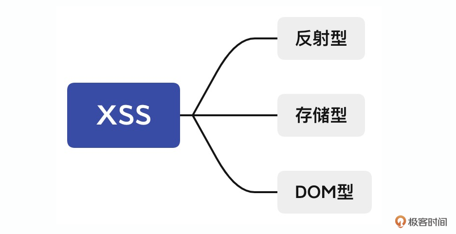
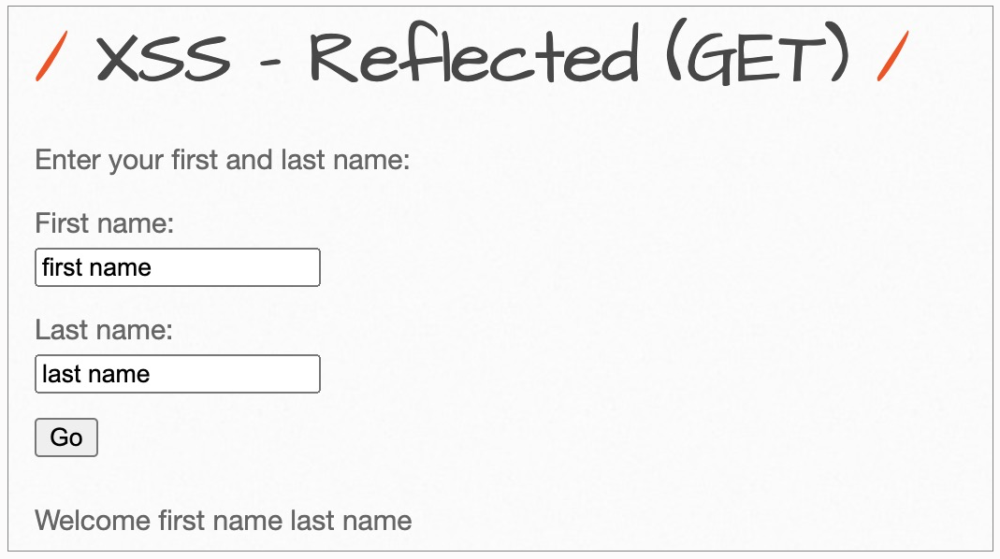
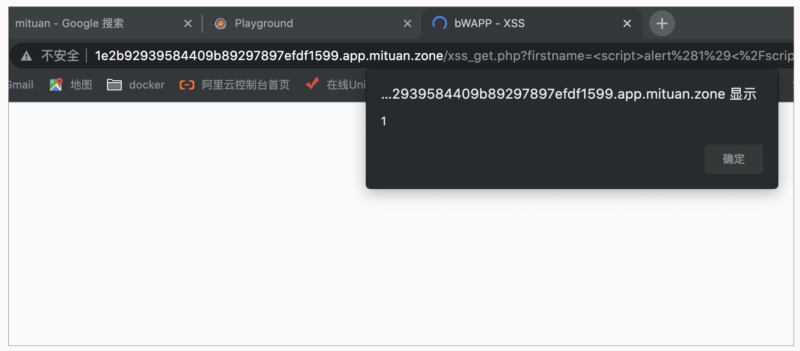
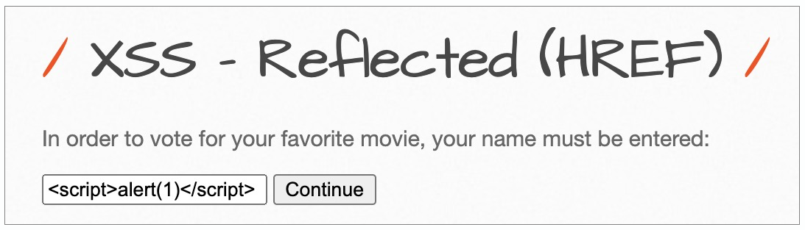
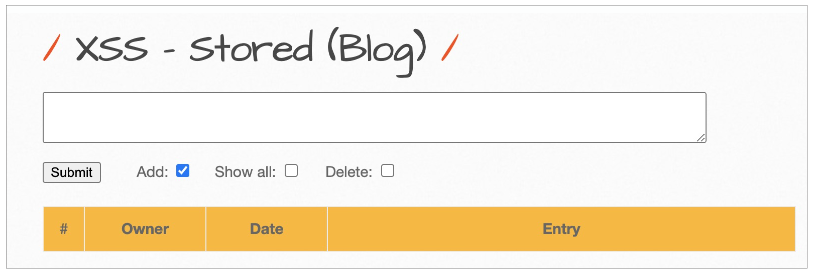
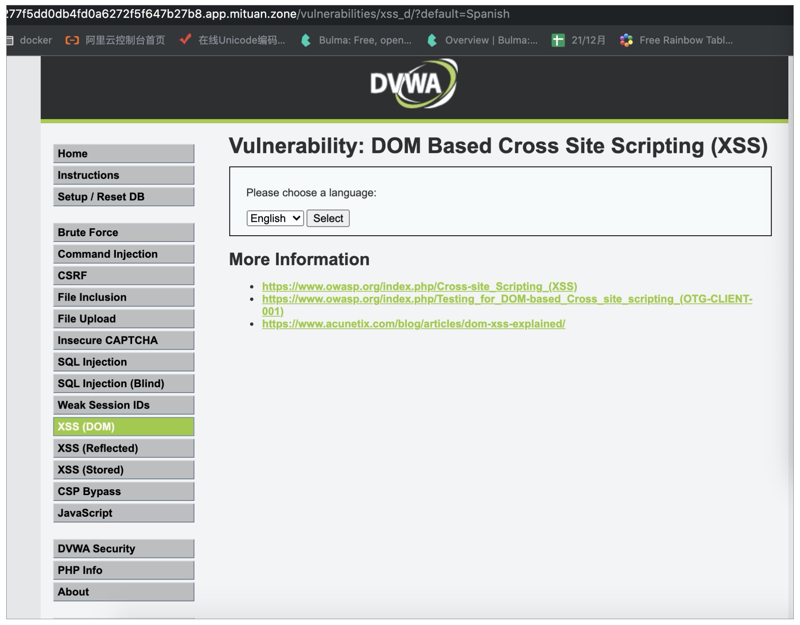
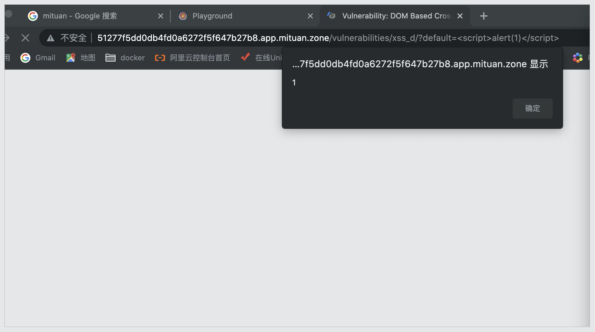

# 21 | XSS（上）：前端攻防的主战场

你好，我是王昊天。

如今，我们开发一个 Web 应用需要用到前端和后端两部分。其中前端主要用于数据的渲染，将信息更好地展示给我们；后端则需要获取数据，将合适的信息展示给我们。只有前端和后端一起合作，才能构建出一个优秀的 Web 应用。

在之前的课程中，我们学习了 SQL 注入、命令注入这两种注入攻击，它们都是针对 Web 后端的攻击。那么注入攻击可以针对前端执行吗？答案是肯定的，今天我们要学习的 XSS 即跨站脚本攻击就是针对前端的攻击方式，下面让我们开始对它的学习吧。

## XSS 介绍

XSS 即跨站脚本攻击，是 OWASP TOP10 之一。它的全称为 Cross-site scripting，之所以缩写为 XSS 是因为 CSS 这个简称已经被占用了。这就是 XSS 名称的由来。

XSS 攻击的原理为，浏览器将用户输入的恶意内容当做脚本去执行，从而导致了恶意功能的执行，这种针对用户浏览器的攻击即跨站脚本攻击。它的攻击方式可以分为三种类型，我在下图将它们列举出来了。



下面让我们进一步来学习它的攻击方式吧。

## 反射型 XSS

当应用程序将收到的用户输入，直接作为 HTML 输出的一部分时，并且未经验证或转义，攻击者就可以输入一些 JavaScript 脚本，使得受害者的浏览器执行任意的 JavaScript 代码。这就是反射型 XSS 攻击，之所以称之为反射型 XSS，是因为这种攻击需要用户提供一个恶意输入，然后页面据此进行反射，执行攻击的命令。

为了加深你的理解，我们一起来看一个示例。



上述是一个反射型 XSS 注入的靶场，我们需要在其中输入并上传两个参数 First name 以及Last name，然后该 Web 应用在接收到上传的参数后，会将它们显示在页面上，如 Welcomefirstname lastname。

查看页面的元素，我们可以看到输入的参数直接被放在 HTML 的 body 中。

```xml
<body>
 # ...
 <div id="main">
 # ...
 "Welcome first name last name"
 </div>
```

由于页面中没有对我们的输入进行限制，导致了我们可以直接在 First name 中输入<script>alert(1)</script>，在 Last name 中随意输入任何字符串例如 abc，这样就能导致 XSS攻击。



可以看到我们输入的恶意 JavaScript 脚本 alert(1) 已经执行成功，弹出了一个警告框。我们再次检查页面的源代码，发现如下所示：

```xml
<body>
 # ...
 <div id="main">
 # ...
 " Welcome “
 <script>alert(1)</script>
 ” abc "
 </div>
```

我们在 First name 中输入的恶意脚本，被解析为 JavaScript 命令，所以我们的攻击成功了。

上面例子中的行为，看似是我们自己在攻击自己，但事实上也可以攻击别人，使得别人在访问一个页面时受到我们发起的 XSS 攻击。你可以想一想要如何利用反射型 XSS 攻击别人？

事实上，我们发送的 First name 以及 Last name 都是通过 GET 方式上传的参数，而在之前的学习中，我们知道以 GET 方式上传的参数会出现在链接中，例如我们将 First name 设为<script>alert(1)</script>，将 Last name 设为 abc，那么对应的恶意链接就如下所示：

```
http://1e2b92939584409b89297897efdf1599.app.mituan.zone/xss_get.php?firstname=%3C
```

我们只需要将这个恶意链接发送给要攻击的目标即可，这样只要受害者点击链接，那么恶意命令就会在受害者的浏览器执行。

上述示例中，Web 没有对我们的输入做任何限制，使得我们的 JavaScript 脚本顺利执行，接下来我们来看反射型注入如果受到限制该如何破解呢？



例如这个示例中，我们输入一个 JavaScript 脚本，但是它就不会被执行，通过查看页面源代码：

```xml
<p>Hello <script>alert(1)</script>, please vote for your favorite movie.</p>
```

我们可知，它不会被执行的原因是 <p></p> 将我们的输入包裹起来了，在 HTML 中，这代表了限制其中包裹的内容为文本，那么这里你有什么好办法来绕过这个限制吗？

比如，类似 SQL 注入中的闭合操作？没错，我们可以将它的 <p> 标签闭合起来，构造输入如下：

```xml
# 输入为：
</p><script>alert(1)</script><p>
# 响应的html变为：
<p>Hello </p><script>alert(1)</script><p>, please vote for your favorite movie.</
```

这样我们就可以将 <p> 标签闭合，成功执行我们的 JavaScript 恶意代码。

从上述内容中，我们可以知道，反射型 XSS 具有非持久化的特点，因为用户必须点击带有恶意参数的链接才能引起这个攻击。同时它的影响范围很小，只有那些点击了恶意链接的用户才会受到它的攻击。

接下来让我们进入到另一种更危险的 XSS 攻击中——存储型 XSS 攻击。

## 存储型 XSS

存储型 XSS 是指应用程序通过 Web 请求获取不可信赖的数据，在未检验数据是否存在 XSS代码的情况下，便将其存入数据库。当下一次从数据库中获取该数据时，程序也没有对其进行过滤，使得页面再次执行 XSS 代码。与反射型 XSS 不同的是，存储型 XSS 可以持续攻击用户。

攻击者想要发起存储型 XSS 攻击，首先需要将恶意代码进行上传，上传的位置主要有留言板、评论区、用户头像、个性签名以及博客。如果 Web 应用没有限制上传的内容，并且将该内容存储到了数据库中，那么存储型 XSS 就成功了第一步。

接下来，想要使得存储型 XSS 攻击生效，还需要让 Web 应用去读取之前存储的恶意代码。这其实很简单，我们可以想一想留言板，我们只要上传一条留言，那么每次去访问这个留言板时，系统就会自动去读取之前上传的所有数据，并在页面上显示出来。当然系统可能会对读取的数据做一定的限制，如果我们的恶意代码没有被限制，那么我们的存储型 XSS 攻击的第二步也就成功了。

完成了读取后，系统会将内容进行解析读取，如果解析的时候没有成功限制住我们的恶意代码，那么我们之前存储的恶意命令将被执行。存储型 XSS 攻击也就成功啦！

下面，让我们一起看一个示例，来加深一下对存储型 XSS 攻击的理解。



在这个示例中，Web 应用选择的为一个博客，我们可以在此输入一个恶意命令作为博客，并且进行上传。例如我们输入 <script>alert(1)</script> 点击上传，之后页面会刷新，并且弹出警告框 1，之后这个页面每次被访问，都会引起恶意命令的执行。

从结果我们知道，我们的恶意命令成功执行，这代表了我们的恶意输入被上传到数据库中，并且 Web 应用读取了它，将它解析出来。

根据我们对存储型 XSS 攻击的了解，我们不难知道，它的危害性是远远高于反射型 XSS 攻击的。因为它的影响范围远远高于反射型 XSS，它会影响到所有访问到受攻击 Web 页面的用户。

完成了存储型 XSS 攻击的学习后，接下来让我们接着学习 DOM 型 XSS 攻击。

## DOM 型 XSS

首先我们需要知道什么是 DOM，DOM 就是文档对象模型，它可以将文档解析成一个由节点和对象（包含属性和方法的对象）组成的结构集合。简单来讲，它会将 Web 页面和脚本程序连接起来。

DOM 型 XSS 攻击其实是一种特殊类型的反射型 XSS，通过 JavaScript 操作 DOM 树动态地输出数据到页面，而不依赖于将数据提交给服务器端，它是基于 DOM 文档对象模型的一种漏洞。

根据之前的学习，我们可以明白，在 DOM 型 XSS 中，整个过程和后端无关，它完全是基于前端的攻击，所以当我们遇到要绕 Waf 的时候，就可以使用这种攻击，因为 Waf 是基于后端进行拦截的。

DOM 型 XSS 的攻击方式，其实与反射型 XSS 很相似，它们都是没有控制好输入，并且把JavaScript 脚本作为输出插入到 HTML 页面。不同的是，反射型 XSS 经过后端语言处理后，页面引用后端输出生效。而 DOM 型 XSS 是经过 JavaScript 对 DOM 树直接操作后插入到页面。相比于反射型 XSS 攻击，它的危害性更大，因为它不经过后端，所以可以绕过 Waf 的检测。

下面让我们从实战中，更深入地学习 DOM 型 XSS 攻击。

### 实战演练

在这个案例中，该靶场已经搭建于谜团中，你可以访问 DVWA 靶场进行实战测试。

我们在登录后，选择 DVWA Security 为 low，然后打开 XSS(DOM) 靶场。



打开后发现了一个选择框，我们无法从这里进行输入，通过点击 Select 按钮，我们从链接中可以发现，它是通过 GET 方式上传的参数。

```
http://51277f5dd0db4fd0a6272f5f647b27b8.app.mituan.zone/vulnerabilities/xss_d/?de
```

这就给了我们输入的机会，然后进一步观察页面的源代码，对此进行分析。

```javascript
if (document.location.href.indexOf(“default=“) >= 0) {
                       var lang = document.location.href.substring(document.loca
                       document.write(“<option value=‘” + lang + “’>” + decodeUR
                       document.write(“<option value=‘’ disabled=‘disabled’>——</
                   }
```

从源代码中我们可知，这个页面属于 DOM 型 XSS 攻击，它没有经过后端处理，是直接用document.write 函数将输入显示在页面中，并且没有做任何限制。因此我们可以用下述链接执行我们的攻击命令：

```
http://51277f5dd0db4fd0a6272f5f647b27b8.app.mituan.zone/vulnerabilities/xss_d/?de
```



可以看到，我们的攻击已经成功，一个警告框已经弹出来了。

## 总结

在这节课里，我们首先了解了什么是 XSS 攻击，并且知道它主要可以分为三种不同的类型，包括反射型 XSS、存储型 XSS 以及 DOM 型 XSS。之后我们对它们分别展开了具体的学习。

在对反射型 XSS 的学习中，我们知道反射型 XSS 的攻击需要用户提供一个恶意输入，然后页面据此进行反射，执行攻击的命令。同时，我们也知道了，当我们的输入被 HTML 标签限制住，可以用闭合的方法来解除它的限制。反射型 XSS 具有非持久化的特点，因为用户必须点击带有恶意参数的链接才能引起这个攻击，同时它的影响范围很小，只有那些点击了恶意链接的用户才会受到它的攻击。

之后我们学习了危害性更大的存储型 XSS，存储型 XSS 是指应用程序通过 Web 请求获取不可信赖的数据，在未检验数据是否存在 XSS 代码的情况下，便将其存入数据库。当下一次从数据库中获取该数据时，程序也没有对其进行过滤，使得页面再次执行 XSS 代码。与反射型XSS 不同的是，存储型 XSS 可以持续攻击用户，我们每次访问被攻击的 Web 页面都会受到这个攻击的影响。

最后，我们学习了 DOM 型 XSS 攻击，经过学习，我们知道 DOM 型 XSS 攻击其实是一种特殊类型的反射型 XSS，通过 JavaScript 操作 DOM 树动态地输出数据到页面，而不依赖于将数据提交给服务器端，它是基于 DOM 文档对象模型的一种漏洞。它与反射型 XSS 不同的是，反射型 XSS 经过后端语言处理后，页面引用后端输出生效。而 DOM 型 XSS 是经过JavaScript 对 DOM 树直接操作后插入到页面。相比于反射型 XSS 攻击，它的危害性更大，因为它不经过后端，所以可以绕过 Waf 的检测。

## 思考

最后留给你一道思考题：XSS 攻击有什么防范方法吗？

欢迎在评论区留下你的思考。如果觉得今天的内容对你有所帮助的话，也欢迎你把课程分享给其他同事或朋友，我们共同学习进步！
