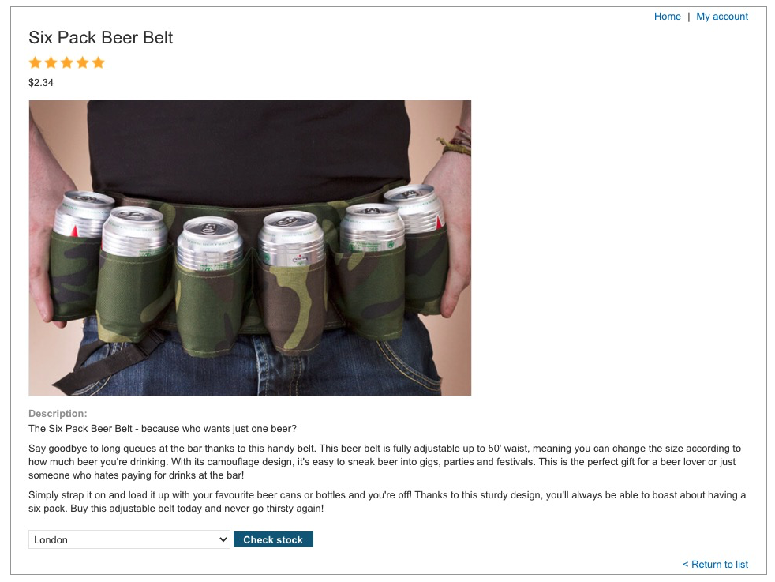
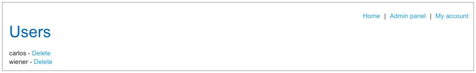
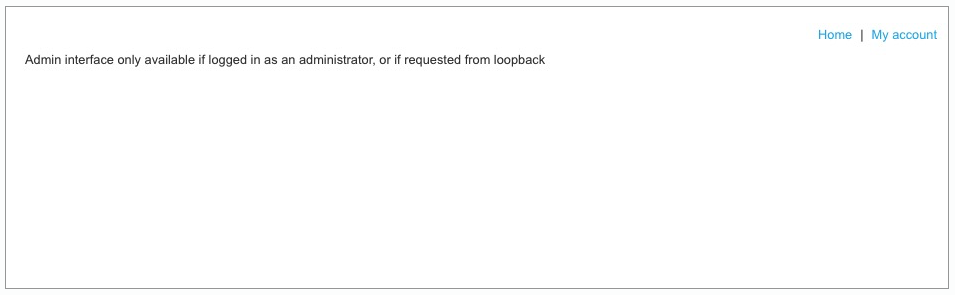
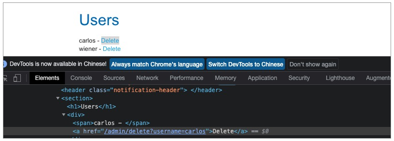
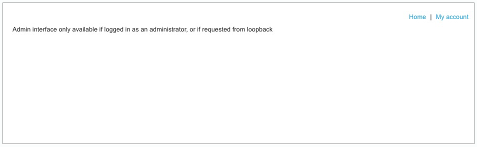

# 33 | SSRF：穿越边界防护的利刃

你好，我是王昊天。

在现实生活中，会有很多的边界对我们进行限制。

记得我小时候，不是特别喜欢上学读书，经常会产生从学校跑回家的想法。可是学校四周都有围栏，唯一的出口就是校门，而校门会有保安监控，想要出去一定要老师的批假条。没有正当理由，老师是不会给我批假，这就导致我无法跑回家。其实，校门就是一个边界，它会阻止外面的坏人进入，也会阻止逃课的小孩偷偷溜回家。

在 Web 应用中，出于安全性的考虑也是有边界存在的，它会限制一些资源，使得其在边界内可以访问，而边界外的我们无法访问。不过我们仍然可以通过 SSRF 攻击穿越边界对其进行访问，下面让我们一起来学习下这种穿越方式吧！

## SSRF 服务端请求伪造攻击

SSRF 即为 Server Side Request Forgery 的缩写，它意为服务端请求伪造。指的是当攻击者无法访问 Web 应用的内网时，在未能取得服务器所有权限的情况下，利用服务器存在的漏洞，以服务器的身份发送一条精心构造好的请求给服务器所在内网，从而成功对内网发起请求。

下面，让我们通过一个示例，加深我们对 SSRF 的理解。



上图是一个 Web 购物应用靶场中的一个商品详情页面。从图中我们可以看出，该商品是一个便携啤酒腰带，由于它非常方便，所以我们点击 Check stock，即检查库存按钮，发现它还有509 个，可惜不支持发货到中国，不然我们就可以直接下单。于是感到气愤的我，想要对其进行攻击行为。

于是我再次点击检查库存按钮，并用 BurpSuite 捕获到如下报文：

```
POST /product/stock HTTP/1.1
Host: ac0d1ffb1e4f89bac00a8de300fb00d4.web-security-academy.net
Cookie: session=WjZYVShyY7v3E3tfhT55IGh0hmVYXyAA
Content-Length: 107
Sec-Ch-Ua: "Chromium";v="95", ";Not A Brand";v="99"
Sec-Ch-Ua-Mobile: ?0
User-Agent: Mozilla/5.0 (Windows NT 10.0; Win64; x64) AppleWebKit/537.36 (KHTML,
Sec-Ch-Ua-Platform: "macOS"
Content-Type: application/x-www-form-urlencoded
Accept: */*
Origin: https://ac0d1ffb1e4f89bac00a8de300fb00d4.web-security-academy.net
Sec-Fetch-Site: same-origin
Sec-Fetch-Mode: cors
Sec-Fetch-Dest: empty
Referer: https://ac0d1ffb1e4f89bac00a8de300fb00d4.web-security-academy.net/produc
Accept-Encoding: gzip, deflate
Accept-Language: zh-CN,zh;q=0.9
Connection: close
stockApi=http%3A%2F%2Fstock.weliketoshop.net%3A8080%2Fproduct%2Fstock%2Fcheck%3Fp
```

经过观察，我们容易发现，它通过 POST 方式上传了一个接口 stockAPI，用来获取商品库存的数目。

我们将这个接口修改为 http://localhost/admin，尝试获取 Web 应用的管理员页面。



发送报文后，我们惊喜地观察到页面下方确实暴露出来了 Web 应用的管理页面。接着尝试点击 Delete 按钮，去删除用户，可是发现收到的响应如下：



我们可以看到，该请求被拒绝了，这是因为 Web 应用对管理接口进行了边界限制，不允许外网用户在非管理员登录状态下对其进行访问。于是，我想起了利用 SSRF 方式穿越这一边界。



首先我们查看删除按钮对应的链接，接着再次点击检查库存，将捕获到报文中的接口改为删除所对应的链接。

```sql
POST /product/stock HTTP/1.1
Host: ac0d1ffb1e4f89bac00a8de300fb00d4.web-security-academy.net
Cookie: session=6yXqSaAliJJjyWYmdK8kQfAeMSoMxoYt; session=WjZYVShyY7v3E3tfhT55IGh
Content-Length: 107
Sec-Ch-Ua: "Chromium";v="95", ";Not A Brand";v="99"
Sec-Ch-Ua-Mobile: ?0
User-Agent: Mozilla/5.0 (Windows NT 10.0; Win64; x64) AppleWebKit/537.36 (KHTML,
Sec-Ch-Ua-Platform: "macOS"
Content-Type: application/x-www-form-urlencoded
Accept: */*
Origin: https://ac0d1ffb1e4f89bac00a8de300fb00d4.web-security-academy.net
Sec-Fetch-Site: same-origin
Sec-Fetch-Mode: cors
Sec-Fetch-Dest: empty
Referer: https://ac0d1ffb1e4f89bac00a8de300fb00d4.web-security-academy.net/produc
Accept-Encoding: gzip, deflate
Accept-Language: zh-CN,zh;q=0.9
Connection: close
stockApi=http://localhost/admin/delete?username=carlos
```

这样，我们发现用户 carlos 就被我们成功删除了，我们通过利用该应用的服务器发起了删除的请求，从而绕过了边界对我们行为的限制。

在这个示例中，我们使用 SSRF 攻击对 Web 应用的本地服务器进行了操作。但事实上，我们还可以对内网中的服务器进行攻击，例如我知道内网中的一个地址，我们想要利用 SSRF 攻击对其进行操作，只需要将 localhost 改为它的内网地址即可。

学习完这个典型的 SSRF 漏洞之后，我们还需要学习 SSRF 中一个特殊的类别——BlindSSRF 漏洞。

### Blind SSRF 攻击

当我们可以诱使应用程序向提供的 URL 发出后端 HTTP 请求，但后端对于这个 HTTP 请求的响应未在前端页面展示，这就是 Blind SSRF 攻击。

一般来说，Blind SSRF 漏洞的危害会低于普通 SSRF 漏洞，因为我们不能轻易利用该漏洞从后端系统检索敏感数据，而是要类似于之前学习的 SQL 带外注入一样，通过一些带外的方式将敏感数据输出。

到这里，你已经明白了 SSRF 的攻击方式以及原理，接下来我们来学习 SSRF 攻击可能造成的后果。

## SSRF 攻击的危害

SSRF 的危险程度其实与 Web 应用内网的防御强度相关。

由于边界内的内网服务防御相对外网服务来说一般会较弱，甚至部分内网服务出于运维方便的考虑，可能对内网都没有进行访问设置及权限验证，所以存在 SSRF 时，通常会造成较大的危害。

因此，一般来讲，成功的 SSRF 攻击可以导致未经授权的访问或操作、实现对内网的扫描以及利用 file 协议读取内网服务器中的本地文件。除此之外，我们还可以利用 SSRF 攻击使得Web 服务器去请求一个较大的文件，这样就可以对应用的服务器发起 DOS 攻击。

到这里，你已经知道了 SSRF 攻击的可怕之处。接下来让我们一起分析这个漏洞存在的原因，以加深我们对它的认知。

## SSRF 漏洞存在的原因

SSRF 漏洞存在的原因可以分为两方面，第一方面为对输入链接过滤的失败，另一方面则为内网防御措施的缺失。下面，让我们先来看第一个原因。

开发者为了抵御 SSRF 攻击可能会用一些方式，例如正则匹配等，去过滤一些传过来的 URL参数。如果开发者没有对 URL 参数进行过滤，或者过滤不够充分就会导致 SSRF 漏洞的发生。

为了让你更好地理解，下面让我们来看一个示例。

假如开发者为了防止 SSRF 攻击，会将用户传来的 URL 数据做正则匹配处理，判断该 URL是否是内网地址，它的匹配逻辑为判断链接是否包含 10./172./192. 这些内网地址中包含的内容。此时攻击者可以用 8 进制来表示地址格式，就能绕过正则匹配，成功将内网地址输入，从而发起 SSRF 攻击。

这个示例是由于正则匹配输入的 URL 不充分导致的 SSRF 攻击，接下来让我们来看 SSRF 漏洞存在的另一个重要原因——内网防御措施的缺失。



这里，我们需要仔细观察之前点击删除按键时，应用返回的提示信息。发现这个应用限制未登录的外网账户对管理功能的直接访问，所以我们可以借助服务器用内网对其发送请求，并成功实现恶意行为。那么应用为什么不在内网中做一些防御措施呢？

事实上，在内网中与服务器本身建立连接时，有可能会绕过访问控制检查，因为实现访问控制检查的组件管理不到其对自身的连接。另一方面，出于防止管理员账户密码丢失的目的，通常会允许本机直接登录，这样就算管理员忘记登录凭据也可以访问管理后台进行恢复。

这就是 SSRF 漏洞存在的两个主要原因。在了解了它们之后，我们就可以更好地学习如何防御，下面就让我们一起学习 SSRF 攻击的防御方式以及相应的绕过技巧吧！

## SSRF 攻击的抵御及绕过

为了防止攻击者利用其他协议，如 file 去读取本地文件，应用开发者需要限制协议为HTTP/HTTPS，这样可以对攻击者的行为做出限制。

对于攻击者将 URL 改为内网地址实现 SSRF 穿越边界的行为，应用开发者可以对 URL 设置黑白名单机制，使得攻击者设置内网中的 URL 变得无效。不过攻击者有很多绕过技巧。

对于黑名单验证机制来说，应用开发者可能会限制 URL 中不可包含 127.0.0.1 这一地址。相应的，攻击者可以将 URL 设为 017700000001，它是 127.0.0.1 的八进制表示，这样就可以绕过黑名单机制的限制。

对于白名单验证机制来说，攻击者同样是可以绕过的。当开发者限制 URL 必须以期望的地址expected-host 开头，攻击者可以将 URL 设置为 http://expected-host@evil-host，这里的 @可以让 URL 实际代表 @ 之后的地址，这样就能绕过白名单限制，使得应用服务器访问 evil-host。

## 总结

在这一讲中，我们学习了 SSRF 漏洞的相关内容。

首先，我们学习了 SSRF 即服务端请求伪造攻击的定义，知道了它指的是当攻击者无法访问Web 应用的内网时，在未能取得服务器所有权限的情况下，利用服务器存在的漏洞，以服务器的身份发送一条精心构造好的请求给服务器所在内网，从而成功对内网发起请求。

之后，我们通过一个 SSRF 示例，更好地理解了 SSRF 攻击的实现方式以及可能造成的后果。此外，我们还了解了一种特殊的 Blind SSRF，事实上它就是不存在回显的 SSRF 攻击，不过我们也可以通过带外的方式获取到一些隐私数据。

然后，我们学习了 SSRF 攻击的危害，知道了由于内网服务防御相对较弱，所以导致了 SSRF攻击危害较为严重。攻击者可以利用 SSRF 攻击实现未经授权的访问或操作、对内网进行扫描、利用 file 协议读取内网服务器中的本地文件以及发起 DOS 攻击。

接着，我们对 SSRF 漏洞存在的原因进行了分析，分析后我们知道 SSRF 其实就是两方面的原因所导致，一方面是由于对输入的 URL 限制不够充分，另一方面是因为内网中的防御措施不够完整。

最后，我们了解了 SSRF 攻击的抵御及绕过方式，知道了可以通过限制协议以及黑白名单验证的方式来抵御 SSRF 攻击。攻击者也可以利用八进制表达 URL 以及利用 @来绕过黑白名单对于 URL 内容的限制。

## 思考题

你知道还有哪些 SSRF 攻击的防御措施吗？

欢迎在评论区留下你的思考。如果觉得今天的内容对你有所帮助的话，也欢迎你把课程分享给其他同事或朋友，我们共同学习进步！
