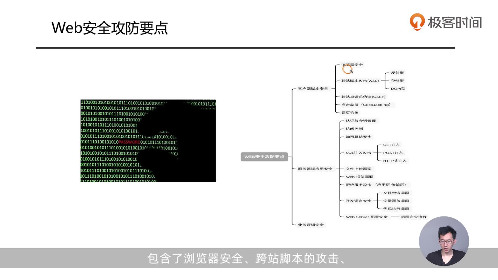
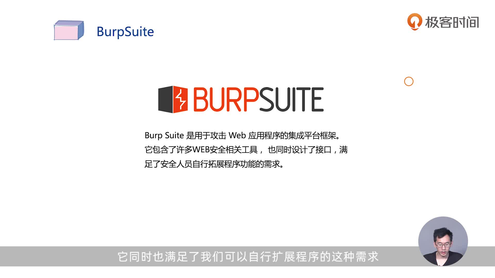
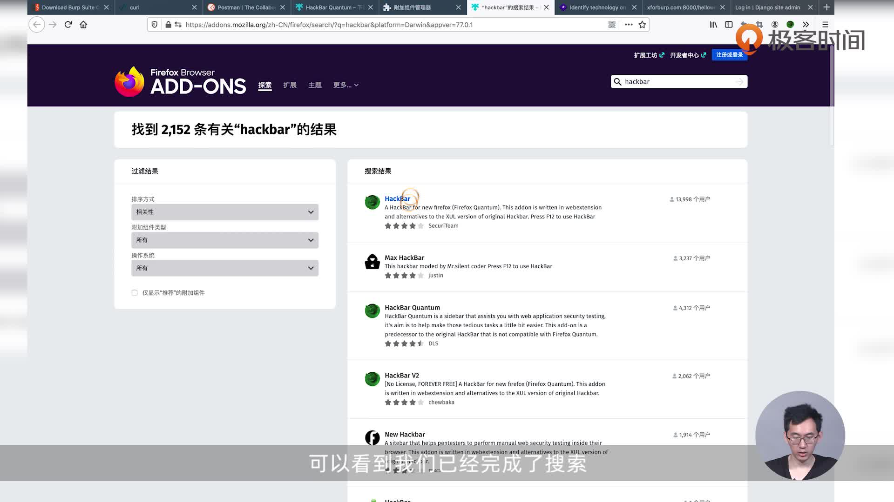

# 春节策划（一） | 视频课内容精选：Web渗透测试工具教学

你好，我是王昊天。

今天是除夕，首先祝你新年快乐，希望你在新的一年收获满满！

在这个特别的节日，我要送给你一套 Web 安全基础的教学视频作为新年礼物。在之前的课程中，我们已经深入学习了 Web 漏洞挖掘的“失效的访问控制”“加密失败”“注入”“不安全的设计”的内容。

为了加深你对这部分内容的理解和掌握程度，我特地从我第一季的视频课程《Web 安全攻防实战》中精选了 3 讲视频内容，提供给你学习。

## 第一节

08 | 常见的 Web 安全漏洞都有哪些？

在这一节视频课程中，我们会对 Web 应用使用的 HTTP 协议进行学习，然后结合 Web 安全攻防要点分析 Web 安全的本质。目的是，帮助你更好地理解和掌握 Web 安全。

## 第二节

09 | Web 渗透工具入门：Burp Suite、cURL、Postman

在这一节视频课程中，我们会对 Web 安全领域的常用工具进行学习，主要包括 Burp Suite、cURL 和 Postman。

这一讲视频中用到的插件安装地址，我也一起提供给你。

1. cURL 的插件安装地址：https://curl.haxx.se/

2. cURL 下载地址：https://curl.haxx.se/download.html

3. Burp Suite 插件安装地址：https://portswigger.net/burp

4. Burp Suite 下载地址：https://portswigger.net/burp/communitydownload

5. Postman 插件安装地址：https://www.postman.com/

6. Postman 下载地址：https://www.postman.com/downloads/

这样，在《Web 漏洞挖掘实战》这门课之后的学习中，你就可以用这些工具来进行实战测试了。

## 第三节

10 | Web 渗透插件入门：Wappalyzer、HackBar

在这节视频课程中，我们会对 Web 渗透插件进行学习，主要包括 Wappalyzer 和 HackBar。掌握了这两个插件，可以对我们的漏洞挖掘过程提供极大的帮助。

这一讲视频中用到的插件安装地址，我也一起提供给你。

1. HackBar 插件安装地址：https://addons.mozilla.org/en-US/firefox/addon/hackbar-quantum/

2. Wappalyzer 插件安装地址：https://www.wappalyzer.com/

以上就是我要送给你的 3 讲视频内容。我再概括下这三节课程的内容，你可以进行针对性地学习：

- 第一节课从 HTTP 协议的角度，帮助你理解基本的 Web 应用系统通信原理；

- 第二节课从 HTTP 协议操纵工具入手，帮助你在 Web 领域行走自如；

- 第三节课则从自动化插件的领域，帮助你快速识别目标 Web 应用架构。

其实，抽选这三讲内容，我的主要考量是：在《Web 漏洞挖掘实战》这门课中，我一直致力于讲解 Web 领域的漏洞挖掘和利用思维，以及从防御的视角去看开发，所以其中涉及的渗透实践类的讲解并不多。

但在我看来，无论是尝试去做 Web 领域的漏洞挖掘，还是尝试手工复现及利用我们所讲解的漏洞，掌握 Web 领域的渗透测试工具都是必不可少的。凭借这些优秀的工具，可以大幅提高我们学习和实践的效率，也可以加深我们对专栏内容的理解。

今天的福利就到这里，相信这 3 讲视频内容，可以帮助你拥有快速在 Web 安全领域上手的能力。
