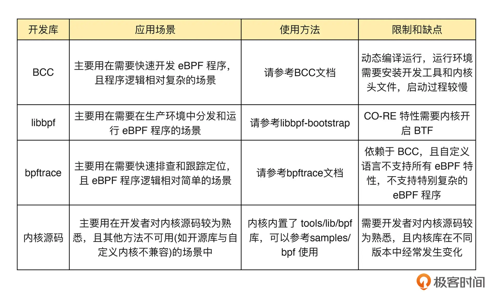
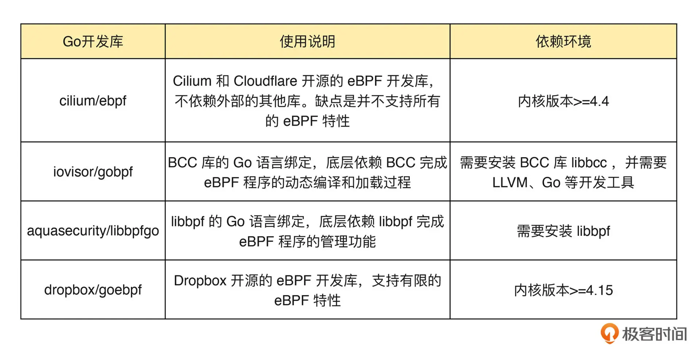
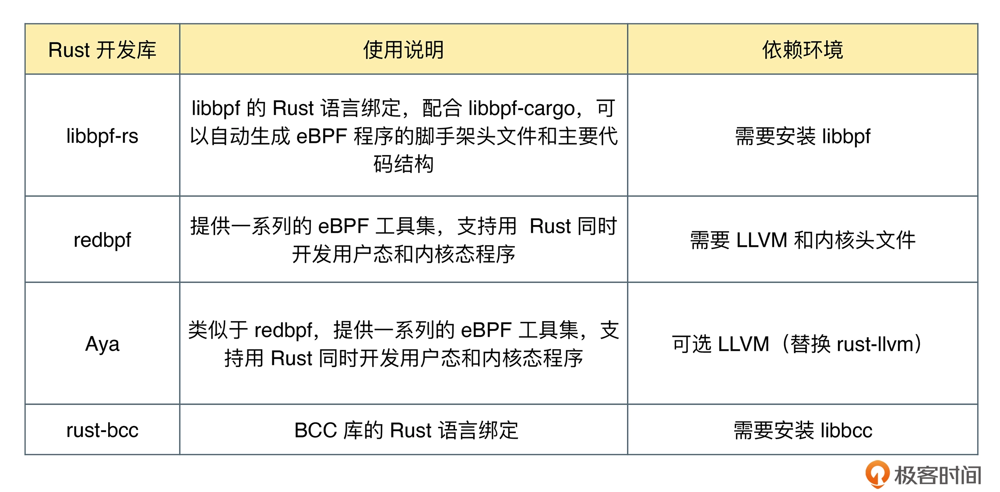
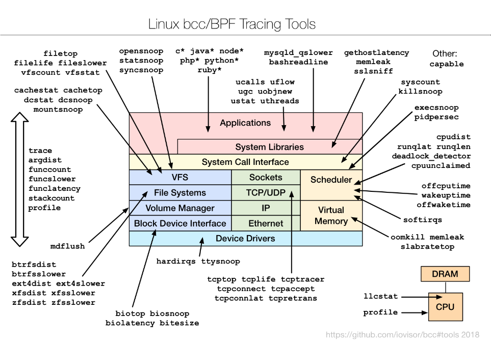
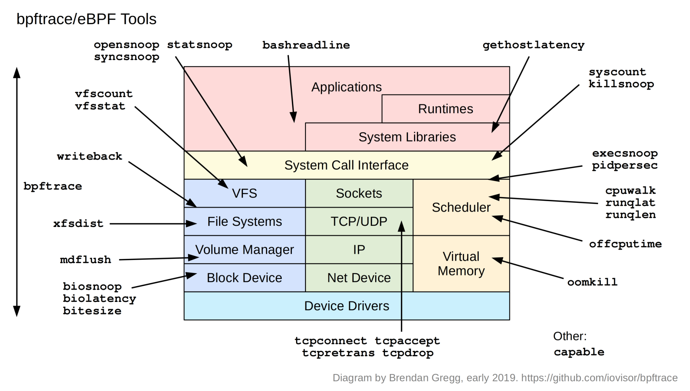
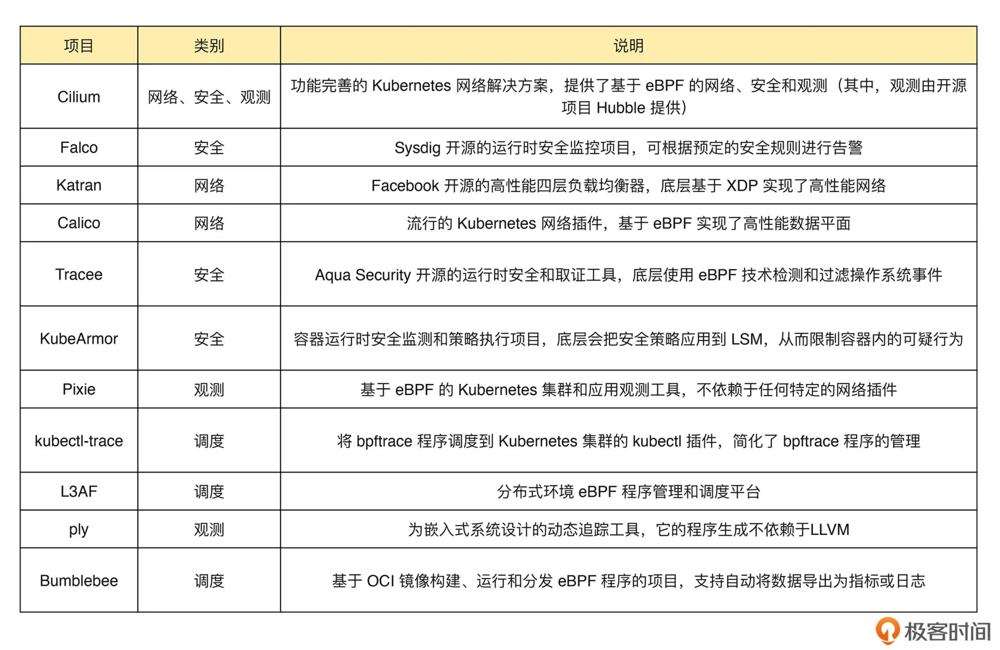

# 14 | 阶段总结：实用eBPF工具及最新开源项目总结

你好，我是倪朋飞。

到上一讲的高性能网络实战为止，我们就完成了“实战进阶篇”的学习。在这个模块中，我带你从实战出发，利用 BCC、libbpf、bpftrace 等常用的 eBPF 开发工具，开发了应用于内核跟踪、用户态跟踪、网络跟踪、容器安全、高性能网络等各个场景的 eBPF 程序。通过这个模块的学习，我想你已经掌握了 eBPF 在不同场景的应用方法，并能够举一反三，利用类似的步骤把 eBPF 应用到实际的工作当中去。

“实战进阶篇”结束后，我们课程的常规更新阶段的正文内容就基本更新完了。在之前的课程内容中，除了用实践帮你更好地理解原理，我也在案例中穿插介绍了很多开源项目和 eBPF 工具，帮你更好地利用 eBPF 去解决实际的问题。今天，我就基于现阶段的 eBPF 最新技术发展，为你汇总最实用的 eBPF 工具以及最新的开源项目状态。这样，在后续的学习和实践过程中，你就可以按图索骥，根据应用场景选择最合适的方案。今天的内容将分为开发工具集、实用工具集和最新开源项目三个部分。

## 开发工具集

首先来看第一个部分，开发工具集，也就是在开发 eBPF 程序时常用的开发库以及开发工具。

在这门课里，我已经在不同案例中为你反复介绍了 BCC、libbpf、bpftrace 等常用的开发库，以及把 eBPF 源代码编译为字节码的 LLVM 工具。除了这些方法，你还可以直接在内核源码库中，参考已有的示例（示例路径为 samples/bpf ）进行 eBPF 程序的开发。

你还记得这些不同开发方法的主要应用场景和使用步骤吗？为了帮助你理解，我把它们的主要应用场景和使用方法总结成了一个表格，方便你在需要的时候参考。



BCC、libbpf 以及内核源码，都主要使用 C 语言开发 eBPF 程序，而实际的应用程序可能会以多种多样的编程语言进行开发。所以，开源社区也开发和维护了很多不同语言的接口，方便这些高级语言跟 eBPF 系统进行交互。比如，我们课程多次使用的 BCC 就提供了 Python、C++等多种语言的接口，而使用 BCC 的 Python 接口去加载 eBPF 程序，要比 libbpf 和内核源码的方法简单得多。

在这些开发库的基础上，得益于 eBPF 在动态跟踪、网络、安全以及云原生等领域的广泛应用，开源社区中也诞生了各种编程语言的开发库，特别是 Go 和 Rust 这两种语言，其开发库尤为丰富。

下面的表格列出了常见的 Go 语言开发库，以及它们的使用场景：



在使用这些 Go 语言开发库时需要注意，Go 开发库只适用于用户态程序中，可以完成 eBPF程序编译、加载、事件挂载，以及 BPF 映射交互等用户态的功能，而内核态的 eBPF 程序还是需要使用 C 语言来开发的。

而对于 Rust 来说，由于其出色的安全和性能，也诞生了很多不同的开发库。下面的表格列出了常见的 Rust 语言开发库，以及它们的使用场景：



从 Go 和 Rust 语言的开发库中你可以发现，纯编程语言实现的开发库（即不依赖于 libbpf 和BCC 的库）由于很难及时通过内核进行同步，通常都有一定的功能限制；而 libbpf 和 libbcc的开发语言绑定通常功能更为完善，但开发和运行环境就需要安装 libbpf 和 libbcc（部分开发库支持静态链接，在运行环境不再需要 libbpf 或 libbcc）。因为底层的实现是类似的，所以掌握了 libbpf 和 BCC 的使用方法，在学习其他语言的绑定时会更容易理解。

了解常见的开发工具和不同编程语言的开发库之后，我们再来看看，有哪些开箱即用的 eBPF实用工具。

## 实用工具集

作为最常用的开发工具集，BCC 和 bpftrace 除了可以帮你简化 eBPF 程序的开发和运行之外，它们其实也都提供了丰富的实用工具。在你安装 BCC 和 bpftrace 时，这些实用工具也都会默认安装到你的系统中。如果它们刚好已经满足了你的使用场景，那你就可以直接使用，而不再需要额外去开发新的程序。

```
比如，安装好 BCC 和 bpftrace 之后，你可以直接执行下面的命令，来跟踪 execve 系统调
```

用。

```
使用 bpftrace：execsnoop.bt
使用 BCC：execsnoop-bpfcc
```

BCC 提供的工具非常丰富，很多工具在动态跟踪、性能优化、调试排错等场景都可以直接使用。下面的图片（图片来自 www.brendangregg.com）列出了常用 BCC 工具在内核中的位置，你可以根据需要选择使用：



在开发自己的 eBPF 工具时，假如你碰到了难题，不妨来看看 BCC 是否提供了类似的工具，这些工具也是开发 eBPF 程序最好的参考资料之一。

同 BCC 类似，bpftrace 也提供了大量的工具。下面的图片（图片来自brendangregg.com）列出了一些常用的 bpftrace 工具集。虽然这些工具不如 BCC 工具集完善，但得益于 bfptrace 提供的高级语言，你可以用脚本的方式更快地编写 eBPF 程序。



除了 BCC 和 bpftrace 工具集之外，内核自带的 bpftool 也是最常用的 eBPF 工具之一。在05 讲 和 12 讲 中，我曾介绍过 bpftool 的一些使用方法，包括查询内核支持的 eBPF 特性、查看和操作 BPF 映射、加载和挂载 BPF 字节码，以及生成 eBPF 程序的脚手架头文件

```
等。你可以执行 bpftool help 或 bpftool <子命令> help 查询更多的使用方法。
```

了解过常见的 eBPF 实用工具，最后我们再来看一些最新的 eBPF 开源项目，以及它们的最新发展状态。

## 最新开源项目进展

根据功能和使用场景的不同，我把 eBPF 相关的开源项目分为以下几个类别：

- 第一类是 eBPF 在操作系统内核的支持，包括 Linux 内核和 eBPF for Windows。

- 第二类是辅助 eBPF 程序开发和运行的开源项目，上述两个部分中提到的所有开源项目都属于这个类别。

- 第三类是 eBPF 在跟踪监控、网络、安全等各个领域应用的开源项目，Cilium、Falco、Karan 等都属于这个类别。

接下来，我带你一起来看看每个类别都有哪些开源项目，以及它们最新的发展状态是什么样的。

### 操作系统内核类

首先来看第一个类别，eBPF 在操作系统中的支持。之前在 01 讲 中，我为你梳理了 eBPF的发展历程。其中，2021 年微软发布 eBPF for Windows ，以及 eBPF 基金会的成立代表着eBPF 生态的空前活跃。

一方面，在 Linux 内核中，eBPF 是内核社区最活跃的子模块之一，并且还处在一个快速发展的阶段。在未来，eBPF 不仅会支持更多的内核特性，也有可能会作为最底层的基础，替换掉很多性能不佳的内核模块（如 iptables 防火墙等）。

另一方面，在 Windows 系统中，eBPF for Windows正在努力把 eBPF 技术带入 Windows操作系统。同 Linux 类似，eBPF for Windows 也提供了 libbpf API，这样未来你开发的一套eBPF 程序就可以在两种不同的操作系统中运行。eBPF for Windows 同样处在快速迭代的过程中，目前还没有发布稳定版本。在这门课之后的动态更新阶段，也就是“技术雷达篇”中，我会为你持续跟踪它的发展状态。

### 开发工具类

说完操作系统类的开源项目，接下来的第二个类别是辅助 eBPF 程序开发和运行的开源项目，包括编译工具 LLVM 和 GCC，开发工具集中的各类开发库，以及实用工具集中的各类 eBPF工具等。其中，后两个类别的开源项目已经在前面讲过了，这儿不再展开。

而对编译工具来说，自从 3.7 版本支持 BPF 编译以来，LLVM 一直都是默认的 eBPF 编译工具。我们课程提到的所有开源项目，除 eBPF for Windows 之外，都是借助 LLVM 把 eBPF 程序编译为字节码的。GCC 虽然也已经支持了 eBPF 编译选项，但目前来说还有很多的限制，也没有大型开源项目在使用它。所以，我推荐你在编译 eBPF 程序时，还是继续使用LLVM 工具。

### eBPF 应用类

最后一个类别是 eBPF 在跟踪监控、网络、安全等各个领域应用的开源项目。这类开源项目的数量是最多的，其中比较典型的是 Cilium、Falco、Karan、Calico 以及 Tracee 等已经拥有众多用户的知名开源项目，代表了 eBPF 在网络和安全方面的典型应用。

由于这类开源项目的数量比较多，我把几个典型的开源项目做成了一个表格，方便你在需要时参考。如果它们刚好满足你的应用场景，那么在开发新的 eBPF 应用之前，不妨先去尝试一下这些开源项目。我相信，即便你最终没有直接使用这些开源项目，了解它们的设计思路和实现方法也会给你带来意想不到的启发。



## 小结

今天，我对课程前几个模块的学习内容做了个阶段总结，汇总了在 eBPF 开发和实践过程中最常用的开发工具集和实用工具集，并给你分享了最新的开源项目以及它们的发展状态。

我希望你在了解了这些工具和项目之后，可以按图索骥，根据实际需要选择最合适的方案。在eBPF 的学习和实践过程中，如果你碰到了难题，也可以回过头来参考一下这些开源项目，看看它们是如何解决你的难题的。

最后，我还想提醒你一下：虽然今天分享的工具和开源项目种类繁多，但这并不意味着它们可以帮你解决所有的问题。所以，在实际的应用中，除了学会它们的使用方法，更重要的是理解它们背后的设计思想和运行原理。因为只有这样，你才能做到举一反三，真正借鉴开源社区的最佳实践去解决你的问题。

## 思考题

在这一讲的最后，我想邀请你来聊一聊：

在今天分享的工具和开源项目中，有没有一些是你已经在工作中使用过的呢？如果有使用过，它们帮你解决了哪些实际的问题？或者，还有哪些其他的工具和开源项目是你经常使用的呢？

欢迎在留言区和我讨论，也欢迎把这节课分享给你的同事、朋友。让我们一起在实战中演练，在交流中进步。

## 参考链接

由于文中表格不支持链接，今天内容中所提到的开源项目及相关文档链接我都放在了这里，你可以自行查阅。

- Aya

- BCC 文档

- Bumblebee

- Calico

- Cilium

- Falco

- Hubble

- Katran

- KubeArmor

- Kernel BPF 示例

- Kernel libbpf

- L3AF

- Pixie

- Tracee

- aquasecurity/libbpfgo

- bpftrace 文档

- cilium/ebpf

- dropbox/goebpf

- eBPF for Windows

- GCC eBPF 编译选项

- iovisor/gobpf

- kubectl-trace

- libbpf-bootstrap

- libbpf-rs

- ply

- redbpf

- rust-bcc
