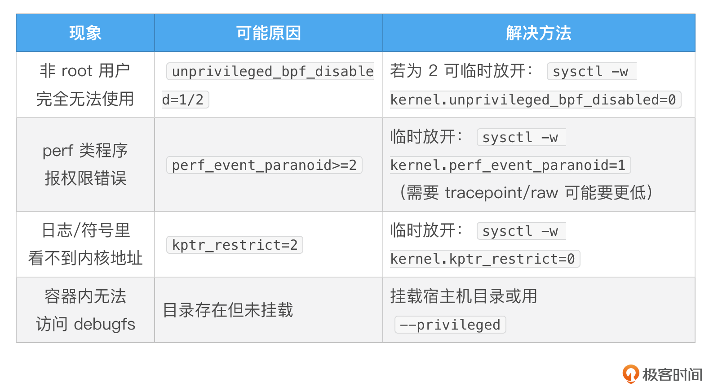
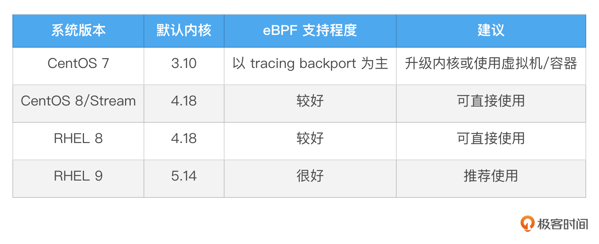
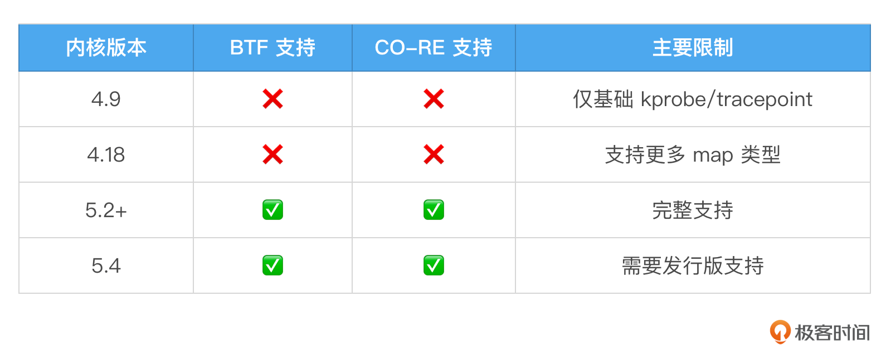
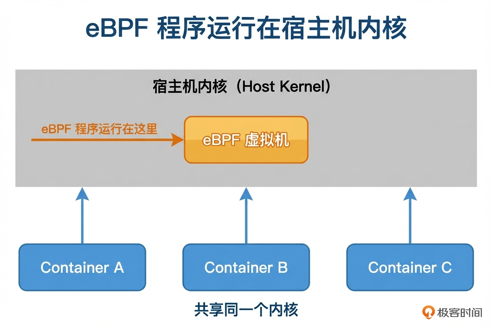
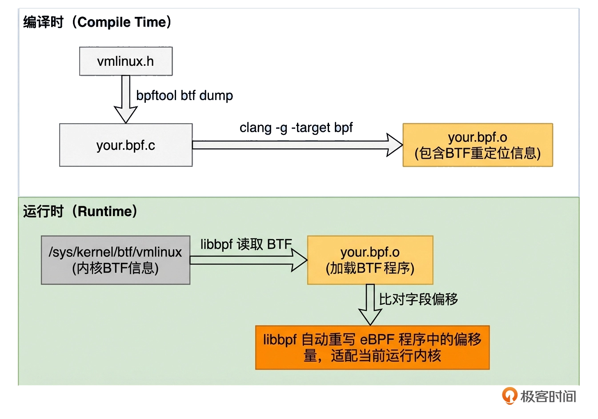
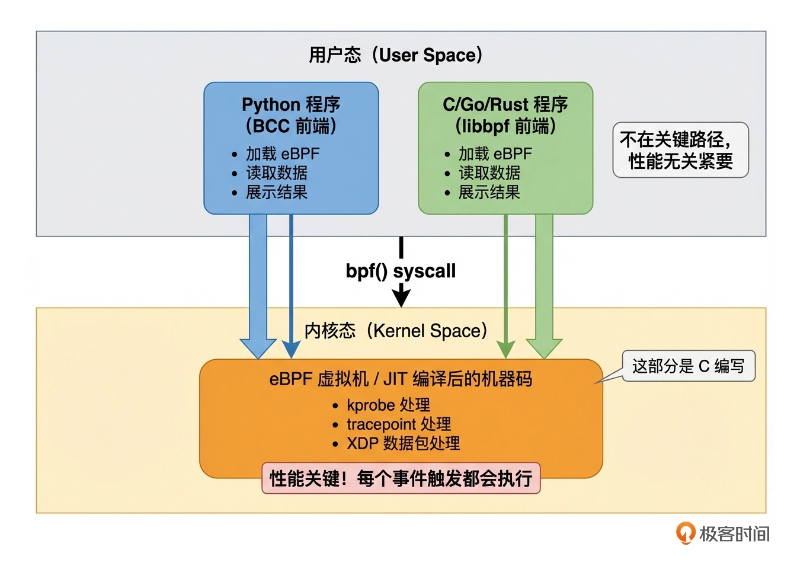
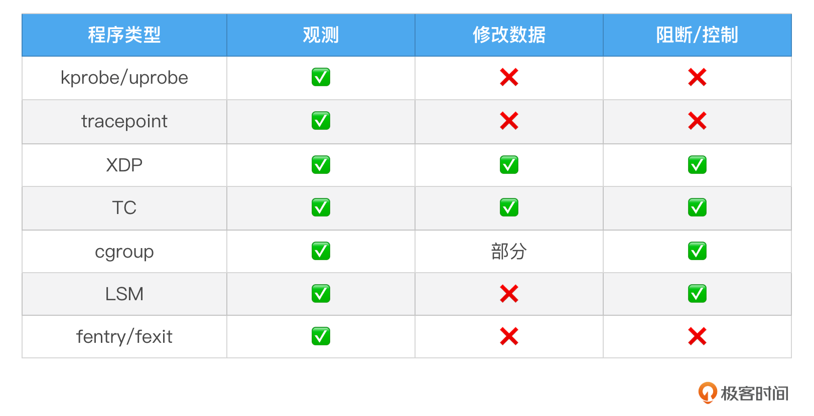

# 30 | 难点答疑：eBPF应用实践中的那些问题

你好，我是倪朋飞。

自从我们 eBPF 实战课上线以来，我在留言区和微信群收到了许多同学的提问。有同学遇到“bpftool dump jited 总是报 No libbfd support” 的问题，有同学困惑“公司只有 CentOS 7，是不是就无法学习 eBPF”，还有同学对“BTF 和 CO-RE 到底是什么关系”等基础概念感到疑惑。


这些问题涵盖了从开发环境搭建到生产环境部署的方方面面，很多都是大家在实际动手时遇到的“拦路虎”。今天，我就把这些问题整理出来，集中为你解答。


我把这些问题分成了五大类：环境搭建与工具错误、内核版本与兼容性、CO-RE 与 BTF 概念、编程与调试，以及功能与应用场景。每一类都是实践中的高频痛点，希望这些解答能帮你跨越从“能跑通 Hello World”到“真正用好 eBPF”的鸿沟。

## 一、环境搭建与工具错误

环境搭建是学习 eBPF 的第一道门槛。从留言来看，很多同学在这一步就遇到了各种各样的报错。让我们来逐一解决。

### 问题 1：如何解决 bpftool prog dump jited 的反汇编支持错误？

同学 2Sunshine、袁世超等同学提问：

- sudo bpftool prog dump jited id 187 返回 Error: No libbfd support，版本 5.8.18，没有显示false 还是提示 No libbfd support。

```
这是一个高频问题。bpftool prog dump jited 的反汇编能力是可选特性，取决于
```

bpftool 在构建时是否检测到并链接了反汇编库（新版本优先用 LLVM，libbfd 作为回退）。没有的话就会报这个错误。

需要提醒你的是，在部分发行版（如 Debian 官方包）里，这个特性可能因为打包策略或许可

```
证兼容性等原因默认不启用（尤其是 libbfd 依赖），即使你装了 binutils-dev 也不一定有
```

用。所以更现实的做法是：先用替代方案，再考虑重新编译。

解决方案

```
方法一：使用 dump xlated 替代
对于大多数调试场景，dump xlated（查看经过验证器处理后的 eBPF 字节码）已经足够用
```

了：

```
# 查看 eBPF 字节码（不需要 libbfd）
bpftool prog dump xlated id 187
# 或者直接查看 .o 文件
llvm-objdump -d your_program.bpf.o
dump xlated 显示的是 BPF 指令，而 dump jited 显示的是 JIT 编译后的本地机器码。除
```

非你需要分析具体的 CPU 指令性能，否则前者通常足够。

方法二：检查并重新编译 bpftool

先检查你的 bpftool 是否支持这个特性：

```
bpftool version -p
如果输出中显示 "llvm": false 且 "libbfd": false（旧版本可能只显示 libbfd），说明
```

没有编译进反汇编支持。

在 Ubuntu 上，安装依赖后重新从源码编译通常能解决这个问题：

```bash
sudo apt install binutils-dev libcap-dev libelf-dev
git clone --recurse-submodules https://github.com/libbpf/bpftool.git
cd bpftool/src
make clean && make
sudo make install
```

### 问题 2：如何解决 strace 跟踪 Python 脚本时的报错？

同学 Geek_5ada4a 提问：

- strace ./hello.py 报 execve = -1 EACCES (Permission denied)

同学有识之士提问：

- sudo strace -v -f -ebpf ./hello.py 报错 strace: exec: Exec format error

- 这个问题出现得非常频繁，至少有 5 位以上的同学提到过这个问题。问题的根源在于Python 脚本的执行方式。

解决方案

问题一：Permission denied

这是因为 Python 脚本没有可执行权限。解决方法很简单：

```bash
chmod +x hello.py
```

问题二：Exec format error

```
这是因为直接执行 ./hello.py 时，系统会把它当作可执行文件来处理，但 Python 脚本需
```

要解释器来运行。通常的做法有两种（二者选择其一）：

一是显式指定 Python 解释器来运行脚本：

```bash
sudo strace -v -f -ebpf python3 hello.py
```

二是确保脚本的第一行有正确的 shebang：

```
#!/usr/bin/env python3
```

### 问题 3：linux-tools 包找不到对应版本怎么办？

同学昕光之愿提问：

- 在 ubuntu 22.04 安装 linux-tools-$(uname -r) 报错，Unable to locate package linux-tools-5.19.0-38-generic。

这个问题通常出现在内核版本较新或者使用了非标准内核的情况下。

解决方案

方法一：安装通用版本

如果找不到与当前内核完全匹配的版本，可以安装通用版本：

```bash
sudo apt install linux-tools-generic
```

这会安装系统支持的默认版本，对于大多数 eBPF 开发场景已经足够。

方法二：检查可用版本

查看系统中有哪些可用的 linux-tools 版本，然后从中选择跟你的内核匹配的版本安装：

```bash
apt-cache search linux-tools | grep $(uname -r | cut -d'-' -f1,2)
```

方法三：从源码编译 bpftool

如果以上方法都不行，可以直接从内核源码或 GitHub 编译 bpftool：

```bash
# 方式 A：从 GitHub 编译（推荐，更简单）
git clone --recurse-submodules https://github.com/libbpf/bpftool.git
cd bpftool/src
sudo apt install libelf-dev
make
sudo make install
# 方式 B：从内核源码编译
sudo apt install linux-source libelf-dev
cd /usr/src
sudo tar xf linux-source-*.tar.bz2
# 进入解压后的目录（注意目录名包含版本号）
cd $(ls -d linux-source-* | head -1)/tools/bpf/bpftool
make
sudo make install
```

### 问题 4：如何解决静态编译时的 ZSTD 链接错误？

同学深清秋提问：

- 在高版本 ubuntu 6.8.0-40-generic 下，clang -Wall -O2 -g execsnoop.o -static -lbpf -lelf -lz

```
-o execsnoop 报错 undefined reference to ZSTD_createCCtx 等。
```

这个问题出现在 Ubuntu 高版本中，原因是 libelf 现在依赖 zstd 压缩库来处理压缩的 ELF 段。

解决方案：

方法一：去掉 -static 选项（推荐）

对于开发测试环境，可以使用动态链接：

```
clang -Wall -O2 -g execsnoop.o -lbpf -lelf -lz -o execsnoop
```

方法二：添加 zstd 静态库

如果确实需要静态编译，就需要添加 zstd 库：

```bash
sudo apt install libzstd-dev
clang -Wall -O2 -g execsnoop.o -static -lbpf -lelf -lz -lzstd -o execsnoop
注意链接顺序，-lzstd 需要放在 -lelf 后面，因为 libelf 依赖 zstd。
问题 5：为什么 bpftool gen skeleton 报 无效的 eBPF 对象文件？
```

同学四五又十提问：

- bpftool gen skeleton execsnoop_example.bpf.o 报错 libbpf: elf: execsnoop_example_bpfis not a valid eBPF object file。

这个错误通常意味着 .o 文件的格式不正确，最常见的原因是编译时没有指定正确的目标架构。

解决方案

确保编译 eBPF 程序时使用了正确的参数：

```
clang -O2 -g -target bpf -D__TARGET_ARCH_x86 \
   -I/usr/include/x86_64-linux-gnu \
   -c execsnoop.bpf.c -o execsnoop.bpf.o
```

几个关键参数的含义：

```
-target bpf：指定目标架构为 BPF，这是最关键的参数
-D__TARGET_ARCH_x86：定义目标 CPU 架构（根据你的系统调整）
-g：生成调试信息（BTF 需要）
你可以用 file 命令检查生成的 .o 文件：
file execsnoop.bpf.o
# 正确的输出应该类似：
# execsnoop.bpf.o: ELF 64-bit LSB relocatable, eBPF, version 1 (SYSV), with debug
如果显示的不是 eBPF，而是 x86-64 之类的，说明编译参数有问题。
```

### 问题 6：如何解决 bpftrace 的符号读取错误？

同学 17 提问：

- 使用 bpftrace -l 命令报错 Could not read symbols from/sys/kernel/debug/tracing/available_filter_functions: Permission denied。

同学 Bachue Zhou 提问：

- 运行 bpftrace 找不到 BEGIN symbol：ERROR: Could not resolve symbol:/proc/self/exe:BEGIN_trigger。

解决方案

问题一：Permission denied

这是 debugfs 权限问题。解决方法：

```bash
# 确保 debugfs 已挂载
sudo mount -t debugfs none /sys/kernel/debug
# 使用 root 用户运行
sudo bpftrace -l 'kprobe:*'
```

问题二：Could not resolve symbol: BEGIN_trigger

这通常不是内核或 BTF 的问题，而是 bpftrace 可执行文件本身的符号表被剥离（stripped）

```
了，导致它找不到内部用于触发 BEGIN/END 探针的 BEGIN_trigger/END_trigger 符
```

号。

先用下面的命令自检：

```
# 检查 bpftrace 是否有符号
nm $(which bpftrace) 2>&1 | grep -E 'BEGIN_trigger|END_trigger'
# 如果输出为空或提示 "no symbols"，说明被 strip 了
```

解决方法是安装带符号的版本（不少发行版确实发生过这种打包问题）：

```sql
# Ubuntu/Debian（需要先启用 dbgsym 源）
echo "deb http://ddebs.ubuntu.com $(lsb_release -cs) main restricted universe mul
   sudo tee /etc/apt/sources.list.d/ddebs.list
sudo apt update
sudo apt install bpftrace-dbgsym
# 或者从源码编译一个不 strip 的版本
git clone https://github.com/bpftrace/bpftrace.git
cd bpftrace && mkdir build && cd build
cmake -DCMAKE_BUILD_TYPE=RelWithDebInfo ..
make -j$(nproc)
sudo make install
```

### 补充：为什么 root 用户也加载不了 eBPF 程序？

在生产环境或容器里，你可能发现即使用 root 也无法运行 eBPF 程序，verifier log 也看不到。这通常是因为权限和安全策略的限制，而不是工具本身的问题。

建议你根据下面这个自检清单做个检查：

```
# 1. 检查 sysctl 安全开关
sysctl kernel.unprivileged_bpf_disabled  # 0=允许非特权，1=永久禁用，2=禁用但管理员可改
sysctl kernel.perf_event_paranoid        # 值越大限制越多：>=2 禁止非特权内核 profilin
sysctl kernel.kptr_restrict              # 限制内核指针暴露（%pK），日志/符号可能被遮蔽
# 2. 检查进程 capabilities
capsh --print | grep -E 'cap_bpf|cap_perfmon|cap_net_admin|cap_sys_admin'
# eBPF 加载/观测通常需要 CAP_BPF + CAP_PERFMON；网络类程序还可能需要 CAP_NET_ADMIN
# 3. 检查 bpffs 和 tracefs 挂载
mount | grep -E 'bpf|trace'
# 常见挂载点：/sys/fs/bpf（bpffs）、/sys/kernel/tracing 或 /sys/kernel/debug/tracing
```

常见原因与解决方法：



```
注意：unprivileged_bpf_disabled=1 在运行时不可恢复，只能重启后再调整默认值。
```

在容器环境里，除了上述 sysctl，还要确保挂载了必要的目录（见下面问题 10 的容器运行示例）。

## 二、内核版本与兼容性问题

环境搭建问题解决之后，接下来我们来看另一类高频问题——内核版本兼容性。这是 eBPF 落地生产环境的核心挑战之一。不同版本的内核在 eBPF 特性支持、函数签名、数据结构等方面都可能存在差异。那么，你可能就要问了：低版本内核是不是就无法使用 eBPF 了呢？

### 问题 7：为什么课程讲的操作系统里没有 CentOS？能否在 CentOS 上学习？

同学 helloworld 提问：

- 老师我问个比较 low 的问题，为什么操作系统里没有 centos？操作系统为啥不能是centos？

这个问题反映了企业环境中的真实困境。

CentOS 7 默认的内核版本是 3.10，这是一个被 Red Hat 大量 backport 过的内核。从 RHEL7.6 开始，Red Hat 把部分 eBPF 能力（主要用于系统 tracing/ 观测）移植到了 3.10 系列。但3.10 上的能力边界高度依赖发行版 backport，很难一句话说清楚“支持什么、不支持什么”。一般来说，CO-RE/BTF、BPF LSM、较新的 cgroup hook、XDP/TC 的完整能力通常需要更高版本的内核。

CentOS/RHEL 用户的选择：



解决方案

方法一：使用 CentOS 8 Stream 或 RHEL 8/9

如果可能，升级到 CentOS 8 Stream 或更新的系统，它们的内核对 eBPF 支持更完善。

方法二：在 CentOS 7 上升级内核

可以使用 ELRepo 仓库安装新内核：

```bash
# 安装 ELRepo
rpm --import https://www.elrepo.org/RPM-GPG-KEY-elrepo.org
yum install https://www.elrepo.org/elrepo-release-7.el7.elrepo.noarch.rpm
# 安装最新稳定内核
yum --enablerepo=elrepo-kernel install kernel-ml
# 重启后验证
uname -r
```

方法三：使用虚拟机或容器

在 CentOS 上运行一个 Ubuntu 虚拟机专门用于 eBPF 开发学习，这是最简单的方法。

### 问题 8：低版本内核（4.9、5.4）如何使用 eBPF？CONFIG_DEBUG_INFO_BTF

### 怎么打开？

同学 lyonger 提问：

- 总结下来，好像对于 4.9 的内核支持，还是不是特别友好，线上要使用还是很麻烦。

同学 James 提问：

- Ubuntu 20.04，内核 5.4.0，但是 CONFIG_DEBUG_INFO_BTF 没打开，怎么打开呢？

首先，让我们梳理一下不同内核版本的 eBPF 能力边界：



- 另外需要注意，Ubuntu 是否默认开启 BTF 取决于内核 flavor/HWE/ 云厂商定制版本，无法只靠版本号判断，建议用下面的自检方法确认。

解决方案

检查 BTF 支持：

```bash
# 检查内核配置
cat /boot/config-$(uname -r) | grep CONFIG_DEBUG_INFO_BTF
# 或者直接检查 BTF 文件是否存在
ls -la /sys/kernel/btf/vmlinux
```

如果 BTF 未开启：

对于云厂商提供的 Ubuntu，有些内核已经默认开启了 BTF，但并不保证。如果没有，你需要重新编译内核：

```
# 在内核配置中启用以下选项
CONFIG_DEBUG_INFO_BTF=y
CONFIG_DEBUG_INFO=y
```

对于完全不支持 BTF 的老内核有三种策略：

1. 使用 BCC：BCC 采用运行时编译，不依赖 BTF

2. 使用 btfhub：为老内核下载预编译的 BTF 文件

3. 降级功能：放弃 CO-RE，使用传统方式开发

### 问题 9：如何应对高版本内核的函数名变化？

同学 Bachue Zhou 提问：

- sudo bpftrace -l ‘kprobe:kfree_skb*’ 我这边 5.19 就没有 kfree_skb 这个函数了，只有kfree_skb_reason。

这是一个非常典型的内核 API 演进问题。内核开发者经常会重命名、重构或删除某些函数，这给 eBPF 程序的兼容性带来了挑战。

解决方案

方法一：使用 tracepoint 替代 kprobe

Tracepoint 相比 kprobe 更加稳定，内核开发者在修改 tracepoint 时会更加谨慎：

```bash
# 查找相关的 tracepoint
sudo bpftrace -l 'tracepoint:skb:*'
# 使用 tracepoint 替代
sudo bpftrace -e 'tracepoint:skb:kfree_skb { printf("%s\n", kstack); }'
```

方法二：运行时探测函数是否存在

在用户态程序中动态检测：

```
// 检查函数是否存在
bool has_kfree_skb_reason = false;
FILE *f = fopen("/sys/kernel/debug/tracing/available_filter_functions", "r");
if (f == NULL) {
   // 文件不存在或无权限访问，使用默认值
   // 可能需要检查 debugfs 是否已挂载
   return has_kfree_skb_reason;
}
char line[256];
while (fgets(line, sizeof(line), f)) {
   if (strstr(line, "kfree_skb_reason")) {
       has_kfree_skb_reason = true;
       break;
   }
}
fclose(f);
// 根据结果选择挂载点
if (has_kfree_skb_reason) {
   bpf_program__attach_kprobe(prog, false, "kfree_skb_reason");
} else {
   bpf_program__attach_kprobe(prog, false, "kfree_skb");
}
```

方法三：在 eBPF 程序中使用 CO-RE 特性探测

```
// 使用 bpf_core_type_exists 检测类型是否存在
if (bpf_core_type_exists(struct trace_event_raw_kfree_skb)) {
   // 新内核逻辑
} else {
   // 旧内核逻辑
}
```

### 问题 10：eBPF 依赖的是容器内核还是宿主机内核？

同学 helloworld 提问：

- 老师，请问下 ebpf 对系统内核的要求，可以通过容器的操作系统来屏蔽掉对吗？不要求物理机节点的内核版本吧？

这是一个很常见的误解，我必须明确地告诉你：eBPF 程序始终运行在宿主机内核中，与容器内的“内核”无关。

原理解释：

容器（如 Docker）并不包含真正的内核，它只是一个隔离的用户空间进程。容器内的所有系统调用最终都会由宿主机的内核来处理，如下图所示：



正是因为如此，你需要注意以下三点：

1. 你在容器内运行 eBPF 工具（如 bpftrace），它访问的是宿主机的内核；

```
容器镜像内的 /lib/modules 等内核相关文件与实际运行的内核可能不匹配；
```

3. 要在容器内运行 eBPF 程序，通常需要挂载宿主机的相关目录。

通常来说，你可以参考下面这个命令在容器中运行 eBPF 程序：

```bash
docker run -it --rm \
   --privileged \
   -v /lib/modules:/lib/modules:ro \
   -v /usr/src:/usr/src:ro \
   -v /sys/kernel/debug:/sys/kernel/debug \
   -v /sys/fs/bpf:/sys/fs/bpf \
   your-ebpf-image
```

## 三、CO-RE 与 BTF 概念混淆

前面，我给你讲了环境搭建和内核兼容性的问题。接下来，我们来看 eBPF 学习中最容易混淆的概念——CO-RE 和 BTF。CO-RE（Compile Once, Run Everywhere）是 eBPF 生态中的重要创新，但也是概念最容易混淆的部分。很多同学在这里卡住了，不过别担心，让我用图示来帮你理清它们的关系。

### 问题 11：BTF 和 CO-RE 的关系是什么？调试信息从哪来？

同学 MoGeJiEr 提问：

- BTF 那块是不是没说完阿？怎么后面 CO-RE 就可以借助 BTF 的调试信息？这个调试信息哪里来？一头雾水。

同学张 Dave 提问：

- 一次编译到处执行，哪里还有更详细的解释呢？没太明白文中总结的两点具体是怎么做的？

这确实是一个容易让人困惑的概念，让我用一张图来说明它们之间的关系：



在这个图中，有几个关键概念需要你理解：

1. BTF（BPF Type Format）：一种紧凑的调试信息格式，记录了内核数据结构的类型、成员、偏移量等信息。它来源于两个地方：

```
内核 BTF：位于 /sys/kernel/btf/vmlinux，由内核在编译时生成；
程序 BTF：嵌入在 .bpf.o 文件中，由 clang 在编译 eBPF 程序时生成。
vmlinux.h：由 bpftool btf dump file /sys/kernel/btf/vmlinux format c
```

```
> vmlinux.h 生成，包含了内核所有数据结构的定义。
```

3. CO-RE：是一套机制，不是单一技术。它包括：

- 编译时：clang 记录所有结构体访问的重定位信息；

- 加载时：libbpf 读取目标内核的 BTF，重写偏移量。

再来看一个具体的例子。

```
假设你要读取 task_struct->pid：
// 在开发机（内核 5.15）上编译时，pid 偏移量是 1234
struct task_struct *task = ...;
int pid = task->pid;  // clang 记录：需要访问 task_struct 的 pid 字段
// 在运行机（内核 5.4）上加载时，libbpf 发现：
// - 5.4 内核的 task_struct->pid 偏移量是 1200（不是 1234）
// - 自动将 eBPF 程序中的偏移量从 1234 改为 1200
```

这就是“一次编译到处执行”的核心原理。

### 问题 12：CO-RE 条件编译具体如何实现？

同学鴻🍋提问：

- “采用条件编译的方式，根据是否支持 CO-RE，生成两个不同的 eBPF 字节码文件。” 这个是如何实现的？

让我通过具体的代码示例来解答。

场景一：编译时条件编译（生成两个版本）

这是在 Makefile 层面的条件编译：

```go
# Makefile
CORE_SUPPORT := $(shell test -f /sys/kernel/btf/vmlinux && echo 1 || echo 0)
```

```
ifeq ($(CORE_SUPPORT),1)
   # 支持 CO-RE 的编译
   CFLAGS += -DUSE_CORE
   BPF_CFLAGS += -g  # 生成 BTF
else
   # 不支持 CO-RE 的编译
   CFLAGS += -DNO_CORE
endif
```

对应的 eBPF 代码：

```
#ifdef USE_CORE
// CO-RE 版本：使用 BPF_CORE_READ
#include "vmlinux.h"
#include <bpf/bpf_core_read.h>
SEC("kprobe/do_sys_open")
int trace_open(struct pt_regs *ctx) {
   struct task_struct *task = (void *)bpf_get_current_task();
   int pid = BPF_CORE_READ(task, pid);  // CO-RE 方式读取
   // ...
}
#else
// 非 CO-RE 版本：使用传统的 bpf_probe_read
#include <linux/sched.h>
SEC("kprobe/do_sys_open")
int trace_open(struct pt_regs *ctx) {
   struct task_struct *task = (void *)bpf_get_current_task();
   int pid;
   bpf_probe_read(&pid, sizeof(pid), &task->pid);  // 传统方式
   // ...
}
#endif
```

场景二：运行时特性检测

另一种方式是在运行时检测内核特性：

```
#include "vmlinux.h"
#include <bpf/bpf_core_read.h>
// 使用 bpf_core_field_exists 检测字段是否存在
SEC("kprobe/do_sys_open")
int trace_open(struct pt_regs *ctx) {
   struct task_struct *task = (void *)bpf_get_current_task();
   // 假设新内核将 pid 重命名为 thread_pid
   int pid;
   if (bpf_core_field_exists(task->thread_pid)) {
       pid = BPF_CORE_READ(task, thread_pid);
   } else {
       pid = BPF_CORE_READ(task, pid);
   }
   // ...
}
```

场景三：处理结构体字段变更

libbpf 的“忽略后缀规则”是处理不兼容变更的利器：

```
// 假设在新内核中，task_struct 的某个字段类型变了
// 可以定义带后缀的结构体，libbpf 会自动匹配
struct task_struct___old {
   // 旧内核的字段定义
   int pid;
   char comm[16];
} __attribute__((preserve_access_index));
struct task_struct___new {
   // 新内核的字段定义
   struct pid *thread_pid;
   char comm[16];
} __attribute__((preserve_access_index));
// libbpf 会忽略 ___old 和 ___new 后缀，自动匹配内核中的 task_struct
```

### 问题 13：cilium/ebpf 库如何实现 CO-RE？

同学疯狂的小企鹅提问：

- 请问 cilium/ebpf 库是怎么解决这个问题的？目前我们采用的办法是根据不同 kernel 版本生成多份 .o 文件，然后用户态程序再判断下 kernel 版本来决定加载哪一份 .o。但我感觉这不

- 是最佳实践，求老师赐教。

cilium/ebpf（也叫 ebpf-go）确实支持 CO-RE，它的实现方式与 libbpf 类似。

我总结了一些它的几个最佳实践，供你参考：

1. 使用 CO-RE 重定位（推荐）

cilium/ebpf 内置了 CO-RE 支持，你只需要：

```go
package main
import (
   "log"
   "github.com/cilium/ebpf"
   "github.com/cilium/ebpf/btf"
)
//go:generate go run github.com/cilium/ebpf/cmd/bpf2go -cc clang -target bpf MyPr
func main() {
   // 加载编译好的 eBPF 程序规格
   spec, err := loadMyProgram()
   if err != nil {
       log.Fatalf("loading spec: %v", err)
   }
   // 准备加载选项
   opts := ebpf.CollectionOptions{}
```

```go
   // 如果内核没有 BTF，可以通过 KernelTypes 指定外部 BTF
   if _, err := btf.LoadKernelSpec(); err != nil {
       // 从 btfhub 加载对应版本的 BTF
```

```go
       btfSpec, err := btf.LoadSpec("/path/to/external.btf")
       if err != nil {
           log.Fatalf("loading external BTF: %v", err)
       }
       opts.Programs.KernelTypes = btfSpec
   }
   // 使用选项加载 Collection
   coll, err := ebpf.NewCollectionWithOptions(spec, opts)
   if err != nil {
       log.Fatalf("creating collection: %v", err)
   }
   defer coll.Close()
   // ...
}
```

需要注意的是，外部 BTF 只能解决“加载期拿不到目标内核类型信息”的问题。能否成功 CO-

```
RE 还取决于：你编译的 .o 文件是否携带了 CO-RE 重定位信息，以及目标内核对 BPF/BTF
```

的整体支持能力。

2. bpf2go 工具链

```
cilium/ebpf 推荐使用 bpf2go 工具自动生成 Go 代码：
//go:generate go run github.com/cilium/ebpf/cmd/bpf2go -cc clang MyProg my_prog.b
这会生成 myprog_bpfel.go 和 myprog_bpfeb.go，其中已经包含了 CO-RE 支持。
```

3. 放弃多版本 .o 文件的方案

你目前“生成多份 .o 文件”的做法确实不是最佳实践。正确的做法是：

- 使用 CO-RE + vmlinux.h 编译一份 .o 文件

- 让 cilium/ebpf 在加载时自动处理重定位

- 对于不支持 BTF 的老内核，使用 btfhub 提供外部 BTF

### 问题 14：如何解决 libbpf 版本兼容和符号缺失问题？

同学 Bachue Zhou 提问：

- 这个 XDP 程序对 libbpf 的版本要求很高啊，我这边用的是 Ubuntu 22.04 都不行，很多symbol 找不到的。

同学 Geek_6acaf8 提问：

- xdp-proxy-v2.c:78:2: warning: implicit declaration of function ‘LIBBPF_OPTS’ is invalid。

libbpf 的 API 确实在快速演进，不同版本之间存在兼容性问题。

解决方案

方法一：升级 libbpf

从源码安装最新版本的 libbpf：

```bash
git clone https://github.com/libbpf/libbpf.git
cd libbpf/src
make
sudo make install
sudo ldconfig
```

方法二：使用 libbpf 作为 submodule

这是很多项目采用的方式，将 libbpf 作为项目的一部分一起编译（我们的 Github 项目使用

的是这种方法）：

```
git submodule add https://github.com/libbpf/libbpf.git
```

在 Makefile 中：

```
LIBBPF_SRC = ../libbpf/src
LIBBPF_OBJ = $(LIBBPF_SRC)/libbpf.a
$(LIBBPF_OBJ):
   <!--§§MATH_0§§-->(LIBBPF_SRC)
your_program: your_program.c $(LIBBPF_OBJ)
   <!--§§MATH_1§§-->@ <!--§§MATH_2§§-->(LIBBPF_OBJ) -lelf -lz
```

方法三：检查 API 兼容性

```
某些 API 在不同版本中有变化，比如 LIBBPF_OPTS 宏。如果你的 libbpf 版本较旧，可以使
```

用传统的结构体初始化：

```
// 新版本 (libbpf >= 0.6)
LIBBPF_OPTS(bpf_xdp_attach_opts, attach_opts);
// 旧版本兼容写法
struct bpf_xdp_attach_opts attach_opts = {
   .sz = sizeof(struct bpf_xdp_attach_opts),
};
```

## 四、编程与调试问题

到这里，我已经带你了解了环境、兼容性和 CO-RE 概念相关的问题。接下来，让我们深入到实际编程中，看看开发和调试 eBPF 程序时会遇到哪些问题。

### 问题 15：tracepoint 参数结构体（如 trace_event_raw_sys_enter）如何确定？

同学 donix 提问：

- SEC(“tracepoint/syscalls/sys_enter_execve”) 中的参数的结构体 structtrace_event_raw_sys_enter 是如何确定的？

确定 tracepoint 参数结构体通常有两种方法：

方法一：从 vmlinux.h 中查找（推荐）

如果你使用 CO-RE 和 vmlinux.h，可以直接在头文件中搜索：

```bash
# 生成 vmlinux.h
bpftool btf dump file /sys/kernel/btf/vmlinux format c > vmlinux.h
# 搜索对应的结构体
grep -A 20 "struct trace_event_raw_sys_enter" vmlinux.h
```

一般规则是：

```
sys_enter_xxx 对应 struct trace_event_raw_sys_enter
sys_exit_xxx 对应 struct trace_event_raw_sys_exit
其他 tracepoint 可以在 vmlinux.h 中搜索 trace_event_raw_ 前缀
```

方法二：从 /sys/kernel/debug/tracing 读取格式

这是更通用的方法，适用于没有 vmlinux.h 的情况：

```
# 查看 tracepoint 的格式定义
```

```bash
sudo cat /sys/kernel/debug/tracing/events/syscalls/sys_enter_execve/format
```

你会看到类似如下的输出：

```javascript
name: sys_enter_execve
ID: 708
format:
   field:unsigned short common_type;    offset:0;    size:2;    signed:0;
   field:unsigned char common_flags;    offset:2;    size:1;    signed:0;
   field:unsigned char common_preempt_count;    offset:3;    size:1;    signed:0
   field:int common_pid;    offset:4;    size:4;    signed:1;
   field:int __syscall_nr;    offset:8;    size:4;    signed:1;
   field:const char * filename;    offset:16;    size:8;    signed:0;
   field:const char *const * argv;    offset:24;    size:8;    signed:0;
   field:const char *const * envp;    offset:32;    size:8;    signed:0;
```

根据这个格式，你可以自己定义结构体：

```javascript
struct sys_enter_execve_args {
   char _[16];                    // 前 16 字节是 common 字段
   const char *filename;          // offset:16
   const char *const *argv;       // offset:24
   const char *const *envp;       // offset:32
};
SEC("tracepoint/syscalls/sys_enter_execve")
int trace_execve(struct sys_enter_execve_args *ctx) {
   const char *filename = ctx->filename;
   // ...
}
```

### 问题 16：没有符号信息的二进制文件如何使用 uprobe 跟踪？

同学 DD 提问：

- 老师，请问如果用户空间的二进制文件，没有调试信息呢？该如何找到要跟踪的函数？

同学 Geek_722e86 提问：

- 如果我 OS 上的 bash 就是没有符号信息，我还是想挂载 readline 函数，怎么办呢？

这是一个实际生产环境中经常遇到的问题。解决方案取决于具体场景：

方法一：安装调试符号包

大部分发行版都提供调试符号包：

```bash
# Ubuntu/Debian
sudo apt install bash-dbgsym
# CentOS/RHEL
debuginfo-install bash
# 验证
sudo bpftrace -l 'uprobe:/usr/bin/bash:*readline*' # 现在应该能看到符号了
```

方法二：从符号表获取地址（动态链接的情况）

即使没有调试符号，动态链接的函数仍然可以在 .dynsym 中找到：

```
# 查看动态符号表
readelf -s --dyn-syms /usr/bin/bash | grep readline
# 或使用 objdump
objdump -T /usr/bin/bash | grep readline
```

如果 readline 是从 libreadline.so 动态加载的，可以直接跟踪库函数：

```
# 找到 libreadline 的位置
```

```bash
ldd /usr/bin/bash | grep readline
# 跟踪库中的函数
sudo bpftrace -e 'uretprobe:/lib/x86_64-linux-gnu/libreadline.so.8:readline {
   printf("readline: %s\n", str(retval));
}'
```

方法三：从 ELF 文件计算地址偏移

如果函数确实在二进制中但没有符号，你需要通过逆向分析找到函数地址：

```bash
# 获取 .text 段的基地址
readelf -S /usr/bin/bash | grep ".text"
# 使用反汇编工具（如 Ghidra、IDA）找到函数偏移
# 然后使用地址挂载
sudo bpftrace -e 'uprobe:/usr/bin/bash:0x12345 { printf("hit\n"); }'
```

方法四：使用 USDT（如果可用）

一些程序内置了 USDT（User Statically-Defined Tracing）探针：

```bash
# 检查程序是否有 USDT 探针
sudo bpftrace -l 'usdt:/usr/bin/bash:*'
# 如果有，直接使用
sudo bpftrace -e 'usdt:/usr/bin/bash:readline { ... }'
```

### 问题 17：为什么用 Python 写 eBPF？对性能要求这么高怎么会用 Python？

同学李清泉🍻提问：

- 老师您好，bpf 对性能要求这么是，怎么会用 python 写呢？

同学斜风细雨不须归提问：

- 用 Python 来调用 c 就很莫名其妙，倒不像搞开发了，顿时像搞运维了。这个问题反映了对 eBPF 架构的误解，我来澄清一下。

之所以有这个疑惑，主要还是没有理解 eBPF 中的用户态和内核态这两个核心概念。为了方便你理解，我画了一个示意图，如下所示：



从图中你可以看出：

1. 性能敏感的代码是内核态 eBPF 程序，无论你用什么语言写用户态程序，内核态的 eBPF代码都是用 C 编写、编译为 eBPF 字节码、在内核虚拟机中运行的。

2. 用户态程序只负责管理工作：

- 编译 / 加载 eBPF 程序（只执行一次）；

- 从 map 读取数据（用户态低频操作）；

- 展示结果给用户。

3. Python（BCC）的优势：

- 快速原型开发

- 交互式探索

- 丰富的数据处理 / 可视化库

- 适合一次性诊断脚本

4. C/Go/Rust 的优势：

- 更好的性能（如果需要高频读取 map）

- 更适合生产环境部署

- 静态二进制，无需安装依赖

至于何时选择什么语言，你可以参考下面这个表格：


## 五、功能与应用场景

前面，我们讨论了环境搭建、内核兼容性、CO-RE 概念和编程调试等方面的问题。最后，让

我们来看看 eBPF 的能力边界——它到底能做什么，不能做什么？

### 问题 18：eBPF 能否做控制 / 阻断操作？比如阻断文件打开？

同学 Slience-0°C 提问：

- eBPF 可以下钩子，进行某些行为的阻断么？比如阻断文件打开？

这是一个关于 eBPF 能力边界的好问题。答案是：可以，但取决于具体场景和使用的 eBPF 程序类型。

可以阻断 / 控制的场景：

1. 网络数据包（XDP/TC）：

```
SEC("xdp")
int xdp_drop_icmp(struct xdp_md *ctx) {
   // 解析数据包，如果是 ICMP 就丢弃
   if (is_icmp_packet(ctx)) {
       return XDP_DROP;  // 丢弃数据包
   }
   return XDP_PASS;
}
```

2. 系统调用（Seccomp BPF）：

```
// 使用 seccomp-bpf 可以阻断系统调用
// 注意：这不是 eBPF，而是经典 BPF
```

3. LSM（Linux Security Module）钩子（内核 5.7+）：

```
SEC("lsm/file_open")
int BPF_PROG(deny_open, struct file *file) {
```

```
   // 检查是否允许打开文件
   if (should_deny(file)) {
       return -EPERM;  // 拒绝操作
   }
   return 0;  // 允许操作
}
```

4. cgroup BPF：

```
SEC("cgroup/connect4")
int deny_connect(struct bpf_sock_addr *ctx) {
   // 阻止连接到某些 IP
   if (ctx->user_ip4 == blocked_ip) {
       return 0;  // 拒绝连接
   }
   return 1;  // 允许连接
}
```

不能阻断的场景：

1. kprobe/uprobe：只能观测，不能修改行为或阻断；

2. tracepoint：只能观测；

3. perf events：只能采样和观测。

在选择使用时，可参考下表：



```
问题 19：为什么验证器报 R4 invalid zero-sized read 错误？
```

同学进击的 Lancelot 提问并详细分析了问题（这个分析过程非常值得学习）：

- 按照 HTTPS 跟踪详解中的代码编写，在加载 ebpf 程序时会产生错误信息：139: (85) callbpf_skb_load_bytes#26 R4 invalid zero-sized read… 产生这个错误信息的原因是因为bpf_skb_load_bytes 的第四个参数必须是常量类型。

这位同学的分析过程堪称教科书级别，我来梳理一下他的排查方法：

1. 从错误信息定位内核函数：

```
错误信息 invalid zero-sized read 指向 check_mem_size_reg 函数
```

2. 使用 bpftrace 追踪验证器行为：

```bash
sudo bpftrace -e 'kretprobe:check_mem_size_reg /retval != 0/ { print(kstack());}'
```

3. 根据调用栈定位源码：

```
check_func_arg+1013 → ARG_CONST_SIZE
```

4. 查看 bpf_func_proto 定义：

```javascript
static const struct bpf_func_proto bpf_skb_load_bytes_proto = {
   .func       = bpf_skb_load_bytes,
```

```
   .arg4_type  = ARG_CONST_SIZE,  // 第 4 个参数必须是常量！
};
```

```
这样其实就找到了问题的根因，即 bpf_skb_load_bytes(skb, offset, buf, len)
的第四个参数 len 必须是编译时常量，不能是运行时变量。
```

错误代码：

```
int read_length = calculate_length();  // 运行时变量
bpf_skb_load_bytes(skb, 0, buf, read_length);  // 错误！
```

正确代码：

```
#define MAX_READ_LEN 100
bpf_skb_load_bytes(skb, 0, buf, MAX_READ_LEN);  // 正确，常量
// 或者使用固定的 sizeof
bpf_skb_load_bytes(skb, 0, buf, sizeof(buf));  // 正确
```

验证器为什么有这个限制？

这是出于安全考虑。eBPF 验证器需要在加载时就能确定所有内存访问的边界，如果允许运行时变量作为长度，验证器就无法证明内存访问不会越界。

## 小结

今天，我整理回答了课程留言中最典型的 19 个问题，涵盖了从开发环境搭建到生产部署的各个方面。

在环境搭建方面，bpftool 的高级功能依赖编译选项，遇到报错时可以考虑替代方案或重新编译。执行 Python 脚本要注意权限和 shebang，静态编译时注意处理 zstd 等新增依赖。

在内核兼容性方面，eBPF 程序始终运行在宿主机内核中，与容器无关。低版本内核可以通过BCC 或 btfhub 获得部分能力，内核函数改名时优先用 tracepoint 保证兼容。

在 CO-RE 和 BTF 方面，BTF 是调试信息格式，CO-RE 是重定位机制，两者配合实现“一次编译到处执行”。vmlinux.h 用于编译时，内核 BTF 用于加载时重定位。

在编程和功能边界方面，tracepoint 参数结构体可从 vmlinux.h 或 debugfs 获取；Python 写用户态不影响性能，因为关键代码在内核态。eBPF 的阻断能力取决于程序类型，XDP/TC/LSM可以阻断，kprobe/tracepoint 只能观测。

另外，碰到这类问题时，不妨试试借助 AI 工具来解决。把报错信息或问题描述发给 ChatGPT等大模型，大部分情况下都能得到有用的答案。如果是 eBPF 程序的编写，还可以用 ClaudeCode 这类 AI 编程工具，它不仅能帮你写代码，出错后还能自动排查并修复。不过要注意，eBPF 程序需要 root 权限运行，所以这种方式只建议在开发环境中使用。

## 思考题

最后，留两个思考题：

1. 在你的实际工作中，有没有遇到过今天讨论的某个问题？你是怎么解决的？有没有更好的方法？

2. 结合今天的内容，你觉得在企业环境中推广 eBPF 最大的障碍是什么？如何克服这些障碍？

欢迎在留言区和我讨论，也欢迎把这节课分享给你的同事、朋友。让我们一起在实战中演练，在交流中进步。
