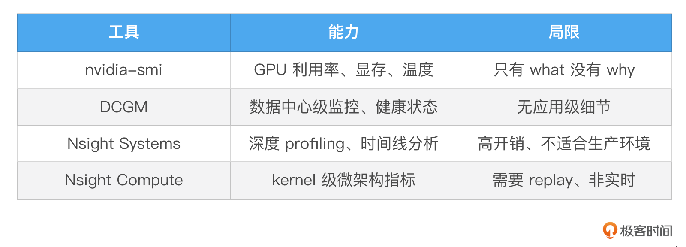
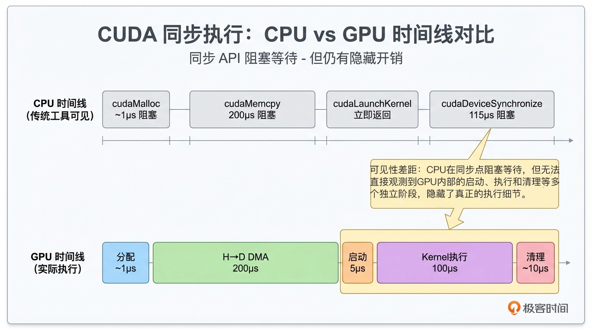
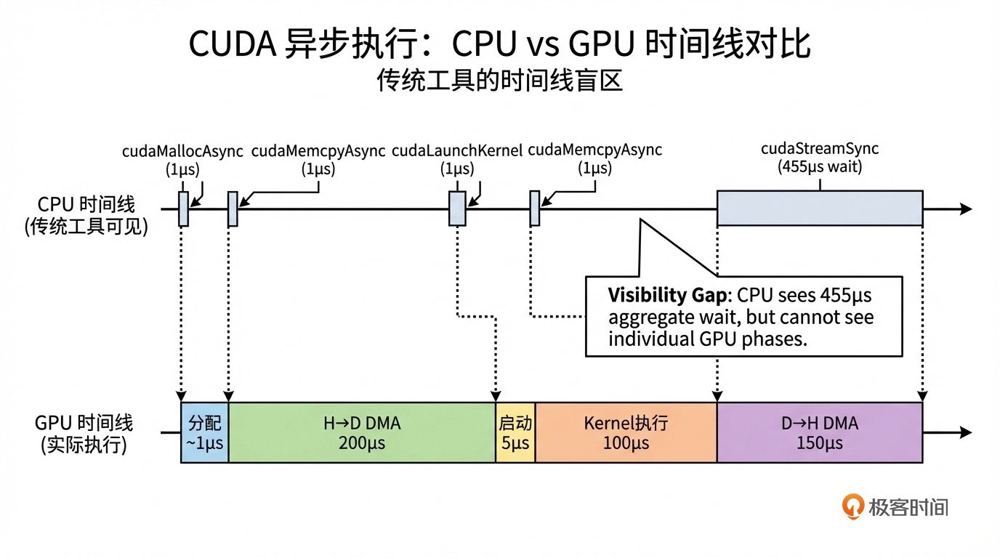
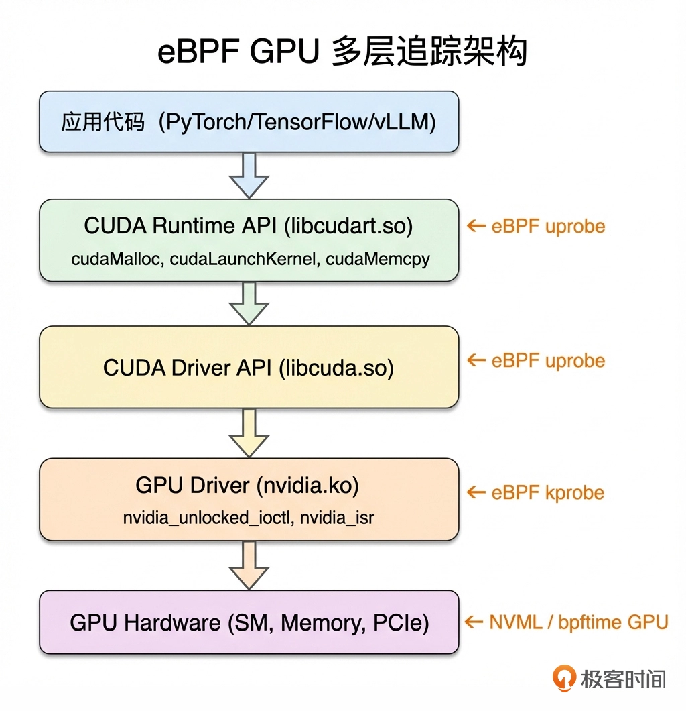
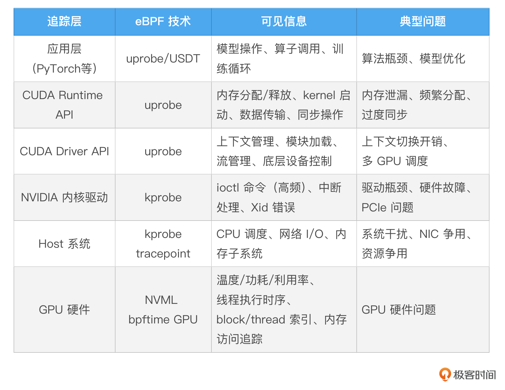
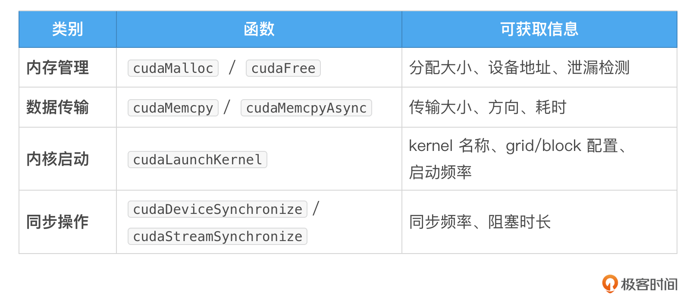
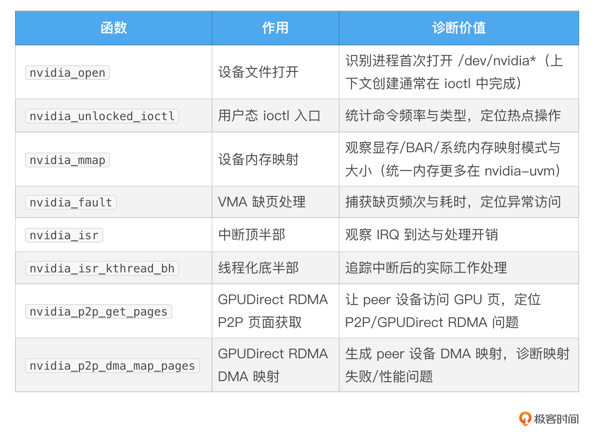
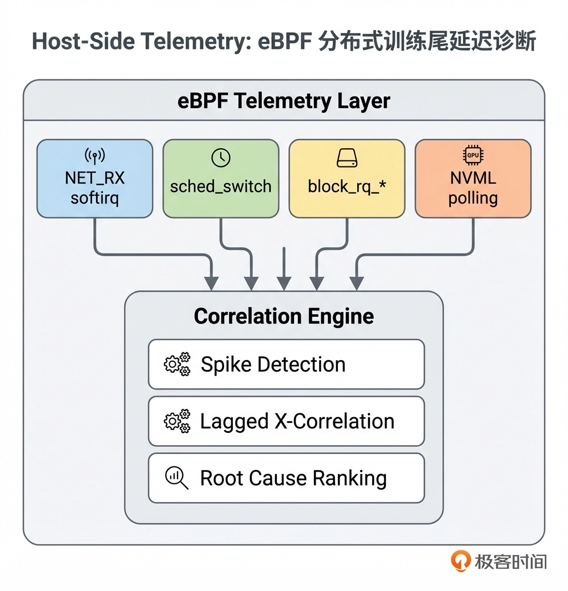
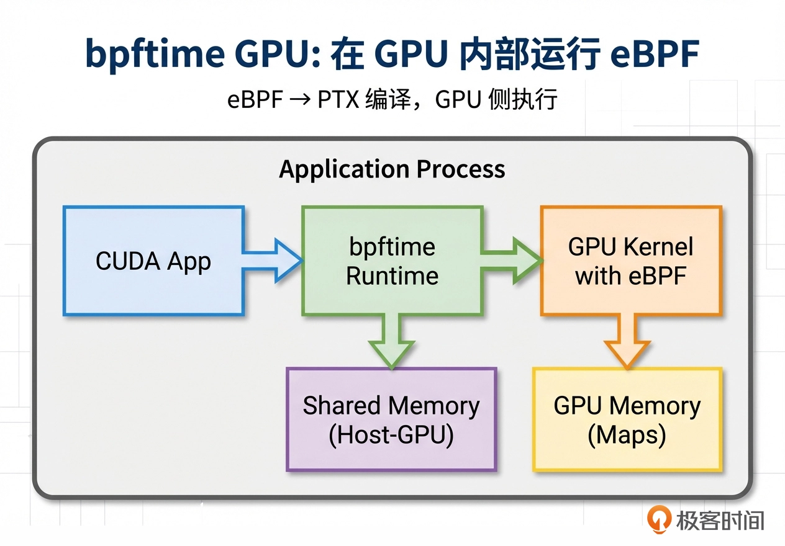
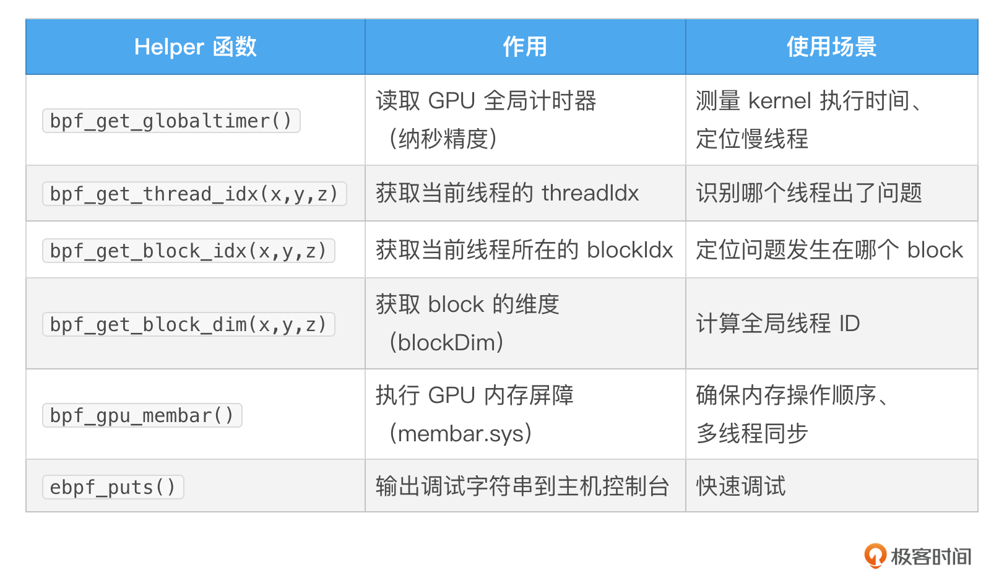

# 31 | 案例解析：eBPF揭秘GPU，大模型训练与推理的性能诊断

你好，我是倪朋飞。

上一讲，我们把 eBPF 实践中常见的问题做了一次集中答疑。今天，我们换个角度，聊一个非常热门的话题：如何使用 eBPF 技术监控和诊断 GPU 性能问题，特别是在大模型（LargeLanguage Model，简称 LLM）训练与推理场景中。

不知道你在使用 GPU 时有没有遇到过这样的困境：

- H100 显示 80% 利用率，但训练速度比预期慢 40%

- All-Reduce 操作偶发性超时，找不到根因

- 推理服务 P99 延迟突然飙升，nvidia-smi 看不出问题

这些问题的共同点是：传统的 GPU 监控工具只能告诉你发生了什么，却无法解释为什么发生。而 eBPF，正是打开这个黑盒的钥匙。

## GPU 为什么是黑盒？

在深入 eBPF 解决方案之前，我们先来理解一下，为什么 GPU 可观测性如此困难。

### 传统工具的局限

如下表格所示，目前业界主流的 GPU 监控工具主要有以下几种：



让我用一个类比来说明这个问题。nvidia-smi 就像汽车仪表盘上的油量表和速度表，它能告诉你“油快没了”或者“车速 80 公里”，但它无法告诉你“为什么油耗这么高”或者“为什么提速这么慢”。而 Nsight 系列工具虽然能深入分析，但就像把车开进 4S 店做全面检测一样，你需要停下来，而且检测本身会显著影响性能。

### 大模型场景的挑战

在大模型训练和推理场景中，GPU 可观测性面临更加严峻的挑战：

1. 异步 CUDA API 导致时间信息丢失：现代 CUDA 应用大量使用异步 API（如

```
cudaMemcpyAsync()、cudaLaunchKernel() with streams）来最大化硬件利用率。
```

- API 调用立即返回，CPU 继续执行，而 GPU 在后台按顺序处理操作。从 CPU 的视角看，所有入队操作在微秒级返回，只有最终的同步点才会阻塞。如果只看 CPU 侧 wall-time，很

- 容易把入队很快误判成 GPU 执行很快。要拿到 GPU 侧真正的执行时间，需要 CUDAEvent 或设备侧 profiler（如 Nsight/CUPTI）；而 eBPF 更擅长补齐 Host/ 驱动侧的关联证据。

2. 分布式训练中的 NCCL 尾延迟：分布式训练依赖 NCCL（NVIDIA CollectiveCommunications Library）进行 All-Reduce 等操作。当某个节点出现延迟时，整个训练都会被拖慢，而问题根因可能在 GPU 之外，比如 NIC 争用、PCIe 压力、CPU 干扰等等。

3. 多租户环境的干扰源识别：在 Kubernetes 集群中，多个推理服务共享 GPU 资源。当性能下降时，很难区分是本服务的问题还是邻居服务的影响。

4. 推理服务的 P99 延迟抖动：推理服务对尾延迟极其敏感。偶发的延迟尖峰可能来自内存分配、kernel 调度、甚至是驱动层的行为。

### GPU 可观测性盲区

让我用一个具体的例子来说明 GPU 可观测性的盲区问题。假设你有一个典型的 CUDA 工作流：分配显存 → 数据传输到 GPU → 执行 kernel → 数据传输回 CPU。

同步模式下，CPU 侧工具还能通过阻塞 API 的耗时获得一些信息，如下图所示：



不过，即使在同步模式下，115μs 的同步时间也是一个不透明的聚合值，它混合了多个隐藏的GPU 侧阶段：kernel 启动开销（~5μs）、实际执行（~100μs）、清理（~10μs）。你无法区分性能问题是来自启动开销过大、warp 分歧（warp divergence）、还是内存访问模式不佳。

异步模式下情况更糟，如下图所示：



所有计时信息都被压缩成一个 455μs 的聚合值。“瓶颈是内存传输还是 kernel 执行？”这个问题从 CPU 侧已经无法回答。

## eBPF 如何填补 GPU 可观测性空白？

eBPF 的核心优势在于：零代码修改、低开销、可在生产环境持续运行。通过多层追踪策略，我们可以覆盖完整的 GPU 软件栈，如下图所示：



从图中可以看出，想要覆盖完整的 GPU 软件栈，需要对从 GPU Hardware 到 PyTorch 应用层代码的每一层都进行观测，并且每一层都有相应的 eBPF 技术支持。具体的跟踪方法和每一层可观测到信息如下表所示：



## 如何追踪 CUDA API？

现在，让我们进入动手实践环节，先来看看如何跟踪 CUDA API。GPU 应用主要通过 CUDA运行时库与 GPU 交互，我们可以使用 uprobe 拦截这些 API 调用。

### 可追踪的关键函数

CUDA 的追踪并不需要覆盖所有 CUDA API，在大模型场景下，大多数情况下只需关注最关键的几个即可。我已将最值得追踪的 CUDA API 整理成表格，供你参考：



### uprobe 追踪 cudaMalloc 示例

有了待追踪的具体函数，接下来该如何追踪呢？

```
以追踪 cudaMalloc 的调用为例，下面是一个完整的 eBPF 程序。它会捕获每次显存分配的
```

大小、返回地址和状态码。

首先，我们定义用于用户态和内核态通信的数据结构：

```
// cuda_events.h - 事件数据结构
#define TASK_COMM_LEN 16
#define MAX_DETAILS_LEN 128
enum cuda_event_type {
   CUDA_EVENT_MALLOC = 0,
   CUDA_EVENT_FREE,
   CUDA_EVENT_MEMCPY,
   CUDA_EVENT_LAUNCH_KERNEL,
   CUDA_EVENT_STREAM_SYNC,
};
struct cuda_malloc_event {
   __u32 pid;                    // 进程 ID
   __u64 size;                   // 请求分配的大小
   void *device_addr;            // 分配到的设备地址
   __s32 ret;                    // 返回码 (cudaError_t)
   __u64 start_ns;               // 调用开始时间
   __u64 end_ns;                 // 调用结束时间
   char comm[TASK_COMM_LEN];     // 进程名
};
```

接下来是 eBPF 程序的核心逻辑：

```
// cuda_events.bpf.c - eBPF 程序
#include "vmlinux.h"
#include <bpf/bpf_helpers.h>
#include <bpf/bpf_tracing.h>
#include "cuda_events.h"
// Ring buffer 用于向用户态发送事件
struct {
   __uint(type, BPF_MAP_TYPE_RINGBUF);
   __uint(max_entries, 256 * 1024);
} events SEC(".maps");
// 用于在 uprobe 和 uretprobe 之间传递参数
struct malloc_args {
   void **dev_ptr;
   size_t size;
   __u64 start_ns;
};
struct {
   __uint(type, BPF_MAP_TYPE_HASH);
   __uint(max_entries, 10240);
   __type(key, __u32);
   __type(value, struct malloc_args);
} malloc_args_map SEC(".maps");
// 1) uprobe: 在 cudaMalloc 入口捕获参数
SEC("uprobe/cudaMalloc")
int trace_cuda_malloc(struct pt_regs *ctx) {
   __u32 pid = bpf_get_current_pid_tgid() >> 32;
   // 捕获函数参数
   // cudaMalloc 签名: cudaError_t cudaMalloc(void **devPtr, size_t size)
   void **dev_ptr = (void **)PT_REGS_PARM1(ctx);
   size_t size = (size_t)PT_REGS_PARM2(ctx);
   // 保存参数供 uretprobe 使用
   struct malloc_args args = {
       .dev_ptr = dev_ptr,
       .size = size,
       .start_ns = bpf_ktime_get_ns(),
   };
   bpf_map_update_elem(&malloc_args_map, &pid, &args, BPF_ANY);
   return 0;
}
// 2) uretprobe: 在 cudaMalloc 返回时捕获结果
SEC("uretprobe/cudaMalloc")
int trace_cuda_malloc_ret(struct pt_regs *ctx) {
   __u32 pid = bpf_get_current_pid_tgid() >> 32;
   // 获取之前保存的参数
   struct malloc_args *args = bpf_map_lookup_elem(&malloc_args_map, &pid);
   if (!args)
       return 0;
   // 从用户空间读取实际分配的设备地址
   void *device_addr;
   if (bpf_probe_read_user(&device_addr, sizeof(void *), args->dev_ptr) < 0)
       device_addr = NULL;
   // 准备事件数据
   struct cuda_malloc_event *e;
   e = bpf_ringbuf_reserve(&events, sizeof(*e), 0);
   if (!e)
       return 0;
   e->pid = pid;
   e->size = args->size;
   e->device_addr = device_addr;
   e->ret = (int)PT_REGS_RC(ctx);  // cudaError_t 返回值
   e->start_ns = args->start_ns;
   e->end_ns = bpf_ktime_get_ns();
   bpf_get_current_comm(&e->comm, sizeof(e->comm));
   // 发送事件到用户态
   bpf_ringbuf_submit(e, 0);
   // 清理临时数据
   bpf_map_delete_elem(&malloc_args_map, &pid);
   return 0;
}
char LICENSE[] SEC("license") = "GPL";
```

这段代码有几个关键点需要你注意：

```
第一，uprobe/cudaMalloc 在函数入口触发。此时我们能获取函数参数，但还不知道分
```

- 配是否成功，因为函数还没执行完。我们把参数保存到一个以 PID 为 key 的 hash map中。

```
第二，uretprobe/cudaMalloc 在函数返回时触发。此时我们能获取返回值，并且可以
通过之前保存的 devPtr 指针读取实际分配到的设备地址。
第三，为什么需要 bpf_probe_read_user()？因为 cudaMalloc 的第一个参数是一个
指向指针的指针 void **devPtr。调用完成后，实际分配的设备地址被写入 *devPtr。
```

- 我们需要从用户空间读取这个值。

有了 eBPF 程序之后，你还需要一个用户态程序加载 eBPF 程序并持续读取 events 中的数据，完整的代码可以参考cuda_events.c 的 Github 代码。为了方便你验证观测的结果，我还写一个用来测试 cudaMalloc 功能的验证代码，你可以在 test_cuda_malloc.c 找到它的完整代码。

分别编译这两个程序，并在两个不同终端中运行之后，你讲看到类似如下的输出：

```
# ./cuda_events
Using CUDA runtime library: /usr/lib/x86_64-linux-gnu/libcudart.so
Tracing cudaMalloc calls... Hit Ctrl-C to end.
COMM             PID     SIZE         DEVICE_ADDR        RESULT          LATENCY
---------------- ------- ------------ ------------------ --------------- --------
test_cuda_mallo  2908059 1.00 MB      0x7ab21d200000     cudaSuccess     240423.9
test_cuda_mallo  2908059 1.00 MB      0x7ab21d200000     cudaSuccess     285.03 u
test_cuda_mallo  2908059 1.00 MB      0x7ab21d200000     cudaSuccess     216.55 u
```

### 使用 bpftrace 快速验证

当然，在开发环境中编写大量用户态和内核态代码可能会显得繁琐。实际上，你还可以使用bpftrace 快速验证你的想法。比如下面就是一个跟踪几个常见 CUDA 函数的示例：

```
#!/usr/bin/env bpftrace
// cuda_trace.bt - CUDA API 快速追踪
// 追踪 cudaMalloc 调用
uprobe:/usr/lib/x86_64-linux-gnu/libcudart.so:cudaMalloc {
   printf("PID %d (%s): cudaMalloc size=%zu bytes\n",
          pid, comm, arg1);
}
// 追踪 cudaMalloc 返回
uretprobe:/usr/lib/x86_64-linux-gnu/libcudart.so:cudaMalloc {
   printf("PID %d: cudaMalloc returned %d\n", pid, retval);
}
// 追踪 kernel 启动频率
uprobe:/usr/lib/x86_64-linux-gnu/libcudart.so:cudaLaunchKernel {
   @launches[pid, comm] = count();
}
// 追踪 cudaFree
uprobe:/usr/lib/x86_64-linux-gnu/libcudart.so:cudaFree {
   printf("PID %d: cudaFree ptr=%p\n", pid, arg0);
}
// 统计 cudaMemcpy 方向
uprobe:/usr/lib/x86_64-linux-gnu/libcudart.so:cudaMemcpy {
   // kind: 1=H2D, 2=D2H, 3=D2D
   @memcpy_kind[arg3] = count();
   @memcpy_bytes[arg3] = sum(arg2);
}
END {
   print(@launches);
   print(@memcpy_kind);
   print(@memcpy_bytes);
}
```

执行下面的命令，使用 bpftrace 运行这个脚本：

```bash
sudo bpftrace cuda_trace.bt
```

以下是一个输出的示例：

```
PID 12345 (python): cudaMalloc size=1073741824 bytes
PID 12345: cudaMalloc returned 0
PID 12345 (python): cudaMalloc size=1073741824 bytes
PID 12345: cudaMalloc returned 0
...
@launches[12345, python]: 45000
@memcpy_kind[1]: 15000    // H2D
@memcpy_kind[2]: 15000    // D2H
@memcpy_bytes[1]: 15000000000
@memcpy_bytes[2]: 15000000000
```

### 如何定位 libcudart 路径和符号名？

有了跟踪程序之后，是否放到生产环境就可以直接运行了呢？答案是并不一定。

不同环境下 CUDA 库的路径可能不同，符号名也可能因版本而异，这其实是 uprobe 的一个通用问题。所以，在编写 uprobe 之前，我建议你首先确认以下两个信息：

第一个是查找 libcudart 路径，有三种常用的方法如下所示：

```bash
# 方法1：查看进程加载的库
lsof -p <PID> | grep libcudart
# 方法2：使用 ldconfig 查找系统库
ldconfig -p | grep libcudart
# 方法3：在常见路径中查找
find /usr/local/cuda* /opt/cuda* -name "libcudart.so*" 2>/dev/null
```

第二个是查看可用的符号名，可以使用 nm 来查找：

```
# 列出 libcudart 的导出符号
nm -D /usr/lib/x86_64-linux-gnu/libcudart.so | grep -E "cuda(Malloc|Free|Memcpy|L
# 示例输出：
# 0000000000045678 T cudaFree
# 0000000000045abc T cudaLaunchKernel
# 0000000000045def T cudaMalloc
# 0000000000046012 T cudaMemcpy
# 0000000000046345 T cudaMemcpyAsync
```

如果你在容器环境中追踪，需要特别注意：容器内的库路径（如

```
/usr/local/cuda/lib64/libcudart.so）与宿主机可能不同。一般需要在运行命令里
```

显式指定库路径或做路径映射。

## 如何追踪 NVIDIA 驱动层？

掌握了 CUDA API 追踪之后，我们再往下走一层，看看如何追踪 NVIDIA 驱动。你可能会问：已经能追踪 CUDA API 了，为什么还要深入到驱动层？

原因很简单：CUDA API 追踪提供的是应用层视角，但有些问题的根因藏在更底层。所有用户

```
态的 CUDA 调用，最终都会通过系统的 ioctl 接口与 NVIDIA 内核驱动通信。当你遇到
```

GPU 硬件报错（比如 Xid 错误码）、显存 ECC 错误、GPU 挂起，或者驱动命令处理延迟、中断响应异常、多 GPU 环境下的 PCIe 通信故障时，光看 CUDA API 是定位不到问题的。

这里有个麻烦：NVIDIA 驱动是闭源的，它不像 AMD/Intel 开源驱动那样暴露完整的tracepoint。这就需要我们使用 kprobe 直接 hook 驱动函数。在使用时需要注意，这些内核函

```
数名可能会随驱动版本变化，所以在不同环境下使用时需要先用 sudo bpftrace -l
'kprobe:nvidia_*' 确认函数是否存在。
```

那么，驱动层有哪些关键函数值得追踪呢？我整理了一个表格供你参考：



```
补充说明：如果驱动使用 MSI-X，中断路径可能走 nvidia_isr_msix /
nvidia_isr_msix_kthread_bh；如果关注统一内存迁移 / 缺页，建议在 nvidia-uvm
模块中额外关注 uvm_* 相关函数。
```

有了这些函数，我们来看一个具体的 bpftrace 示例。

这里先解释一下 ISR（Interrupt Service Routine，中断服务例程）：当 GPU 完成一批计算任

```
务后，会通过硬件中断通知 CPU，而 nvidia_isr 就是驱动中负责响应这个中断的函数。如
```

果 ISR 执行时间过长，意味着驱动无法及时响应 GPU 的完成信号，这往往会导致推理服务的尾延迟升高，或者训练任务出现卡顿。正常情况下，ISR 应该在几十微秒内完成，超过 100μs通常意味着驱动层存在瓶颈，值得关注。

下面这个脚本会追踪 ioctl 调用频率（用于识别高频命令模式），并测量 ISR 的执行延迟。当延迟超过 100μs 时，脚本会打印告警信息：

```sql
#!/usr/bin/env bpftrace
// nvidia_driver.bt - NVIDIA 驱动层追踪
// 追踪 ioctl 调用频率（识别高频命令模式）
kprobe:nvidia_unlocked_ioctl {
   @ioctl_count[pid, comm] = count();
}
// 测量中断服务延迟
kprobe:nvidia_isr {
   @isr_start[tid] = nsecs;
}
kretprobe:nvidia_isr {
   $start = @isr_start[tid];
   if ($start > 0) {
       <!--§§MATH_0§§-->start;
       @isr_latency_ns = hist($latency);
       // 告警：ISR 延迟超过 100μs
       if ($latency > 100000) {
           printf("WARNING: High ISR latency %llu ns (elapsed: %llu s)\n",
                  $latency, elapsed / 1000000000);
       }
   }
   delete(@isr_start[tid]);
}
interval:s:10 {
   print(@ioctl_count);
   print(@isr_latency_ns);
   clear(@ioctl_count);
   clear(@isr_latency_ns);
}
END {
   clear(@isr_start);
}
```

正常情况下，你会看到类似如下输出的统计信息，即没有告警信息（有告警信息说明真的出问题了）：

```
# bpftrace nvidia_driver.bt
Attaching 5 probes...
@ioctl_count[36321, python3.10]: 92
@ioctl_count[36321, python3.10]: 92
@ioctl_count[36321, python3.10]: 46
...
```

## 如何诊断分布式训练的尾延迟？

掌握了驱动层追踪之后，我们来看一个更复杂的场景：分布式训练中的尾延迟问题。

你可能在实际工作中遇到过这样的情况：在多机多卡训练时，明明每个节点的 GPU 利用率都显示正常，但训练速度却比预期慢很多。问题的根源往往是尾延迟——某个节点偶发性地变慢，导致其他所有节点都在等它。由于分布式训练依赖 NCCL（NVIDIA CollectiveCommunications Library）进行 All-Reduce 等集合通信操作，任何一个节点的延迟都会拖慢整体进度。

那么，尾延迟的根因到底在哪里？这里有个关键诊断点：问题往往不在 GPU 本身，而是在Host 侧。网卡争用、CPU 调度干扰、磁盘 I/O 压力，甚至 GPU 过热降频，都可能导致某个节点的 NCCL 操作变慢。而传统的 GPU 监控工具（如 nvidia-smi、DCGM）只关注 GPU 本身，无法捕捉这些 Host 侧的干扰源。

### 基于 eBPF 的 Host-Side Telemetry

针对这个问题，最近有研究团队提出了一种基于 eBPF 的 Host-Side Telemetry 方案（论文：arxiv.org/abs/2510.16946）。这个方案的核心思路是：同时采集多个系统指标，然后通过相关性分析找出导致 NCCL 延迟的根因。

具体来说，方案会在 Host 侧部署多个 eBPF 探针，分别采集网络软中断、CPU 上下文切换、磁盘 I/O 请求等指标。当检测到 NCCL 延迟异常时，通过 lagged cross-correlation（滞后互相关）算法，分析哪个指标的异常与 NCCL 延迟最相关。



根据论文的实验结果，这个方案在定位尾延迟根因时达到了 81%～88% 的准确率，而 CPU开销仅约 1.21%，完全可以在生产环境中持续运行。

常见的干扰源包括 NIC 争用、CPU 调度干扰、磁盘 I/O 压力和 GPU 降频等，每种都有对应的 eBPF 信号可以捕捉。下面我们以最常见的 NIC 争用为例，看看如何用 bpftrace 快速定位问题。

### 实战：定位 NIC 争用

下面是一个 bpftrace 脚本示例，它会同时采集网络软中断、CPU 上下文切换和 TCP 接收等指标。当 NCCL 出现延迟时，你可以用这个脚本快速判断是否存在网络争用：

```
#!/usr/bin/env bpftrace
// nccl_interference.bt - NCCL 干扰源定位
// 追踪网络软中断频率
// NET_RX 的 softirq 向量号是 3，频率升高通常意味着网卡处理压力大
tracepoint:irq:softirq_entry /args->vec == 3/ {
   @net_rx_count++;
   @net_rx_time[cpu] = nsecs;
}
// 追踪 CPU 上下文切换
// 如果 NCCL 使用的 CPU 核心上有频繁的上下文切换，可能导致通信延迟
tracepoint:sched:sched_switch {
   @ctx_switch++;
}
// 追踪 TCP 接收
// NCCL 底层走 TCP/IP 时，这个指标反映了网络数据包的接收情况
kprobe:tcp_v4_rcv {
   @tcp_recv++;
}
// 每秒输出一次统计信息
interval:s:1 {
   printf("NET_RX: %lld, CTX_SWITCH: %lld, TCP_RECV: %lld\n",
          @net_rx_count, @ctx_switch, @tcp_recv);
   clear(@net_rx_count);
   clear(@ctx_switch);
   clear(@tcp_recv);
}
```

运行这个脚本后，如果你看到 NET_RX 和 CTX_SWITCH 在 NCCL 延迟期间明显升高，就可

```
以进一步用 ss 或 netstat 等工具检查是哪个进程在占用网络带宽。
```

需要注意的是，这个脚本只是一个快速诊断的起点。在生产环境中，你可能还需要结合 NCCL

```
自身的调试日志（设置 NCCL_DEBUG=INFO）以及网络监控工具（如 iftop）来做更深入的
```

分析。

## 如何在 GPU 内部运行 eBPF？

掌握了 Host 侧的 CUDA API 追踪和驱动层追踪之后，你可能会问：能不能更进一步，直接看到 GPU 内部发生了什么？比如 warp 分歧（warp divergence）有多严重、内存访问模式是否高效、SM 利用率分布情况等。

这些问题用 Host 侧的 uprobe 和 kprobe 是回答不了的，因为它们只能看到 CPU 发出了什么命令，看不到 GPU 内部怎么执行。传统的做法是用 Nsight Compute 这类工具做离线分析，但开销太大，不适合生产环境。

最近，开源社区出现了一些新的尝试：把 eBPF 程序直接运行在 GPU 上。这个想法听起来有点偏门，但确实有人在做，而且已经有了可用的原型。

### bpftime GPU：把 eBPF 带到 GPU 上

bpftime 是一个用户态的 eBPF 运行时项目，它最近扩展了 GPU 支持。核心思路是把 eBPF程序编译成 PTX（Parallel Thread Execution，NVIDIA GPU 的中间指令格式），然后注入到CUDA kernel 中运行。

你可能会问：这跟 Linux 内核的 eBPF 是一回事吗？严格来说不是。bpftime GPU 借用了eBPF 的编程模型和工具链（比如你可以用熟悉的 BPF 语法写程序），但它运行在 GPU 上，helper 函数、map 类型、输出通道都跟内核 eBPF 不同。可以理解为 eBPF 风格的 GPU 追踪。

下图展示了 bpftime GPU 的基本架构：



在 GPU 侧，bpftime 提供了一组专门的 helper 函数，让你可以获取 GPU 特有的信息。我整理了最常用的几个：



让我用一个具体的例子来说明 bpftime GPU 能做什么。

假设你想知道 CUDA kernel 中每个线程的完成时间，以便发现 warp 分歧问题。下面是一个追踪程序的示例：

```
// kernelretsnoop.bpf.c - 追踪 GPU 线程执行时间
SEC("kretprobe/_Z9vectorAddPKfS0_Pf")
int ret__cuda() {
   // 获取当前线程的索引（我是哪个线程？）
   __u64 tid_x, tid_y, tid_z;
   bpf_get_thread_idx(&tid_x, &tid_y, &tid_z);
   // 获取当前时间戳（我何时完成？）
   __u64 ts = bpf_get_globaltimer();
   // 构造事件数据
   struct thread_exit_event data = {
       .tid_x = tid_x,
       .tid_y = tid_y,
       .tid_z = tid_z,
       .timestamp = ts,
   };
   // 写入 ring buffer 供用户态分析
   bpf_perf_event_output(ctx, &events, 0, &data, sizeof(data));
   return 0;
}
```

这段代码有几个关键点：

```
第一，SEC("kretprobe/_Z9vectorAddPKfS0_Pf") 表示在 vectorAdd 这个 CUDA
```

- kernel 返回时触发。注意这里的函数名是 C++ mangled 之后的名字。

```
第二，bpf_get_thread_idx() 获取当前线程在 block 内的索引。CUDA 的线程组织是
```

- 三维的（x, y, z），所以有三个返回值。

```
第三，bpf_get_globaltimer() 返回 GPU 全局计时器的值，精度是纳秒级。
```

有了这些数据，你可以分析 warp 分歧问题。举个例子：如果一个 warp 中的 31 个线程都在T+100ns 完成，但第 32 个线程在 T+850ns 才完成，这说明存在严重的控制流分歧：某个 if分支导致一个线程走了很长的路径，而其他线程都在等它。

如果你对 bpftime GPU 感兴趣，可以参考官方文档，了解详细的使用方法和更多示例。需要提醒你的是，bpftime GPU 目前还处于实验阶段，并不适合生产环境。但作为一种新的思路，它值得关注。

## 小结

今天，我带你一起探索了如何使用 eBPF 技术来诊断 GPU 性能问题，特别是在大模型训练与推理场景中那些 GPU 利用率看起来正常，但性能就是上不去的疑难杂症。

我们首先分析了 GPU 可观测性的困境：nvidia-smi 只能告诉你发生了什么，却无法解释为什么发生；而 Nsight 等专业工具虽然能深入分析，但开销太大，不适合生产环境。eBPF 正好填补了这个空白，它可以在生产环境持续运行，开销通常低于 5%。

接下来，我们从三个层次学习了 eBPF 追踪 GPU 的方法：

```
CUDA API 层：使用 uprobe 追踪 cudaMalloc、cudaLaunchKernel 等关键函数，可
```

- 以发现内存分配模式、kernel 启动频率等应用层问题。

```
NVIDIA 驱动层：使用 kprobe 追踪 nvidia_unlocked_ioctl、nvidia_isr 等驱动函
```

- 数，可以定位驱动瓶颈、中断延迟、Xid 错误等底层问题。

- Host 系统层：使用 tracepoint 追踪网络软中断、CPU 调度等系统事件，可以发现分布式训练中的 NIC 争用、CPU 干扰等外部干扰源。

在实际工具选型方面，我建议在快速调试时使用 bpftrace 一行命令验证想法；生产监控则采用基于 libbpf 的专用监控程序，并结合 Prometheus 持续采集数据；需要深度分析时，可配合Nsight 进行离线 profiling。但工具只是手段，关键在于建立从现象到根因的分析思路：先用低开销的 eBPF 追踪缩小问题范围，再用专业工具深入分析具体瓶颈。

## 思考题

最后，我想请你聊一聊：你平时是怎么监控 GPU 的？除了 nvidia-smi，还用过哪些工具或方法？有没有遇到过今天课程讲到的各种问题？

欢迎在留言区分享你的排查思路和踩过的坑，也欢迎把这节课分享给你的同事、朋友。
