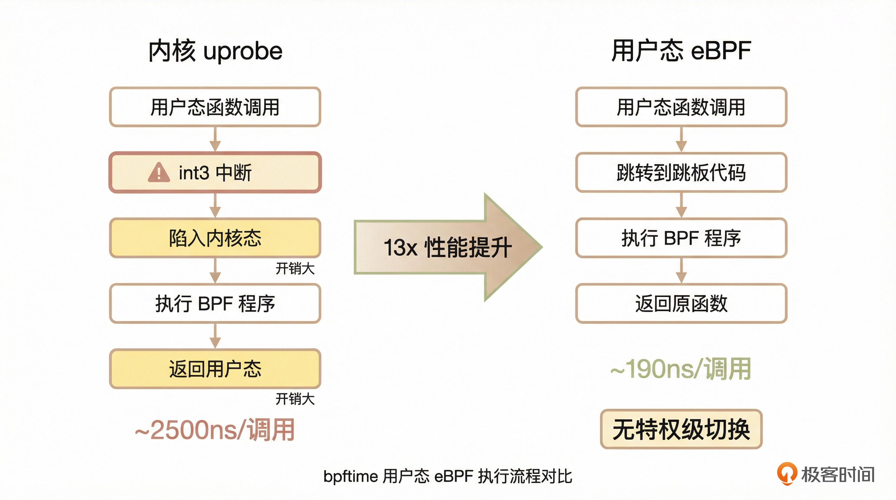
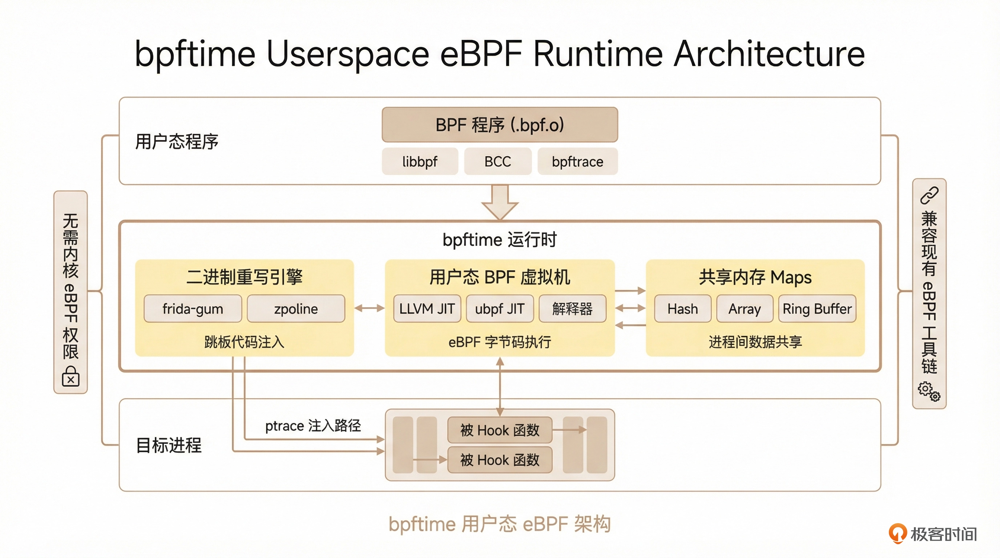
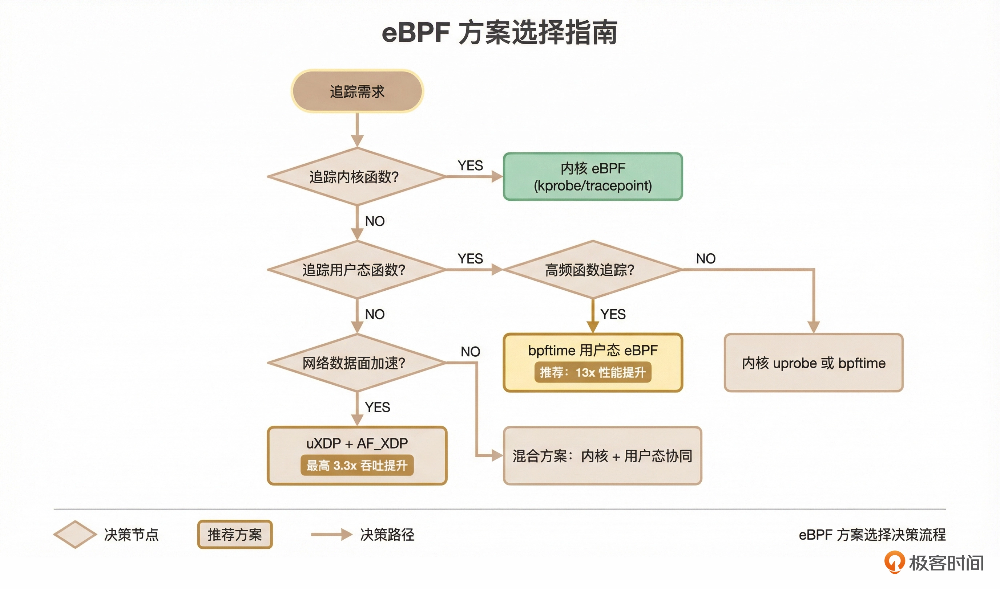

# 32 | 技术解析：用户态eBPF与bpftime详解

你好，我是倪朋飞。

在上一讲中，我带你一起探讨了如何使用 eBPF 来诊断 GPU 工作负载的性能问题。通过追踪CUDA 运行时和驱动层的关键函数，我们可以深入了解大模型训练和推理过程中的性能瓶颈。不过，你可能也注意到了，当我们使用 uprobe 跟踪用户态函数时，总会面临一个令人头疼的问题，也就是性能开销。

还记得 09 讲中讨论过的用户态跟踪内容吗？我特别提醒过你，uprobe 本质上是通过断点去执行处理程序，跟踪高频函数会带来显著的性能开销。那么，有没有办法既享受 eBPF 的强大功能，又能大幅降低用户态跟踪的性能开销呢？

今天，我就来带你了解旨在解决这个问题的用户态 eBPF 运行时。我们将以 bpftime 项目为核心，深入解析它的原理、应用场景和未来发展方向。

## 为什么需要用户态 eBPF？

在深入技术细节之前，我们先来理解一个问题：为什么要在用户态运行 eBPF 程序？

要理解用户态 eBPF 的价值，我们先来看看内核 uprobe 的工作原理。

当你使用 uprobe 跟踪一个用户态函数时，内核的处理流程是这样的：

```
用户态函数调用 → int3 中断 → 陷入内核态 → 执行 BPF 程序 → 返回用户态
```

这个过程涉及两次特权级切换——先从用户态陷入内核态，再从内核态返回用户态。每次特权级切换都意味着 CPU 寄存器的保存和恢复、可能的页表切换、缓存污染以及安全检查开销。

那么，如果把 eBPF 虚拟机搬到用户态运行，情况会怎样？整个执行流程变成：

```
用户态函数调用 → 跳转到 BPF 程序 → 执行 BPF 程序 → 返回原函数
```

整个过程完全在用户态完成，没有特权级切换。这就是用户态 eBPF 的核心思想。

下图直观展示了两种方案的执行流程差异：



从图中可以看到，内核 uprobe 每次调用约需 2500ns，而用户态 eBPF 只需约 190ns，性能提升超过 13 倍。这个差距在跟踪高频函数时会被急剧放大，这也是为什么在生产环境中，很多团队不敢开启持续的用户态追踪。他们只能在问题发生时临时开启，但往往也意味着错过了最关键的诊断窗口。

除了性能优势，用户态 eBPF 还带来了其他好处：

```
降低内核侧权限依赖：内核 eBPF 需要 CAP_BPF（或更早版本的 CAP_SYS_ADMIN）以及
CAP_PERFMON 等权限，还受 perf_event_paranoid 等系统策略限制。用户态 eBPF
不走内核 BPF 子系统，但如果需要注入到其他进程，仍然需要 ptrace 权限（受同一
UID、kernel.yama.ptrace_scope 等限制）。
```

2. 更小的安全攻击面：不在内核中运行，即使出现问题也不会影响整个系统。

3. 更灵活的部署：可以在没有 eBPF 支持的老内核或受限容器中使用。

4. 功能扩展：可以实现内核 uprobe 不支持的功能，如修改函数返回值。

## bpftime 核心原理

了解了用户态 eBPF 的必要性之后，接下来我们一起看看 bpftime 是如何实现这一目标的。

bpftime 是一个开源的用户态 eBPF 运行时，由 eunomia-bpf 社区开发。bpftime 的设计目标是：在不修改任何代码的情况下，让现有的 eBPF 工具和应用程序在用户态运行，同时保持与内核 eBPF 的完全兼容。

需要注意的是，bpftime 目前仍处于早期开发阶段，API 可能会有变动，官方文档也提醒不建议直接用于生产环境。如果你打算在正式项目中使用，建议先在测试环境充分验证，并关注项目的版本更新。

bpftime 的整体设计可以用一句话概括：用二进制重写劫持函数入口，用用户态虚拟机执行BPF 代码，用共享内存实现数据通信。

如下图所示，就是 bpftime 的架构示意图：



从架构图可以看到，当目标程序的函数被调用时，控制流首先被二进制重写引擎劫持到跳板代码，然后由用户态 BPF 虚拟机执行 eBPF 字节码，执行过程中产生的数据通过共享内存Maps 与控制平面通信。整个过程都在用户态完成，不需要陷入内核。

接下来，我们逐一看看这三项核心技术是如何实现的。

### 核心技术一：二进制重写

二进制重写（Binary Rewriting）是 bpftime 实现动态跟踪的关键技术。它的基本思想是：在运行时修改目标函数的机器码，将控制流重定向到我们的跳板代码。

bpftime 的二进制重写实现受到了两个开源项目的启发：

- frida-gum：著名的动态插桩框架，提供了用户态函数 hook 的能力。

- zpoline：USENIX ATC’23 发表的系统调用拦截技术。

具体来说，当你想跟踪一个用户态函数时，bpftime 会执行以下步骤：

```bash
// 原始函数入口（假设）
target_function:
   push rbp
   mov rbp, rsp
   ...
// 重写后的函数入口
target_function:
   jmp trampoline     ; 跳转到跳板代码
   nop                ; 填充对齐
   ...
trampoline:
   ; 保存寄存器状态
   ; 调用 BPF 程序
   ; 恢复寄存器状态
   ; 跳回原函数继续执行（如果需要）
```

这种方法的优点是：

- 零拷贝：直接在原地修改代码，不需要创建函数副本。

- 低延迟：只需要一次跳转指令，开销极小。

- 透明性：对被跟踪程序完全透明，无需重编译。

```
bpftime 还支持通过 ptrace 机制将运行时注入到已经运行的进程中，这意味着你可以在不重
```

启进程的情况下开始跟踪。

### 核心技术二：用户态 BPF 虚拟机

bpftime 实现了一个完整的用户态 BPF 虚拟机，用于执行 eBPF 字节码。这个虚拟机有三种执行模式：

- LLVM JIT 编译器：LLVM 即时编译器（Just-In-Time Compiler，简称 JIT）将 eBPF 字节码即时编译为本地机器码。这是性能最高的执行模式，编译后的代码几乎与手写的 C 代码一样高效。LLVM JIT 还提供了跨平台支持，包括 x86_64、ARM64 和 RISC-V 架构。

- ubpf JIT 编译器：基于 ubpf 项目的轻量级 JIT 编译器。相比 LLVM JIT，它的编译开销更小、启动更快，但生成的代码性能略低。适合对启动时间敏感的场景。

- ubpf 解释器：对于某些不需要极致性能的场景，bpftime 也提供了基于 ubpf 的解释器模式。虽然执行速度较慢，但启动最快，内存占用最小，适合调试或资源受限的环境。

### 核心技术三：共享内存 Maps

在内核 eBPF 中，BPF Maps 是用户态程序和内核态 BPF 程序之间共享数据的桥梁。bpftime在用户态实现了类似的机制，但使用的是共享内存而不是内核数据结构。

这种设计的优势在于：

1. 进程间共享：多个进程可以同时访问同一个 Map，实现分布式数据收集。

2. 与控制平面通信：跟踪数据可以实时传递给分析工具。

3. 语义一致性：与内核 BPF Maps 的 API 完全兼容。

```
bpftime 还支持 ring buffer 和 perf buffer，用于高效地将事件数据从 BPF 程序传递
```

到用户态分析程序。

### 兼容性设计

了解了 bpftime 的三项核心技术之后，你可能会问：它与现有的 eBPF 生态能否无缝对接？接下来我们就来看看 bpftime 的兼容性设计。

bpftime 的一个重要设计目标是与现有 eBPF 生态系统完全兼容。这意味着：

```
你可以直接使用 clang 编译 BPF 程序，无需任何修改
```

- 现有的 libbpf 程序可以直接在 bpftime 上运行

- bpftrace 脚本可以无缝迁移到用户态执行

- BCC 工具也可以在用户态运行

例如，下面是使用 bpftime 运行 bpftrace 脚本的一个完整示例：

```bash
# 传统的内核态 bpftrace（需要 root 权限）
sudo bpftrace -e 'uretprobe:/usr/bin/bash:readline { printf("cmd: %s\n", str(retv
# 使用 bpftime 在用户态运行（通常不需要root，但bpftrace的支持暂时还需要以root用户来运行）
# 先把 bpftrace 脚本加载到 bpftime 的共享内存中
bpftime load bpftrace -e 'uretprobe:/usr/bin/bash:readline { printf("cmd: %s\n",
# 再用 bpftime 启动一个 bash，让 bpftime agent 注入到该进程
bpftime start /usr/bin/bash
```

两种方式使用的是完全相同的 bpftrace 脚本。差别在于：内核态 bpftrace 需要把探针挂到内核里，通常需要 root；bpftime 走用户态注入链路，在同一用户启动的进程中往往不需要

```
root，但如果你要 attach 到已运行的进程，通常需要 CAP_SYS_PTRACE 或 sudo。
```

## 与内核 eBPF 的对比与选择

了解了用户态 eBPF 的能力之后，你可能会问：是否意味着我们应该放弃内核 eBPF 呢？当然不是。用户态 eBPF 和内核 eBPF 是互补关系，各有各的适用场景。接下来，我就带你一起来看看在实际工作中应该如何选择。

下图是一个快速决策指南，帮助你根据追踪需求选择合适的方案：



从图中可以看到，选择的核心依据是你要追踪的目标在内核态还是用户态。如果你需要追踪内核函数、网络协议栈、文件系统等内核行为，那内核 eBPF 是唯一的选择，这一点没有争议。

```
而如果你的目标是用户态函数，那就需要进一步考虑函数的调用频率了：对于 malloc、SSL
```

函数、语言运行时等高频调用的函数，bpftime 带来的性能优势是非常明显的。

除了单独使用，bpftime 还可以与内核 eBPF 协同工作。比如，你可以用 bpftime 在用户态收集应用层的调用信息，同时用内核 kprobe 追踪系统调用和网络栈，最后把两边的数据关联起来分析。这种混合方案可以实现端到端的可观测性，是很多复杂排障场景的最佳选择。

当然，在实际使用 bpftime 之前，你还需要了解它的一些限制和潜在风险。

- 首先是功能边界的问题。bpftime 覆盖的是用户态观测和注入能力，无法替代 kprobe、tracepoint 等内核追踪手段，自然也看不到内核数据结构。

- 其次是二进制重写带来的风险。修改正在运行的进程内存，如果跳板代码有 bug 可能导致目标进程崩溃；某些编译器优化（如函数内联、尾调用优化）可能导致 hook 失效；如果目

- 标程序同时被其他 hook 工具（如 Frida、LD_PRELOAD）修改，也可能产生冲突。

- 最后是权限和安全策略的限制。注入其他进程需要 ptrace 权限，在容器环境或启用了

```
ptrace_scope=2 的系统上可能被拒绝；某些安全软件也会检测和阻止进程注入行为。
```

综合来看，如果你的场景是追踪内核函数或网络协议栈内部行为，或者目标程序运行在无法获取 ptrace 权限的环境（如某些 PaaS 平台），那 bpftime 就不太适用了。对于稳定性要求极高的生产环境核心服务，我也建议你先在测试环境充分验证之后再考虑上线

## 小结

今天，我带你一起了解了用户态 eBPF 技术的原理和应用。

内核 uprobe 的性能瓶颈源于用户态到内核态的特权级切换，这在高频函数追踪场景下会带来显著的性能损失。而 bpftime 通过二进制重写、用户态 BPF 虚拟机和共享内存 Maps 这三项核心技术，实现了完全在用户态运行 eBPF 程序的能力。

从性能测试数据来看，bpftime 的 uprobe 性能比内核版本快了一个数量级，这意味着我们终于可以在生产环境中持续开启用户态追踪，而不用担心对业务造成严重影响。

需要注意的是，用户态 eBPF 与内核 eBPF 是互补关而不是替代关系。内核 eBPF 仍然是内核级追踪的首选方案，而用户态 eBPF 则更适合高频用户态函数追踪的场景。两者可以协同工作，提供端到端的可观测性。

## 思考题

在课程结束之前，我想邀请你来聊一聊：bpftime 使用二进制重写技术修改函数入口点，你能想到这种方法可能带来哪些潜在风险吗？如何在安全性和灵活性之间取得平衡？

欢迎在留言区和我讨论，也欢迎把这节课分享给你的同事、朋友。让我们一起在实战中演练，在交流中进步。
