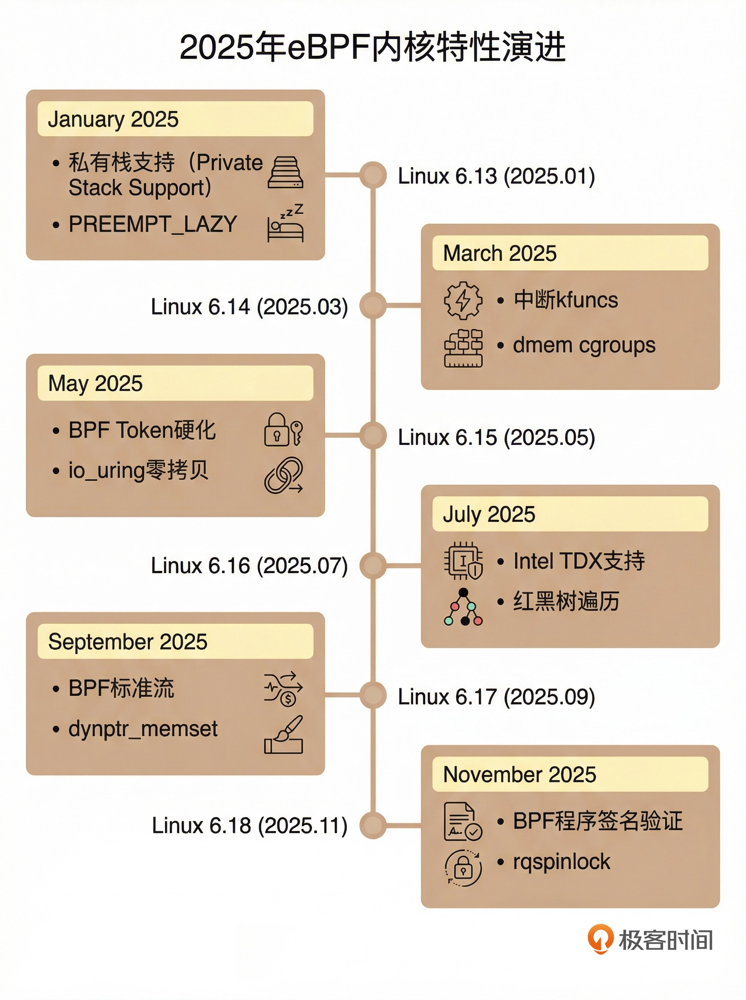
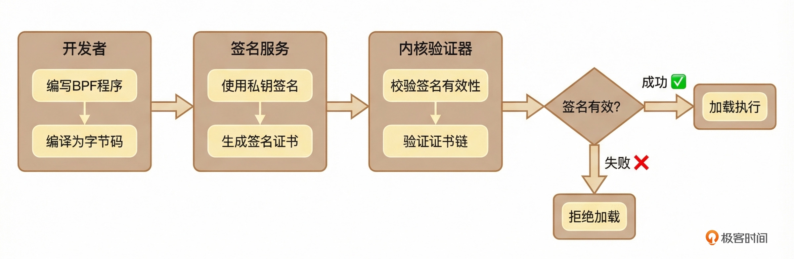
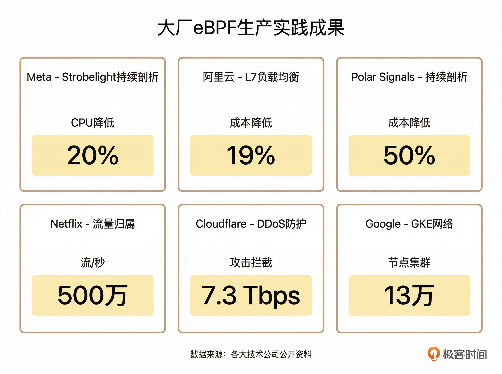
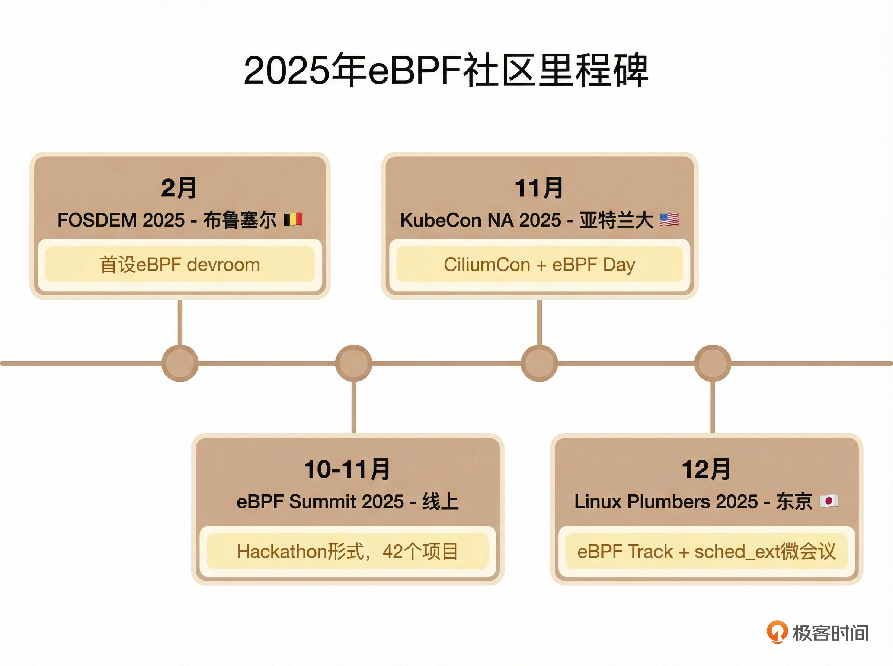

# 33 | 年度总结：eBPF的2025之旅

你好，我是倪朋飞。

不知不觉，2025 年已经过去了。每到年末，我都习惯回顾一下过去一年的旅程，看看发生了哪些事情、有什么收获，并期待着未来。对于 eBPF 的学习和应用也是如此，在这一讲中，我将带你回顾 eBPF 在 2025 年的发展历程。

如果说 2024 年 eBPF 生态进入了快速发展的新阶段，那么 2025 年可以说是 eBPF 真正走向生产环境核心基础设施的一年。这一年，Linux 内核引入了私有栈、dmem cgroups 与 BPF 程序签名等重要特性；Cilium 项目走过了近十年历程；甚至 eBPF for Windows 项目也迎来了v1.0 候选版本，跨平台部署 eBPF 程序的可能性正在变为现实。

## eBPF 内核的新进展

作为 Linux 内核的一部分，让我们先来看看 eBPF 在 2025 年有哪些新变化。

2025 年，Linux 内核发布了 6.13 至 6.18 这六个重要版本，每个版本都为 eBPF 引入了众多新特性。如下图所示，列出了这些版本的发布时间和核心特性：



具体来说，这几个内核版本的主要亮点包括：

Linux 6.13：私有栈

Linux 6.13 为 eBPF 引入了私有栈（Private Stack）。它把 BPF 程序的栈从内核栈里分离出来，降低长调用链下的栈溢出风险，目前主要在 x86_64 上先行支持。

Linux 6.14：中断控制与 dmem cgroups

```
Linux 6.14 新增 bpf_local_irq_save 和 bpf_local_irq_restore 两个 kfunc，允许
```

eBPF 程序在需要时临时关闭并恢复本地 CPU 中断，便于实现临界区逻辑。同时，内核引入dmem cgroup（设备内存控制组，Device Memory cgroup）控制器，用于设备内存（例如GPU 显存）的统计与限制，为 AI 负载的资源治理铺路。

Linux 6.15：BPF Token 细化、零拷贝收包与 rqspinlock

```
6.15 继续扩展 BPF Token 的可授权能力，比如新增对 BPF_BTF_GET_FD_BY_ID 的 token
支持；io_uring 在网络路径上加入零拷贝收包（zero-copy receive，简称 ZC Rx）能力；
同时引入 rqspinlock（可恢复自旋锁，bpf_res_spin_lock）kfunc，使 BPF 程序能够使用
```

可恢复的自旋锁语义，放宽多锁使用场景的约束。

Linux 6.16：机密计算与数据结构增强

Linux 6.16 加入 Intel TDX（可信域扩展）的初始支持，机密虚拟机开始成为现实，这也让宿主机侧的 BPF 观测能力面临新的边界。BPF 数据结构方面，推进了红黑树遍历与链表 peek等能力，为内核侧更复杂的数据结构打基础。

Linux 6.17：新 kfunc 与标准流

```
Linux 6.17 新增 bpf_dynptr_memset 与 bpf_cgroup_read_xattr 等 kfunc，增强了
```

dynptr 操作与 cgroup 元数据读取能力。同时，BPF 程序开始具备标准输出与标准错误流，便于在内核与用户态之间传递文本流式信息。

Linux 6.18：BPF 程序签名

Linux 6.18 开始提供 BPF 程序签名的初始支持，这是生产环境安全加固的重要一步，但配套的安全策略与落地方式仍在完善中。

如下图所示，BPF 程序签名验证的工作流程可以分为三个阶段：开发者编写并编译程序、签名服务对字节码进行签名、内核验证器在加载时校验签名有效性。只有通过验证的程序才能被加载执行。



- BPF程序签名验证流程

值得一提的是，内核的 UAPI 里已经明确标注：BPF helper 列表基本冻结，新增能力应优先通过 kfunc 暴露。这也解释了 2025 年社区对 kfunc 的明显倾斜，kfunc 更灵活，但也意味着缺少稳定性承诺。

伴随着这些内核版本的发布，新引入的功能特性也都集成到了 libbpf 和 bpftool 中。你可以访问它们的 Github 发布网站，查看最新的发布列表。

从以上最新版本的发布情况来看，eBPF 在内核中依然是最活跃的模块之一，功能特性还在持续演进。同样，在内核之外的开源社区和商业公司也在不断推进 eBPF 的发展，完善 eBPF 生态的同时为 eBPF 带来了更多的应用实践。接下来，我再带你一起看看开源社区和商业公司又为 eBPF 生态带来了哪些最新的进展。

## eBPF 生态的新进展

如果说 2024 年的 eBPF 生态是进入快速发展的新阶段，那么 2025 年可以说是走向成熟并成为基础设施的一年。这一年，Cilium、bpftrace、Tetragon、Falco 等主流项目都发布了重要版本更新，同时也涌现出 Kyanos、bpftime 等新工具。eBPF 已经成为云原生网络、安全和可观测性领域的核心技术之一。

### Cilium：持续演进的 Kubernetes 网络方案

在网络领域，Cilium 依然是最值得关注的项目。从 2015 年底开始发展，到 2025 年 Cilium 已经走过了近十年的历程。这一年，Cilium 发布了 v1.17 和 v1.18 两个版本，继续巩固其作为Kubernetes 网络首选方案的地位。

Cilium 1.17 的亮点之一是双写身份（Double-Write Identity）分配模式，帮助运维团队在不中断业务的情况下，把身份存储后端从 KVStore 平滑迁移到 Kubernetes CRD。

Cilium 1.18 则带来了加密覆盖网络（Encrypted Overlay）和负载均衡控制面重构，同时新增入向带宽限速（Ingress Rate Limiting）能力，进一步提升了大规模集群的安全性与性能。

### bpftrace：语言特性升级

在追踪工具方面，bpftrace 今年引入了一系列语言层面的改进，让脚本编写更加现代化。宏支持实现了代码复用，命名参数让脚本可以像命令行工具一样接收参数，range-based for 循环和布尔字面量简化了常见逻辑。新增的时间序列 Map（tseries）可以直接输出带时间戳的数据，方便做趋势分析；时间字面量支持 ns、us、ms 等单位，写起来更直观。

### Tetragon：运行时安全增强

在安全领域，Cilium 团队维护的 Tetragon 项目今年也有重要更新。最值得关注的是 USDT 支持，可以钩入应用程序内部的函数，而不是像之前那样仅限于系统调用层面。数据传输方面，Ring Buffer 成为 5.11+ 内核的默认选项，相比 perf buffer 有更好的性能和更低的丢失率。uprobe 覆盖动作可以在不终止进程的情况下拒绝特定操作，实现更细粒度的运行时防护。

### Falco：事件捕获与取证

同样在安全领域，Falco 今年新增了事件捕获功能。当安全规则触发时，Falco 可以自动记录系统调用轨迹并生成 SCAP 文件，方便后续取证分析。通过与开源取证工具 Stratoshark 集成，安全团队可以在收到告警后调取对应时间窗的系统调用录像。性能方面，Falco 引入了Mimalloc 内存分配器支持，在高负载场景下内存管理更高效。

### 新兴工具

除了这些成熟项目的更新，还有一些近两年涌现的新工具值得关注。

bpftime 是一个用户态 eBPF 运行时，今年它的论文入选系统领域顶级会议 OSDI’25，这也是eBPF 相关研究在学术界获得认可的一个标志。bpftime 通过二进制重写技术，把 BPF 程序注入目标进程的内存空间，绕过传统 uprobe 的内核路径。公开论文显示，它在特定场景下可达到约 10 倍的性能提升，并且无需 root 权限即可运行。目前项目也在探索 GPU hooks 等新方向。

Grafana Beyla 在今年 5 月捐赠给了 OpenTelemetry 项目，更名为 OpenTelemetry eBPFInstrumentation（简称 OBI）。它的核心能力是零代码自动注入——不需要修改应用代码，就可以自动采集分布式追踪数据。捐赠之后，社区贡献明显加速，协议支持扩展到了HTTP/HTTPS、gRPC、SQL、Redis、MongoDB、Kafka、GraphQL、Elasticsearch 等。

## 大厂生产实践

看完了开源项目的进展，我们再来看看 eBPF 在实际生产环境中的应用。2025 年，不少公司公开了 eBPF 的实践成果，用具体数据证明了 eBPF 的价值。

如下图所示，我整理了这些大厂的 eBPF 生产实践成果（数据来源于 eBPF 基金会年度报告及其案例研究）：



下面详细介绍两个比较有代表性的案例。

Meta 在 2025 年公开了其内部 Strobelight 项目的细节。Strobelight 是一个全局 Profiling 编排器，通过 eBPF 以低开销持续收集后台服务的性能剖析数据，覆盖 CPU、内存、GPU 以及Python、Java 等多语言运行时。它的核心思路是“永远在线的性能分析”，这样当问题发生时，历史数据已经在那里了。Strobelight 帮助 Meta 把 CPU 使用率压到最高约 20% 的下降，同时带来 10-20% 的服务器节省。这说明持续 Profiling 在超大规模基础设施中确实能发现很多隐藏的优化机会。

阿里云的 Hermes 是另一种典型路径：在 L7 负载均衡场景中用 eBPF 重构数据面，支持1000 万请求 / 秒规模，单位基础设施成本降低 19%，同时将 worker hangs 降低 99.8%。这类案例说明，eBPF 不只是观测工具，也能直接成为高性能数据面的核心组件。

## 社区动态

除了技术层面的进展，2025 年 eBPF 社区的活动也比较活跃，从侧面说明这项技术正在获得越来越多的关注。如下图所示，这一年有几个重要的社区里程碑：



2 月份的 FOSDEM 2025 是一个标志性事件。FOSDEM 是欧洲最大的开源开发者会议，每年在布鲁塞尔举办，今年恰逢 25 周年。2025 年，FOSDEM 首次设立了专门的 eBPFdevroom，由 Alexei Starovoitov、Daniel Borkmann、Andrii Nakryiko 等核心开发者组织。分会场的议题涵盖内核特性开发、用户态运行时、工具链改进等方向，吸引了不少内核开发者和基础设施工程师参与。

eBPF Summit 是 eBPF 社区自己的年度会议。2025 年它从传统的演讲形式转型为Hackathon，为期六周，吸引了全球超过 500 名开发者参与，最终收到 42 个项目提交。获奖项目中有两个比较有意思：一个是基于 sched_ext 框架的自定义 Kubernetes 容器调度器，评委评价“用 eBPF 实现如此复杂的程序类型，对于新手团队来说很 impressive”；另一个是 Go运行时的实时 Profiler，可以可视化 goroutine 和内存分配。

11 月的 KubeCon NA 2025 在亚特兰大举办，恰逢 CNCF 十周年。同期举办的 CiliumCon 已经是第六届，议题从 Cilium 网络扩展到了 Hubble 可观测性和 Tetragon 安全。今年的演讲者们分享了一些很有挑战性的生产案例，包括 60,000 节点集群的网络管理、IPv6-only 骨干网络的部署实践，以及 AI 场景下的网络需求。

12 月的 Linux Plumbers Conference（LPC）在东京举办，eBPF 基金会作为白金赞助商支持了这次活动。今年的 eBPF Track 热门议题集中在几个方向：BPF 验证器的改进（包括状态剪枝和循环处理）、新增的 load-acquire/store-release 指令、bpftrace 向可组合框架的演进、bpftime 用户态运行时，以及 sched_ext 可编程调度器的实践经验。

## 值得关注的趋势

回顾完 2025 年的具体进展，我们来聊聊几个值得关注的趋势。

从单点工具到平台底座

今年这些项目的更新有一个共同特点：功能边界在扩张，而且是有意识地往平台方向走。

Cilium 1.18 是个典型例子。这个版本同时推出了加密覆盖网络、负载均衡控制面重构和入向带宽限速，这三个特性分别属于安全、流量管理和 QoS 领域。一个 CNI 插件同时在三个方向发力，说明 Cilium 的定位早已不只是容器网络连通性，而是云原生网络平台。

类似的逻辑也出现在其他项目上。Tetragon 今年加入 USDT 支持，把观测能力从系统调用层延伸到用户态应用内部；Beyla 捐给 OpenTelemetry 成为 OBI，从 Grafana 的单点工具变成了更大生态的一部分。

这背后的驱动力在于：eBPF 在内核层面提供了统一的数据采集与处理能力，与其为每项功能单独部署 Agent，不如在一个平台上进行整合。对企业而言，这将降低运维复杂度，减少数据孤岛。

安全与可观测性走向融合

传统上，安全团队用安全工具，运维团队用监控工具，两边各干各的。但 eBPF 收集的数据天然具有双重属性：同样是一次网络丢包，对安全团队来说可能是策略拒绝的证据，对运维团队来说就是连接失败的指标；同样是一次系统调用跟踪，既可以做性能剖析，也可以做安全取证。

今年 Tetragon 增加的 USDT 传感器、Falco 的事件捕获功能，都是这个趋势的体现。未来，同一个 eBPF Agent 收集的遥测数据，可能会同时服务于安全运营中心和网络运营中心。这不是技术上的巧合，而是 eBPF 这种“内核级全量数据采集”模式带来的必然结果。

AI 基础设施的监控需求

这是今年比较明显的一个新方向。随着 GPU 和 AI 加速器在数据中心的比重越来越高，传统的 CPU 中心化监控方案已经不够用了。

Linux 6.14 引入的 dmem cgroups 是个信号，它为设备内存（比如 GPU 显存）提供了标准化的统计接口，让容器环境下的 GPU 资源追踪成为可能。与此同时，eBPF 基金会资助的eBPF Governors 项目也在探索用 eBPF 实现 QoS 感知的智能功耗管理。可以预见，eBPF 在AI 基础设施监控、资源调度方面的应用会越来越多。

跨平台的可能性

最后是跨平台扩展。微软的 eBPF for Windows 项目在 2025 年推出了 v1.0 候选版本，虽然Windows 上的 eBPF 生态还远不如 Linux 成熟，但“写一次 eBPF 程序，跨平台部署”的可能性正在变成现实。对于需要同时管理 Linux 和 Windows 工作负载的企业来说，这是个值得关注的进展。

## 小结

今天我们一起回顾了 eBPF 在 2025 年的发展历程，信息量比较大，我帮你梳理一下核心脉络。

内核层面，Linux 6.13 到 6.18 这六个版本持续增强 eBPF 能力。私有栈解决了长调用链的栈溢出风险，dmem cgroups 为 GPU 资源管理铺路，BPF 程序签名则是生产环境安全加固的重要一步。另外一个值得注意的变化是：helper 函数列表基本冻结，新能力优先通过 kfunc 暴露，这会影响你未来写 BPF 程序的方式。

生态层面，主流项目都在往平台方向演进。Cilium 不再只是 CNI，而是覆盖加密、负载均衡、流量管控的网络平台；Tetragon 把安全观测从系统调用延伸到用户态应用；Falco 加入事件捕获，具备了取证能力；Beyla 并入 OpenTelemetry 说明零代码插桩正在成为标准做法。

生产实践层面，Meta 和阿里云的案例给出了具体数字：20% 的 CPU 优化、19% 的成本节省、1000 万 RPS 的数据面吞吐。这些数据说明 eBPF 已经不只是很酷的技术，而是真正能带来业务价值的基础设施组件。

社区层面，FOSDEM 首设 eBPF devroom、eBPF Summit 转型 Hackathon 以及依旧爆火的Cilium 生态，这些都说明 eBPF 正在从小众技术走向主流。

## 思考题

今天聊了很多 2025 年的进展，最后留一个问题：在你的工作场景中，eBPF 目前解决的是什么问题？如果让你预测，2026 年你最希望 eBPF 在哪个方向有突破——是 AI 基础设施监控、跨平台部署，还是其他你关心的领域？

欢迎在留言区分享你的想法。
