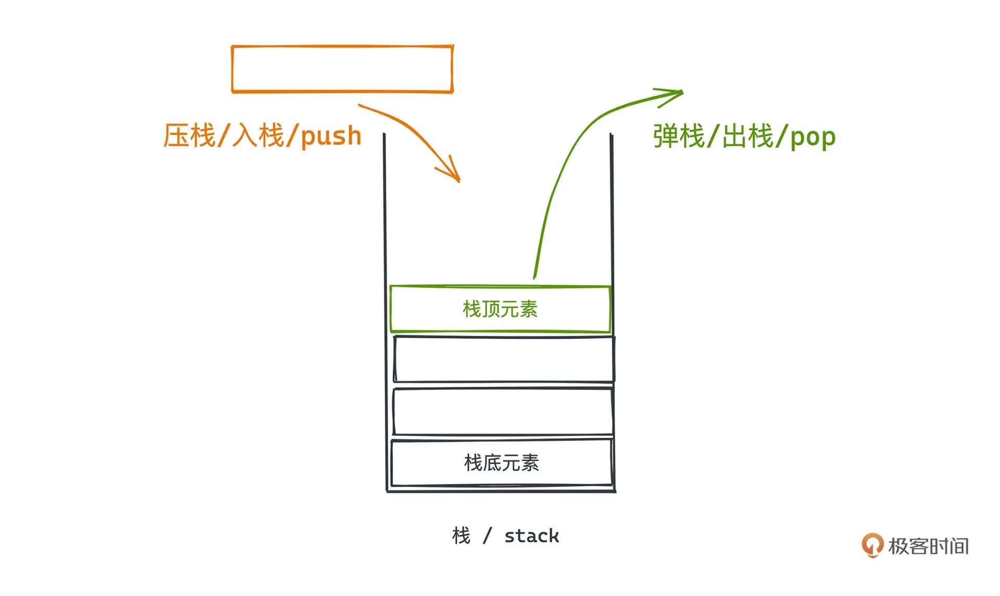
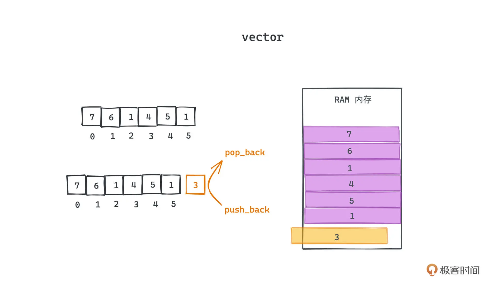
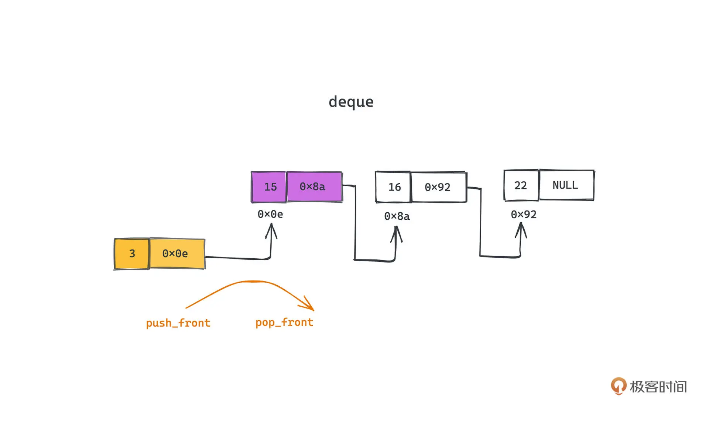
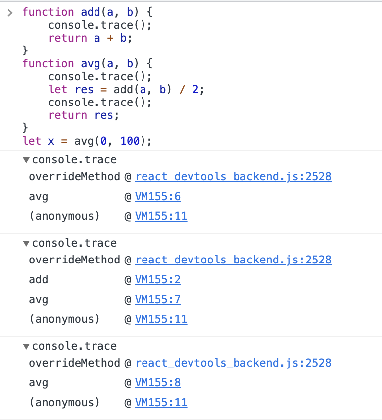
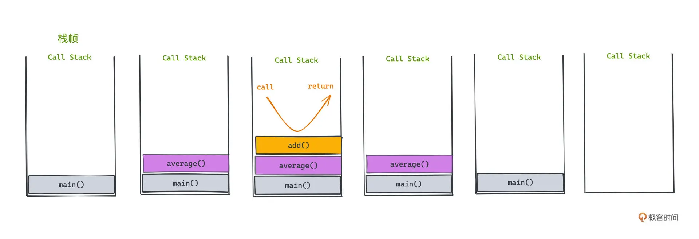

# 04 | 栈：函数调用的秘密究竟是什么？

你好，我是微扰君。

目前为止，我们已经介绍了 STL 里的大部分序列式容器，包括 vector、deque 和 list，也对应着数组、队列和链表这几种基础数据结构；今天我们来学习最后一种常用的线性数据结构，栈。

栈这个词，相信每一个研发同学在学习编程的过程中都会经常听到。不仅仅是因为栈本身就是一种基础的、常见的数据结构，更因为栈在计算机世界里起着举足轻重的作用。

在编程语言中，栈除了作为一种常用的数据结构，也常常用来表示一种叫做“调用栈”的概念，它是编程语言之所以能实现函数调用的关键所在。而在内存分配中，栈也表示一种内存分配的区域，和内存中的堆区是一种相对的概念。

栈区是有结构和固定大小的，区块按照次序存放，每个线程独占一个栈区，总的大小也是事先确定的；而堆区则没有固定的大小，数据可以随意存放。我们常常听到的 stack overflow 错误，也就是栈溢出错误，就是指程序在运行时，存放在栈上的数据已经多于栈区的容量，产生了容量不足的错误。相信说到这，你就更加明白为什么说栈相比于其他数据结构更经常被听到了吧。

其实无论是调用栈还是内存中的栈区，这两种含义都和栈数据结构的 LIFO 特性有关。如果你已经有了充分的背景知识，可以先想想这是为什么？

## 栈的特性：LIFO

和队列一样，我们也可以将栈理解成一种有约束的序列式数据结构，但是不同于 FIFO 的队列，栈的约束在于，插入和移除元素的操作，都只能在该数据结构的一端进行。栈对外暴露的插入和删除接口，我们一般称为 push 和 pop，操作的那一侧，也称为栈顶，不能操作的那一侧则叫做栈底。



我们只能从栈顶删除或者插入元素，这直接保证了 LIFO，也就是先进后出的特性。

栈有一个很好理解的生活中的例子就是坐电梯。显然电梯就是这样一种有着单侧开口性质的容器，把电梯里的乘客看成是容器中的元素，我们发现先进入的人肯定不太好直接越过后进来的人们先下电梯，因为出口和入口是一样的，并且只有一个。

这也就是为什么我们坐电梯到目标楼层准备出来的时候，经常会需要前面的人让一让。相信你只要想象一下这样的场景，就可以理解栈这个数据结构的精髓所在啦。

## STL 中 stack 的实现

stack 就是 STL 中对栈这一数据结构的实现。其实，相比上一讲内存管理逻辑复杂的队列，stack 的代码实现非常简单。

前面说了 stack 有单侧开口、后进先出的特性，有没有想到之前讲过的哪个容器也能实现类似的效果呢？



其实不只一个可以实现。比如 vector 就可以通过在一侧 push_back 和 pop_back 的操作模拟栈的 push 和 pop；同理，deque 也可以通过在同一侧（比如头部）的 push_front 和pop_front 操作进行栈的模拟，这也正是 STL 的做法。也正是因为这个原因，stack 的实现就非常简单了。



不过 stack 并没有像前几讲介绍的数据结构那样真正实现底层接口的逻辑，而仅仅基于deque 现有的能力去改造出符合 stack 语义的接口，是不是就像一个接口转换器呢？就好像是把一个三口的插头转成了两口的插头。

事实上，这样的封装方式，也正是一种设计模式：“适配器”模式。所以也有人认为 stack 不是一种 container，容器，而是一种 container adapter，适配器容器。

### 数据结构定义

好了，来看一下 stack 在 STL 中的具体实现，我们同样先来看看 stack 的数据结构定义：

```python
template<typename _Tp, typename _Sequence = deque<_Tp> >
class stack
{
public:
   typedef typename _Sequence::value_type                value_type;
   typedef typename _Sequence::reference                 reference;
   typedef typename _Sequence::const_reference           const_reference;
   typedef typename _Sequence::size_type                 size_type;
   typedef          _Sequence                            container_type;
protected:
   _Sequence c; // stack 底层容器； 默认为 deque
public:
    reference
     top()
     {
       __glibcxx_requires_nonempty();
       return c.back();
     }
   void push(const value_type& __x) { c.push_back(__x); }
   void pop() {c.pop_back();}
   ...
}
这里有一行 __glibcxx_requires_nonempty ，这实际上是一个宏而不是函数，你不用太
```

过关心，主要是用于帮助你 debug 的，对代码的运行没有任何影响。

可以看到 stack 下有一个受保护的成员变量 _Sequence，它就是我们说 stack 作为适配器所适配的容器，在默认的情况下，_Sequence 的选择是用 deque 作为它底层的存储容器，所以其扩容机制，当然也就是依赖了 deque 的实现。

这也是适配器的魅力所在，给我们所需要的类型提供了一套统一的接口，但底层所适配的容器依旧是可配置的；我们可以根据策略随时改变底层容器的选择，不会对外界造成任何影响。

现在既然已经有了一个功能强大的底层容器“deque”，我们当然可以基于它快速实现 stack 所需要的所有接口。在 STL 的实现中，我们封闭了 deque 的前端，不再有任何地方可以进行push_front 或者 pop_front 操作了。 而 stack 最关键的两个方法 push 和 pop ，只需要简单地调用 c.push_back() 和 c.pop_back() ，就可以达到模拟单侧开口的栈的效果。

除了可以利用其他数据结构，stack 实现起来非常简单还有另一个原因，它不需要暴露迭代器。在标准的栈“后进先出”的语义下，我们并不需要对 stack 做随机访问和遍历的操作，加上只有栈顶的元素才会被外界访问，又省去了实现迭代器的很多逻辑。而栈顶元素 top 也只需要调一下内置容器的 back 方法即可取得。

当然，这也让我们失去了一些属于 deque 的能力，但我认为这正是面向对象 6 大设计原则之一的接口隔离原则的体现，当我们使用栈的时候，就不应该去关心如何迭代它。

到这里 stack 在 STL 中的实现我们就已经全部学完了，是不是非常简单呢？

## stack 的应用 - 调用栈

掌握了栈作为数据结构的基本特性和实现，我们来回答开头的问题，在编程语言中，函数调用栈里的栈到底是什么，和栈的 LIFO 特性有什么关系，为什么它也被命名为栈呢？

### 函数调用

先来简单复习一下什么是函数调用，以及函数调用背后有哪些过程。我们就以 JavaScript 语言为例来学习，因为现代的 Web 应用都是跑在 Google 的 V8 引擎之上的，这能避免我们涉及太多寄存器和汇编语言相关的细节，毕竟那些细节对理解函数调用栈并没有太直接的帮助。

来看一下这段代码，这里面就包含一个典型的函数调用：

```javascript
function add(a, b) {
   console.trace();
   return a + b;
}
function avg(a, b) {
   console.trace();
   let res = add(a, b) / 2;
   console.trace();
   return res;
}
let x = avg(0, 100);
```

代码中一共包含了两个函数，add 用于求两数之和，avg 用于求两数均值。其中 avg 的逻辑里就调用了 add 函数，而对新变量 x 的赋值过程，也调用了 avg 函数。

整个调用链路是：对 x 赋值 -> call avg -> call add -> return add -> return avg。

这个调用的结构是不是天然看起来就像是前面举的“进电梯 - 出电梯”的例子呢？ 函数的 call 和return 仿佛就像是进电梯和出电梯的过程，后 call 的先 return，完美符合了 LIFO 的原则。事实上也正是如此，但 call 和 return 的过程究竟是什么呢？下面我们就来一探究竟。

因为 Chrome 浏览器的运行时提供了很好用的打印调用栈信息的功能，我们就调用一下，直观地感受调用栈的状态变化：



可以看到，第一次打印的时候，调用栈中包括 avg 函数和匿名函数。第二次打印的时候在调用栈的顶部又增加了一个 add 函数。第三次打印的时候 add 又一次消失在了栈顶。

这是因为在代码的第 2、6 和 8 行，打印了三次调用栈的信息。由于 avg 函数第一个执行trace 命令，是在调用 add 之前，所以首先打印在 console 中的调用信息属于 avg 函数，随后是 add 函数，最后是 avg 调用完 add 之后的第二次打印。

如果将调用栈的信息做一个完整的展示，大概是这个样子：



看起来显然更像一个栈了。现在，调用栈之所以叫调用“栈”，也就不言而喻了，它记录程序正式运行过程中函数调用的后 call 先 return 情况。

那么调用栈里的一个个函数到底是什么呢？

我们知道，每个函数都有一个自己的作用域，但不同作用域下的变量可以有相同的变量名。比如在刚才的例子中，avg 和 add 函数中的入参变量名都是 a 和 b，它们互相不影响。这就是因为每个函数都会有一个自己的上下文，而上下文中存放着变量名和值的绑定，不同的上下文是彼此隔离的。

当程序每次执行到一个函数调用的时候，操作系统或者虚拟机就会在栈上分配一块区域，我们称之为栈帧。

简单来说，栈帧中就存放着函数执行的上下文。当前计算完成之后，我们就会将执行结果返回，并绑定到上一个栈帧内的变量里，当前栈帧的所有资源也就可以释放了。

这个释放过程，在操作系统或者虚拟机底层，最后都会转化成几个寄存器值的变化，成本非常低廉。事实上，各个语言在实现函数调用的时候都是不约而同地依赖调用栈去实现的，只不过js 建立在 V8 引擎之上，栈帧里存的就可以是执行上下文，包括了变量和值的绑定等信息；而在 C 语言里可能就直接操作的几个寄存器的值，如 EAX、ESP 等，和具体的 CPU 指令集架构有关。

比如前文中 js 的例子，当 average 函数调用 add 函数时，我们就创建了一个属于 add 的执行上下文，其中 a 和 b 绑定着从 average 中传递过来的变量。因为上下文是隔离的，在 add 的执行过程中，无论我们怎么修改 a 和 b 的值，对 average 上下文中的变量其实都是没有影响的。

假设用一个数组来表示执行上下文栈，其过程大概如下，average 和 add 有各自的上下文也就对应着各自的活动对象。

```
EXE_STACK = [];
EXE_STACK.push(<main> functionContext);
EXE_STACK.push(<average> functionContext);
Average_AO = {
 arguments: {
   0: 5,
   1: 100,
   length: 2
 },
 a: 5,
 b: 100,
}
EXE_STACK.push(<add> functionContext);
Add_AO = {
 arguments: {
   0: 5,
   1: 100,
   length: 2
 },
 a: 5,
 b: 100,
}
EXE_STACK.pop(); // add 执行完毕
EXE_STACK.pop(); // 执行 average
EXE_STACK.pop(); // 执行 main
```

等 add 执行完毕之后，我们会将 add 的结果返回，并继续执行 average 后续的操作。返回后，add 的上下文也就没有必要再保留了，直接释放掉即可。所以整个代码执行过程看到的调用栈才会是上图中展现的样子。

至此，整个上下文从创建到销毁的过程完美契合了栈 LIFO 的原则。正是因为每次调用前，我们都有将上下文的信息保留在栈中，调用的计算过程并不会影响到调用前的内存空间，完美地做到了函数调用保留现场的作用；调用完成之后，我们可以延续调用前上下文中的状态，继续进行后续的计算。

在栈上连续的内存分配，以及函数调用完，不会再有其他地方需要函数上下文内变量的特点，让在栈上的内存管理变得简洁而高效。所以可以说，通过使用栈，我们优雅地实现了函数调用这一编程语言中最基础的核心能力。

在栈上连续的内存分配，以及函数调用完函数生命周期就结束，也就是不会再有其他地方需要函数上下文内变量的特点，让在栈上的内存管理变得简洁而高效；释放内存的操作和堆上完全不同，我们只需要直接改变函数栈帧指针的指向即可。所以可以说，通过使用栈，我们优雅地实现了函数调用这一编程语言中最基础的核心能力。

## 总结

栈的主要特点就是先进后出，其实 list、vector、deque 都可以用来做 stack 的底层容器，只需要利用适配器模式封装，屏蔽一部分接口，只保留在容器一端的插入 / 删除操作即可，对应到stack 上也就是 push 和 pop 两个操作。

通过今天的学习，相信你就能理解在函数里，调用栈为什么也叫栈了吧？就是因为函数调用的过程中，函数上下文的产生与销毁天然符合栈后进先出的特点。这在各个语言的编译器中都有体现，有兴趣的话你可以看看你熟悉的语言中调用栈实现的细节。

## 课后作业

最后留一个小问题给你，既然 stack 可以有很多种实现方式，为什么 STL 选择了用 deque 来实现栈呢？通过 vector 实现会有什么好处或弊端吗？ 时间复杂度又有什么差异？

欢迎你在留言区留言，一起交流今天的学习感悟。我们下节课见～
