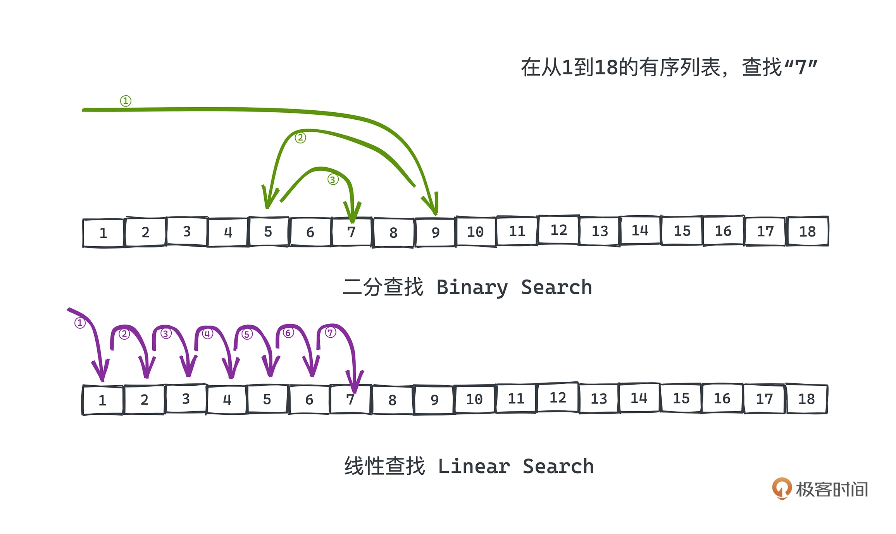
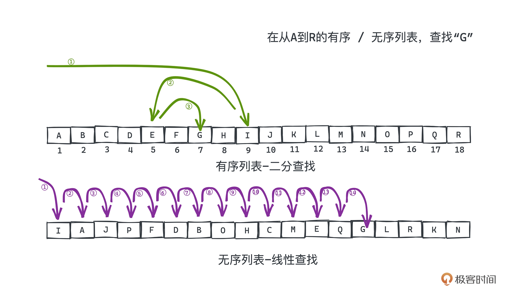
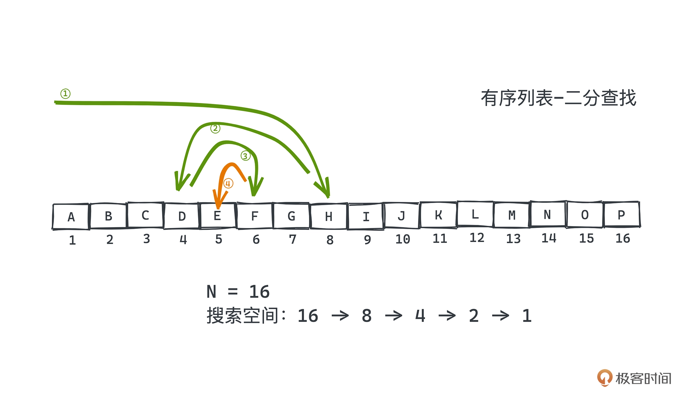
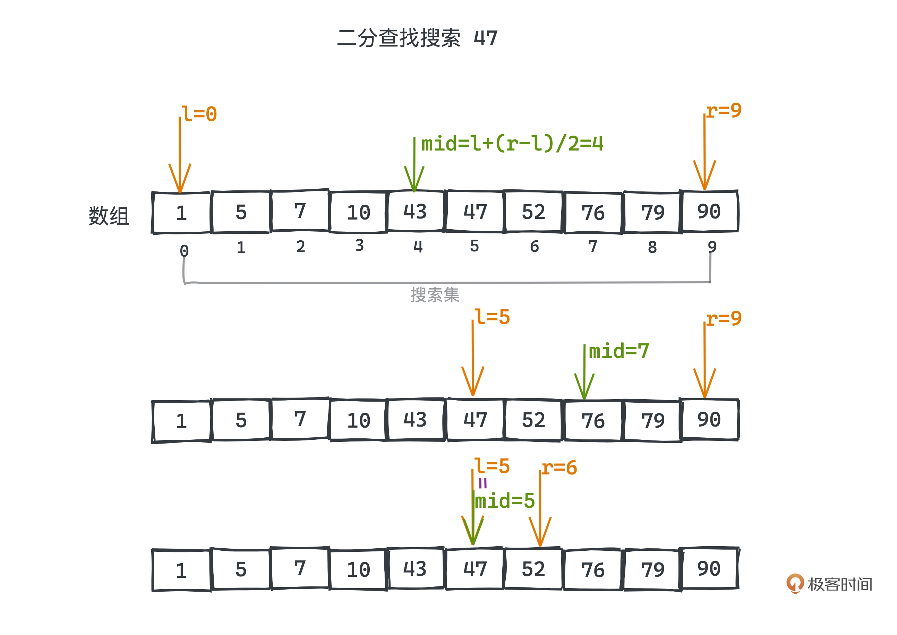
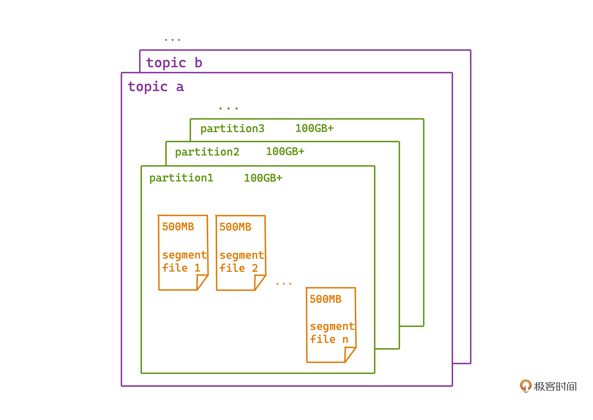
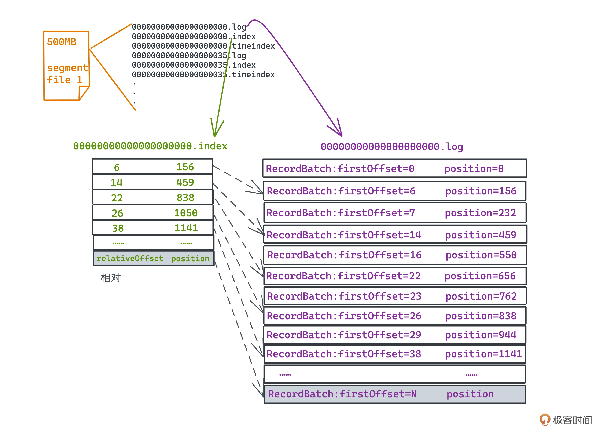
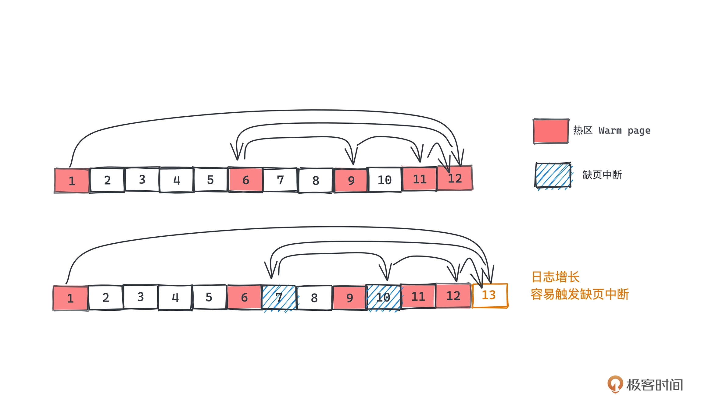
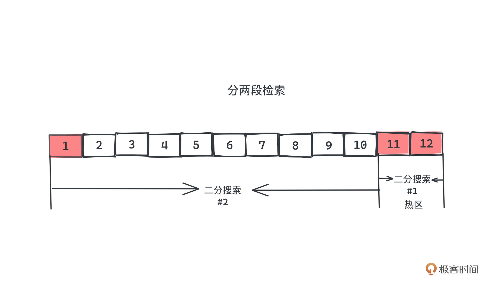

# 09 | 二分：如何高效查询Kafka中的消息？

你好，我是微扰君。

今天我们来学习另一个常用的算法思想，二分法。这个算法思想相信即使你没有什么开发经验也不会感到陌生，而且之前讲红黑树的时候我们也简单聊过。

不知道你有没有玩过“猜数字”的游戏。大家规定一个范围，一个人在心里想一个这个范围内的具体数字，比如一个 1-100 的自然数，然后另几个人来猜数字；每次猜错，这个人都会提示他们的猜测是大了还是小了，看谁最快猜到数字。

如果你做这个游戏会怎么猜呢？从 1 开始顺次猜吗？我反正不会这么猜，出于一个很简单的直觉，如果 1 猜错了，那么出题的同学给你的提示对可选范围的缩小非常有限，也就是从 1-100变成了 2-100。

我想很多人第一反应也都会是从比较中间的位置，比如 50，开始猜起。毕竟如果 50 猜错了，因为要提示是大了还是小了，范围就要么缩小到 1-49，要么缩小到 51-100，这样猜测范围就可以成倍的缩小。

所以，如果每一次我们都猜测可能范围内的中间值，那么即使猜错了也能成倍的缩小范围，这样的策略其实就是二分查找算法。

有了二分查找算法，即使更大的范围内进行游戏，比如在 1-1,000,000 的范围内，我们按照二分的策略，最多也只需要 20 次即可完成任意数字的猜测，这是遍历数字猜测所远远做不到的。可以看下图有一个直观的认知。



不过这样凭感觉的分析肯定是不行的，我们来严谨地讨论一下二分查找相比于线性查找，到底有多大的优势吧。

## 二分查找

在具体比较它俩的复杂度和实现之前，首先，我们要知道二分查找相比于线性查找更快是有先决条件的，就是查找的范围内的元素一定是有序排列的。

比如在刚刚说的猜数字游戏里，我们之所以每次能排除一半的搜索空间，就是因为数字整体是有序排列的，如果某次猜测的数 x，比目标值 target 大，那么当然比 x 更大的数就没有必要猜测了。

那什么是无序的排列呢？我们换个例子，假设要从一个由字母构成的数组中寻找某个目标字母“G”是否存在。

如果字母数组本身是按照字母序排序的，那么显然可以用二分查找法，和翻字典的过程其实差不多，如果我们打开的当前页比目标字母要字母序更靠前，那么我们肯定会往后翻，反之则会往前翻。

但是如果字母数组并不是按照字母序排列的，而是随机排列没有规律可言，这样唯一的做法就只有遍历数组的每个元素逐一对比了，因为在乱序的数组中的任意位置和目标字母进行比较，不会有任何有用的信息可以告诉我们应该要往前找还是往后找。



这也是为什么有序的结构在很多情况下是更受偏爱的，我们在许多场景下，会先对数组元素进行排序预处理，再进行后续的其他操作；哪怕我们知道，排序，即使是内排序，也会花费不菲的代价，但它带来的收益可能是更高的。

在算法面试中，你可能会经常碰到这样要先进行排序预处理的题目，比如力扣上经典的两数之和题，有一种基于双指针的做法就是要先进行排序预处理的；而采用快排这样的 O(nlgn) 时间复杂度的算法，即使多出了预处理的步骤，也可以让我们获得比暴力法更好的时间复杂度的算法。如果你感兴趣可以课后尝试解决一下相关的题目。

### 二分查找

所以我们也来看一下数组上的二分查找算法在维基百科上的严格定义：

- 二分查找是一种在有序数组中查找某一特定元素的搜索算法。搜索过程从数组的中间元素开始，如果中间元素正好是要查找的元素，则搜索过程结束；如果某一特定元素大于或者小于中间元素，则在数组大于或小于中间元素的那一半中查找，而且跟开始一样从中间元素开始比较。如果在某一步骤数组为空，则代表找不到。这种搜索算法每一次比较都使搜索范围缩小一半。

核心就是查找元素需要可比较且有序的排列。

好，我们来简单分析一下二分查找的时间复杂度。也很简单，假设我们搜索的空间内一共有 N个元素，它们可以根据某种比较函数升序排列，那基于二分查找的策略，均摊下来需要比较多少次呢？

比较理想的情况，比如查找的元素正好在序列正中间，搜索一次就可以返回了。但我们需要考虑最差的情况。由于每次检索至少能排除一半的空间，假设一开始的搜索空间大小是 N，那么我们的搜索空间在最差情况下会构成一个等比数列，下图是一个 N=16 时具体的例子：



当搜索空间里只剩一个可能元素时，也就是最后一次猜测，我们要么猜到了答案，要么就是答案不存在。这样最坏的搜索次数就是最大搜索空间折半多少次可以变成 1。所以二分搜索的时间复杂度就是 O(logn) 了。

### 二分查找的实现

用代码实现的时候，往往会用数组来存储有序排列的待搜索元素，这里假设整个数组元素是升序排列的。我们用 left 和 right 两个整型作为数组的下标，代表搜索空间的左右边界，进行循环猜测。

每次猜测我们都会选择可选范围内最中间的元素去和目标值比较，最中间元素的数组下标为(left+right)/2。如果和目标值一样，我们就猜中了答案；如果比目标值大，说明比当前元素大的元素都不可能了，我们应该把可能范围的右边界移到当前位置之前；反之，就应该把左边界移到当前位置之后。



以猜数字为例，力扣上的 374 题描述的就是这个游戏，对应的二分查找代码可以这样写：

```python
// Forward declaration of guess API.
// @param num, your guess
// @return -1 if my number is lower, 1 if my number is higher, otherwise return 0
int guess(int num); // num比答案高返回-1； 否则返回1
class Solution {
public:
   int guessNumber(int n) {
       int l = 1;
       int r = n;
       while(l < r) {
           int mid = l + (r-l)/2; // 每次用左右边界的中点作为猜测值
           if (guess(mid) == 0) return mid; //猜中直接返回
           if (guess(mid) < 0) { // 猜的数大了
               r = mid - 1;
           } else { // 猜的数小了
               l = mid+1;
           }
       }
       return l;
   }
};
```

你只要记住我们始终让 l 和 r 表示可能的范围，再根据中间值比较的结果，进行边界的缩放；代码是很容易实现的。

这里我们也对比线性搜索的代码看一看：

```python
// Forward declaration of guess API.
// @param num, your guess
// @return -1 if my number is lower, 1 if my number is higher, otherwise return 0
int guess(int num);
class Solution {
public:
   int guessNumber(int n) {
     for (int i = 1; i <= n; i++) {
       if (guess[i] == 0) return i;
     }
     return -1;
for
   }
};
```

可以看到，在线性搜索的代码里，其实没有用到 guess[i]为 -1 或者 1 的信息，也就没有利用到数字本身是有序的特点。当目标值为 n 的时候，我们需要比较 n 次才能得到答案，所以均摊的整体时间复杂度为 O(N)。在 N 很大的时候，线性查找会比二分查找慢很多。

## 二分查找的应用

那二分查找在工程中常用吗？ 可太常用了，下面我们就以 Kafka 的索引查询为例，学习一下二分查找在工程实战中可以发挥的巨大威力。

当然你可能会说，平时写业务代码的时候好像也没怎么写过二分查找。这其实也很正常，一是因为大部分时候，业务代码很少会在内存中存储大量的线性有序数据，在需要比较大量数据的检索时，我们往往会依赖底层的中间件；而数据量比较小时，线性查找和二分查找可能也差别不大了；另外我们也常常会用一些如红黑树这样的结构去存储有序集合，检索的时候也不会用到二分搜索这样在线性容器内的操作。

不过作为有追求的程序员，这种非常基础的算法思想我们还是很有必要掌握的，不止是能帮助你通过面试，更能帮助你更好地理解像 Kafka 这样的中间件的部分底层实现原理。

### Kafka

我们知道 Kafka 是一款性能强大且相当常用的分布式消息队列，常常用于对流量进行消峰、解耦系统和异步处理部分逻辑以提高性能的场景，不太了解的同学可以去看一下官网的介绍。

在 Kafka 中，所有的消息都是以“日志”的形式存储的。这里的“日志”不是说一般业务代码中用于 debug 的日志，而是一种存储的范式，这种范式只允许我们在文件尾部追加新数据，而不允许修改文件之前的任何内容。

简单理解，你可以认为 Kafka 的海量消息就是按照写入的时间顺序，依次追加在许多日志文件中。那在某个日志文件中，每条消息自然会距离第一条消息有一个对应的 offset，不过这里的 offset 更像是一个消息的自增 ID，而不是一个消息在文件中的偏移量。

为什么说是许多日志文件，而不是一个巨型的日志文件呢？这也是一个常用的计算机思想：分片。在这里，分片可以让我们更快速、更方便地删除部分无用文件，提高磁盘的利用率。

Kafka 日志文件具体的存储方式可以参考这张图。Kafka 的每个 topic 会有多个 partition，每个 partition 下的日志，都按照顺序分成一个个有序的日志段，顺次排列。



### 怎么找到消息

我们知道，Kafka 虽然不允许从尾部以外的地方插入或者修改数据，但我们在 Kafka 中还是很可能需要从某个时间点开始读数据的，这就意味着我们要通过一个 offset，快速查找到某条消息在日志文件的什么位置。这里再强调一下，kafka 中的 offset 实际上是类似于消息自增 ID的存在，并不是真的在磁盘上的偏移量。

但由于每条消息的消息体不同，每条消息所占用的磁盘大小都是不同的，只有 offset，没有办法直接定位到文件的位置。所以我们要么遍历日志文件进行查找，要么我们为日志文件建立一套索引系统，将消息 offset 和在文件中的 position 关联起来，这样我们就可以利用消息offset 的有序性，通过二分法加速查找了。

下面是一个典型的某个 topic 的某个 partition 下 file（日志文件）的存储情况。

```
00000000000000000000.log
00000000000000000000.index
00000000000000000000.timeindex
00000000000000000035.log
00000000000000000035.index
00000000000000000035 timeindex
```

- .log 文件就是存储了消息体本身的日志文件；

- .index 文件就是用于帮我们快速检索消息在文件中位置的索引文件；

- 这里还有个.timeindex 后缀的文件，它和 index 其实差不多都是索引文件，只不过在这个文件中关联 position 的变成了时间戳。

所有的文件名都是在这个 file 下的第一条消息，距离 Kafka 整体的第一条消息的 offset，也就是绝对偏移量，那么在一个 index 文件内，我们就只需要用更小的空间存储相对偏移量即可。

而 index 文件的内容也很简单，就是用固定大小的记录来标记一对“消息 offset”和“消息在 log文件中的位置 position”的关系，当然我们会保证消息 offset 是递增的。下图是一个简单的示意。有了这个索引文件，就可以快速地进行二分查找了。



当然这里还有个小细节不知道你有没有注意到，在 index 文件中，文件中的 offset 并不是连续存储的。这会导致我们拿着 offset，在 index 中查询时，只能大致查找到一段可能的范围；之后在.log 文件中，我们还需要在查找的最接近的消息的位置往后顺序遍历，才可以找到真正的offset 所在精确位置。

比如要查询 offset 为 29 的消息，在索引表中只能定位到 offset 为 26 的位置在 838，然后我们还要从 838 的位置开始，在.log 文件中往后遍历查询，直到找到 offset 为 29 的消息。

这其实是一个时空效率的权衡，为了使用更少的内存空间，Kafka 采用的是稀疏不连续的索引，在实战中起到了非常好的效果。

好说到这，相信让你基于 Kafka 的存储体系，去实现指定 offset 消息的查询也可以轻松实现了吧。不过这里要稍微再多说一点，很可能你所面对的不是一个可以在内存中放得下的简单索引文件，而是一个比内存大得多的存放在磁盘上的东西。怎么办？

Kafka 的做法是基于 mmap 技术，将硬盘上的文件和内存进行映射；当然由于硬盘的空间可能比内存大很多，所以并不能够直接将内存在物理层面上与磁盘进行一一映射，这里我们需要引入虚拟内存的手段。这点我们会在操作系统篇讲解 LRU 缓存置换算法的时候进一步讨论。

那最后我们来看一下 kafka 中的代码到底是怎么写的吧。

## kafka 源码实现

你可以对比一下自己想的实现看看有没有什么差别。当然 Kafka 用的是 scala 语言，你可能需要花一点时间理解一下基础的语法。

在整个 Kafka 中，二分搜索的核心作用就是用于加速索引指定 offset 的消息，所以相应的代码

```
都在 core/src/main/scala/kafka/log/AbstractIndex.scala 中。
indexSlogRangeFor 就是用于检索目标值的函数，其返回值就代表可能范围的上下界，我
```

们会不断的递归搜索，如果最终返回的下界和上界相等，就说明我们找到了目标值。

```python
     /**
    * Lookup lower and upper bounds for the given target.
    */
   private def indexSlotRangeFor(idx: ByteBuffer, target: Long, searchEntity: In
     // 检查index是否为空
     if(_entries == 0)
       return (-1, -1)
       // 二分搜索
     def binarySearch(begin: Int, end: Int) : (Int, Int) = {
       var lo = begin
       var hi = end
       while(lo < hi) {
         val mid = ceil(hi/2.0 + lo/2.0).toInt
         val found = parseEntry(idx, mid)
         val compareResult = compareIndexEntry(found, target, searchEntity)
         if(compareResult > 0)
           hi = mid - 1
         else if(compareResult < 0)
           lo = mid
         else
           return (mid, mid)
       }
       (lo, if (lo == _entries - 1) -1 else lo + 1)
     }
     val firstHotEntry = Math.max(0, _entries - 1 - _warmEntries)
     // 查询的目标offset是否在热区
     if(compareIndexEntry(parseEntry(idx, firstHotEntry), target, searchEntity)
       return binarySearch(firstHotEntry, _entries - 1)
     }
     // 查询的目标offset是否小于最小的offset
     if(compareIndexEntry(parseEntry(idx, 0), target, searchEntity) > 0)
       return (-1, 0)
     return binarySearch(0, firstHotEntry)
   }
```

看第 9-25 行代码，和前面写的“猜数字”代码看起来是不是如出一辙呢？就是简单的二分搜索，相信你应该没有什么问题了。

我们稍微解释一下 27 行到 37 行的代码。你可能会很疑惑，有了二分搜索函数，我们直接检

```
索  binarySearch(0, _entries - 1) 不就可以了吗？为什么还要分两段检索呢？
```

这其实也涉及到操作系统、内存和 mmap 的工作机制。

前面我们提到 Kafka 利用 mmap，将更大的磁盘文件映射到了一个虚拟内存空间，但底层的内存存储其实是相对小的；所以很多时候，我们需要将一部分暂时不用的空间，从内存中置换出去，把需要访问但此时不在内存中的文件，置换进来，这个方法叫做内存置换，每次内存置换都会触发一次“缺页中断”，之后我们会在 LRU 的章节里展开讲解，现在你只需要知道这个操作显然是需要比较高昂的成本就可以了。

而 Kafka 消息队列的特性也决定了，我们大部分的索引查询其实都是在日志比较靠近尾部的区域 (数据比较新)。

那么，如果我们将索引中最后的 8KB 认定为“热区”，是大部分查询所会命中的区域，剩余的区域认定为是“冷区”，但每次查询的中间位置随着日志的增长就很容易变成冷区，就很容易触发缺页中断。一个典型查询在内存中产生的冷热页面的对比例子可以参见下图：



如果我们在查询的时候分成两段，优先查询热区，没有命中时再查询冷区，是不是就能大大减少“缺页中断”的次数了呢？是的，对于查询常在尾部出现的情况下，采用冷热分区的二分查询算法能很好地优化性能。具体 issue 可以参考这个。



可以看到，相比简单的内存中的二分查询，Kafka 中的二分查询考虑了更多的“现实”问题，这也是我们在工程中遇到算法问题和平时做算法题的算法的一个很大的差异。所以如果我们想要真的把算法很好的应用于工程中，除了对算法本身的掌握需要过硬；也需要真正打好计算机基础知识；对程序和操作系统的运行了如指掌，才能真正写出高性能的代码。

## 总结

相信通过今天的学习，你已经学会了如何给一个基于“日志”存储的消息队列，建立消息的索引查询了吧。通过线性有序的索引文件，我们其实可以为任何需要查询的系统，进行基于二分法的查询，以优化查询效率。二分查找的核心就在于，相比于线性查找，我们可以在每次查询中成倍地缩小可能的查询范围，达到 O(logN) 的时间复杂度。

所以在工程中，建立索引文件，或者是对业务数据进行排序，都是常用的预处理手段。通过一次计算，就可以帮助我们在之后的查询操作中获得更好的效率，是典型的空间换时间的手段。希望你在工作生活中可以灵活运用今天学习的知识。

### 课后作业

那最后提一个小问题。 既然建立线性的索引文件就可以帮助我们加速查询的过程，那为什么在许多情况下，我们还需要使用诸如红黑树、B+ 树这样的复杂索引结构呢？比如 InnoDB 的索引文件就采用了 B+Tree，它和 Kafka 所选择的顺序稀疏索引文件各有什么优劣呢？

欢迎你在留言区和我一起讨论。如果有收获也欢迎你转发给身边的朋友，邀他一起学习。我们下节课见～
