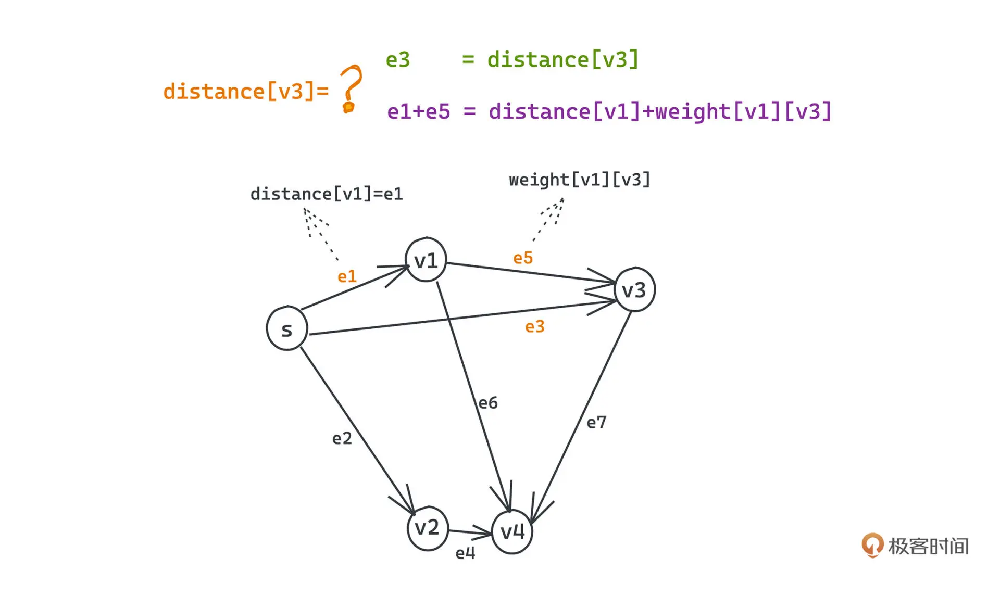
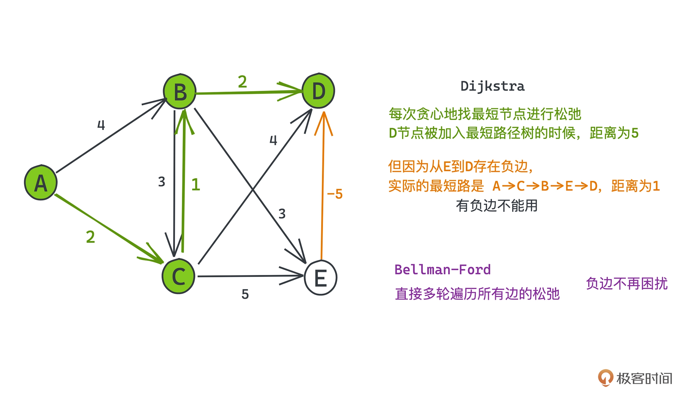
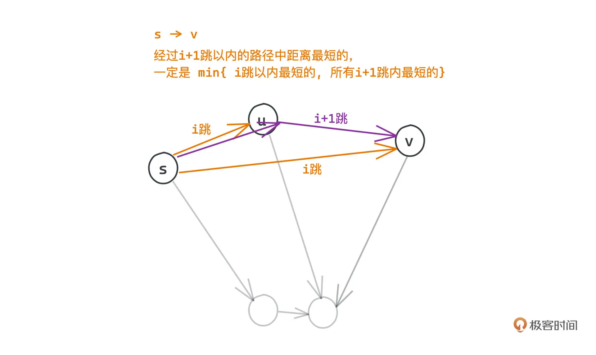
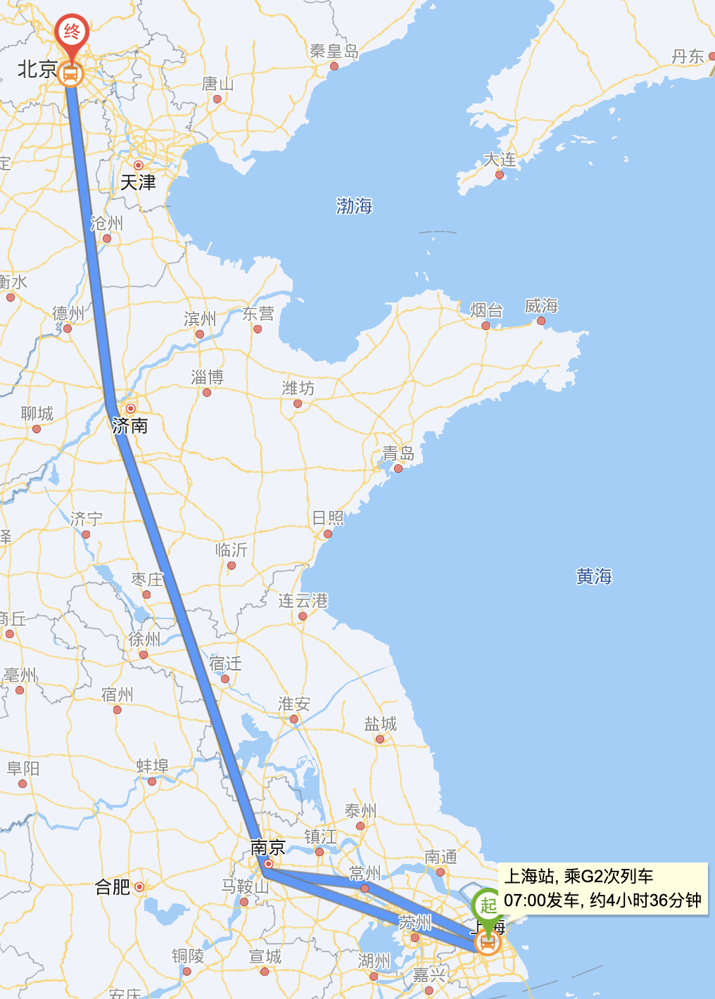
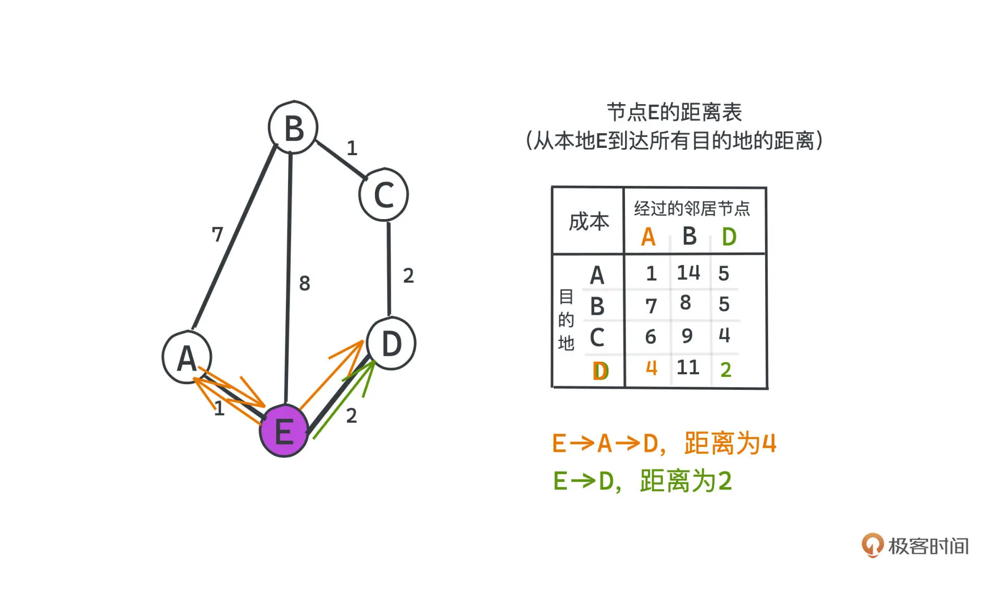
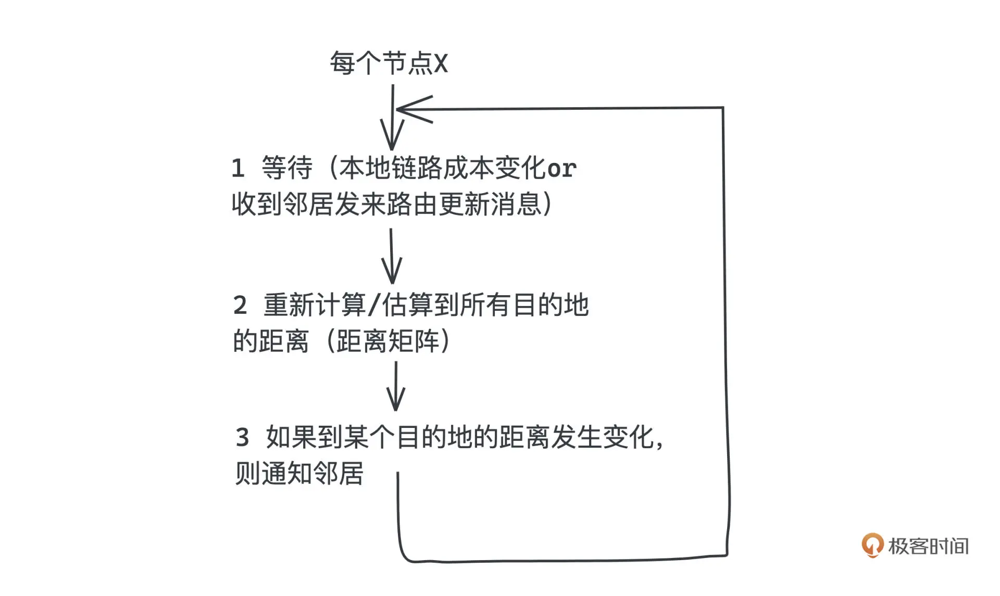
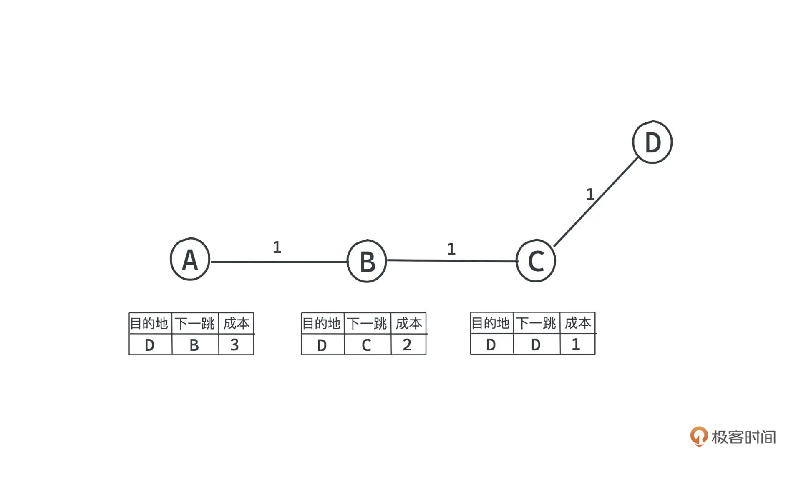
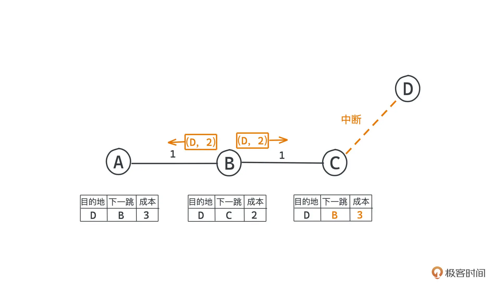

# 19 | 选路算法：距离矢量算法为什么会产生无穷计算问题？

你好，我是微扰君。今天，我们一起来学习一种新的解决最短路问题的思路——Bellman-Ford算法，以及基于它发展出来的距离矢量算法。

动态路由问题相信你已经理解了，上两讲我们也一起学习了解决这个问题的一种经典选路算法——基于 Dijkstra 算法思想的链路状态算法，核心就是每个节点，通过通信收集全部的网络路由信息，再各自计算。

如果说链路状态算法的思想是全局的、中心化的，我们今天要学习的距离矢量算法就是本地的、非中心化的，交换信息的数据量会比链路状态少很多。因为在基于距离矢量算法下的选路协议下，节点之间只用交换到网络中每个其他节点的距离信息，不用关心具体链路，也就是我们所说的距离矢量，而不是泛洪地转发整个网络中每条边的信息。

具体是如何做到的呢？这背后计算最短路的核心思想就是 Bellman-Ford 算法。

## Bellman-Ford 算法

我们就先来学习 Bellman-Ford 算法，它同样是一种反复执行“松弛”操作去计算源点 S 到网络中其他节点距离最短路径的算法，所以学过 Dijkstra 算法的思想，我们再理解 BellmanFord 算法是比较简单的。

不过，和 Dijkstra 用到的贪心思想不同，Bellman-Ford 算法采用的是动态规划（dynamicprogramming）的思想。

首先用同样的数学语言来描述整个图，图 G=(V,E) 包含 V 个顶点 E 条边，源点是 s，weight表示节点之间的距离，weight[u][v]表示节点 u 和节点 v 之间的距离，distance[u]表示从 s 到 u的最短距离，在整个算法过程中我们会不断地更新也就是松弛这个距离 distance[u]的值。



Bellman-Ford 的核心思路就是我们遍历所有的边 e=(u,v) ，并进行松弛操作，也就是判断distance[v]是否小于 distance[u]+weight[u][v]，如果是的话，就把 distance[v]设为distance[u]+weight[u][v]，这也标志着在这次遍历中，我们为 v 找到了一条从 s 出发抵达 v 更近的路线。

为了保证正确计算出从源点 s 到每个其他顶点的最短路径，怎么做呢？

其实也很简单，我们只要把这个遍历松弛的过程重复（V-1）次，也就是图上除了自己之外的顶点数量次。这样，在每次遍历所有边松弛的过程中，distance[v]被计算正确的节点都会增加，最终，我们就可以得到所有节点的最短路径（如果你对这个方法有疑惑，我们稍后会梳理证明过程）。

相比 Dijkstra 算法每次贪心地找最短节点进行松弛的方式，Bellman-Ford 直接多轮遍历所有边的松弛方式显然可以适应更广的应用场景。

比如现在负边就不再是一个困扰了，我们不再需要考虑每个节点加入最短距离树之后，可能会因为存在负边而被重新更新距离的情况。和 Dijkstra 算法一样，Bellman-Ford 中第 i 轮松弛结束之后，可以确定至少有 i 个节点到原点的最短路被确定了，但我们不再知道（当然也没有必要知道）是哪一个了。



这个代码其实比 Dijkstra 算法要好实现许多，这里我写了一个版本（伪代码）供你参考，我们一起来梳理一下思路：

```go
function BellmanFord(list vertices, list edges, vertex source) is
   // This implementation takes in a graph, represented as
   // lists of vertices (represented as integers [0..n-1]) and edges,
   // and fills two arrays (distance and predecessor) holding
   // the shortest path from the source to each vertex
   distance := list of size n
   predecessor := list of size n
   // Step 1: initialize graph
   for each vertex v in vertices do
       distance[v] := inf             // Initialize the distance to all vertices
       predecessor[v] := null         // And having a null predecessor
   distance[source] := 0              // The distance from the source to itself
   // Step 2: relax edges repeatedly
   repeat |V|−1 times:
        for each edge (u, v) with weight w in edges do
            if distance[u] + w < distance[v] then
                distance[v] := distance[u] + w
                predecessor[v] := u
   return distance, predecessor
```

整体就是两步：

- 第一步，对图的初始化。和 Dijkstra 算法一样，我们需要用 distance 数组去记录每个节点的距离，用 predecessor 记录每个节点最短路中的前驱节点，方便输出最短路径。在刚开始还没有进行遍历松弛的时候，把距离都设为无限大，前驱节点设为空就行。

- 第二步，循环松弛操作。就是我们刚刚说的，一共进行 V-1 次，每次循环中都遍历所有的边，进行松弛操作。不过注意，每次松弛成功，也需要更新前置节点。

可以看到，代码写起来其实比 Dijkstra 要简单很多，这也是建立在更高的时间复杂度代价下的，Bellman-Ford 的整体时间复杂度是 O(V*E)，大部分实际场景下，边的数量比节点数量大的多，所以时间复杂度要比 Dijkstra 算法差很多。当然好处在于可以处理图中有负边的情况。

代码的部分还是比较好理解的。Bellman-Ford 算法正确性的证明还是要稍微花一点功夫，会涉及一点数学的证明，如果你觉得理解困难的话，可以多找几个例子好好模拟几遍遍历松弛的过程，观察一下每一轮遍历之后，距离变化的情况，相信还是可以掌握的。

### Bellman-Ford 算法正确性证明

我们来严格证明一下为什么只要对进行 V-1 轮的所有边的松弛操作，就一定可以得到所有节点到原点的最短路径。

整体证明可以通过数学归纳法实现。数学归纳法我们简单复习一下，核心就是两步，第一步要证明 i=1 的时候某个结论成立；第二步要证明如果结论在 i=n 时成立，那么 i=n+1 的情况也成立，这样就能证明整个结论的正确性。

首先，在 Bellman-Ford 算法中我们知道进行完第一轮遍历之后，一定能得到从源点出发到其他任意节点通过长度最多为 1 的（1 跳）路径中最短的距离。

那我们假设在进行完第 i 轮遍历之后，可以得到从原点出发到其他任意节点通过长度最多为 i的（i 跳）路径中最短的距离，判断进行第 i+1 轮松弛时，是否能得到从原点出发到其他任意节点通过长度最多为 i+1 的（i+1 跳）路径中最短的距离呢？

答案是肯定的。因为长度为 i+1 的路径只能从长度为 i 的路径演化而来，假设从 s 到某个节点v 的路径中，存在长度为 i+1 的路径比长度小于等于 i 的路径更近，假设这条路径的第 i 跳是u，那遍历所有边，一定能基于此前到 u 最短的路径，加上 u->v 这条边，得到 s->v 的最短路径。



### 负权回路问题

在一个没有负权回路的图中，也就是不存在某个回路中边的权重之和是负值的情况，显然，从s 出发到任意节点 v 的最短路径，经过的边数量最多就是 V-1，因为最短路径不可能经过同一个点两次。

所以，我们通过 V-1 轮松弛，可以得到从 s 出发到任意节点的边数量小于等于 V-1 的路径中最短的路径，自然也就得到了 s 到任意节点的最短路径。

讲到这里，也就引出了在 Bellman-Ford 算法中的一个限制：没法处理存在负权回路的情况。

有时候 Bellman-Ford 的这一特性也可用来检测负权回路在图中是否存在，做法就是进行第 V次循环，正常情况下这第 V 次循环不会再有任何边的距离被更新，但是如果有边的距离被更新了，就说明在图里一定有负权回路。

```
   // Step 3: check for negative-weight cycles
   for each edge (u, v) with weight w in edges do
       if distance[u] + w < distance[v] then
           error "Graph contains a negative-weight cycle"
```

当然，在网络选路算法的场景下，我们肯定是没有负边的，也就没有必要担心负权回路的问题了。

## 距离矢量算法

好，现在我们已经了解了 Bellman-Ford 的思想，如何用它来解决选路算法中的最短路问题呢？

类似链路状态算法的通信，网络中各节点间同样是需要通过彼此的信息交换获得最短路径的信息，但这次我们只关心网络中各节点和自己的邻居们的路径长度，不用获取全局的网络拓扑结构信息。

举个例子帮助你理解。现在我们希望从上海坐汽车去北京，但没有全局的地图（来源百度地图）不知道怎么走更短，只能打电话问相邻城市的好朋友。如果我们要找出一条最短的路径有两种办法。



一种就是让所有人都问自己邻居城市的朋友，收集好所有的公路信息，然后传播给自己邻居城市的朋友；这样经过一段时间，我们就可以从邻居那里获得整个地图各站间的全部信息，从而可以自己研究出一条最短路径，这个思想就是链路状态法。

而另一种就是我们只是问邻居，你那有汽车能到北京吗？

假设到上海距离一样的两个城市常州和苏州都可以抵达北京，一个到北京 700km，另一个到北京 800km，那我们可能就会选择短的那条经过常州的线路。而常州和苏州怎么知道自己可以到达北京呢，也是基于类似的方式从自己邻居城市的朋友那知道的。这个思路其实和距离矢量法本质上是一样的。

所谓的“距离矢量”其实就是在每个节点都维护这样一张距离表：它是一个矩阵，每一行都可以代表一个目标节点，每一列是经过每个邻居到达这个目标节点的最短距离。



选路的时候，我们就会从每行中选择一个经过邻居节点成本最低的邻居，作为路由表的下一跳。

比如选择从 E 到达 D 的路径，我们对比 E 经过 A 到 D、E 直接到达 D 的路径，距离分别是第四行的第一列和第四行的第三列，显然 E 直接到达 D 是一条更短的路径，所以路由表下一跳的选择自然也会是 D。

整个算法也是迭代进行的，每个节点都会不断地从邻居那里获得最新的距离信息，然后尝试更新自己的距离矩阵，如果发现自己的距离矩阵有变化，才会通知邻居。这样也能避免许多不必要的通信成本。



参考这个体现算法逻辑的流程图，相信你也一定能意识到为什么我们说这个算法是建立在Bellman-Ford 算法思想上的了，其实节点间彼此传递信息的时候，在做的就是松弛操作，等所有的节点都稳定下来，也就相当于进行了 V-1 轮松弛操作，这个时候所有节点的距离矢量就会进入稳定没有变化的状态，整个算法也就进入了收敛状态。

### 无限计算问题

但是因为每个节点都没有全局的拓扑结构，距离矢量有一个巨大的问题，就是在一些情况下会产生无限计算的可能。

比如图中的例子，假设 A、B、C、D 四个节点已经在某一时刻建立了稳定的距离矢量，ABC三个节点到 D 都会经过 C 节点。



此时如果 C->D 节点突然中断了，会发生什么呢？

C 发现自己到 D 的路径走不通了，就会问自己的邻居 B：你那边可以到 D 吗？

这个时候 B 的距离表是没有变化的，结果 B 发现自己可以到 D 距离为 2，就会告诉 C：可以从我这走距离是 2。

但是因为距离矢量算法没有任何信息告诉 B 其实它到 D 的路径就需要经过 C，于是，C 就会把自己到 D 的路径信息更新为新的，B 到 D 的距离加上 C 到 B 的距离，也就是 2+1。



而更新之后，B 又会收到消息，你的邻居 C 距离矩阵变化了，从而把自己 B 到 D 的距离更新为 3+1。

这样的过程会反复执行，于是通往 D 的距离会无限增加。

这个问题就是路由环路问题，也被称为无限计算问题。解决思路也比较多，比较常见的做法就是设定一个跳数上限。

比如在 RIP 协议中 16 跳就是一个常用的上限，如果路径跳数多于 16，我们就会把这个路径看成不可达的，这个时候我们可以让发现某个节点不可达的节点，暂时不要相信其他节点发来的距离矢量，从而避免路由环路问题的无限计算问题。当然，如果有节点和网络断开连接，但在跳数没有到达上限之前，还是会进行大量无谓的计算。

## 总结

好距离矢量算法到这里就学完了，我们结合链路状态算法简单对比一下。

首先，距离矢量算法和链路状态算法背后分别是基于 Bellman-Ford 算法和 Dijkstra 算法实现的。

距离矢量算法背后的 Bellman-Ford 本质就是对所有边无差别的松弛操作，迭代地进行很多轮，是本地的、非中心化的算法。

节点之间不用交换全部的路由拓扑信息，只需要交换到其他节点的最短距离，就可以让距离矢量算法逐步正确选出最短的路径，直至收敛；节点之间的通信也不需要是同步的，邻居节点的距离矢量在什么时间更新、以什么次序抵达都可以，不会影响选路的正确性。

但是在状态链路算法中完全不同，每个节点都需要通过信息交换获取全部的路由信息，然后各自独立地计算最短路径。虽然带来了更大通信开销，但同时也更加保证了计算的健壮性，不会出现环路计算这样的问题。

这两种基础选路算法值得你好好体会其中的思想，可以说现在绝大部分选路算法都是在它们的基础上改进的。另外背后的 Dijkstra 和 Bellman-Ford 算法也是算法竞赛中的常考题，在各大互联网公司的笔试题中也逐渐开始出现，你可以到力扣上找一些题目练习。

### 课后作业

今天留给你的思考题就是前面提到的环路问题，在跳数没有到上限之前，还是会进行大量无谓的计算。有什么更好的解决办法吗？

欢迎你留言与我一起讨论，如果觉得这篇文章对你有帮助的话，也欢迎转发给你的朋友一起学习。我们下节课见～
