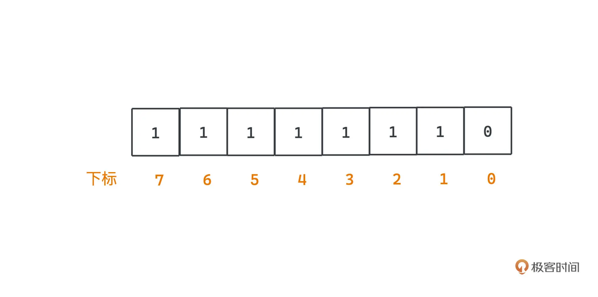
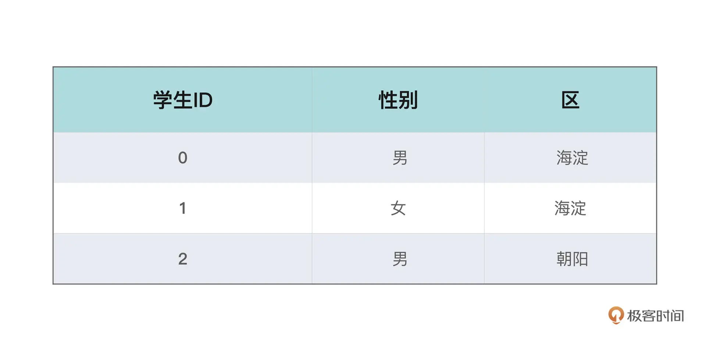

# 29 | 位图：如何用更少空间对大量数据进行去重和排序？

你好，我是微扰君。

今天我们从一道非常经典的面试题开始说起，看看你能否用之前学过的知识回答出来，题目是这样的：QQ，相信你肯定用过，假设 QQ 号（也就是用户的 ID）是一个 10 位以内的数字，用一个长整型是可以存储得下的。

现在，有一个文件里存储了很多个 QQ 号，但可能会有一定的重复，如果让你遍历一边文件，把其中重复的 QQ 号都过滤掉，然后把结果输出到一个新的文件中。你会怎么做？如果 QQ号多达 40 亿个，但是你的内存又比较有限（比如 1GB），又会怎么做呢？

你可以先暂停，思考一下这个问题，如果有了初步思路，我们一起进入今天的学习。

## 直接基于内存进行去重

先来说说常规的思路。假设我们的数据可以被内存装下，这个问题其实就有很多种方式可以解决。

比如，对于去重，直接采用基于散列思想的 hashset，或者基于树状结构的 set 就可以了，前者可以在 O(1) 的时间复杂度内，判断某个元素是否存在于集合中，后者虽然需要 O(logN) 的时间复杂度，但是在十亿的数量级下，其实也就是比较 30 次左右，代价也并不高；然后我们遍历一遍整个文件，存入 set 中，再输出到另一个文件。总的时间复杂度，前者是 O(N)，后者是 O(N*logN)。

当然还有一种思路，我们先用数组把所有 QQ 号存储下来，进行排序；然后顺次遍历，跳过所有和前个 QQ 号相同的 QQ 号，就能实现去重，采用快排同样可以达到 O(N*logN) 的时间复杂度。

所以总的来说，基于哈希算法的时间复杂度，理论上已经是最优的了，耗时也是可接受的，毕竟无论如何，想要去重，每个元素至少要遍历一遍，不可能存在更优的时间复杂度了。我们唯一还能优化的点就是，在像 QQ 号这种以数字为 key 的特殊情况下，直接利用数组来充当hashmap，避免 hash 的开销。

但是这个题真正的问题是，从空间上来说，我们真的能开着这么大的一个数组吗？因为存储的是 10 位数的 QQ 号，这意味着我们的数组至少要有 10 位数以上的 index，假设最高位以 1、2、3、4 开头，也就是说数组至少要存放 40 亿级别的数据。

假设数组类型是 bool，表示对应 index 的 QQ 号是否存在，那我们所需要的内存空间大约是4GB。这对目前的硬件来说不是一个特别高的内存要求，许多个人电脑所采用的内存条都足以支撑，但是如果存 11 位的 QQ 号或者其他更大的数据量，显然就不够用了。而且这道面试题的原始版本要求我们用 1GB 的内存实现去重。

总之，如果有办法用更低的内存，我们应该想办法去发掘。

## 对文件进行分割

现在，内排序、直接使用 hashmap 或者数组计数去重的方式肯定是不行了。

不知道你有没有想到之前学过的外排，本质上就是对文件的分割和逐步排序。在我们的 QQ 号场景下，不需要真的做排序，只是需要去重，所以完全可以逐行读入大文件，根据 QQ 号的范围，切分成多个可以一次性加载进内存的小文件。

不过因为不同范围内 QQ 号重复的数量可能不同，分割范围可能不是特别好把握，保守一点的话，我们可以把 QQ 号按照 1000W 的大小进行分段，这样大约需要分为 400 个文件。这样基本上，算上重复的 QQ 号，也不太可能超过 1G 内存的容量，每个文件再用 hashmap 之类的手段去重，最后合并就可以了。

外排序是一个可行的解决办法，而且理论上来说，利用类似的思路，我们还可以实现更大数量级的去重任务，但是代价是要进行更多次的 IO。性能比较差。

事实上，40 亿级的数据范围，在 1GB 的内存下，我们是有办法直接在内存中处理去重的，这就是我们今天要学习的 Bitmap，它非常有用，在计算机的世界里无处不在，从文件系统、数据库，还有 Redis 中都有广泛应用。我们来看设计思路。

## Bitmap

40 亿的数据直接放在内存里是不行的，但去重，必须获得所有的信息，如果我们想要只利用内存进行去重，也仍然需要把每个数字是否出现在文件中的信息，通过某种方式记录下来。

前面通过数组存 bool 值的方式，显然不是最经济的一种存储方式，因为每个 bool 类型在数组中占据了一个字节的数据，也就是 8 个 bit。

但是存储一个数字是否出现，其实我们只需要用一个 bit 来记录。Bitmap 的核心就是用数字二进制的每一位去标记某个二值的状态，比如是否存在，用 0 表示不存在，用 1 表示存在，所以可以在非常高的空间利用率下保存大量二值的状态。

一个基本的 Bitmap 的图示，相信你一看就能明白：



比如可以用 char 类型来存储 8 个不同元素是否出现的情况，char 的范围在各大主流语言中一般为 0～255，一共包含 8 位二进制，我们可以用下标的每一位来表示一个元素是否出现。在这张图中 Bitmap 的值为 254，表示下标 1～7 的元素都有出现，而下标 0 的元素没有出现。

这样仅仅用了一个字节，就表示了 8 个元素是否出现的情况，而如果用 map 或者数组，至少需要 8 个 bool 值也就是 8 个字节大小的空间，这样我们就节约了 8 倍的空间。

同样如果我们用别的类型来存储 Bitmap，比如 unsigned int 类型，每一个数字就可以表示 32个元素的存在与否，采用多个 unsigned int 类型数据级联，就可以标识更多的元素是否存在。

在 QQ 号的场景下，要表示 40 亿的元素，采用 Bitmap，最少只需要 40 亿个 bits，所占据的空间大约是 500M 左右，这样，我们就大大压缩了内存的使用空间，在 1GB 之内就可以完成去重的工作。

这里插句题外话，不知道你有没有想过为什么 bool 类型，在大部分语言中，都需要一个 byte去存储呢？bool 本身语意上就只是二值，我们不应该用一个 bit 来实现吗，这样不是效率高得多？

这个问题，需要我们有比较好的计算机组成原理相关的知识了。本质原因是在大部分的计算机架构中，最小的内存操作单元就是一个 byte，直接采用一个 byte 作为 bool 类型的存储，在一次读内存的操作内即可完成，如果存储为一个 bit，我们还需要像 Bitmap 那样，从若干位中通过位运算进行一次提取操作，反而更慢。

当然 Bitmap 的本质，实质上就是更好地利用空间来做二值的标记，相比于一般的 hash 算法，它能获得更好的空间成本，从计算上来说，其实也是更高效的，在去重和排序中有比较良好的应用。

### 具体实现

具体的代码实现，我们需要开辟一个 unsigned char 的数组，记作 flags。数组中的每个元素都记录了 8 个 QQ 号是否存在，可以简单地从 0 开始往后计数，虽然位数很低的 QQ 号其实并不存在。

```
flags[index] 代表着第 index*8 ~ index*8+7 这 8 个 QQ 号是否存在的情况，最低位
表示 index*8 是否存在，而最高位就代表 index*8+7 这个 QQ 号是否存在。
```

建立好 Bitmap 数组之后，遍历文件中的 QQ 号，进行对应 Bitmap 标记的更新，根据 QQ 号计算出对应的 flags 的下标和二进制的哪一位，进行和 1 的或运算即可。

遍历完成后，我们只需要顺次遍历 Bitmap 的每一位，如果为 1，说明 QQ 号存在，输出到新文件，为 0 的位直接跳过即可。整个过程完成后，其实我们不止做到了去重，也做到了排序。

整个过程可以很简单地用 C++ 进行实现。首先要实现一个基本的 Bitmap，对外提供初始化、设置标记、获取标记 3 个功能。

```python
class BitMap{
private:
   char *flags;
   int size;
public:
   BitMap(){
       flags = NULL;
       size = 0;
   }
   BitMap(int size){
       // 声明bitmap数组
       flags = NULL;
       flags = new char[size];
       memset(flags, 0x0, size * sizeof(char));
       this->size = size;
   }
   // 根据index设置元素是否出现过
   int bitmapSet(int index){
       int addr = index/8;
       int offset = index%8;
       unsigned char b = 0x1 << offset;
       if (addr > (size+1)) {
           return 0;
       }else{
           flags[addr] |= b;
           return 1;
       }
   }
   // 根据index查看元素是否出现过
   int bitmapGet(int index){
       int addr = index/8;
       int offset = index%8;
       unsigned char temp = 0x1 << offset;
       if (addr > (size + 1)) {
           return 0;
       }else{
           return (flags[addr] & temp) > 0 ? 1 : 0;
       }
   }
};
```

有了这样的基本能力，我们需要做的就是遍历文件的部分，由于文件 IO 和解析的部分不是今天的重点，我们直接处理一个在内存中的 QQ 号数组。

```
int remove_dup(vector<unsigned int> qqs) {
 BitMap b = new BitMap(4000000000);
 for (int i = 0; i < qqs.size(); i++) {
   b.bitmapSet(qqs[i]);
 }
 for (int i = 0; i < 4000000000; i++) {
   if (b.bitmapGet(i)) cout << i << endl;
 }
 return 0;
}
```

如果封装好了基本的 Bitmap 逻辑之后，使用过程和 hashmap 看起来没有什么太大区别，你可以认为 Bitmap 就是一种对数字的散列方式，和数组用于去重的场景相似，适用于下标比较密集的情况，否则仍然会浪费大量的空间，在 QQ 号去重的场景下就非常好用。

## 数据库中的 Bitmap 索引

Bitmap 既然可以适用于排序，当然也可以用来做索引。在数据库中就有一类索引被称为Bitmap 索引，位图索引，比较适用于某个字段只有部分可选值的情况，比如性别的男、女，或者所在城市之类。

采用位图索引，不止可以降低空间成本，在多条件查询中，我们也可以基于位运算提高索引的利用率。看个具体例子：



现在我们有一张北京市某所学校的学生信息表，其中有两列，分别记录了性别和所在区，这两列显然都属于有固定枚举值的情况。这里为了讲解方便，我们简单假设所包含的区只有海淀、朝阳、东城、西城这四个。

如果采用传统的 B+ 树建立索引，在性别这一栏上区分度其实很低，因为很大的概率我们任意一个筛选条件都要筛选出接近半数的元素，所以，基本上先利用性别的红黑树检索就没有什么查询优势了，事实上在大部分的数据库中也会直接选择全局遍历。同样的在区这一维度看，由于我们假设只有 4 个可选项，采用 B+ 树也没有什么特别大的好处。

而位图索引在这样固定枚举值的场景下非常合适，具体做法就是我们会为性别男、性别女，海淀区、朝阳区、东城区、西城区这样几个独立的选项，都建立一个位图向量，作为索引。比如：

```
性别_男= 10010101
性别_女= 01101010
区_朝阳= 00000100
```

就意味着 id=7\4\3\0 的学生性别为男，id=1\2\5\6 的学生为女。

当然由于数据库存储的数据量要大的多，我们会采用更长的 Bitmap 来存储所有学生在某个key 为不同取值的情况。

使用位图索引，最大的好处就在于多查询条件的时候，我们可以直接通过对 Bitmap 的位运算

```
来获得结果集的向量。比如想获得朝阳区的女生，只需要对区_朝阳和 性别_女 这两个
```

Bitmap 做与运算，就可以得到同时符合两个条件的结果集向量，比如在这个例子里，两者与得结果为 0，说明不存在这样的学生。相比于 B+ 树，位图索引效率就会高很多。

## 总结

Bitmap 位图，本质上就是一种通过二进制位来记录状态的数据结构。比基于硬件特性设计、用一个字节来存储 bool 类型的方式，提高了 8 倍的存储效率，可以用更少的空间来表示状态。

Bitmap 在大量数据去重和排序的场景下很有用，比如大量 QQ 号的去重问题；在内存资源敏感、需要标记状态的场景下也很常见，比如文件系统中存储某个 block 是否被占用的状态，用到的就是 Bitmap。

在数据库中，我们也可以在枚举类型的属性上建立位图索引，为属性的每个取值建立一个位图，从而可以大大提高多条件过滤查询的效率。事实上，之后会讲到的布隆过滤器，底层也是基于位图的思想，如果你的工作中有去重的需要，也不妨考虑一下采用位图实现的方式，说不定就能大大提高系统的性能。

### 课后练习

今天主要讲的就是 QQ 号面试题，课后你可以尝试自己动手实现一下，另外有时我们的Bitmap 也会需要把设置为 1 的状态清除，目前我们没有提供这样的接口，欢迎把你的代码贴在留言区，一起讨论。

如果觉得这篇文章对你有帮助的话，也欢迎转发给你的朋友一起学习。我们下节课见。
