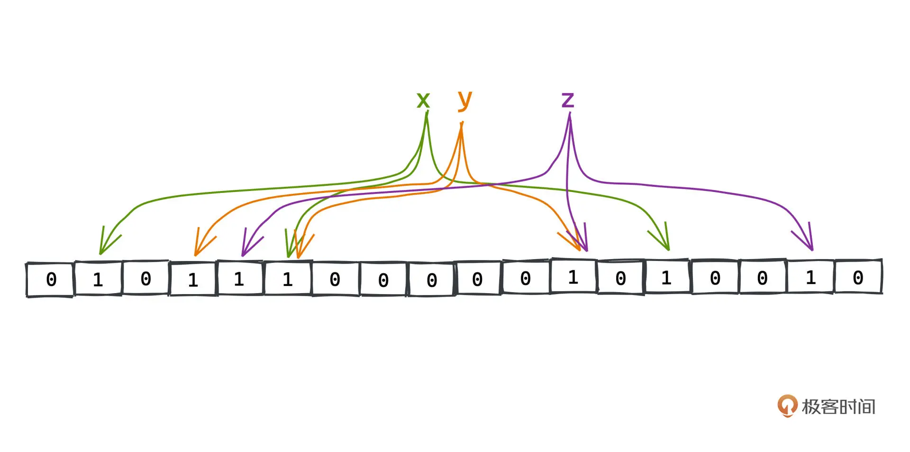
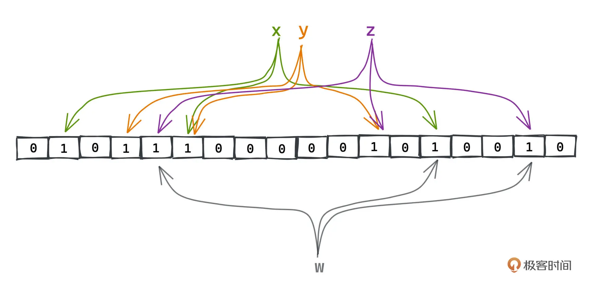

# 30 | 布隆过滤器：如何解决Redis缓存穿透问题？

你好，我是微扰君。

上一讲我们学习了如何基于 bitmap，使用少量内存，对大量密集数据高效地去重和排序，本质就是通过一个长长的二进制 01 序列，来维护每个元素是否出现过这样的二值状态，这个数据结构非常重要，日常工作中有很多应用，比如我们今天要学习的布隆过滤器，就建立在相似的数据结构之上。

那什么是布隆过滤器，用来解决什么样的问题呢？我们先从缓存说起。

## 缓存穿透

还记得之前介绍 LRU 的时候，我们提过的缓存思想吗，用一些访问成本更低的存储，来存一些更加高频的访问数据，提高系统整体的访问速度。比如在业务开发中，我们经常会用 Redis来缓存数据。

这就是因为 Redis 主要把数据存储在内存中，访问速度比数据库快得多，引入缓存层之后，能大大减少数据访问的延时，也能降低数据库系统本身的压力。

我们的用法通常是这样：每次请求某个数据的时候，假设都是基于某个 key 去访问数据库，比如用户 ID 之类的字段，我们会先试图访问 Redis，查看是否有 key 相关的缓存记录，有的话就可以直接返回了；如果没有，再去数据库里查询，查到结果后会把数据缓存在 Redis 中；如果数据库中也没有，返回没有相关记录，这样 Redis 中自然也不会有缓存数据。

另外，大部分系统访问数据的时候都会有时空局部性，也就是说最近访问过的记录很有可能会被再次访问到，所以加了 Redis 之后，数据库的压力就会小很多。当然，这里我们需要处理缓存数据过期或者缓存和数据库数据不一致之类的问题。

所以总的来说，如果我们想要通过 Redis 避免数据库的压力太大，就得保证查询的数据很大一部分是在 Redis 中有缓存的。

大部分场景下，由于时空局部性，都是可以满足这个条件的，但是如果有人恶意反复去系统访问那些已知不存在的 key 呢？

由于数据库中一定不会存在这样的 key，Redis 中也不可能有这样的 key，我们的每次请求都会访问一次 Redis 再访问一次数据库，就好像穿透了 Redis 层一样，这个问题我们就称为“缓存穿透”，恶意攻击者往往可以通过这样的手段，让我们的数据库的压力很大，甚至崩溃。

但是即使在正常的 workload 下，有时候也会产生大量穿透的请求，有什么办法减少这些不必要的请求呢？

## 布隆过滤器

布隆过滤器，也就是 bloom filter，可以很好地帮助我们解决这个问题。

顾名思义，布隆过滤器起到的是过滤的作用，在缓存穿透的场景下，过滤掉肯定不在系统中key 的相关请求。所以，布隆过滤器，核心就是要维护一个数据结构，我们通过它来快速判断某个 key 是否存在于某个集合中。

看到这里，你是不是马上想到了一种最简单的 filter 策略：既然 Redis 做的就是一个缓存系统，如果存在 key，我们把数据缓存至 Redis 中，不存在 key 的时候，我们一样缓存到系统中，然后记录一个特殊的值来表示这个数据不存在，这样不就可以了嘛，就像我们之前学的LSM-tree 中的墓碑标记一样。

这个方案当然是可以工作的，但是，不存在的 key，显然取值范围是很大的，我们也可以预想在大部分场景下，要比存在于系统中的 key 的取值范围多得多。Redis 存储空间有限，所以，这个方案无疑会大大减少有效数据的缓存空间。在恶意攻击者的攻击下，甚至可能造成 Redis中存储的大部分数据都是标记为不存在的记录，所以这显然不是一个很好的办法。

我们有没有办法利用更少的空间，快速判断某些记录是否存在于系统中呢？

这就是布隆过滤器的主要优势了，当然，软件没有银弹，布隆过滤器也有两个比较大的限制：

1. 判断并不是完全准确的。布隆过滤器可以保证自己判断出不在系统中的 key 一定不在，但是剩下的部分不一定都在系统中存在 key，有一定的误判风险；

2. 布隆过滤器的记录删除比较困难。

为什么会这样呢，接下来我们就来看一看布隆过滤器的实现原理。

## 实现原理

布隆过滤器本质上可以理解成一种散列的算法，这也是为什么我们说它和上一讲学到的Bitmap 关系很大。

不过布隆过滤器不是一个简单的映射，更像是一个散射，它包含 K 个不同的散列函数，每个散列函数都会把某个 key 映射到一个数字 h，然后我们会把一个 M 位二进制对应的第 h 位二进制，置为 1。这样，每个 key，我们就映射到 m 位二进制中 k 位为 1 的数字上了，记录的方式其实和 bitmap 的定义如出一辙。

在整个布隆过滤器的使用过程中，我们会维护一个全局的 Bitmap，并且把每个出现过的记录值都进行这样的散射，Bitmap 的每个散射到的位置都置为 1。

看这个例子，我们把 x、y、z 分别散射到了绿色、橙色、紫色指针的位置：



之后再查询不同的 key，比如 x、y、z，我们首先会进行同样的 Hash 计算，判断出每个对应的位置是否为 1，如果有一位不为 1，说明这个 key 肯定在系统中不存在，我们也就不需要进行后续的查询了。这样我们能减少很大一部分缓存穿透的情况，而且付出的存储空间也非常有限。

这样多重 Hash 方式有什么好处呢？

### 优势与劣势

比如之前提到的直接用 HashMap 的实现方式，因为我们完全可以直接对 xyz 进行某种 hash算法，将它们映射到一个数组空间里，再判断对应的 key 是否存在呀？多重 Hash 有什么优势呢？

主要的问题是 HashMap 所占用的存储空间要高得多，在传统的 HashMap 中，我们会存储key 的引用，这是一个很大的开销。而在布隆过滤器中，我们所需要的只是一个不大的Bitmap（至于到底选择多大的 bitmap 合适，我们稍后具体的计算）。

当然，我们去掉了引用所占用的空间，自然也就少了应对冲突的能力，这就是布隆过滤器不完美的地方之一，它的重复判断是有“误差的”。

根据前面的原理，我们来详细分析一下，只要确定布隆过滤器中不存在的 key，则该 key 在系统中一定是不存在的，因为但凡有一个 Hash 值对应的 Bitmap 位不为 1，说明这个 key 一定没有被添加到过 bloom filter 中。

但是反过来，如果每一位都为 1，其实仍然有一定的概率这个 key 没有出现在布隆过滤器中。比如例子中的 w：



w 映射的每个 Bitmap 的位正好都是 x、y、z 中某个 key 映射的一位，从布隆过滤器中看来，w 的每一位也都是 1，我们并不能排除它在系统中存在的可能性，但是如果 w 不存在，就会产生一次不必要的穿透。

但是缓存系统是空间敏感的应用，这也是我们没有直接用 Redis 存储不存在记录的原因，为了使用更小的空间，付出小概率的“误差”成本完全是可接受的。

第二个劣势记录删除困难，根本原因和上一点是一致的，因为我们重叠了 Hash 的位数，所以无法判断每一位的 1 到底是由哪一次 Hash 计算贡献的，同一个 1 可能被多次 Hash 计算更新，所以我们不好在想要移除某个字段的时候，把通过 Hash 计算得到的位直接置 0。不过这个问题在许多需要使用布隆过滤器的场景下影响也不大。

### 误判率推导

好现在明白了布隆过滤器的设计思路与优劣势，工作应用时到底选择多大的 bitmap 合适呢，我们来根据误判概率算一算。

假设 Bitmap 由 m 位二进制组成，包含 k 个哈希函数。判断某个 key 是否存在的概率怎么算呢？

首先，判断是否存在，就是看这个 key 对应的 k 个位置是否都为 1，那每个位置是否为 1 的概率从何而得呢？假设之前已经插入了 n 个 key。

先考虑每次插入 key 的时候某一位为 1 的概率。如果哈希函数均匀，每个 key 一共进行 k 次

- 11k

## （1 −

- ​）

哈希，每次哈希到特定某一位的概率为

- ，那么这一位不为 1 的概率是：。mm​

- 1k∗n

## （1 −

- ​）

再考虑这样的操作之前已经进行过 n 次，那么这一位不为 1 的概率是：

- 。m

- 1k∗n

## 1 −（1 −

- ​）

最后反推，这一位为 1 的概率是：

- 。m

所以什么时候会误判呢？也就是说对于某个新的 key，虽然这个 key 不存在，但是它 k 次Hash 出来的每个位置都为 1。这个概率的计算，我们随便找 k 个 1，然后对每一位都为 1 的概率做累积，在 m 比较大的时候，通过高等数学的知识可以得到近似：

## 1

- kn kk∗n−k

## （1 −（1 −

## (1 −e

## )

## ）=

- ​）m​

## m

可以看出，误判概率大致和 n 成正比，和 k、m 成反比，我们可以根据自己的业务场景选择合适的位数和哈希函数数量。不同的 m、n、k 取值下，可以参考误判率的表格。

经验值是对于 100w 的数据量，如果希望通过 5 次 Hash 得到 5% 以内的误判率，我们大概需要 700 万位 Bitmap，内存只需要不到 1M 即可完成，效果非常不错。而且 5% 的误判率，我们也是完全可以接受的，以数据库 - 缓存构成的系统为例，这足以帮我们降低 95% 的穿透请求，效果显著。

## 实现逻辑

在理解布隆过滤器实现原理的基础上，我们动手实现就非常简单了，比 Bitmap 的实现多不了几行代码。

Google 提供的经典 Java 工具库 Guava 中，就有一个对 bloom filter 的实现，它提供了很好的泛化能力，通过自己重新封装 bitset 获得了更佳的性能，同时也支持多种不同的策略。我们来看一下核心的逻辑：

```
MURMUR128_MITZ_64() {
   @Override
   public <T> boolean put(
       T object, Funnel<? super T> funnel, int numHashFunctions, BitArray bits)
     long bitSize = bits.bitSize();
     // 获得带有随机性的hash种子
     byte[] bytes = Hashing.murmur3_128().hashObject(object, funnel).getBytesInt
     long hash1 = lowerEight(bytes);
     long hash2 = upperEight(bytes);
     boolean bitsChanged = false;
     long combinedHash = hash1;
     // 进行k次hash计算
     for (int i = 0; i < numHashFunctions; i++) {
       // Make the combined hash positive and indexable
       bitsChanged |= bits.set((combinedHash & Long.MAX_VALUE) % bitSize);
       combinedHash += hash2;
     }
     return bitsChanged;
   }
   @Override
   public <T> boolean mightContain(
       T object, Funnel<? super T> funnel, int numHashFunctions, BitArray bits)
     long bitSize = bits.bitSize();
     byte[] bytes = Hashing.murmur3_128().hashObject(object, funnel).getBytesInt
     long hash1 = lowerEight(bytes);
     long hash2 = upperEight(bytes);
     long combinedHash = hash1;
     for (int i = 0; i < numHashFunctions; i++) {
       // Make the combined hash positive and indexable
       if (!bits.get((combinedHash & Long.MAX_VALUE) % bitSize)) {
         return false;
       }
       combinedHash += hash2;
     }
     return true;
   }
}
```

MURMUR128_MITZ_64 是其中一种比较常见的策略，核心方法就是 put 和 mightContain 方法。

从 mightContain 方法名中，相信你也可以再一次意识到 bloom filter 误判的特性，可以说Google 的库命名非常确切。

put 方法，核心逻辑就是通过 murmur3_128 进行 Hash 计算，得到一个 128 位带有随机性的byte，取其中的高位和低位作为种子，再通过简单的位运算叠加 k 次，等同了 Hash k 次的效果，最后把对应的位置都置 1 即可。mightContain 的逻辑，基本上就是相反的过程。

Guava 库的代码质量很高，也不是特别难懂，如果你是 Java 爱好者，不妨用这个库开始你的源码学习之旅。

## 总结

今天我们一起学习了非常知名且常用的数据结构，bloom filter。在 Bitmap 和 HashMap 的基础上，布隆过滤器，通过对每个元素进行某种散射式的 Hash，把状态记录在 Bitmap 中，高效且成本低地为我们提供了在大量数据中判断某个元素是否存在的神奇能力。

当然，相比于朴素的 HashMap，省来的空间也不是完全没有代价，在布隆过滤器中，我们只能断言一个元素一定不存在，但没有断言时，元素可能存在也可能不存在。

不过在选取合适的 Bitmap 数组大小和 Hash 计算次数之后，可以很容易地把误判率控制在低于 5% 的水平，依旧可以给我们带来很大的性能提升。在 Redis 中，就常常用来缓解缓存穿透的现象，从而提高系统的吞吐和稳定性。

### 思考题

留一个有点难度的思考题。我们提到了布隆过滤器清除状态比较困难，但有些缓存数据是有生命周期的，比如一周或者一个月之后就大概率过期了，你有没有什么好办法可以帮助我们更好地清理过期数据呢？

欢迎你在留言区留下你的思考。如果觉得这篇文章对你有帮助的话，也欢迎你转发给你的小伙伴一起学习。我们下节课见～
