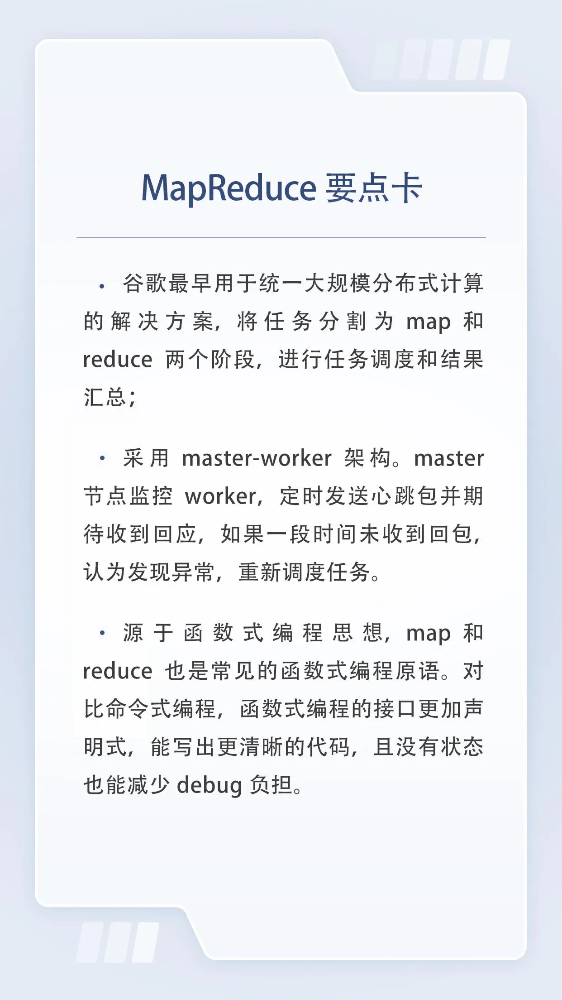
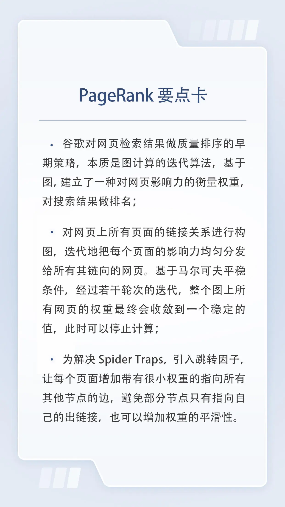
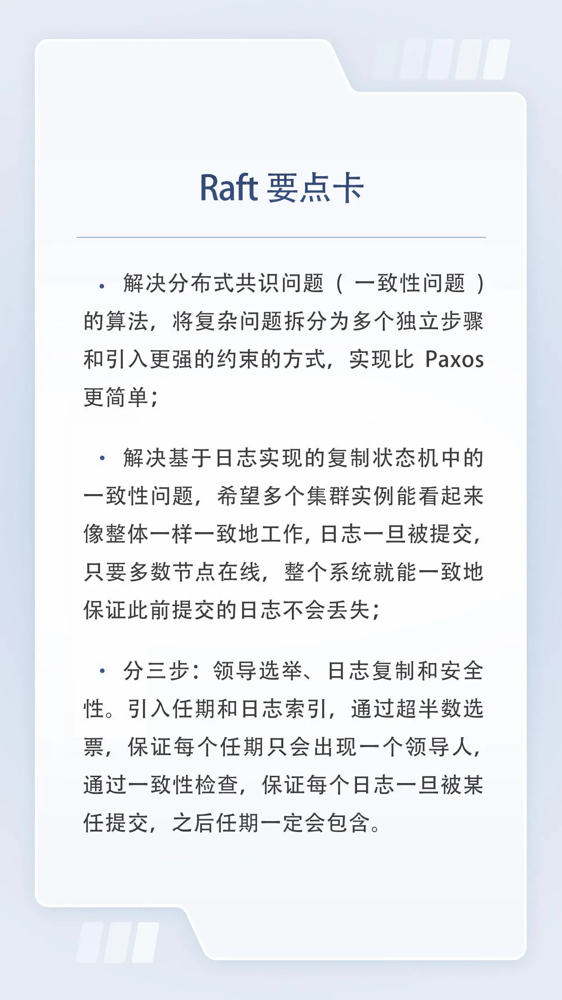
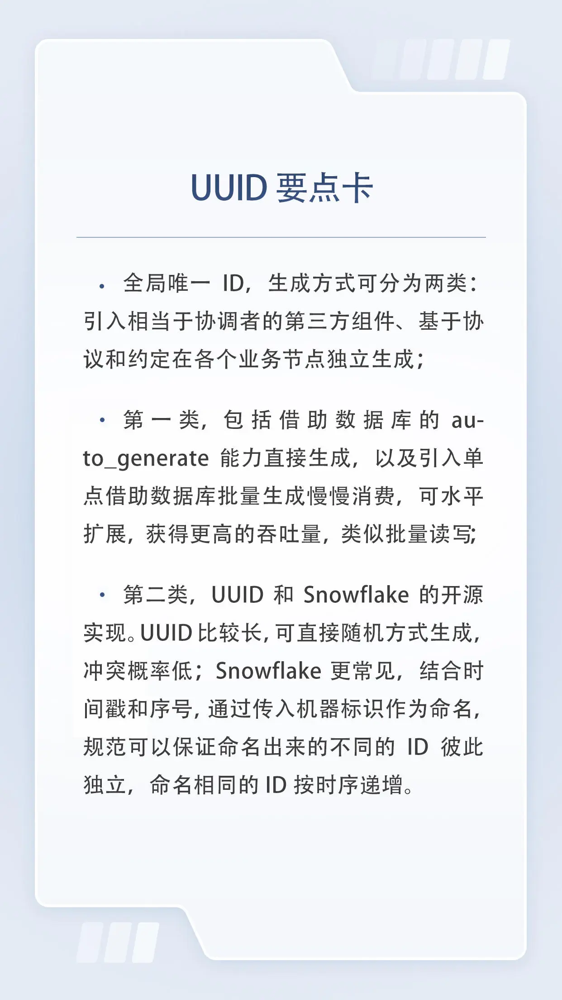
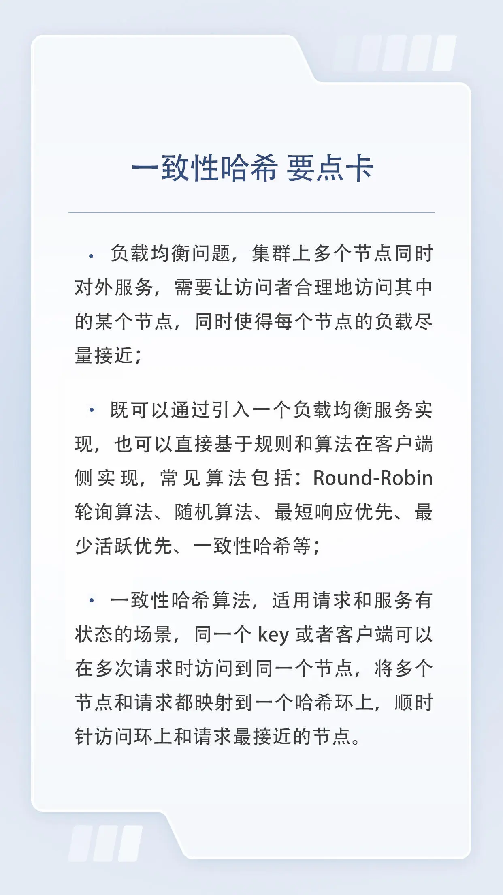

# 即学即练 | 分布式篇：复习卡一键直达

你好，我是微扰君。

我们已经学完了分布式章，今天就来复习回顾一下这一章的要点内容。既然讲的是工程中的问题，也就没有 LeetCode 练习题了，主要是在工作中多观察多分析多总结。在学习的时候，我们也不要想着只是解决这一个简单的问题，而是要更多地考虑别人解决问题背后的思路。

有些算法，虽然现在已经有了现成的库类和中间件，供我们开箱即用，但是如果你对它背后的原理更加熟悉，一旦在业务开发中碰到类似的问题，你才能比别人更快地想到有效的解决方案，这也是我认为学习这些算法最重要的意义。

## 分布式篇

今天来复习 & 练习专栏的第四章，分布式篇。在这个模块里，我们一起学习了 MapReduce 、PageRank、Raft、UUID、一致性哈希。你可以借助整理好的要点卡片，回到相应章节，有针对性地复习。

### 复习要点卡

点击要点卡，直达你最需要复习的那篇。

复习的过程中，如果有什么困惑，获得了什么收获，都欢迎你留言讨论，也欢迎你把复习卡分享给你的朋友。

学习愉快，我们工程实战篇见～
