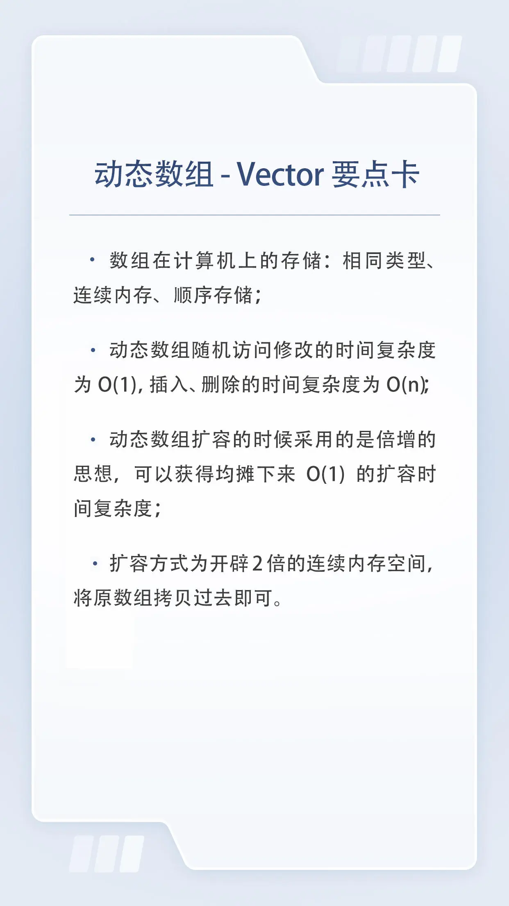
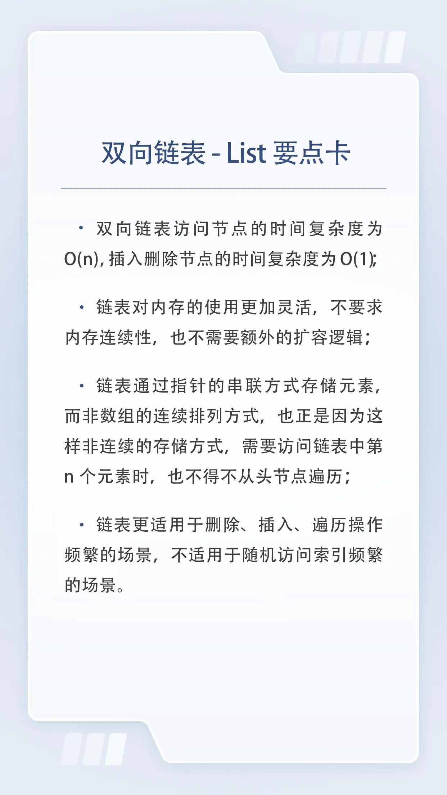
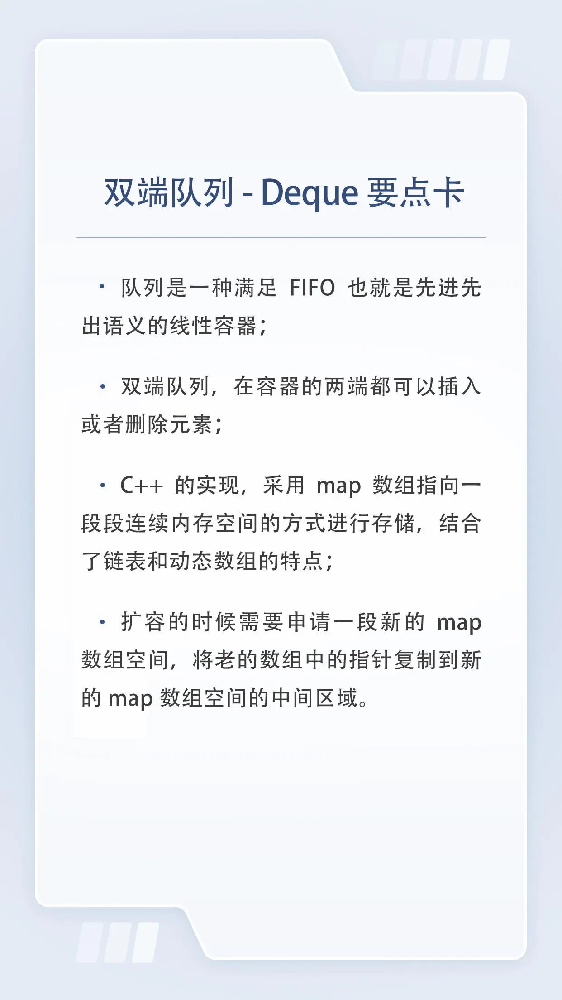
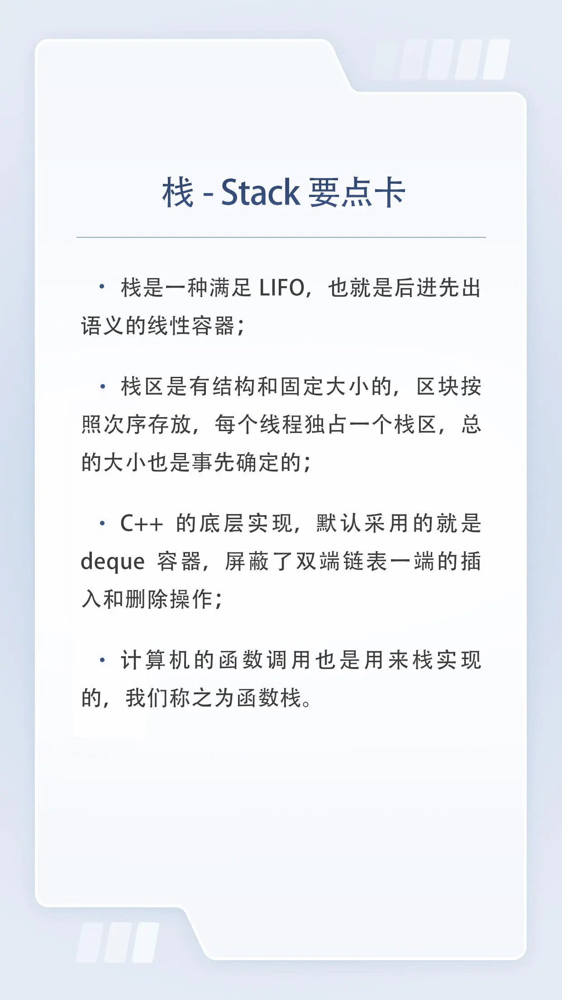
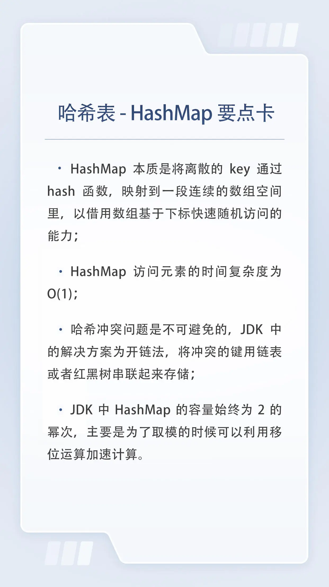
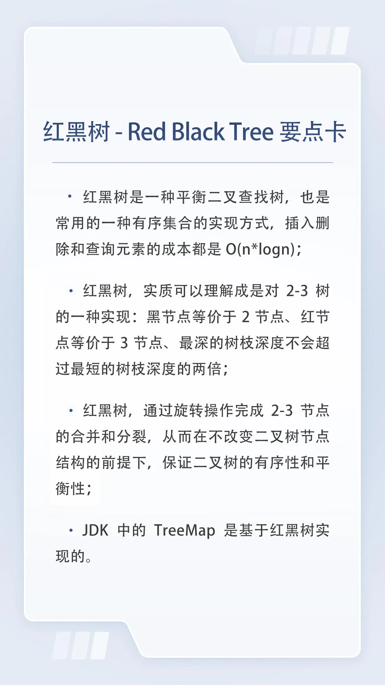
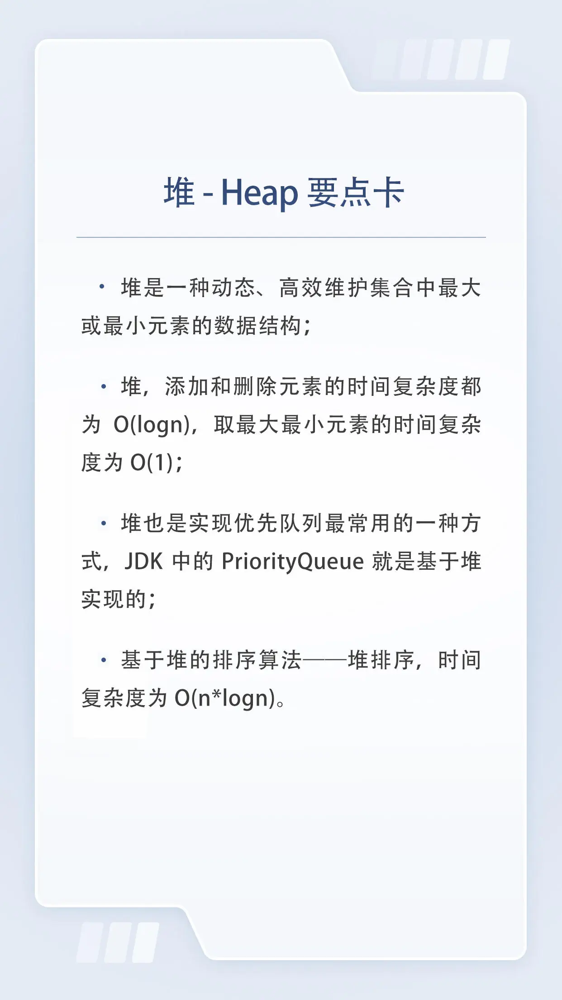

# 即学即练 | 基础数据结构篇：复习卡&算法题特训

你好，我是微扰君。

到目前为止我们已经学习了课程基础部分的 4 章内容，包括基础数据结构篇、基础算法思想篇，以及操作系统和计算机网络这两门非常重要的计算机基础课中会用到的基础算法。不知道你掌握的如何啦？

我常在课程里提到只有掌握优秀算法的精髓，才能根据实际的 workload 选择合适的算法，但如果缺少足够的练习，我们在实际写的时候，可能还是会遗漏一些值得考虑的细节，而长期不间断的算法训练，能磨练我们的思维能力。上一节课也分享了我自己刷算法题的方法。

春节期间我们就来 4 期特别策划，我会带你复习这四大章的要点内容，把每篇文章的要点都梳理出来，供你快速回顾内容。

另外我也整理了这 4 章每个核心知识点对应的必知必会的 18 道 LeetCode 练习题，供你练手复习巩固。你可以每天花一点时间，来完成测验。测验完成后，如果发现自己哪里还不太明白，可以点击要点卡，可以直接跳转到你最需要复习的那篇。有针对性地复习。

## 基础数据结构篇

今天我们来复习 & 练习专栏的第一章，基础数据结构篇。在这个模块里，我们一起学习了动态数组、双向链表、双端队列、栈、HashMap、Treemap、堆这几个内容。

## 必知必会力扣题

- 题目名 随机翻转矩阵

题目链接：https://leetcode-cn.com/problems/random-flip-matrix/

题解思路

- 题目名 786. 第 K 个最小的素数分数

题目链接：https://leetcode-cn.com/problems/k-th-smallest-prime-fraction/

题解思路

- 题目名 430. 扁平化多级双向链表

题目链接：https://leetcode-cn.com/problems/flatten-a-multilevel-doubly-linked-list/

题解思路

- 题目名 678. 有效的括号字符串

题目链接：https://leetcode-cn.com/problems/valid-parenthesis-string/题解思路

- 题目名 1705. 吃苹果的最大数目

题目链接：https://leetcode-cn.com/problems/maximum-number-of-eaten-apples/

题解思路

- 题目名 剑指 offer 49. 丑数题目链接：https://leetcode-cn.com/problems/chou-shu-lcof/

题解思路

### 复习要点卡

点击要点卡，直达你最需要复习的那篇。

复习 & 练习的过程中，如果有什么困惑，获得了什么收获，都欢迎你留言。做完题目之后，欢迎你把复习卡和你的 LeetCode 题解分享给你的朋友，说不定就帮他解决了一个难题。

学习愉快，我们下期见～
