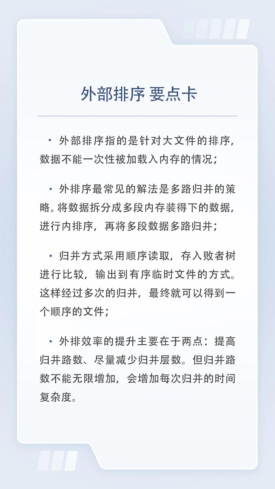
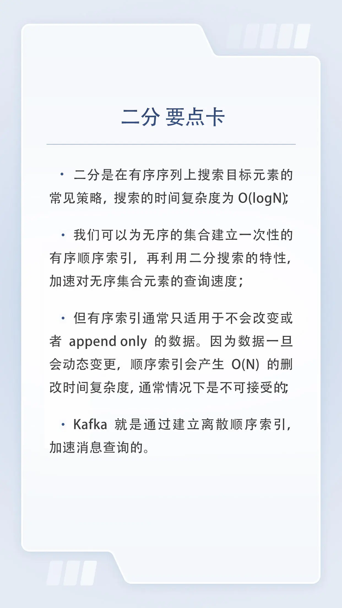
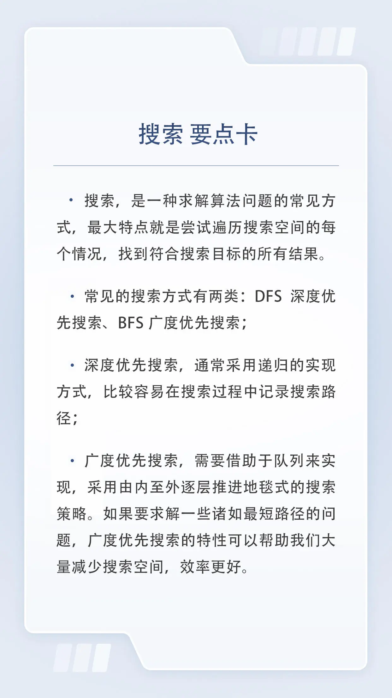
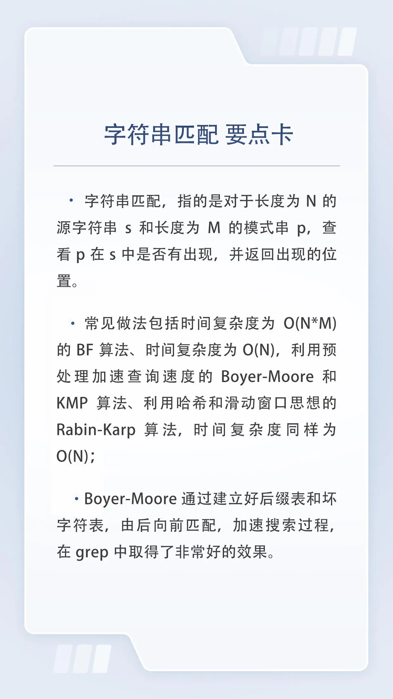
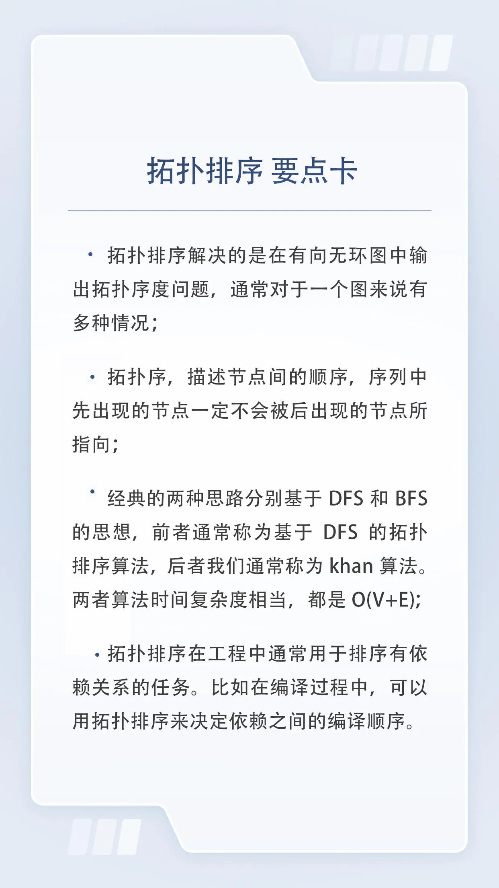
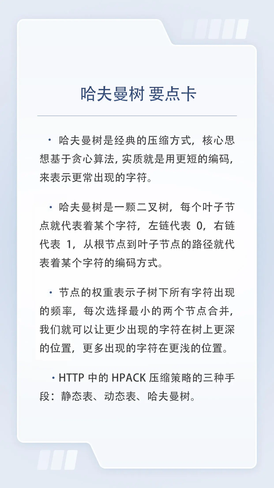

# 即学即练 | 基础算法思想篇：复习卡&算法题特训

你好，我是微扰君。

大年初一，祝你新春快乐！

今天是春节特别策划的第二期。昨天的第一期是关于基础数据结构篇的，如果你错过了可以点这里答题 & 复习。

这 4 篇文章中的题目都是我精选出来的，无论是对知识点的理解，还是为了准备面试，都是必须要掌握的，建议你一定要全部手写练习。如果一遍搞不定，你可以点击对应章节的要点卡，再复习一下文章，多看几遍，结合题目反复练习，一定会收获很多。

## 基础算法思想篇

今天我们来复习 & 练习专栏的第二章，基础算法思想篇。在这个模块里，我们一起学习了外部排序、二分、搜索、字符串匹配、拓扑排序、哈夫曼树这些内容。

### 必知必会力扣题

- 题目名 846. 一手顺子

题目链接：https://leetcode-cn.com/problems/hand-of-straights/

题解思路

- 题目名 475. 供暖器

题目链接：https://leetcode-cn.com/problems/heaters/

题解思路

- 题目名 剑指 Offer II 069. 山峰数组的顶部

题目链接：https://leetcode-cn.com/problems/B1IidL/

题解思路

- 题目名 162. 寻找峰值

题目链接：https://leetcode-cn.com/problems/find-peak-element/

题解思路

- 题目名 1044. 最长重复子串

题目链接：https://leetcode-cn.com/problems/longest-duplicate-substring/题解思路

- 题目名 851. 喧闹和富有

题目链接：https://leetcode-cn.com/problems/loud-and-rich/

题解思路

### 复习要点卡

点击要点卡，直达你最需要复习的那篇。

复习 & 练习的过程中，如果有什么困惑，获得了什么收获，都欢迎你留言讨论。做完题目之后，欢迎你把复习卡和你的 LeetCode 题解分享给你的朋友。

学习愉快，我们下期见～
