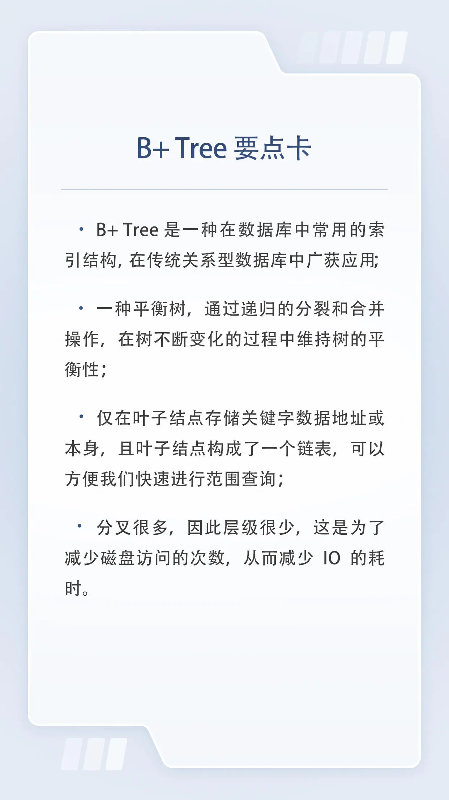
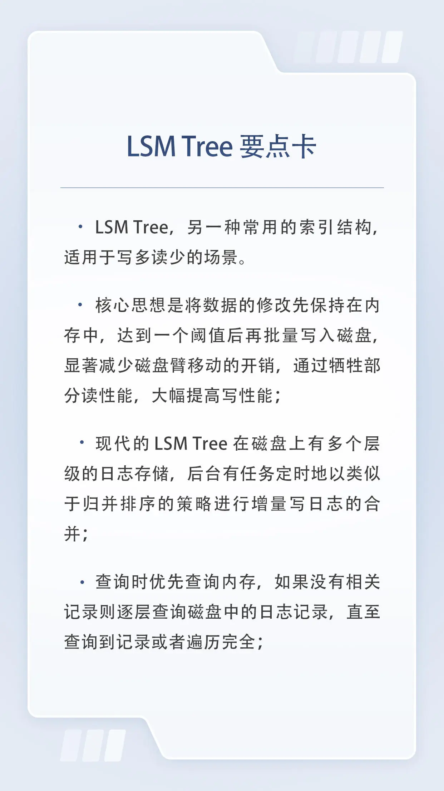
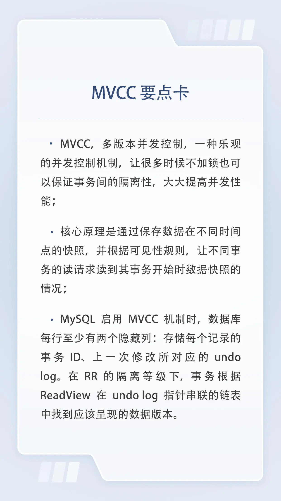
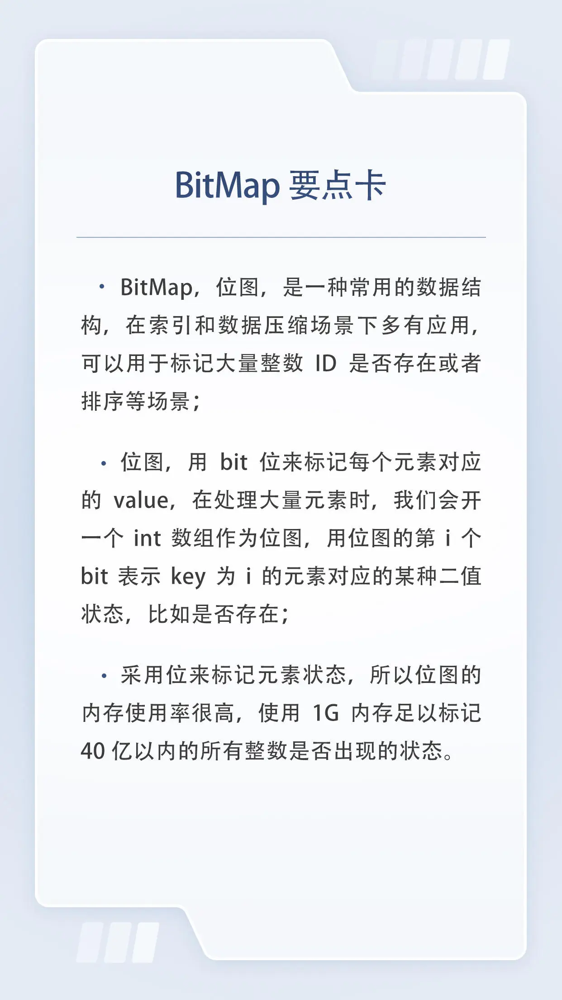
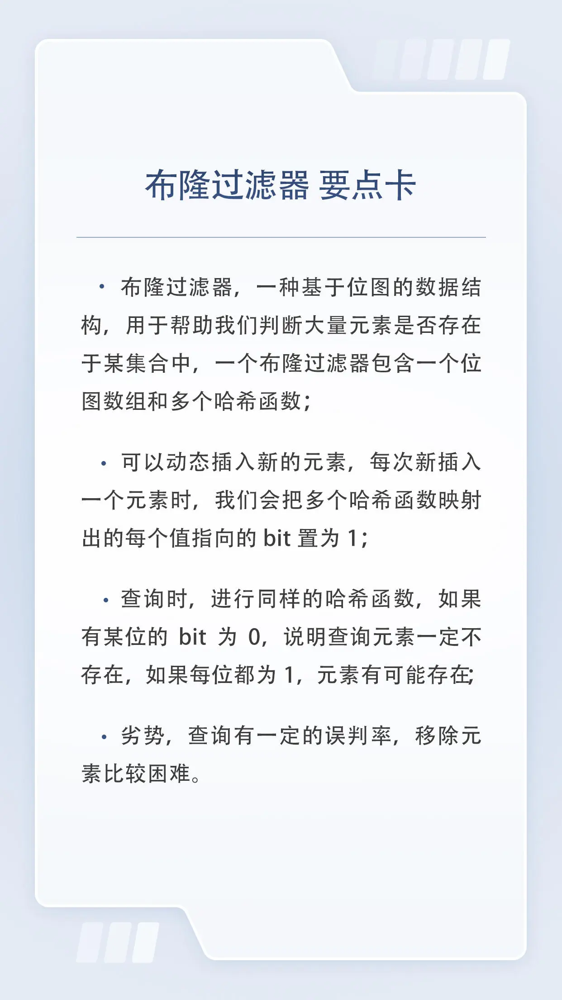
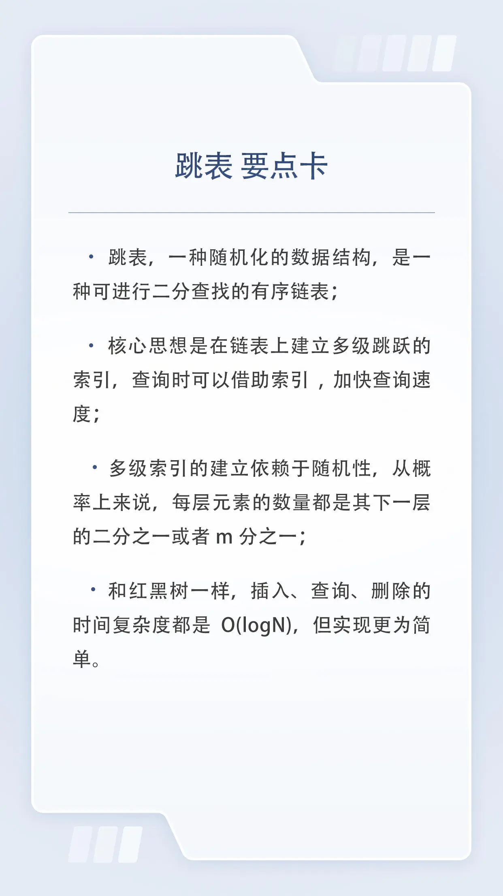
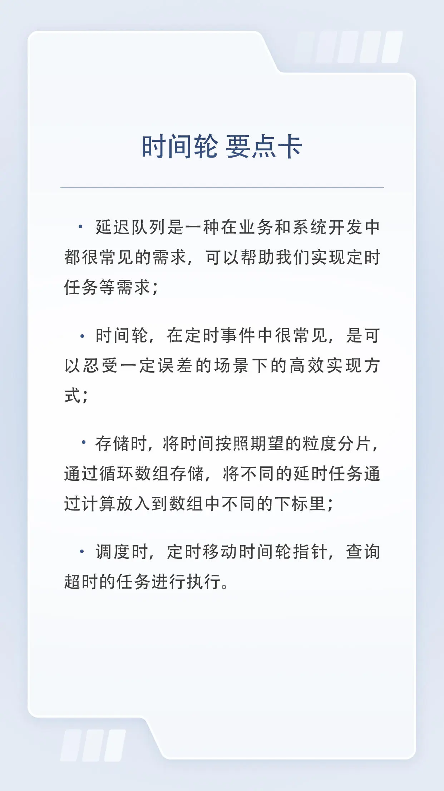
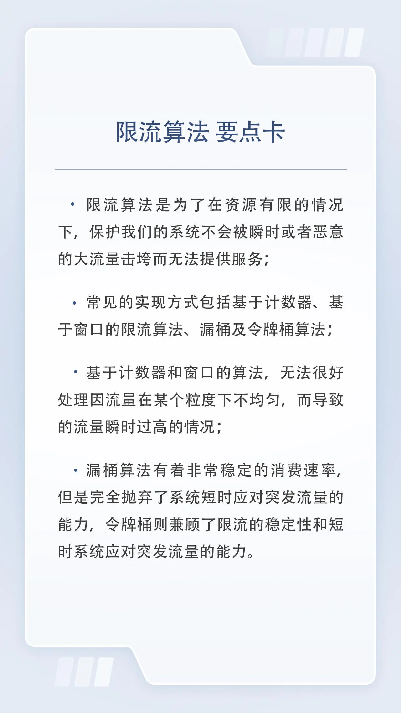
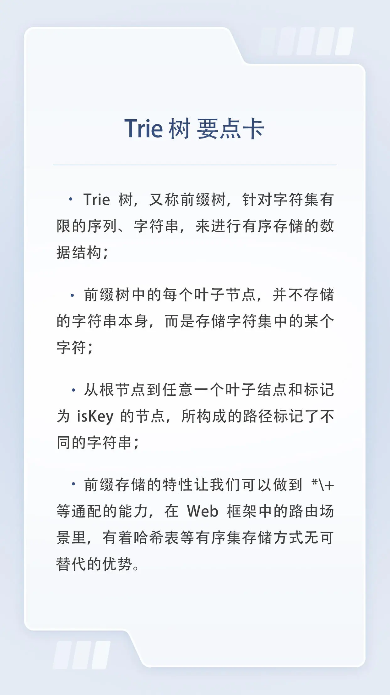

# 即学即练 | 工程实战篇：复习卡一键直达

你好，我是微扰君。

今天我们来回顾一下工程实战篇的要点内容，这也是专栏的最后一个模块。

在这个章节中，相信你能感受到我们更多提到了前面学习的算法思想和基础数据结构的知识点，这也正是工程中算法应用的特点，它们都是某个庞大系统的一部分，被用来解决不同场景下的技术问题，而不是一个独立可抽离的知识点。

在这些算法中，一方面，我们会借鉴很多其他系统中的设计经验和思想，比如 LSM Tree 中提到的批量写降低 IO 成本的思想，在很多系统中都有体现；另一方面，这些系统中的算法本身也会跟很多其他的系统进行交互，比如 B+ Tree 和 LSM Tree 的设计思想就和磁盘读写的特性息息相关。

所以在学习这些算法的时候，我们更多的还是要结合工程实战的场景来学习。我也相信，在学习它们的过程中，你也能更多收获融会贯通的快乐，也希望你能借此打好算法和计算机基础，在编程的世界里一直有所精进。

## 工程实战篇

来复习专栏的第四章，工程实战篇。在这个模块里，我们一起学习了 B+ Tree、LSM Tree、MVCC、BitMap、布隆过滤器、跳表、时间轮、限流算法、Trie 树。

你可以借助整理好的要点卡片，回到相应章节，有针对性地复习。

### 复习要点卡

点击要点卡，直达你最需要复习的那篇。

复习的过程中，如果有什么困惑，获得了什么收获，都欢迎你留言讨论，也欢迎你把复习卡分享给你的朋友。

学习愉快～
