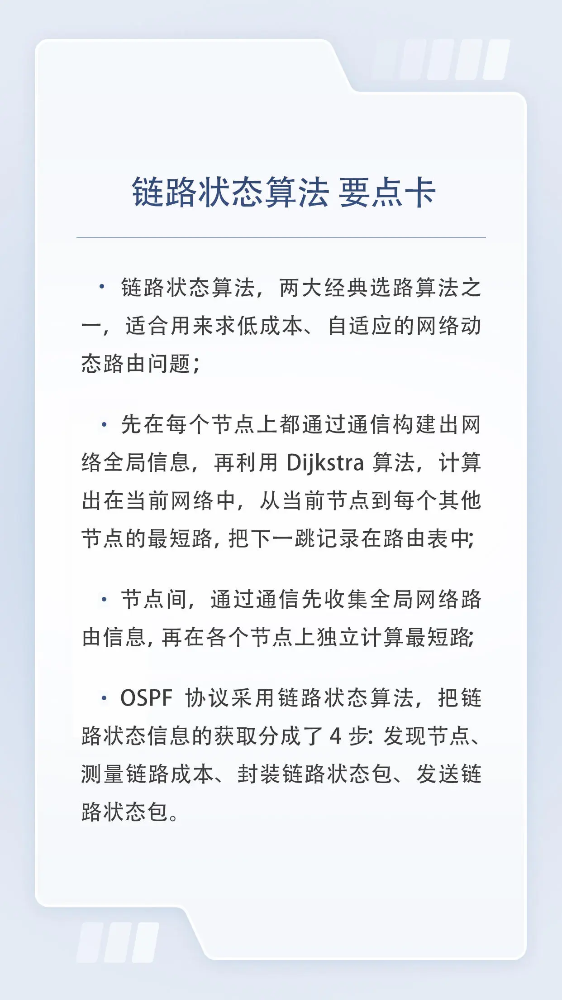
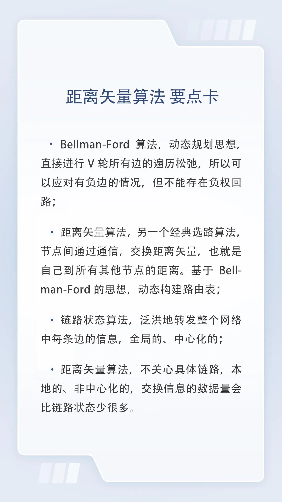
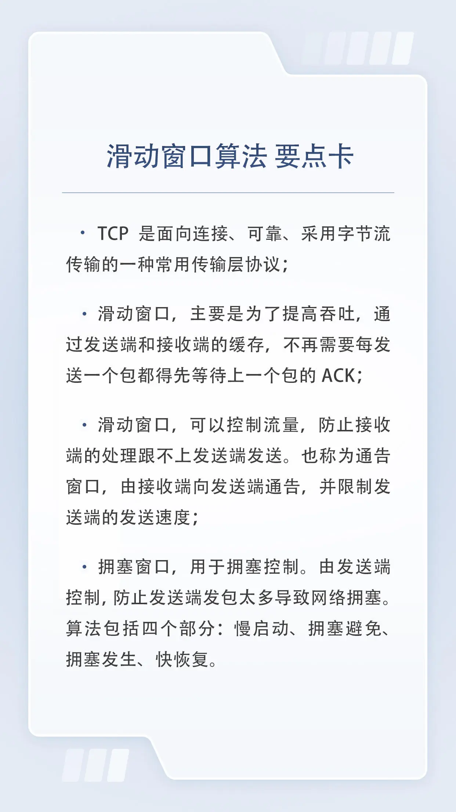

# 即学即练 | 计算机网络篇：复习卡&算法题特训

你好，我是微扰君。初五好！

通过这几次的复习和练习，你掌握了多少呢，想必收获颇丰。今天是我们春节特别策划的最后一期了，继续坚持哦，加油。

你可以借助整理好的要点卡片，快速回顾今天的要点内容。复习完知识点，也可以用对应的LeetCode 练习题练练手，复习巩固一下。

## 计算机网络篇

今天我们来复习 & 练习专栏的第四章，计算机网络篇。在这个模块里，我们一起学习了选路问题中的两种算法及背后的最短路求解算法：链路状态算法 (Dijkstra)、距离矢量算法(Bellman-Ford)，以及滑动窗口算法这 4 讲内容。

### 必知必会力扣题

- 题目名 187. 重复 DNA 序列

题目链接：https://leetcode-cn.com/problems/repeated-dna-sequences/

题解思路：滑动窗口

- 题目名 743. 网络延迟时间

题目链接：https://leetcode-cn.com/problems/network-delay-time/

题解思路：参考官解即可，SPFA 和 Dijkstra 都可以解决

### 复习要点卡

点击要点卡，直达你最需要复习的那篇。

如果有什么困惑，获得了什么收获，都欢迎你留言讨论。

春节的刷题复习课到这里就结束了，我们之后就要开始学习在分布式和工程实践中算法的应用了，会学习在各个业务场景下如何拆解问题、应用算法，升级自己的编程思维。

这 7 天的学习只是改变的开始。我们下节课见～
