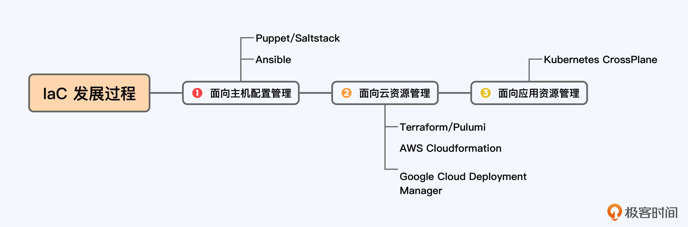
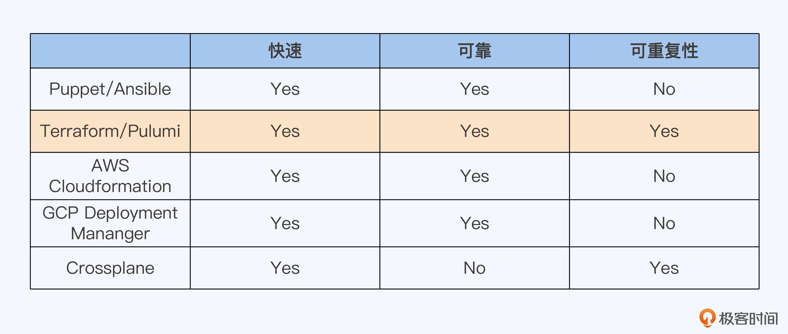
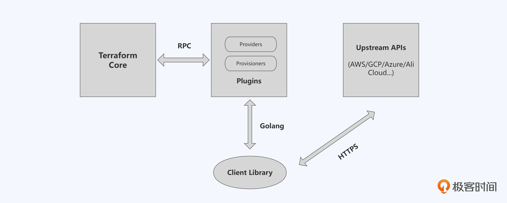
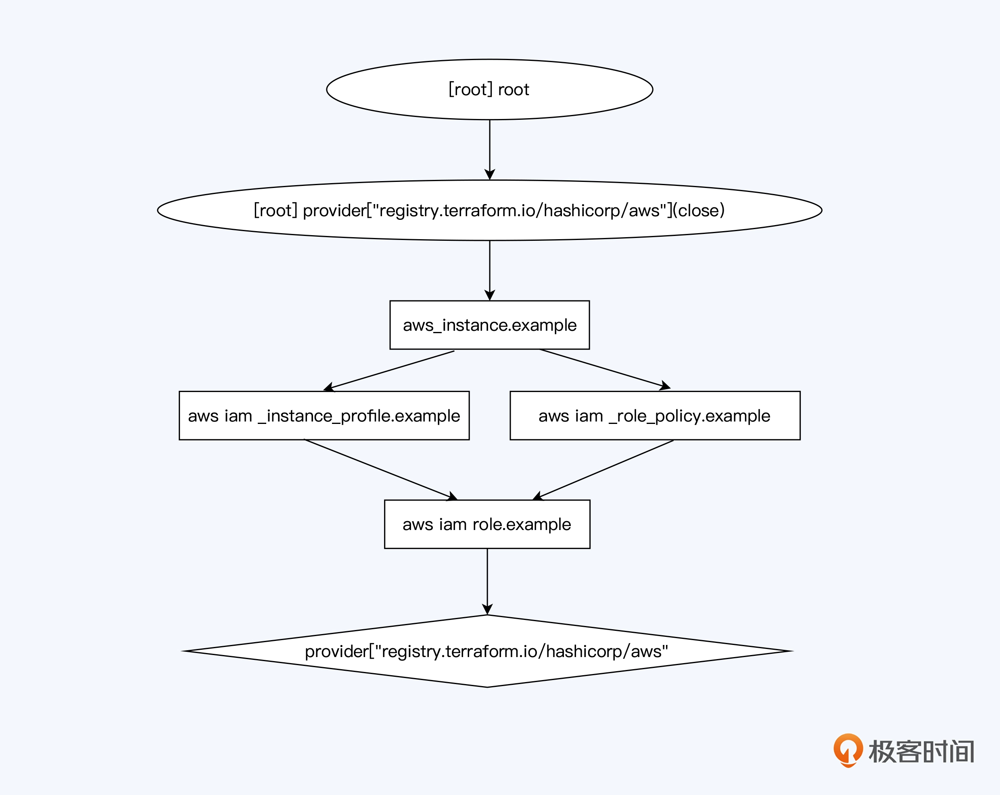
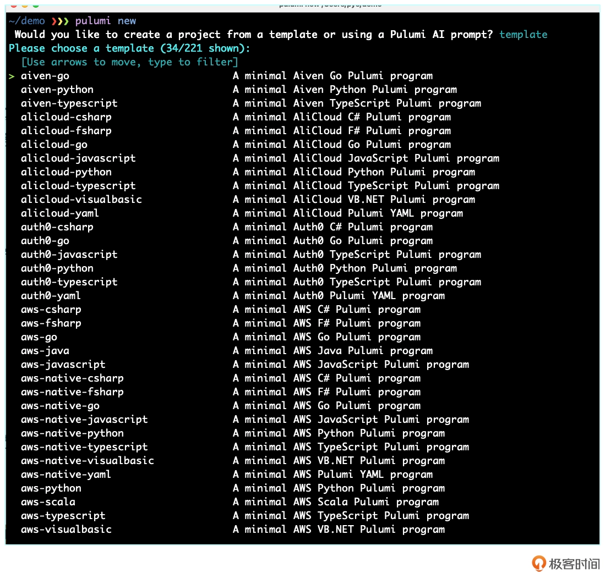

# 02 | 主流IaC工具解析：你的最佳IaC工具选择指南

你好，我是潘野。

上一讲，我们了解了 IaC 的概念及其发展过程，今天我们着重分析一些重要的 IaC 工具。

虽然我们很容易就可以查阅相关工具的文档，但不少同学并没有了解过这些工具为什么会被设计出来，背后又涉及哪些原理。而掌握了这些，你才能掌握选择工具的思路与标准，之后应用的时候，也能在使用上更加得心应手，避免踩坑。

## IaC 工具盘点

在正式盘点之前，我们需要先明确一下工具选择标准。

上一讲我们了解了基础设施即代码的概念，IaC 是一种自动化基础设施管理的方法，通过代码描述和配置基础设施资源，实现快速、可靠和可重复的部署和管理过程。

这里面有三个关键词——快速、可靠和可重复，这也是我们选择 IaC 工具的一个基准线。

快速有两层含义。第一是工具易用，容易编写 IaC 代码；第二是工具性能好，运行速度快。

可靠是指基于同样一份 Code，同一套参数构建出的产物，其最终的行为应该是一致的。

可重复则表示定义基础设施的代码是可以被重复使用和共享，确保不同环境间的一致性和可靠性，这样可以防止因配置偏移或缺少依赖项而导致的运行时问题。简单来说，我上线 A 资源用这套代码，上线 B 资源我还可以用这套代码。

接下来，我们看看 IaC 每个发展阶段有哪些主流工具。



面向主机配置管理的工具主要有两类。一类采用 Client-Server 架构，比如 Puppet、Saltstack。另一类采用无 Agent 架构，比如 Ansible。

上一讲我曾说过，配置管理的 IaC 工具主要的短板是，它们只能管理主机里的软件包安装、配置文件，但无法管理其他的资源，已经跟不上基础设施发展的需求了。

下面我们来看看更现代的面向云资源管理，同样也有两类代表工具。

一类是公有云厂商为自家产品推出的 IaC 管理工具，比如 AWS 的 Cloudformation、GoogleCloud 的 Deployment Manager。不过，公有云上各家提供的 IaC 工具只能给自家云用，如果我同时使用 AWS 和 GCP 两个公有云，那显然代码不具有可重复性。

为了能做到可重复性，又催生了另一类 IaC 工具，就是以 Terraform、Pulumi 为代表的开源多云管理工具。

最后，我们来看面向应用资源管理的工具。Kubernetes 极大降低了运维成本，它成为了事实上各家云厂商的通用接口。于是就有了 Crossplane 这样的工具，它利用 Kubernetes 的能力和接口来编排云资源，让云基础设施和应用程序管理变得更容易。但 Crossplane 是 2020 年诞生的，在可靠性方面还略有欠缺，还需要更多的时间来完善。

我们将上述工具做个汇总，对比它们是否符合快速、可靠和可重复这三个基本特点。



结合表格可以看出，最符合我们要求的两个 IaC 工具分别是 Terraform 和 Pulumi，前者是声明式方法，而后者采用了编程式方法。

## Terraform

那我们先来看看 Terraform。

Terraform 是 2014 年由 HashiCorp 公司发布的，它用一种简单且易读的配置语言来描述基础设施的期望状态，包括虚拟机、网络、数据库、负载均衡器等资源。这种配置语言叫做HashiCorp 配置语言，简称 HCL。

在众多 IaC 的实现中，Terraform 因为它强大的扩展能力、丰富的插件和简单明了的配置语言，深受用户喜欢，也获得了众多云厂商的支持。

后面这张图展示了 Terraform 核心架构。从图上看，核心就是两个组成部分——Terraform 插件与 Terraform 核心程序。



### 插件

Terraform 的插件作用是和云厂商接口对接，获取或者更新云上的资源配置。

对照前面图片中 Plugins 的部分，里面有两个小块，一个叫 Provider，另一个叫 Provision，它们两个加起来就构成了 Terraform 的插件机制。Terraform 通过 Provider 去调用各个云提供商的 SDK，或者是 SaaS 服务的 API 来获取资源。你可以按照 Terraform plugin 官方文档来开发自己的 Provider，然后发布到 Terraform 的官方网站上。

有些场景中里声明式配置无法表达，这种情况下，Provisioner 可以作为一种补充手段来完成这种类型的操作。后面就是一个获取机器 IP 的例子，你可以借助它来加深理解。

```
resource "aws_instance" "web" {
 # ...
 provisioner "local-exec" {
   command = "echo The server's IP address is ${self.private_ip}"
 }
}
```

现在我们在 Terraform 的官方网站，可以搜索到几乎所有云提供商的 Provider，这些都是官方接纳的 Provider。你可以直接复用已有的 Provider，只要在文件里定义使用哪一个Provider，Provider 相关参数是什么即可。

后面这段代码演示了如何在 Terraform 的 main.cf 里定义自己所需要的 Provider。

```
# Configure the AWS provider
provider "aws" {
 access_key = ""
 secret_key = ""
 region = "eu-west-1"
}
```

我们在 provider 里定义使用了 AWS provider，向 AWS provider 传入 access_key，secret_key，region 这些参数，这样 Terraform 才能通过这个 provider 真正连上 AWS 的API。

### 主程序

插件的作用是对接云厂商接口，而我们要生成哪些资源、这些资源的关系链是什么样的以及如何编排这些资源，这些问题都需要 Terraform 主程序来解决。

我们回看一下前面的 Terraform 核心架构图，图中用户 apply 了 Terraform 的代码。这个Terraform 代码里就定义了所需要创建的资源，例如 VPC、虚拟机或是负载均衡器等等。

让我们来看看后面这个创建一个 EC2 的实例。

```
# Create an EC2 instance
resource "aws_instance" "example" {
 ami           = "ami-785db401"
 instance_type = "t2.micro"
 tags {
   Name = "terraform-example"
 }
}
```

注意看代码第二行，这里有个关键词 resource，我们需要创建的资源就是通过它定义的。在resource 里，我们还可以定义很多参数，这些参数目的是抽象化接口，使得代码具有更好的复用能力。这里就用了 tag 这个参数来给这个资源打标签。

不同 resource 里参数也不尽相同，有必填的参数，也有可选的参数。使用 resource 前，你可以先查阅 Terraform 官方文档，了解参数列表以及它们的含义、赋值的约束条件等。

除了定义我们需要哪些 resource，我们还需要确定这些 resource 关系链是怎样的。大部分资源间的依赖关系可以被 Terraform 自动处理，但是在某些场景下，我们需要在代码中显式声明依赖关系。你可以参考下面这个例子。

```
resource "aws_s3_bucket" "my_bucket" {
 # S3 bucket configuration here
}
resource "aws_instance" "my_ec2_instance" {
 # EC2 instance configuration here
 # Explicit dependency on the S3 bucket resource
 depends_on = [aws_s3_bucket.my_bucket]
}
```

这两个 resource 的作用是配置 AWS EC2 实例和 S3 存储桶。因为 EC2 实例中程序需要向S3 Bucket 里写数据，所以 S3 Bucket 就需要在 EC2 实例启动之前就建立起来。为了强制执

```
行这个创建顺序，我们使用 depends_on 来处理资源的依赖关系。
```

这就引出了一个新的问题，Terraform 应该用什么顺序创建资源，才能保证每个资源都是在其依赖项之后创建的？

Terraform 用图来表述基础设施，官方术语叫做 Resource Graph，其中 Resource 为顶点，依赖项为边。上述问题就可以用标准图算法来解决。

Terraform 里有多种图算法，比如深度优先搜索（DFS）、Tarjan 演算法和有向无图的Transitive reduction 算法。一般这些细节不用太深入地了解，当然如果你对 Terrafrom 的实现机制有兴趣，可以参考官方文档 Resource Graph 章节。

```
我们可以通过 terraform graph 这个命令配合 graphviz，生成 Terraform 的资源关系图。
terraform graph | dot -Tsvg > graph.svg
```



### 如何使用

讲完原理，我们再来看看怎么使用 Terraform。最常用的只有四个命令。

```
terraform init 初始化项目，拉取 provider 的模块
terraform plan 推测将有哪些资源被更改或者创建
terraform apply 执行 terraform 计划以配置基础设施
terraform destroy 销毁资源
```

这些命令的使用，你参考官方文档很容易就能掌握，我就不详细展开了。

这里我想重点给你讲解一下 Terraform 的状态管理，我曾经因为没有正确管理好 Terraform 状态管理文件，差点导致了一个严重的生产事故。

```
Terraform 每次执行 terraform apply 操作的时候，会将状态信息保存在一个叫
```

terraform.tfstate 状态文件里，这个文件最主要的作用就是追踪资源状态。默认情况下，这个文件位于当前工作目录下。

```
每次执行 terraform plan 或者  terraform apply 的时候，Terraform 都要读取这个文
```

件的内容，与实际资源状态做比较，找出变化点，生成新的执行计划，避免已经创建的资源不会被重复创建。

所以，tfstate 相当于云资源的更改历史记录。如果 tfstate 文件损坏或者丢失，就意味着

```
Terrafrom 不能再管理已经创建好的资源，此时你执行 terraform plan 或者  terraform
apply ，会发现资源被重复创建。我当时就是因为丢失了 tfstate，差点重复创建了生产环境
```

的资源。好在后来在备份中找到了 tfstate 文件，才避免了一场生产事故。

这时就不得不提到 Terraform 的一个重要功能了，它就是 remote backend。这项功能支持将tfstate 存在对象存储服务或数据库中，比如 S3、Consul 等等。

```
这个功能帮我们解决了两个重要的问题。首先，当每次执行 terraform plan 或者
terraform apply 的时候，Terraform 会自动将状态文件写进远端存储中。像 S3 还提供了
```

版本管理功能，这样就可以记录整个云资源的更改历史，保证状态文件的完整性与可追踪性。

```
terraform {
 backend "s3" {
   bucket = "my-terraform-state"
   key    = "terraform.tfstate"
   region = "cn-north-1"
 }
}
```

其次，Terraform 的状态文件是明文的，这意味着代码中所使用的一切机密信息都将以明文的形式保存在状态文件里。出于安全考虑，我们不应该将 tfstate 文件存在本地，而是应该将其存在远端存储中。这样就解决了状态文件加密问题。

## Pulumi

了解了 Terraform 的工作原理和用法，你可能会发现 Terraform 存在一个问题——Terraform对于状态文件的管理并不是特别理想。因为它是明文存储且默认没有状态文件的版本管理，只能依赖外部存储对文件做加密与版本管理。

我在最开始的时候提到 IaC 工具需要满足快速，可靠和可重复这三个特点。我们写下的Terraform 代码 + 状态文件，才能组成完整的 Terraform 形态，满足可靠这条基准线。

另外，Terraform 的 HCL 语法虽然很简单，很容易上手，但是 HCL 语法里没有 for/if-else 这些流程控制。所以如果我们遇到的场景需要用非常复杂的逻辑实现，基于 HCL 语法的声明式配置就会显得捉襟见肘，我们往往要复制粘贴大段的 Terraform 代码，才能实现想要的配置。

后面这个例子能帮你理解刚刚前面讲的内容。我们有两个环境，一个是 dev 开发环境，一个是stg 测试环境。可以看到，不同的环境所对应的 MySQL 和 Redis 的地址是不一样的。

```json
[
   {
       "env_name": "dev",
       "mysql": "mysql-dev.awsamazon.com:3306",
       "redis": "redis-dev.awsamazon.com:6379",
   },
   {
       "env_name": "stg",
       "mysql": "mysql-stg.awsamazon.com:3306",
       "redis": "redis-stg.awsamazon.com:6379",
   }
]
```

那现在我要针对不同的环境去设置不同的安全策略，最简单的方式就是为每个环境都写一段

```
terraform 代码。于是，我们可能就会将目录文件组织成  dev/main.cf  stg/main.cf ，两
```

个 main.cf 里大部分的代码是一样的，然后分开执行。

为了解决这些痛点，微软和亚马逊云服务的老兵 Joe Duffy 和 Luke Hoban 在 2017 年创建了一款对标 Terraform 的 IaC 软件，名字叫 Pulumi。

首先，针对 Terraform 的语法弱点，Pulumi 引入了主流编程语言来编写基础设施。Pulumi 支持 TypeScript、JavaScript、Python、Go、C# 这几种语言。你可以看看下面这个例子，我用Go 语言描述了如何创建一个 s3 bucket。你应该发现了，这对开发人员来说非常友好。

```go
package main
import (
   "github.com/pulumi/pulumi-aws/sdk/v4/go/aws/s3"
   "github.com/pulumi/pulumi/sdk/v3/go/pulumi"
)
func main() {
   pulumi.Run(func(ctx *pulumi.Context) error {
       // Create an AWS resource (S3 Bucket)
       bucket, err := s3.NewBucket(ctx, "my-bucket", nil)
       if err != nil {
           return err
       }
       // Export the name of the bucket
       ctx.Export("bucketName", bucket.ID())
       return nil
   })
}
```

Pulumi 也吸收了 Terraform 的经验，支持了亚马逊云科技、微软 Azure、谷歌云与阿里云等主流公有云厂商。从下图可以看出，Pulumi 为主流云厂商提供了多种编程语言的 SDK。



其次，在状态管理方面，Pulumi 默认提供了状态管理的云服务，帮助用户保存状态，也支持将状态存在自己管理的对象存储中。

在状态存储中，相比 Terraform 的 Remote backend，Pulumi 有两个非常重要的特性。

第一，Pulumi 对状态文件做了加密，并且通过 TLS 的方式传输到 Pulumi Cloud 上。这点刚好弥补了 Terraform 明文状态文件的安全问题。

第二，Terraform 需要使用 S3 的版本管理功能才能记录整个云资源的更改历史，而 Pulumi 天然自带了 Checkpoints 功能。Pulumi 每次更新都是一个 Checkpoint，这样如果我要回滚到上次配置，可以直接将配置回滚到上一个 Checkpoint 的状态。

除了语法、状态管理的优势，Pulum 还内置了对敏感信息配置和加密存储包含敏感信息的资源，这在原生的 Terraform 里是不支持的。另外，Pulumi 支持直接将 Terraform 配置文件转换成代码，帮你完成无缝切换。

当然，Pulumi 也有一些不足。采用编程语言作为 IaC 的配置的描述方式，对非开发人员来说有一些门槛。Pulumi 的诞生时间晚于 Terraform，在生态上比 Terraform 来说还是差一些。

## 总结

这一讲，我们先运用快速、可靠、可重复这三个标准作为基准线，梳理了 IaC 主流工具。

其中最符合我们要求的就是 Terraform 和 Pulumi。对于 Terraform，你要重点掌握它的基本原理和插件机制。

之后，我们提到了 Terraform 的不足之处，没有很好的原生状态文件的管理机制，以及Terraform 明文状态文件的安全问题。由此引出了更有优势的 Pulumi。对于 Pulumi，你需要重点掌握 Pulumi 的工作原理，了解 Pulumi 如何将你的代码转化为基础设施以及如何处理基础设施的状态和变更。

这种两种面向资源管理的 IaC 工具各有千秋，如果你的公司里现存项目中使用的是Terraform，那么建议你依然使用 Terraform，不要为了工具而给自己增加不必要的工作量。如果你的公司里有新启动的项目，可以考虑尝试使用 Pulumi 作为你的 IaC 的工具。

此时你是否隐隐感觉到，似乎可以用 Terraform 或者 Pulumi 同时管理不止一个云平台？下一讲，我会围绕多云管理这个主题，继续为你讲解如何扩展 IaC 的。

## 思考题

请你尝试参考 Terraform 的官方文档，写一段 Terraform 的代码，在 AWS 上启动一个 EC2 的实例，然后在这个实例中启动 http 服务并对外提供服务。

欢迎你在留言区分享你的思考或疑惑。如果这一讲对你有启发，别忘了分享给身边更多朋友。
