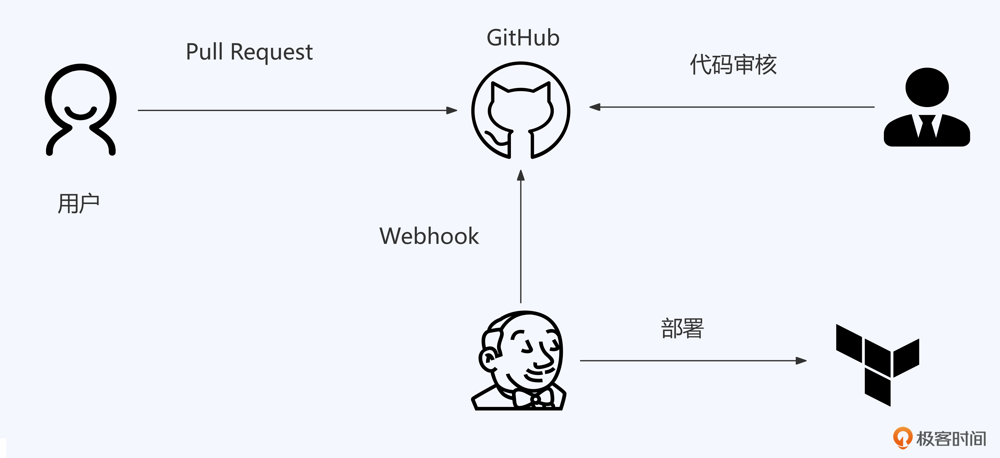

# 05 | GitOps：开启基础架构自动化新篇章

你好，我是潘野。

前面几讲，我们一起探索了 IaC 的发展脉络、相关工具的原理分析以及多云异构的管理方式。

不知道你是否发现一个问题？这些内容基本都是从单一维度来审视基础架构自动化，而真正维护基础设施自动化的时候，我们还会面临其他的问题，例如持续集成与自动化部署、版本控制，文档与团队协作规范等等。

而今天我们要学习的 GitOps 模式，就可以把这些零散的点合理组织起来，帮我们真正落地实现基础架构自动化。

## 持续集成和持续部署

我们依然从一个小场景出发。

Tom 和 Jerry 是公司平台组的工程师。有一天 Tom 接到一个需求，需要在 AWS 中部署一套业务环境。但是，当 Tom 快要完成时，被抽调去支援其他紧急项目，于是 Jerry 接手了 Tom的工作。

Jerry 拿着 Tom 用邮件发过来的 Terraform 代码，继续完成部署环境的任务。不过，在运行terraform apply 时他发现，Tom 提供的代码可能并不是最新的，因为代码中缺少一些配置，实际状态和他代码中的描述不一致。

此时 Jerry 犯愁了，贸然执行可能会导致整个环境损坏。所以，Jerry 只能先手动更改线上环境配置，以免影响业务上线进度，等 Tom 从其他项目回来之后再将问题反馈给他。

上面的情况想必你并不陌生，无论我们在工作里扮演的是 Tom 还是 Jerry，都不难发现前面例子暴露的问题。

- Terraform 的代码可能有遗漏。

- 一旦 Terraform 代码有问题，我们可能很难回退到更改前的状态。

- 在 Jerry 手动更改了线上环境之后，线上环境的状态与 Terraform 代码中表述的不一样了。实际状态和代码描述之间的差别更大了，这让基础设施环境变得更加不一致。

很明显，用文件分享代码这种管理方式带来的问题，Terraform 或者 Pulumi 这些工具也无法解决。Tom 从紧急项目回来之后，Jerry 和 Tom 就开始讨论如何应对。DevOps 组的 Mike 听到两人对话，提出了用持续集成和持续部署的方式来管理 Terraform 代码。

这种方式的具体要求如下。

1. Terraform 的代码应该放在 Git 中管理，所有对环境的更改都应该通过提交 Pull Request（PR）到 Git 仓库来完成。这个 PR 需要被团队其他成员审查并批准。

2. 一旦 PR 被合并，Git 仓库的变化就会通过推送 API，自动送进自动化工具，并自动将新的目标状态应用到实际环境中。这通常由持续集成和持续部署（CI/CD）工具来完成。

3. 选择 Jenkins、GitHub Actions 等适合团队使用的 CI/CD 的工具，这些工具将用于自动执行代码构建、测试和部署等任务。

4. 在 Git 的 log 以及持续集成和持续部署的工具中会记录所有的构建、测试和部署活动，以便在出现问题时进行故障排除和根因分析。

5. 监控线上环境的状态，并在检测到与 Git 仓库中描述的目标状态不一致时，自动修复这些不一致，或者给团队发送报警。

Mike 提出来的这种基于 Git 的管理代码的方式，我们就称为 GitOps。接下来，我再围绕GitOps 里提交代码、CI/CD 和安全这几个方面带你深入了解。

## GitOps 之 Pull Request

在 GitOps 中，Git 中的 IaC 代码被看成“唯一的事实来源”，因此对这个代码的所有改动都需要经过一定的测试、审核，以确保更改是正确、安全的。

这种方式不仅提高了代码质量，也增加了代码更改的透明度，能帮助团队更好地协作和管理代码。一旦 PR 被合并，自动化工具会检测到 Git 仓库的更改，并自动将新的目标状态应用到实际环境中，确保环境的一致性。

## GitOps 之 CI/CD

现在我们可以选择的持续部署和持续集成的工具有很多，比较老牌的有 Jenkins、Github 自带的 Github Action，还有 Kubernetes 社区推出的 Tekton 等工具。

这些持续集成的工具各有千秋，不要在工具选型上太过于纠结，根据实际情况来决定即可。比如团队成员大多熟悉 Github Action，就可以选择 Github Action 作为持续集成的工具。

一般来说，持续集成的工具都会由 Webhook 与代码仓库 Github 或者 Gitlab 集成。在 GitOps中，当 Git 仓库中有新的更改（例如，合并了一个新的 Pull Request）时，Git 仓库可以通过Webhook 通知 CI/CD 工具，再由 CI/CD 工具拉取新的代码更改并启动构建和部署流程。

这样，Webhook 就实现了 Git 仓库和 CI/CD 工具之间的实时通信，使得 CI/CD 能够快速响应Git 仓库的更改，确保生产环境始终与 Git 仓库中描述的目标状态保持一致。

有些接触过 GitOps 的同学，可能会认为 GitOps 等同于 CI/CD。其实并非如此，虽然 CI/CD贯穿了自动化管理流程中一大部分，但是这并不意味者 GitOps 等于 CI/CD，如果使用不当，就可能带来一些安全问题。我们这就来聊聊 GitOps 如何解决这方面的问题。

## GitOps 之安全

我们在管理基础设施的时候，难免要遇到一些需要认证的场景，比如容器的私有镜像仓库使用

```
用户名密码方式来验证。显然，你不能在 Git 仓库中直接写  docker login --
username=xx --password=xx , 这会泄漏出密码和敏感信息。
```

那么遇到这种情况你应该怎么解决呢？我先给你分享两种常见做法。

第一种做法，使用开源安全工具 git-crypt 对 Git 仓库中的文件进行加密和解密。Git-crypt工作原理是在提交时自动加密文件，并在 git checkout 时自动解密文件。这种方式无缝地集成到 Git 中，使得敏感数据的保护变得易如反掌。

虽然 Git-crypt 这个工具很有用，但它仅限于 Git 中的加密解密，不能取代全面的安全策略。所以我们应该把它看作敏感数据保护方面的一个额外层次，而不是唯一的防线。

第二种做法，使用密钥管理工具，比如 HashiCorp Vault、AWS Secret Manager 等工具。这些工具提供了一个中心化的位置供我们存储、访问和分发密钥，并提供精准的访问控制策略，供我们限制不同用户的访问权限，为每个客户端生成独特的短期访问凭证。这些工具还支持我们对数据进行高级别的加密，并提供详细的审计日志功能，这样一来，我们就能安全地存储和管理敏感数据了。

除此之外，Git 作为唯一真实数据源的同时，我们需要确保对 Git 仓库有适当的访问控制，防止仓库中的代码被非法更改。

## Example

了解了 GitOps 中持续集成和持续部署，我们不妨继续思考，前面 Tom 和 Jerry 遇到的问题要怎么通过 GitOps 方式解决呢？

后面是一张基于 GitOps 的 IaC 过程图，你可以结合图示继续听我分析。



整个过程大致经历这五个步骤。

1. Tom 向仓库提交一个 Pull Request，将 AWS 的 EC2 实例从原来的 t2.micro 更换成m4.xlarge。

2. CI 流水线会检查 Tom 的代码，并执行 Terraform plan，将结果返回给 Github 的 PullRequest 中。

3. 接下来，同组 Jerry 会审核代码的变化，并检查 Terraform plan 的输出是否如代码所写。

4. 所有代码检查通过之后，Tom 将 PR 合并进代码主分支，利用持续部署工具部署代码。

5. 如果代码有问题，可以通过 git revert 的方式回滚代码。接下来，持续部署工具会再次运行terraform apply 来完成回滚操作。

## 总结

今天的内容告一段落，让我们来总结一下。

GitOps 是一种创建和管理基础设施的方法，其中 Git 被用作“事实的唯一来源”。在 GitOps中，Git 仓库包含环境的所有信息，并且所有更改都通过 Pull Request（PR）进行。

这种方法的主要优点是提供了一种声明性方法来管理基础设施。这意味着你只需要在 Git 仓库中描述你想要的环境状态，就能凭借自动化工具来实现这个状态。

此外，由于所有更改都在 Git 中进行版本控制，因此我们可以轻松跟踪和审计更改。这对于满足合规性要求以及故障排查方面都非常有用。

总之，GitOps 提供了一种简单、可扩展和可审计的方式来管理基础设施，因此它在许多现代DevOps 团队中已经成为首选的基础设施管理方法。

课程中的例子用到了 GitOps 的 IaC 管理模式，无论是基础设施的部署，还是 Kubernetes 的集群管理，我们都会遵循 GitOps 模式。在后续的课程中，我们也会将今天学到的理论知识转化成实践，敬请期待。

## 思考题

GitOps 并不是一种万能的解决方案，它同样存在一些挑战和限制，你能想到有哪些限制吗？

欢迎你和我在评论区一起讨论。如果这一讲对你有帮助，别忘了分享给身边更多同事、朋友。
