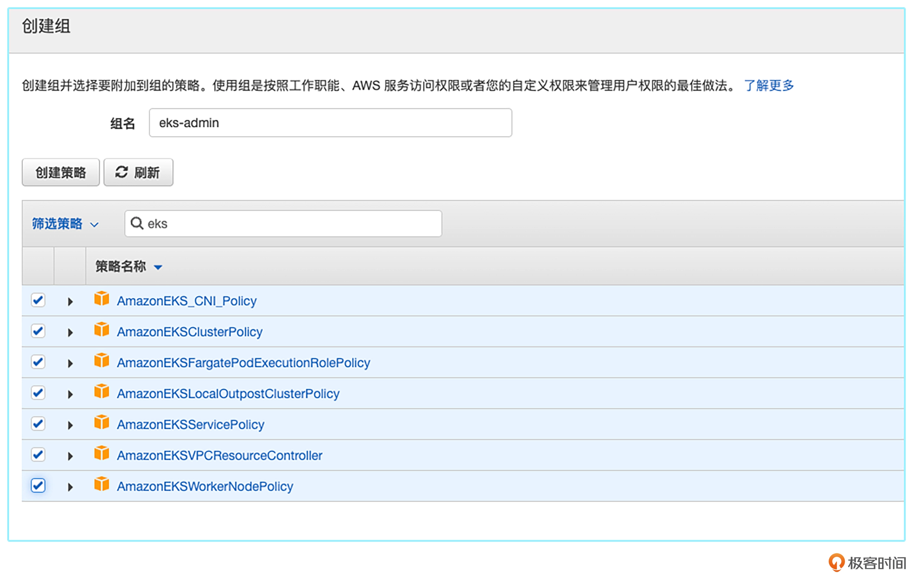
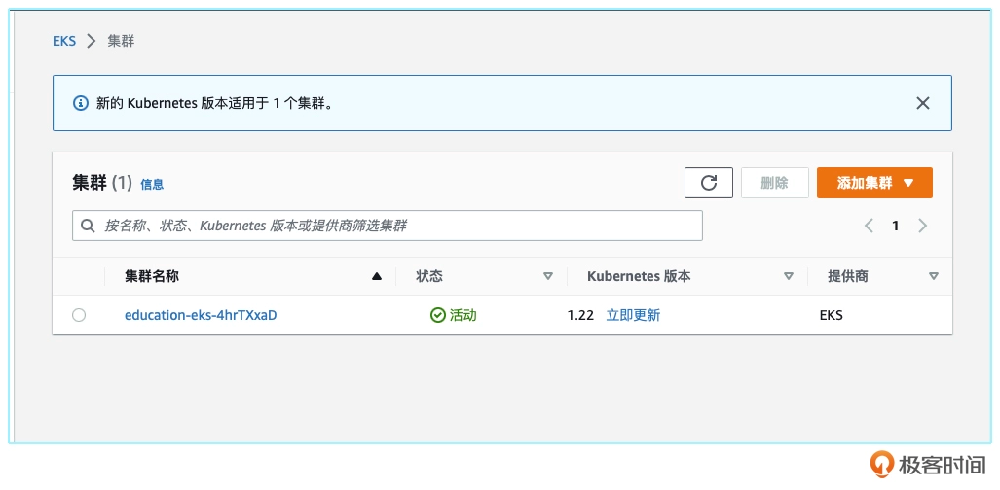
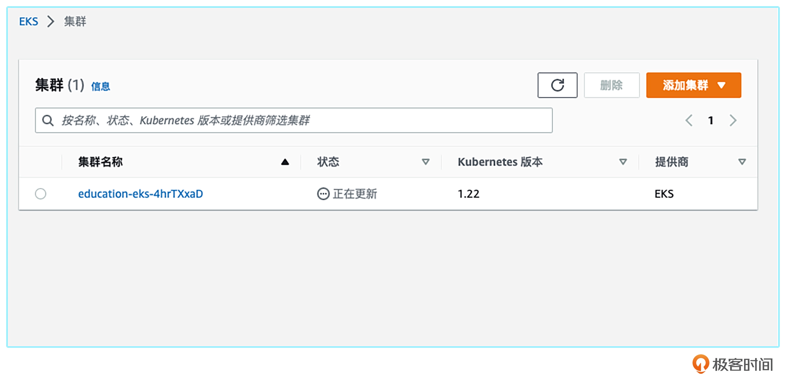
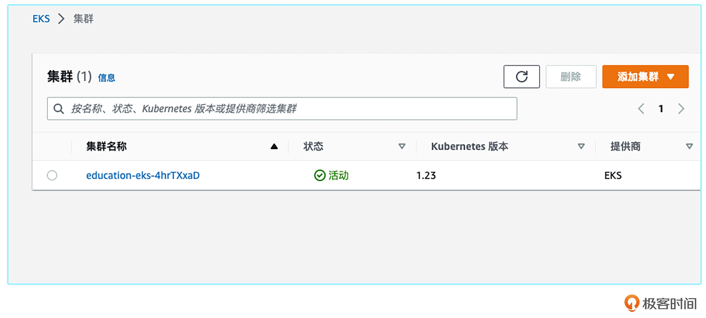

# 06 | 云环境实战：快速启动Kubernetes集群

你好，我是潘野。

前面的课程里，我们学习了云原生的基本组成技术，现代化的云原生技术架构如何管理以及公有云的基本特点等内容。你可能觉得前面的知识偏理论，眼睛看会了、脑袋明白了，但是手还不会。

从这一章开始，我为你设计了一系列的实验，从易到难、循序渐进地带你实战演练，最终形成一套可以用在生产环境的基础架构自动化管理方式。除了提高实践水平，你还能加深对不可变基础设施、混合云管理等理论的理解。

这一讲我们会利用 Terraform 工具，在 AWS 中启动一个 Kubernetes 集群，帮你尽快熟悉现代 IaC 面向资源的管理方式。

## 前期准备工作

为什么我们选择公有云 AWS 作为课程的实践环境呢？

因为它提供了完整的 IaaS API 与文档，更方便我们学习实践。而且无论是哪个云厂商，提供的功能都差不多。即便你所在的团队是自建机房，多数也会采用像 Openstack、VMware 这样的 IaaS 解决方案，哪怕 API 或操作跟公有云略有差别，使用方法和思路也基本一致。

好，下面正式进入实战环节，我们先从配置本地环境开始。我们选用一台 Ubuntu 22.04 的虚拟机作为基础操作环境。

首先，我们需要安装 AWS 的命令行工具 AWS CLI。如果你使用的是 Mac OS 或者 Windows系统，可以参照 AWS 的官方文档来配置你的环境，这里我们只列出 Linux 环境的配置命令。

```bash
curl "https://awscli.amazonaws.com/awscli-exe-linux-x86_64.zip" -o "awscliv2.zip"
unzip awscliv2.zip
sudo ./aws/install
```

当 AWS CLI 工具安装成功之后，别忘了检查一下版本输出。

```
root@devops:~/aws# /usr/local/bin/aws --version
aws-cli/2.8.1 Python/3.9.11 Linux/5.15.0-48-generic exe/x86_64.ubuntu.22 prompt/o
```

接下来，我们在 IAM 中新建一个 USER，并且生成一个 access key。AWS 的 IAM 是身份和访问管理的缩写，是一种 Web 服务，可以帮助你安全地控制对 AWS 资源的访问。我们借助IAM，可以集中管理控制用户可访问哪些 AWS 资源的权限。

对于初次接触公有云环境的同学，我建议使用 admin 权限，这样能帮你在后续学习中减少一些权限问题。但是要注意，这并不是一个正确的做法，不能在生产环境中使用。关于 IAM 的安全部分，后续章节我再详细讲解。



当你完成了新用户的创建以及赋权之后，就需要在 AWS CLI 工具中完成配置。配置的内容也很简单，将你上一步获取到的 Access ID 和 Key 填入即可。

```
root@devops:~# aws configure
AWS Access Key ID [None]: AKIAY6CN....
AWS Secret Access Key [None]: 482iR9LP3bbCV.....BmZi/Q
Default region name [None]: us-east-2
Default output format [None]:
```

## 使用 tfenv 管理 Terraform 版本

之前的课程里，我们虽然了解了 Terraform 的一些基本操作，但是在实际工作中，当你接手前人的代码，还是会遇到后面这类困难。

- 因为 Terraform 在不同的版本存在一些兼容性问题，在 version.tf 中需要使用某个特定版本的 Terraform。

- 代码年久失修，仍在使用某个很老的 Terraform 版本，缺少一些新版本的特性。

这时候你就需要一个 Terraform 版本管理工具，帮助你在不同的版本中切换。这里我们需要用

```
到 tfenv 来帮助我们管理 Terraform 的版本，它的 GitHub 的地址是这个：
```

https://github.com/tfutils/tfenv。

如果你没有用过 tfenv，可以参考官方提供的方法进行安装。tfenv 的核心用法就是将远程的不同版本 Terraform 下载下来，然后通过改变环境变量来切换成指定版本。当你装好 tfenv 之后，可以使用 list-remote 参数来查看所有的 terraform 的版本号，并指定所需要的版本。

```
root@devops:~# tfenv list-remote
```

然后，你可以使用 latest 的参数安装最新版本，也可以安装指定版本。

```
root@devops:~# tfenv install latest
Installing Terraform v1.3.2
Downloading release tarball from https://releases.hashicorp.com/terraform/1.3.2/t
#################################################################################
Downloading SHA hash file from https://releases.hashicorp.com/terraform/1.3.2/ter
Not instructed to use Local PGP (/root/.tfenv/use-{gpgv,gnupg}) & No keybase inst
Archive:  /tmp/tfenv_download.cTS98Z/terraform_1.3.2_linux_amd64.zip
 inflating: /root/.tfenv/versions/1.3.2/terraform
Installation of terraform v1.3.2 successful. To make this your default version, r
root@devops:~/infra-automation/terraform/eks/example# tfenv install 1.2.0
Installing Terraform v1.2.0
Downloading release tarball from https://releases.hashicorp.com/terraform/1.2.0/t
#################################################################################
Downloading SHA hash file from https://releases.hashicorp.com/terraform/1.2.0/ter
Not instructed to use Local PGP (/root/.tfenv/use-{gpgv,gnupg}) & No keybase inst
Archive:  /tmp/tfenv_download.TpmQi9/terraform_1.2.0_linux_amd64.zip
 inflating: /root/.tfenv/versions/1.2.0/terraform
Installation of terraform v1.2.0 successful. To make this your default version, r
root@devops:~/infra-automation/terraform/eks/example# tfenv use 1.2.0
Switching default version to v1.2.0
Default version (when not overridden by .terraform-version or TFENV_TERRAFORM_VER
root@devops:~/infra-automation/terraform/eks/example#
```

## 课程代码的概述

我在 GitHub 上建立了一个 cloudnative-automation 的组织，所有的课程代码，实现方式都会展现在这个组织中。

首先，你需要从 GitHub 上将课程代码 clone 到本地，链接是https://github.com/cloudnative-automation/eks-cluster/tree/example。

我给你简单讲解下 example 里的文件分别是什么作用。

```
versions.tf 定义了与 Terraform 相关的参数，比如版本号、使用模块的版本等等，这里我
```

们将 Terraform 的版本设置为 1.2，AWS 模块的版本设置为 4.15。

```
terraform {
 required_providers {
   aws = {
     source  = "hashicorp/aws"
     version = "~> 4.15.0"
   }
   random = {
     source  = "hashicorp/random"
     version = "3.1.0"
   }
 }
 required_version = "~> 1.2.0"
}
```

```
variables.tf 包含一个区域变量，控制着在哪里创建 EKS 集群。这里面有一些参数我们在
前面的 aws configure 里配置过，那么在variables.tf 配置的参数会去覆盖前面 aws
```

configure 配置的参数。

```
再来看 vpc.tf ，它能为我们提供一个 VPC、子网和可用区。为了不影响用户现有的云环境
```

和资源，我们可以利用 vpc.tf 创建一个新的 VPC。

在 vpc.tf 中我们需要配置两个网段，一个专门为内网服务，另一个为外网服务，但是有两个地方要注意。

1. 网段不能重复。

2. 子网掩码建议不要低于 24，EKS 的 CNI 网络会从 VPC 的 subnet 里取 IP，所以集群越大，需要的 IP 越多。

```
 private_subnets = ["10.0.1.0/24", "10.0.2.0/24", "10.0.3.0/24"]
 public_subnets  = ["10.0.4.0/24", "10.0.5.0/24", "10.0.6.0/24"]
接着是 security-groups.tf ，它规定了 EKS 集群将使用的安全组。在这里，我们为每个
```

node group 都配置了规则策略，你可以根据你实际需求来放行端口，比如这个例子里放行的就是 22 端口。

```
resource "aws_security_group" "node_group_one" {
 name_prefix = "node_group_one"
 vpc_id      = module.vpc.vpc_id
 ingress {
   from_port = 22
   to_port   = 22
   protocol  = "tcp"
   cidr_blocks = [
     "10.0.0.0/8",
   ]
 }
}
最后来看 eks-cluster.tf ，这里我们可以使用 AWS EKS 模块来配置 EKS 集群和其他所
```

需资源，包括自动扩展组、安全组、IAM 角色和 IAM 策略。

这里面有几个参数需要你注意。

```
cluster_version 定义了这个集群的版本，我们需要在 AWS 上确认我们可以使用哪些版
```

本。在样例中我使用的是 1.22 这个大版本。

```
ami_type 表示你要选择什么类型的操作系统镜像。我曾在第三讲带你了解过专门为容器设
```

计的操作系统—— Bottlerocket，建议在这里选择使用 Bottlerocket。如果你对容器还不太熟悉，也可以选择 Amazon Linux 作为操作系统。

```
instance_types 是一个列表，你可以加入多种机型。这里注意，尽管公有云厂商准备了大
```

量的服务器，但是它们不是万能的。我们经常会遇到在某个 region、某种机型可以购买的数量吃紧的状况，所以建议多加几种类型的机器。

```
min_size, max_size, desired_size 定义了集群最少机器数量、最多机器数量以及默
```

认机器数量。

## 启动集群

在讲解完代码之后，我们来启动一个 Kubernetes 集群。

```
首先通过命令行进入 example 的目录，执行 terraform init 这条命令。init 命令会根据你
```

配置文件里的要求，将相对应的 Terraform 模块下载到本地。

```
root@devops:~/infra-automation/terraform/eks/example# terraform init
Initializing modules...
Downloading registry.terraform.io/terraform-aws-modules/eks/aws 18.26.6 for eks..
- eks in .terraform/modules/eks
- eks.eks_managed_node_group in .terraform/modules/eks/modules/eks-managed-node-g
- eks.eks_managed_node_group.user_data in .terraform/modules/eks/modules/_user_da
- eks.fargate_profile in .terraform/modules/eks/modules/fargate-profile
Downloading registry.terraform.io/terraform-aws-modules/kms/aws 1.0.2 for eks.kms
- eks.kms in .terraform/modules/eks.kms
- eks.self_managed_node_group in .terraform/modules/eks/modules/self-managed-node
- eks.self_managed_node_group.user_data in .terraform/modules/eks/modules/_user_d
Downloading registry.terraform.io/terraform-aws-modules/vpc/aws 3.14.2 for vpc...
- vpc in .terraform/modules/vpc
Initializing the backend...
Initializing provider plugins...
- Reusing previous version of hashicorp/tls from the dependency lock file
- Reusing previous version of hashicorp/cloudinit from the dependency lock file
- Reusing previous version of hashicorp/aws from the dependency lock file
- Reusing previous version of hashicorp/random from the dependency lock file
- Reusing previous version of hashicorp/kubernetes from the dependency lock file
- Installing hashicorp/cloudinit v2.2.0...
- Installed hashicorp/cloudinit v2.2.0 (signed by HashiCorp)
- Installing hashicorp/aws v4.15.1...
- Installed hashicorp/aws v4.15.1 (signed by HashiCorp)
- Installing hashicorp/random v3.1.0...
- Installed hashicorp/random v3.1.0 (signed by HashiCorp)
- Installing hashicorp/kubernetes v2.12.1...
- Installed hashicorp/kubernetes v2.12.1 (signed by HashiCorp)
- Installing hashicorp/tls v3.4.0...
- Installed hashicorp/tls v3.4.0 (signed by HashiCorp)
Terraform has made some changes to the provider dependency selections recorded
in the .terraform.lock.hcl file. Review those changes and commit them to your
version control system if they represent changes you intended to make.
Terraform has been successfully initialized!
You may now begin working with Terraform. Try running "terraform plan" to see
any changes that are required for your infrastructure. All Terraform commands
should now work.
If you ever set or change modules or backend configuration for Terraform,
rerun this command to reinitialize your working directory. If you forget, other
commands will detect it and remind you to do so if necessary.
当模块初始化完毕之后，我们就可以使用 terraform apply 命令来创建一个 EKS 集群。
```

这步动作可能需要几分钟到十几分钟不等，时长取决于整个环境在前面是否有过初始化。

```
root@devops:~/infra-automation/terraform/eks/example# terraform apply
Plan: 56 to add, 0 to change, 0 to destroy.
Changes to Outputs:
 + cluster_endpoint          = (known after apply)
 + cluster_id                = (known after apply)
 + cluster_name              = (known after apply)
 + cluster_security_group_id = (known after apply)
 + region                    = "us-east-2"
Do you want to perform these actions?
 Terraform will perform the actions described above.
 Only 'yes' will be accepted to approve.
 Enter a value: yes
random_string.suffix: Creating...
random_string.suffix: Creation complete after 0s [id=4hrTXxaD]
```

完成 apply 动作以后，terraform 会将集群的地址、ID、name 都打印在终端。此时需要你记录下这些信息。因为之后我们要用到这些信息来生成 kubeconfig，从而连接集群。

```
Apply complete! Resources: 56 added, 0 changed, 0 destroyed.
Outputs:
cluster_endpoint = "https://4D58C6B2B0213AA1FB0925F950CEB497.gr7.us-east-2.eks.am
cluster_id = "education-eks-4hrTXxaD"
cluster_name = "education-eks-4hrTXxaD"
cluster_security_group_id = "sg-0ffee9cb0c254f781"
region = "us-east-2"
root@devops:~/infra-automation/terraform/eks/example#
```

同时，我们在 AWS 的 console 上查询一下，看看集群是否建立成功。如果出现后面这样的截图就表示建立成功了。



当我们看到集群的状态是绿色标记“活动”的时候，代表此时我们已经获得了一个可以使用的Kubernetes 集群。

接下来我们来配置集群的 kubeconfig，此时我们需要用到 AWS CLI 这个工具，它会帮我们把

```sql
EKS 的配置下载到本地 .kube/config 中。
root@devops:~# aws eks --region us-east-2 update-kubeconfig --name education-eks-
Added new context arn:aws:eks:us-east-2:614342226570:cluster/education-eks-4hrTXx
```

现在，你用 kubectl 这个命令就可以看到这个集群情况了。

```
root@devops:~# kubectl get node
NAME                                       STATUS   ROLES    AGE     VERSION
ip-10-0-1-65.us-east-2.compute.internal    Ready    <none>   4m9s    v1.22.12-eks
ip-10-0-2-92.us-east-2.compute.internal    Ready    <none>   4m24s   v1.22.12-eks
ip-10-0-3-141.us-east-2.compute.internal   Ready    <none>   4m19s   v1.22.12-eks
root@devops:~#
```

这样我们就通过 IaC 的方式得到了一个全新的 Kuberentes 集群。

## 集群升级

接下来，我们继续结合实例，看看如何给集群升级，这是 Kubernetes 集群管理的高频操作。

```
之前的配置中， cluster_version 是 1.22。需要升级集群时，我们只需要改写下面的配
```

置，将 cluster_version 从 1.22 改成 1.23。

```
 version = "18.26.6"
 cluster_name    = local.cluster_name
 cluster_version = "1.23"
 vpc_id     = module.vpc.vpc_id
```

然后，我们再跑一次 terraform apply，即可自动完成集群版本的升级。

```
root@devops:~/infra-automation/terraform/eks/example# terraform apply
... (省略了一些输出)...
Do you want to perform these actions?
 Terraform will perform the actions described above.
 Only 'yes' will be accepted to approve.
 Enter a value: yes
module.eks.aws_eks_cluster.this[0]: Modifying... [id=education-eks-4hrTXxaD]
module.eks.aws_eks_cluster.this[0]: Still modifying... [id=education-eks-4hrTXxaD
module.eks.aws_eks_cluster.this[0]: Still modifying... [id=education-eks-4hrTXxaD
module.eks.aws_eks_cluster.this[0]: Still modifying... [id=education-eks-4hrTXxaD
module.eks.aws_eks_cluster.this[0]: Still modifying... [id=education-eks-4hrTXxaD
module.eks.aws_eks_cluster.this[0]: Still modifying... [id=education-eks-4hrTXxaD
module.eks.aws_eks_cluster.this[0]: Still modifying... [id=education-eks-4hrTXxaD
module.eks.aws_eks_cluster.this[0]: Still modifying... [id=education-eks-4hrTXxaD
module.eks.aws_eks_cluster.this[0]: Still modifying... [id=education-eks-4hrTXxaD
module.eks.aws_eks_cluster.this[0]: Still modifying... [id=education-eks-4hrTXxaD
```

我们在 AWS 的 Console 上可以观察到，集群现在的状态是正在更新。



因为 AWS 的 EKS 升级的原理是加一台新的 EC2 节点，然后将老的 EC2 节点下线，所以整个升级的时间取决于你集群的大小。集群越大，升级时间越久。

等待一段时间后，集群就顺利升级到 1.23 这个版本了。



## 总结

如果你在 AWS 的页面里探索过，就会发现你几乎不可能在页面上通过点点点的方式，顺利点出一个 EKS 集群。这是因为 AWS 在设计上，倾向让用户使用代码来管理云上的资源。

这一讲我们通过 Terraform 这个工具，熟悉了管理云资源的代码结构和关键参数，成功创建了一个 EKS 集群。然而对初学者来说，还是会卡在怎么写模块、怎么看懂代码上。这一讲我重点带你熟悉了核心代码和关键参数。更详细的代码解释和分析，你可以参考我为你准备的GitHub 代码，还可以自行查阅Terraform 官方文档。

除了 Terraform 之外，社区里还有不少工具能帮我们用代码方式管理云上资源。比如后起之秀Pulumi，基于 Kubernetes 方式 Crossplane，它们都可以做到一套代码管理多云的方式。你如果感兴趣可以课后自行探索。

其实无论是哪种工具，基本思路都是使用代码描述如何分配和使用资源，然后通过工具框架调用

IaaS API，最终获得我们所需的资源。希望你能举一反三，参考这一讲学到的管理思路，套用到其他公用云甚至私有云的资源管理上。

现在我们是手动执行代码来获得资源的，这显然并没完全达到自动化的要求。那如果我们想通过一些手段，比如 DevOps 的 CI/CD 来自动化执行这些代码获得资源，该怎么做呢？后续课程里我会继续和你探讨这个话题，敬请期待。

## 思考题

今天，我们使用了 Terraform 在公有云中启动了一个 Kubernetes 集群。但实际工作中，公司里只有一个集群的情况极少，往往我们面对十多个、甚至上百个 Kubernetes 集群，那么我们要如何管理多个集群的 Terraform 代码呢？

欢迎你在留言区和我交流探讨，我们下一讲见！
