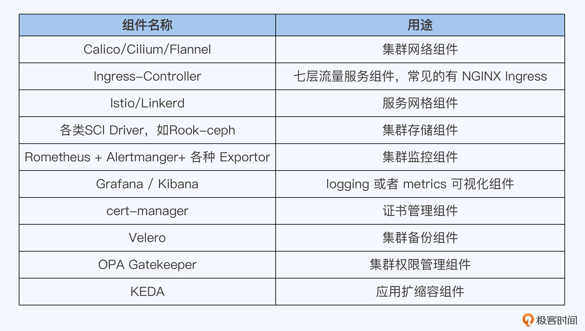
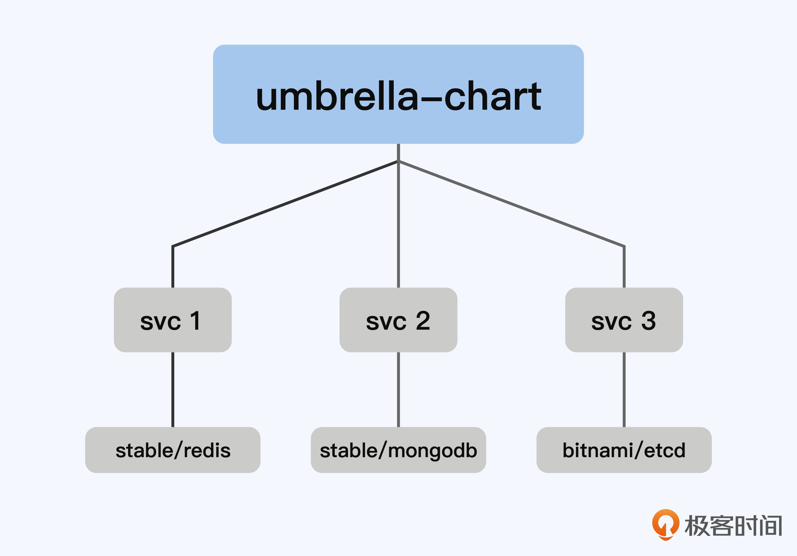
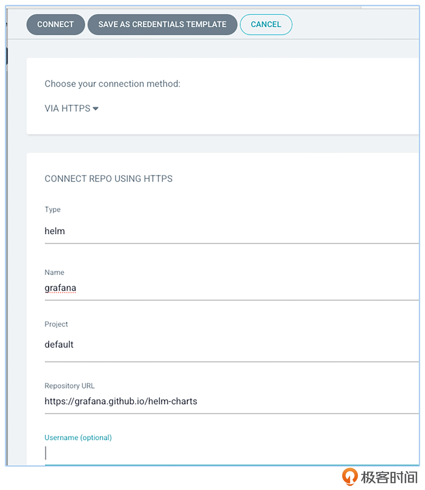
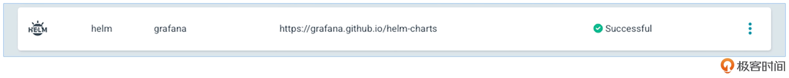
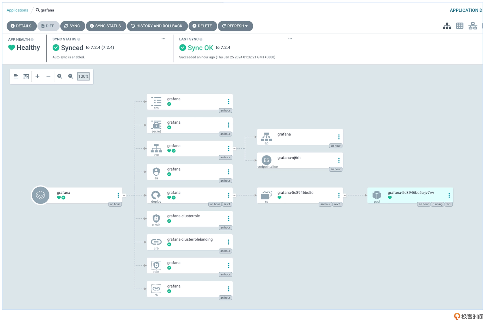
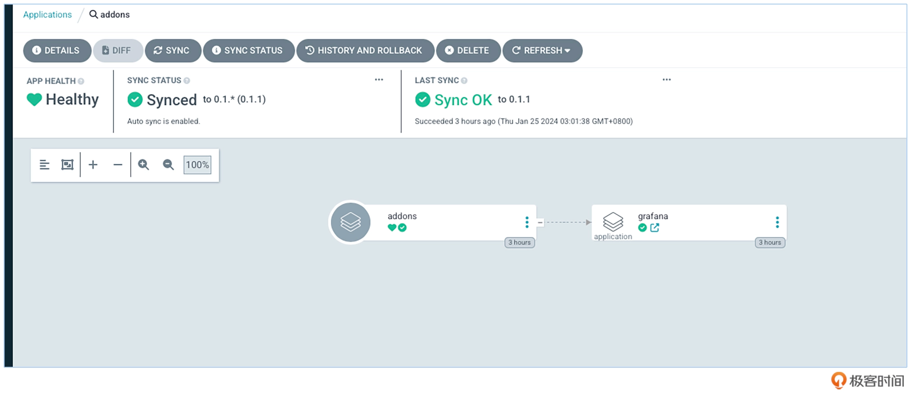
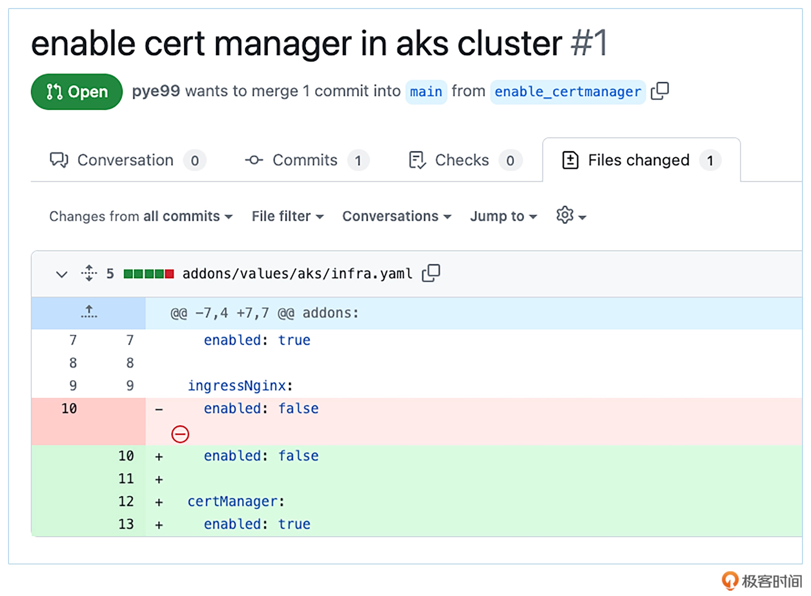
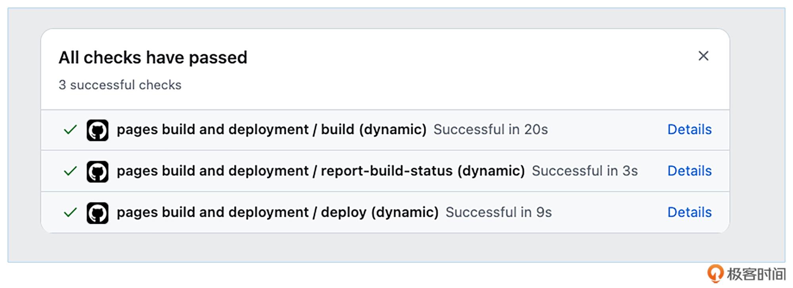
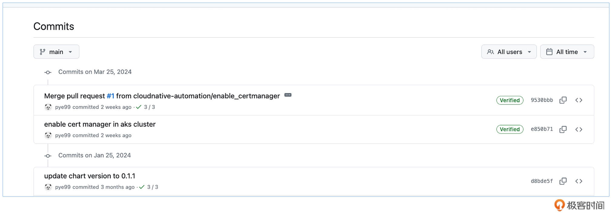

# 09 | 集群组件管理：自动化之道，轻松管理百个集群

你好，我是潘野。

通过前面的课程，我们学习了通过 GitOps 的方式来管理公有云里的资源，也顺利地启动了一个 Kubernetes 集群。

但是在真正的生产环境中，一个“光秃秃”的集群业务人员是无法使用的。比如业务需要Ingress 来对外暴露流量，SRE 需要集群内有 Prometheus 来监控整个应用的状态。所以像Ingress、Prometheus 这些组件依然属于基础设施的管理范畴。也就是说，快速、可靠和可重复的管理 Kubernetes 集群组件也是 IaC 中的一环。

我们不妨试着想象一下，假如你是公司 Kubernetes 平台管理员，需要管理 100 个Kubernetes 集群，而每个集群都有 10 个组件的时候，你应该如何来做呢？

## 常见的 Kubernetes 集群组件

我们先看看交付给业务团队使用的 Kubernetes 集群一般需要哪些组件。

这些组件分成两类，一类是控制平面组件，一类是数据平面组件。控制平面的组件里面涉及到网络插件、安全组件等，数据平面的组件主要是以 Ingress、cert-manger 和 Grafana 这样的业务辅助组件为主。我将常用的 Kubernetes 集群组件用表格的形式列在下面，供你参考。



前面我们预设的场景是 100 个集群，每个集群 10 个组件，那么一共就有 1000 个组件。我们来分析一下有哪些通用的管理需求，主要是三类。

1. 组件类型管理：因为 100 个集群可能因为用途不同，就需要针对性的安装不同的组件。例如给 AI 用的 GPU 集群就需要安装 device-plugin 这些组件，而普通集群显然不需要这样的组件。

2. 组件版本管理：这 100 个集群的 Kubernetes 版本可能不一样，那么依赖的组件版本也会不一样。例如 HPA 的 API version 在 1.21 时候是 v2beta1，但是到了 1.24 之后就升级到了v2，那么在 1.21 集群上涉及到 HPA 的组件可能就不能安装最新版本。

3. 组件功能管理：我们还得考虑不同环境下组件配置不一样的问题。比如在测试环境的集群，我们需要开启组件的一些功能来做测试，而到了正式的生产环境，这些组件中用来测试的功能就需要关闭。

基于这三类的需要，我们怎么做才能同时实现需求定制，还有集中管理组件这两个要求呢？

## 如何按需定制集群组件

其实我们仔细想一想，这 100 个 Kubernetes 集群，即便是业务场景不同，但是其中部分集群组件都是一样的。

我们结合自己的经验，很容易就能找到一些共性规律。比如说，集群总需要监控吧？那么就需要采集节点状态 node-exportor；再比如，应用总需要对外暴露自己服务的访问地址吧？那么ingress-controller 也是必不可少的，所以这些属于必要组件。

和必要组件相对应，还有一些是可选的功能。比如说，虽然我们要对所有集群进行监控，但是查看监控数据的组件 Grafana 并不是每个集群都要安装，只需要安装在某一个集群即可，所以这类组件就属于可选组件。

那么我们是不是可以维护一个集合，来表述一个集群需要安装哪些组件呢？为了帮你理解这个集群组件集合如何实现，我们来看一段非常简单的 yaml 配置文件示例。

```
---
addons:
 ingress:
   enabled: true
 grafana:
   enabled: false
 node-exportor:
   enabled: true
```

熟悉 helm 的同学，看到这里是不是觉得有点眼熟？在 helm 的 values.yaml 中，我们经常会

```
看到 enabled: false 或者是 enabled: true 这个字段？既然在 helm 中我们可以使用
enabled 这个关键词来决定是否开启功能，那我们是不是也可以套用在这里呢？
```

这肯定是可以的。这时候我们还需要配套使用一个技巧，这个技巧来自官方文档。

- The current best practice for composing a complex application from discrete parts is tocreate a top-level umbrella chart that exposes the global configurations, and then use thecharts/ subdirectory to embed each of the components.

中文翻译过来就是：

- 构建复杂应用的最佳实践是创建顶层的伞状 Chart (umbrella chart)，用于暴露全局配置，然后使用 charts/ 子目录嵌入每个组件。

那么如何理解顶层的 umbrella chart 呢？

结合我们上面示例的 yaml 配置文件，addons 这个顶层的伞状 chart，在 addons 这个 chart

```
里，会通过 enabled 这个字段来决定是否在集群上启用这些组件。你可以结合下图来理解原
```

理。



那么问题来了，在顶层的 chart 中包含子系统的 chart，这个需求要如何实现呢？

我们需要结合部署集群组件的过程来找到答案。接下来，我们就分三步走，先从部署单个集群组件入手，然后升级到同时部署多个集群组件，最后再进入如何部署多个集群的组件。

## ArgoCD：如何部署单个组件

我们一般会通过 Helm 配合 ArgoCD 这个工具来部署单个集群组件。这里我以部署 Grafana 为例，快速地讲一下 ArgoCD 部署单个组件的过程，一共分两步。

第一步，在 ArgoCD 中配好 Helm 的仓库。你可以通过 ArgoCD 的 UI 来添加 Helm 仓库，也可以通过命令行来添加仓库。这里的操作也很简单，我们先在 UI 中点击 settings ->Repositories -> connect repo，然后选择 repo 的类型为 helm，再填上 repo 的 URL 即可。



当正确配置了 helm repo 之后，ArgoCD 中就会显示 successful 的提示。



第二步，通过 UI 或者 Kubernetes 命令行创建 ArgoCD 的 Application，配置好相关参数即可部署。

```bash
apiVersion: argoproj.io/v1alpha1
kind: Application
metadata:
 name: grafana
 namespace: argocd
spec:
 destination:
   namespace: addons-system
   server: https://Kubernetes.default.svc
 project: default
 source:
   chart: grafana
   repoURL: https://grafana.github.io/helm-charts
   targetRevision: 7.2.4
 syncPolicy:
   automated: {}
```

完成上面的步骤以后，最终我们就会看到 Grafana 部署在了集群中，如下图所示。



## umbrella chart - 管理集群所有组件

一个组件是这样部署的，其他组件也同理，也就是说，所有的集群组件都可以通过 Helm 配合

```
ArgoCD 部署。而 umbrella chart 要做的事情，就是根据 enabled 这个字段，渲染出所需要
```

的 Application，这样不就可以解决我们的需求了吗？

我们这就来看看具体实现思路，我们先为 ArgoCD 的 Application 这类资源自定义一个 helmchart 包，将变化的参数转变成可配置的 value。你可以先看看下面的配置示例 ，再听我分析。

```
在 template 中 grafana.yaml 中，我们用 addon.enabled 来控制 helm 是否渲染出这个配置
```

文件，如果 enabled 是 true，那么接下来会根据 values.yaml 里面的值生成真正的 ArgoCD 的配置文件。下面是 grafana argocd application 的样例代码：

```go
{{- $addon := .Values.addons.grafana }}
{{- if $addon.enabled }}
apiVersion: argoproj.io/v1alpha1
kind: Application
metadata:
 name: {{ $addon.names.app }}
 namespace: argocd
spec:
 destination:
   namespace: {{ $addon.namespace | default "addons-system" }}
   server: https://Kubernetes.default.svc
 project: default
 source:
   chart: {{ $addon.names.chart }}
   helm:
     valueFiles:
     - values.yaml
   repoURL: {{ $addon.repoURL}}
   targetRevision: {{ $addon.targetVersion }}
 syncPolicy:
   automated: {}
 {{- end }}
```

基于上面的样例代码，我们发现在 helm 中的 value 定义无非就是这么几个参数，分别用来说明是否在集群中启用，chart 的仓库地址，还有需要在集群中安装哪个版本等等信息。你可以参考后面这个例子看一下。

```bash
grafana:
 enabled: false
 names:
   app: grafana
   chart: grafana
 repoURL: https://grafana.github.io/helm-charts
 targetVersion: 7.2.4
```

## 如何集中化管理集群组件

前面，我们解决了集群组件定制的需求，那么我们如何通过一份代码来管理 100 个集群的组件呢？

Helm 里的 values.yaml 是可以采用层层递进式覆盖的。你可以结合后面这个配置案例来理解。

```bash
apiVersion: argoproj.io/v1alpha1
kind: Application
metadata:
 name: addons
 namespace: argocd
spec:
 destination:
   namespace: addons-system
   server: https://Kubernetes.default.svc
 project: default
 source:
   chart: addonsmgr
   helm:
     valueFiles:
       - values.yaml
       - values/aks/infra.yaml
   repoURL: https://cloudnative-automation.github.io/addon-manager/repo
   targetRevision: 0.1.*
 syncPolicy:
   automated: {}
```

可以看到，我们只要为每个集群单独配置一个 values.yaml，就能控制集群可以安装哪些组件。这是因为 valueFiles 会默认读取 chart 包中的 values.yaml，并覆盖掉默认的 values。

```
例如，我们在 values/aks/infra.yaml  中定义了 Grafana 开启，而 ingressNginx 则没有
```

开启，这样就能精细地控制这个集群可以安装哪些组件。

```
---
clusterURL: infra-dev.hcp.japaneast.azmk8s.io
addons:
 grafana:
   enabled: true
 ingressNginx:
   enabled: false
```

## 效果图

让我们来看下这样做的效果如何。



对照截图可以看到，addons 是顶层的 umbrella chart，在这个集群中，Grafana 是它的子chart。详细代码我已经放在 GitHub 上，你可以结合我前面的讲述来深入理解。

看到这里，有同学可能会问，想要建立 100 个集群，岂不是要执行 100 次创建命令了么？

这一点其实你无需担心。在工作中，我们同时建立的集群一般不超过 10 个。我们只是在集群初始化时，才会去创建这个 addons 的 application，部署 addons 这个顶层 chart。之后，

```
ArgoCD 将会通过 targetRevision: 0.1.* 这样的方式来监听 Helm 仓库的变化，一旦有
```

新的版本出现，便会自己同步过来，进行更新。

## 如何维护 helm chart 的仓库地址

除了创建命令执行的自动化，对于 helm char 的仓库地址的维护，我们也可以自动化实现。

我们可以看到，每个子 chart 都有一个 repoURL 的配置，常用的管理方式有两种方式。

第一种是自己维护一个 chart repo，将所有需要安装的 chart 包导入自己维护的 repo 中，同学们可以参考课程 GitHub 仓库中关于自建 chart 仓库的说明。

第二种是依然使用原始 chart 的仓库地址，这里需要保证集群环境网络对外的连通性。

```bash
source:
 chart: grafana
 repoURL: https://grafana.github.io/helm-charts
 targetRevision: 7.2.4
```

无论是哪一种管理方式，都需要提前将 Chart 的 Repositories 导入 ArgoCD。这一讲里我已经写了如何在 ArgoCD 中导入仓库的方法，这步动作也是在集群初始化的时候先完成，你可以把后面这段代码放在 Terraform 的代码中。

```javascript
resource "repo_resource" "add helm repos" {
 provisioner "local-exec" {
   command = <<EOF
     argocd repo add https://charts.jetstack.io --username devops;
   EOF
   environment = {
     AWS_REGION = var.region
   }
 }
```

## GitOps 维护

讲到这里，我们已经完成了所有的工作。

如果我们想在某个集群里打开一个组件，应该如何操作呢？

例如我们在集群中打开 cert- manager 这个组件，只需要提交一个 PR，经过代码的审核，然后 merge 进代码主干。



这样就能触发 GitHub Action 的流水线，将我们的 Chart 自动打包并上传到镜像仓库，ArgoCD 监测到 chart 版本变化之后开始更改集群组件配置。



如果我们需要回滚某个配置，只需要重新提交一个 git revert 的 PR，之后 GitHub Action 的流水线以及 ArgoCD 会遵循同样的方法部署出去。

进行到这里，我们实践了如何用 GitOps 方式来管理 Kubernetes 集群配置。在这个仓库里，你可以看到整个集群的配置更改历史，都显示在 Git 的 commit 中，而且使用了 Git 作为唯一真实数据源的运维模式。



这种方式提供了版本控制、审计日志以及回滚等功能，完整地实现了我们在课程最初提出来的快速、可靠和可重复的部署和管理过程。

## 总结

今天这一讲是基础架构自动化管理中相当重要的一节课。

我们的目标是让 Kubernetes 基础组件既可以按需求定制，又能够集中管理。为此，我们从我们 umbrella chart 切入为你做了详细演示。

我们先从部署单个集群组件入手，然后升级到同时部署多个集群组件，最后再进入如何部署多个集群的组件。

由此，我们就解决了基础设施自动化管理的最后一公里 ，也就是 Kubernetes 集群交付。同时也遵循了我们在课程最初提出的快速、可靠和可重复的部署和管理过程。

到今天为止，我们完成了基础设施即代码环节，但是目前我们仅仅完成了交付给业务使用的环节。在此基础上，我们如何保证交付的基础设施的可用性与稳定性呢？这些问题后面我们再继续讨论，敬请期待。

## 思考题

请你根据代码仓库里提供的样例，来完成其他集群组件的部署。

```bash
---
clusterURL: 127.0.0.1
addons:
 namespaces:
   default: addons-system
 grafana:
   enabled: false
   names:
     app: grafana
     chart: grafana
   repoURL: https://grafana.github.io/helm-charts
   targetVersion: 7.2.4
 ingressNginx:
   enabled: false
   names:
     app: ingress-nginx
     chart: ingress-nginx/ingress-nginx
   repoURL: https://kubernetes.github.io/ingress-nginx
   targetVersion: 4.9.0
```

欢迎在评论区与我讨论。如果这一讲对你有启发，也欢迎分享给身边更多朋友。
