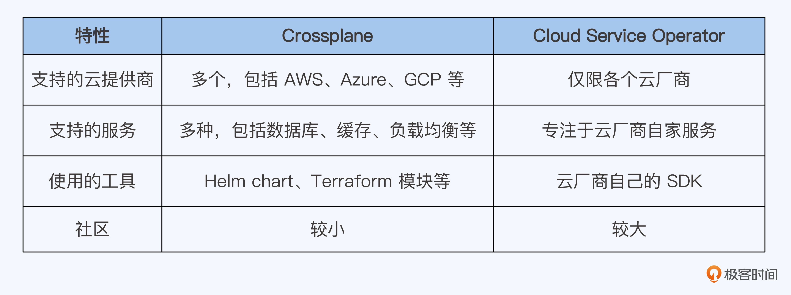

# 10 | KubernetesOperator：IaC配置管理的轻量级利器

你好，我是潘野。

前面两讲，我们分别使用了两种持续集成工具（GitHub Action 和 Tekton）来实现 IaC 的GitOps。有同学可能有疑问，自己所在公司里的线上环境不是很大，只有两三个 Kubernetes集群，应用也不是很多，十几个应用而已。为这个环境单独折腾一套持续集成环境，似乎投入产出比不高。

那么有没有什么轻量级的办法，同样可以实现 GitOps 方式下的 IaC 管理配置呢？

没错，这就是今天我们要学习的，基于 Kubernetes Operator 模式的云资源管理方式。

## Kubernetes Operator

首先，我给不熟悉 Kubernetes Operator 的同学介绍下什么是 Operator。

### 控制器

如果你在 Kubernetes 中部署过应用，应该对 Deployment 控制器、Statefulset 控制器，还有Job 控制器相对熟悉，这些都属于 Kubernetes 内置控制器，用于管理 Kubernetes 集群中的各种资源。

除了这些常见的控制器，我们日常工作里，还有三种控制器用得比较多。

第一个是常用在日志收集、监控方面的 DaemonSet 控制器。它的作用是在集群中的每个节点运行守护进程，确保集群中每个节点上都运行一个 Pod 副本。

第二个是 Ingress，用来控制外部流量如何访问集群中的服务，它的作用是根据域名或路径将流量路由到不同的服务。

第三个是 Service，它能够为 Pod 提供一个统一的访问地址，即使 Pod 的 IP 地址发生变化，也不影响对外访问。

这些内置控制器的基本原理都是一样的，按照工作顺序可以概括成这几个步骤。

首先，控制器通过 Kubernetes API Server 监视集群中资源的状态，然后控制器根据用户定义的资源配置计算出资源的期望状态。

接下来，对比实际状态和期望状态，并找出两者之间的差异。最后，控制器根据差异执行相应的控制操作，让实际状态与期望状态一致。

我举个例子来帮你加深理解。假设我们有一个 Deployment 资源，该资源定义了三个 Pod 副本。控制器会监视 Deployment 的状态，并确保集群中始终运行着三个 Pod 副本。如果其中一个 Pod 副本失败，控制器就会检测到这个事件，并创建一个新的 Pod 副本来替换失败的Pod 副本。

Kubernetes 内置了二十多种控制器，你可以在官方的代码库里看到具体有哪些控制器，上面讲了这些控制器的工作原理，你可以课后拓展阅读。

因为控制器的共同特性就是通过监视（list-watch）集群状态并执行控制操作，来确保资源始终处于我们的期望状态。因此我们实际使用的时候，只需要定义自己的资源需求就可以了，剩下的工作控制器就可以帮我们处理。

## Kubernetes Operator

Kubernetes 为了能管理更多类型的资源，开发了一种自定义 Kubernetes 控制器的方法，叫Kubernetes Operator。Operator 扩展了 Kubernetes 的功能，有了它的帮助，我们就能用自动化的方式管理和运维复杂的应用程序和云资源。

Operator 通过将应用程序或云资源的运维知识转化为可编程的代码，让你能够定义和管理应用程序或云资源的整个生命周期，包括安装、配置、扩展、监控和升级等方面。

Operator 的核心思想是将应用程序的运维知识编码为 Kubernetes 资源和控制器。具体来说，Operator 会为应用程序定义一个或多个自定义资源 （CRD），CRD 用于描述应用程序的状态和配置。Operator 还会为每个 CRD 创建一个控制器，该控制器会不断监视集群的状态，并根据 CRD 的定义对应用程序进行相应的操作。

### Operator 的优势

Operator 的优势在于，它可以将应用程序或云资源的运维知识，从人工操作转化为自动化的代码，从而提高应用程序或云资源的管理效率和可靠性。此外，Operator 还能与 Kubernetes的其他功能相集成，例如 RBAC、autoscaler 等，从而提供更强大的应用程序或云资源管理能力。

说了那么多，那么这个 Operator 和云上资源管理有什么联系呢？

因为 Kubernetes 被广泛使用，还有控制器良好的设计模式，各大云厂商纷纷推出了基于Kubernetes Operator 方式来部署与维护各种云资源，并且开源了 Operator 的代码，鼓励更多技术同学参与开发。

例如 AWS 推出了 aws-controller-k8s，AWS 提供了 iam-controller，rds-controller，以及如何使用和开发这些控制器。Google 的 GCP 也有类似的工具，叫 Config Connector，它的代码在这里。当然 Azure 也有类似的工具，叫 Azure Service Operator，它的文档在这里。

尽管这些 Operator 在用法上有一些差异，但它们的主要功能只有两个。

一个是使用 Kubernetes 命令行工具 （kubectl） 来管理云资源，例如创建、更新、删除等操作。

另一个是使用 Kubernetes 声明式资源模型定义云资源的配置，例如需要几个虚拟机，每个虚拟机是什么配置。

## 配置

前面我带你了解了什么是 Kubernetes Operator，它的工作原理和优势。

接下来，让我们趁热打铁，体验下怎么使用这些 Operator 来管理云上资源。这里我用 Azure平台作为样例。

首先，我们要安装 Azure Service Operator，步骤很简单，只有三步。

第一步，在 Azure 账号里申请一个 Client Secret，控制器认证的时候会用到它。

第二步，安装 Cert-manager 与 Azure Service Operator。请注意，我们在安装 Operator 的过程中，需要将 Azure 的认证的四个重要配置一起传入 Azure Service Operator。

```bash
kubectl apply -f https://github.com/jetstack/cert-manager/releases/download/v1.12
helm repo add aso2 https://raw.githubusercontent.com/Azure/azure-service-operator
helm upgrade --install aso2 aso2/azure-service-operator \
   --create-namespace \
   --namespace=azureserviceoperator-system \
   --set azureSubscriptionID=$AZURE_SUBSCRIPTION_ID \
   --set azureTenantID=$AZURE_TENANT_ID \
   --set azureClientID=$AZURE_CLIENT_ID \
   --set azureClientSecret=$AZURE_CLIENT_SECRET \
   --set crdPattern='resources.azure.com/*;containerservice.azure.com/*;keyvault
```

接下来是第三步，确保 Cert-mananger 和 Azure Service Operator 的 pods 都启动，进入running 并且 ready 的状态了。下面是安装完成的命令行输出。

```
~ ❯❯❯ kubectl get pod -n cert-manager
NAME                                       READY   STATUS    RESTARTS   AGE
cert-manager-7bd4d4cdff-2ktws              1/1     Running   0          20s
cert-manager-cainjector-5cdc7f9c66-lghmt   1/1     Running   0          21s
cert-manager-webhook-77c8d4fd8d-74mqv      1/1     Running   0          19s
～ >>> kubectl get pods -n azureserviceoperator-system
NAME                                                READY   STATUS    RESTARTS
azureserviceoperator-controller-manager-5b4bfc59df-lfpqf   2/2     Running   0
```

当这一切都准备好了之后，我们就可以使用 Azure Service Operator 来管理 Azure 中的资源了

用过 Azure 的同学们应该知道，在 Azure 中所有的资源都是属于某一个组的，叫做 ResourceGroup。所以这里我们要先建立一个 Resource Group，配置如下。

```
apiVersion: resources.azure.com/v1api20200601
kind: ResourceGroup
metadata:
 name: cloudnative-iac-gitop
 namespace: default
spec:
 location: westcentralus
```

我们需要注意，Resource Group 中 localtion 这个字段，它表示的是这个 Resource Group 所在的 region。这样一来，接下来所有的资源都会在这个 region 中。

接下来，我们需要申请一个 Azure Redis，看看都会发生什么。

首先，我们要定义申请 Redis 的配置文件，你可以参考后面的配置。

```
apiVersion: azure.microsoft.com/v1alpha1
kind: RedisCache
metadata:
 name: redis01
spec:
 location: eastus2
 properties:
   sku:
     name: Basic
     family: C
     capacity: 1
   enableNonSslPort: true
然后，我们可以用 kubectl apply -f 来应用这个配置，我们用 kubectl 工具查看这个数据
```

的状态，你可以看到这个 Redis 显示在创建过程中。等待几分钟，我们将会看到 redis01 已经进入 Ready 状态，这意味着我们已经可以使用这个 Redis 了。

## Kubernetes Operator 的不足

刚刚我们实际体验了如何使用 Kubernetes Operator 来获取我们需要的资源。通过这个例子，我们发现获取云的资源和部署一个 Deployment 的方式一样简单，那么它的局限点在哪里呢？

- 社区生态尚不完善：基于 Kubernetes Operator 模式来管理云资源是一个相对较新的项目，社区支持还不够完善。与其他成熟的 Operator 相比，其文档和示例相对较少，社区活跃度也相对较低。

- 支持的资源类型有限：Azure Service Operator 目前支持的 Azure 资源类型有限，尚未涵盖所有 Azure 资源。对于一些较新的或不常用的 Azure 资源，我们可能无法使用 Azure

- Service Operator 进行管理。

- 扩展门槛高：如果要扩展 Azure Service Operator，需要用户自己去开发代码。

云厂商的 Service Operator 是一个很有潜力的项目，可以简化各自公有云的资源的管理。然而，它还处于发展阶段，存在一些不足之处。在生产环境中使用它之前，我们需要仔细评估其功能、兼容性和安全性。

## Corssplane

既然各个云厂商的 Service Operator 存在一些不足，在管理资源这方面，有没有像 Terraform那样适配了各个云厂商的 Operator 呢？

答案是肯定的。

在第二讲学习如何选择 IaC 工具的时候，我提到有一个基于 Kubernetes 的 IaC 工具叫Corssplane。Crossplane 是一个多功能的 Operator，它提供一个统一的控制平面，用于管理各种基础设施和服务。它允许用户使用 Kubernetes 原生工具和资源模型来管理虚拟机、存储、网络、数据库等资源，无论这些资源位于何处，由谁提供。

这里我为你演示一下如何使用 Crossplane 管理数据库，步骤也并不复杂，

第一步是安装 Crossplane CLI，它是一个用于管理 Crossplane 的命令行工具。安装命令如下：

```
go install sigs.k8s.io/crossplane/cmd/crossplane
```

第二步是定义资源。Crossplane 也是使用 Kubernetes CRD 来定义要管理的资源。我们可以像这样定义一个 RDS 数据库：

```sql
apiVersion: database.aws.crossplane.io/v1alpha2
kind: RDSInstanceClass
metadata:
 name: rdsmysql
 namespace: aws-infra-dev
specTemplate:
 class: db.t2.small
 masterUsername: masteruser
 securityGroups:
  - # sg-ab1cdefg
  - # sg-05adsfkaj1ksdjak
 size: 20
 engine: mysql
 providerRef:
   name: example
   namespace: aws-infra-dev
 reclaimPolicy: Delete
```

第三步，连接到云提供商。Crossplane 也会使用 Provider 来连接到特定的云提供商或服务。这个 Provider 可以是 Helm chart、Terraform 模块或任何其他可以部署资源的工具。

例如，以下是连接到 AWS 的 Provider 配置。

安装 Provider

```
crossplane install provider crossplane/provider-aws:v0.5.0
```

配置 Provider

```
apiVersion: providers.crossplane.io/v1
kind: Provider
metadata:
 name: aws
spec:
 # AWS 提供程序的配置参数
 region: cn-north-1
 credentials:
   secretRef:
     name: aws-credentials
```

启用 Provider

```
我们使用  crossplane apply 命令启用 Provider 配置：
crossplane apply -f provider-aws.yaml
```

第四步，创建资源。完成 Provider 配置之后，我们可以使用 Crossplane CLI 或 KubernetesAPI 来创建资源。例如，像后面这样创建一个 MySQL 实例（这里沿用了我们第二步定义的RDS 数据库，我们需要将配置存在 mysql- instance-mainfest.yaml 中）：

```
crossplane apply -f mysql-instance-manifest.yaml
```

第五步是管理资源。比如，我们需要更改数据库的密码，就可以用 Kubernetes 的命令行工具kubectl 来更新数据库实例的密码。

```bash
kubectl patch database my-database -p '{"spec":{"password":"new-password"}}'
```

可以看到，Corssplane 和各家云厂商的 Service Operator 的使用方式基本差不多。我做了一个对比的表格来展示两者之间的差异。、



从表格的分析来看，选择 Crossplane 还是 Cloud Service Operator 取决于具体需求：

- 如果需要管理多个云提供商中的资源，Crossplane 是一个不错的选择。

- 如果只需要管理单个云服务，Cloud Service Operator 是一个不错的选择。

## 总结

今天，我们了解了 Kubernetes Operator 的基本原理，它是一种 Kubernetes 自定义控制器，可以监视 Kubernetes 资源并根据需要执行操作。

之后是实操练习部分，我们在集群内启用了云厂商提供的 Kubernetes Operator，并且使用这个 Operator 申请了一台 Redis 服务器。

还记得我们在第二节如何选择 IaC 工具提到的，选择工具的三个标准是快速、可靠和可重复性。其实，Kubernetes Operator 的几个优点非常贴合这三个标准：

- 易于使用：使用 Kubernetes API 进行管理，我们无需学习新的工具。

- 可扩展性： 可以扩展到管理大量资源。

- 可靠性： 使用 Kubernetes 的内置功能可以确保资源的可用性和一致性。

- 灵活性： 可以用于管理任何应用程序或基础设施。

此外，我们还学习了如何使用 Corssplane 来管理数据库，并对比了云厂商的 ServiceOperator 与 Corssplane。Corssplane 比 Service Operator 更通用，但是在支持力度上稍有欠缺，随着云原生技术的普及，Operator 将在云上资源管理领域发挥更大的作用。

## 思考题

请你根据这一讲提供的 Azure Service Operator 讲解，自己动手写一个申请 PostgreSQL 的配置。

欢迎在评论区与我讨论。如果这一讲对你有启发，也欢迎分享给身边更多朋友。
