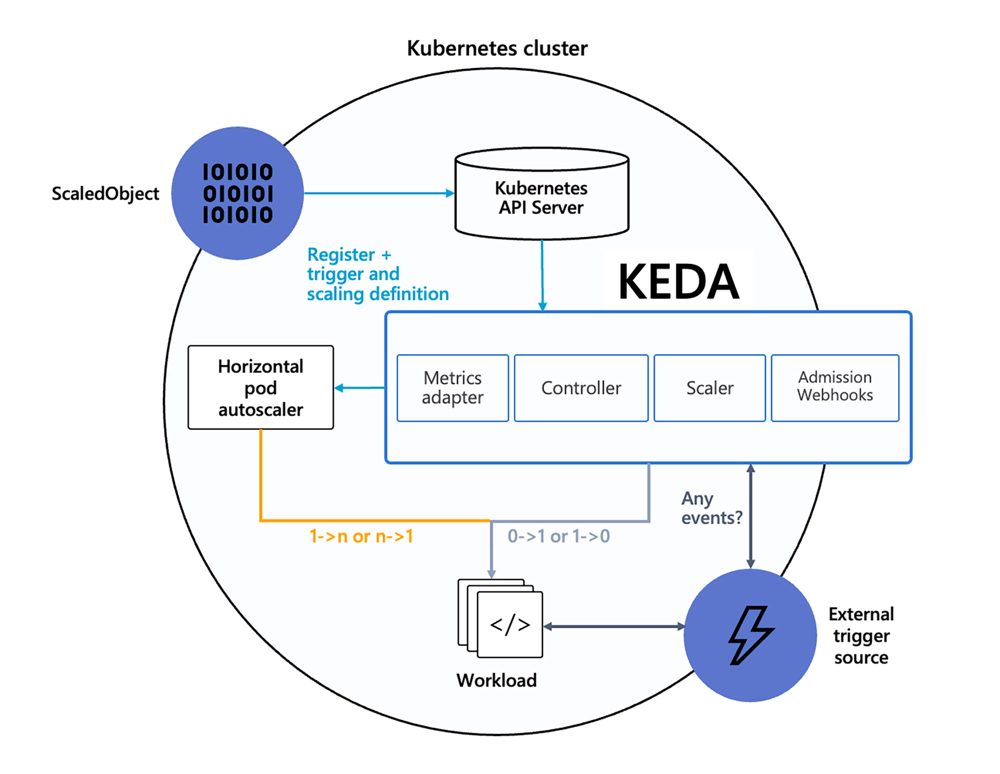
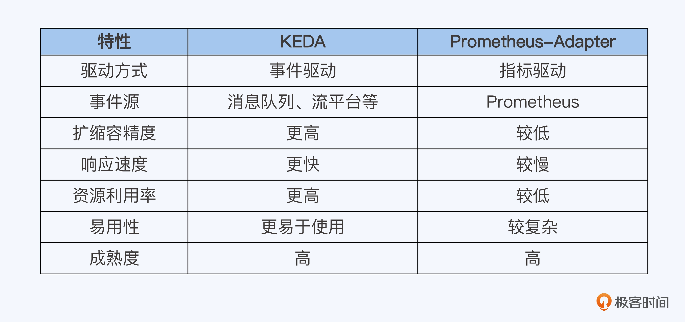

# 13 | KEDA：基于事件驱动的自动扩缩容方案

你好，我是潘野。

上一讲里，我们掌握了如何使用 Kubernetes HPA 这个工具，它配合 Prometheus-Adapter 即可实现应用的水平扩展能力。

不过，其中我们也发现了 Prometheus-Adapter 的一些局限性，例如依赖 Prometheus，大部分情况下不能做到开箱即用，需要应用开发自定义 Prometheus metrics，才能配合 HPA 使用。

那么有没有开箱即用型的工具，也能够配合 HPA 实现水平扩展呢？这就是我们今天要学习的KEDA。

## KEDA 的由来

在 Kubernetes 诞生的时候，第一个专门为 Kubernetes 设计的监控工具，叫 Heapster。Heapster 能够收集 Node 节点上的 cAdvisor 数据，获取 pod 的 CPU、内存、网络和磁盘的指标，它与 Horizontal Pod Autoscaler (HPA) 等工具结合使用，即可实现自动扩缩容。

但是 2016 年 Prometheus 从 CNCF 毕业之后，社区转向支持 Prometheus，停止了对Heapster 的维护。直到 2018 年的 10 月，Prometheus-Adapter 才首次发布，直到 2019 年 4月，Prometheus-Adapter 才支持了 Kubernetes HPA，所以在那段时期，Kubernetes 社区还没有非常成熟的自动扩缩容方案。

在这种背景下，2019 年 11 月微软发布了基于事件驱动型的自动扩缩容工具 KEDA。最值得我们注意的是，与 Prometheus-Adapter 设计方向不同，KEDA 选择是事件驱动方式的扩缩容。

## 事件驱动

我们先理解一下什么是事件驱动。事件驱动是一种编程模型，在这种模型中，程序的执行是由事件驱动的。事件可以是任何事情，例如用户输入、网络请求或计时器超时。当事件发生时，程序会执行相应的事件处理程序。

KEDA 就借鉴了事件驱动模型，根据各种事件源（例如消息队列、流平台等）的事件触发 Pod的扩缩容。这里我举一个场景帮助你们来理解 KEDA 中的事件驱动模型。

很多应用都会用到像 Kafka、RabbitMQ 这样的消息队列中间件。消息队列里一头是生成者，不断地向队列中传递信息；另一头则是消费者，接受队列中的信息。

如果消费者的速度跟不上生产者的速度，消息队列中就会产生积压的消息，当积压的消息数量超过一定阈值，就会产生一个事件，诸如“队列中消息数量超过了 X 值”。这时，KEDA 就会接收到这个事件，并且自动触发扩容消费者的数量，提高消费者的速度，减少队列中的消息积压，这就是 KEDA 基于事件驱动模型的原理。

那么上一讲里，我提到过 Prometheus-Adapter 的不足，比如反应慢半拍或者服务抖动问题。而 KEDA 就从事件驱动角度解决了这些问题，我们一起梳理一下大致的过程。

首先，当应用负载增加时，HPA 会生成一个事件并将其发布到 KEDA 事件队列，KEDAScaledJob 控制器订阅 KEDA 事件队列，并接收 HPA 事件。

接下来，KEDA ScaledJob 控制器根据 HPA 事件中的负载信息，创建一个新的 ScaledJob。ScaledJob 会根据指定的 Pod 模板，创建新的 Pod。当新的 Pod 启动完成后，进入 Ready 状态，开始处理请求。

KEDA 事件驱动架构允许 KEDA 控制器在收到 HPA 事件后立即创建新的 Pod。这让应用能快速响应负载变化，不至于反应慢半拍。此外，KEDA ScaledJob 控制器可以根据负载情况平滑地扩缩容 Pod。这样应用就能避免服务抖动问题，提高其可靠性。

## KEDA 的架构与用法

前面，我提到事件驱动、KEDA ScaledJob 等名词，接下来我们不妨结合官方提供的架构图，了解一下 KEDA 的组成部分和工作原理。



- 图片来源：https://keda.sh/docs/2.13/concepts/

首先我们定义了 ScaledObject，这是 KEDA 的自定义资源定义（CRD），用于定义自动伸缩的规则和目标。它可以用来定义触发器类型（例如 RabbitMQ、Kafka 等）、触发器元数据、最小和最大副本数等参数。

接下来是事件源，也就是图片里右下角蓝色图标 External trigger source 的位置。 KEDA 支持多种事件源，例如 HTTP 请求、消息队列消息、数据库连接等。当事件源产生新的事件时，KEDA 会自动触发自动伸缩。

事件源具体触发的就是自动伸缩 Scaler。Scaler 的作用是接收事件并将其转换为 Kubernetes可以理解的格式，然后根据 ScaledObject 定义的规则决定是否需要进行伸缩。

KEDA 内置了很多种 Scaler，例如基于 Kafka topic 的，也有基于 MySQL 或者 PostgreSQL数据库的。你可以课后查询官方文档了解详细内容。

最后是 Metrics Adapter，Metrics Adapter 是 KEDA 与 Kubernetes HPA（Horizontal PodAutoscaler）之间的桥梁，用于将 Scaler 查询到的事件数量转化为 Kubernetes HPA 可以理解的度量值。

## 配置样例

了解了 KEDA 原理之后，我们还是来看看例子加深理解。官方文档中刚好有一个消息对立RabbitMQ 的样例，我们来看看 KEDA 是如何实现中间件扩缩容的。

我们首先要部署一个 RabbitMQ。注意虽然官方文档中并未提及，但 RabbitMQ 需要配置memory limit。你可以按照下面这个命令安装 RabbitMQ。

```
helm install rabbitmq --set auth.username=user --set auth.password=PASSWORD --set
```

接下来，我们新建一个叫 rabbitmq-consumer 的 Deployment，这里你可以直接参考GitHub 上的代码。

然后，我们来配置 KEDA 的 ScaledObject，对照后面的配置代码，我为你梳理一下重点。

```
apiVersion: keda.sh/v1alpha1
kind: ScaledObject
metadata:
 name: rabbitmq-consumer
 namespace: default
spec:
 scaleTargetRef:
   name: rabbitmq-consumer
 pollingInterval: 5 # Optional. Default: 30 seconds
 cooldownPeriod: 30 # Optional. Default: 300 seconds
 maxReplicaCount: 30 # Optional. Default: 100
 triggers:
   - type: rabbitmq
     metadata:
       queueName: hello
       queueLength: "5"
     authenticationRef:
       name: rabbitmq-consumer-trigger
```

我们从第七行看起，scaleTargetRef 是指我们需要对哪一个 deployment 进行扩缩容。而第十一行的 maxReplicaCount 可以指定这个扩容的最大副本数。之后，我们在 triggers 中配置type 为 “rabbitmq”，并填写相关参数。再来看最后两行代码，authenticationRef 的作用是指定用于认证 ScaledObject 的身份验证凭据，这里就是 RabbitMQ 的用户名、密码和链接地址的信息。

完成配置之后，我们来验证一下效果如何。

我们来运行一个 Kubernetes Job，该 job 的作用是向 RabbitMQ 中填入数据。接下来，我们 get pod 的时候会看到有四个 rabbitmq-consumer 的 pod 启动了，这四个 Pod 是消费者，正在负责接收 RabbitMQ 队列中的数据。

```
>> kubectl get pod
NAME                                 READY   STATUS    RESTARTS   AGE
rabbitmq-0                           1/1     Running   0          7m1s
rabbitmq-consumer-778744fb5d-7s779   1/1     Running   0          19s
rabbitmq-consumer-778744fb5d-9l292   1/1     Running   0          3s
rabbitmq-consumer-778744fb5d-njbnk   1/1     Running   0          3s
rabbitmq-consumer-778744fb5d-q6x7w   1/1     Running   0          3s
```

此时我们可以看到，ScaledObject 已经准备就绪，处在激活的状态。

```
❯❯❯ kubectl get scaledobjects.keda.sh rabbitmq-consumer -oyaml
...
status:
 conditions:
 - message: ScaledObject is defined correctly and is ready for scaling
   reason: ScaledObjectReady
   status: "True"
   type: Ready
 - message: Scaling is performed because triggers are active
   reason: ScalerActive
   status: "True"
   type: Active
```

看完刚刚的例子，估计你也发现了，相比 Prometheus-Adapter 来说，KEDA 的配置过程方便了很多。

## KEDA 的优势

除了配置方便之外，我们来讨论一下 KEDA 都有哪些优势，我认为可以从三个角度去看。

1. 更灵活的扩缩容策略

KEDA 可以根据应用的实际负载进行扩缩容，而不是依赖于 CPU 或内存等资源指标。KEDA还可以根据负载的阶梯变化来扩缩容 Pod。例如，当负载增加 10% 时，KEDA 可以扩容 1 个Pod。当负载增加 20% 时，KEDA 可以再扩容 2 个 Pod。

虽然 Prometheus-Adapter 也可以实现这样的自动扩容方式，但是需要将消息队列的 metrics导入进 Prometheus，需要维护的组件包括 Prometheus、Prometheus-Adapter，消息队列的exporter 等，相对来说对外部组件的依赖较多，维护成本较高。

2. 更快的扩缩容速度

与基于指标驱动的 Prometheus-Adapter 不同，KEDA 无需等待指标收集就能立即响应事件，从而快速扩缩容 Pod，这可以进一步缩短扩缩容的响应时间。而 Prometheus-Adapter 需要等待 Prometheus 定期收集指标数据，然后才能根据指标数据触发 Pod 的扩缩容，这意味着KEDA 可以更快地应对突发负载，避免服务中断。

3. 更高的资源利用率KEDA 利用了 Predictkube 这个 AI-Base 的 Kubernetes 扩容插件。 PredictKube 插件可以使用 Prometheus 历史数据来预测未来的负载，并提前扩容 Pod，以确保应用始终有足够的资源来处理负载，避免资源浪费或不足。

我们结合一个 KEDA 预扩容的示例配置感受一下。在这个示例中，KEDA 将根据过去 7 天的历史数据预测未来 2 小时的负载。如果预测的 http_requests_total 超过 2000 的时候，KEDA将扩容 Pod。

```
triggers:
- type: predictkube
 metadata:
   # Required fields:
   predictHorizon: "2h"
   historyTimeWindow: "7d"
   prometheusAddress: http://<prometheus-host>:9090
   query: sum(irate(http_requests_total{pod=~"example-app-.*"}[2m]))
   queryStep: "2m"
   threshold: '2000'
```

有小伙伴要问了，Prometheus-Adapter 中可以做到预扩容吗？

虽然在 Prometheus-Adapter 中无法直接做到预扩容，但是我们可以使用 Prometheus 的预

```
测规则  predict_linear() 间接实现有限度的预测扩容。
```

我们来看后面这个例子，这里使用了 Prometheus 预测规则。

```
- alert: HighLoad
 expr: predict_linear(my_metric[5m], 10m) > 100
 for: 5m
 labels:
   severity: critical
```

```
在这个示例中， my_metric 指标用于衡量负载。预测规则会计算  my_metric  指标的平均
```

值和变化率。然后，它会使用线性回归预测未来 10 分钟的平均值。如果预测的平均值超过100，则会触发 HighLoad 警报。

```
那么显然 Prometheus 的predict_linear函数与和 KEDA 的预扩容机制相比，还不够完
```

善。

## Prometheus-Adapter 与 KEDA 对比

Prometheus-Adapter 与 KEDA 均可用于将监控数据与 Kubernetes 集成，但侧重点不同。Prometheus-Adapter 基于指标驱动，根据 Prometheus 中的指标触发扩缩。而 KEDA 基于事件驱动，根据各种事件触发扩缩容。

选择 KEDA 还是 Prometheus-Adapter，取决于我们的具体需求。

- 如果你的应用是事件驱动的，则 KEDA 是更好的选择。

- 如果你的应用是指标驱动的，则 Prometheus-Adapter 是更好的选择。

- 如果你需要更精准的扩缩容和更快的响应速度，则 KEDA 是更好的选择。

最后为了方便你直观对比，我用表格梳理了 KEDA 和 Prometheus-Adapter 的主要区别，供你参考。



## 总结

今天这一讲，我们学习了基于事件驱动的自动扩缩容工具 KEDA，了解了 KEDA 的架构，还结合配置案例了解了它的使用方法。

和基于指标驱动的 Prometheus-Adapter 扩缩容方式相比，基于事件驱动的 KEDA 具有以下优势。

- 更灵活：事件驱动可以根据应用程序的具体事件进行扩缩容，而指标驱动只能根据预定义的指标进行扩缩容。

- 更快速：事件驱动可以更快地响应应用程序负载的变化，而指标驱动可能需要一段时间才能收集到足够的指标数据。

- 更准确：事件驱动可以更准确地反映应用程序的实际负载情况，而指标驱动可能受到指标收集频率和准确性的影响。

当然，我们使用 KEDA 也要面对一些挑战，例如需要定义合适的事件类型和事件处理逻辑。但总体而言，KEDA 是一种更为灵活、快速和准确的扩缩容策略。

## 思考题

你觉得 KEDA 在哪些场景下可以发挥最大价值？

欢迎在评论区里给我留言。如果这一讲对你有启发，别忘了分享给身边更多朋友。
