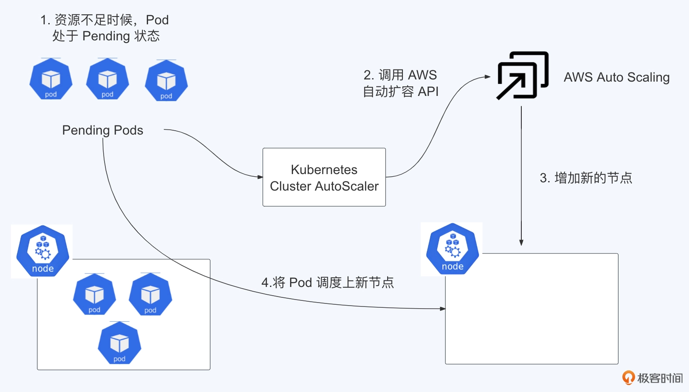
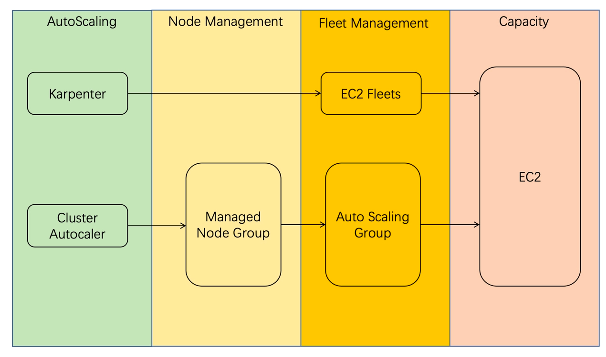
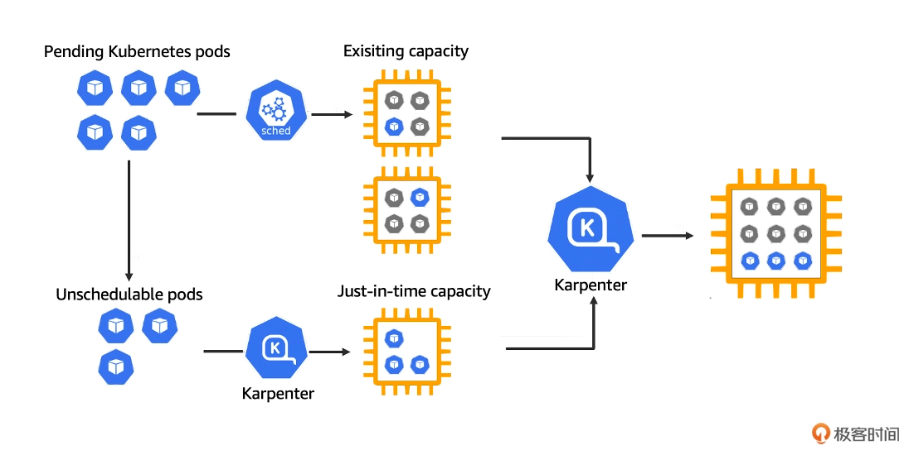
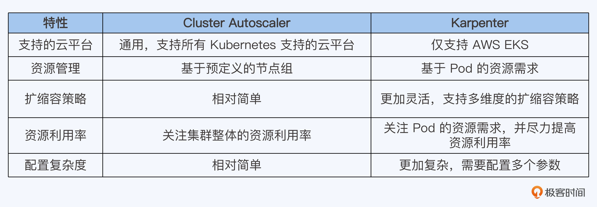

# 14 | ClusterAutoscaler与Karpenter：集群容量扩缩容最佳实践

你好，我是潘野。

我们在第十二讲曾经提到，动态扩缩容有两个层级，一个着眼于应用层级，通过上一讲的学习，我们掌握了如何使用 Prometheus-Adapter 与 KEDA 解决这个层级的问题。

第二个层级是 Kubernetes 集群本身容量的动态扩缩容，也就是根据集群的负载情况自动增加或减少节点数量，以满足应用的需求。

在这个层级的动态扩缩容中，我们可以使用 Kubernetes 官方社区支持的集群自动扩缩容工具Cluster Autoscaler，它能根据 Pod 的资源需求和节点的资源可用情况自动扩缩容集群。

除了 Kubernetes 社区主推的 Cluster Autoscaler 之外，云厂商也推出了自己的集群扩缩容工具来弥补 Cluster Autoscaler 中的一些不足，比如今天课程里将要重点学习的 AWSKarpenter。

## Cluster Autoscaler

Kubernetes 集群伸缩一直是集群管理的重要课题之一，随着容器技术的普及和广泛应用，更需要我们找到高效伸缩集群的方式，来满足不断变化的负载需求。

Cluster Autoscaler 作为 Kubernetes 早期推出的集群伸缩工具，在简化集群管理方面发挥了重要作用。它通过监控集群资源利用率，自动增减节点以满足 Pod 需求，有效降低了运维成本并提高了资源利用率。

然而，随着 Kubernetes 生态系统的不断发展，垂直和水平两个维度的伸缩需求也日益凸显。为了简化运维操作并统一管理伸缩功能，Kubernetes 社区于 2021 年将 Cluster Autoscaler、VPA 和 Addon Resizer 整合为 Kubernetes Autoscaler。

虽然 Kubernetes Autoscaler 整合了三大自动扩缩容能力，但在实际使用场景中，ClusterAutoscaler 作为集群节点自动扩缩容的核心组件，重要性不言而喻。因此，接下来我们重点关注 Kubernetes Autoscaler 中的 Cluster Autoscaler。

## 原理

Cluster Autoscaler 能够定期监控集群中 Pod 的资源需求与节点的资源使用情况，主要应对以下两种情形。

1. 当集群中的 Pod 由于资源不足无法被调度时，Cluster Autoscaler 能够自动进行集群扩容。

2. 若集群中的节点长时间以低利用率运行，并且这些节点上的 Pod 可以迁移到其他现有节点，Cluster Autoscaler 就会通过 Kubernetes 接口把这些 Pod 驱逐其他机器上，并释放这些节点。

Cluster Autoscaler 的原理并不复杂，你可以结合 Kubernetes 集群配合 AWS 自动伸缩（AutoScaling）的工作流程图听我分析。



从图中可以看出，整个扩展过程分为四个步骤：

1. 因为资源不足，Pod 处于等待状态（Pending Pod）。在 Kubernetes 中，Pod 是最小的部署单元，这里显示的是因为节点（Node）上的资源不够，所以新的 Pod 无法启动，处于等待状态。

2. 增加 Auto Scaling Group 中的所需实例数量（Increase desired number of instances in oneAuto Scaling Group）。这是在 AWS 的自动伸缩服务中进行的，用来响应资源不足的情况，提出要增加更多的实例。

3. 自动伸缩服务将创建新的节点（Provision new node）。在 AWS 中，根据预先设定的自动伸缩策略，会自动启动新的计算实例来扩展集群。

4. 调度 Pod 到新节点上（Schedule pod）。最后，Kubernetes 的调度器会将等待中的 Pod 调度到新加入的节点上，这样 Pod 就可以被成功部署并运行了。

整个流程是一个自动化的扩容机制，当 Kubernetes 集群中的资源不足时，可以自动利用云服务提供的自动伸缩功能来增加计算资源，这能保证集群的应用顺利运行。

那么在步骤 1 和步骤 2 之间，Cluster Autoscaler 会定期（默认间隔 10 秒）检测是否有足够的资源来调度新创建的 Pod。如果资源不足，Cluster Autoscaler 会调用云提供商 API 创建新的节点。现在 Cluster Autoscaler 支持非常多的公有云 API，具体支持情况你可以从这里查找。

Cluster Autoscaler 不仅可以做扩容，也可以做缩容，Cluster Autoscaler 会定期（默认间隔 10秒）自动监测节点的资源使用情况。如果一个节点长时间（超过 10 分钟，其期间没有执行任何的扩缩容操作）资源利用率都很低（低于 50%），Cluster Autoscaler 会自动将其所在虚拟机从云服务商中删除。

我们都知道扩容容易，缩容难。这里估计会有同学要问了，缩容的时候会不会造成应用程序不稳定呢?

想要解答这个问题，我们需要了解 Cluster Autoscaler 缩容时的步骤。

首先，确定需要缩容哪些节点，从历史的数据中找到资源利用率低于 50% 的机器。

然后，准备将机器上的工作负载通过 kubectl drain 的方式来驱逐到其他的机器上。同时，Cluster Autoscaler 会查询当前节点上的 pod 是不是受到 Kubernetes PDB 控制，并计算出哪些节点可以被删除。

最后，通过云服务商 API 删除这些节点。

了解了这些我们就可以回答前面问题了，缩容的确可能对应用程序的稳定性产生一定影响。当Cluster Autoscaler 决定缩减节点数量时，运行在被缩减节点上的 Pod 会被驱逐。如果这些Pod 没有适当地终止宽限期或 PreStop 钩子，可能会导致应用程序的连接被突然中断，进而影响服务的稳定性。

不过，Kubernetes 为我们提供了一些机制来缓解这个问题，你可以通过这么几种方式来保证应用的稳定性。

1. 通过设置 PodDisruptionBudget 来控制同一时间被驱逐的 Pod 数量上限。

2. 为 Pod 设置合理的终止宽限期，让应用有足够时间优雅退出。

3. 在 Pod 中配置 PreStop 钩子，让应用在被终止前，执行一些清理操作。

4. 为关键应用设置较高的 PriorityClass，降低它们被驱逐的优先级。

因此，虽然缩容可能会对应用造成一定影响，但只要我们合理配置 Kubernetes 的各项机制，就能最大程度降低这种影响，保证应用的平稳运行。为了实现这一目标，接下来我们将详细了解如何在 AWS 上配置 Cluster Autoscaler。通过这个配置帮我们优化资源管理，提高系统的整体效率。

### 配置

在 AWS 上配置 Cluster Autoscaler 过程相对来说比较简单。

首先，我们来创建 IAM Policy，在 IAM role 中粘贴下面的内容。

```json
{
 "Version": "2012-10-17",
 "Statement": [
   {
     "Effect": "Allow",
     "Action": [
       "autoscaling:DescribeAutoScalingGroups",
       "autoscaling:DescribeAutoScalingInstances",
       "autoscaling:DescribeLaunchConfigurations",
       "autoscaling:DescribeScalingActivities",
       "autoscaling:DescribeTags",
       "ec2:DescribeInstanceTypes",
       "ec2:DescribeLaunchTemplateVersions"
     ],
     "Resource": ["*"]
   },
   {
     "Effect": "Allow",
     "Action": [
       "autoscaling:SetDesiredCapacity",
       "autoscaling:TerminateInstanceInAutoScalingGroup",
       "ec2:DescribeImages",
       "ec2:GetInstanceTypesFromInstanceRequirements",
       "eks:DescribeNodegroup"
     ],
     "Resource": ["*"]
   }
 ]
}
```

接下来，我们直接安装 controller。

```bash
kubectl create -f https://raw.githubusercontent.com/kubernetes/autoscaler/master/
```

安装完成之后，在 kube-system 中，我们可以找到这个 pod。

```
kube-system   cluster-autoscaler-5cf5949bdf-ft8nq   0/1     Error     2 (18s ago)
```

通过查看日志发现，我们为第一步设置的 policy 权限还不够。

```
F0228 19:54:42.862427       1 aws_cloud_provider.go:419] Failed to create AWS Man
```

当我们赋予足够的权限之后，pod 就会进入 running 状态，接下来我们进行一个测试。

我在集群里部署了一个 nginx 的 deployment，此刻我将这个 deployment 的副本数调整到50。

```
~ ❯❯❯ kubectl scale deploy nginx-deployment --replicas=50
deployment.apps/nginx-deployment scaled
```

```
此时我们关注下 Cluster-autoscaler pod 的日志，首先提示 Pod nginx-deployment-
7wj5d 无法调度上。无法调度上的原因很多，这里是资源足够，但是 Pod 不符合机器的要
```

求。

```
I0418 19:43:12.191057       1 scale_up.go:299] Pod nginx-deployment-7wj5d can't b
```

接下来，Cluster-autoscaler 触发扩容，调用 AWS 的 Auto Scaling Group 中 eks-cloudnative-generic202402021083043402700000021 这个组，这个组现在有 25 个节点，扩容到 29 个节点，这个扩容组最大可以扩到 80 个节点

```
I0418 19:43:12.614829       1 event_sink_logging_wrapper.go:48] Event(v1.ObjectRe
```

最终我们会看到节点准备完毕，加入集群。此时 Pending 的 Pod 就会被调度上去。

```
ip-10-96-123-123.cn-north-1.compute.internal   Ready    <none>   3m55s   v1.25.16
```

### 使用建议

刚刚我们动手体验了 Cluster Autoscaler 的用法，它这种动态的扩缩容能力，既满足了系统在高峰期更多资源的需要，也能帮助我们在低峰期间尽可能少占用资源，降低支出成本。

虽然看起来很完美，但是现实情况是，如果使用不当，很可能造成生产事故，这里我分享一个我遇到的真实案例。

某个核心应用组的一位同学对基础设施不是很了解，他在集群里启动了三个 redis-cluster，但是发现这三个 redis-cluster 经常崩溃，导致线上服务经常不可用。最后排查下来才发现，这位同学在 Kubernetes Statefulset 的配置中为每个 redis pod 申请了 8 核 CPU、200G 的内存。

因为 pod 的内存很大，导致 Cluster Autoscaler 在扩容时只能选择非常大的 EC2 实例。而运行一段时间之后，Cluster Autoscaler 发现机器的 CPU 和内存实际使用率低于 50%，于是便开始回收这些机器。

但是机器回收之后，pod 被 Kubernetes 重新带起来。正因为这个反复扩缩容的过程，才影响了 redis-cluster 的稳定性。

那么从这个案例里，我们能总结出这样几个关键的使用建议。

首先，确保团队对他们所用的技术足够了解。不论是开发团队还是运维团队，大家都得熟悉Kubernetes、Statefulsets、Cluster Autoscaler 这些技术的基本原理和最佳实践。

接着，关于配置资源，我们得根据实际的需要来配置。比如配置 pod，如果配置过头了，不仅浪费资源，还可能引起扩缩容的问题，这样应用的稳定性就会受影响。

再来说说扩缩容策略，我们需要优化 Cluster Autoscaler 的设置，确保它的扩缩容操作不会扰乱服务的稳定性。这可能意味着我们要调整一下回收策略，或者延长一下评估周期，避免因为频繁调整规模而让服务变得不稳定。

最后，别忘了定期监控一下应用和基础设施的表现。这一点也很重要，通过监控数据，我们可以判断资源配置是否合理，确保资源利用得当，同时避免因为资源配置过度而带来的问题。

通过这些步骤，我们可以避免很多麻烦，让系统运行得更加平稳高效。

### 局限性

除了这个案例，我们还得了解一下 Cluster Autoscaler 的一些局限性。

首先，它可能会有点慢。有时候 Cluster Autoscaler 需要一段时间才能察觉到 Pod 的资源需求有变化，然后才开始进行扩缩容操作。

其次，如果我们配置不得当，Cluster Autoscaler 可能会导致资源浪费。这是因为它可能会过度地扩展资源，特别是在不需要那么多资源的时候。

还有一个点是，Cluster Autoscaler 很依赖云服务商提供的功能，比如 AWS 的启动模板和自动扩展组。这就意味着，如果我们想要一些更加个性化的调度功能，Cluster Autoscaler 可能就不能满足需求了。

所以，虽然 Cluster Autoscaler 是个强大的工具，但我们使用的时候还是要考虑到这些局限。

## 下一代自动扩缩容工具 Karpenter

为了解决我们刚刚说的 Cluster Autoscaler 的局限，AWS 自行开发了新一代的自动扩缩容组件，即 2021 年推出的 Karpenter。

Karpenter 最初只支持 AWS 的服务，但经过一段时间的实践验证后，AWS 决定将 Karpenter的开发转交给 Kubernetes 社区。

我们可以在 kubernetes-sig 这里看到 Karpenter 的代码以及开发进度，AWS 目标是将Karpenter 开发成下一代的集群扩缩容标准组件。

## 优势

那它都有什么优势呢？

Karpenter 有三大优势。首先，Karpenter 更灵活。下面这张图对比了 Karpenter 与现有的Cluster Autoscaler 运行机制，结合图片理解更为直观。



不难发现，和 Cluster Autoscaler 相比，Karpenter 不再使用 node group 来管理集群的 EC2资源，而是直接调用 EC2 的接口获取资源。这种方式速度更快，灵活性更高。

第二个优势就是使用更简单。

Cluster Autoscaler 需要去配置 Launch template 和 Auto Scaling group，并且整个配置过程需要在 Terraform 或者 UI 上完成，这导致节点的管理与 Kubernetes 集群容量管理分离，给我们带来额外的运维工作。

而 Karpenter 因为是一个 Kubernetes 原生的 Controller，整个配置和管理过程都在Kubernetes 中，维护配置就会更加方便。

第三个优势就是更高的资源利用率。

Karpenter 采用了 First Fit Descending 算法，它将 pod 按照从大到小排序，先将最大的 pod去适配实例，如果不行就再换小一些的 pod。这个过程里，尝试的实例越来越小，直到将最小的 pod 找到合适的实例。这样做的好处是，大的 pod 经常会在实例上留下一些间隙，可以让后面的小 pod 填入，可以更有效地利用资源。

Karpenter 的工作原理

Karpenter 优势这么多，它又是如何工作的呢？我们这就来看看。

下图是 Karpenter 的工作流程。



简单来说 Karpenter 会监控集群中 Pod 的资源需求，一旦发现有不可调度的 pod，Karpenter就会使用预先定义的模板创建新的节点，向底层 cloud providers 发送命令开始自动配置新节点，以响应不可调度的 pod。这些预先定义的模板可以根据不同的应用需求进行定制，比如说，我们可以指定节点的 CPU、内存、存储等资源规格。

Karpenter 仍在不断发展中，未来的版本将提供更多功能和改进。比如支持更多主流云平台，例如阿里云、腾讯云等；提供更智能的扩缩容策略，更好地满足用户的需求；提供更强大的管理功能，让用户可以更好地控制和管理节点。

## 配置 Karpenter

接下来我们进入实战环节，动手配置一下，加深对 Karpenter 的理解。

第一步是配置 AWS VPC subnet tag。

```
Karpenter 发现子网需要有指定 tag：kubernetes.io/cluster/$CLUSTER_NAME  ，我
```

们将此 tag 添加到为集群配置的关联子网。

```
>>> SUBNET_IDS=$(aws cloudformation describe-stacks \
   --stack-name eksctl-${CLUSTER_NAME}-cluster \
   --query 'Stacks[].Outputs[?OutputKey==`SubnetsPrivate`].OutputValue' \
   --output text)
>>> aws ec2 create-tags \
   --resources $(echo $SUBNET_IDS | tr ',' '\n') \
   --tags Key="kubernetes.io/cluster/${CLUSTER_NAME}",Value=
```

第二步，在 IAM 中创建权限，让 Kapenter 得到调用 EC2 的 API 权限。

```bash
TEMPOUT=$(mktemp)
curl -fsSL https://karpenter.sh/docs/getting-started/cloudformation.yaml > $TEMPO
&& aws cloudformation deploy \
 --stack-name Karpenter-${CLUSTER_NAME} \
 --template-file ${TEMPOUT} \
 --capabilities CAPABILITY_NAMED_IAM \
 --parameter-overrides ClusterName=${CLUSTER_NAME}
```

接下来是第三步，安装 Kapenter。

```sql
helm repo add karpenter https://charts.karpenter.sh
helm repo update
helm upgrade --install karpenter karpenter/karpenter --namespace karpenter \
 --create-namespace --set serviceAccount.create=false --version 0.4.1 \
 --wait # for the defaulting webhook to install before creating a Provisioner
```

安装过程中，我们需要不断检查 Kapenter 的 log，看看配置是否正确。

```bash
kubectl logs -n karpenter ${karpenter pod}
```

能够看到后面这样的日志，那 Kapenter 的安装基本上就没有问题了。

```json
{"level":"DEBUG","time":"2024-04-18T20:05:55.865Z","logger":"controller.awsnodete
{"level":"DEBUG","time":"2024-04-18T20:05:55.876Z","logger":"controller.awsnodete
{"level":"DEBUG","time":"2024-04-18T20:05:55.925Z","logger":"controller.awsnodete
```

之后进行第五步，配置 Kapenter 的模版。这个模版就是 Kapenter 预先定义的模板，作用是让 Kaptenter 知道启动什么样的机器、多大内存、多少 CPU。

```bash
cat <<EOF | kubectl apply -f -
apiVersion: karpenter.sh/v1alpha5
kind: Provisioner
metadata:
 name: default
spec:
 requirements:
   - key: node.k8s.aws/capacity-type
     operator: In
     values: ["spot"]
 provider:
   instanceProfile: KarpenterNodeInstanceProfile-${CLUSTER_NAME}
   cluster:
     name: ${CLUSTER_NAME}
     endpoint: $(aws eks describe-cluster --name ${CLUSTER_NAME} --query "cluste
 ttlSecondsAfterEmpty: 30
EOF
```

接下来，我们做和 Cluster Autoscaler 一样的测试。我们还是将这个 deployment 的副本数调整到 50。

```
此时我们可以一边观察 Kapenter 的日志，一边用 kubectl get machine 命令，来查看新
```

生成机器的状态。例如下面这台新建机器，就是由 Kapenter 在 2 分钟内完成的。

```
~ ❯❯❯ kubectl get machine default-cqq8l
default-cqq8l   t3a.large     cn-north-1a   ip-10-96-224-116.cn-north-1.compute.i
```

此时你可能发现它在集群中还处在 Not Ready 的状态，稍等十多秒之后，机器会完成自动化配置，进入 Ready 状态，此时 Pod 就可以被调度上去了。

```
ip-10-96-224-116.cn-north-1.compute.internal   NotReady   <none>   3s      v1.25.
```

## 总结

今天我们学习了两种不同的 Kubernetes 动态扩缩容的工具，它们各有千秋，适合不同的场景。

我把这两个工具的特点做成了一张表格，供你对比参考。



在实际工作中，我们该怎么选用这两个工具呢？我给你几个建议。

- 如果你想要一个简单好用的工具，而且你的工作负载对资源的要求不是特别高，那么Cluster Autoscaler 就挺合适的。

- 如果你在用 AWS 平台，那么 Karpenter 可能是更合适的选择。它的伸缩速度快，而且能更精确地监控资源利用率。

- 如果你需要更精细的控制，想要优化资源利用和控制成本，Karpenter 会是更好的选择。

- 如果你的应用工作负载有严格的资源需求或者特别的调度要求，Karpenter 可能更适合你。

总之，选择哪一个工具，主要还是看你的具体需求和使用场景。

## 思考题

请你尝试自己完成 Cluster Autoscaler 和 Karpenter 的配置。

欢迎在评论区与我讨论。如果这一讲对你有启发，也欢迎分享给身边更多朋友。
