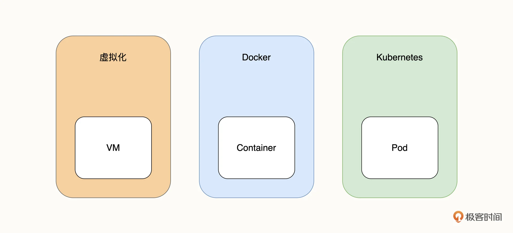
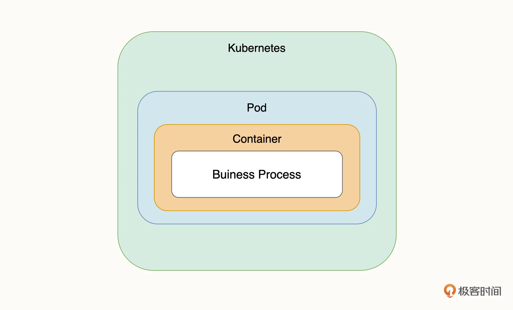

# 02-如何将容器镜像部署到K8s？

你好，我是王炜。

上节课，我们学习了容器镜像的概念以及如何将业务构建成容器镜像。容器镜像是我们学习云原生的起点，同时也会贯穿在云原生的各个环节之中，希望你能多花点时间巩固。这节课，我们一起来看看如何将容器镜像部署到 K8s。

K8s 的系统设计非常复杂，这导致它的学习曲线非常陡峭。尤其是对于刚入门的同学而言，面对繁杂的概念时往往会不知所措，也无从下手。再加上学习过程缺乏实战性的反馈，很容易导致“从入门到放弃”的情况出现。

所以这节课，我打算摒弃概念先行的教学方法，从实战的角度出发，带你从零入门 K8s。

我会继续延伸上一节课程的内容，带你把之前构建的容器镜像部署到 K8s 集群中。在实战的过程中，我也会讲解 K8s 的一些基本概念。

在开始实践之前，你需要做好以下准备：

- 准备一台电脑（首选 Linux 或 macOS，Windows 也适用，需要稍微注意一下操作上的差异）；

- 安装 Docker；

- 安装 Kubectl。

## 安装 Kubernetes

如何获得一个 K8s 集群是每一个开发者需要熟练掌握的内容。

安装 K8s 的方法非常多，有生产级的安装方法，也有以测试为目标的安装方法。为了方便测试，这里我推荐一种在本地安装 K8s 集群的办法：Kind。

首先，你需要根据官方步骤安装 Kind，它是一个命令行工具，使用非常简单。

接下来，我们开始创建 K8s。

将以下内容保存为 config.yaml：

```
kind: Cluster
apiVersion: kind.x-k8s.io/v1alpha4
nodes:
- role: control-plane
 kubeadmConfigPatches:
 - |
   kind: InitConfiguration
   nodeRegistration:
     kubeletExtraArgs:
       node-labels: "ingress-ready=true"
 extraPortMappings:
 - containerPort: 80
   hostPort: 80
   protocol: TCP
 - containerPort: 443
   hostPort: 443
   protocol: TCP
```

执行 kind create 命令，创建 K8s 集群：

```bash
❯ kind create cluster --config config.yaml
Creating cluster "kind" ...
✓ Ensuring node image (kindest/node:v1.23.4)
✓ Preparing nodes 📦
✓ Writing configuration 📜
✓ Starting control-plane 🕹️
✓ Installing CNI 🔌
✓ Installing StorageClass 💾
Set kubectl context to "kind-kind"
You can now use your cluster with:
kubectl cluster-info --context kind-kind
```

通过这两个简单的步骤，我们的本地 K8s 集群就创建好了。

## 初识 Kubernetes

K8s 的概念既多又复杂，如果像教科书一样把这些概念一条一条给你讲出来，最后你可能也记不住。所以，我也不打算这么做。

我想先问你一个问题：Docker 已经挺好用了，我们为什么还需要 K8s 呢？你可以试着用 30秒来思考一下。

我用一个场景来给你解释一下。还记得我们在上节课提到的启动一个容器的方法吗？这条命令非常简单，只需要运行 docker run 就可以了。

但是试想一下，如果你需要同时启动 10 个不同的容器镜像，是不是需要运行 10 次 dockerrun 命令呢？此外，如果容器之间有依赖顺序，你是不是还需要额外记住这 10 条命令特定的启动顺序？

K8s 的独特之处在于，它为我们抽象了诸如“启动 10 个容器镜像”这样的过程式的命令，你只需要向 K8s 描述“我需要 10 个容器”。10 个容器是我期望的最终状态，我不管怎么执行命令，执行了多少次命令等过程，我想要的就是这个结果。

用来向 K8s 描述“期望最终状态”的文件，就叫做 K8s Manifest，也可以称之为清单文件。Manifest 就好比餐厅的菜单，你只管点菜，做菜的过程我不管。

到这里，我们引出了第一个概念：Manifest。简单地说，它是用来描述如何将容器镜像部署到集群中的。Manifest 的概念非常重要，它会贯穿整个 K8s 的生态系统，所以请你务必要理解。

现在，假设我们有了一个 Manifest，我要如何告诉 K8s 呢？换句话说，我们怎么和 K8s 交流？这时候我们需要引入一个工具：Kubectl。

Kubectl 是一个与 K8s 集群交互的工具，通过 Kubectl，我们可以非常方便地以 Manifest 为媒介操作 K8s 集群的对象。就像操作数据库一样，我们可以对 Manifest 所描述的对象进行创建、删除、修改、查找等操作。

接下来，我们从编写 Manifest 开始，看看怎么将上节课制作的容器镜像部署到 K8s 集群中。

### 部署容器镜像到 K8s

要将容器镜像部署到 K8s 集群中，我们首先需要书写 Manifest。我们需要将下面的内容保存为 flask-pod.yaml：

```
apiVersion: v1
kind: Pod
metadata:
 name: hello-world-flask
spec:
 containers:
   - name: flask
     image: lyzhang1999/hello-world-flask:latest
     ports:
       - containerPort: 5000
```

接下来，我们通过 kubectl apply 应用这段 Manifest：

```
$ kubectl apply -f flask-pod.yaml
pod/hello-world-flask created
```

需要注意的是，当使用 Kind 创建集群后，它会自动配置 Kubectl 和 Kind 集群的连接。如果连接配置不正确，你可以执行 kind export kubeconfig 来切换集群连接的上下文。

如果成功看到输出内容 pod/hello-world-flask created，说明我们已经把这段 Manifest 提交到集群里了。参数 -f 表示“指定一个 Manifest 文件”。

也就是说，当我们想要向 K8s 提交 Manifest 的时候，只需要记住一条命令，那就是 kubectlapply。

我们对上面的 Manifest 做一些必要的解释。其实这里只需要聚焦四个字段，分别是 Kind、Containers、Image、Ports。

Kind 字段表示 K8s 的工作负载类型。在 K8s 中，我们不能像 Docker 一样直接运行一个容器镜像，镜像需要依赖于 K8s 更上层的封装方式运行，这种封装方式也就是工作负载，Pod 是工作负载的一种类型。

每个工作负载有自己的名字，也就是 Metadata 节点下的 Name 字段。

为了更好地帮助你理解，我们可以把 Pod 类比成虚拟化技术中的 VM ，或者是 Docker 技术的容器，它们都是一种调度对象，如下图所示：



在实际的项目中，我们一般不会直接创建 Pod 类型的工作负载，而是会通过其它的工作负载间接创建它们。如果你现在还不能理解 Pod 的概念也没关系，只需要记住它是 K8s 调度的最小单位就可以了。

Containers 字段代表 Pod 要运行的容器配置，例如名称、镜像和端口等。细心的你会注意到，它是一个数组类型，这意味着我们可以在一个 Pod 里面配置多个容器。

Image 字段表示容器镜像。显然，这里我们希望启动的是上节课制作的镜像，也就是lyzhang1999/hello-world-flask。需要注意将这里的 lyzhang1999 替换为你自己的 docker hub账户 ID。

Ports 字段表示容器要暴露的端口。它有点像我们在上节课提到的启动镜像时暴露的容器端口，也就是 docker run 的 p 参数。很显然我们希望暴露 5000 端口，也就是业务进程的监听端口。

接下来，我们继续回到实战环节。

当我们把 Manifest 部署到 K8s 集群之后，会面临两个问题：

1. 如何查看刚才提交的 Pod？

2. 如何访问 Pod？

### 查看和访问 Pod

先看第一个问题。要查看 K8s 集群正在运行中的 Pod，你可以使用 kubectl get pods ：

```
$ kubectl get pods
NAME                READY   STATUS    RESTARTS   AGE
hello-world-flask   1/1     Running   0          1m
```

可以看到，结果中返回了刚才部署名为 hello-world-flask 的 Pod，状态为“运行中”。还记得上节课我们提到怎么查看运行中容器的命令吗？是不是非常类似？

接下来我们尝试访问 Pod。要在本地访问集群内的 Pod，我们可以使用 kubectl port-forward命令进行端口转发操作，打通容器和本地网络：

```
$ kubectl port-forward pod/hello-world-flask 8000:5000
Forwarding from 127.0.0.1:8000 -> 5000
Forwarding from [::1]:8000 -> 5000
```

你可能会问，既然已经在 Manifest 里定义了 Ports 参数，为什么还需要进行端口转发操作呢？那是因为 Ports 参数只定义了 Pod 在集群内部暴露的端口，这个端口可以在集群内部进行访问。但我们本地和集群的网络是隔离的，自然不能在集群外部，也就是本地电脑访问Pod。

执行 kubectl port-forward 之后，我们打开浏览器访问 127.0.0.1:8000 就可以看到输出了：

```
Hello, my first docker images! hello-world-flask
```

需要注意的是，端口转发的进程是在前台运行的，你可以使用 ctrl+c 终止转发进程。

除了访问 Pod 以外，上节课我们还提到可以用 docker exec 进入运行中的容器。同样，我们也可以进入到 Pod 运行中的容器内。

你可以使用 kubectl exec 进入到 Pod 容器内部：

```
$ kubectl exec -it hello-world-flask -- bash
root@hello-world-flask:/app#
```

可以看到，这里的 -it 参数和 docker exec 的参数是完全一致的。在进入容器后，你可以试着像第一节课那样，修改 app.py 的输出，保存后刷新浏览器，观察一下是不是也能立即看到修改结果呢？

最后，我们可以通过 kubectl delete 命令来删除 Pod：

```sql
$ kubectl delete pod hello-world-flask
pod "hello-world-flask" deleted
```

到这里，我们就完成了将容器镜像部署到 K8s，还有查看、访问和删除 Pod 这一系列操作。

### 业务进程、容器镜像和工作负载之间的关系

通过上面的实战，我们将一个容器镜像以工作负载的方式部署到了 K8s 集群中。那么如果再往前追溯到业务层面，业务进程、容器镜像和工作负载之间的关系又是怎么样的呢？

当我初次接触 K8s 的时候，我对业务进程、容器镜像和工作负载层层封装，以及他们相互之间的关系感到非常疑惑。或许你也有同样的疑问，我为你总结了一张图，可以帮助你梳理一下它们之间的关系。



通过这张图可以看出，最内层是我们的业务应用进程，外层通过 Docker 镜像以容器化的形式运行，再往外是 K8s 的最小调度单位 Pod。

## 总结

这节课，我们通过 Kind 在本地创建了一个 K8s 集群。同时，在将容器镜像部署到 K8s 集群的过程中，我还给你介绍了 Manifest 以及 K8s 的最小调度单位 Pod 的概念。

此外，我们还介绍了与 K8s 集群交互的工具 Kubectl 及其简单操作，例如向集群提交Manifest、端口转发、查看、进入以及删除 Pod 等。

最后，我们还梳理了业务进程、镜像、容器和 Pod 之间的关系，理解它们将有助于你未来学习 K8s 的其他复杂概念。

到这里，你可能会问：学习了这么多概念，也花了这么多努力把容器镜像部署到了 K8s 集群，可是为什么还没看到 K8s 究竟能给我们带来什么实际的好处呢？

别着急，下节课，我会带你直观地感受 K8s 的魅力和强大之处：自动扩容和自愈。

## 思考题

最后，给你留两道思考题吧。

1. Kind 的全称是 Kubernetes in Docker，它的设计理念非常有意思。请你结合相关资料，说一说你对它的理解。

2. 请你尝试为 hello-world-flask Pod 增加第二个容器，镜像为 nginx，端口为 80，并通过端口转发访问 Nginx Pod。

欢迎你给我留言交流讨论，你也可以把这节课分享给更多的朋友。我们下节课见。
